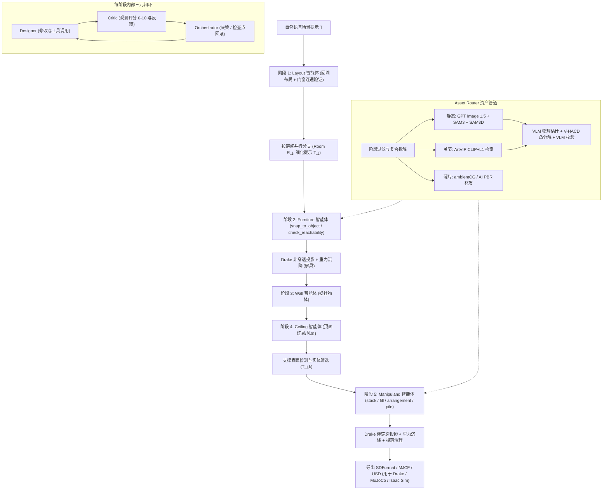
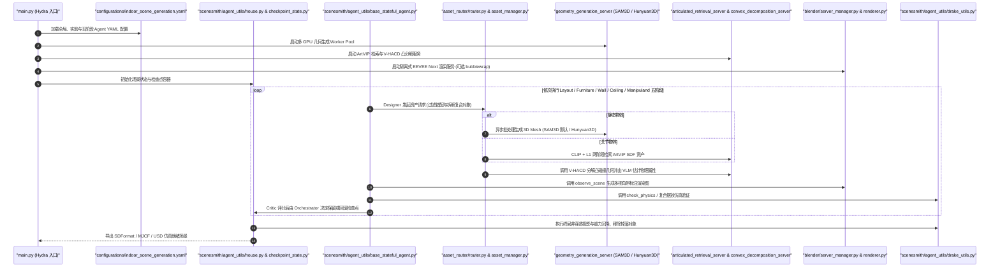

# SceneSmith: Agentic Generation of Simulation-Ready Indoor Scenes

## 一句话定义

SceneSmith 是 MIT 与丰田研究院（TRI）提出的分层多智能体室内场景生成框架：它以自然语言为输入，经由“布局 → 家具 → 墙面 → 天花板 → 可操作小物”五阶段 Designer–Critic–Orchestrator 协作生成高密度、含关节家具且带物理属性与碰撞几何的仿真就绪环境，无需人工修补即可在 Drake、MuJoCo、Isaac Sim 等仿真器中运行并用于机器人策略自动评测。

## 英文缩写速查

| 缩写 | 英文全称 | 简要说明 |
|---|---|---|
| VLM | Vision-Language Model | 视觉语言模型，承担 SceneSmith 各阶段 Designer/Critic/Orchestrator、资产路由与物理参数估计 |
| V-HACD | Volumetric Hierarchical Approximate Convex Decomposition | 体积分层近似凸分解，用于将视觉网格拆分为仿真器可用的凸碰撞几何体 |
| PBR | Physically Based Rendering | 基于物理的渲染材质（含颜色、法线、粗糙度等通道），用于墙面、地面与薄覆盖物外观 |
| SDF / SDFormat | Simulation Description Format | 机器人仿真场景描述格式，SceneSmith 的原生场景表示并与 Drake 模型指令兼容 |
| TOPP | Time-Optimal Path Parameterization | 时间最优路径参数化，示例评测策略中用于保证轨迹满足机器人速度、加速度与力矩限制 |
| RRT-Connect | Rapidly-exploring Random Tree Connect | 双向快速扩展随机树规划器，示例评测策略中用于生成无碰撞末端与全身运动段 |

## 为什么重要

1. **填补“高密度可交互物理场景”的仿真供给缺口**：传统程序化或 LLM 室内场景生成方法（如 ProcTHOR、Holodeck、HSM、SceneWeaver、LayoutVLM）平均每个房间仅生成约 11–23 个物体，且普遍缺乏碰撞几何、动力学参数与可活动关节，难以支撑家庭机器人在杂乱环境（clutter）下的精细操作训练与评测。
2. **开集资产按需生成 + 可分离组合**：通过将 GPT Image 1.5、SAM3 与 SAM3D 融入资产路由器，SceneSmith 不受固定资产库词汇限制，并能把“果盘”“带显示器的书桌”拆解为独立可抓取对象，减少外部真实机器人策略在评测时遇到训练集资产污染的风险。
3. **打通从任务描述到策略自动判定的完整仿真闭环**：不仅生成可直接在 Drake 中用 RB-Y1 遥操作或运行预训练策略的场景，还展示了“任务 Prompt 扩展 → 多样化场景生成 → 策略执行 → Agentic Evaluator 工具验证”的端到端自动评测流水线，使大规模免手工标注的机器人策略评测成为可能。

## 核心信息

| 字段 | 内容 |
|---|---|
| 作者 | Nicholas Pfaff, Thomas Cohn, Sergey Zakharov, Rick Cory, Russ Tedrake |
| 机构 | Massachusetts Institute of Technology (MIT), Toyota Research Institute (TRI) |
| 发表与版本 | arXiv:2602.09153v2（2026-05-30 修订，v1 提交于 2026-02-09）；ICML 2026 Spotlight（Top 2.2%） |
| 论文链接 | [arXiv:2602.09153](https://arxiv.org/abs/2602.09153)（HTML 全文：[arXiv HTML](https://arxiv.org/html/2602.09153)） |
| 项目与代码 | [项目主页](https://scenesmith.github.io/) · [GitHub（nepfaff/scenesmith）](https://github.com/nepfaff/scenesmith) · [HuggingFace 数据集](https://huggingface.co/datasets/nepfaff/scenesmith-preprocessed-data) |
| 清单分类 | `environment.reconstruction` |
| 来源条目 | `survey_ax_2602_09153` |
| 开源状态 | **已开源**（MIT License，含五阶段智能体、多 GPU 资产生成/检索/V-HACD/Blender 服务端与 Docker 配置；预处理 ArtVIP 数据集已公开托管，默认后端需自行申请 SAM3/SAM3D 权重及配置 `OPENAI_API_KEY`） |

## 核心原理

### 1. 分层场景表示与五阶段树状构造
SceneSmith 将多房间环境形式化为 $\mathcal{S} = \{\mathcal{R}_j \mid j \in \{1,\dots,M\}\}$，其中每个房间 $\mathcal{R}_j = (\mathcal{G}_j, \mathcal{O}_j)$ 由有限厚度的体素级建筑几何 $\mathcal{G}_j$（墙体、地板、门、窗、开放连接）与物体集合 $\mathcal{O}_j = \{(\mathcal{A}_i, \mathcal{X}_i)\}$ 组成。每个仿真资产 $\mathcal{A}_i$ 包含视觉网格、凸碰撞几何、估计的物理参数（质量、质心、惯量、摩擦）与关节定义，$\mathcal{X}_i \in SE(3)$ 为全局位姿。

构造流程呈两级分支树状结构，并伴随**层次化 Prompt 细化**（$\mathcal{T} \to \mathcal{T}_j \to \mathcal{T}_{j,k}$）：
- **根阶段（Layout）**：解析全局提示 $\mathcal{T}$，利用 `generate_room_specs` 确定房间数 $M$、尺寸、邻接关系与门窗材质。房间排布采用带房间排序（锚点房间优先、按面积降序）与边贴合 11 点采样的 Best-First 回溯搜索，局部评分结合邻接奖励与质心紧凑惩罚，全局目标优化面积紧凑度 $S_{\text{compact}} = A_{\text{rooms}} / A_{\text{bbox}}$ 与编辑稳定性 $S_{\text{stable}} = \sum_r \exp(-\|\mathbf{p}_r - \mathbf{p}_r^{\text{prev}}\|_2 / 2)$，最后以 BFS 验证所有房间可从外门到达。
- **房间级并行分支（Furniture → Wall-mounted → Ceiling-mounted）**：各房间 $\mathcal{R}_j$ 独立实例化智能体并按顺序填充落地家具、墙面物体（画框、镜子、壁挂架）与天花板灯具/吊扇，避免多房间上下文爆炸。
- **支撑实体级并行分支（Manipulands）**：VLM 先分析 $\mathcal{T}_j$ 与房间渲染图筛选需放置小物的支撑实体，提取必选/可选物品、数量与否定约束以及风格说明形成 $\mathcal{T}_{j,k}$；采用 HSM 算法提取支撑表面，对每个支撑实体的所有水平面（如多层书架或橱柜各抽屉）在单一会话内联合填充。

### 2. Designer–Critic–Orchestrator 三元协作与工具系统
每个构造阶段均由角色隔离的三个 VLM 智能体协作完成（论文统一使用 GPT-5.2，Designer 与 Critic 采用 high reasoning effort，Orchestrator/Planner 采用 low，辅助 VLM 调用采用 medium）：
- **Designer**：拥有资产获取、表面局部 $SE(2)$ 放置/移动/缩放及检查工具权限，每轮可调用任意数量工具，借助结构化状态（`get_current_scene_state` / `render_ascii`）与带坐标网格、包围盒、Base-36 标签及朝向箭头的 Set-of-Mark 多视角渲染（`observe_scene`）自我验证。
- **Critic**：仅拥有观测与物理/可达性校验权限，针对不同阶段在 4–6 个维度上给出 0–10 评分及文字诊断，降低自评偏差。
- **Orchestrator**：控制迭代轮次并维护场景检查点；若 Critic 分数显著下降则调用 `reset_scene_to_checkpoint` 回滚场景状态，但保留 Designer 的对话上下文使其避免重蹈覆辙。会话记忆采用滑动窗口（完整保留当前与上一轮，更早轮次由 LLM 摘要）。

各阶段还配备领域专用工具以弥补纯视觉推理的几何盲区：
- **家具阶段**：`check_facing`（2D 射线-AABB 相交判别并计算最优偏航角 $\theta^*$）、`snap_to_object`（碰撞推出 → 朝向对齐 → 步进消隙，支持 `toward`/`away`/`none` 模式，可处理椅子推入桌下等 2D 包围盒重叠场景）、`check_reachability`（以机器人半宽 $h_r$ 为半径做地板内缩 $F' = F \ominus B_{h_r}$ 与家具膨胀 $O_i' = O_i \oplus B_{h_r}$，检查连通可行域 $W$ 并识别阻塞通道的家具 ID）。
- **小物阶段**：借助 Drake 实时物理仿真提供四大复合排列工具——`create_stack`（Z 轴堆叠与稳态检验）、`fill_container`（凸包开口检测、纵横比与“粗端朝上”朝向校准、排斥采样分高投放与跌落重试）、`create_arrangement`（平盘精确坐标排布与“全有或全无”防掉落校验）、`create_pile`（随机散落或水槽等内置凹腔投放）。
- **随机微扰风格控制**：针对智能体偏好整数坐标与 $90^\circ$ 倍数角度的问题，Orchestrator 根据提示词选择 `Natural`（如家具位置 $\sigma=3\text{ cm}$、偏航 $\sigma=1.0^\circ$，小物 $\sigma=1\text{ cm}$、偏航 $\sigma=3.0^\circ$）或 `Perfect`（$1\text{ mm}$ / $0.1^\circ$）模式注入高斯扰动。

### 3. 资产路由、多模态生成与物理属性估计
Designer 发起的资产请求由 VLM **Asset Router** 先进行阶段过滤与复合拆解（如将“fruit bowl”拆为碗与多个独立水果），再路由至三条管线：
1. **Text-to-3D 静态资产生成**：GPT Image 1.5 生成 $1024\times 1024$ 纯色背景参考图 → SAM3 前景分割 → SAM3D 单图重建带纹理 3D 网格，按目标尺寸缩放并规范化为“Z 轴向上、+Y 轴向前”坐标系。
2. **关节物体检索**：从 ArtVIP 多连杆模型库中按类别过滤后，使用 8 视角平均的 ViT-H-14 CLIP 嵌入（1024 维）及目标包围盒 L1 距离进行两阶段检索（论文明确指出 PartNet-Mobility 的网格与关节质量不足以支持逼真仿真）。
3. **薄覆盖物生成（Thin Coverings）**：针对地毯、桌布、海报等无碰撞薄片，区分可平铺（tileable）与单幅画作（single image）模式，优先用 CLIP 从 ambientCG 检索 PBR 材质，未命中时回退至 GPT Image 1.5 生成并做边缘线性混合。

所有刚体与关节物体均由 VLM 结合 6 视角（或分连杆视角）估计 19 类主导材质（映射摩擦系数）、质量置信区间 $[m_{\min}, m_{\max}]$（支持域随机化）及功能正面；刚体基于均匀密度假设 $\rho = m / V_{\text{mesh}}$ 计算惯量张量 $\boldsymbol{I}_B = \rho \cdot \boldsymbol{I}_{\text{unit}}$，关节物体采用“先估总质量、再按连杆分配且求和守恒”的策略。碰撞网格由 V-HACD 分解（家具上限 128 凸块、墙面与小物 64、天花板 16），文中验证 CoACD 不仅易产生“膨胀”效应导致堆叠物体悬空，而且计算耗时慢 1–2 个数量级。入库前还须通过 VLM 资产校验（类型、风格、单物体、完整性、比例与门/抽屉闭合状态）。

### 4. 仿真就绪物理后处理与策略自动评测
在家具阶段后、每个支撑实体小物放置后以及全屋小物完成后，系统在 Drake 中执行两步物理可行性后处理：
1. **非穿透投影**：固定朝向，采用 SNOPT 求解非线性二次规划 $\min_{\mathbf{p}} \|\mathbf{p} - \mathbf{p}_0\|_2^2 \text{ s.t. } d(i,j) \ge \epsilon$（$\epsilon = 10^{-5}\text{ m}$），最小位移消除碰撞穿插。
2. **重力沉降与清理**：以 1 ms 步长进行重力物理仿真，自动剔除倾角过大的倒塌家具以及穿地或从家具表面跌落的小物。最终原生存储为 SDFormat，并支持导出 MJCF、USD 与 Blender 格式。

在下游应用上，论文构建了**自动机器人策略评测流水线**：LLM 从自然语言任务提取房间约束、必需物体与初始否命题约束生成多样化场景 Prompt；SceneSmith 生成仿真场景并运行待测策略；**Agentic Evaluator** 调用状态工具（`get_distance`、`get_spatial_relation`、`get_support` 等）与视觉渲染工具（`observe_scene`、`observe_objects`）综合判定任务是否成功，摆脱了手工编写成功谓词的限制。

## 流程总览

## 源码运行时序图

以下时序图基于官方仓库 `nepfaff/scenesmith` 的已核实文件结构（`main.py`、Hydra 配置、`scenesmith/agent_utils/` 下的状态智能体与多服务端管理器），展示单次场景生成任务的启动、五阶段推进与后处理导出流程。

## 实验与评测

论文在 **210 条多样化自然语言 Prompt**（179 条房间级：SceneEval-100 房间子集 94 条 + Type Diversity 50 条 + Object Density 25 条 + Themed Scenes 10 条；31 条房屋级：SceneEval-100 房屋子集 6 条 + House-Level 25 条）上进行了用户研究、自动化指标与消融实验（所有报告数字均源自原文 Tables 1–2 与 Appendices L、N、O）：

### 1. 人工成对盲测（Prolific 205 名有效参与者，3,051 条有效评分）
- **外部基线对比（房间级，Table 1）**：SceneSmith 平均每房间生成 **71.1 ± 13.0** 个物体（基线为 11.2–23.0 个），在全部基线上的平均真实感（Realism）胜率达 **92.2%**、提示词忠实度（Faithfulness）胜率达 **91.5%**（全部 FDR 校正后 $p < 0.001$，Cohen's $h \in [0.78, 1.16]$）：
  - 对比 HSM（22.7 ± 2.6 物体）：真实感胜率 **88.5%** [83.5, 92.1]、忠实度 **85.2%** [79.7, 89.3]。
  - 对比 Holodeck（23.0 ± 1.4 物体）：真实感 **88.6%**、忠实度 **90.6%**。
  - 对比 SceneWeaver（13.5 ± 1.0 物体）：真实感 **91.7%**、忠实度 **92.9%**。
  - 对比 I-Design（13.0 ± 1.0 物体）：真实感 **94.1%**、忠实度 **90.6%**。
  - 对比 LayoutVLM（Curated 11.2 / Objaverse 14.2 物体）：真实感 **94.9% / 95.4%**、忠实度 **95.8% / 93.9%**。
- **房屋级对比（31 条多房间提示，Table 1）**：对唯一支持多房间的外部基线 Holodeck，SceneSmith 平均生成 **214.1 ± 60.9** 个物体（Holodeck 为 81.3 ± 18.3），取得 **80.3%** 真实感胜率与 **84.7%** 忠实度胜率（$p < 0.001$）。
- **分类型稳健性（Table 13）**：在 Object Density 场景中真实感胜率达 **94.7%**，在 Themed Scenes 中忠实度胜率达 **94.9%**，四个房间子集两项指标均超过 89%。

### 2. 自动化语义与物理仿真指标（Table 2, 14, 15, 16, 17）
为公平对比，基线场景均经人工后处理补全 V-HACD 碰撞几何与统一密度（$1000\text{ kg/m}^3$）物理属性后再测物理指标（SceneSmith 无需后处理直接可用）：
- **房间级自动化指标（179 场景，Table 2）**：
  - 语义与空间对齐：CNT **82.9 ± 3.4**（次优 I-Design 69.3）、ATR **74.4 ± 6.2**（次优 HSM 61.5）、OOR **67.6 ± 5.8**（次优 HSM 30.6，提升超 2.2 倍）、OAR **80.6 ± 5.5**（次优 I-Design 66.6）、OOB **0.2 ± 0.4**；由于物体密度高出 3–6 倍，ACC（83.4）与 NAV（97.6）略低于极稀疏的 LayoutVLM/Holodeck。
  - 物理仿真就绪度：碰撞率 COL 仅为 **1.2% ± 0.6%**（基线 3.0%–28.9%），碰撞物体平均穿透深度 MPD 为 **3.77 ± 1.28 mm**（基线 10.87–47.05 mm）；5 秒重力沉降静态稳定率 STB 达 **95.6% ± 1.7%**（基线仅 8.1%–60.8%），非固定物体平均位移 MD 为 **12.3 ± 4.5 mm**（基线 382.3–932.2 mm）。
- **房屋级自动化指标（31 场景，Table 2）**：SceneSmith 在 CNT（83.3 vs 64.6）、ATR（66.8 vs 43.2）、OOR（76.6 vs 30.1）、OAR（82.6 vs 58.4）、COL（0.9% vs 3.8%）和 STB（79.8% vs 17.9%）全面大幅领先 Holodeck。
- **底座模型控制实验（Table 15）**：将强基线 HSM 与 Holodeck 同步切换为 GPT-5.2（high reasoning）重跑 179 个房间，HSM-GPT-5.2 虽提升部分语义指标但 COL 恶化至 31.8%、STB 降至 36.7%；Holodeck-GPT-5.2 的 STB 降至 27.4%，验证 SceneSmith 的优势源自系统架构与物理闭环而非仅依赖 GPT-5.2。

### 3. 消融实验与成本/耗时权衡（Tables 1, 14, 18, 19）
- **关键组件贡献**：完整版显著优于 `NotGenerated`（替换生成资产为 HSSD 检索资产：人工真实感 63.8%、忠实度 67.0%；COL 升至 7.4%、STB 降至 88.4%）、`NoAssetValidation`（63.0% / 62.2%）与 `NoObserveScene`（真实感 61.5%）。`NoAgentMemory` 导致平均沉降位移方差剧增（MD 795.1 ± 1078.8 mm）且成本与时间上升（$16.41、4 小时 14 分）。
- **成本-密度权衡（8×L40S 并发生成 25 场景测量，Table 18 & 19）**：完整 SceneSmith 平均每房间成本 **$13.98**（Designer 占 75.9% 即 $10.61，Critic 占 20.0% 即 $2.79）、平均耗时 **3:26**；`NoCritic` 仅生成单轮初始设计，物体数由 71.1 降至 54.0，但成本骤降 70% 至 **$4.24**、耗时缩短 51% 至 **1:40**，且人工盲测未现显著偏好差异（51.8% / 47.5%）。

### 4. 机器人策略评测与演示（Section 4.3–4.4 & Appendix L）
- **自动策略评测流水线（Table 12）**：在 4 个跨房间/单房间抓放任务共 100 个生成场景上评测基于 KUKA LBR iiwa14 移动底盘的模型策略（VLM 目标解析 + 点云对跖抓握采样 + 无碰撞 IK + RRT-Connect + TOPP），标准策略总体成功率为 **16/100（16%）**，移除末端速度/加速度约束与避障净空的退化策略为 **12/100（12%）**；人工核验 300 组状态判定，Agentic Evaluator 与人类一致率达 **299/300（99.7%）**。
- **遥操作与零样本策略演示**：在 Drake 中通过 Rainbow Robotics RB-Y1 完成导航、开合关节橱柜并放入水瓶等遥操作；在 `lbm_eval` 仿真配置下直接运行外部独立训练的 LBM 策略（Lin et al., 2026），无需任何 SceneSmith 资产或渲染微调即可零样本执行“Take the apple from the bowl and place it onto the cutting board”等语言指令。

## 与其他工作对比

| 系统 | 新颖静态资产按需生成 | 多房间布局 | 墙/地 PBR 材质 | 可分离多物体组合 | 关节物体支持 | 估计物理属性 | 多仿真器导出 | 迭代 Critique/回滚 |
|---|---|---|---|---|---|---|---|---|
| **SceneSmith** | 支持（SAM3D） | 支持 | 支持 | 支持 | 支持（ArtVIP） | 支持（VLM+几何） | 支持（SDF/MJCF/USD） | 支持（有检查点回滚） |
| **Holodeck** | 不支持（检索） | 支持 | 不支持 | 不支持 | 不支持 | 不支持 | 不支持 | 不支持 |
| **HSM** | 不支持（HSSD） | 不支持 | 不支持 | 不支持 | 不支持 | 不支持 | 不支持 | 不支持 |
| **SceneWeaver** | 不支持 | 不支持 | 不支持 | 不支持 | 不支持 | 不支持 | 不支持 | 支持（无多角色检查点） |
| **I-Design / LayoutVLM / ProcTHOR** | 不支持 | 不支持（ProcTHOR 支持规则生成） | 不支持 | 不支持 | 不支持 | 不支持 | 不支持 | 不支持 |

- 与 **HSM** 相比：SceneSmith 复用了其水平支撑面检测算法，但进一步引入全局到实体的层次化 Prompt 细化、多表面联合填充、开放词表 Text-to-3D 资产合成与完整的物理后处理，房间物体数提升超过 3 倍且碰撞率降低逾一个数量级。
- 与 **Holodeck** 相比：Holodeck 仅靠约束求解无法保证合理的功能流线（如酒店客房穿过浴室才到厨房），而 SceneSmith 的 Layout 阶段带连通性验证与 Critic 空间流评分，在房屋级生成 2.6 倍物体数同时将静态稳定率从 17.9% 提升到 79.8%。

## 结论

**一句话总判：SceneSmith 验证了“分层三元 VLM 智能体 + 开集 3D 生成/关节检索路由 + 仿真器内嵌物理优化”能够稳定批量产出免修补、高密度且物理稳定的仿真就绪室内环境，为具身操作策略评测提供了可扩展的环境与自动裁判基础。**

1. **用工具约束代替纯语言猜测**：在布局（回溯搜索 + BFS 连通检查）、家具（`check_facing` / `snap_to_object` / Minkowski `check_reachability`）与小物（Drake 仿真组合工具）环节均注入确定性几何或物理工具，比单纯升级 VLM 底座更能解决穿模与悬空问题。
2. **明确分离静态合成与关节检索边界**：当前文生 3D 尚未稳定产出可直接仿真的关节运动学结构，工程上宜采用“静态物体按需生成防污染 + 关节家具优质库检索 + 复合物体原子拆解”的混合路由。
3. **按需选择成本与密度工作点**：完整 Designer–Critic 闭环（$13.98/房间）适合构建高密度操作评测基准；若预算受限且可接受略稀疏场景（54 vs 71 物体），`NoCritic` 配置可将 API 成本压缩 70%。
4. **仿真器就绪度必须前置进构建链路**：将 V-HACD 凸分解（避免 CoACD 的膨胀效应）、SNOPT 非穿透投影与重力沉降内嵌在阶段交接点，是从“视觉好看的 3D 房间”跨越到“可交互物理场景”的关键工程环节。

## 工程实践

- **多 GPU 吞吐与隔离**：生成管道通过共享几何生成服务器做批请求流水线（Batch Request Pipelining），在 8×L40S 上并发 25 个场景时可将网格后处理与 GPU 推理重叠；在 Linux 上推荐配合 `bubblewrap` 隔离各场景的 Blender EEVEE Next 实例，防止多进程共享 GPU 0 触发渲染显存溢出。
- **硬件与资产折中**：默认 SAM3D 后端需约 32 GB 显存 GPU 及 HuggingFace 权限审批；显存受限时可在配置中将 `asset_manager.backend` 切为 `hunyuan3d`（约 24 GB，质量明显低于 SAM3D），或设 `strategy: "hssd"` 纯检索免去生成 GPU 负载。
- **物理与仿真细节**：墙体使用有限厚度体素几何而非零厚度平面以防止离散步长穿墙；V-HACD 上限分层（128/64/16 凸块）在接触精度与仿真步速间取得平衡。

## 局限与风险

1. **关节物体多样性受限于检索库**：ArtVIP 覆盖范围有限，遇到稀缺品类可能匹配到语义相近但错误的对象（如用储物柜充当迷你冰箱），回退到 Text-to-3D 则会丧失可动关节。
2. **视觉材质通道缺失**：SAM3D 当前不输出完整 PBR 材质通道（金属度、透射、粗糙度等），导致玻璃器皿不透明、金属餐具缺乏高光质感（论文建议未来可替换为支持 PBR 的图像转 3D 模型如 TRELLIS.2）。
3. **顺序阶段构造与 VLM 空间推理局部瑕疵**：前序阶段无法总被后续阶段改写，偶发阶段边界泄露（如家具阶段生成的电视柜自带电视机），或小尺寸支撑面被漏检导致花盆落于地面；VLM 在墙灯朝向规范化与餐桌两侧餐具镜像朝向上亦存在局部误判。
4. **运行成本、估计误差与物理范围边界**：Designer 调用占总开销 75.9%，单房间平均耗时数小时且约 $14；质量与摩擦系数为 VLM 基于类别的估计值（非实测值），精细接触任务仍需域随机化兜底；当前系统仅支持刚体与关节物体，尚未覆盖可变形体、流体与易碎物，也尚未完成正式的 Sim2Real 迁移定量评测。

## 关联页面

- [Agentic Robots 综述](paper-towards-agentic-robots-survey.md)
- [全量项目节点清单](../overview/awesome-agentic-robots-node-index.md)
- [VLA 方法背景](../methods/vla.md)
- [机器人仿真场景生成](../methods/robot-simulation-scene-generation.md)
- [智能体工具调用接口](../methods/agent-tool-use-interface.md)
- [智能体规划与反馈机制](../methods/agent-planning-feedback.md)
- [工程仿真工作流](../methods/engineering-simulation-workflow.md)
- [RRT-Connect 运动规划](../methods/rrt-connect.md)
- [机器人操作任务](../tasks/manipulation.md)
- [遥操作任务](../tasks/teleoperation.md)

## 推荐继续阅读

- [SceneSmith 项目主页与交互式 3D 场景浏览器](https://scenesmith.github.io/)
- [SceneSmith 官方开源仓库（nepfaff/scenesmith）](https://github.com/nepfaff/scenesmith)
- [SceneSmith 原文（arXiv:2602.09153）](https://arxiv.org/abs/2602.09153)
- [预处理 ArtVIP 数据集（HuggingFace）](https://huggingface.co/datasets/nepfaff/scenesmith-preprocessed-data)
- [LBM Eval 仿真评测基准（ToyotaResearchInstitute/lbm_eval）](https://github.com/ToyotaResearchInstitute/lbm_eval)

## 参考来源

- [SceneSmith 论文全文核对档案](../../sources/papers/paper-agentic-2602-09153.md)
- [SceneSmith 官方仓库核对档案](../../sources/repos/paper-agentic-2602-09153.md)
- [官方 Awesome 快照归档](../../sources/repos/awesome-agentic-robots-survey-index.md)
- [arXiv 原文（2602.09153v2）](https://arxiv.org/abs/2602.09153)
- [SceneSmith 项目主页](https://scenesmith.github.io/)
- [SceneSmith 官方 GitHub 仓库](https://github.com/nepfaff/scenesmith)
