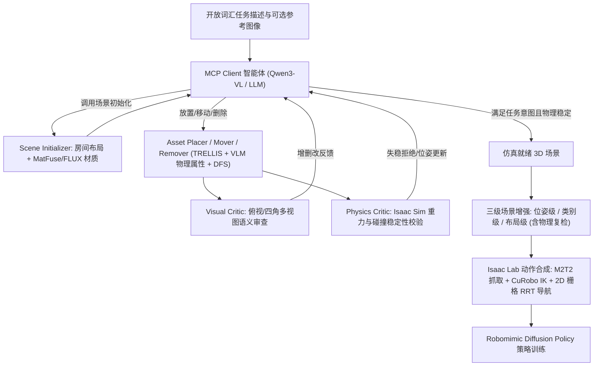
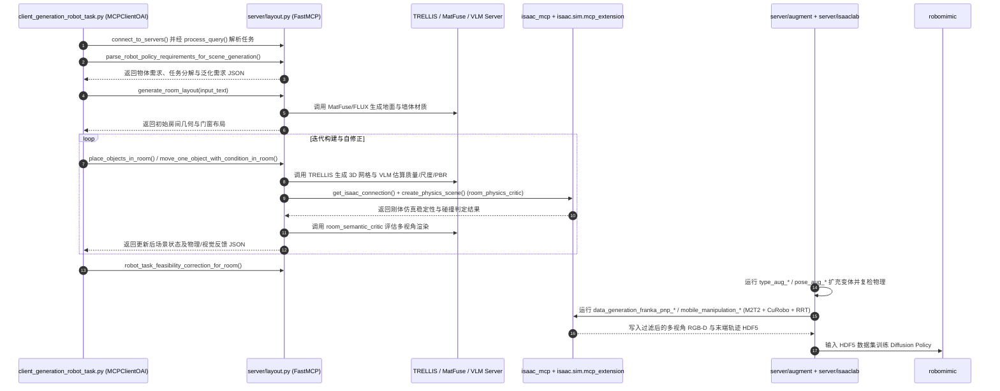

# SAGE: Scalable Agentic 3D Scene Generation for Embodied AI

## 一句话定义

**SAGE** 是一个面向具身智能的智能体化 3D 场景与数据生成框架，通过 Model Context Protocol（MCP）动态编排房间布局、文本生成 3D 资产与局部编辑工具，并借助多视角视觉评论器和 Isaac Sim 物理评论器的闭环自修正，将开放词汇任务描述转化为物理稳定、可直接用于策略训练的仿真环境与动作数据集。

## 英文缩写速查

| 缩写 | 英文全称 | 简要说明 |
|---|---|---|
| SAGE | Scalable Agentic 3D Scene Generation for Embodied AI | 本文框架：可扩展的智能体三维场景与具身数据生成系统 |
| MCP | Model Context Protocol | 标准化工具调用协议，用于解耦智能体（Client）与场景/仿真后端（Server） |
| PBR | Physically Based Rendering | 基于物理的渲染，由 VLM 估计物体的金属度、粗糙度等材质属性 |
| DFS | Depth-First Search | 深度优先搜索，用于结合网格采样和碰撞检测求解物体摆放位姿 |
| IK | Inverse Kinematics | 逆运动学，配合 CuRobo 生成无碰撞机械臂抓取与放置关节轨迹 |
| VLM | Vision-Language Model | 视觉语言模型，负责估算物体物理属性、执行视觉评论及图像条件解析 |
| RRT | Rapidly-exploring Random Tree | 快速扩展随机树，用于在 2D 占据栅格上规划移动操作无碰导航路径 |

## 为什么重要

1. **打破“静态管线”与“不可仿真”瓶颈：** 现有 LLM/VLM 场景生成方法（如 Holodeck）多采用固定顺序的静态计算图且缺少完整 3D 物理校验；而并发的智能体方法（如 SceneWeaver）虽能多工具调用，却未将物理属性与仿真器验证纳入默认闭环，在重力与碰撞测试下易出现倒塌或穿模（Table 1–2）。SAGE 通过在闭环中直接嵌入 Isaac Sim 物理验证，将平均物体稳定性从基准方法的 63.8%–67.7% 提升至 99.9%。
2. **用开放词汇 3D 生成突破封闭资产库局限：** 传统规则生成（ProcTHOR、Infinigen）或封闭分类树检索受限于资产词表，难以响应“赛博朋克游戏室”或特定任务道具组合；SAGE 结合 TRELLIS 文本生成 3D 网格与 VLM 物理参数估计，能面向具体机器人任务按需合成多样几何与外观资产。
3. **验证了合成场景驱动策略缩放（Data Scaling）的有效性：** 从单一基础场景出发，通过位姿、类别与背景布局三级增强，再叠加自动抓取（M2T2）与运动规划（CuRobo + RRT），纯仿真训练的 Diffusion Policy 在未见物体与未见布局上均呈现随场景数量增长的成功率上升趋势。

## 核心信息

| 字段 | 内容或状态 |
|---|---|
| 作者 | Hongchi Xia, Xuan Li, Zhaoshuo Li, Qianli Ma, Jiashu Xu, Ming-Yu Liu, Yin Cui, Tsung-Yi Lin, Wei-Chiu Ma, Shenlong Wang, Shuran Song, Fangyin Wei |
| 机构 | 英伟达（NVIDIA）、伊利诺伊大学厄巴纳-香槟分校（UIUC）、康奈尔大学（Cornell University）、斯坦福大学（Stanford） |
| 发表时间 | arXiv v1 提交于 2026-02-10，v2 修订于 2026-02-20 |
| 论文链接 | [arXiv:2602.10116 (HTML v2)](https://arxiv.org/html/2602.10116) / [arXiv 摘要页](https://arxiv.org/abs/2602.10116) |
| 项目与代码 | [项目页（重定向入口）](https://research.nvidia.com/labs/dir/sage/) / [项目落地页](https://nvlabs.github.io/sage/) / [GitHub 官方仓库 (NVlabs/sage)](https://github.com/NVlabs/sage) |
| 数据集 | [nvidia/SAGE-10k (Hugging Face)](https://huggingface.co/datasets/nvidia/SAGE-10k)（10,000 场景、50 种房间类型与风格、565K 个独立 3D 物体） |
| 清单分类 | `environment.reconstruction` |
| 来源条目 | `survey_ax_2602_10116` |
| 开源状态 | 已开源（Apache-2.0；含 MCP 客户端、场景生成与编辑服务端、Isaac Sim 扩展、多级增强、Isaac Lab 动作生成与 Robomimic 策略训练代码，并公开 SAGE-10k 数据集） |

## 核心原理

### 1. 基于 MCP 的智能体-生成器-评论器闭环（§3.1 / Appendix B.1）

SAGE 将智能体设为 MCP Client，把布局生成、资产合成与物理仿真工具封装在 MCP Server 后端，所有工具均暴露标准参数说明并以 JSON 字典字符串返回结构化状态。智能体在每轮迭代中自主决定调用哪类生成器或结束生成，无需硬编码固定流水线：

- **四大生成器（Generators）：**
  1. **Scene Initializer：** 两步式构造房间结构——首先由 LLM 根据任务需求预测房间类型、尺寸（多房间模式则额外规划连通关系与门位置），随后用 MatFuse（附录中亦使用 FLUX.1-dev）生成地板与墙体材质贴图，并输出包含文本描述、预估物理属性及约束条件的对象提案列表。
  2. **Asset Placer：** 针对指定物体描述调用 TRELLIS 生成 3D 网格，随后执行减面、非流形修复与补洞（确保网格水密性），由 VLM 估计物理尺度（高度）、质量以及 PBR 金属度/粗糙度。LLM 将摆放关系划分为 `floor`（地面）、`wall`（墙面）和 `on-top`（表面承托）三类：地面与墙面物体采用网格采样 + 深度优先搜索（DFS）配合碰撞检测求解；`on-top` 物体则在支撑物体网格上提取法向接近竖直朝上轴的面片，从而支持货架、桌面等多层支撑场景图（区别于 Holodeck 的单层表面限制）。
  3. **Asset Mover：** 解析待移动物体与目标位置要求，先将该物体从场景中临时移除，再复用 Asset Placer 的放置规划器重新求解；若空间不足则恢复原位并向智能体报错，以便进一步腾出空间或删除冲突物。
  4. **Asset Remover：** 依托 LLM 定位不再需要或阻碍通行/放置的物体并删除。
- **双评论器（Critics）自修正：**
  - **Visual Critic：** 接收当前对象配置以及多视角渲染图（俯视图与四个角落视角），检查常识性物体组合（如桌椅配套）、房间稀疏度补全、任务关键物体是否遗漏以及物体错位问题，并向智能体提出增删改建议。
  - **Physics Critic：** 每次增删改后将场景导入 Isaac Sim 进行重力与碰撞动力学仿真（墙面挂载物体固定为静态，其余设为动态刚体）。系统对比仿真前后的位姿变化：对地面和墙面物体统一一次性仿真后剔除失稳个体；对更易倾倒的 `on-top` 物体逐个验证，从 30–50 个候选中采用早停策略选取首个稳定无碰撞位置。若出现“枕头立在床上倒下”等情况，会记录落定后位姿进行二次验证；全部候选均失稳时，则反馈建议缩小物体尺寸或更换支撑面。

### 2. 三级场景增强与自动动作合成（§3.2 / Appendix B.2–B.3）

为把单一任务场景扩展为大规模训练分布，SAGE 采用先增广场景、再合成示范轨迹、最后训练策略的流水线：

1. **多级场景增强（Scene Augmentation）：**
   - **对象配置级（Object Configuration-level）：** 在当前场景内重采样任务相关物体（待抓取物、放置目标等）的位姿。
   - **对象类别级（Object Category-level）：** 通过 LLM 对任务相关物体的文本描述做形状、颜色、材质、表面工艺改写，保持类别一致并由 TRELLIS 重新生成 3D 资产（同步支持墙地纹理替换）。
   - **场景布局级（Scene Layout-level）：** 保留已生成的任务相关物体并随新格局重定位，利用智能体重新生成整个房间几何与所有任务无关的背景家具，随后还可叠加新一轮类别级增强。每次增强均强制通过 Physics Critic 复检。
2. **机器人动作数据生成（Action Generation）：**
   - **Pick-and-Place（Franka Emika Panda）：** 基于深度渲染由 M2T2 生成候选抓取位姿并转换至世界坐标，接入 CuRobo 将场景网格纳入碰撞体进行 IK 与最小加加速度轨迹规划（前置点 $\rightarrow$ 下探闭合夹爪 $\rightarrow$ 抬升 $\rightarrow$ 移动至目标上方释放丢落）。
   - **Mobile Manipulation（Franka Emika Panda + Omron LD-60 移动底盘）：** 导航子任务在 2D 占据栅格地图上运行双向 RRT 规划无碰撞底盘路径，抓取与放置复用上述 M2T2 + CuRobo 管线，并过滤碰撞或目标未到位的失败轨迹。
3. **策略学习（Policy Learning）：** 使用 Robomimic 训练 Diffusion Policy，输入多视角 $128\times 128$ RGB-D 图像与末端位姿轨迹预测连续动作。Pick-and-Place 采用单模型；Mobile Manipulation 拆分为四个顺序执行的阶段策略，每段预测阶段终止信号以触发切换。

## 流程总览

## 源码运行时序图

以下时序图依据官方仓库 [NVlabs/sage](https://github.com/NVlabs/sage) 中的 `client/client_generation_robot_task.py`、`server/layout.py`、`server/isaacsim/isaac_mcp/server.py`、`server/augment/` 与 `server/isaaclab/` 实际入口编写：

关键复现入口：先启用 `isaac.sim.mcp_extension` 并启动 Isaac Sim，再运行 `client/scripts/generate_from_robot_task.sh`（底层由 `MCPClientOAI` 连接 `../server/layout.py`）生成基础任务场景；随后通过 `server/augment/scripts/robot_data_generation_franka_arm.sh` 或 `robot_data_generation_mobile_franka_scene_aug.sh` 驱动 `server/isaaclab/` 采集轨迹并交由 `robomimic/` 训练。

## 实验与评测

### 1. 场景生成主对比（Table 2，§4.1）

实验在 3 类常见室内场景（Bedroom、Kitchen、Living Room）上各生成 10 个场景取平均；智能体与内置 LLM 采用 `gpt-oss-120b`，VLM 采用 `Qwen3-VL-30B-A3B-Instruct`。视觉指标（Realism、Functionality、Layout、Completeness）由 GPT-4.1 评分，网格碰撞率（Coll.）由 `trimesh` 计算，物理稳定性（Stab.）定义为在 Isaac Sim 中仿真 120 步后相对平移 $\le 0.2\text{ m}$ 且旋转 $\le 8^\circ$ 的物体比例：

| 场景类别 | 方法 | #Obj $\uparrow$ | Real. $\uparrow$ | Func. $\uparrow$ | Lay. $\uparrow$ | Comp. $\uparrow$ | Coll. (%) $\downarrow$ | Stab. (%) $\uparrow$ |
|---|---|---|---|---|---|---|---|---|
| Bedroom | Holodeck | 28.5 | 7.4 | 6.8 | 5.0 | 6.1 | 29.1 | 51.0 |
| Bedroom | SceneWeaver | 17.5 | 9.0 | 9.7 | 7.8 | 7.5 | 31.0 | 58.8 |
| Bedroom | **SAGE** | **48.3** | **9.0** | **10.0** | **8.0** | **9.5** | **2.3** | **99.8** |
| Kitchen | Holodeck | 28.5 | 6.7 | 6.1 | 4.4 | 6.2 | 16.0 | 73.8 |
| Kitchen | SceneWeaver | 37.5 | 8.2 | 7.7 | 6.8 | 7.2 | 28.0 | 67.0 |
| Kitchen | **SAGE** | **47.6** | **8.5** | **9.0** | **7.8** | **7.6** | **0.7** | **100.0** |
| Living Room | Holodeck | 34.0 | 8.3 | 7.3 | 5.7 | 7.3 | 20.8 | 66.5 |
| Living Room | SceneWeaver | 18.1 | 8.5 | 9.3 | 7.2 | 6.8 | 39.5 | 77.2 |
| Living Room | **SAGE** | **48.8** | **8.8** | **9.5** | **7.8** | **7.4** | **2.7** | **100.0** |
| **Average** | Holodeck | 30.3 | 7.5 | 6.7 | 5.0 | 6.5 | 22.0 | 63.8 |
| **Average** | SceneWeaver | 24.4 | 8.6 | 8.9 | 7.3 | 7.2 | 32.8 | 67.7 |
| **Average** | **SAGE** | **48.2** | **8.8** | **9.5** | **7.9** | **8.2** | **1.9** | **99.9** |

### 2. 评论器消融实验（Table 3，3 类房间各 5 场景均值）

| Visual Critic | Physics Critic | #Obj $\uparrow$ | Real. $\uparrow$ | Func. $\uparrow$ | Lay. $\uparrow$ | Comp. $\uparrow$ | Coll. (%) $\downarrow$ | Stab. (%) $\uparrow$ |
|---|---|---|---|---|---|---|---|---|
| ✗ | ✗ | 35.3 | 8.5 | 9.2 | 7.5 | 7.3 | 7.8 | 80.3 |
| ✓ | ✗ | 50.1 | **8.9** | 9.5 | **8.1** | 8.1 | 3.7 | 84.1 |
| ✗ | ✓ | 36.8 | 8.8 | 9.3 | 7.7 | 7.8 | 1.9 | 99.6 |
| ✓ | ✓ | **53.7** | **8.9** | **9.6** | 8.0 | **8.2** | **0.8** | **100.0** |

结果表明，Visual Critic 显著增加场景物体丰富度（35.3 $\rightarrow$ 50.1）并提升布局与完备性；Physics Critic 将碰撞率从 7.8% 压低至 1.9%、稳定性提升至 99.6%；二者结合后物体数达 53.7、碰撞率仅 0.8% 且稳定性达 100.0%。

### 3. 具身策略学习、缩放与交叉评测（§4.2，Table 4–5）

动作生成与策略评测均在 NVIDIA L40S GPU 的 Isaac Lab 中进行，每个任务的测试结果在 3 个留出场景上各随机初始化 90 次机器人位姿与物体配置取平均：
- **Pick-and-Place（Franka 抓杯入碗）：** 对 264 个独立物体生成超 28,000 条演示（3 路透视 RGB-D 相机，左/右/腕部，每 GPU 8 并行环境）。
- **Mobile Manipulation（Franka + Omron LD-60 移动取罐放置）：** 跨越 50 个多样场景生成近 50,000 条演示（5 路相机：3 路透视 + 前后 2 路鱼眼，每 GPU 2 并行环境）。

| 任务 | Privileged Agent (Train / Test %) | Policy Rollout (Train / Test %) |
|---|---|---|
| Pick-and-Place | 65.3 / 57.7 | 63.4 / 50.0 |
| Mobile Manipulation | 68.4 / 52.8 | 54.6 / 46.0 |

在 Mobile Manipulation 跨数据来源泛化对比中（Table 5，Baseline 1 去掉 Physics Critic 并以检索替代 text-to-3D 模拟 SceneWeaver；Baseline 2 进一步改为固定管线模拟 Holodeck）：

| 训练数据来源 | 在 Baseline 1 测试 (%) | 在 Baseline 2 测试 (%) | 在 SAGE 测试 (%) |
|---|---|---|---|
| Baseline 1（无物理评论器+检索） | 13.2 | 9.3 | 14.4 |
| Baseline 2（固定管线+检索） | 13.5 | 16.2 | 13.1 |
| **SAGE** | **39.1** | **24.7** | **46.0** |

### 4. 扩展能力与计算开销（§4.1.3 & Appendix A.3）

- **扩展功能：** 支持多房间连通布局并行填充、基于 `Qwen3-VL` 的参考图像条件风格/物体提取（语义一致、非像素对齐），以及结合 PartNet-Mobility 检索铰接物体执行“开抽屉放碗关抽屉”动作规划。
- **耗时分析（NVIDIA L40S）：** 单卡 TRELLIS 生成约 `15 s`/物体（8 卡并行降为 `2–3 s`/物体）；Isaac Sim 单次候选放置稳定性检测 `1–2 s`；生成 20 个物体的完整场景约 `10 min` 并随物体数线性增长。Isaac Lab 动作规划并行均摊后 Pick-and-Place 约 `2–3 s`/条、Mobile Manipulation 约 `8–10 s`/条；Diffusion Policy 训练收敛需数小时。

## 与其他工作对比

- **对比规则程序化生成（ProcTHOR、Infinigen Indoors）：** 规则系统几何稳定但缺乏开放词汇语义理解与按任务定制能力，物理属性多依赖手工规则；SAGE 通过 LLM/VLM + TRELLIS 实现任意文本或任务驱动生成，并保留物理校验。
- **对比静态 LLM/VLM 管线（LayoutGPT、LayoutVLM、Holodeck、AnyHome 等）：** 静态管线计算图固定、缺少全局自修正且大多只支持单层桌面放置或纯位姿优化，Holodeck 在常见房间平均碰撞率达 22.0%、稳定性仅 63.8%；SAGE 以 MCP 支持多层支撑图与多轮回溯修正，碰撞率降至 1.9%。
- **对比并发智能体方法（SceneWeaver）：** 二者均借助工具调用自反思改进布局，但 SceneWeaver 缺少显式物理属性绑定与仿真器闭环验证，平均碰撞率 32.8%、稳定性 67.7%，无法直接稳定用于策略训练；SAGE 将 Isaac Sim 嵌入生成闭环，并在策略学习实验中证实省略物理评论器和 3D 资产合成会使下游成功率跌至不足三分之一（13.2%–16.2% vs. 46.0%）。

## 结论

**一句话总判：SAGE 证明了“MCP 工具编排 + 仿真器内置物理评论器 + 开放词汇 3D 生成”是把文本场景合成真正落地为机器人策略训练引擎的关键闭环，其中物理校验与资产多样性对下游策略泛化缺一不可。**

1. **Physics Critic 是仿真可用性的硬门槛：** 仅有 Visual Critic 时场景物体虽丰富但仍有 3.7% 碰撞与 15.9% 失稳物体，引入 Isaac Sim 闭环后稳定性升至 99.6%–100.0%，直接决定后续运动规划与策略能否顺利采集数据。
2. **数据多样性显式转化为跨分布泛化：** 保持相同演示总数时，依托 SAGE 多级增强训练的策略不仅在本源测试达 46.0%，在 Baseline 1/2 留出场景也分别取得 39.1% 和 24.7%，明显高于在基线自身数据上训练的结果。
3. **工程算力代价集中在 3D 生成与仿真验证：** 智能体推理耗时较短，瓶颈主要在 TRELLIS 网格生成（15 s/物体）与 `on-top` 物体逐个物理仿真；实际批量生产建议采用多卡并行 TRELLIS 与早停物理检验策略。
4. **选型取舍：** 若需要直接复用现成高多样性室内场景，可先下载 [nvidia/SAGE-10k](https://huggingface.co/datasets/nvidia/SAGE-10k)；若需针对特定机械臂任务定制场景与动作流，再按 `NVlabs/sage` 架构部署后端服务。

## 工程实践

- **模型与服务拆分部署：** 官方代码库采用客户端-服务端架构，需分别启动 vLLM 推理服务（Client 默认配置 `Qwen/Qwen3-VL-32B-Thinking`，Server 默认 `Qwen/Qwen3-VL-30B-A3B-Instruct` 与 `openai/gpt-oss-120b`）、TRELLIS Docker 服务及 MatFuse/FLUX 材质生成器，并通过 `key.json` 与 `constant.py` 配置接口地址。
- **Isaac Sim MCP 扩展挂载：** 运行前需将 `server/isaacsim/isaac.sim.mcp_extension` 软链接至 Isaac Sim 的 `exts/` 目录并以 `--enable isaac.sim.mcp_extension` 启动无头仿真进程；论文实验采用 Isaac Sim 5.0.0 与 Isaac Lab（`client/README.md` 注记安装包指向 4.2.0 归档，部署时应核对接口兼容性）。
- **加速物理校验与网格后处理：** 地面与墙面物体可先批量放置后统一在 Isaac Sim 中单次模拟并剔除失稳项；`on-top` 小物体则逐个验证并采用早停（首个无碰稳定候选即接受）；TRELLIS 网格需经减面、非流形修复与补洞以防仿真碰撞穿透。
- **长时程策略拆分技巧：** 移动操作任务直接端到端训练易受长时程误差累积影响，论文将其拆解为 4 个带终止信号预测的阶段性 Diffusion Policy，并结合 3 路透视相机 + 2 路鱼眼导航相机（$128\times 128$ RGB-D）完成衔接。

## 局限与风险

- **物理建模与场景域边界：** 主体工作面向室内刚体环境，室外大尺度场景与可变形物体（布料、流体等）尚未纳入标准流水线；铰接物体目前通过 PartNet-Mobility 检索扩展，尚不能像刚体那样完全由文本生成可动关节资产。
- **简化操作原语与真机鸿沟：** 当前动作合成覆盖抓放与导航组合，且放置阶段简化为夹爪张开自由下落（drop），未覆盖精细插拔、双臂协同或软接触控制；论文实验全部在仿真中完成验证，尚未提供真实物理机器人闭环迁移评测。
- **算力门槛与外部依赖较重：** 从零运行完整生成链路需要多张大显存 GPU（论文在 L40S 集群并配合 4–8 卡张量并行大模型服务运行）及 Objathor 门窗数据下载，单场景约 10 分钟的生成延迟限制了在线实时交互场景的即时响应。

## 关联页面

- [Agentic Robots 综述](paper-towards-agentic-robots-survey.md)
- [全量项目节点清单](../overview/awesome-agentic-robots-node-index.md)
- [VLA 方法背景](../methods/vla.md)
- [机器人仿真场景生成](../methods/robot-simulation-scene-generation.md)：对照场景、资产与可运行性检查
- [智能体工具调用接口](../methods/agent-tool-use-interface.md)：MCP 与标准化工具编排范式
- [智能体规划与反馈闭环](../methods/agent-planning-feedback.md)：视觉/物理双评论器自修正机制
- [扩散策略（Diffusion Policy）](../methods/diffusion-policy.md)：下游多视角视觉运动策略学习骨干
- [抓取位姿估计](../methods/grasp-pose-estimation.md)：M2T2 深度图抓取位姿生成环节
- [模仿学习](../methods/imitation-learning.md)：从运动规划示范到策略蒸馏的训练范式
- [RRT 路径规划](../methods/rrt.md)：移动操作底盘在 2D 占据栅格上的无碰导航规划
- [操作任务（Manipulation）](../tasks/manipulation.md)
- [移动操作（Loco-Manipulation）](../tasks/loco-manipulation.md)

## 推荐继续阅读

- [SAGE 项目主页（NVIDIA Research）](https://research.nvidia.com/labs/dir/sage/)（公开镜像：[nvlabs.github.io/sage](https://nvlabs.github.io/sage/)）
- [SAGE 官方 GitHub 仓库（NVlabs/sage）](https://github.com/NVlabs/sage)
- [SAGE-10k 数据集（Hugging Face）](https://huggingface.co/datasets/nvidia/SAGE-10k)
- [arXiv:2602.10116 原文（HTML v2）](https://arxiv.org/html/2602.10116)

## 参考来源

- [论文原文核查：SAGE: Scalable Agentic 3D Scene Generation for Embodied AI](../../sources/papers/paper-agentic-2602-10116.md)
- [官方代码库核查：NVlabs/sage](../../sources/repos/paper-agentic-2602-10116.md)
- [官方 Awesome 快照归档](../../sources/repos/awesome-agentic-robots-survey-index.md)
- [arXiv:2602.10116](https://arxiv.org/abs/2602.10116)
- [NVlabs/sage (GitHub)](https://github.com/NVlabs/sage)
