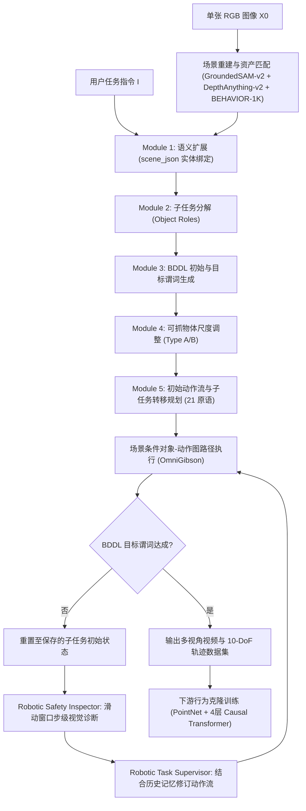

# Scene2Demo: Self-Evolving Embodied Data Generation via Object-Action Graph

## 一句话定义

**Scene2Demo** 是一种离线具身智能数据生成框架，能够从单张 RGB 场景图像与自然语言任务指令出发，自动重建可交互仿真场景，通过符号化子任务接口、对象-动作图搜索以及“安全检查员-任务监督者”双智能体视觉反馈闭环，持续修正失败动作流并输出可用于下游模仿学习的多视角视频与观测-动作数据集。

## 英文缩写速查

| 缩写 | 英文全称 | 简要说明 |
|---|---|---|
| BDDL | Behavior Domain Definition Language | BEHAVIOR/OmniGibson 采用的域定义语言，用于形式化描述子任务初始与目标谓词 |
| VLM | Vision-Language Model | 视觉语言模型，承担场景语义扩展、步级视觉诊断与动作流修订 |
| IK | Inverse Kinematics | 逆运动学控制器，将移动底盘与末端位姿目标转为连续关节运动轨迹 |
| EEF | End-Effector | 机器人末端执行器（含平行夹爪），对应平移与抓取类原子原语 |
| SR | Success Rate | 完整任务成功率，长时程任务要求所有子任务依次达成目标谓词 |
| ESR | Evolution Success Rate | 自进化挽救成功率，衡量首轮失败样本经反馈迭代后被成功修正的比例 |
| BC | Behavior Cloning | 行为克隆，利用框架自主生成的专家演示训练下游 10-DoF 策略 |

## 为什么重要

1. **打通“单图到可训练策略数据”的全自动闭环：** 传统仿真数据生成往往依赖人工搭建场景、手工编写任务脚本或耗时极长的强化学习训练（如文中对比的 RoboGen+RL 需 48 小时以上）；Scene2Demo 仅需单张 RGB 图和文本查询即可构建可执行环境并产出 10-DoF 演示轨迹。
2. **用符号边界与对象-动作图解决长时程分解漂移：** 直接用大模型进行无约束任务分解时，重复查询容易产生波动的子任务数量与不一致的前后置条件；Scene2Demo 通过 `⟨target, support_init, support_goal, s_init, s_goal⟩` 接口与图搜索约束，使重复分解保持结构稳定。
3. **离线视觉自进化聚焦长尾与后段误差：** 长时程任务往往在前半段（如开门、抓取）成功而在后半段（如避开冰箱门放入水杯）因碰撞或几何偏差失败；框架仅在失败时启动步级安全诊断与历史记忆驱动的参数/序列修订，并以固定初始状态重置避免环境污染。

## 核心信息

| 字段 | 内容或状态 |
|---|---|
| 作者 | Xiang Liu*, Sen Cui, Guocai Yao†, Zhong Cao, Jingheng Ma, Min Zhang, Changshui Zhang† |
| 机构 | 清华大学（通讯邮箱 `mail.tsinghua.edu.cn`）、北京大学（通讯邮箱 `pku.edu.cn`）；项目页保留匿名投稿占位 |
| 发表时间 | arXiv v1 提交于 2026-02-12，v3 修订于 2026-10-17（v3 正文题名 *Scene2Demo: Automated Embodied Data Generation for Robot Policy Learning*） |
| 论文链接 | [arXiv:2602.12065 (HTML v3)](https://arxiv.org/html/2602.12065) / [arXiv 摘要页](https://arxiv.org/abs/2602.12065) |
| 项目与代码 | [项目页](https://scene2demo-anon.github.io/)（列有 Paper / Code / Policy Weights 按钮，但当前无可用 GitHub 或模型权重仓库链接） |
| 清单分类 | `environment.task_generation` |
| 来源条目 | `survey_ax_2602_12065` |
| 开源状态 | 未确认开源代码（截至 2026-11-27 仅见匿名项目页与论文全文，未提供可运行官方仓库） |

## 核心原理

### 1. 场景条件仿真基底（Scene-Conditioned Simulation Substrate）

给定单张 RGB 图像 $X_0 \in \mathbb{R}^{H \times W \times 3}$ 与估计相机内参，系统沿用 Digital Cousins（ACDC）重建链路构造可执行初始物理状态 $S_0 \sim p(S \mid X_0; \epsilon_0)$：
- **语义与几何提取：** 利用 LLM 与 GroundedSAM-v2 获取物体类别和分割掩码，并用 DepthAnything-v2 估计深度以生成点云；
- **资产检索与物理摆放：** 通过 CLIP 与 DINOv2 在 BEHAVIOR-1K 资产库中分层检索匹配的交互式三维资产，结合墙面安装等物理稳定性规则导入 OmniGibson 仿真器。

### 2. 五模块结构化任务生成与符号接口

为让中间产物可检查且可局部修订，Scene2Demo 将任务生成拆分为五个职责隔离的模块：
- **Module 1（Semantic Expansion）：** 结合场景元数据 `scene_json`（物体 ID、3D 坐标、包围盒）与可选图像，将模糊用户查询 $I$ 接地为带唯一实例 ID 的 `task_name` 与逐步描述 `task_message_detail`。
- **Module 2（Subtask Decomposition）：** 将复杂长时程任务表示为有序简单任务序列 $\mathcal{T} = \{T_1, T_2, \dots, T_K\}$。每个简单任务定义为五元组 $T = \langle o_t, o_{s_1}, o_{s_2}, s_{\mathrm{init}}, s_{\mathrm{goal}} \rangle$，其中 $o_t$ 为直接操作物体，$o_{s_1}, o_{s_2}$ 分别为初始与目标支撑/容器物体。
- **Module 3（BDDL Generation）：** 为每个子任务生成标准 `.bddl` 文件，提供可自动判定的初始谓词 $s_{\mathrm{init}}$ 与成功检测谓词 $s_{\mathrm{goal}}$（如 `ontop`、`inside`、`open`）。
- **Module 4（Object Size Adjustment）：** 区分固定/铰接家具（Type A，保持缩放 $S=1.0$）与可抓取物品（Type B）；若平行夹爪最大张开宽度约 $0.06\text{ m}$ 且物体水平最小尺寸 $d_{\min} = \min(\text{bbox}_x, \text{bbox}_y) > 0.06\text{ m}$，则缩放使 $S \times d_{\min} \approx 0.05\text{ m}$。
- **Module 5（Action Flow & Transfer Planning）：** 在 `BasicSkill` 定义的 **21 个原子原语库** $\mathcal{A}$ 上生成子任务内动作流 $\pi(T) = \{a_i(\theta_i \mid T)\}_{i=1}^n$ 与相邻子任务间的上下文转移 $e_k = \{a_{\mathrm{end}}(\theta_{\mathrm{end}}^{(k)} \mid \mathcal{T}), a_{\mathrm{start}}(\theta_{\mathrm{start}}^{(k+1)} \mid \mathcal{T})\}$，转移序列建模为 $p_T(E \mid \mathcal{T}; \epsilon_2) = \prod_{k=1}^{K-1} p_T(e_k \mid \mathcal{T}, e_{<k}; \epsilon_2)$。

21 个原子原语按参数形式分为四类：
1. **7 个无参上下文感知原语：** `APPROACH`, `CONVERGE`, `GRASP`, `UNGRASP`, `RETREAT`, `NAVIGATE_TO_TARGET`, `NAVIGATE_TO_SUPPORT`。
2. **6 个末端平移原语（参数为距离/米）：** `LIFT_EEF_UP`, `LIFT_EEF_DOWN`, `MOVE_EEF_FORWARD`, `MOVE_EEF_BACKWARD`, `MOVE_EEF_LEFT`, `MOVE_EEF_RIGHT`。
3. **6 个底盘运动原语（平移/米、旋转/度）：** `MOVE_BASE_FORWARD/BACKWARD/LEFT/RIGHT`, `TURN_BASE_LEFT/RIGHT`。
4. **2 个铰接体原语（参数为关节限位或 `None`）：** `ARTICULATE_OPEN`, `ARTICULATE_CLOSE`。

### 3. 对象-动作任务图（Object-Action Task Graph）

在通用图模板 $\mathcal{G} = (\mathcal{V}, \mathcal{E}),\ \mathcal{V} = \mathcal{O} \times \mathcal{A} \times \mathbb{N}^+$ 下，节点 $v = (o, a, n)$ 表示在局部时间步 $n$ 对物体 $o$ 执行原语 $a$。面向重建场景 $S_0$，模块 2–5 实例化出场景条件子图 $\mathcal{G}_{S_0}$，其中任务内有向边编码原子动作流，转移边连接相邻子任务边界，从而把长时程任务规划转化为满足谓词约束的有序路径搜索。

### 4. 双智能体视觉反馈自进化（Self-Evolution）

当某个子任务 $T_k$ 的初始动作流执行失败时，系统启动最多 $\tau_{\max}=5$ 轮的离线反馈修订循环（每轮开始前将仿真器重置回保存的子任务初始状态 $\bar{S}_{\mathrm{init}}^{(k)}$）：
- **多视角采样与滑动窗口：** 从 $\mathcal{C} \subset \{\mathrm{Global}, \mathrm{Head}, \mathrm{Wrist}\}$ 三视角采样，单个动作最多下采样至 $L_j = \min(\lceil t_j / p_2 \rceil, 6)$ 帧；默认回看窗口 $p_1 = 1$，为第 $j$ 步构造上下文 $X_{k,j}^{\mathcal{C}}$。
- **Robotic Safety Inspector（步级检查员）：** 针对每个动作步 $a_j$ 输出诊断 $m_{\tau,j} \sim p_E(m \mid X_{k,j}^{\mathcal{C}}; \epsilon_4)$，核查三项内容：（1）运动是否符合原语语义；（2）起止帧状态对比是否发生预期转变；（3）是否存在碰撞、打翻或空抓等异常。
- **Robotic Task Supervisor（任务级监督者）：** 聚合当前动作流 $\hat{\pi}_\tau(T_k)$、步级诊断 $m_\tau$、完整视频 $X_k^{\mathcal{C}}$、任务上下文 $\mathcal{T}$ 及过往失败记忆 $\mathcal{H}_{<\tau} = \{(\hat{\pi}_i(T_k), m_i, \hat{r}_{i+1})\}_{i=0}^{\tau-1}$，先做根因定位（锁定最早出错步骤），再在 21 原语库约束下输出修订动作流 $\hat{\pi}_{\tau+1}(T_k)$ 与修订理由 $\hat{r}_{\tau+1}$。

## 流程总览

## 源码运行时序图

**不适用**（说明核查结果：截至 2026-11-27，论文全文 `arXiv:2602.12065v3` 及匿名项目页 `https://scene2demo-anon.github.io/` 均未提供可下载运行的官方 GitHub 源码仓库链接，仅展示了项目页演示与方法伪代码 Algorithm 1；待官方公开可运行仓库后再补充基于实际文件与入口的源码运行时序图。）

## 实验与评测

所有核心模块默认使用开源视觉语言模型 `qwen3-vl-235b-22a-thinking`（$p_1=1$），仿真机器人为带移动底盘的 FrankaMounted（缩放系数 $s=0.7$，抓取收敛偏置 $\delta_{\text{offset}}=0.14 \times s$）。

### 1. 大规模原子场景-任务对可执行性（Table 1，关闭自进化）

使用 Qwen3-Max 与 Seedream-4.5 生成 34 张家庭场景 RGB 图（16 厨房、10 卧室、8 书房/工作间等），每张图从 BEHAVIOR-1K 匹配 top-3 资产变体构成 $34 \times 3 = 102$ 个交互场景并自动提案任务：

| 任务类别 | 评估数量 | 成功数 | 成功率 SR (%) |
|---|---|---|---|
| $\mathcal{T}_5$：Open/Close（铰接体开关） | 36 | 24 | 66.7 |
| $\mathcal{T}_6$：Pick/Place（刚体抓放） | 66 | 49 | 74.2 |
| **总计** | **102** | **73** | **71.6** |

### 2. 复杂长时程任务与基线主对比（Table 2 & Table 4）

在四个代表性长时程任务（$\mathcal{T}_1$：玻璃杯放进冰箱；$\mathcal{T}_2$：苹果放进冰箱；$\mathcal{T}_3$：苹果放进碗里；$\mathcal{T}_4$：水杯放到桌上）及两类简单任务上，报告 `SR / Subtask-Level Score (%)`（注：各系统子任务定义与进度评估器不同，Subtask-Level Score 作诊断参考）：

| 方法 | $\mathcal{T}_1$ | $\mathcal{T}_2$ | $\mathcal{T}_3$ | $\mathcal{T}_4$ | $\mathcal{T}_5$ | $\mathcal{T}_6$ |
|---|---|---|---|---|---|---|
| M1: Ours (Primitive) | 0 / 50 | 0 / 50 | 40 / 70 | 0 / 50 | 66.7 / 66.7 | 74.2 / 74.2 |
| M2: Ours (Prim+Evo) | 40 / 84 | 30 / 79 | 70 / 93 | 70 / 85 | — | — |
| M3: GenSim2 (Primitive) | 0 / 73 | 5 / 78 | 55 / 91 | 0 / 68 | 100 / 100 | 38.8 / 82.1 |
| M4: RoboGen (Primitive) | 0 / 50 | 0 / 46.5 | 0 / 50 | 0 / 50 | 0 / 50.2 | 0 / 42.8 |
| M5: RoboGen (Prim+RL) | fail | fail | fail | fail | success | success |

- **自进化净增益：** 仅靠开环原语规划时 $\mathcal{T}_1,\mathcal{T}_2,\mathcal{T}_4$ 完整任务成功率为 0%；引入自进化闭环后分别提升至 40%、30%、70%，$\mathcal{T}_3$ 从 40% 提升至 70%。

### 3. 不同 VLM 骨干与子任务阶段表现（Table 3 & Appendix B.7.1）

在 $\mathcal{T}_1$ 与 $\mathcal{T}_3$ 上对比了三种 VLM（每子任务迭代上限 5 次）：
- **$\mathcal{T}_1$（完整任务 SR / 成功样本平均迭代次数）：** Qwen3-VL（20 demos）为 `40% / 3.1`，Gemini-3-Flash（10 demos）为 `30% / 2.3`，GPT-5.2（10 demos）为 `20% / 3.5`。
- **$\mathcal{T}_3$（10 demos）：** Gemini-3-Flash 为 `70% / 1.6`，GPT-5.2 为 `50% / 0.2`，Qwen3-VL 为 `50% / 0.4`；另外 Qwen3-VL 在 $\mathcal{T}_2$ 为 `30% / 2.3`，在 $\mathcal{T}_4$ 为 `70% / 1.0`。
- **诊断风格差异：** Qwen3-VL 倾向保守微调，易忽略非碰撞型运动学卡死；Gemini-3-Flash 感知敏锐但步长调整较激进；GPT-5.2 易不断叠加冗余步骤导致序列过长、累计误差上升。

### 4. 消融实验与生成耗时（§4.4）

- **分解稳定性：** 对同一指令 $\mathcal{T}_2$ 重复执行分解，Scene2Demo 始终输出一致的可执行子任务结构，而无约束基线会出现子任务数量波动。
- **耗时统计：** 简单任务无自进化约 2 分钟；长时程任务初始生成 35s–1m20s，每子任务执行 22s–1m30s，单次 Qwen3-VL 进化迭代 1m19s–2m57s，完整长时程演示约 15–30 分钟（找到成功配置后即可配合域随机化批量扩增）。
- **视角与上下文消融：** 多视角组合（含 Global / Head / Wrist）整体优于单视角；回看窗口从 $p_1=1$ 增至 $p_1=2$ 不仅未提升成功率，反而增加上下文长度与推理延迟，因此默认采用 $p_1=1$。

### 5. 下游策略学习验证（§4.5 & Appendix B.8）

利用 Scene2Demo 自主生成的 100 条演示（目标物体 XYZ 尺度随机扰动 $\pm 0.10$，铰接体绕 $z$ 轴旋转扰动 $\pm\pi/12$）训练行为克隆策略（点云下采样至 1024 点经 PointNet 编码 + 本体感知融合 + 4 层 8 头 Causal Transformer，时间窗 $T=10$，输出 10-DoF 增量动作；单张 A800 训练 200 epochs，AdamW，lr=$4\times 10^{-4}$）：
- **Open Refrigerator：** 评估 25 次，成功 24 次（**96.0%**）。
- **Pick Up Glass：** 评估 25 次，成功 23 次（**92.0%**）。

## 与其他工作对比

| 对比维度 | Scene2Demo（本文） | GenSim2 | RoboGen | Digital Cousins / ManiAgent |
|---|---|---|---|---|
| 输入与环境构建 | 单张 RGB 图 + 指令，经 Digital Cousins 重建交互式 OmniGibson 场景 | 基于多模态与推理 LLM 扩增仿真任务与数据 | 基于生成式仿真生成任务、场景、奖励与 RL/原语求解 | Digital Cousins 侧重资产匹配重建；ManiAgent 直接估计 3D 位姿与抓取 |
| 任务表示与稳定性 | 符号五元组 + BDDL 谓词 + 场景条件对象-动作图搜索，重复分解结构稳定 | 任务特定进度评估准则，铰接开关强（$\mathcal{T}_5$ 100%）但抓放较弱（$\mathcal{T}_6$ 38.8%） | 任务结构不固定，长时程依赖子任务 RL 训练 | 主要面向单步/资产重建或抓取执行，缺乏多轮自进化数据闭环 |
| 长时程修正与成本 | 离线双智能体视觉反馈自进化，单条长时程演示约 15–30 分钟 | 仅前向原语执行时在 $\mathcal{T}_1,\mathcal{T}_4$ 成功率为 0% | `Prim+RL` 在 4 个长时程任务均失败，且总训练耗时超 48 小时 | 无内置失败后基于滚动记忆的动作流重规划循环 |

## 结论

**一句话总判：Scene2Demo 验证了“结构化符号任务图 + 多视角视觉反馈自进化”可作为有效的离线仿真演示生成引擎，但当前能力边界仍受限于 21 个硬编码原语、单目重建尺度误差及离线开环修正特性。**

1. **优先复用可检查的符号接口设计：** 将任务分解约束为 `⟨o_t, o_s1, o_s2, s_init, s_goal⟩` 与 `.bddl` 谓词，使长时程任务能够模块化验证并在子任务级别重置重试。
2. **把高开销视觉自进化留给长尾与后段子任务：** 简单原子任务开环规划即可达 71.6% 成功率，而放置与搬运等后期子任务最受益于 Inspector-Supervisor 闭环。
3. **数据生成后配合域随机化批量放大 ROI：** 虽然单次长时程进化耗时 15–30 分钟，但一旦锁定成功动作流，即可结合尺度/旋转随机化快速产出上百条可用于 BC 训练的轨迹。
4. **注意代码未开源与真机未验证边界：** 当前项目尚无公开可运行代码，且全部实验仅在 OmniGibson 仿真中完成，工程落地前需补充真实场景感知对齐与底层控制器升级。

## 工程实践

- **多视角分工不可或缺：** Global View 负责判断物体间全局可达性与任务逻辑完成度（如门朝向与障碍）；Head View 适合观察机械臂连杆碰撞与底盘相对位姿；Wrist View 在近距抓取有参考价值，但在高空悬停阶段信息量有限，实操中应保留 Global + Head 基础组合。
- **单目重建尺度工程经验：** 在 OmniGibson 中使用 Digital Cousins 重建室内场景时，绝对尺度往往偏小或不稳定；本文通过统一将 FrankaMounted 缩放至 $s=0.7$、并将 `CONVERGE` 停靠偏置耦合为 $0.14 \times s$，同时按夹爪最大宽度 $0.06\text{ m}$ 动态缩放可抓物体至 $0.05\text{ m}$，显著减少“抓空”与“顶撞物体”失败。
- **进化迭代中的状态隔离：** 每次修订后必须从保存的子任务边界状态 $\bar{S}_{\mathrm{init}}^{(k)}$ 重置仿真器，避免上一轮打翻物体或卡死关节污染后续 VLM 诊断。

## 局限与风险

- **原语库与 IK 控制器天花板：** 现有 21 个原语仅覆盖开关门、刚体抓放与底盘移动，不支持双臂协作、非刚性物体或精细灵巧操作；低层纯 IK 路径也缺乏接触力顺应性。
- **单目场景重建与资产匹配误差：** 依赖 Digital Cousins 与 BEHAVIOR-1K 资产库，遇到未收录家具或严重遮挡时会出现资产失配、几何比例失真与不可交互问题。
- **离线开环修正的几何振荡风险：** VLM 仅能根据离散关键帧离线改写下一轮静态参数，无法执行实时连续视觉伺服（Appendix B.7.2 中的苹果入碗左右振荡与冰箱侧壁连杆奇异卡死即由此导致）。
- **代码与真机迁移尚未验证：** 截至 2026-11-27 官方代码与策略权重尚未公开，且论文明确说明未进行真实物理机器人迁移评测。

## 关联页面

- [Agentic Robots 综述](paper-towards-agentic-robots-survey.md)
- [全量项目节点清单](../overview/awesome-agentic-robots-node-index.md)
- [VLA 方法背景](../methods/vla.md)
- [机器人学习数据管线](../methods/robot-learning-data-pipelines.md)：对照自动化演示生成与数据规模化管线。
- [仿真场景生成工作流](../methods/robot-simulation-scene-generation.md)：对应从单张 RGB 重建可交互仿真基底的场景构造环节。
- [Agent 规划与反馈机制](../methods/agent-planning-feedback.md)：对照视觉检查员与历史记忆驱动的多轮动作流修订范式。
- [行为克隆（Behavior Cloning）](../methods/behavior-cloning.md)：对应下游基于生成演示训练 PointNet + Causal Transformer 策略。
- [机器人操作（Manipulation）](../tasks/manipulation.md)
- [移动操作（Loco-Manipulation）](../tasks/loco-manipulation.md)：对应 7-DoF 机械臂与 3-DoF 移动底盘协同的 10-DoF 长时程室内任务。

## 推荐继续阅读

- [arXiv:2602.12065 (HTML v3 全文)](https://arxiv.org/html/2602.12065) — 本文完整方法、21 个原子原语定义、自进化推理样例及行为克隆实现细节。
- [Scene2Demo 项目页](https://scene2demo-anon.github.io/) — 提供三视角任务执行视频与自进化迭代对比演示。
- [arXiv:2602.12065 摘要页](https://arxiv.org/abs/2602.12065) — 论文元数据与版本修订记录。

## 参考来源

- [Scene2Demo 论文全文核对归档](../../sources/papers/paper-agentic-2602-12065.md)
- [官方 Awesome 快照归档](../../sources/repos/awesome-agentic-robots-survey-index.md)
- [arXiv:2602.12065 (HTML v3)](https://arxiv.org/html/2602.12065)
- [Scene2Demo 项目页](https://scene2demo-anon.github.io/)
