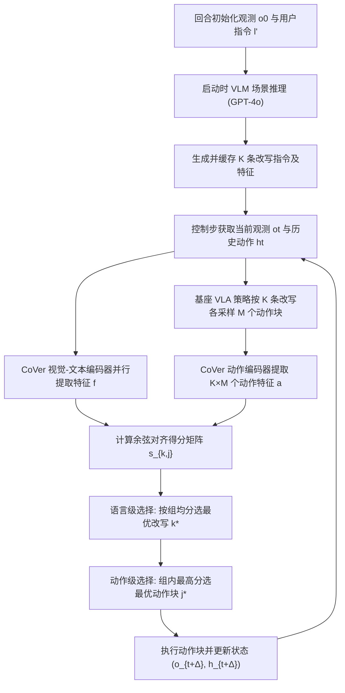
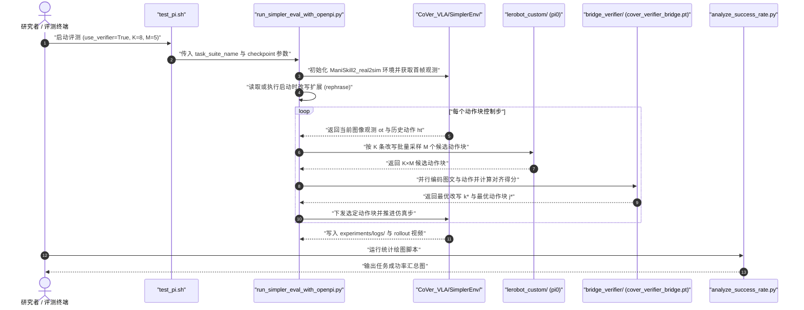

# Scaling Verification Can Be More Effective than Scaling Policy Learning for Vision-Language-Action Alignment

## 一句话定义

**CoVer-VLA** 是一套面向视觉-语言-动作（VLA）模型的层次化测试时验证与缩放框架，通过基于双向 InfoNCE 对比学习训练的轻量对齐验证器 **CoVer**，在部署时联合优化 VLM 启动时预生成的改写指令与基座策略采样的候选动作块，以更低训练算力弥合具身指令遵循中的「意图-动作鸿沟」。

## 英文缩写速查

| 缩写 | 英文全称 | 简要说明 |
|---|---|---|
| VLA | Vision-Language-Action | 视觉-语言-动作模型，直接依据图像观测与自然语言指令生成机器人控制动作 |
| VLM | Vision-Language Model | 视觉-语言模型，本文用于启动时结合初始场景图像生成同义指令改写 |
| CoVer | Contrastive Verifier | 本文提出的视觉-语言-动作三模态对比对齐验证器 |
| InfoNCE | Info Noise-Contrastive Estimation | 双向对比损失函数，利用批内其他样本作为隐式负例训练模态对齐 |
| NRMSE | Normalized Root Mean Squared Error | 归一化均方根误差，用于衡量采样动作与真实专家动作之间的偏差 |
| OOD | Out-of-Distribution | 分布外场景，包含未见物体、多干扰物以及对抗性（red-teaming）指令变体 |

## 为什么重要

1. **揭示具身指令遵循的测试时缩放定律**：在 Bridge V2 上基于预言机验证器的缩放分析表明，单纯增加同一指令的重复采样或高斯扰动容易陷入策略分布的局部极小；而通过 VLM 改写指令并结合动作重采样（hybrid sampling），能够显著拓宽动作候选分布的覆盖度，其动作误差随推理算力呈幂律下降（$\log(e) \approx \log(a) + b \cdot \log(k)$）。
2. **以测试时验证替代高成本策略重训**：相比将训练数据扩增 16 倍来微调基座策略 $\pi_0$（耗费 $5.4 \times 10^{20}$ FLOPs），冻结视觉-文本编码器训练 1B 参数的 CoVer 仅需 $1.3 \times 10^{20}$ FLOPs（约为前者的四分之一），既避免了微调导致的多模态推理灾难性遗忘，又在分布内与分布外基准上取得更高成功率。
3. **兼顾层次化推理与实时控制延迟**：通过将 VLM 场景推理与指令改写移至回合启动时（boot-time）一次性缓存，并将验证器的图像-文本编码与基座策略前向传播并行化，CoVer 仅在控制关键路径上增加 7–8 ms 的动作编码开销，使多候选验证可稳定用于准静态真机操作。

## 核心信息

| 字段 | 内容 |
|---|---|
| **作者** | Jacky Kwok, Xilun Zhang, Mengdi Xu, Yuejiang Liu, Azalia Mirhoseini, Chelsea Finn, Marco Pavone |
| **机构** | Stanford University、NVIDIA Research |
| **发表时间** | 2026 年 2 月（arXiv:2602.12281v2，2026-02-18） |
| **论文链接** | [arXiv:2602.12281](https://arxiv.org/abs/2602.12281) / [HTML 全文](https://arxiv.org/html/2602.12281) |
| **项目与代码** | [项目主页](https://cover-vla.github.io) / [官方主仓库](https://github.com/cover-vla/cover-vla) / [PolaRiS 评测仓库](https://github.com/cover-vla/cover-vla-polaris) |
| **清单分类** | `harness.monitoring_and_recovery` |
| **来源条目** | `survey_ax_2602_12281` |
| **开源状态** | **部分开源**：已开源 Bridge/SIMPLER 推理与评测管线、PolaRiS/DROID 评测脚本及 Hugging Face 权重（`cover-vla/cover-vla-bridge`、`cover-vla/cover-vla-polaris`）；主仓库 To-Do 注明验证器训练管线与独立服务尚未发布 |

## 核心原理

CoVer-VLA 将原本易受自然语言 phrasing 漂移影响的开环 VLA 推理，重构为「离线对比验证器训练 + 在线层次化提示-动作联合寻优」两阶段闭环机制。

### 1. 层次化提示-动作优化形式化（Hierarchical Prompt-Action Optimization）

设观测空间为 $\mathcal{O}$、动作空间为 $\mathcal{A}$、自然语言空间为 $\mathcal{L}$。在时间步 $t$，分块（chunk-based）VLA 策略 $\pi$ 依据观测 $o_t$ 与语言指令 $l$ 输出动作块 $a_t \sim \pi(a_t \mid o_t, l)$。由于 VLA 对词法表达高度敏感，CoVer-VLA 在每个动作块边界依次执行两级选择：

- **语言级优化（Language-level）**：构造与原意图等价的 $K$ 条改写集合 $\mathcal{L}_r(l') = \{l'_1, \dots, l'_K\}$，在语言空间寻找所诱导动作分布期望语义对齐度最高的提示 $l^*$：
  $$l^* = \arg\max_{l' \in \mathcal{L}_r} \mathbb{E}_{a \sim \pi(\cdot \mid o_t, l')}\big[r(o_t, a, l)\big]$$
- **动作级优化（Action-level）**：在选定提示 $l^*$ 下从策略采样 $M$ 个候选动作块 $a'_j \sim \pi(\cdot \mid o_t, l^*)$，利用带近期历史动作上下文 $h_t \in \mathcal{A}^W$ 的验证器 $\mathcal{V}_\theta$ 选出最优动作块执行：
  $$a_t^* = \arg\max_{j \in [M]} \mathcal{V}_\theta(o_t, h_t, l^*, a'_j)$$

### 2. CoVer 离线对比训练（Offline Verifier Training）

机器人演示数据集通常只含成功轨迹而缺乏负例标注，人工或合成失败动作易偏离真实动力学流形。CoVer 通过两阶段离线训练解决这一问题：

1. **指令空间重述扩增（Rephrase Augmentation）**：固定轨迹中的图像观测 $o_t$ 与专家动作序列 $(h_t, a_t)$，仅在语言空间将原始指令 $l$ 扩增为 $N$ 条语义等价改写 $l_n^{\text{oxe}} \in \mathcal{I}(l)$（来源包括 Open-X Embodiment 改写集及 GPT-4o 生成后经 `Qwen3-Embedding-0.6B` $k$-means 聚类的 $8\times \sim 64\times$ 子集）。
2. **解耦式双塔编码与双向 InfoNCE**：
   - **文本感知视觉-语言塔**：采用**冻结权重**的预训练 SigLIP2 视觉与文本编码器（1B 版本为 `ViT-L/16-SigLIP2`），通过文本感知视觉注意力（text-aware visual attention）融合为指令相关表征 $\mathbf{F}_{\text{combined}}(o_i, l_i)$。冻结骨干既保留网络规模语义知识，又省去大编码器反向梯度计算。
   - **时序动作塔**：使用 Transformer 动作编码器联合编码短期历史动作 $h_i$ 与未来候选动作块 $a_i$，输出表征 $\mathbf{A}(h_i, a_i)$。
   - **对称对比目标**：经 $\ell_2$ 归一化得到单位向量 $\mathbf{f}_i = \mathbf{F}_i / \|\mathbf{F}_i\|_2$ 与 $\mathbf{a}_i = \mathbf{A}_i / \|\mathbf{A}_i\|_2$，以余弦内积 $s_{i,j} = \langle \mathbf{f}_i, \mathbf{a}_j \rangle$ 作为对齐得分，最小化批大小为 $B$ 的双向 InfoNCE 损失，将批内非配对动作自动视为隐式负例：
     $$\mathcal{L}_{\text{InfoNCE}} = \frac{1}{2B}\sum_{i=1}^{B}\left(-\log\frac{\exp(s_{i,i})}{\sum_{j=1}^{B}\exp(s_{i,j})} - \log\frac{\exp(s_{i,i})}{\sum_{j=1}^{B}\exp(s_{j,i})}\right)$$

### 3. 启动时推理缓存与批处理验证（Test-Time Verification）

为避免在线调用大模型导致动作卡顿，CoVer-VLA 采用**启动时计算（Boot-time Compute）**：回合初始化时仅调用一次 VLM（GPT-4o），结合首帧图像 $o_0$ 描述场景物体与空间关系并生成 $K$ 条简洁改写 $\{l'_k\}_{k=1}^K$（含原始指令 $l'_1 = l'$），随后缓存其文本及图文特征。实际控制循环中（默认 $K=8, M=5$）：

1. 对每条改写并行前向采样 $M$ 个动作块：$a'_{k,j} \sim \pi(\cdot \mid o_t, l'_k)$；
2. 利用 3 个独立种子训练的 CoVer 集成（嵌入均值后算余弦相似度），统一相对于**用户原始指令** $l'$ 评分：$s_{k,j} = \mathcal{V}_\theta(o_t, h_t, l', a'_{k,j})$；
3. 先按改写组平均分 $S_k = \frac{1}{M}\sum_{j=1}^M s_{k,j}$ 选出最可靠语言 $k^* = \arg\max_k S_k$，再从中选最高分动作块 $j^* = \arg\max_j s_{k^*, j}$ 下发执行。

## 流程总览

## 源码运行时序图

在官方主仓库 `cover-vla/cover-vla` 中，SIMPLER/Bridge 评测由 `CoVer_VLA/inference/experiments/robot/simpler/bashes/test_pi.sh` 触发主脚本 `run_simpler_eval_with_openpi.py`，在同一个推理循环内调度 `lerobot_custom/`（加载 `juexzz/INTACT-pi0-finetune-bridge`）、`bridge_verifier/cover_verifier_bridge.pt` 与 `CoVer_VLA/SimplerEnv/` 完成批采样、验证打分与环境步进。

## 实验与评测

### 1. 验证器缩放定律与判别能力（Bridge V2，§5.1 & §8.4–8.5）

- **缩放维度**：在 1,000 个 Bridge V2 保留（held-out）三元组构建的 64 候选动作检索池上，Top-1 动作检索准确率随合成指令倍数（$8\times \to 64\times$）、验证器参数量（250M `ViT-B/16-CLIP` → 500M `ViT-B/16-SigLIP2` → 1B `ViT-L/16-SigLIP2`，其中文本编码器从 40M 扩至 280M 贡献显著）、对比批大小（2,048 → 8,192；最终训练使用 32,768）、训练步数以及集成模型数（1 → 8，部署采用 3 模型集成）均呈稳定单调提升。
- **二分类判别与样本数消融**：在区分真实对齐动作与随机采样动作的二分类测试中，CoVer 取得 Precision **0.765**、Recall **0.780**、F1 **0.772**；随候选动作采样数从 $N=1$ 增至 $N=16$，保留轨迹上的动作 RMSE 从 **0.166**（$N=1$）逐步降至 **0.155**（$N=2$）、**0.149**（$N=4$）和 **0.147**（$N=16$，降幅 11%）。
- **时序分值动态（Figure 11）**：成功轨迹的验证器得分在「靠近目标物体」与「完成任务末端」两个关键阶段出现明显峰值，而失败轨迹的得分随回合推进持续下滑，具备充当运行时监控器的潜力。

### 2. SIMPLER 仿真基准（ERT 对抗性指令，Table 3，$K=8, M=5$）

在包含 4 项分布内（ID）与 3 项分布外（OOD，引自 Interleave-VLA）任务、统一采用 ERT 生成的对抗改写指令评测下，各方案成功率（% ± 标准差）如下：

| 模型配置 | ID: Carrot on Plate | ID: Eggplant in Basket | ID: Spoon on Towel | ID: Block Stacking | ID 均值 | OOD: Redbull on Plate | OOD: Zucchini on Towel | OOD: Tennis in Basket | OOD 均值 |
|---|---|---|---|---|---|---|---|---|---|
| $\pi_0$（基座） | 48 ± 4 | 74 ± 3 | 27 ± 4 | 17 ± 1 | 41.5 | 6 ± 1 | 30 ± 3 | 53 ± 5 | 29.7 |
| $\pi_0$ w/ Inst. Aug.（16× 微调） | 48 ± 4 | 68 ± 4 | 36 ± 2 | 24 ± 4 | 44.0 | 29 ± 3 | 42 ± 3 | 75 ± 9 | 48.7 |
| $\pi_0$ w/ random rephrase | 49 ± 5 | 78 ± 3 | 41 ± 1 | 1 ± 1 | 42.3 | 1 ± 1 | 7 ± 2 | 78 ± 3 | 28.7 |
| RoboMonkey（7B 验证器） | 0 ± 0 | 13 ± 3 | 10 ± 1 | 7 ± 2 | 7.5 | 19 ± 3 | 10 ± 5 | 45 ± 1 | 24.7 |
| $\pi_0$ + CoVer | 48 ± 4 | 89 ± 8 | 40 ± 6 | 51 ± 4 | 57.0 | **51 ± 3** | 41 ± 1 | **91 ± 3** | 61.0 |
| $\pi_0$ (rephrase) + CoVer | **52 ± 8** | **95 ± 2** | **59 ± 5** | **56 ± 0** | **65.5** | 46 ± 3 | **55 ± 6** | 85 ± 1 | **62.0** |

### 3. PolaRiS 仿真基准（DROID，$\pi_{0.5}$ 基座，50 回合 × 3 种子，Table 1）

| 任务 | $\pi_{0.5}$ 任务进度 (%) | $\pi_{0.5}$ + CoVer 进度 (%) | $\pi_{0.5}$ 成功率 (%) | $\pi_{0.5}$ + CoVer 成功率 (%) |
|---|---|---|---|---|
| PanClean | 48.4 ± 1.9 | **70.4 ± 4.0** | 10.7 ± 0.9 | **33.3 ± 6.6** |
| BlockStack | 33.1 ± 1.3 | **44.3 ± 2.5** | 0.0 ± 0.0 | **0.7 ± 0.9** |
| FoodBussing | 38.3 ± 2.4 | **47.0 ± 4.1** | 0.7 ± 0.9 | **5.3 ± 1.9** |
| **Average** | 40.0 ± 6.4 | **53.9 ± 11.7 (+13.9)** | 3.8 ± 4.9 | **13.1 ± 14.1 (+9.3)** |

### 4. 真机评测与算力 / 时延开销（§5.5–5.6, Table 2, Table 5, Table 7）

- **WidowX 真机评测（§5.5）**：在 `pepto bismol on plate`（含未见过药瓶干扰物）与 `redbull on plate` 两项真机任务上，CoVer-VLA 相对基线 $\pi_0$(rephrase) 分别提升 **30%** 与 **60%** 成功率（平均绝对提升 **45%**），而基础 $\pi_0$ 在强对抗指令与干扰物下几乎无法启动运动（0% 成功）。
- **训练算力对比（Table 7）**：基座 $\pi_0$ 训练为 $3.4 \times 10^{19}$ FLOPs（$1.0\times$）；$\pi_0$（rephrase）16× 指令扩增微调需 $5.4 \times 10^{20}$ FLOPs（$16.0\times$）；训练 CoVer 仅需 $1.3 \times 10^{20}$ FLOPs（$3.8\times$），主因冻结图像-文本编码器使反向传播算力仅约 $1.0 \times 10^9$ FLOPs/样本（前向约 $3.3 \times 10^{11}$ FLOPs）。
- **推理时延（Table 2, Table 5）**：在 RTX 5090 上，$\pi_{0.5}$+CoVer 的图像-文本编码器与策略并行执行，CoVer 动作编码器在 Batch Size 1–32 恒定增加 **7–8 ms**（BS=1 时 63 ms，BS=16 时 453 ms ≈ 2.2 Hz，BS=32 时 873 ms）。使用 LeRobot $\pi_0$ 时（Table 5），BS=32 下总时延为 756 ms（约 1.3 Hz）。启动时调用 VLM 生成 8 条改写耗时约 11 s，不计入单步控制延迟。

## 与其他工作对比

| 对比维度 | CoVer-VLA（本文） | RoboMonkey（7B VLM 验证器） | $\pi_0$ 指令扩增微调 ($\pi_0$ w/ Inst. Aug.) | 纯文本 LLM 改写 / 随机改写 |
|---|---|---|---|---|
| **作用阶段** | 测试时层次化提示-动作验证 | 测试时单步动作重采样验证 | 训练期 16× 指令扩增微调 | 推理前文本改写，无验证筛选 |
| **动作时间粒度** | 原生编码历史窗口与未来动作块（chunk） | 逐步（step-level）验证，易破坏流匹配动作块内部结构 | 直接生成动作块 | 直接生成动作块 |
| **视觉锚定与负例机制** | 冻结 SigLIP2 + 批内隐式负例 InfoNCE + VLM 视觉改写 | 依赖 OpenVLA 偏好标注数据，跨策略迁移至 $\pi_0$ 发生分布偏移 | 无显式验证器；易引发 VLM 推理遗忘 | LLM 易将 `zucchini` 泛化为 `vegetable` 导致语义漂移 |
| **SIMPLER 均值 (ID / OOD)** | **57.0% / 61.0%**（配 $\pi_0$）；**65.5% / 62.0%**（配扩增 $\pi_0$） | 7.5% / 24.7% | 44.0% / 48.7% | 42.3% / 28.7%（随机改写方差极大） |
| **额外训练成本** | $1.3 \times 10^{20}$ FLOPs（基座 3.8×） | 需构建偏好集并微调 7B VLM 验证器 | $5.4 \times 10^{20}$ FLOPs（基座 16.0×） | 无额外训练 |

## 结论

**一句话总判：CoVer-VLA 证明了在机器人 VLA 对齐任务中，把算力分配给启动时视觉锚定改写与对比学习动作块验证，比单纯扩大策略指令微调更具算力效率与分布外鲁棒性。**

1. **优先采用「VLM 改写 + 动作重采样」混合测试时缩放**：实验证实同时扩展改写数量与动作样本数，比单一维度采样更能打破策略的局部模式坍塌，但必须配合语言级验证器过滤掉会误导策略的坏改写（如随机改写使 Block Stacking 跌至 1%）。
2. **冻结大规模图文编码器训练对比验证器性价比极高**：利用 SigLIP2 冻结主干与双向 InfoNCE，无需昂贵的失败轨迹人工标注，即可仅用 16× 策略微调约四分之一的算力获得超越策略微调的泛化增益，且二者叠加仍具互补性。
3. **测试时验证器必须对齐基座策略的动作块结构**：对比 RoboMonkey 迁至 $\pi_0$ 时因分布偏移与单步验证破坏 chunk 结构而性能崩溃（ID 降至 7.5%），CoVer 在整个动作块与短期历史窗口上做对齐评分，可直接服务于流匹配/扩散类动作块策略。
4. **用启动时缓存将 VLM 延迟移出实时控制环**：对初始观测做一次性 VLM 场景推理并缓存改写特征（~11 s），结合并行图文塔与 8 ms 级轻量动作塔，可在单卡上以 1.3–2.2 Hz 频率支撑真实操作验证。

## 工程实践

- **环境与权重部署**：基于 `cover-vla/cover-vla` 仓库执行 `bash CoVer_VLA/scripts/env_simpler_pi.sh`（依赖 `uv`、Linux、Python 3.10 与 CUDA GPU），并通过 `huggingface-cli download cover-vla/cover-vla-bridge cover_verifier_bridge.pt` 获取约 312 MB 的 Bridge 验证器权重；PolaRiS/DROID 评测则使用配套仓库 `cover-vla/cover-vla-polaris` 及 `cover_verifier_polaris.pt`，需配置 `GEMINI_API_KEY` 用于首次指令的在线改写与缓存。
- **可调推理超参**：主脚本 `run_simpler_eval_with_openpi.py` 通过 `--lang_rephrase_num`（默认 8）与 `--policy_batch_inference_size`（默认 5）控制 $K \times M$ 候选预算；若任务对控制频率敏感，可参考 Table 2 / Table 5 将批大小控制在 8–16（RTX 5090 上约 251–453 ms/chunk），利用 KV cache 复用降低重复采样代价。
- **渲染排障**：在无头服务器运行 SIMPLER/MuJoCo 仿真时，需按仓库说明设置 `export MUJOCO_GL=osmesa` 与 `export PYOPENGL_PLATFORM=osmesa` 以避免 Vulkan 窗口扩展缺失报错。

## 局限与风险

1. **依赖外部闭源 VLM 与启动时静止假设**：启动时改写依赖 GPT-4o（PolaRiS 仓库代码使用 Gemini）对首帧图像 $o_0$ 的场景理解，约 11 s 的启动时延与网络 API 依赖在动态变化场景或离线端侧环境中可能受限；若长程任务中物体状态剧变，静态缓存的首帧改写未必全程最优。
2. **动作生成上限仍受制于基座策略分布**：CoVer 仅对基座策略 $\pi_0$ 或 $\pi_{0.5}$ 采样的候选动作重排序，当基座策略在极高难度任务上完全无法采出有效轨迹时（如 PolaRiS `BlockStack` 成功率仅从 0.0% 升至 0.7%），验证器难以「无中生有」。
3. **验证器训练管线尚待开源与跨领域泛化边界**：截至 2026-11-27，官方主仓库尚未发布验证器训练脚本与独立服务（仅开放推理管线与 Bridge/PolaRiS 权重），且当前验证器主要在 Bridge V2（20M 扩增样本）与 DROID 生态验证，迁移至灵巧手、双臂高频动态接触等全新动作空间时仍需重新收集数据训练。
4. **控制频率受限（1.3–2.2 Hz）**：虽然 CoVer 本身仅引入 7–8 ms 开销，但大批量（如 BS=16/32）采样基座流匹配 VLA 模型导致单步决策耗时 453–873 ms，目前主要适用于准静态桌面抓取放置，尚不适用于高频动态接抛或强接触力控任务。

## 关联页面

- [Agentic Robots 综述](paper-towards-agentic-robots-survey.md)
- [全量项目节点清单](../overview/awesome-agentic-robots-node-index.md)
- [VLA 方法背景](../methods/vla.md)
- [机器人智能体执行框架](../methods/robot-agent-harness.md)：对照规划、执行接口与反馈机制。
- [pi0 策略](../methods/pi0-policy.md)：本文在 SIMPLER 与 PolaRiS 实验中重点验证的流匹配基座 VLA 策略（$\pi_0$ 与 $\pi_{0.5}$）。
- [动作分块（Action Chunking）](../methods/action-chunking.md)：理解 CoVer 为何将近期历史动作窗口与未来动作块整体作为验证单元。
- [DIAL 指令扩增](../methods/dial-instruction-augmentation.md)：对照语言空间指令多样化与训练期扩增策略。
- [机器人操作任务（Manipulation）](../tasks/manipulation.md)：Bridge V2、SIMPLER、PolaRiS 与 WidowX 真机操作评测场景背景。

## 推荐继续阅读

- [论文原文（arXiv HTML）](https://arxiv.org/html/2602.12281)
- [CoVer-VLA 官方项目主页](https://cover-vla.github.io)
- [CoVer-VLA 官方代码库（GitHub）](https://github.com/cover-vla/cover-vla)
- [CoVer-VLA PolaRiS 评测伴随仓库（GitHub）](https://github.com/cover-vla/cover-vla-polaris)
- [Hugging Face 预训练验证器模型库](https://huggingface.co/cover-vla)

## 参考来源

- [论文原文核查归档（arXiv:2602.12281v2）](../../sources/papers/paper-agentic-2602-12281.md)
- [官方代码库核查归档（cover-vla/cover-vla）](../../sources/repos/paper-agentic-2602-12281.md)
- [官方 Awesome 快照归档](../../sources/repos/awesome-agentic-robots-survey-index.md)
- [arXiv 论文入口](https://arxiv.org/abs/2602.12281)
- [官方项目主页](https://cover-vla.github.io)
