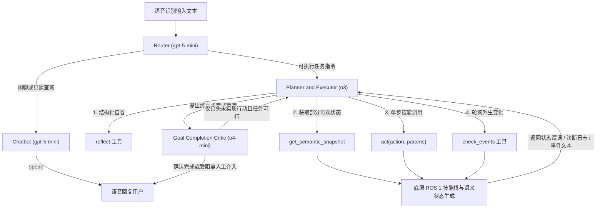

# Agentic AI for Robot Control: Flexible but still Fragile

## 一句话定义

**将推理型大语言模型（OpenAI o3）置于“自省规划—工具调用—语义状态快照—事件轮询”闭环中，通过可验证的高层技能 API 驱动双平台机器人，并借此系统剖析生成式智能体控制的迁移灵活性与长程脆弱性。**

## 英文缩写速查

| 缩写 | 英文全称 | 简要说明 |
|---|---|---|
| LLM | Large Language Model | 大语言模型；在本系统中分别承担路由、对话、规划执行与完成度评判角色 |
| API | Application Programming Interface | 应用程序编程接口；隔离高层语言推理与底层 ROS 控制栈的技能调用边界 |
| ROS | Robot Operating System | 机器人操作系统；Mobipick 与 Valdemar 底层技能栈均构建于 ROS 1 |
| DoF | Degree of Freedom | 自由度；Mobipick 配备 6-DoF 机械臂、末端相机与移动底盘 |
| POI | Point of Interest | 兴趣点；Valdemar 户外农业巡检场景中的预设导航扫描航点（`poi_1`–`poi_5`） |
| IK | Inverse Kinematics | 逆运动学；Mobipick 底层 MoveIt 轨迹规划与抓取放置的前置运动学求解组件 |

## 为什么重要

1. **填补“可迁移架构”与“真机长程脆弱性”之间的实证空白：** 多数工作侧重展示 LLM 规划成功案例，而本文在室内真机移动操作（Mobipick）与户外农业巡检仿真（Valdemar）上如实记录了不盲从提示词约束、非确定性目标选择、工具策略失控和陈旧世界模型等脆弱模式。
2. **明确高层代理与经典几何控制栈的职责边界：** 不要求 LLM 直接输出关节轨迹或原始位姿，而是通过离散符号谓词快照（如 `on(object, table_1)`）与参数化原子技能接口交互，使现有 ROS/MoveIt 工业栈可在不重训低层策略的前提下接入推理模型。
3. **给出可复用的八段式系统提示词与防“只说不做”评判机制：** 提出了针对具身控制的结构化提示词模板，以及独立的 `Goal completion critic` 来纠正推理模型“仅口头解释而不实际调用动作工具”的退化现象。

## 核心信息

| 字段 | 内容 |
|---|---|
| **作者** | Oscar Lima, Marc Vinci, Martin Günther, Marian Renz, Alexander Sung, Sebastian Stock, Johannes Brust, Lennart Niecksch, Zongyao Yi, Felix Igelbrink, Benjamin Kisliuk, Martin Atzmueller, Joachim Hertzberg |
| **机构** | German Research Center for Artificial Intelligence (DFKI, CAS Osnabrück)；Osnabrück University (Institute of Computer Science) |
| **发表时间** | 2026-02-13（arXiv:2602.13081v1 [cs.RO]） |
| **论文链接** | [arXiv:2602.13081](https://arxiv.org/abs/2602.13081)（[HTML 全文](https://arxiv.org/html/2602.13081)） |
| **项目与代码** | 项目页 <https://dfki-ni.github.io/AGENTS-MAKE-2026>（提示词页 `/prompts`）；Mobipick Gazebo 仿真包 <https://pypi.org/project/mobipick-labs-docker-gui>；符号事实生成前置依赖 <https://github.com/DFKI-NI/symbolic_fact_generation> |
| **清单分类** | `model.planning`, `harness.monitoring_and_recovery` |
| **开源状态** | **未确认开源控制源码**（本批次核查中 `project_page_status=0` 未抓通项目页；候选仓库 `https://github.com/DFKI-NI/symbolic` 系脚注截断地址且 `exists=false`；仅确认 PyPI Gazebo 仿真镜像与先前依赖仓库链接） |

## 核心原理

### 1. 四角色多智能体编排（Sec. 3, Table 1）

系统由语音识别转写的用户话语触发，采用 OpenAI Agent Builder 导出为 Python 编排代码并绑定机器人动作 API：

| 智能体角色 | 模型与推理强度 | 输出模式 | 可用工具 | 职责边界 |
|---|---|---|---|---|
| **Router** | `gpt-5-mini`（`minimal`） | `bool` | 无 | 判定指令属于闲聊问答还是需物理执行的任务 |
| **Chatbot** | `gpt-5-mini`（`minimal`） | `string` | `get today date`、`get available locations`、`get semantic environment representation snapshot`、`speak` | 回答查询与常规对话，不触发环境变更动作 |
| **Planner and executor** | `o3`（`low`） | `string` | `speak`、`act`、`reflect`、`get semantic environment representation snapshot`、`check for events` | 核心控制代理：自省规划、查询状态、执行技能、轮询事件与重规划 |
| **Goal completion critic** | `o4-mini`（`low`） | `string` | 无 | 审计完整执行日志，拦截“仅口头说明不调用工具”的行为；但在物理不可行或反复受阻时允许停机并报告原因 |

### 2. 八段式具身提示词结构（Sec. 4）

作者把“可迁移的机器人控制提示词”拆解为八个显式模块：
1. **领域模型（Domain Model）：** 描述机器人形态（如移动底盘 + 6-DoF 臂 + 末端相机）、物理限制（单次仅持一物、可达范围）、可观与不可观谓词（如夹持状态需内部记忆）。
2. **语义环境状态示例：** 给出状态快照的标准文本格式，强调状态会在移动、人类介入或感知误差后过期。
3. **操作指令与安全不变量：** 如必须先获取初始状态、动作后周期刷新状态、禁止无故不作为，以及平台安全规则（Mobipick 导航前收臂、放置前验空位；Valdemar 禁在棚内驾驶、对接前需到达入口位姿）。
4. **Affordance 与启发式：** 刻画物体属性（如重型工具 vs 可容纳多个小物体的容器、持物时限制观察姿态）与低风险偏好（少走弯路、不确定时先感知、推迟放置）。
5. **动作目录（Action Catalogue）：** 严格限定允许改变环境的唯一操作集合。
6. **规划-执行少样本示例：** 引导代理遵循“先 `reflect` 给出简短高层计划 → 读取状态 → 单步 `act` → 检查外生事件”的循环，并示范指代消歧与澄清策略。
7. **过往失败模式短记忆（Execution Failure Patterns）：** 以简短自省警示替代硬编码规则，抑制已知重复错误（如连续无效轮询事件或基于陈旧状态放置）。

### 3. 四原语工具接口与语义状态抽象（Sec. 5）

- **`reflect`：** 输出结构化推理轨迹作为“规划通道”（与 Inner Monologue 思路一脉相承），不改变物理环境。
- **`act(action, params)`：** 唯一环境变更原语，受严格模式约束（无额外字段），支持 `action` $\in \{\texttt{navigate}, \texttt{move\_arm}, \texttt{perceive}, \texttt{pick}, \texttt{place}, \texttt{insert}, \texttt{listen}, \texttt{speak}\}$ 及位置参数列表 `params`；返回结构化文本成功/失败诊断（如不可达位姿、抓取不可行），防止模型凭空编造失败原因。
- **`get semantic environment representation snapshot`：** 返回离散符号谓词快照。Mobipick 端由 `symbolic_fact_generation` 将末端相机观察缓冲转为 `at(robot, location)`、`on(object, table_1)`、`in(object, box)`、`arm_posture(robot, observe)`；Valdemar 端将 GPS 坐标映射到最近已知 POI/棚区，并将电量按阈值离散为 `okay` / `low` / `critical`。
- **`check_events`：** 显式轮询自上次调用以来的文本外生事件（急停、用户偏好变更、电量跃迁）。

## 流程总览

图依据：论文 Sec. 3（Fig. 2、Table 1）与 Sec. 5 工具接口定义。

## 源码运行时序图

**不适用**（截至 2026-11-27 核查：论文声明项目页为 `https://dfki-ni.github.io/AGENTS-MAKE-2026`，但本批次抓查未取得项目页正文（`project_page_status: 0`）；候选仓库 `https://github.com/DFKI-NI/symbolic` 系正文脚注 `https://github.com/DFKI-NI/symbolic_fact_generation` 的截断地址且在 `candidate_repos` 中判定 `exists: false`，未确认可运行的本研究官方智能体控制源码仓；论文仅另行提供了用于部分仿真验证的 PyPI 容器包 `https://pypi.org/project/mobipick-labs-docker-gui`。）

## 实验与评测

论文明确声明所有实验均为**定性概念验证（proof-of-concept demonstrations）**，旨在验证闭环可执行性与跨平台迁移性，**未汇报定量成功率或耗时统计表**。

| 实验编号 | 平台与环境 | 任务或指令 | 观察结果与暴露的脆弱性 |
|---|---|---|---|
| **Exp 1** | Mobipick（室内三桌，仿真+真机） | “put the multimeter inside the box and bring it to table 2” | 多数运行可完成“寻表→抓取→寻盒→装入→搬运”；但偶发未查空位“盲放”，且有时先找齐两物再折返抓取，引入冗余导航 |
| **Exp 2** | Mobipick（真机+事件中断） | 歧义指令“pick any tool I can use to screw with” | 环境同时存在螺丝刀与电钻；模型违背提示词中“螺丝刀难抓”警告，仅凭“更轻”常识选螺丝刀致碰撞风险触发急停；轮询事件后暂停等待，随后响应用户口头改选电钻并完成抓取 |
| **Exp 3** | Mobipick（部分感知约束） | “go to table 3 and take the box from there to table 2” | 识别到持有含万用表的盒子时不能执行 `perceive`（防倒翻）；提前规划为先去 table 2 感知空位，再到 table 3 取盒直运，零碰撞完成 |
| **Exp 4** | Mobipick（长程压力测试） | “transport all objects to table 2” | 利用蓝盒子批量转运并自发收集了提示词未点名的漂白剂瓶；抓瓶触发线缆急停后恢复；最后主动返 table 1 复核；但放置盒子前未强制刷新 table 2 陈旧位姿 |
| **Exp 5** | Valdemar（户外农业仿真，~1天迁移） | “scan poi_1, poi_2, poi_3, poi_4, poi_5” | 核对停靠与电量状态后自动出棚、逐点扫描并返棚对接充电，运行无异常 |
| **Exp 6** | Valdemar（低电量监测仿真） | 高耗电设置下扫描 3 个 POI | 电量转 `low` 后中断巡检返棚充电至 `okay` 并断点续扫；未指定目标电量时在 80%/90%/100% 间非确定性波动，且长航行动作无法被轮询实时抢占 |
| **Exp 7** | Valdemar（不可能指令拒绝） | “Fly to Paris” / “do a somersault” | 受技能 API 边界限制安全拒绝并发出语音解释；但拒绝后偶发幻觉，为迎合用户而提议同样不可执行的替代驾驶动作 |

- **跨实验定性观察（Sec. 6）：** 模型常不严格遵守提示词中的 `check_events` 调用时机（时而连续高频冗余调用，时而遗漏）；但正面效应是当非专业用户要求“demonstrate a real scan”时，系统能自发串联充电-出棚-导航-扫描-返航并配合语音解释流程，提升人机交互透明度。

## 与其他工作对比

| 对比维度 | 本文 Agentic Control | 经典符号规划器（McDermott 1992; Ghallab et al. 2025） | 早期 LLM 分层规划（SayCan / ReAct / Inner Monologue / CAPE / AutoGPT+P） | 端到端 VLA / 机器人基础模型 |
|---|---|---|---|---|
| **领域建模方式** | 自然语言八段式提示词（~1 天迁移 Valdemar） | 专家编写 PDDL/形式化领域动作模型，迁移成本高 | 提示模板或固定技能价值函数（如 SayCan 需训练 affordance Q 函数） | 大规模具身数据端到端联合训练 |
| **动作与感知边界** | 高层符号快照 + ROS 1 参数化技能 API | 离散逻辑谓词 + 底层执行器 | 离散技能词表 + 视觉描述或前置错误纠偏 | 图像与文本直接映射连续低层控制动作 |
| **反馈与自省** | `reflect` + 结构化报错文本 + `check_events` + Critic 监督 | 显式计划监控，但缺乏自然语言交互解释 | Inner Monologue / CAPE 支持文本反馈闭环，缺独立防空谈评判器 | 隐式表征，长程可解释性与人为中途纠偏较弱 |
| **主要短板** | 轮询无法抢占长动作、提示词冗余脆弱、远端推理延迟 | 开放词表指令与未建模突发事件处理僵化 | 对格式敏感、缺少跨异构平台迁移脆弱性实证剖析 | 不具备即插即用复用现有经典 ROS 控制栈的零样本迁移力 |

## 结论

**一句话总判：在具备完善底层 ROS 技能栈的前提下，用推理型 LLM 加极简四原语工具接口确实能以极低改造成本完成跨平台迁移，但提示词脆弱性、非确定性与同步轮询盲区使该范式目前仅适合受限原型验证而非高可靠无人部署。**

1. **用统一抽象层解耦推理与几何：** 将运动规划、抓握合成与 6-DoF 估计严格保留在底层技能 API，让 LLM 只消费离散符号快照和文本错误诊断，是现有机器人团队最快接入推理模型的工程路径。
2. **必须引入独立防空谈监督：** 推理模型存在“仅口头规划不调工具”的退化倾向，部署时应保留类似 `Goal completion critic` 的外部执行审计器，但同时赋予其在物理不可行时停止的权限。
3. **关键安全不变量不可只写一遍：** 实验表明 LLM 对单处提示约束遵守不稳定，安全硬约束应同时下沉到底层技能 API 前置校验，并在提示词领域模型、规则与反例记忆中冗余声明。
4. **长动作任务必须改造为可抢占异步机制：** 依赖同步轮询 `check_events` 无法在导航等长耗时动作途中响应低电量或急停，工程落地需将技能封装为可取消（preemptible）动作或切分为检查点子步。

## 工程实践

- **底层栈前置条件（Sec. 5）：**
  - 室内移动操作（Mobipick）：需先具备 ROS 1 自主导航、物体分类与 6-DoF 位姿估计、抓取合成、MoveIt 逆解与轨迹监控、放置位姿可行性采样，以及将感知缓冲转为离散谓词的 `symbolic_fact_generation`。
  - 户外/其他平台（Valdemar）：需提供封装底层控制的 Python 技能 API、位姿到已知地标/区域的映射，以及电池/遥测阈值离散化。
- **跨平台迁移清单：** 保留 `Router / Chatbot / Planner & Executor / Critic` 四角色编排与四原语工具签名不变，集中替换提示词中的领域模型、物体 affordance、安全不变量与动作目录，并把 `act(action, params)` 重新绑定到目标平台的技能 API。
- **调试与复现：** 借助 `reflect` 输出记录决策依据；可将 Mobipick 场景部署在论文提及的 Gazebo Docker 仿真包（`mobipick-labs-docker-gui`）中先行验证工具调用序列与事件中断恢复，再上真机。

## 局限与风险

1. **同步轮询导致的实时响应盲区：** 当前工具循环为同步阻塞式，`check_events` 仅能在离散动作间隙触发，无法在长距离导航中途及时抢占并返航充电（Exp 6）。
2. **强提示词敏感性与冗余建模成本：** 为抑制不安全动作，必须跨领域模型、操作规则、少样本示例与历史错题多个区块重复强调同一约束，且长程下仍会出现遗漏刷新表盘状态（Exp 1、Exp 4）或误判工具选择（Exp 2）。
3. **非确定性与工具策略不可控：** 欠定义目标会导致停止标准随机波动（如充电目标在 80%/90%/100% 间跳变），且模型会频繁或无规律地连调 `check_events`。
4. **幻觉与人机交互安全边界：** 面对不可执行指令时，API 层虽能兜底拒绝执行，但语言模型在解释时仍会编造同样不可行的替代方案（Exp 7）；此外系统未涉及模型对齐与提示注入（prompt injection）防护。
5. **远端云推理的成本、延迟与断网风险：** 系统依赖云端大模型推理（`o3` / `o4-mini` / `gpt-5-mini`），论文指出每步工具决策均带来经济成本、额外端到端延迟以及对稳定互联网连接的强依赖（未给出具体延迟测量数值）。

## 关联页面

- [Agentic Robots 综述](paper-towards-agentic-robots-survey.md)
- [全量项目节点清单](../overview/awesome-agentic-robots-node-index.md)
- [VLA 方法背景](../methods/vla.md)
- [智能体机器人操作策略](../methods/agentic-manipulation-policies.md)：对照操作场景中的规划、执行与反馈接口
- [机器人智能体执行框架](../methods/robot-agent-harness.md)：对照技能契约、前置检查与有限恢复边界
- [智能体规划与反馈执行](../methods/agent-planning-feedback.md)：对照反馈驱动的重规划与状态验证闭环
- [智能体工具调用接口](../methods/agent-tool-use-interface.md)：对照严格参数模式与执行错误诊断契约
- [操作任务](../tasks/manipulation.md)：对照桌面抓取、放置与容器插入任务需求

## 推荐继续阅读

- [arXiv:2602.13081 HTML 全文](https://arxiv.org/html/2602.13081)
- [AGENTS-MAKE-2026 官方项目与提示词主页](https://dfki-ni.github.io/AGENTS-MAKE-2026)
- [Mobipick Gazebo Docker 仿真包（PyPI）](https://pypi.org/project/mobipick-labs-docker-gui)
- [DFKI-NI/symbolic_fact_generation 前置仓库](https://github.com/DFKI-NI/symbolic_fact_generation)

## 参考来源

- [论文全文核对归档（arXiv:2602.13081）](../../sources/papers/paper-agentic-2602-13081.md)
- [Awesome Agentic Robots 索引快照](../../sources/repos/awesome-agentic-robots-survey-index.md)
- [arXiv:2602.13081 摘要页](https://arxiv.org/abs/2602.13081)
- [AGENTS-MAKE-2026 项目页（论文声明）](https://dfki-ni.github.io/AGENTS-MAKE-2026)
