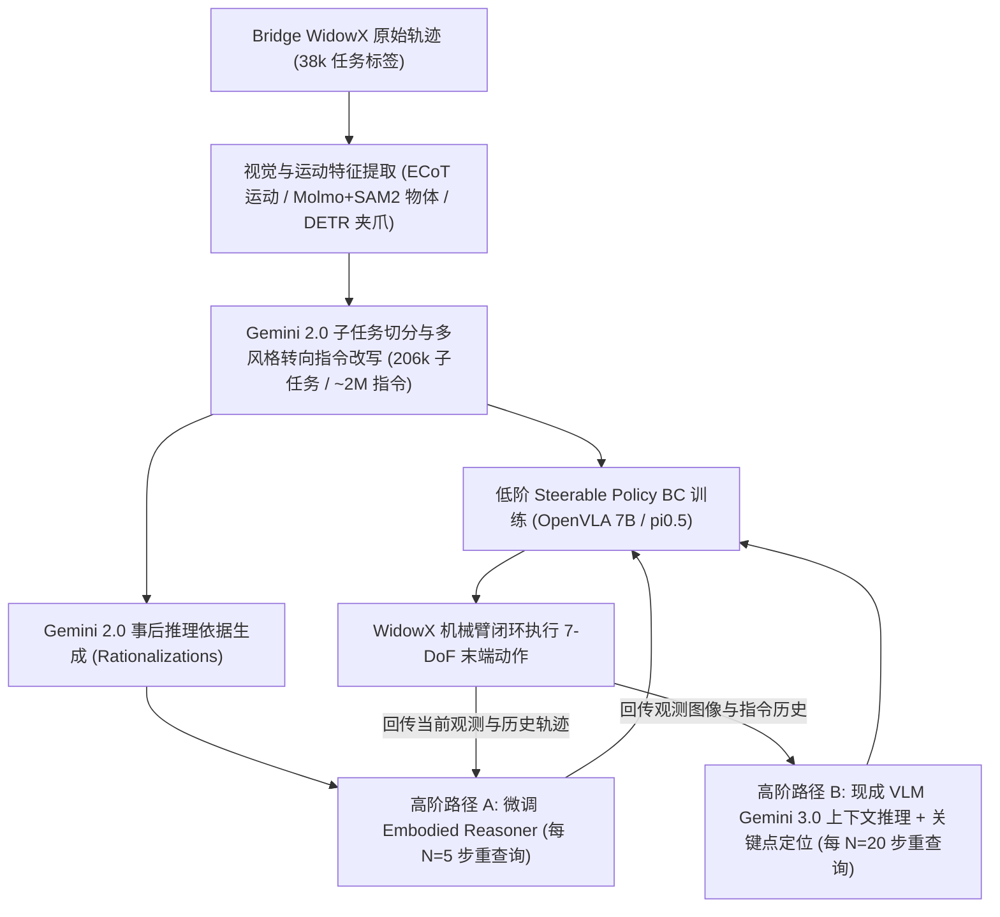
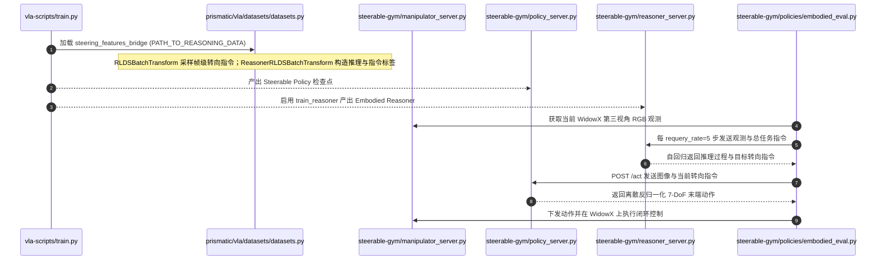

# Steerable Vision-Language-Action Policies for Embodied Reasoning and Hierarchical Control

## 一句话定义

Steerable Policies 是一种在多抽象层级合成转向指令（任务、子任务、原子运动、像素点、夹爪轨迹及混合指令）上训练的视觉-语言-动作模型（VLA），旨在扩大高阶视觉-语言模型（VLM）向低阶控制策略传递推理与上下文学习能力的接口带宽。

## 英文缩写速查

| 缩写 | 英文全称 | 简要说明 |
|---|---|---|
| VLA | Vision-Language-Action Model | 视觉-语言-动作模型，接收图像与语言指令并输出机器人动作 |
| VLM | Vision-Language Model | 预训练视觉-语言基础模型，在本工作中担任高阶规划与推理器 |
| BC | Behavioral Cloning | 行为克隆，通过监督学习模仿专家演示动作分布 |
| CoT | Chain-of-Thought | 思维链，指模型在输出指令前显式生成中间推理过程 |
| ECoT | Embodied Chain-of-Thought | 具身思维链，结合场景与机器人状态生成具身推理序列 |
| ICL | In-Context Learning | 上下文学习，高阶 VLM 基于历史观测与指令序列在线修正策略 |

## 为什么重要

在分层机器人控制框架（高阶 VLM 规划 + 低阶 VLA 执行）中，高阶与低阶之间通常仅通过单一层级的自然语言任务或子任务指令通信。由于现有机器人数据集的文本标注过于公式化且语义粗糙，低阶 VLA 往往无法识别分布外物体、区分多实例目标或执行精细空间纠偏，导致高阶 VLM 即使判断出了正确策略也“指挥不动”底层执行器。

本工作指出**低阶策略的可控性（steerability）是将基础模型泛化能力迁移至物理机器人控制的关键瓶颈**。通过自动化管线将 Bridge 数据集从 38k 条标准任务标签扩展至近 2M 条跨抽象层级的转向指令，作者证明：同一个高阶模型在面对不同任务与场景时，能够动态选择最合适的指令抽象层级，从而在不改动底层架构假设的前提下大幅提升语义泛化、空间泛化、运动泛化与长程多步任务表现。

## 核心信息

| 维度 | 内容 |
|---|---|
| 作者 | William Chen, Jagdeep Singh Bhatia, Catherine Glossop, Nikhil Mathihalli, Ria Doshi, Andy Tang, Danny Driess, Karl Pertsch, Sergey Levine |
| 机构 | UC Berkeley、Stanford University、Physical Intelligence |
| 发表时间 | arXiv:2602.13193v3（v1 提交 2026-02-13，v3 修订 2026-04-06） |
| 论文链接 | [arXiv:2602.13193](https://arxiv.org/abs/2602.13193) / [HTML 全文](https://arxiv.org/html/2602.13193) |
| 项目与代码 | [官方项目页](http://steerable-policies.github.io) / [OpenVLA 训练代码 `steerable-policies-bridge`](https://github.com/steerable-policies/steerable-policies-bridge) / [WidowX 评测环境 `steerable-gym`](https://github.com/steerable-policies/steerable-gym) / [HF 模型](https://huggingface.co/Embodied-CoT/steerable-policy-openvla-7b-bridge) / [HF 标注集](https://huggingface.co/datasets/Embodied-CoT/steering_features_bridge) |
| 清单分类 | model.perception |
| 来源条目 | `survey_ax_2602_13193` |
| 开源状态 | 部分开源（OpenVLA 基座训练与推理代码、`steerable-policy-openvla-7b-bridge` 权重及 `steering_features_bridge` 数据集已公开；README 中 Embodied Reasoner 权重链接尚在注释占位，且 $\pi_{0.5}$ 微调改动未单独随该仓库发布） |

## 核心原理

### 1. 六类多抽象层级转向指令（Styles of Steering Commands）

为兼顾通用泛化性、高阶 VLM 可生成性以及大规模合成标注可行性，论文定义了六类统一以纯文本 token 表示的指令风格（像素坐标归一化至 $[0, 255]$，格式为 `[x, y]`）：

1. **任务指令（Tasks）：** 数据集原始高层目标，如 `"put the carrot in the pot"`，保留标准 VLA 能力。
2. **语义子任务（Subtasks）：** 分解后的语义步骤，如 `"reach for the carrot"`，用于组合已有技能。
3. **原子运动（Atomic motions）：** 不依赖物体名称的细粒度运动语言，如 `"move left"`、`"open gripper"`，支持空间关系任务与局部位姿修正。
4. **夹爪轨迹（Gripper traces）：** 夹爪应经过的 2D 像素点序列，如 `"move from [x1, y1] to [x2, y2]"`。
5. **关键点指向（Points）：** 指示目标物体或交互位置的 2D 像素点，如 `"grasp at <carrot position>"`、`"open gripper above the container at [x, y]"`，用于突破未见物体命名盲区并消除多实例歧义。
6. **混合组合（Combinations）：** 跨模态拼接指令，如 `"move left from [x, y] to the carrot at <carrot position>"`。

### 2. 大规模自动化合成标注管线

作者基于 Bridge WidowX 轨迹构建全自动标注流程，将 38k 条原始任务标签扩增为 206k 个子任务片段与近 2M 条转向指令：

- **运动语言提取：** 按 ECoT 流程从末端执行器位移程序化生成原子运动描述。
- **物体定位与掩码追踪：** 使用 MolmoE-1B-0924 从首帧提取最多 4 个场景物体名称，通过 Molmo-7B-D-0924 定位初始像素点，再由 SAM 2 沿整条视频轨迹传播，获得时序一致的开放词汇边界框与 `<loc><seg>` 表征（后处理过滤掉未出现在任务描述中的无关物体）。
- **夹爪轨迹提取：** 人工标注 100 张 Bridge 图像训练轻量 DETR 检测器，批量提取全数据集每帧的夹爪质心像素坐标。
- **子任务切分与指令改写：** 将整体任务、去重后的带时间戳运动列表及物体清单输入 Gemini 2.0，先划分为有序子任务字典，再结合每步夹爪坐标、物体中心点与运动标签提示 Gemini 2.0 为每个子任务生成多种风格的等效转向指令。
- **事后推理依据（Rationalizations）：** 为每个子任务的首帧再次调用 Gemini 2.0，在不直接引用历史子任务名称的前提下，生成结合视觉状态推断“为何此时应执行该子任务/指令”的解释文本，用于高阶推理器监督。

### 3. 低阶策略与两种高阶控制范式

- **低阶 Steerable Policy 训练：** 本质仍为标准行为克隆 $\pi(a \mid o, g)$，在每一训练帧以均匀随机方式从“整体任务指令 + 对应子任务 + 全部合成转向指令”中采样一条 $g$ 替换原始任务文本。论文在两个代表性 VLA 上验证了该配方无关具体架构：
  - **OpenVLA 版：** 基于 Prismatic VLM 7B（DINOv2-SigLIP + Llama2 7B），单第三视角 RGB 输入（不用腕部相机），256 桶离散动作 token，在 8×H100 上以 batch size 256 训练 80k 步。
  - **$\pi_{0.5}$ 版：** 基于 OpenPi DROID 微调配方（关闭 Knowledge Insulation，不输入本体感觉，action chunk=4 且闭环仅执行首步动作），在 8×H200 上训练 30k 步（耗时不足一天）。
- **高阶策略 A — 微调具身推理器（High-level Embodied Reasoner）：** 沿用 Prismatic VLM 7B 架构与 Next-Token Prediction 损失，输入当前图像与总任务描述，自回归输出“推理依据 + 目标转向指令”；推理时低阶策略每执行 $N=5$ 步重新查询一次高阶模型，实现快慢双系统解耦与推理加速。
- **高阶策略 B — 现成 VLM 上下文推理（In-Context Reasoning）：** 直接调用 Gemini 3.0（分配 1024 thinking tokens），在提示词中提供所有指令风格的优缺点说明及“历史观测图像-已执行指令”序列，要求模型按“场景变化解析 → 下一步需求 → 各类别候选指令生成 → 最优抽象层级决策 → 输出单行指令”执行（每 $N=20$ 步重查询）。其中 `<object>` 语义点位由另一独立 Gemini 3.0 定位调用转为 `[x, y]` 像素坐标；实验同时发现现成 VLM 直接预测完整夹爪轨迹效果较差，故在该模式中禁用轨迹抽象，保留子任务、原子运动、点位与混合指令。

论文在附录 E-B 中进一步归纳了低阶策略的**“合理动作流形（manifold of reasonable actions）”**现象：当给定诸如 `"move left"` 这类欠约束（underspecified）原子运动指令时，Steerable Policy 不会像手柄遥控那样盲目沿单一方向直线平移，而是结合视觉场景在所有“与向左移动相符的合理操控任务”边缘分布中采样动作（例如空爪时向左下靠近物体，持物时向左上移向容器），因此单模态测试中原子运动表现尤为稳健；但在多个同类候选物体同处左侧时仍会受限于语义歧义，必须借助点位或混合指令消歧。

## 流程总览

## 源码运行时序图

在 `steerable-policies/steerable-policies-bridge` 中，训练入口为 `vla-scripts/train.py`（通过 `prismatic/vla/datasets/datasets.py` 内的 `RLDSBatchTransform` 与 `ReasonerRLDSBatchTransform` 切换低阶策略或高阶推理器数据流，并由 `train_reasoner` 配置项控制）；WidowX 实机分层推理则由策略端调用配套 `steerable-gym` 中的服务脚本协同运行。

## 实验与评测

论文在真实世界 Bridge WidowX 机械臂上共执行超过 **650 个 rollout episodes**，覆盖三大评测套件（Human Oracle 探索上下界、Embodied Reasoner 对比套件、In-Context Learning 长程多步套件）。

### 1. Human Oracle 可控性上限实验（Section VI-A & Fig. 5）

人类专家每 $\ge 2$ 秒可中断并输入一条任意风格的转向指令（含 GUI 点选像素坐标）。结果表明：**允许自由组合所有指令风格时，成功率接近 100%**；即使限制为单一风格，Task/Subtask/Motion/Trace/Point 均优于直接输入标准任务级标签；各风格在不同泛化轴上高度互补：
- **语义泛化（分布外物体）：** Trace / Point 占优，无需识别新物体名称即可精确指代。
- **空间泛化（左右/相对关系）：** Atomic motions 表现最佳，并成为单模态限制下总体最强的风格。
- **分布内片段：** Tasks / Subtasks 足够可靠。

### 2. 高阶具身推理器评测结果（Table I，复用 ECoT-Lite 任务套件，指标为成功率 `% ± StdErr`）

| 评估分组 / 任务 | OpenVLA | $\pi_{0.5}$ | ECoT-Lite (Dropout) | ECoT-Lite (Pre-train) | Full ECoT | Ours 无推理消融 | Ours 完整 (OpenVLA) | Ours 完整 ($\pi_{0.5}$) |
|---|---:|---:|---:|---:|---:|---:|---:|---:|
| **In Dist.** Mushroom/Corn/Eggplant in pot/bowl | 72.2 | 61.1 | 72.2 | 88.9 | 88.9 | 72.2 | 88.9 | **94.4** |
| **In Dist.** Spoon/Carrot in/on plate/towel | 75.0 | **100** | 66.7 | 91.7 | 91.7 | 66.7 | 91.7 | 83.3 |
| **In Dist. Challenge** 绿物体放毛巾（全绿干扰） | 16.7 | 50.0 | 66.7 | 66.7 | **83.3** | 66.7 | 66.7 | 50.0 |
| **In Dist. Challenge** 绿/粉勺子放盘/毛巾 | **87.5** | **87.5** | 62.5 | 37.5 | 75.0 | 62.5 | 75.0 | **87.5** |
| **Motion Gen.** 放置到高处目标 | 8.3 | 41.6 | 25.0 | 33.3 | 58.3 | **83.3** | **83.3** | 75.0 |
| **Spatial Gen.** Banana/Tomato 放左/右碗 | 91.7 | 83.3 | 75.0 | 83.3 | 91.7 | 91.7 | **100** | 91.7 |
| **Spatial Gen.** 绿/橙玩具放左/右锅 | 50.0 | 75.0 | 75.0 | **87.5** | 75.0 | 62.5 | **87.5** | **87.5** |
| **Spatial Gen.** Mushroom/Carrot 移至他物左/右 | 62.5 | 62.5 | **100** | **100** | 75.0 | 75.0 | 87.5 | **100** |
| **Semantic Gen.** Watermelon 放毛巾 | 0 | 33.3 | **83.3** | **83.3** | 66.7 | 50.0 | 66.7 | **83.3** |
| **Semantic Gen.** Toothbrush 放盘子 | 33.3 | 50.0 | 50.0 | 83.3 | 66.7 | 50.0 | **100** | **100** |
| **Semantic Gen.** Screw 放碗里 | 33.3 | 16.7 | 16.7 | 66.7 | 66.7 | 50.0 | **83.3** | **83.3** |
| **Semantic Gen.** Reach for ketchup/wrench/mallet | 11.1 | 33.3 | 22.2 | 0 | **66.7** | 33.3 | **66.7** | 55.5 |
| **Aggregate（全任务汇总）** | 50.5 ± 4.7 | 61.3 ± 4.6 | 60.4 ± 4.6 | 69.4 ± 4.4 | 77.5 ± 4.0 | 66.7 ± 4.5 | **84.6 ± 3.4** | **83.7 ± 3.4** |

关键消融结论：即使在 OpenVLA 与 $\pi_{0.5}$ 两种迥异的 VLA 架构上，引入 Steerable Policies + 高阶具身推理器均显著超过对应标准基线（+34.1 pp 与 +22.4 pp）；去掉高阶推理（仅直接预测转向指令）聚合成功率降至 `66.7%`，证实显式具身推理对跨分布泛化至关重要。

### 3. 现成 VLM 上下文推理长程多步评测（Table II，Gemini 3.0，指标为平均任务进度分 `% ± StdErr`）

| 评估分组 / 任务 | Standard OpenVLA | SayCan-Like（仅限子任务） | Ours 无推理消融（0 thinking） | Ours 完整方案（1024 thinking） |
|---|---:|---:|---:|---:|
| **Long Horizon 1** 让蘑菇成为盘上唯一物体 | 35.0 | 70.0 | 80.0 | **100** |
| **Long Horizon 1** 让蓝积木成为盘上唯一物体 | 30.0 | 65.0 | **90.0** | 80.0 |
| **Long Horizon 2** 食物进蓝锅、毛绒玩具进棕锅 | 50.0 | 36.7 | 53.3 | **66.7** |
| **Long Horizon 2** 食物进白碗、毛绒动物进绿碗 | 43.3 | 63.3 | **80.0** | 76.7 |
| **Motion Gen.** 叠放锅具（Stack the pots） | 45.0 | 85.0 | 55.0 | **95.0** |
| **Motion Gen.** 在毛巾上叠放锅具 | 40.0 | 60.0 | **90.0** | 65.0 |
| **Spatial Gen.** 香蕉放盘子左/右侧 | 60.0 | 80.0 | 90.0 | **100** |
| **Spatial Gen.** 蓝白毛绒玩偶放左/右碗 | 80.0 | 90.0 | **100** | **100** |
| **Semantic Gen.** 锤子放毛巾 | 40.0 | 60.0 | 70.0 | **80.0** |
| **Semantic Gen.** 螺丝放盘子 | 60.0 | 30.0 | 70.0 | **80.0** |
| **Aggregate（全任务汇总）** | **48 ± 5.1** | **64 ± 5.5** | **78 ± 4.0** | **84 ± 3.7** |

定性分析（Fig. 8）显示，全抽象集合使 Gemini 3.0 能够通过观察历史纠偏（例如点位抓取失败后主动切换为运动指令，或识别出误抓物体后先抬高避障再水平移动），而 SayCan-Like 基线即便在推理中发现抓取失败，由于只能反复下发 `"grasp the screw"` 等子任务指令，低阶 VLA 仍会在同一错误抓取循环中卡死。

## 与其他工作对比

| 对比维度 | 标准 VLA（[OpenVLA](paper-openvla.md) / [π0.5](paper-pi05-open-world-vla.md)） | 端到端推理 VLA（[ECoT](paper-ecot.md) / ECoT-Lite） | 单/双模态可转向策略（[MolmoAct](paper-molmoact.md) / HAMSTER / RT-Trajectory） | 仅子任务分层（SayCan-Like） | Steerable Policies（本文） |
|---|---|---|---|---|---|
| 提示模态广度 | 单一任务级文本 | 内部自回归推理后输出动作 | 1–2 种（如仅轨迹或任务文本+轨迹） | 仅自然语言子任务 | 任务、子任务、原子运动、像素点、夹爪轨迹及组合（全文本 token） |
| 高低阶耦合方式 | 单一端到端策略 | 端到端共训（推理-动作潜在绑定较强） | 分层或半解耦，部分需同时提供文本与轨迹 | 分层解耦，低阶缺乏精细可控性 | 完全分层解耦，高阶可按场景动态切换抽象层级 |
| 在线上下文纠偏 | 无 | 固定频率端到端推理，无外部抽象切换 | 缺乏多抽象切换能力 | 能发现错误但子任务表达力不足以纠偏 | 现成 VLM 可借历史观测切换抽象风格实现纠偏 |
| 实机表现参考 | Bridge 聚合 50.5% / 61.3% | Full ECoT 77.5%，ECoT-Lite 60.4%–69.4% | MolmoAct 的轨迹引导仍依赖任务文本共同输入 | 长程多步平均进度 64% | 具身推理套件 84.6% (OpenVLA) / 83.7% ($\pi_{0.5}$)；长程 ICL 套件 84% |

## 结论

**一句话总判：在无需发明新动作头或采集新实机演示的前提下，将现有机器人数据集重写为跨抽象层级的合成转向指令来训练低阶 VLA，即可成为打通高阶 VLM 推理与上下文学习能力的有效桥梁。**

1. **接口扩宽优先于单模态调优：** 实验证明没有任何单一提示风格能在所有泛化轴上占优（点位胜在未见物体、原子运动胜在空间关系、子任务胜在分布内组合），低阶策略应同时覆盖多层级抽象。
2. **高低阶分离训练优于纯端到端共训：** 将推理与指令选择移交独立高阶 VLM，既减少低阶策略在推理文本与动作间学到虚假相关性，又允许通过降低查询频率（$N=5$ 或 $N=20$）天然加速闭环控制。
3. **现成 VLM 上下文学习无需动作空间定制：** 因为高阶 VLM 输出的是自然语言/坐标转向指令而非原始末端位姿，可直接套用视觉-语言多模态上下文学习进行零样本错误恢复。
4. **模型无关的通用训练配方：** 仅修改数据采样变换（如 `RLDSBatchTransform`）即可同时赋能离散 token 架构（OpenVLA）与连续流匹配架构（$\pi_{0.5}$）。
5. **数据多样性是前提：** 该配方释放的是训练数据中隐含的行为多峰性；对于初始状态单一、轨迹单峰的小型基准（如 LIBERO），合成转向指令无法凭空创造行为多样性。

## 工程实践

- **数据管道与存储：** 可直接复用 HuggingFace 上的 [`steering_features_bridge`](https://huggingface.co/datasets/Embodied-CoT/steering_features_bridge) 字典，在 `prismatic/vla/datasets/datasets.py` 中配置 `PATH_TO_REASONING_DATA` 后按 OpenVLA FSDP 全分片配方微调；若面向自有数据集复现标注管线，需注意对象追踪阶段对显存与 API 成本的平衡（Molmo + SAM 2 + DETR + Gemini 2.0 批量调用）。
- **推理架构与部署：** 实机部署采用 `manipulator_server.py`（机器人端）+ `policy_server.py`（VLA 端）+ `reasoner_server.py` 或 Gemini API（高阶端）的解耦架构；实际运行 ICL 模式时，建议关闭高阶 VLM 的完整夹爪轨迹生成（论文证实直接生成坐标序列稳定性差），改为输出语义标签 `<object>` 再由轻量定位调用转换为 `[x, y]`。
- **重查询周期调参：** 论文在微调 Embodied Reasoner 中采用 `requery_rate = 5`，而在延迟更高的云端 API（Gemini 3.0）上采用 `sample_every = 20`；若换用不同控制频率的机械臂，需按单步物理位移量相应缩放查询步长。

## 局限与风险

- **高阶模型对低阶可供性（affordances）的认知盲区：** 论文在 Appendix E-D 指出，现有最主要失效模式来自高阶 VLM 未充分掌握低阶 VLA 的真实响应边界（例如放置完成后若下达易触发数据集偏置的指令，低阶策略可能重复抓起刚放下的物体），目前缺乏通过 RL 或闭环 rollout 专门对齐高阶 VLM 与低阶 VLA 可供性的机制。
- **对基础数据集行为多样性的强依赖：** 如论文对 LIBERO 的分析所示，Steerable Policies 只能“索引并组合”训练集中已潜藏的技能，无法在窄分布、单峰演示数据集上诱导出原本不存在的泛化运动模式。
- **云端 VLM 延迟与多步定位成本：** ICL 方案每 $N=20$ 步需调用一次带 1024 thinking budget 的 Gemini 3.0，且当指令含 `<object>` 时还需额外调用一次坐标定位，难以直接满足高频实时反应控制，且在目标被遮挡时点位检测器可能失效。
- **部分产物未完全开放：** 截至当前仓库核对，高阶 Embodied Reasoner 的独立检查点链接在 README 中仍被注释，且基于 $\pi_{0.5}$ / OpenPi 的训练脚本未随 `steerable-policies-bridge` 一并公开。

## 关联页面

- [Agentic Robots 综述](paper-towards-agentic-robots-survey.md)
- [全量项目节点清单](../overview/awesome-agentic-robots-node-index.md)
- [VLA 方法背景](../methods/vla.md)
- [机器人控制系统架构](../methods/robot-control-architecture.md)
- [行为克隆（Behavior Cloning）](../methods/behavior-cloning.md)
- [自动化数据标注流水线](../methods/auto-labeling-pipelines.md)
- [智能体式操作策略](../methods/agentic-manipulation-policies.md)
- [机器人操作任务（Manipulation）](../tasks/manipulation.md)
- [OpenVLA](paper-openvla.md)
- [π0.5（Open-World VLA）](paper-pi05-open-world-vla.md)
- [ECoT（具身思维链推理）](paper-ecot.md)
- [MolmoAct](paper-molmoact.md)

## 推荐继续阅读

- [Steerable Policies 官方项目页](http://steerable-policies.github.io)
- [论文全文（arXiv:2602.13193 HTML）](https://arxiv.org/html/2602.13193)
- [官方代码仓库 `steerable-policies/steerable-policies-bridge`](https://github.com/steerable-policies/steerable-policies-bridge)
- [配套环境仓库 `steerable-policies/steerable-gym`](https://github.com/steerable-policies/steerable-gym)

## 参考来源

- [论文原文核对归档](../../sources/papers/paper-agentic-2602-13193.md)
- [官方代码仓库静态核对归档](../../sources/repos/paper-agentic-2602-13193.md)
- [官方 Awesome 快照归档](../../sources/repos/awesome-agentic-robots-survey-index.md)
- [arXiv:2602.13193](https://arxiv.org/abs/2602.13193)
- [项目主页 http://steerable-policies.github.io](http://steerable-policies.github.io)
- [GitHub 仓库 steerable-policies-bridge](https://github.com/steerable-policies/steerable-policies-bridge)
