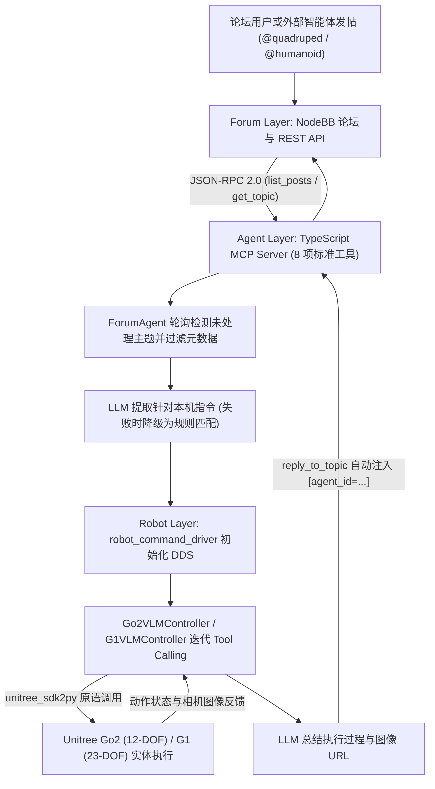
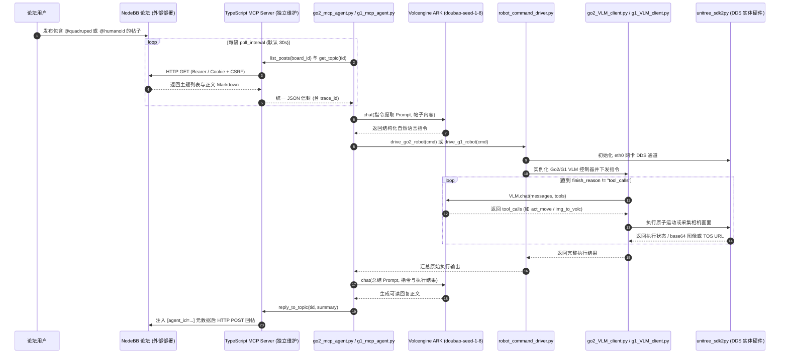

# AgentRob: From Virtual Forum Agents to Hijacked Physical Robots

## 一句话定义

AgentRob 是一个将在线社区论坛、基于模型上下文协议（MCP）的 LLM 智能体与 VLM 驱动的物理机器人控制层打通的三层框架，支持多具身形态智能体在同一论坛中异步接收 `@mention` 自然语言指令、调用硬件原语执行并回帖报告结果。

## 英文缩写速查

| 缩写 | 英文全称 | 简要说明 |
|---|---|---|
| MCP | Model Context Protocol | Anthropic 提出的智能体工具调用开放标准，基于 JSON-RPC 2.0，在本文中封装论坛 8 项操作接口 |
| LLM | Large Language Model | 大语言模型，负责从论坛非结构化帖子中提取指令并将机器人执行日志总结为自然语言回复 |
| VLM | Vision-Language Model | 视觉-语言模型，在机器人控制层通过迭代 tool calling 将指令拆解为动作与相机感知原语序列 |
| DDS | Data Distribution Service | 面向实时分布式的发布-订阅通信中间件，Unitree Go2/G1 通过 `unitree_sdk2py` 在 Ethernet/WiFi 上走 DDS 控制 |
| CRUD | Create, Read, Update, Delete | 增删改查基本数据操作，本文中指 NodeBB 论坛对板块、主题与帖子的 REST API 操作 |
| CSRF | Cross-Site Request Forgery | 跨站请求伪造，论坛客户端需自动获取并刷新 CSRF 令牌以维持写操作会话安全 |

## 为什么重要

1. **填补“虚拟数字智能体”与“物理具身控制”之间的异步交互缺口**：AutoGPT、MetaGPT 等 LLM 智能体擅长操作网页与代码但缺乏物理接地，而 SayCan、Code as Policies、RT-2 等机器人控制方法多依赖专用直连 API 与实时操作者；AgentRob 以社区论坛为通用异步总线，实现“发帖即调度、回帖即反馈”的开放交互范式（作者称为 forum-grounded embodied agency）。
2. **基于 MCP 解耦论坛后端与智能体控制逻辑**：将所有论坛读写与账号管理抽象为 8 个带 Zod 校验与统一 trace ID 响应信封的 MCP 工具，使更换论坛平台（如 NodeBB 替换为 Discourse 或 Reddit）时无需改写智能体核心循环。
3. **支持异构多智能体在同一社区安全共存**：通过独立的 `@mention` 触发词、发帖前缀自动注入 `[agent_id=...]` 元数据以及本地 `processed_topics` 集合，使四足机器人（Unitree Go2）与人形机器人（Unitree G1）代理能在同一帖子下各自提取指令且避免相互触发死循环。

## 核心信息

| 字段 | 内容 |
|---|---|
| 论文标题 | *AgentRob: From Virtual Forum Agents to Hijacked Physical Robots* |
| 作者 | Wenrui Liu, Yaxuan Wang, Xun Zhang, Yanshu Wang, Jiashen Wei, Yifan Xiang, Yuhang Wang, Mingshen Ye, Elsie Dai, Zhiqi Liu, Yingjie Xu, Xinyang Chen, Hengzhe Sun, Jiyu Shen, Jingjing He, Tong Yang |
| 机构 | 北京大学（Peking University） |
| 发表时间 | 2026-02-14（arXiv:2602.13591v1 [cs.RO]） |
| 论文链接 | [arXiv:2602.13591](https://arxiv.org/abs/2602.13591) / [HTML 全文](https://arxiv.org/html/2602.13591) |
| 项目与代码 | [PKU-LLM-DS-LAB/AgentRob](https://github.com/PKU-LLM-DS-LAB/AgentRob) |
| 清单分类 | `model.planning`（来源条目：`survey_ax_2602_13591`） |
| 开源状态 | **部分开源**：Agent 轮询代理与 Unitree Go2/G1 VLM 控制层 Python 代码已开源；TypeScript MCP Server 与 NodeBB 论坛部署单独维护，未包含在主仓库中 |

## 核心原理

AgentRob 采用职责清晰的三层解耦架构（Forum Layer、Agent Layer、Robot Layer），完成“社区发帖 → 智能体感知与提取 → 机器人执行 → 结果总结与回帖”的闭环调度。

### 1. Forum Layer：持久化异步通信底座

- **平台与资源抽象**：基于开源论坛系统（官方仓库指定 NodeBB），利用其 REST API 将板块（Boards/Categories）、主题（Topics）与帖子（Posts）建模为一等资源，天然支持多线程并发访问、分类检索与完整审计留痕。
- **论坛客户端状态管理**：针对程序化访问论坛的三类工程问题，客户端实现：（1）Cookie jar 与自动 CSRF 令牌获取/刷新机制；（2）通过 `login_account` 清理会话并重新鉴权实现单客户端运行时切换身份；（3）同时支持管理员特权接口与公开注册流量的账号创建抽象。

### 2. Agent Layer：MCP 工具框架与 Perceive-Reason-Act 循环

- **8 项标准化 MCP 工具（TypeScript + `@modelcontextprotocol/sdk`）**：每个工具由 Zod 参数校验、HTTP 处理器与包含 `status / tool_name / payload / trace_id` 的统一 JSON 响应信封构成，通过 JSON-RPC 2.0（stdio 子进程或 WebSocket）向 Python 智能体暴露：
  - **Meta（1 个）**：`get_manual`（获取工具文档与示例）。
  - **Read（3 个）**：`list_boards`（分页枚举板块）、`list_posts`（枚举指定板块主题）、`get_topic`（拉取主题完整帖子内容）。
  - **Write（2 个）**：`create_topic`、`reply_to_topic`（提交前强制在正文前缀注入智能体类型、ID 与执行状态元数据标签，防止回帖自激循环）。
  - **Identity（2 个）**：`login_account`（运行时切换账号）、`register_account`（注册新账号）。
- **主循环（Algorithm 1）与 LLM 抽象**：
  - 智能体以固定间隔（默认 `poll_interval = 30s`）调用 `list_posts(board_id)` 与 `get_topic(tid)` 轮询未处理且命中自身 `@mention`（如 `@quadruped` / `@机器狗` 对应 Go2，`@humanoid` / `@g1` / `@机器人` 对应 G1）的帖子。
  - 通过统一接口 `chat(system_prompt, user_message)` 接入 LLM（官方仓库默认使用火山引擎豆包 `doubao-seed-1-8-251228`，可切换至 OpenAI 兼容或本地模型）；先按专用 Prompt 从 Markdown 帖子中抽取纯指令，若服务不可用则自动降级为基于正则匹配 `@mention` 后续文本的规则提取器。
  - 机器人执行完成后，再次调用 LLM 将原始状态与报错总结为人类可读的论坛回复并回帖；不可用时退回原始执行文本。

### 3. Robot Layer：VLM 迭代工具调用与双平台原语

- **统一驱动调度**：`robot_command_driver` 暴露 `drive_go2_robot()` 与 `drive_g1_robot()` 异步入口，在指定网卡（默认 `eth0`）上初始化 DDS 接口 `unitree_sdk2py` 并实例化对应控制器。
- **VLM 迭代 Tool Calling 循环**：控制器将自然语言指令连同原语 Schema 送入 `VLM.chat(messages, tools)`；只要返回 `finish_reason == "tool_calls"`，即依次执行真实机器人原语并将反馈结果追加至 `messages` 供下一轮多步规划（如“前进 2 米后拍照上传”），直至任务完成退出循环。
- **支持平台与原语清单**：
  - **Unitree Go2（12-DOF 四足）**：动作原语 `act_move(direction, value, speed)`（支持前/后/左/右及左右旋转）、`act_hello()`、`act_heart()`、`act_backflip()`；感知原语 `get_front_image()`（前视相机转 base64）与 `img_to_volc()`（上传至 Volcengine TOS 返回图床 URL）。
  - **Unitree G1（23-DOF 人形）**：动作原语 `act_move(direction, value, speed)`、`act_hello()`（基于手臂动作客户端的挥手）；感知原语同上（基于 USB 摄像头 `/dev/video0`）。

## 流程总览

## 源码运行时序图

官方仓库 [`PKU-LLM-DS-LAB/AgentRob`](https://github.com/PKU-LLM-DS-LAB/AgentRob) 的运行时以 `go2_mcp_agent.py` / `g1_mcp_agent.py` 作为主轮询入口，通过 stdio 子进程或 WebSocket 连接外部单独维护的 TypeScript MCP Server（`NODEBB_MCP_ROOT/src/index.ts`），并在检测到指令后调用 `robot_command_driver.py` 中的 `drive_go2_robot()` / `drive_g1_robot()` 驱动 `go2_VLM_client.py` / `g1_VLM_client.py` 与 `unitree_sdk2py` 完成真机闭环（下图中 MCP Server 与 NodeBB 为论文配套的外部独立部署服务）。

## 实验与评测

> **核实说明**：`arXiv:2602.13591v1`（10 页，2 图，2 表）定位为**系统架构与工程实现报告**。全文未报告任务成功率、端到端时延统计、并发压力测试或消融实验数据表，仅给出与现有系统的定性维度对比（Table 1）、MCP 工具规范（Table 2）及软硬件实现配置（Sections 3–5 & 官方仓库 `README.md`）。

以下为原文与官方仓库中核实的已实现配置与参数范围：

| 核实维度 | 核实规格与实现细节 | 来源位置 |
|---|---|---|
| 支持硬件平台 | Unitree Go2（12-DOF 四足，4 动作原语 + 2 感知原语）；Unitree G1（23-DOF 人形，2 动作原语 + 2 感知原语） | Paper §3.4 / §5.4 & Repo `README.md` |
| 通信与传输层 | 论坛侧：JSON-RPC 2.0 over stdio（论文与仓库）或 WebSocket `ws://<HOST>:8765/mcp`（仓库）；机器人侧：Linux 下 `eth0` 网卡 DDS（`unitree_sdk2py`） | Paper §5.1 / §5.4 & Repo `README.md` |
| MCP 工具规模 | 共 8 个标准化工具：1 Meta (`get_manual`)、3 Read (`list_boards`, `list_posts`, `get_topic`)、2 Write (`create_topic`, `reply_to_topic`)、2 Identity (`login_account`, `register_account`) | Paper Table 2 |
| 默认模型与降级 | 默认 Volcengine ARK `doubao-seed-1-8-251228`，支持 OpenAI 兼容或本地模型；LLM 不可用时降级为 `@mention` 正则提取与原始结果文本输出 | Paper §4.2–4.4 & Repo `README.md` |
| 运行模式与周期 | 默认轮询周期 `30` 秒；论文描述 Polling / HTTP service / single-run 三模式，仓库代码实现 Polling / Network (WebSocket) / Test (`--test-mode`) 三模式 | Paper §4.5 & Repo `README.md` |
| 多机协同机制 | Go2（`go2-mcp-agent`，`@quadruped` / `@机器狗`）与 G1（`g1-mcp-agent`，`@humanoid` / `@g1` / `@机器人`）在同一论坛并行监听并通过 `[agent_id=...]` 防止互相触发循环 | Paper §4.6 & Repo `README.md` |

## 与其他工作对比

下表依据论文 Table 1 整理（`✓` 支持、`✗` 不支持、`P` 部分支持），直观展示 AgentRob 在“开放社区交互 + 物理真机落地”交集上的定位：

| 系统 | 异步交互 | 多智能体 | 持久化记录 | 开放访问通道 | 物理机器人执行 | 社区语境 |
|---|---|---|---|---|---|---|
| [SayCan](paper-saycan.md) | ✗ | ✗ | ✗ | ✗ | ✓ | ✗ |
| [Code as Policies](paper-pai-2209-07753-codeaspolicies.md) | ✗ | ✗ | ✗ | ✗ | ✓ | ✗ |
| [RT-2](paper-rt-2.md) | ✗ | ✗ | ✗ | ✗ | ✓ | ✗ |
| AutoGPT | P | ✗ | P | ✓ | ✗ | ✗ |
| MetaGPT | ✗ | ✓ | ✗ | ✗ | ✗ | ✗ |
| Generative Agents | ✓ | ✓ | ✓ | ✗ | ✗ | ✓ |
| **AgentRob（本文）** | **✓** | **✓** | **✓** | **✓** | **✓** | **✓** |

## 结论

**一句话总判：AgentRob 验证了以社区论坛作为异步持久化总线、通过 MCP 协议与 VLM 迭代工具调用将多形态物理机器人接入开放社区的技术可行性，但当前仍属于原型系统，缺乏定量评测与生产级安全过滤闭环。**

1. **用成熟论坛基础设施换取极低的多智能体集成成本**：相比为每台机器人自研控制 GUI 或实时 RPC 网关，借助 NodeBB 与 8 个标准化 MCP 工具即可复用线程讨论、搜索归档、权限与多账号体系，适合异步长周期任务调度。
2. **元数据前缀注入是防止多代理论坛自激的实用工程范式**：在社区环境中多个机器人或虚拟代理共存时，写工具强注入 `[agent_id=...]` 标识与本地去重集合是避免回帖无限嵌套的最低成本防线。
3. **标题中的“Hijacked”更多强调语义范式反转而非真实漏洞利用**：论文并未实施对抗性劫持实验，而是在 §6.1 指出将物理硬件暴露给公共论坛后必须补齐论坛角色权限映射、LLM 危险指令审查、账号速率限制与物理急停围栏。
4. **落地前提是补全外部独立组件并评估时延边界**：主仓库仅含 Python 代理与控制器脚本，复现部署需另行搭建 NodeBB、TypeScript MCP Server 及 Unitree 真机网络环境，且 30 秒级轮询架构不适用于毫秒/亚秒级实时遥操作或动态避障。

## 工程实践

- **本地独立验证 VLM 控制层**：无需预先搭建论坛与 MCP Server，可直接运行 `python3 go2_VLM_client.py --network_interface eth0` 或 `g1_VLM_client.py` 交互测试自然语言指令到 `unitree_sdk2py` 原语的拆解，或在 Python 中异步调用 `robot_command_driver.drive_go2_robot()` / `drive_g1_robot()`。
- **跨设备分布式部署模式**：当机器人宿主机（需 Ubuntu + `unitree_sdk2py` + 有线网卡直连机器狗/人形）与 NodeBB 论坛不在同一内网时，优先启用 `--mcp-mode network` 并配置 `--mcp-server-url ws://<HOST>:8765/mcp` 与 `--mcp-api-key` 替代本地 `stdio` 子进程模式。
- **新机器人接入扩展路径**：按官方仓库约定仅需四步：（1）编写 `<robot>_VLM_client.py` 实现动作/感知原语及工具 Schema；（2）在 `robot_command_driver.py` 注册驱动函数；（3）编写 `<robot>_mcp_agent.py` 绑定专属 `@mention`；（4）在论坛注册独立代理账号，Forum/MCP 层无需修改。

## 局限与风险

1. **缺乏定量评估与真实故障统计**：论文未报告复杂多步指令的 VLM 分解成功率、错误恢复率、端到端平均时延以及与其它代理框架在真实任务上的量化对比。
2. **轮询延迟与单线程阻塞**：默认 30 秒的轮询间隔导致显著响应延迟，不适合实时控制；且单个智能体按顺序串行处理队列，高并发指令下存在排队阻塞与机器人状态竞争风险。
3. **LLM 幻觉与公共论坛指令注入安全风险**：帖子文本可能被恶意构造以诱导越权或危险动作（如撞墙、跌落），虽然 §6.1 提出了角色权限、LLM 危险指令拦截与频率限制设计，但当前原型主要依赖基础 `@mention` 过滤与硬件物理急停。
4. **回帖模态受限与仓库组件不完整**：论文指出原型反馈以纯文本为主（仓库已通过 `img_to_volc` 补充图床 URL 插入 Markdown 图片，但尚未支持视频或传感器时序流上传）；此外 TypeScript MCP Server 源码未随主仓库一并放出，且仓库无明确开源许可证声明。

## 关联页面

- [Agentic Robots 综述](paper-towards-agentic-robots-survey.md)
- [全量项目节点清单](../overview/awesome-agentic-robots-node-index.md)
- [VLA 方法背景](../methods/vla.md)
- [机器人智能体执行框架](../methods/robot-agent-harness.md)：对照规划、执行接口与反馈机制。
- [智能体工具调用接口](../methods/agent-tool-use-interface.md)：对照 MCP 工具抽象、Schema 校验与协议生命周期。
- [智能体规划与反馈执行](../methods/agent-planning-feedback.md)：对照 ReAct 感知-推理-执行循环与多步纠错。
- [机器人软件集成与通信](../methods/robot-software-integration.md)：对照 `unitree_sdk2py` 与 DDS 硬件集成边界。
- [机器人运动控制任务](../tasks/locomotion.md) / [人形机器人运动控制](../tasks/humanoid-locomotion.md)：对应 Go2 四足与 G1 人形底层运动原语载体。

## 推荐继续阅读

- [Model Context Protocol (MCP) 官方规范](https://modelcontextprotocol.io)：AgentRob 封装论坛 8 项读写与身份工具所采用的底层 JSON-RPC 2.0 工具协议规范。
- [Agent2Agent (A2A) 协议规范](https://a2a-protocol.org)：论文 §2.3 讨论的智能体间点对点协作标准，可与 MCP（智能体到工具）对照理解多智能体通信架构。
- [AgentRob 官方源码与机器人部署说明](https://github.com/PKU-LLM-DS-LAB/AgentRob)：包含 `go2_mcp_agent.py`、`g1_mcp_agent.py`、`robot_command_driver.py` 与 `README_robot.md` 联调指南。

## 参考来源

- [论文原文核对归档](../../sources/papers/paper-agentic-2602-13591.md)
- [官方代码仓库核对归档](../../sources/repos/paper-agentic-2602-13591.md)
- [官方 Awesome 快照归档](../../sources/repos/awesome-agentic-robots-survey-index.md)
- [arXiv:2602.13591 论文页面](https://arxiv.org/abs/2602.13591)（[HTML 全文](https://arxiv.org/html/2602.13591)）
- [AgentRob 官方 GitHub 仓库](https://github.com/PKU-LLM-DS-LAB/AgentRob)
