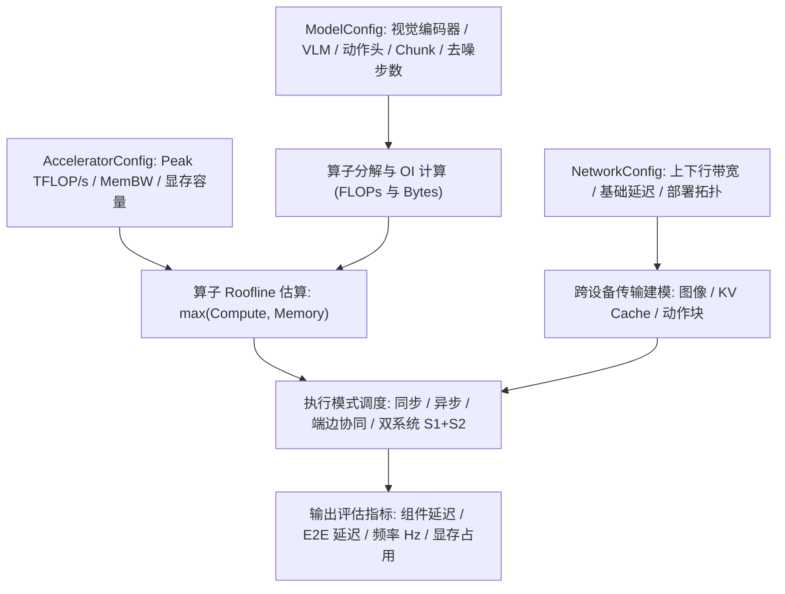
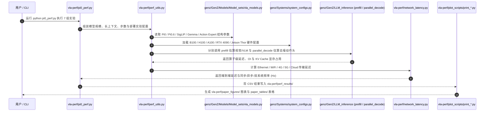

# How Fast Can I Run My VLA? Demystifying VLA Inference Performance with VLA-Perf

## 一句话定义

**VLA-Perf** 是 NVIDIA Research 提出的基于 Roofline 模型的视觉-语言-动作（VLA）推理性能解析工具，可在无需真实部署全部软硬件组合的前提下，预测任意 VLA 架构与端-边-云推理系统组合的端到端延迟、吞吐频率与瓶颈分布，并据此提炼出面向 10–100 Hz 实时控制的 15 条设计准则。

## 英文缩写速查

| 缩写 | 英文全称 | 简要说明 |
|---|---|---|
| VLA | Vision-Language-Action | 结合视觉感知、语言理解与机器人动作生成的具身基础模型 |
| VLM | Vision-Language Model | 负责编码多视角图像与语言指令并产出隐状态或 KV cache 的视觉语言主干 |
| OI | Operator Intensity | 算子强度，即浮点计算量与访存字节数之比（FLOPs/Bytes），决定算子受计算还是访存限制 |
| KV Cache | Key-Value Cache | 注意力层缓存的键/值张量，决定长上下文显存占用与端边协同网络传输开销 |
| DoF | Degrees of Freedom | 机器人动作空间自由度维度（文中双臂 UR5e 基线为 14 DoF） |
| HBM / LPDDR | High Bandwidth Memory / Low-Power DDR | 数据中心 GPU 高带宽显存（如 B100 8 TB/s）与边缘端低功耗内存（如 Jetson Thor 270 GB/s） |

## 为什么重要

1. **实时性硬约束与组合爆炸**：标准 RGB 相机采样率通常为 24–60 Hz，工程上常以 **10 Hz** 作为可接受的实时推理下限、**100 Hz** 作为高性能目标；但模型架构（自回归 vs 扩散/流匹配、参数规模、上下文长度、action chunk、异步/双系统）与部署系统（Jetson Thor、RTX 4090、A100/H100/B100 及有线/无线/云网络）的组合空间极大，逐一实机搭建评测耗时且成本高昂。
2. **揭示跨数量级的性能差异**：同一 $\pi_0$ 模型在不同硬件与网络组合下的端到端推理频率可跨越两个以上数量级（从 4G 慢速云同步的 3.7 Hz 到 B100 10G 双系统异步的 676.0 Hz），单一视角的模型轻量化往往无法解决真正的系统瓶颈（例如网络延迟或边缘内存带宽）。
3. **填补 LLM 与 VLA 性能建模差异**：传统 LLM 推理分析（如 GenZ）聚焦单模型 prefill/decode，缺乏对跨模态视觉编码、流匹配并行动作去噪、交叉注意力访问 VLM KV cache 以及机器人端-边-云链路传输的系统性建模。

## 核心信息

| 字段 | 内容或状态 |
|---|---|
| 作者 | Wenqi Jiang, Jason Clemons, Karu Sankaralingam, Christos Kozyrakis |
| 机构 | 英伟达研究院（NVIDIA Research） |
| 发表时间 | 2026-02-20（arXiv:2602.18397v1 [cs.RO]） |
| 论文链接 | [arXiv:2602.18397](https://arxiv.org/abs/2602.18397) / [HTML 全文](https://arxiv.org/html/2602.18397) |
| 项目与代码 | [NVlabs/vla-perf](https://github.com/NVlabs/vla-perf)（Apache 2.0 协议） |
| 清单分类 | `harness.infrastructure`（来源条目 `survey_ax_2602_18397`） |
| 开源状态 | **已开源**：仓库公开 `vla-perf/` 全套性能评测、网络建模与论文绘图脚本，以及扩展版 `genz/` 硬件后端 |

## 核心原理

VLA-Perf 将一次 VLA 推理抽象为「**多个模型组件执行阶段**」与「**组件间数据搬运阶段**」的交替流水线：

1. **输入参数化（`ModelConfig` / `AcceleratorConfig` / `NetworkConfig`）**
   - **模型侧**：指定视觉编码器（如 SigLIP-So400m/Giant、DINOv2）、VLM 主干（如 Gemma 2B、Llama2 7B/13B/70B）、动作头类型（自回归或扩散/流匹配 Action Expert）、输入视觉与语言序列长度、去噪步数、action chunk size 与动作自由度。
   - **系统侧**：指定单卡加速器规格（FP32/BF16/INT8 峰值算力、显存容量与显存带宽）以及组件部署位置（端侧、边缘服务器、云服务器或端边协同）；若跨设备部署，则由上行/下行带宽与基础往返延迟刻画网络通道。
2. **端到端与算子级 Roofline 建模**
   - 端到端推理延迟等于各模型组件延迟与跨网络数据搬运延迟之和（同设备内张量搬运忽略不计）：
     $$T_{\text{total}} = \sum_{m \in \mathcal{M}} T_m + \sum_{d \in \mathcal{D}} T_d$$
   - 每个模型组件 $m$ 分解为线性投影、全连接、自注意力与交叉注意力等算子序列 $\mathcal{O}_m$，单个算子 $o$ 在硬件 $h$ 上的执行时间取计算时间与访存时间的上界最大值：
     $$T_m = \sum_{o \in \mathcal{O}_m} T_o, \quad T_o = \max\left(\frac{\text{FLOPs}_o}{\text{FLOP/s}_h}, \frac{\text{Bytes}_o}{\text{MemBW}_h}\right)$$
   - 当算子强度 $\text{OI}_o = \text{FLOPs}_o / \text{Bytes}_o$ 高于硬件平衡点 $\text{FLOP/s}_h / \text{MemBW}_h$ 时为 **compute-bound**，反之为 **memory-bound**。
   - 跨设备通信延迟（传输原始图像、视觉 token、VLM KV cache 或预测动作）建模为单向基础延迟与载荷传输时间之和：
     $$T_d^{\text{net}} = \text{NetLat} + \frac{\text{Bytes}_d}{\text{NetBW}}$$
3. **面向 VLA 的 GenZ 后端扩展**
   - 论文在 [GenZ LLM Analyzer](https://github.com/astra-sim/GenZ-LLM-Analyzer) 上新增 `parallel_decode` 建模（刻画扩散/流匹配 Action Expert 每步去噪并行生成整个 action chunk 并对 VLM KV cache 执行交叉注意力的计算与访存模式），同时保留 prefill（视觉编码器与 VLM 主干）与逐 token decode（如 OpenVLA 自回归动作头）路径，并补充了 $\pi_0$/$\pi_{0.6}$/OpenVLA 模型定义与 NVIDIA B100、RTX 4090 及 Jetson 全系硬件配置。
4. **模型保真度（Table 1）**
   - 以 Ma et al. (2025) 在 RTX 4090 上经 Triton 优化的 $\pi_0$ 实现（10 步流匹配、chunk=63、空文本）作为对照，1 / 2 / 3 相机下 VLA-Perf 预测为 14.7 / 22.5 / 30.4 ms，实测为 20.0 / 27.3 / 36.8 ms，实测吞吐达到理论 Roofline 的 **73.3% / 82.3% / 82.6%**，证明其足以捕捉量级差异与瓶颈迁移规律。

## 流程总览

## 源码运行时序图

官方主入口为 `vla-perf/pi0_perf.py`（另提供 `vla-perf/openvla_perf.py` 评估 OpenVLA），经 `vla-perf/perf_utils.py` 调用本地安装的可编辑包 `genz/` 计算各组件 Roofline 延迟，再叠加 `vla-perf/network_latency.py` 得出全部 7 组实验的 CSV 数据并交由 `vla-perf/plot_scripts/` 绘图（上述调用链基于仓库结构与脚本源码说明静态核对，未本地执行）。

## 实验与评测

全部分析基于双臂 UR5e 机器人配置：3 路 224×224 相机输入（共 768 视觉 token）+ 32 语言 token = 800 输入 token，动作维度 14 DoF，默认 action chunk = 50、去噪步数 = 10、精度 BF16/FP16。基准 $\pi_0$ 总参数约 2.7B（Vision 411.19M、VLM 1.98B、Action Expert 292.63M）。

### 1. 基准 $\pi_0$ 跨硬件性能与计算/访存特征（Table 3 & Table 4）

| 硬件平台 | 平衡 OI (FLOPs/B) | Vision 延迟 (OI=321.4) | VLM 延迟 (OI=542.8) | Action 延迟 (OI=54.0) | E2E 延迟 | E2E 频率 |
|---|---|---|---|---|---|---|
| Jetson Thor (128GB, 270GB/s) | 1481.5 | 6.06 ms (Memory) | 20.30 ms (Memory) | 26.20 ms (Memory) | 52.57 ms | 19.0 Hz |
| RTX 4090 (24GB, 1008GB/s) | 163.7 | 4.02 ms (Compute) | 19.79 ms (Compute) | 7.25 ms (Memory) | 31.06 ms | 32.2 Hz |
| A100 (80GB, 2039GB/s) | 153.0 | 2.13 ms (Compute) | 10.47 ms (Compute) | 3.60 ms (Memory) | 16.20 ms | 61.7 Hz |
| H100 (80GB, 3350GB/s) | 295.2 | 0.71 ms (Compute) | 3.30 ms (Compute) | 2.14 ms (Memory) | 6.15 ms | 162.5 Hz |
| B100 (192GB, 8000GB/s) | 218.8 | 0.40 ms (Compute) | 1.87 ms (Compute) | 0.91 ms (Memory) | 3.18 ms | 314.4 Hz |

- **Takeaway 1–2**：数据中心 GPU 运行 $\pi_0$ 已达到 61.7–314.4 Hz（匹配甚至超过 24–60 Hz 相机帧率），而 Jetson Thor 仅 19.0 Hz；Action Expert 在所有 GPU 上均为 memory-bound，而 Vision 与 VLM 在非 LPDDR GPU 上为 compute-bound，在 Jetson Thor 上则因 270 GB/s 内存带宽全部退化为 memory-bound。

### 2. 模型规模缩放与长上下文 KV Cache 开销（Table 5 & Table 6）

| 模型变体 | 组件配置 (Vision / VLM / Action) | Jetson Thor | RTX 4090 | B100 |
|---|---|---|---|---|
| $\pi_0$ (2.7B) | SigLIP-So (0.4B) / Gemma-2B / Act-M (0.3B) | 19.0 Hz | 32.2 Hz | 314.4 Hz |
| $\pi_0$-L (9.1B) | SigLIP-Giant (1.1B) / Llama2-7B / Act-L (1.5B) | 3.9 Hz | 8.0 Hz | 73.6 Hz |
| $\pi_0$-XL (16.7B) | SigLIP-Giant (1.1B) / Llama2-13B / Act-XL (2.9B) | 2.1 Hz | N/A (OOM) | 39.7 Hz |
| $\pi_0$-XXL (81.3B) | SigLIP-Giant (1.1B) / Llama2-70B / Act-XXL (11.7B) | N/A | N/A (OOM) | 9.6 Hz |

- **Takeaway 3–4**：各组件延迟随参数量近似线性增长；B100 在 81.3B 模型下仍可维持 9.6 Hz，而 RTX 4090 在 16.7B 即发生显存溢出，Jetson Thor 在 16.7B 时跌至 2.1 Hz。
- **长上下文（Takeaway 5, Table 6）**：将历史图像积累进 VLM KV cache 时，100 步历史（总显存 6.4 GB / KV 1.3 GB）在 Thor 与 4090 上降至 122.9 ms（8.1 Hz）与 117.3 ms（8.5 Hz），B100 为 11.3 ms（88.4 Hz）；1,000 步历史（18.3 GB / KV 13.2 GB）时 B100 维持 85.2 ms（11.7 Hz），Thor 与 4090 跌至 768.3 ms（1.3 Hz）与 900.6 ms（1.1 Hz）；10,000 步（137.0 GB / KV 131.8 GB）仅 B100 放得下，但频率降至 1.2 Hz（823.7 ms）。

### 3. 去噪步数、Action Chunk 与生成范式（§4.5–§4.6）

- **去噪步数 vs Chunk Size（Takeaway 6）**：在 B100 上，去噪步数从 10 增至 50（5×）使 Action Expert 延迟线性增至 5×、端到端总延迟增至 2.15×；而由于 Action Expert 受访存带宽主导，chunk size 从 50 增至 250（5×）仅使 Action Expert 延迟增加 40%、端到端延迟仅增加 11%。
- **扩散 vs 自回归（Takeaway 7–8）**：在 chunk=50、14 DoF 下，B100 上标准扩散式 $\pi_0$（3.2 ms）比逐维自回归版（700 步，327.6 ms）快 **102.4×**；即使无 chunking 仅生成 7 DoF 动作时，标准扩散仍快于自回归。采用并行解码的自回归变体（Autoregressive-Parallel）在 chunk $\le 10$ 时快于标准扩散，但在 chunk=50 时算子强度从 135.9 跃升至 477.7（超过 B100 平衡 OI 218.8）转为 compute-bound，延迟劣于始终处于 memory-bound（OI=54.0）的扩散动作头。

### 4. 部署位置、协同切分、异步与双系统流水线（Table 7–9 & §4.11）

- **端侧 vs 服务端（Takeaway 9）**：在绝大多数网络下，服务端（甚至通过 WiFi 连接 RTX 4090）端到端延迟低于 Thor 端侧；B100 在 5G 边缘或快速云下仍快于端侧；仅在 4G 或高延迟慢速云链路下端侧更优。
- **端边协同（Takeaway 10）**：将 VLM 放 B100、Action Expert 放 Thor 时，需通过网络下载 VLM KV cache（10G 以太网 12.4 ms、WiFi 7 43.7 ms、5G 257.7 ms），导致端边协同始终慢于纯服务端，且在无线网络下反而不如纯端侧推理。
- **异步推理（Takeaway 11, Table 8）**：重叠网络传输与 GPU 推理不缩短单次端到端延迟，但可显著提升吞吐：B100 在 10G 以太网下为 301.4 → 314.4 Hz（1.04×），WiFi 7 为 119.7 → 314.4 Hz（2.63×），5G 为 35.9 → 215.3 Hz（5.99×），4G 为 13.7 → 50.5 Hz（3.68×），有线+快速云为 42.8 → 314.4 Hz（7.34×），4G+慢速云为 3.7 → 50.5 Hz（13.79×）。
- **双系统流水线（Takeaway 12, Table 9）**：在 System 2（VLM）限频 10 Hz 时，B100 + 10G 以太网由 301.4 Hz 提升至 676.0 Hz（2.24×），Thor 端侧由 19.0 Hz 升至 24.7 Hz（1.30×），而 B100 + 5G 受 System 1 网络往返（26.0 ms）制约仅由 35.9 Hz 升至 37.8 Hz（1.05×）。
- **10 Hz 与 100 Hz 达标路线（Takeaway 13–15）**：Thor 端侧可跑 19 Hz 满足 10 Hz，但距 100 Hz 仍有约 5× 差距（需剪枝/减步/量化）；边缘服务端下 RTX 4090 配 4G 即可达 10 Hz，而 100 Hz 需 B100 配合 10G/1G 以太网或 WiFi 7；云端同步受网络往返限制（快速云最高 42.8 Hz），云端突破 100 Hz 必须依赖异步推理。

## 与其他工作对比

| 维度 | 对比对象 / 方案 | VLA-Perf 的定位与量化结论 |
|---|---|---|
| 性能建模范围 | GenZ / ECHELON、Vidur、LLMServingSim（LLM 推理建模） | 继承 GenZ 算子分解与 Roofline 抽象，针对 VLA 补充扩散并行解码、VLM KV cache 交叉注意力及机器人无线/云链路端到端建模 |
| 动作生成范式 | 逐维自回归（如 OpenVLA / RT 系列）vs 并行解码自回归 vs 扩散/流匹配（如 [π₀ 策略](../methods/pi0-policy.md)） | chunk=50 时扩散头快于逐维自回归 102.4×；并行解码仅在 chunk $\le 10$ 占优，大 chunk 时转 compute-bound 而落后于轻量扩散头 |
| 协同与流水线机制 | 纯端侧 / 纯服务端 / 端边切分 / 异步 / 双系统（Helix 风格） | 证明跨网络下载 KV cache 使端边切分在无线场景劣于纯端侧；验证异步掩盖无线传输、双系统仅在高速内网+强算力下获倍增收益 |

## 结论

**一句话总判：VLA 实时推理的瓶颈高度依赖部署拓扑与算子强度匹配——动作头普遍受访存带宽限制而视觉/VLM 在桌面与数据中心 GPU 上受算力限制，工程优化应优先砍去噪步数、用大 chunk 摊薄调用频率、避免无线端边切分 KV cache，并在弱网/云端场景采用异步推理。**

1. **端侧优先压降去噪步数并提升带宽利用率**：在 Jetson Thor 上全流程均为 memory-bound，增大 action chunk 对单次推理耗时影响极小（5× chunk 仅增 11% 延迟），应通过减少流匹配步数、量化与小型化实现从 ~19 Hz 向 100 Hz 逼近。
2. **不要在无线移动机器人上做「云端 VLM + 端侧动作头」切分**：传输千兆级规模的 VLM KV cache 会引入数十至数百毫秒通信开销（WiFi 7 下 43.7 ms、5G 下 257.7 ms），直接纯端侧或纯服务端执行均明显更快。
3. **100 Hz 高频控制必须同时满足强算力与低延迟网络**：边缘部署需 B100 级别 GPU 搭配有线以太网或 WiFi 7；若走云端推理，单靠加速算力无法绕过网络 RTT，必须结合异步执行（可使快速云吞吐从 42.8 Hz 恢复至 314.4 Hz）。
4. **长历史记忆需严格预算步数**：原始帧直接入 KV cache 在端侧与消费级 GPU 上超过约 100 步即跌破 10 Hz，超过千步需依赖数据中心 GPU 或记忆压缩机制。

## 工程实践

- **本地复现与自定义分析路径**（基于 `NVlabs/vla-perf` 静态核对）：
  1. 安装扩展后端：`cd genz && pip install -e .`（Python 3.10 环境）。
  2. 复用或修改模型与硬件库：`genz/GenZ/Models/Model_sets/vla_models.py` 定义新 VLA 组件尺寸，`genz/Systems/system_configs.py` 添加目标机器人算力与带宽参数。
  3. 运行实验脚本：`python vla-perf/pi0_perf.py`（或 `vla-perf/openvla_perf.py`）生成 CSV 至 `vla-perf/perf_results/`，再用 `vla-perf/plot_scripts/` 出图。
- **典型硬件选型映射**：需要 10 Hz 离线/有线实验可选 RTX 4090（32.2 Hz）或 Jetson Thor 端侧（19.0 Hz）；需要 100 Hz 闭环或 >10B 参数规模/千步上下文需配置 H100/B100 边缘服务器并保证至少 WiFi 7 或千兆/万兆有线链路。

## 局限与风险

1. **Roofline 乐观上界假设**：未显式建模 kernel launch、OS 调度与运行时框架开销，实测优化系统通常只能达到其预测值的 73.3%–82.6%（Table 1），未充分融合算子的 PyTorch 实现差距会更大。
2. **仅覆盖推理阶段与操作任务**：未计入相机传感器曝光/读出延迟与机械臂底层控制执行延迟，也未涵盖需要 SLAM、导航规划及强机载约束的四足、无人机或自动驾驶系统（§5）。
3. **不联合建模任务成功率**：异步推理引入的观测陈旧性（staleness）、大幅减少去噪步数、低比特量化以及双系统 VLM 降频都会改变闭环控制精度与成功率，论文假设「模型已满足精度阈值」而未做准确率-延迟帕累托实测。
4. **双系统近似建模**：论文指出当时尚无广泛采用的开源双系统扩散 VLA 实现，§4.10 中对视觉特征注入动作专家的代价作了零开销近似，实际系统需以实测校准。

## 关联页面

- [Agentic Robots 综述](paper-towards-agentic-robots-survey.md)
- [全量项目节点清单](../overview/awesome-agentic-robots-node-index.md)
- [VLA 方法背景](../methods/vla.md)
- [机器人智能体执行框架](../methods/robot-agent-harness.md)：对照规划、执行接口与反馈机制。
- [AI 模型服务与推理优化](../methods/ai-model-serving-inference.md)：Prefill/Decode 瓶颈拆解、KV Cache 与批处理/异步调度基础。
- [Action Chunking（动作分块）](../methods/action-chunking.md)：分析 chunk size 与控制频率及响应滞后的权衡。
- [π₀（Pi-Zero）通用机器人流匹配 VLA 策略](../methods/pi0-policy.md)：VLA-Perf 主要剖析的三阶段参考架构。
- [双臂协同操作（Bimanual Manipulation）](../tasks/bimanual-manipulation.md)：论文评测设定的 14 DoF 三相机 UR5e 典型应用场景。

## 推荐继续阅读

- [VLA-Perf 官方论文 HTML（arXiv:2602.18397）](https://arxiv.org/html/2602.18397)
- [VLA-Perf 官方 GitHub 仓库（NVlabs/vla-perf）](https://github.com/NVlabs/vla-perf)
- [GenZ-LLM-Analyzer 上游硬件性能建模仓库](https://github.com/astra-sim/GenZ-LLM-Analyzer)
- [Running VLAs at Real-time Speed（arXiv:2510.26742，Table 1 Triton 实测对照来源）](https://arxiv.org/abs/2510.26742)

## 参考来源

- [论文原文核对归档](../../sources/papers/paper-agentic-2602-18397.md)
- [官方代码仓库核对归档](../../sources/repos/paper-agentic-2602-18397.md)
- [官方 Awesome 快照归档](../../sources/repos/awesome-agentic-robots-survey-index.md)
- [arXiv 论文主页（arXiv:2602.18397）](https://arxiv.org/abs/2602.18397)
- [VLA-Perf GitHub 官方仓库](https://github.com/NVlabs/vla-perf)
