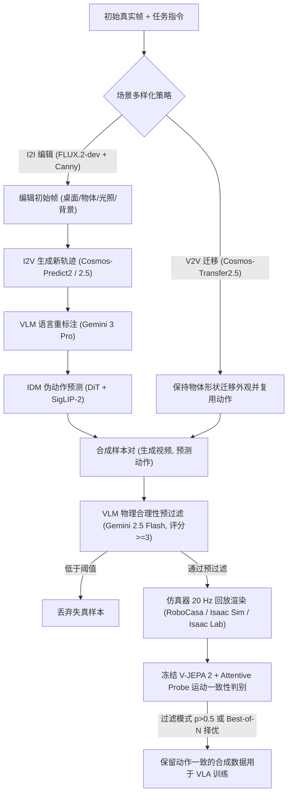

# RoboCurate: Harnessing Diversity with Action-Verified Synthetic Data for Robot Learning

## 一句话定义

**RoboCurate** 是由 KAIST 与 RLWRLD 提出的机器人合成数据生成与动作一致性筛选框架：它利用视频生成模型与结构化场景编辑扩展操作场景多样性，先通过 VLM 预过滤物理失真视频，再将逆动力学模型（IDM）预测的伪动作输入物理仿真器回放渲染，借助基于冻结视频编码器（V-JEPA 2）训练的 Attentive Probe 将跨模态「视频-动作一致性校验」转化为「生成视频-仿真回放」的运动一致性判别，从而剔除或择优筛选动作标签失真的合成轨迹。

## 英文缩写速查

| 缩写 | 英文全称 | 简要说明 |
|---|---|---|
| VLA | Vision-Language-Action Model | 视觉-语言-动作模型，如本文用作基准策略的 GR00T N1.5 与 RLDX-1 |
| IDM | Inverse Dynamics Model | 逆动力学模型，根据相邻视觉观测帧 $\mathbf{o}_t, \mathbf{o}_{t+H}$ 推断伪动作序列 |
| VLM | Vision-Language Model | 视觉-语言模型，本文用于任务指令生成、物理合理性预过滤及语言重标注 |
| I2I / I2V / V2V | Image-to-Image / Image-to-Video / Video-to-Video | 图像编辑、图生视频与视频风格迁移，用于结构化扩展操作场景多样性 |
| WSD | Warmup-Stable-Decay | 预训练学习率调度策略，衰减阶段仅切入 RoboCurate 过滤后的高质量合成数据 |
| AUPRC | Area Under the Precision-Recall Curve | 精确率-召回率曲线下面积，用于评估 Attentive Probe 在分布偏移下的判别能力 |

## 为什么重要

在数据稀缺的具身操作与灵巧手控制领域，依赖「视频生成模型 + IDM 伪动作标注」（如 DreamGen）已经成为低成本扩展跨任务、跨物体数据的主流技术路线，但合成管线面临两层隐蔽的失效模式：

1. **生成视频物理失真**：模型可能无视指令，或产生手部未接触物体即发生位移（tele-grab）、穿模、异常形变等违背物理常识的画面；
2. **视频-动作跨模态错位（Video-Action Misalignment）**：即便生成视频外观逼真、物理合理，IDM 仍可能因视觉域偏移或遮挡而预测出与画面运动不符的错误动作（作者在 400 条合成视频中人工标注出 27 例「视频正确但动作错误」样本）。

既有过滤方法（如 DreamGenBench、VideoCon-Physics）仅用 VLM 对视频画面做单模态物理打分，对「画面合理但动作错标」的失效模式几乎无能为力（实验显示 DreamGenBench 仅能剔除其中 3.7%）。RoboCurate 首次将物理仿真器回放引入合成数据质量校验闭环，同时结合图像与视频双层反事实编辑缓解原始数据场景单一的瓶颈，使验证后的合成数据在预训练及真机灵巧手联合微调上均稳定带来显著增益。

## 核心信息

| 字段 | 内容 |
|---|---|
| 论文标题 | RoboCurate: Harnessing Diversity with Action-Verified Synthetic Data for Robot Learning（Survey 索引别名：`Neural Trajectory`） |
| 作者 | Seungku Kim*，Suhyeok Jang*，Byungjun Yoon，Dongyoung Kim，John Won，Jinwoo Shin（*共同一作） |
| 机构 | KAIST（韩国科学技术院）、RLWRLD |
| 发表时间 / 会议 | arXiv:2602.18742v2（2026-02-21 提交 v1，2026-11-05 更新 v2）；CoRL 2026 G2A Workshop Oral（The Action Gap Workshop） |
| 论文链接 | [arXiv:2602.18742](https://arxiv.org/abs/2602.18742) · [arXiv HTML v2](https://arxiv.org/html/2602.18742) |
| 项目与代码 | [官方项目页](https://seungkukim.github.io/robocurate/)（仅含 Paper / arXiv 与演示视频；**未发布 RoboCurate 官方源码仓库**） |
| 清单分类 / 来源条目 | `data.collection` / `survey_ax_2602_18742` |
| 开源状态 | **未确认开源代码**（截至 2026-11-27 官方项目页与论文未附源码仓库；管线依赖外部公开组件：`Cosmos-Predict2`、`Isaac Sim`、`V-JEPA 2`、`GR00T N1.5` 及预训练 IDM 检查点 `seonghyeonye/IDM_gr1`） |

## 核心原理

### 1. 问题形式化与策略训练基础

给定有限真实示教 $\mathcal{D}_{\text{real}}$ 与合成数据 $\mathcal{D}_{\text{syn}}$，策略 $\pi_\theta$ 在混合数据集 $\mathcal{D} = \mathcal{D}_{\text{real}} \cup \mathcal{D}_{\text{syn}}$ 上预测动作块 $\mathbf{a}_{t:t+H-1}$，并在 Flow-Matching 目标下优化扩散动作头：

$$\mathcal{L}_{\text{IL}}(\theta;\mathcal{D}) = \mathbb{E}_{t,\mathbf{a}_{t:t+H-1},\boldsymbol{\epsilon},\tau}\Big[\big\|\mathbf{v}_\theta(\mathbf{a}_{t:t+H-1}^\tau,\tau\mid \mathbf{o}_t,I,\mathbf{q}_t) - (\boldsymbol{\epsilon}-\mathbf{a}_{t:t+H-1})\big\|_2^2\Big]$$

其中 $\mathbf{a}_{t:t+H-1}^\tau = (1-\tau)\mathbf{a}_{t:t+H-1} + \tau\boldsymbol{\epsilon}$，且由于 IDM 不预测本体状态，$\mathcal{D}_{\text{syn}}$ 中的本体状态 $\mathbf{q}_t$ 采用零填充（zero-padding），预训练阶段对真机与合成数据分别赋予独立的 embodiment tag 以隔离动作统计差异。

### 2. 结构化场景多样化（Scene Diversification）与重标注

直接从真实初始帧做 I2V 生成会继承原有桌面与背景的狭窄分布，限制过滤器的筛选空间。RoboCurate 用 Gemini 3 Pro 解析初始帧，沿着四个解耦维度生成随机组合的反事实场景描述，并附加 **Canny 边缘图** 维持机械臂与桌面几何结构：

- **编辑四维轴**：(1) 桌面材质/纹理（Table）；(2) 目标物体类型、形状、颜色与表面处理（Target Object）；(3) 整体光照强度与质感（Lighting）；(4) 房间背景与非侵入式桌面干扰物（Background）。
- **双层生成路径（预训练 I2I:V2V = 2:1）**：
  - **图像级（I2I 编辑）**：用 `FLUX.2-dev` 编辑初始图像（可替换目标物体类别与外观），再输入 `Cosmos-Predict2-14B`（或 OpenArm 使用 `Cosmos-Predict2.5-2B`）与 VLM 生成的新指令共同合成新操作视频，随后用 DiT + SigLIP-2 的 IDM 链式标注伪动作；
  - **视频级（V2V 迁移）**：用 `Cosmos-Transfer2.5-2B` 对已生成且成功完成任务的视频做风格迁移，严格锁定原目标物体的类别与形状，仅改变颜色、材质、桌面、光照与背景，从而直接复用原 IDM 动作标签并免去重标注开销。
- **两阶段语言重标注（Language Re-captioning）**：用 Gemini 3 Pro（输入 8 帧）先判别视频是否忠实执行了原始指令（YES/NO），对未遵循指令的视频重新生成与画面动作一致的文本指令，避免图文错位污染策略训练。

### 3. VLM 物理合理性预过滤

在动作校验之前，利用 Gemini 2.5 Flash（输入 8 帧）从三个阶段评估视频中机械手与末端执行器的深度和空间朝向合理性：(1) 接近阶段（Move-to-object，惩罚无明显前伸或深度不足的瞬移抓取）；(2) 抓取阶段（Grasp，惩罚穿模或明显偏移接触）；(3) 搬运阶段（Move-to-target，惩罚物体漂移而手部无对应位移）。按 1–5 分制评分，默认保留 $\ge 3$ 分样本（OpenArm 设为 $\ge 4$ 分）。

### 4. 仿真器回放与 Attentive Probe 动作验证

针对通过预过滤的合成样本 $(\mathbf{x}_{\text{gen}}, \mathbf{A}_{\text{IDM}})$，直接在「视频-动作」跨模态空间度量一致性十分困难。RoboCurate 的核心转换是利用物理仿真器 $f$ 在无目标物体的空场景中以 20 Hz 回放预测动作 $\mathbf{A}_{\text{IDM}}$，从与真机一致的自我中心视角渲染代理视频 $\hat{\mathbf{x}}_{\text{sim}} = f(\mathbf{A}_{\text{IDM}}, \tilde{\mathbf{o}})$：

- **仿真器映射**：GR-1 人形机器人采用基于 robosuite 的 RoboCasa（`GR1ArmsAndWaistFourierHands`，固定 `layout_id=0, style_id=0`）；ALLEX 采用 NVIDIA Isaac Sim（48 自由度 USD 模型 + `Neck_Yaw_link` 虚拟 ZED MINI 左目相机）；OpenArm 采用 NVIDIA Isaac Lab（28 自由度自我中心视角）。
- **自监督对比样本构造（零人工标注）**：仅使用真实示教 $\mathcal{T}=\{(\mathbf{x}_i^{\text{real}}, \mathbf{A}_i^{\text{real}})\}$ 与真实动作的仿真回放 $\mathbf{x}_i^{\text{sim}} = f(\mathbf{A}_i^{\text{real}}, \tilde{\mathbf{o}})$ 训练判别器（严禁引入带噪声的合成样本）。正样本 $\mathcal{P}^+$ 为同一示教同时间片段；负样本 $\mathcal{P}^-$ 分为三类（占比 45% / 45% / 10%，总体正负比 80% / 20%）：
  - **时间偏移负样本 $\mathcal{P}^-_{\text{shift}}$**：同一轨迹但起始帧相差至少 5 帧（终点对齐），迫使探针捕捉细粒度时序相位；
  - **跨轨迹负样本 $\mathcal{P}^-_{\text{cross}}$**：同一技能类别（如 pick-and-place、pour/scoop）内的不同轨迹配对，防止模型仅依赖粗糙任务语义捷径；
  - **复合负样本 $\mathcal{P}^-_{\text{shift+cross}}$**：同时跨轨迹且时间偏移。
- **探针架构与推理**：从每段视频均匀采样 16 帧（$256\times 256$），经冻结的 **V-JEPA 2 Large（300M）** 编码后拼接 token 序列，输入单层、8 头交叉注意力探针 $g_\phi$（含 1 个可学习 query token 与二分类头），以二元交叉熵（AdamW, lr=$10^{-4}$, 50 epochs）训练输出一致性概率 $p=\sigma(\ell)$。
- **双重应用模式**：(1) **事后过滤（Post-hoc Filtering）**，在大规模预训练中保留 $p > 0.5$ 的样本；(2) **生成时 Critic（Best-of-N）**，在数据稀缺的真机微调中用 $N=4$ 个不同高斯噪声种子采样候选视频与动作，经 VLM 预过滤后选取 $p$ 最高的一组进入微调集。

## 流程总览

## 源码运行时序图

**不适用**（截至 2026-11-27，RoboCurate 官方论文与项目页仅提供方法说明、超参数及 Appendix I VLM 提示词，尚未公开发布 RoboCurate 自身的官方可运行代码仓库；论文引用到的 `nvidia-cosmos/cosmos-predict2`、`isaac-sim/IsaacSim` 与 `seonghyeonye/IDM_gr1` 等均为独立上游依赖，不可替代 RoboCurate 完整编排源码的调用时序核查）。

## 实验与评测

### 1. 预训练基准实验（GR00T N1.5，60K 步预训练）

预训练真实数据采用 ActionNet 3K 去重子集（Fourier GR1-T1，44 维关节空间），与 10K 条过滤前合成数据按 1:1 混合，在 WSD 调度器前 50K 步使用全量合成数据、后 10K 衰减步切换为 RoboCurate 过滤后数据。

**GR-1 Tabletop（24 个任务：18 个重排 + 6 个铰接操作，每任务 50 次试验，成功率 %）：**

| 方法 | 合成数据 | 一致性过滤 | 300 Demos (重排 / 铰接 / 平均) | 1000 Demos (重排 / 铰接 / 平均) |
|---|---|---|---|---|
| Real（仅真实数据） | ✗ | ✗ | 16.1 / 13.3 / 15.4 | 30.9 / 19.0 / 27.9 |
| w/ DreamGen | ✓ | ✗ | 21.1 / 14.7 / 19.5 | 30.7 / 36.3 / 32.1 |
| w/ RoboCurate（仅场景多样化） | ✓ | ✗ | 23.2 / 21.0 / 22.7 | 31.0 / **43.0** / 34.0 |
| **w/ RoboCurate（完整过滤）** | ✓ | ✓ | **30.9 / 24.3 / 29.3**（相对 Real **+90.3%**） | **32.3** / 41.3 / **34.6** |

**DexMimicGen（6 个双臂灵巧操作任务，3 个随机种子 × 50 次试验，每任务 100 demos，成功率 %）：**

| 方法 | GR-1 Humanoid | Bimanual Panda Arms | Avg. |
|---|---|---|---|
| Real（仅真实数据） | 56.9 | 32.2 | 44.6 |
| w/ DreamGen | 57.1 | 35.6 | 46.4 |
| w/ RoboCurate（仅场景多样化） | 59.3 | 39.3 | 49.3 |
| **w/ RoboCurate（完整过滤）** | **72.2** | **42.9** | **57.6**（相对 Real **+29.1%**） |

实验同时表明：基于 GR-1 人形合成数据预训练的策略能够实现跨构型迁移（cross-embodiment transfer），显著提升配备灵巧手的双臂 Panda 机械臂下游表现（32.2% → 42.9%）。

### 2. 真机联合微调实验（Co-finetuning，Best-of-4 Critic）

真机实验仅对分布内（ID）任务采集遥操作数据（ALLEX 48 条，OpenArm 44 条），**未见物体与未见行为（OOD）任务零真机数据**，完全依赖合成数据与 `RoboCurate*`（无场景多样化，基于 $N=4$ 候选的 Best-of-N 筛选）按 1:1:1 比例联合微调 10K 步：

| 平台与基座策略 | 方法 | ID 任务成功率 (%) | OOD-新物体 (%) | OOD-新行为 (%) | 平均成功率 (%) |
|---|---|---|---|---|---|
| **ALLEX**（48-DoF，GR00T N1.5，24 试验/任务） | Real | 25.0 (PnP Can) | 16.7 (PnP Cup) | 0.0 (Pour Can) | 13.9 |
| ALLEX | w/ DreamGen | 37.5 | 33.3 | 12.5 | 27.8 |
| **ALLEX** | **w/ RoboCurate*** | **47.9** | **43.8** | **25.0** | **38.9**（相对 Real **+179.9%**） |
| **OpenArm**（28-DoF，RLDX-1-PT-IMG，32 试验/任务） | Real | 37.5 (Lift Bottle) | 6.3 (Lift Box) | — | 21.9 |
| OpenArm | w/ DreamGen | 43.8 | 9.4 | — | 26.6 |
| **OpenArm** | **w/ RoboCurate*** | **46.9** | **15.6** | — | **31.3**（相对 Real **+42.9%**） |

### 3. 消融实验与探针鲁棒性分析（GR-1 Tabletop 300 demos）

- **过滤策略横向对比（Table 4 & Table 6）**：无过滤基线 22.7%，加入 DreamGenBench 为 22.8%，VideoCon-Physics 为 23.0%，而 RoboCurate 达到 **29.3%**；在人工标定的 27 例「视频合理但动作错标」样本上，DreamGenBench 仅检出 **3.7%**，RoboCurate 成功剔除 **70.4%**。
- **模块逐级消融（Table 5）**：无过滤（22.7%）→ 仅 VLM 预过滤（24.2%）→ 改用余弦相似度 Top-K 筛选（26.0%）→ 替换为 Attentive Probe（**29.3%**）。
- **视频编码器与阈值敏感性（Table 7 & Table 9）**：VideoMAEv2 (83M) 为 25.4%，V-JEPA 2 (300M) 为 29.3%；探针阈值在 0.10 / 0.25 / 0.50 时分别为 25.2% / 26.6% / 29.3%，均稳定优于未过滤基线；在无场景多样化的低资源设定（0.3K 真机 + 1K DreamGen）下，过滤仍将成功率由 15.8% 提升至 20.0%（Table 8）。
- **分布偏移泛化测试（Table 11）**：Attentive Probe 在 ActionNet 留出集上取得 **AUPRC 0.907**；当仿真回放相机偏移 +0.1 m 且视场角加宽 10° 时 AUPRC 仍维持 **0.904**；当真机视频替换自外部数据集 `GR00T-Teleop-GR1` 时 AUPRC 为 **0.865**，证明探针对小幅相机误差和跨数据集外观变化具有较强鲁棒性。

## 与其他工作对比

| 维度 | DreamGen / DreamGenBench | VideoCon-Physics | **RoboCurate（本文）** |
|---|---|---|---|
| 场景多样性生成 | 依赖原始帧直接生视频，受限于底图分布 | 仅评估已有视频，不涉及生成 | 四维解耦编辑（桌/物/光/背景）+ I2I/V2V + Canny 约束 |
| 过滤维度 | 仅用 VLM 评估视频自身物理合理性 | 微调 7B VLM 评估视频物理常识 | VLM 预过滤 + **仿真器回放检验视频-动作运动一致性** |
| 动作错标检出能力 | 对「画面真、动作假」样本仅检出 3.7% | 未直接校验 IDM 伪动作标签 | 对不一致动作样本检出率达 **70.4%** |
| 监督信号来源 | 通用 VLM 提示词 | 人工标注的物理违例数据集 | 仅需真机示教与仿真回放自动构造正负对，**零人工标注** |
| 生成时利用方式 | 固定单种子前向采样 | 仅作事后过滤 | 可复用为 **Best-of-N Critic** 指导真机数据择优采样 |

## 结论

**一句话总判：RoboCurate 通过「物理仿真器回放 + 冻结视频编码器 Attentive Probe」打通了合成视频与 IDM 伪动作标签之间的跨模态一致性闭环，证明动作校验配合结构化场景扩增比单纯依赖 VLM 画面质检更能提升下游 VLA 策略性能。**

1. **优先校验动作一致性而非只检视频画质**：DreamGenBench 与 VideoCon-Physics 在动作不一致样本前几乎失效（22.8%/23.0% vs. 22.7%），构建合成数据管线时必须把 IDM 预测动作拉回物理或运动学空间检验一致性。
2. **用少量真机示教零成本训练过滤探针**：只要具备机器人 URDF/USD 模型和基本真实遥操作样本，即可利用时序偏移与同技能跨轨迹负样本训练轻量化 Attentive Probe（50 epoch 即可收敛，AUPRC 0.907），无需昂贵的人工视频-动作对齐标注。
3. **预训练切分阶段、微调改用 Best-of-N**：预训练时可在前中期保留全部合成数据以吸收视觉多样性，在 WSD 学习率衰减期切换为高一致性过滤子集；真机微调等样本受限场景则适合直接部署 Best-of-4 Critic 提纯样本。
4. **场景编辑与结构保护并重**：在应用 I2I/V2V 扩增时结合 Canny 边缘约束与严格提示词限制（如 V2V 锁定物体几何形状），能在引入桌台、光照、干扰物多样性的同时保证动作标签可复用。

## 工程实践

- **仿真回放环境配置**：回放场景无需搭建完整物体交互物理（仅需加载机器人本体并保持固定背景与空桌台，20 Hz 控制并匹配真机自我中心相机内参），大幅降低了仿真资产构建与跨视角对齐门槛（Appendix B.3）。
- **统计隔离与调度策略**：由于 IDM 预测动作的数值分布与人工遥操作真机数据存在系统差异，在策略训练中需为真机和合成数据分别设置独立的归一化统计量（OpenArm）或独立的 embodiment tag（GR00T N1.5）。
- **计算开销基准（Appendix B.4）**：60K 步预训练（batch 512）在 4× A100 上约需 126 GPU 小时；10K 步真机联合微调（2× H100 / 2× A100）仅需约 4 GPU 小时；但采用 Best-of-N Critic 时视频生成与 IDM 推理算力开销随 $N$ 线性放大。
- **VLM 分工选型**：高吞吐批量动作合理性预过滤采用较轻量的 Gemini 2.5 Flash（8 帧），而结构化场景提示生成、初始任务指令生成与语言重标注采用推理能力更强的 Gemini 3 Pro。

## 局限与风险

1. **官方源码未公开**：截至 2026-11-27，作者尚未开源 RoboCurate 的整体编排脚本、Attentive Probe 权重及真机数据处理代码，复现需自行串联 Cosmos-Predict2 / 2.5、FLUX.2-dev、Isaac Sim / RoboCasa 与 V-JEPA 2。
2. **依赖真实示教与仿真资产**：Attentive Probe 的正负样本构建依赖一定数量的真机动作-视频配对以及高保真机器人仿真模型，在极低数据或缺乏精准动力学/运动学建模的新构型上落地受限（Appendix A.1）。
3. **推理成本与滤波阈值权衡**：Best-of-N 采样虽能显著提升微调与 OOD 行为成功率，但会成倍增加视频扩散模型的采样耗时，在实际大规模生产中需在过滤质量与生成吞吐之间做折中。
4. **真机 OOD 绝对成功率仍待提升**：尽管相对真机基线提升幅度大，但 ALLEX 新行为（Pour Can）与 OpenArm 新物体（Lift Box）的绝对成功率仍仅分别为 25.0% 和 15.6%，合成数据仍无法完全替代真实交互反馈与真机安全验证。

## 关联页面

- [Agentic Robots 综述](paper-towards-agentic-robots-survey.md)
- [全量项目节点清单](../overview/awesome-agentic-robots-node-index.md)
- [VLA 方法背景](../methods/vla.md)
- [机器人策略学习流程](../methods/robot-policy-learning.md)：了解任务、训练信号与策略评估。
- [生成式数据增强](../methods/generative-data-augmentation.md)：梳理 I2I/V2V 与仿真增强的通用技术谱系。
- [生成式世界模型](../methods/generative-world-models.md)：了解视频世界模型作为策略数据引擎与评测器的能力边界。
- [机器人学习数据管线](../methods/robot-learning-data-pipelines.md)：对比数据采集、清洗、自动标注与质量门控流程。
- [双臂灵巧操作](../tasks/bimanual-manipulation.md)：了解 GR-1、ALLEX 等双臂与灵巧手操作任务挑战。

## 推荐继续阅读

- [RoboCurate 官方项目页](https://seungkukim.github.io/robocurate/)：查看 ALLEX 与 OpenArm 真机对比视频及方法概览。
- [arXiv:2602.18742 原文（HTML v2）](https://arxiv.org/html/2602.18742)：查阅 Appendix I 中的完整 VLM 场景编辑、物理预过滤与重标注提示词模板。
- [DreamGen（arXiv:2505.12705）](https://arxiv.org/abs/2505.12705)：RoboCurate 直接对比与改进的合成视频-动作数据生成基线框架。
- [V-JEPA 2（arXiv:2506.09985）](https://arxiv.org/abs/2506.09985)：本文 Attentive Probe 所依托的自监督视频表征骨干与探针设计基础。

## 参考来源

- [RoboCurate 论文精读笔记](../../sources/papers/paper-agentic-2602-18742.md)
- [官方 Awesome 快照归档](../../sources/repos/awesome-agentic-robots-survey-index.md)
- [arXiv:2602.18742（v2）](https://arxiv.org/abs/2602.18742)
- [RoboCurate 官方项目页](https://seungkukim.github.io/robocurate/)
