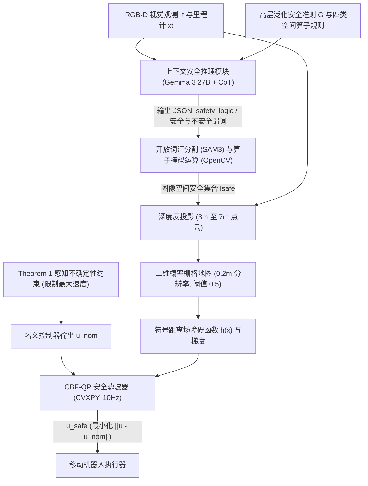

# Contextual Safety Reasoning and Grounding for Open-World Robots

## 一句话定义

**CORE**（Contextual Safety Reasoning and Enforcement）是一个面向未知开放世界移动机器人的三阶段在线安全控制框架：通过视觉语言模型（VLM）从实时图像推理上下文安全谓词，经开放词汇分割与 RGB-D 投影落地为二维符号距离场安全集合，并利用控制障碍函数（CBF）二次规划在不依赖先验地图或预置规则的前提下合成带有感知不确定性概率安全保障的控制输入。

## 英文缩写速查

| 缩写 | 英文全称 | 简要说明 |
|---|---|---|
| CORE | Contextual Safety Reasoning and Enforcement | 本文核心框架，集上下文安全推理、语义落地与 CBF 执行于一体 |
| VLM | Vision-Language Model | 视觉语言模型，本文用于从前向图像在线推理安全约束谓词 |
| CBF | Control Barrier Function | 控制障碍函数，用于保证系统状态前向不变地停留在安全集合内 |
| SDF | Signed Distance Field | 符号距离场，用于将离散栅格安全集转化为解析可微的障碍函数 $h(x)$ |
| CoT | Chain-of-Thought | 思维链推理，文中以 JSON 的 `safety_logic` 字段显式引导 VLM 判定风险 |
| MTS | Maximum Traversal Speed | 最大安全通行速度优化形式，将 VLM 延迟与探测率转化为速度约束证书 |

## 为什么重要

在医院、仓库或户外人行道等开放环境中，安全边界往往由**语义上下文**而非纯几何碰撞决定：例如湿滑警示牌（wet floor sign）周围需要留出安全缓冲区，排成一排的锥桶之间构成禁止通行的语义边界，而物理可通行的草地与人行道在社会规范上具有完全不同的可通行性。

传统基于时间逻辑（LTL/STL）、CBF 或 Hamilton-Jacobi（HJ）可达性的安全滤波器通常依赖专家预先提供的精确规则与环境地图；即便是近年的语言条件安全方法，也要求用户在部署前明确写出面向该环境的具体语义规则（例如“远离厨房”）。当机器人进入未见过的新环境时，这种假设便会失效。CORE 将安全边界的“发现—空间化—实时拦截”全部下放到在线闭环中，填补了视觉语义理解与连续控制层形式化安全保障之间的空白。

## 核心信息

| 字段 | 信息 |
|---|---|
| 作者 | Zachary Ravichandran, David Snyder, Alexander Robey, Hamed Hassani, Vijay Kumar, George J. Pappas |
| 机构 | University of Pennsylvania（宾夕法尼亚大学）、Carnegie Mellon University（卡内基梅隆大学） |
| 发表时间 | 2026-02-23（arXiv:2602.19983v1）；2026-02-24（v2） |
| 论文链接 | [arXiv:2602.19983](https://arxiv.org/abs/2602.19983) / [HTML 全文](https://arxiv.org/html/2602.19983) |
| 项目与代码 | [项目页](https://zacravichandran.github.io/CORE) ；[GitHub 仓库（占位）](https://github.com/KumarRobotics/CORE) |
| 清单分类 | `harness.infrastructure` |
| 来源条目 | `survey_ax_2602_19983` |
| 开源状态 | 宣称将开源（截至 2026-11-27，官方仓库 `KumarRobotics/CORE` 仅含 `README.md` 并标注 `Coming soon.`，暂无可运行源码） |

## 核心原理

CORE 假设机器人具有控制仿射动力学 $\dot{x} = f(x) + g(x)u$，装备前向 RGB-D 相机与里程计，接收名义控制器输出 $u_{\text{nom}}$ 与高层泛化安全准则 $\mathcal{G}$，并通过三个解耦模块在控制闭环中在线构造并执行安全集合 $\mathcal{S} = \bigcap_k \mathcal{S}_k$。

### 1. 上下文安全推理（Contextual Safety Reasoning）

VLM 不直接输出轨迹或坐标，而是将推理结果约束为**空间算子 + 语义类别**组成的谓词，划分为安全区域集合 $\mathcal{P}_{\text{safe}}$ 与不安全区域集合 $\mathcal{P}_{\text{unsafe}}$。系统提示词定义了 5 类安全相关语义（Metric Obstacles、Hazard Indicators、Socially Restricted Zones、Semantic Barriers、Navigable Surfaces）与 4 个空间算子：

- **`ON(class)`**：提取可通行表面类别的全部像素（如人行道、室内地面），仅用于安全导航表面。
- **`NEAR(class)`**：提取实体障碍物类别像素，表达直接物理碰撞缓冲需求。
- **`AROUND(class)`**：对语义实例掩码执行 50 像素核的形态学膨胀，表达危险指示物或行人社交距离缓冲区。
- **`BETWEEN(class)`**：对同类多实例像素集合计算凸包（convex hull），表达由锥桶等排列围合而成的语义禁区。

提示词强制 VLM 在 JSON 中优先生成 `safety_logic` 思维链字段，再以扁平逗号分隔字符串输出 `classes`、`unsafe_regions` 与 `safe_regions`，便于下游确定性解析。

### 2. 语义落地（Semantic Grounding）

给定 VLM 预测的语义类别与谓词，系统使用开放词汇分割模型 **SAM3** 在图像空间提取各类别像素掩码，并通过 OpenCV 计算各算子对应的安全与不安全像素集 $\{\mathcal{I}_j^{\text{safe}}\}$、$\{\mathcal{I}_k^{\text{unsafe}}\}$，图像空间安全区定义为二者的差集：

$$\mathcal{I}_{\text{safe}} = \left(\bigcup_j \mathcal{I}_j^{\text{safe}}\right) \setminus \left(\bigcup_k \mathcal{I}_k^{\text{unsafe}}\right)$$

随后利用配准深度（实机上结合 DepthAnythingV3 平滑深度并通过实测深度中值尺度拟合）与针孔相机内参将图像像素反投影为 3D 点云，并累积到分辨率为 $0.2\text{ m}$ 的二维工作空间栅格 $\mathcal{C}_{ij}$ 中。统计每个栅格累计的安全/不安全点观测数 $n_{ij}^{\text{safe}}, n_{ij}^{\text{unsafe}}$，计算状态安全概率估计：

$$\mathbb{P}[x\text{ is safe}] = \frac{n_{ij}^{\text{safe}}}{n_{ij}^{\text{safe}} + n_{ij}^{\text{unsafe}}}$$

取概率阈值 $\tau = 0.5$ 得到安全集 $\mathcal{S} = \{x \mid \mathbb{P}[x\text{ is safe}] \ge \tau\}$，并构造基于安全边界 $\partial \mathcal{S}$ 的符号距离场（SDF）作为障碍函数 $h(x)$（安全区内为正最小欧氏距离，区外为负），其解析梯度由当前状态指向最近边界点 $y^*(x) = \arg\min_{y \in \partial \mathcal{S}} \|x - y\|$ 给出：$\nabla \hat{h}(x) = \frac{x - y^*(x)}{\|x - y^*(x)\|}$。

### 3. CBF 安全执行与感知不确定性概率保障

获得连续可微的 $h(x)$ 后，内环控制器通过 CVXPY 求解如下二次规划（QP）安全滤波器（实验控制周期 $\Delta t = 0.1\text{ s}$，$\alpha(x) = 0.25x$）：

$$u_{\text{safe}} = \arg\min_u \|u - u_{\text{nom}}\|_2^2 \quad \text{s.t.} \quad \langle \nabla h(x), f(x) + g(x)u \rangle \ge -\alpha(h(x))$$

由于外环 VLM+分割感知延迟（约 $4\text{–}5\text{ s}$）远慢于内环控制（$0.1\text{ s}$），二者在时间尺度上相差近两个数量级，可视为内外环级联系统。针对 VLM 漏检导致的感知不确定性，论文提出探测概率下界函数 $\underline{m}(\delta x)$（允许将极端无法识别的 $\gamma < \delta$ 比例最坏上下文剥离为独立风险预算，并对时间相关性作保守折减），基于逆正则化距离代理 $d^{-1}(r; c, \ell) = \frac{c}{r + \ell}$ 构建非负上鞅（NSM）并应用 Ville 不等式证明 **Theorem 1**：若机器人初始安全半径 $R > 0$ 且每阶段采集的观测次数 $k^*(t)$ 满足 $\mathbb{E}[d^{-1}(r; c, \ell)]\{k^*\} \le \frac{c(\delta - \gamma)}{\ell}$，则整条轨迹离开安全集的概率满足 $\mathbb{P}[\exists t : x_t \notin \mathcal{S}] \le \delta$。工程上可通过 **MTS**（最大通行速度）优化将 VLM 延迟直接换算为保证安全概率下的允许最高线速度。

## 流程总览

## 源码运行时序图

**不适用**（截至 2026-11-27，经核查官方 GitHub 仓库 <https://github.com/KumarRobotics/CORE> 仅包含单一 `README.md` 占位文件并标注 `Coming soon.`，尚未发布任何可运行的推理、分割或 ROS2 控制源码；项目页上的 GitHub 模板仓库 `nerfies/nerfies.github.io` 仅为网页前端模板，非 CORE 算法实现）。

## 实验与评测

### 1. NVIDIA Isaac Sim 仿真评测（60 次闭环试验）

在仓库（Warehouse）、医院（Hospital）和户外住宅区（Outdoor Residential）3 个场景中设计 12 项任务（6 项正常安全通行、6 项引导机器人进入语义禁区的对抗性不安全任务），每项重复 5 次。VLM 采用 4-bit 量化的 Gemma 3 27B（NVIDIA L40 GPU），其余模块运行于 Ryzen 3960X + RTX 6000。

| 方法 | 总成功率 | 安全任务成功率 | 不安全任务拦截率 | 失败归因：Ctx.（推理） | 失败归因：Grnd.（落地） | 失败归因：Enf.（执行） |
|---|---|---|---|---|---|---|
| Oracle（先验真值规则） | 98.3% | 100.0% | 96.6% | 0.0% | 1.7% | 0.0% |
| **CORE（本文）** | **95.0%** | **96.6%** | **93.3%** | **3.3%** | **1.7%** | **0.0%** |
| No Context（预置 LLM 规则） | 55.0% | 93.3% | 16.6% | 43.3% | 1.7% | 0.0% |
| Geometric（纯几何避障） | 50.0% | 100.0% | 0.0% | 100.0% | 0.0% | 0.0% |

CORE 在不安全任务上比缺乏在线上下文推理的 No Context 基线（16.6%）提升超过 5 倍，接近使用真实上下文的 Oracle（96.6%）。

### 2. VLM 选型对比与推理结构消融（100 张实验采样图像，4-bit 量化，L40 GPU）

| 模型 / 变体 | 总预测成功率 | 安全谓词成功率 | 不安全谓词成功率 | 平均延迟 | 显存占用 |
|---|---|---|---|---|---|
| **Gemma 3 27B（Full，本文默认）** | **88.0%** | **91.0%** | **85.0%** | **4.1 s** | **20.4 GB** |
| Gemma 3 12B | 75.0% | 83.0% | 67.0% | 2.2 s | 10.4 GB |
| Qwen3-VL 30B | 75.0% | 77.0% | 73.0% | 26.6 s | 24.3 GB |
| Llava 34B | 52.5% | 49.0% | 56.0% | 6.0 s | 21.4 GB |
| Llava 13B | 0.0% | 0.0% | 0.0% | 2.7 s | 11.3 GB |

在 Gemma 3 27B 上的提示词结构消融（表 III）：
- **Full（完整提示词）**：安全 91.0%、不安全 85.0%、延迟 4.1 s。
- **No Safety Logic（移除算子安全逻辑规则）**：安全 90.0%、不安全 80.0%、延迟 4.1 s（危害识别下降）。
- **No CoT Reasoning（移除 `safety_logic` 思维链）**：安全 61.0%、不安全 77.0%、延迟 2.8 s（安全区识别大幅下降 30 个百分点）。

各模块实测延迟（表 A.I）：Safety Reasoning `4.37 ± 0.45 s`、Semantic Grounding `0.75 ± 1.14 s`、Safety Enforcement `0.04 ± 0.15 s`。

### 3. Boston Dynamics Spot 真机实验与概率安全证书

在实验室环境（包含行人、办公桌、警示牌与锥桶围栏）部署于 Spot 四足机器人（3 项安全 + 3 项不安全任务各 5 次，共 30 次），针对真机 RGB-D 深度稀疏问题引入 DepthAnythingV3 与中值尺度拟合：
- **CORE 真机表现**：总成功率 **86.6%**（安全任务 86.6%、不安全任务 86.6%；失败归因：Ctx. 3.9%、Grnd. 9.0%、Enf. 0.0%）。
- **Geometric 基线**：总成功率 50.0%（安全 100.0%、不安全 0.0%）。
- **安全穿越证书标定（§ V-E & § B-D3）**：以初始安全半径 $D = 4\text{ m}$、最大通行速度 $0.35\text{ m/s}$、约 $3\text{ s}$ 感知延迟对应 $\kappa_{\text{MTS}}^* = 3$，结合 Gemma 3 27B 经验下界 75% 探测率（$\gamma=0$）求得 $\delta = 0.1$ 证书（即理论保障 90% 轨迹安全穿越），与仿真中约 93.3% 的实证拦截率一致。

## 与其他工作对比

| 维度 | 传统几何 CBF / HJ 滤波器 | 先验语言条件安全（如 No Context 基线 / [10,11,12]） | 符号层安全护栏（LTL + 场景图，如 [36,37]） | **CORE（本文）** |
|---|---|---|---|---|
| 上下文规则来源 | 专家手工编码几何约束 | 部署前用户手写特定环境语言规则 | 依赖外部场景图与离散动作校验 | **直接从 RGB-D 图像在线自主推理** |
| 空间表示形式 | 已知障碍物解析边界 | 静态语义代价地图 / 隐式表征 | 离散符号节点 / 图拓扑 | **开放词汇分割 + 2D 概率栅格 SDF** |
| 控制层结合方式 | 与底盘动力学紧耦合 CBF/HJ | 多依赖可达性分析或定制规划器 | 作用于离散任务规划器 | **规划器无关（Planner-agnostic）连续 CBF-QP** |
| 感知不确定性理论 | 主要处理状态/动力学扰动 | 通常缺乏 VLM 漏检理论界 | 较少建模连续视觉漏检 | **基于非负上鞅与 Ville 不等式的轨迹级概率上界** |

## 结论

**一句话总判：CORE 证明了“结构化 VLM 谓词 + 开放词汇分割 SDF + 轻量化 CBF-QP”可以在无需先验地图的前提下实现接近真值先验（95.0% vs. 98.3%）的开放世界语义安全拦截，但其安全保障高度依赖极低速运动假设来消化约 4–5 秒的 VLM 推理延迟。**

1. **结构化推理与 CoT 是 VLM 安全预测可靠性的分水岭** — 去掉 `safety_logic` 思维链会导致安全区域识别率从 91.0% 暴跌至 61.0%，仅靠缩短提示词换取 1.3 s 延迟缩减得不偿失。
2. **模型指令遵循与格式稳定性比参数量更关键** — 4-bit Gemma 3 27B（88.0%，4.1 s）综合表现显著优于推理型 Qwen3-VL 30B（75.0%，26.6 s）和 Llava 34B（52.5%，6.0 s），而 Llava 13B 完全无法稳定输出合法 JSON 谓词。
3. **语义落地（Grounding）而非控制执行是真机部署的主要瓶颈** — 仿真到真机总成功率从 95.0% 降至 86.6%，核心增量误差来自语义落地失败（从 1.7% 升至 9.0%）以及真机 RGB-D 稀疏噪声，必须配合 DepthAnythingV3 等稠密深度补全并严格裁剪有效视距。
4. **理论安全证书的物理代价是通行速度上限** — 在 $4\text{ m}$ 前视安全半径与约 $3\text{–}4\text{ s}$ 感知延迟下，达到 $\delta = 0.1$ 概率安全保障要求最大线速度不超过 $0.35\text{ m/s}$；若要用于高速平台，必须先通过模型蒸馏或端侧小模型压缩感知外环延迟。

## 工程实践

若参考本文思路搭建开放世界移动机器人安全滤波器，论文给出的关键工程实现参数与经验包括：

- **软件栈与模型部署**：在 ROS2 中运行闭环；外环推理使用 Ollama 部署 4-bit 量化 Gemma 3 27B（需约 20.4 GB 显存）；语义分割使用 SAM3 + OpenCV（`AROUND` 膨胀核 50 像素）；内环 QP 使用 CVXPY（控制周期 $\Delta t = 0.1\text{ s}$，CBF 增益 $\alpha(x) = 0.25x$）。
- **有效深度视距裁剪（3 m – 7 m）**：论文在附录 § B-A 明确指出，3 m 以内的近距物体会遮挡相机视野导致 VLM 缺少全局上下文而误判，7 m 以外深度估计显著退化产生“幽灵障碍物（ghost obstacles）”，因此投影时丢弃 `< 3 m` 与 `> 7 m` 的点云测量。
- **栅格与深度补全**：栅格分辨率取 `0.2 m`，安全概率阈值 $\tau = 0.5$；在 Boston Dynamics Spot 等稀疏深度硬件上，使用 DepthAnythingV3 预测相对平滑深度后与真实稀疏深度做中值尺度对齐，可有效降低虚警阻塞。

## 局限与风险

1. **外环 VLM 高延迟与低速限制**：Safety Reasoning 模块平均耗时 `4.37 ± 0.45 s`（加 Grounding 共约 5.1 s），目前仅能通过将机器人最大速度限制在约 `0.35 m/s` 来维持探测次数下界，无法直接应用于高速无人车或敏捷四足奔跑场景。
2. **仅假设平均感知错误率与单视角**：Theorem 1 的标定依赖跨上下文的平均漏检率下界，不支持逐帧动态校准不确定度；且当前仅使用单目/前向 RGB-D，近距盲区与侧后方约束缺失。
3. **纯空间安全集与规划器解耦**：现有 `h(x)` 只能表达静态空间危险区域，尚不支持时序变化规则（如 STL）；同时 CBF-QP 仅作为反应式安全滤波器，当名义路径被语义禁区完全阻断时只会“刹停”而不会主动重规划绕行路线。
4. **动力学模型限制**：理论与 QP 均基于平面控制仿射动力学（2D 位置 + 航向），对于高阶非线性动力学（如高速侧滑车辆或高动态双足平衡）需进一步扩展。

## 关联页面

- [机器人视觉感知栈选型闭环](../queries/robot-perception-stack-selection-loop.md)：对照视觉感知与开放词汇定位选型闭环。
- [Agentic Robots 综述](paper-towards-agentic-robots-survey.md)
- [全量项目节点清单](../overview/awesome-agentic-robots-node-index.md)
- [VLA 方法背景](../methods/vla.md)
- [机器人智能体执行框架](../methods/robot-agent-harness.md)
- [机器人导航工作流](../methods/robot-navigation-workflow.md)
- [机器人控制架构](../methods/robot-control-architecture.md)
- [机器人视觉感知](../methods/robot-visual-perception.md)
- [视觉语言导航（VLN）](../tasks/vision-language-navigation.md)

## 推荐继续阅读

- [CORE 项目主页（含演示视频与论文补充说明）](https://zacravichandran.github.io/CORE)
- [arXiv:2602.19983 HTML 全文（含附录推导与完整 VLM 系统提示词）](https://arxiv.org/html/2602.19983)
- [KumarRobotics/CORE 官方 GitHub 仓库（代码待发布）](https://github.com/KumarRobotics/CORE)

## 参考来源

- [论文全文归档与核对笔记](../../sources/papers/paper-agentic-2602-19983.md)
- [官方 Awesome 快照归档](../../sources/repos/awesome-agentic-robots-survey-index.md)
- [arXiv:2602.19983 原文](https://arxiv.org/abs/2602.19983)
- [CORE 官方项目页](https://zacravichandran.github.io/CORE)
