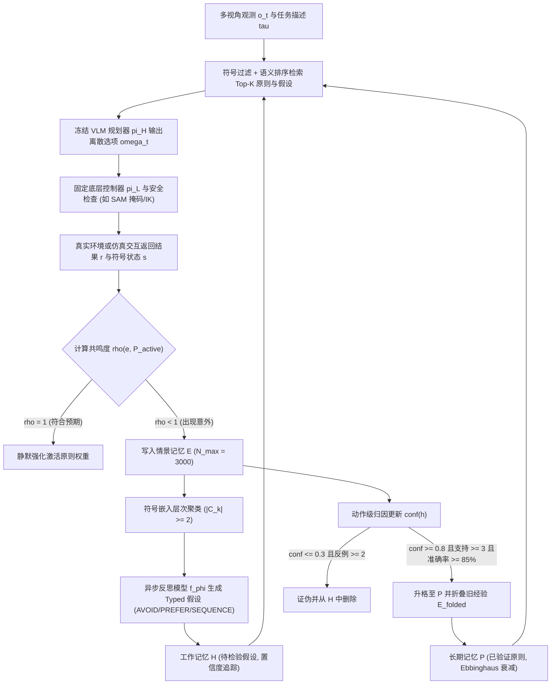
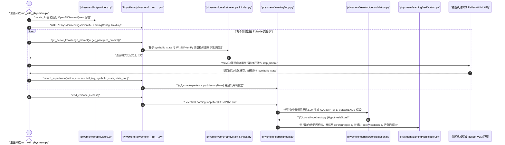

# PhysMem: Scaling Test-Time Memory for Embodied Physical Reasoning

## 一句话定义

PhysMem 是一种面向冻结参数视觉-语言模型（VLM）机器人规划器的测试时物理记忆框架：通过三层记忆架构（情景经验、工作假设、长期原则）和“先检验、再升格”的科学记忆闭环，让智能体在部署交互中提炼并验证可解释的物理原则，同时避免未校验的历史经验在新物理条件下误导规划。

## 英文缩写速查

| 缩写 | 英文全称 | 简要说明 |
|---|---|---|
| VLM | Vision-Language Model | 视觉-语言模型，本文中作为参数冻结的高层决策规划器与异步反思假设生成器 |
| VLA | Vision-Language-Action | 视觉-语言-动作模型，本文在对比背景中讨论其需参数更新与在线适应的局限 |
| RAG | Retrieval-Augmented Generation | 检索增强生成，本文将其直接复用到物理场景作为“未经验证即应用”的对比基线 |
| OOD | Out-of-Distribution | 分布外场景，用于测试已学原则在新初始布局、新球体动力学或未见石块组合下的迁移能力 |
| SAM | Segment Anything Model | 图像分割基础模型，本文在真机实验中用于部件/障碍物掩码碰撞检查与目标石块定位 |
| TTL | Time To Live | 存活时间，本文中指已被原则覆盖折叠（Folded）的原始经验在情景记忆中保留的回合上限（100 回合） |

## 为什么重要

1. **弥合声明式物理常识与具体物理接地的鸿沟**：预训练 VLM 虽然能抽象阐述“摩擦”“稳定性”“动量”等概念，却难以仅凭视觉外观预判特定球体在当前桌面的滚动阻尼、不规则 3D 零件的内部互锁间隙，或不同表面石块的静摩擦与质心平衡。
2. **揭示“先验证后应用”为何优于直接经验检索**：在物理条件会随任务和环境微调的具身操作中，直接按状态相似度检索历史动作（Direct Retrieval）容易把特定场景的偶发成功固化为僵化规则，导致在中等难度积木插装任务上成功率跌至 23%（甚至低于无记忆基线的 53%）。PhysMem 通过“工作记忆检验—动作级归因—证伪剔除”机制，将大量看似合理实则错误的伪相关假设（约 31%）在污染长期记忆前拦截。
3. **分离高层推理与底层控制、实现跨模型测试时缩放**：实验刻意固定底层运动执行器，证明性能提升纯粹源于物理理解而非电机策略调参；同时在保持基座模型参数完全冻结的前提下，使收益随基座 VLM 能力提升而同步放大（从 Gemini-ER-1.5 的 +5% 升至 Gemini-3-Flash 的 +23%）。

## 核心信息

| 字段 | 内容 |
|---|---|
| 作者 | Haoyang Li, Yang You, Hao Su, Leonidas Guibas |
| 机构 | Stanford University（斯坦福大学）；UC San Diego（加州大学圣地亚哥分校） |
| 发表时间 | arXiv:2602.20323v6（2026-02-23 提交 v1，2026-05-03 修订 v6） |
| 论文链接 | [arXiv:2602.20323](https://arxiv.org/abs/2602.20323) / [HTML 全文](https://arxiv.org/html/2602.20323) / [PDF 原文](https://arxiv.org/pdf/2602.20323) |
| 项目与代码 | [官方项目主页](https://phys-mem.github.io/) / [haoyangli16/PhysMem](https://github.com/haoyangli16/PhysMem) |
| 清单分类 | `model.adaptation` |
| 来源条目 | `adaptation_ax_2602_20323` |
| 开源状态 | 已开源（核心三层记忆数据结构、科学学习闭环、多模型 LLM 后端及 `quickstart` / `reflect_vlm` 示例均已在 GitHub 公开；README 声明 MIT License，仓内未单列 `LICENSE` 文件；三项真机任务的完整提示词实例与底层硬件标定细节在论文附录与当前仓内未完整附带） |

## 核心原理

PhysMem 基于 Options 框架将物理操作建模为分层决策问题：每步由参数冻结的 VLM 高层策略 $\pi_\theta^H$ 依据视觉观测 $o_t$、任务描述 $\tau$ 与当前激活原则集 $\mathcal{P}_t \subseteq \mathcal{P}$ 选择时间扩展选项 $\omega_t = \pi_\theta^H(o_t, \tau, \mathcal{P}_t)$，再交由固定的底层控制器 $\pi^L$（如逆运动学或标定抓放原语）执行直至终止。目标是在不修改 $\theta$ 的前提下，于测试时学到能显著提高期望累积回报的原则集 $\mathcal{P}^*$。

### 1. 三层记忆架构

- **情景记忆（Episodic Memory，$\mathcal{E}$）**：存储单步交互经验 $e = (o, \omega, r, c, \mathbf{s})$，包含关键帧观测、所选动作、二值成败结果 $r \in \{0,1\}$、任务上下文 $c$、失败标签 `fail_tag` 及结构化符号状态 $\mathbf{s}$（如动作类型 `action_type`、物体属性 `object_properties`、依赖满足状态、任务进度）。容量上限设为 $N_{\max}=3000$。
- **工作记忆（Working Memory，$\mathcal{H}$）**：暂存尚在检验中的候选假设，每条假设记录支持/反驳证据计数与实时置信度 $\text{conf}(h)$，在升格或证伪前受控地作为 `[TESTING]` 线索暴露给规划器。
- **长期记忆（Long-term Memory，$\mathcal{P}$）**：保存通过验证的原则（Typed Principles），按类型分为 `AVOID`（失败规避）、`PREFER`（成功偏好）、`SEQUENCE`（时序依赖）以及代码实现/扩展模板中的 `COMPARE` / `GENERAL`。长期原则的重要性分数遵循 Ebbinghaus 遗忘曲线按回合衰减：

$$\text{score}_{t+1} = \text{score}_t \cdot \gamma, \qquad \gamma = 0.995$$

在无后续强化时约 138 回合保留 50% 权重，避免过时规则长期干扰新环境。

### 2. 四阶段科学记忆闭环（Scientific Memory Loop）

1. **共鸣门控与经验收集（Resonance Checking）**：记录每次交互后，计算经验 $e$ 与当前激活原则 $\mathcal{P}_{\text{active}}$ 预测结果的一致率（共鸣度）：

$$\rho(e, \mathcal{P}_{\text{active}}) = \frac{|\{p \in \mathcal{P}_{\text{active}} : \text{consistent}(e, p)\}|}{|\mathcal{P}_{\text{active}}|}$$

当 $\rho = 1$ 时说明世界反馈符合现有认知，仅静默强化对应原则；当 $\rho < 1$（出现“预期违背 / Surprise”）时才触发巩固流程，将计算开销集中于未解释的新现象。

2. **符号状态聚类与假设生成（Clustering & Hypothesis Drafting）**：将符号状态转为文本嵌入并计算余弦相似度，使用凝聚式层次聚类（阈值 $\tau=0.6$，敏感性分析默认 $\tau_c=0.7$），对样本数 $|\mathcal{C}_k| \ge n_{\min}=2$ 的簇抽取 3–5 条代表经验与已有原则/假设清单，由反思模型 $f_\phi$（真机采用每 15 秒异步运行的 Qwen3-VL）生成每簇最多 3 条结构化假设：

$$\mathcal{H}_k = f_\phi(\mathcal{C}_k, \mathcal{P}, \mathcal{H}_{\text{existing}})$$

3. **动作级归因（Action-Level Attribution）**：为避免整个长回合的成败混淆单个步骤的物理因果，仅选取执行目标动作 $a^*$ 的相关经验 $\mathcal{E}_h$ 计算动作级成功率 $r_a$，并分段更新假设置信度（式 5 与附录式 7）：当 $r_a \ge 0.7$ 时上调 $\min(1.0, \text{conf}(h)+0.1\cdot r_a)$；当 $r_a \le 0.3$ 时下调 $\max(0.0, \text{conf}(h)-0.1\cdot(1-r_a))$；中间区间微调 $\pm 0.02$。

4. **验证升格、证伪剔除与记忆折叠（Verification & Memory Folding）**：
   - **升格（Promotion）**：当 $\text{conf}(h) \ge \tau_p = 0.8$、支持回合 $|\mathcal{E}_{\text{support}}| \ge 3$ 且准确率 $\ge 85\%$ 时，假设 $h$ 升格进入 $\mathcal{P}$，同时触发**记忆折叠**，将已被该原则覆盖的底层原始经验标记压缩并在 TTL（100 回合）或容量回收时移除：$\mathcal{P} \leftarrow \mathcal{P} \cup \{h\},\ \mathcal{E} \leftarrow \mathcal{E} \setminus \mathcal{E}_{\text{folded}}$。
   - **证伪（Refutation）**：当 $\text{conf}(h) \le \tau_r = 0.3$ 且反例回合 $|\mathcal{E}_{\text{contradict}}| \ge 2$ 时直接剔除，防止伪规律污染长期记忆。

### 3. 检索与提示词注入

推理时先按符号状态（动作类型、物体属性）进行硬过滤，再结合向量索引做语义排序，抽取 Top-$K=5$ 条长期原则（附 `[HIGH ≥85% / MEDIUM 60–84% / LOW <60%]` 置信度标签）与活跃工作假设注入 VLM 规划提示词第 6–7 段。低共鸣区间优先探索与巩固，高共鸣区间稳定利用已有原则。

## 流程总览

## 源码运行时序图

论文的通用记忆核心与测试时学习循环已开源于 [haoyangli16/PhysMem](https://github.com/haoyangli16/PhysMem)。框架对外暴露 `physmem/__init__.py` 中的 `PhysMem` 主类与 `ScientificLearningConfig`，在交互循环中连接 `physmem/core/` 记忆存储与 `physmem/learning/` 巩固验证引擎，并附带独立最小演示 `physmem/examples/quickstart.py` 与 Reflect-VLM 仿真集成脚本 `physmem/examples/reflect_vlm/run_with_physmem.py`。

关键复现入口：快速验证闭环与学习曲线可直接运行 `python3 physmem/examples/quickstart.py`（或无 LLM 规则模式直接实例化 `PhysMem()`）；针对论文积木插装仿真基准，则需先配置外部 Reflect-VLM 环境后运行 `physmem/examples/reflect_vlm/run_with_physmem.py` 并按需配合 `save_state()` / `load_state()` 持久化记忆检查点。

## 实验与评测

### 1. 仿真主对比：Brick Insertion 记忆范式对比（Table II, Reflect-VLM）

在 MuJoCo 3.x + Franka Panda 7-DOF 机械臂的 Brick Insertion（积木按依赖顺序插装）基准上，统一冻结 `Gemini-3-Flash`（thinking mode），每格运行 100 回合 × 3 个随机种子，在 `Top-K=5` 上下文中对比训练免微调记忆范式（MemER 与 MemoryVLA 取其无参数更新的检索/长上下文代理）：

| 方法 | Easy (2–3 块) | Med. (4–5 块) | Hard (6–8 块) | 相对 Token 消耗 |
|---|---:|---:|---:|---:|
| No Memory | 83% | 53% | 28% | 0.40× |
| Direct Retrieval（原始经验检索） | 48% | 23% | 8% | 0.55× |
| MemER-style Retrieval（VLM 比较排序检索） | 85% | 53% | 19% | 1.0× |
| MemoryVLA-style Token Memory（全历史上下文） | 69% | 35% | 13% | 2.5× |
| Reflexion-style（自由文本反思） | 86% | 61% | 31% | 1.2× |
| **PhysMem (Full)** | **89%** | **76%** | **39%** | **1.0×** |

实验显示：直接经验检索在三档难度上全面低于无记忆基线（Med. 暴跌 30 个百分点至 23%）；MemER 式选择性检索在 Med. 仅打平 No Memory（53%），在 Hard 仍跌破无记忆下限（19% vs 28%）；MemoryVLA 式全历史拼接在付出 2.5× Token 代价的同时仍落后 PhysMem 超过 40 个百分点（Med. 35% vs 76%）；仅 PhysMem 在 Hard 难度超越无记忆基线（+11 个百分点）。

### 2. 真机闭环演进与共鸣度（xArm6 30+ 分钟部署，Sec. V-B & V-C）

真机采用 xArm6 机械臂、TPU 3D 打印鳍状软爪（fin-ray soft grippers）、RealSense D435 多视角相机（1280×720），由 `Gemini-3.0-Flash` 规划、`Qwen3-VL` 每 15s 异步生成假设，并在 10–20 回合的连续会话中测试三项视觉难以直接判断物理属性的任务：
- **Parts Organization（3×10 网格紧凑排布 5/6 个 3D 打印不规则件）**：全量记忆下规划得分从 `-1` 持续升至 `9.7`（无记忆维持在 `0` 附近）。
- **Ball Navigation（6 步内推足球穿越桥洞与障碍到达目标）**：全量记忆得分达 `14.7`，而无记忆仅 `0.7`；经验利用率消融中，50% 经验得 `11.0`、100% 经验达 `14.7`，说明复杂动力学依赖充足交互。
- **Balanced Stacking（按摩擦等级 `3M > BLK > WHT > WOOD > PAINT` 与截面形状堆叠 5 块平衡石）**：50% 经验已接近 100% 经验表现，呈现快速饱和特征。
- **共鸣度演化（Fig. 7）**：三项任务共鸣度 $\rho$ 均从早期约 `0.2` 爬升至第 10 回合的约 `0.9`（约第 5–6 回合跨过 `0.7`）；进入高共鸣区间（$\rho > 0.7$）后平均得分达到前 3 回合的 **2.3×**。跨四套任务统计，验证机制共拦截并证伪了约 **31%**（87/281）的候选假设（中位寿命 6 回合、初始中位置信度 0.58）。

### 3. OOD 分布外迁移消融（Table III, 每组 10 次试验）

| Prior（已有原则） | Adapt（测试时适应） | Parts Org. 得分 (成功) | Ball Nav. 得分 (成功) | Balanced Stack. 得分 (成功) |
|---|---|---|---|---|
| ✗ | ✗ | -0.6 (0/10) | 1.6 (1/10) | 6.7 (4/10) |
| ✗ | ✓ | 3.3 (1/10) | 5.5 (2/10) | 8.3 (7/10) |
| ✓ | ✗ | 6.9 (3/10) | 2.9 (1/10) | 9.2 (8/10) |
| ✓ | ✓ | **8.3 (4/10)** | **7.1 (4/10)** | **12.3 (9/10)** |

当物理结构相似时（如换用新石块组合的 Balanced Stacking），先验原则直接带来 80%（8/10）成功率；而 Ball Navigation 换用高摩擦网球与低摩擦月球纹理塑料球后，仅靠先验退化为与零样本一致的 1/10，必须开启测试时适应才能将成功率拉升至 **40%（4/10）**。

### 4. 跨基座模型缩放、原则数量与完整消融（Tables IV, VI, VII, VIII）

- **跨 VLM 缩放（Table VIII, Medium 难度 100 回合，固定 Qwen3-VL 反思模型）**：Gemini-3-Flash 从 `53% → 76%`（**+23%**）、GPT-5.1 从 `43% → 57%`（**+14%**）、Qwen3-VL-235B 从 `38% → 50%`（**+12%**）、Gemini-ER-1.5 从 `29% → 34%`（**+5%**）。基座推理能力越强，从验证原则中获益越多。
- **原则数量缩放（Sec. V-F, 500 回合）**：Medium 难度在 2–8 条原则间由 `55%` 急升至 `67%`，在 16–64+ 条原则趋于 `76%` 稳定平台；Hard 难度学到的原则中 **68%** 为 `Avoid` 约束（Medium 为 41%），主要靠排错避坑提升成功率（+11%）。
- **核心组件消融（Tables IV & VI, Medium / Hard）**：移除情景记忆跌至 `37% / 14%`（-39 / -25）；移除共鸣过滤跌至 `58% / 21%`（均 -18）；移除验证跌至 `64% / 27%`（均 -12）；移除工作记忆跌至 `69% / 28%`（-7 / -11）；关闭遗忘在 Easy/Med. 略增 +2% 但 Hard 降为 `36%`（-3%）且 Token 暴涨至 **3.4× / 4.8×**；关闭折叠准确率仅差 1–2 个百分点但 Token 增至 **1.4×–2.8×**。
- **超参数与延迟开销（Tables V, VII & App. C）**：每簇 2 条假设 + 提示注入 5 条原则（Balanced 配置，76%）优于 Sparse（71%）与 Dense（74%, 1.6× tokens）；在 64 组阈值网格（$\tau_p, \tau_c, \gamma$）中有 59 组波动在 ±5% 内。单步检索耗时约 **180 ms**，后台异步巩固每 15s 耗时约 **1.4 s**，总墙钟开销仅约基座 VLM 推理时间的 **8%**。

## 与其他工作对比

| 维度 | 在线 RL（RECAP, $\pi_{0.6}$） | 参数微调记忆 VLA（MemER, MemoryVLA, MEM） | 回合内自由反思（Reflexion, Self-Refine） | 直接/检索增强（RAG, MAP-VLA） | PhysMem（本文） |
|---|---|---|---|---|---|
| 基座参数更新 | 需要梯度更新 | 需要模仿学习微调 | 冻结 | 冻结 | **冻结** |
| 记忆载体形态 | 隐式网络权重 | 视觉/隐空间/文本记忆 | 自由自然语言反思文本 | 原始历史经验片段 | **经验证的结构化类型原则（AVOID/PREFER/SEQUENCE）** |
| 事前检验与证伪 | 隐式策略试错 | 无显式规则证伪 | 仅在失败后生成，缺乏统计检验 | 无检验，按相似度直接套用 | **动作级归因 + 阈值检验（误判假设会被证伪删除）** |
| 物理分布偏移表现 | 需重新在线训练 | 依赖微调分布覆盖 | 易受单次失败噪声误导（Med. 61%） | 易将过时特例固化为错误规则（Med. 23%） | **低共鸣触发新假说并衰减旧原则（Med. 76%）** |
| 人类可解释性与编辑性 | 低 | 低 | 高 | 中 | **高（支持人工审阅、编辑与跨任务迁移）** |

## 结论

**一句话总判：在冻结基座 VLM 的具身物理规划中，记忆增益的核心不在于检索更多历史上下文，而在于“共鸣门控筛选意外 + 动作级归因验证再升格 + 记忆折叠与遗忘”，这使系统能把零散交互提炼为紧凑、可迁移且抗过拟合的物理原则。**

1. **未校验的直接经验检索在变动力学场景中是有害的**：Brick Insertion 中 Direct Retrieval 跌至 23%（比无记忆低 30 个百分点），全历史拼接（MemoryVLA 代理）耗费 2.5× Token 却仅得 35%；工程上应禁止把未经验证的原始轨迹直接塞入提示词当硬规则。
2. **验证与证伪机制是防止伪相关固化的承重墙**：全实验约 31% 的初生假设看似合理实则错误，去掉验证导致 Medium 与 Hard 均掉点 12 个百分点；部署时必须按动作级成果而非整回合总成败来更新假设置信度。
3. **遗忘与记忆折叠换取长程运行的稳定性与低 Token 成本**：Ebbinghaus 衰减与折叠机制不仅将长程 Token 消耗压低 3–5 倍，还能在复杂任务（Hard）上防止陈旧规则与新原则打架。
4. **记忆放大基座能力而非替代基座推理**：从 Gemini-ER-1.5（+5%）到 Gemini-3-Flash（+23%）的缩放斜率说明，更强的规划器能写出更精准的假设并更准确地遵从原则，选型时应优先搭配推理能力较强的 VLM 骨干。

## 工程实践

- **安装与依赖**：通过 `pip install .` 安装仅含 NumPy 的轻量内核，或 `pip install ".[all]"` 启用 OpenAI/Kimi、Gemini、Qwen 后端与 `FAISS` / 聚类嵌入模块。
- **典型参数设置（Table V 与附录 C-A/D）**：建议设定情景容量 $N_{\max}=3000$、每簇最小样本 $n_{\min}=2$、聚类阈值 $\tau_c \in [0.6, 0.7]$、每簇生成假设上限 2–3 条、升格置信度阈值 $\tau_p=0.8$（支持回合 $\ge 3$，准确率 $\ge 85\%$）、证伪阈值 $\tau_r=0.3$（反例 $\ge 2$）、遗忘衰减因子 $\gamma=0.995$、提示注入上限 `max_principles_in_prompt=5`。
- **异步部署防阻塞**：将单步检索（~180 ms）保留在同步规划路径中，将聚类与反思模型调用放在后台线程异步执行（如每 15s 一轮、耗时 ~1.4 s），可将总体时间开销控制在基座 VLM 推理的约 8%。
- **符号状态设计关键**：真机效果高度依赖 `symbolic_state` 中提取的离散物理属性（如部件旋转模板坐标、与障碍物的空间区域与距离区间、石块材质与截面命名 `{Surface}_{Shape}_{Size}_{Orientation}`）；若符号特征缺失关键混杂变量（如尺寸或真正阻挡物颜色），则会诱发“过度泛化”错误。

## 局限与风险

1. **离散高层抽象难以刻画连续力控与轨迹动力学**：当前文本原则擅长表达离散顺序、几何互锁或速度档位等规则，但无法精确表达连续力曲线或精细轨迹控制，且框架聚焦高层决策，未与端到端底层 VLA 策略联合微调或直接闭环。
2. **感知模态局限与环境人工重置成本**：当前仅依赖 RGB 视觉与二值/分步得分，缺少触觉、力/力矩失败特征或声学接触信号（仅在 Balanced Stacking 放置阶段用末端力阈值探测接触）；真机连续测试中若出现球体掉出桌外或石块塌落，仍依赖人工手动复位，尚未实现全自动物理恢复。
3. **三大残留失败模式（Medium 24% 未解决案例，App. C-B）**：包括**过度泛化（40%）**（窄条件学到的原则被跨尺寸/场景误用）、**延迟纠错（35%）**（旧原则失效后平均滞后 2–4 个回合才累积足够反例被证伪）以及**规划器与原则失配（25%）**（原则正确但基座 VLM 忽略或误执行）。
4. **开源与论文复现边界**：GitHub 仓库完整开放了 `PhysMem` 算法框架及 `quickstart` / `reflect_vlm` 示例，但仓库未单列独立 `LICENSE` 文件（仅 README 声明 MIT），且三项真机任务完整的提示词实例细节及底层标定脚本未随论文附录或仓库完全公开。

## 关联页面

- [Agentic Robots 综述](paper-towards-agentic-robots-survey.md)
- [全量项目节点清单](../overview/awesome-agentic-robots-node-index.md)
- [VLA 方法背景](../methods/vla.md)
- [机器人智能体执行框架](../methods/robot-agent-harness.md)：对照规划、执行接口与反馈机制。
- [智能体规划与反馈执行](../methods/agent-planning-feedback.md)：对比规划—执行反馈闭环与测试时纠错设计。
- [智能体操作策略](../methods/agentic-manipulation-policies.md)：面向长程操作任务的智能体策略组织方式。
- [机器人操作系统集成](../methods/robotic-manipulation-systems.md)：高层决策与底层控制执行栈的系统集成背景。
- [具身智能体基准评测](../methods/embodied-agent-benchmarking.md)：Reflect-VLM 仿真与真机任务评测口径对照。
- [机器人操作任务](../tasks/manipulation.md)：Parts Organization、Ball Navigation 与 Balanced Stacking 所属操作任务总览。

## 推荐继续阅读

- [PhysMem 官方项目主页](https://phys-mem.github.io/)
- [PhysMem 官方 GitHub 仓库（haoyangli16/PhysMem）](https://github.com/haoyangli16/PhysMem)
- [PhysMem 论文原文（arXiv:2602.20323）](https://arxiv.org/abs/2602.20323)

## 参考来源

- [论文全文精读归档](../../sources/papers/paper-agentic-2602-20323.md)
- [官方代码仓库结构与入口归档](../../sources/repos/paper-agentic-2602-20323.md)
- [官方 Awesome 快照归档](../../sources/repos/awesome-agentic-robots-survey-index.md)
- [arXiv:2602.20323v6 HTML 全文](https://arxiv.org/html/2602.20323)
