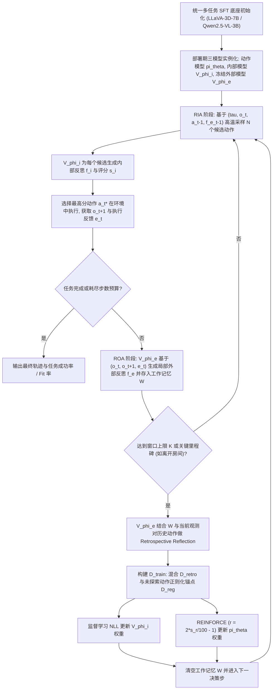
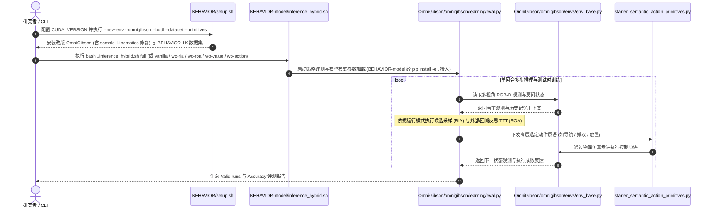

# Learning from Trials and Errors: Reflective Test-Time Planning for Embodied LLMs

## 一句话定义

Reflective Test-Time Planning（反思式测试时规划）是一种面向具身大语言模型（Embodied LLM）的部署期自适应规划框架，通过**行动中反思（Reflection-in-Action）**在执行前采样并打分筛选候选动作，并借助**行动后反思（Reflection-on-Action）**与**事后回溯反思（Retrospective Reflection）**在单回合部署内在线更新动作策略与内部评估模型参数。

## 英文缩写速查

| 缩写 | 英文全称 | 简要说明 |
|---|---|---|
| RIA | Reflection-in-Action | 行动中反思：执行前高温采样多个候选动作并由内部反思模型打分择优（测试时扩展） |
| ROA | Reflection-on-Action | 行动后反思：执行后由外部反思模型评估结果并触发测试时训练更新参数 |
| TTT | Test-Time Training | 测试时训练：部署期间基于自监督回溯反思信号对策略与内部模型进行在线权重更新 |
| SFT | Supervised Fine-Tuning | 监督微调：部署前使用少量经物理仿真校验的轨迹初始化格式与基本具身推理能力 |
| HM3D | Habitat-Matterport 3D | 真实室内三维扫描重建数据集，用于验证从合成环境到逼真场景的零样本迁移 |
| LG-MCTS | Language-Guided Monte Carlo Tree Search | 语言引导蒙特卡洛树搜索，本文用于对比显式前瞻搜索与测试时学习的基线方法 |

## 为什么重要

1. **打破“无记忆重复试错”困局**：传统具身 LLM 在部署期间参数冻结，即使遭遇物体尺寸冲突或前置阻塞也会在同回合或跨步骤中反复犯同样错误；本文使单个部署回合本身成为学习过程，无需环境重置或人工标注。
2. **打通“上下文反思”与“参数化学习”的断层**：以 Reflexion、Self-Refine 为代表的口头反思方法仅将批评留在上下文文本中，无法持久修正模型内部的物理与空间认知；而 PPO、DreamerV3 等 RL 方法依赖多回合稀疏标量奖励。本文把自然语言反思转化为可微监督信号与 REINFORCE 策略梯度，实现了可解释的**双环学习（Double-Loop Learning）**——不仅改动作，还修正预测动作后果的内部假设模型。
3. **解决长程具身任务中的非局部信用分配问题**：在多房间或空间受限操作中，局部看似成功的动作（如先把小物体放进唯一大格口）可能阻塞后续关键动作。本文通过里程碑/滑动窗口触发的**事后回溯反思**重新评估早期决策，以显著低于逐帧微调的开销实现了长程信用分配。

## 核心信息

| 字段 | 内容 |
|---|---|
| 作者 | Yining Hong, Huang Huang, Manling Li, Li Fei-Fei, Leonidas Guibas, Jiajun Wu, Yejin Choi |
| 机构 | Stanford University（Yining Hong 等 6 位作者）、Northwestern University（Manling Li） |
| 发表时间 | arXiv:2602.21198v3（2026-02-24 提交 v1，2026-05-25 修订 v3） |
| 论文链接 | [arXiv:2602.21198](https://arxiv.org/abs/2602.21198) / [HTML v3](https://arxiv.org/html/2602.21198) |
| 项目与代码 | [官方 GitHub 仓库](https://github.com/Reflective-Test-Time-Planning/Reflective-Test-Time-Planning) / [项目主页](https://reflective-test-time-planning.github.io) |
| 清单分类 | `model.planning`, `model.adaptation`, `data.refinement`（条目 `survey_ax_2602_21198`） |
| 开源状态 | **部分开源**：已公开基于 OmniGibson/BEHAVIOR-1K 的修改环境、`BEHAVIOR-model` 样例评测脚本与 MuJoCo Cupboard 交互环境；完整 BEHAVIOR 评测集待论文接收后发布，Cupboard 推理代码仍在清理中 |

## 核心原理

框架由三个共享同源 SFT 初始化底座、但在部署期职责分离的具身 LLM 组成：**动作生成模型** $\pi_\theta$、**内部反思模型** $V_{\phi_i}$（部署期可更新）与**外部反思模型** $V_{\phi_e}$（部署期参数冻结，作为稳定事后裁判）。

### 1. 统一 SFT 初始化（最小化冷启动引导）

在部署前，使用少量经物理仿真验证的轨迹对单一多模态底座（BEHAVIOR 基准采用融合点云特征的 **LLaVA-3D-7B**；Cupboard 基准采用 **Qwen2.5-VL-3B**）进行跨模式多任务监督微调，使其同时掌握动作生成、内部反思与外部反思三种提示格式，然后复制实例化为 $\pi_\theta$、$V_{\phi_i}$、$V_{\phi_e}$。

### 2. Reflection-in-Action（行动中反思，测试时扩展）

在每个决策步 $t$：
1. 构造提示 $x_{\text{action}} = (\tau, o_t, a_{t-1}, f_e^{t-1})$（包含任务目标 $\tau$、当前观测 $o_t$、上步动作及上步外部反思），通过高温 $T$ 采样生成 $N$ 个候选动作：
   $$a_t^k \sim p_\theta(\cdot \mid x_{\text{action}}; T), \quad k = 1, \dots, N$$
2. 对每个候选动作构建 $x_{\text{internal}}^k$，由内部反思模型 $V_{\phi_i}$ 生成自然语言前瞻推演 $f_i^{t,k}$ 与数值评分 $s_i^{t,k} \in [0, 100]$。
3. 择优执行最高分候选 $a_t^* = a_t^{(\arg\max_k s_i^{t,k})}$，并从环境获取下一观测 $o_{t+1}$ 与执行成功/失败二值反馈 $e_t$。

### 3. Reflection-on-Action 与事后回溯反思（测试时训练）

1. **即时外部反思**：执行 $a_t^*$ 后，冻结的 $V_{\phi_e}$ 基于执行前后的真实观测对比 $(o_t, o_{t+1})$ 与结果 $e_t$ 生成局部反思与评分 $(f_e^t, s_e^t)$，写入容量为 $K$ 的工作记忆缓冲区 $\mathcal{W}_t$（BEHAVIOR 中 $K=5$）。
2. **事后回溯反思（Retrospective Reflection）**：当 $|\mathcal{W}| = K$ 或抵达关键里程碑（如离开当前房间 `EXIT` 或出现连续失败）时，$V_{\phi_e}$ 结合完整工作记忆窗口 $\mathcal{W}_t$ 与当前观测 $o_{t+1}$，对 $\mathcal{W} \cup \mathcal{D}_{\text{retro}}$ 中的历史动作 $a_j$ 进行事后重估，输出修正反思与评分 $(f_r^j, s_r^j)$。例如早期成功放入格口的小物体若导致后续大物体无法存放，其回溯分数会被下调。
3. **防遗忘正则化数据集构建**：为防止小批量在线更新引发灾难性遗忘，从动作空间随机采样未探索动作 $a_l$，以当前 $V_{\phi_i}$ 的预测 $(f_i^l, s_i^l)$ 作为锚定目标构成 $\mathcal{D}_{\text{reg}}$，与 $\mathcal{D}_{\text{retro}}$ 按 50%/50% 混合（BEHAVIOR 配置）形成训练集 $\mathcal{D}_{\text{train}}$。
4. **双目标测试时训练（TTT）**：
   - **内部反思模型 $V_{\phi_i}$（监督学习）**：最小化负对数似然 $\mathcal{L}_{\text{internal}}(\phi_i) = \mathbb{E}_{(x_{\text{internal}}, f, s) \sim \mathcal{D}_{\text{train}}}[-\log p_{\phi_i}(f \mid x_{\text{internal}})]$，使其学会预测“事后才会暴露的物理与长期后果”。
   - **动作模型 $\pi_\theta$（REINFORCE 策略梯度）**：将回溯分数映射为奖励 $r = 2(s_r / 100) - 1 \in [-1, 1]$，通过 $\ell_\theta = -r \cdot \log p_\theta(a \mid x_{\text{action}})$ 提升高回溯分动作概率、抑制低分错误动作。

## 流程总览

## 源码运行时序图

以下时序图基于官方仓库 `README.md` 与 `files_sample` 静态核对绘制，对应 **BEHAVIOR-1K 长程家庭任务样例评测路径**（注：仓库 `files_sample` 仅覆盖 `BEHAVIOR/BEHAVIOR-1K/OmniGibson/` 子目录；`cupboard/roboworld/envs/franka_cupboard_interactive.py` 当前仅提供交互环境测试，其模型推理脚本据 README 尚未清理发布）。

- **入口说明**：用户需先在 `BEHAVIOR/` 中配置 CUDA 并通过 `setup.sh` 构建包含定制 `sample_kinematics` 的 OmniGibson 环境，随后在 `BEHAVIOR-model/` 通过 `inference_hybrid.sh` / `inference_storage.sh` / `inference_compare.sh` 传入 `full` 或消融模式标签驱动评测。

## 实验与评测

### 1. 长程家庭任务（BEHAVIOR-1K，Table 1 & Table 3 & Table 5–7 & Table 13–15）

在作者基于 BEHAVIOR-1K 构建的四大失败驱动类别（Fitting 空间适配、Selection 偏好选择、Preparation 依赖顺序、Hybrid 混合，步数预算 30 步，LLaVA-3D-7B 底座）上：

| 方法 / 消融配置 | Fitting (%) | Selection (%) | Preparation (%) | Hybrid (%) | Average (%) | 说明 |
|---|---:|---:|---:|---:|---:|---|
| **Ours (Full)** | **44.7** | **32.4** | **31.7** | **25.8** | **33.65** | RIA + ROA (Retrospective) |
| w/o Act. loss | 25.5 | 26.5 | 20.6 | 16.1 | 22.18 | 仅更新 $V_{\phi_i}$，冻结 $\pi_\theta$ |
| w/o ROA | 6.38 | 11.8 | 19.0 | 12.9 | 12.52 | 仅有行动前内部反思打分 |
| w/o Int. loss | 12.8 | 8.82 | 17.5 | 9.68 | 12.20 | 仅更新 $\pi_\theta$，冻结 $V_{\phi_i}$ |
| w/o RIA | 33.5 | 5.88 | 3.17 | 3.23 | 11.45 | 取消多候选采选，保留 ROA |
| w/o RIA/ROA | 0.00 | 17.6 | 11.1 | 12.9 | 10.40 | 仅 SFT 初始化底座 |
| Self-Refine | 10.6 | 11.8 | 12.7 | 9.68 | 11.20 | 多模态适配版自修正（最多 3 轮） |
| 3DLLM-Mem | 10.6 | 14.7 | 9.52 | 9.68 | 11.13 | 融合点云记忆，无显式反思与 TTT |
| DreamerV3 | 4.26 | 11.8 | 11.1 | 12.9 | 10.02 | 潜空间世界模型 RL（等交互步数） |
| Reflexion | 8.51 | 8.82 | 15.9 | 6.45 | 9.92 | 纯上下文反思缓冲区 |
| ReflectVLM | 2.12 | 5.88 | 14.3 | 6.45 | 7.19 | 单独训练价值头打分 |
| PPO | 0.00 | 2.94 | 7.94 | 3.23 | 3.53 | 离线/在线交互策略优化 |

- **关键衍生验证**：
  - **商用大模型零样本对比（Table 15）**：在同等部分可观测条件下，GPT-5（20.7%）、Gemini 2.5 Pro（19.7%）、Qwen2.5（14.2%）均明显低于本文 7B/3B 反思框架，表明测试时学习而非单纯参数规模主导了纠错能力。
  - **回溯反思 vs. 逐帧外部反思（Table 3）**：在每步均做外部反思 TTT 仅得 15.6% 平均成功率且耗时约 **4×**；回溯反思在 **1×** 开销下达到 **33.7%**。
  - **算力匹配与搜索对比（Table 6 & Table 13）**：给 Vanilla 基线 3× 步数预算仅得 8.46%（未见提升）；LG-MCTS（树深 3）需约 5–8× 开销仅达 15.4%。
  - **HM3D 零样本迁移（41 个 Preparation 任务，Table 5）**：本文达到 **19.5%**，显著领先 3DLLM-Mem（7.32%）、Self-Refine（4.88%）、Reflexion / DreamerV3（2.44%）及 PPO / ReflectVLM（0.00%）。
  - **效率工程优化（Table 7）**：结合并行候选打分+KV Cache、批处理回溯反思、TTT 早停、QLoRA 与多 GPU 并行，可将推理耗时从基础版的约 3× 相对 Vanilla 压降至 **0.45×**，同时保持 **31.5%** 成功率（基准 33.7%）。

### 2. MuJoCo Cupboard Fitting 与 Franka Panda 真机（§5、Fig. 3、Table 4、Appendix N–O）

- **MuJoCo 仿真（Qwen2.5-VL-3B）**：
  - 完整方法（LoRA TTT，$r=8,\alpha=16$）取得 **60.2% Fit 率**与 **25.3% Correct 率**；全非视觉权重 TTT 达 57.4% Fit 率；去除 RIA 降至 53.5%，去除 ROA 降至 45.2%，两者皆去降至 44.5%。
  - **单步生成 vs. 滚动时域规划（Table 18）**：单步动作生成（60.2% Fit / 25.3% Correct，1.0× 算力）优于每次生成 5–10 步序列的 Receding Horizon（57.8% Fit / 25.8% Correct，5.0× 算力），因后者在物理不可预测环境中浪费计算且“幻想预测”与“真实反馈 TTT”梯度冲突。
  - **超参敏感性（Appendix N）**：候选数 $N=6$ 达峰值 60.0%（$N=1$ 为 53.0%，$N=10$ 降为 58.8%）；温度 $T\in[1.25, 1.5]$ 最优（$T=0$ 为 52.6%，$T=2.0$ 跌至 47.0%）；LoRA 过参化会引发模式坍缩——$(16,32)$ 降至 41.5%，$(32,32)$ 坍缩至 34.8%。
- **Franka Panda 真机（Table 4）**：
  - Zero-shot w/o RIA & ROA：13.1% Fit / 4.5% Correct；Fine-tuned w/o RIA & ROA：20.7% / 7.2%。
  - Zero-shot full：40.6% / 13.4%；**Fine-tuned full：44.2% Fit / 16.6% Correct**。在真机抓取偏差与滑动噪声下，未微调的反思模型甚至明显超过微调但无反思的基线。

## 与其他工作对比

- **对比上下文口头反思（Reflexion / Self-Refine）**：后者仅将错误分析以自然语言塞入 Prompt 缓存，模型参数不变导致空间几何误判反复重现；本方法通过 TTT 将语言反思内化为 $\pi_\theta$ 与 $V_{\phi_i}$ 的权重更新。
- **对比值函数/树搜索规划（ReflectVLM / LG-MCTS）**：离线训练的固定价值头或基于未更新先验的 MCTS 前瞻在遇到未知物理约束时依然脱离现实；本方法用真实执行反馈不断校准内部评估器 $V_{\phi_i}$。
- **对比在线/模型化 RL（PPO / DreamerV3）**：常规 RL 依赖大量回合与标量奖励塑形，在单回合长程任务中信用分配极慢；本方法借助语言模型自带常识与事后回溯文本反馈，在单次部署窗口内即可完成快速适应。

## 结论

**一句话总判：Reflective Test-Time Planning 通过将高温采样内部筛选（RIA）与里程碑事后回溯测试时训练（ROA）紧耦合，有效解决了具身 LLM 在单回合长程部署中“只犯不改”的痛点，但实际部署需精细控制 SFT 规模与 LoRA 容量以防模式坍缩。**

1. **RIA 与 ROA 必须成对启用**：仅保留内部筛选（w/o ROA）会放大未校准的错误自信；仅保留测试时训练（w/o RIA）则会基于低质量动作轨迹更新权重。
2. **用事后回溯替代逐帧微调**：在房间切换或窗口满 $K=5$ 时做集中回溯更新，既能纠正早期局部成功但全局阻塞的动作，又能将相对每步微调的额外开销降低约 4 倍。
3. **坚持小步快跑的单步生成**：在高度不确定的物理操作中，依赖单步生成结合回溯反思比生成多步规划序列更省算力且避免优化目标冲突。
4. **严格控制 SFT 步数与 LoRA 秩**：SFT 仅需少量数据教会社区/任务输出格式（过量会过拟合削弱 TTT）；TTT 阶段建议使用中等低秩配置（如 BEHAVIOR 用 $r=4, \alpha=8$，Cupboard 用 $r=8, \alpha=16$）。

## 工程实践

- **硬件与仿真依赖边界**：官方 `BEHAVIOR/setup.sh` 依赖 OmniGibson 与约 50GB BEHAVIOR-1K 数据集；README 明确警告 OmniGibson 当前不支持 Blackwell 架构 GPU，需在 RTX 3090/4090 或双 80 系卡上运行，且需手动在 `setup.sh` 中对齐本机 `CUDA_VERSION`。
- **防崩溃工程要点**：
  - 部署期必须保留未探索动作正则化锚点 $\mathcal{D}_{\text{reg}}$（如 50% 混合比）及较小梯度裁剪阈值（论文 BEHAVIOR 配置中 $V_{\phi_i}$ 裁剪 0.3、$\pi_\theta$ 裁剪 0.5），否则极易在数次更新后输出单一坍缩动作。
  - 若需压缩默认 ~3× 的测试时延迟，可按 Appendix D 组合使用共享前缀 KV Cache 并行候选打分、批处理回溯推理、TTT 早停与 4-bit QLoRA，可在微损精度下将开销压至 ~0.45×。

## 局限与风险

1. **基础推演延迟与并发复杂度**：未优化前全流程带来约 3× 的单步墙钟耗时，且同时维护 $\pi_\theta$、$V_{\phi_i}$、$V_{\phi_e}$ 三个多模态模型副本会显著增加显存占用。
2. **对基础模型格式与规模敏感**：零 SFT 初始化无法稳定输出结构化动作-评分格式（Table 10 近乎 0%）；而过大基础模型（如 Qwen2.5-VL-7B 相比 3B）在少量在线样本下反而更难自适应（Table 11）。
3. **当前开源与真机验证覆盖限制**：仓库尚未释放 BEHAVIOR 完整评测集与 Cupboard 推理脚本；真机验证目前仅覆盖桌面橱柜放置任务（依赖人工标定物体初始位置与俯视 RGB-D bounds 检测结果），尚未拓展至全屋多房间移动操作真机或触觉传感闭环。
4. **在线权重更新安全性**：如论文 Appendix B 所提示，部署期自主改写策略参数可能绕过原有安全约束或放大语言模型的隐性偏见，关键场景需保留外部监控与回滚机制。

## 关联页面

- [Agentic Robots 综述](paper-towards-agentic-robots-survey.md)
- [全量项目节点清单](../overview/awesome-agentic-robots-node-index.md)
- [VLA 方法背景](../methods/vla.md)
- [机器人智能体执行框架](../methods/robot-agent-harness.md)：对照规划、工具调用与反馈的系统边界
- [智能体规划与反馈机制](../methods/agent-planning-feedback.md)：对照行动前筛选与执行后闭环修正机制
- [智能体操纵策略](../methods/agentic-manipulation-policies.md)：长程桌面与家居操作中的任务规划与容错
- [具身智能体基准评测](../methods/embodied-agent-benchmarking.md)：BEHAVIOR-1K 与 HM3D 等多房间长程基准设计
- [PPO 算法](../methods/ppo.md)：对照本文作为强化学习基线的策略优化方法
- [机器人操作任务](../tasks/manipulation.md)：桌面与橱柜几何约束放置任务归属

## 推荐继续阅读

- [官方项目主页（含案例可视化演示）](https://reflective-test-time-planning.github.io)
- [官方代码仓库 Reflective-Test-Time-Planning](https://github.com/Reflective-Test-Time-Planning/Reflective-Test-Time-Planning)
- [BEHAVIOR-1K 仿真基准主页与论文（arXiv:2403.09227）](https://arxiv.org/abs/2403.09227)

## 参考来源

- [论文全文核对归档](../../sources/papers/paper-agentic-2602-21198.md)
- [官方 Awesome 快照归档](../../sources/repos/awesome-agentic-robots-survey-index.md)
- [官方代码仓库静态核对](../../sources/repos/paper-agentic-2602-21198.md)
- [arXiv:2602.21198 论文原文（HTML v3）](https://arxiv.org/html/2602.21198)
- [Reflective-Test-Time-Planning GitHub 仓库](https://github.com/Reflective-Test-Time-Planning/Reflective-Test-Time-Planning)
