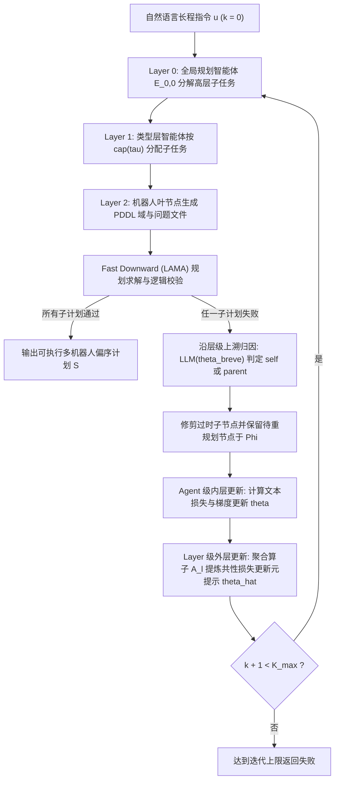

# Hierarchical LLM-Based Multi-Agent Framework with Prompt Optimization for Multi-Robot Task Planning

## 一句话定义

**一种面向异构多机器人长程任务规划的分层 LLM 多智能体闭环框架**：通过「全局规划层 → 机器人类型层 → 单机器人叶节点层」逐级分解与分配自然语言指令并生成 PDDL 规划问题交由经典规划器（Fast Downward）严格求解验证，在规划或校验失败时沿层级回溯并用类 TextGrad 文本梯度（Textual Gradient）迭代更新单智能体提示与同层共享元提示（Meta-Prompt）。

## 英文缩写速查

| 缩写 | 英文全称 | 简要说明 |
|---|---|---|
| LLM | Large Language Model | 大语言模型；本文中各层规划与提示优化智能体均基于 GPT-4o 构建 |
| PDDL | Planning Domain Definition Language | 规划领域定义语言；叶节点智能体生成域与问题文件以供经典求解器验证 |
| TGD | Textual Gradient Descent | 文本梯度下降；依据规划失败反馈生成自然语言修正意见并重写提示词 |
| MAML | Model-Agnostic Meta-Learning | 模型无关元学习；本文借鉴其双层优化结构更新同层共享元提示 |
| SR | Success Rate | 任务成功率；生成计划执行后满足全部目标条件的任务比例 |
| GCR | Goal Condition Recall | 目标条件召回率；实际达成状态原子数与真值目标原子集的比值 |
| RU | Robot Utilization | 机器人利用率；基于状态转移计数衡量成功任务中的机器人动作利用效率 |

## 为什么重要

1. **打破单模型集中式规划的上下文与扩展性瓶颈**：传统混合管线（如 LLM+P、DELTA）或单 LLM 规划器（如 SMART-LLM）把全局分解、能力匹配与状态推理塞进单一上下文窗口，随着机器人数量与任务步数增加极易产生前提幻觉或依赖错乱；三层分布式智能体把推理职责按抽象粒度拆解，消融实验显示移除层级结构（`–H`）会导致成功率暴跌 59.3 个百分点。
2. **打通「经典规划器验证失败 → 上游提示词自动修正」的闭环反馈**：既有多数多智能体框架（如 RoCo、HMAS-II、LaMMA-P）在生成 PDDL 后缺乏将求解失败回传并修改上游分解策略的自动化机制；本文通过层级错误归因（`"self"` vs. `"parent"`）与 TextGrad 文本梯度实现无需手工调参的迭代修复，相比无提示优化版本将整体成功率从 0.47 提升至 0.84。
3. **通过同层元提示共享实现跨智能体经验迁移**：同一层级的同构智能体（如多个机器人叶节点或类型代理）共享元提示 $\hat{\theta}_l$，由聚合算子提炼共性错误约束（如「先开门再放物」「开门后让开通道」），避免每个智能体重复踩坑并减少优化轮次。

## 核心信息

| 字段 | 内容 |
|---|---|
| **作者** | Tomoya Kawabe, Rin Takano |
| **机构** | Data Science Laboratories, NEC Corporation |
| **发表时间** | 2026-02-25（arXiv:2602.21670v1）/ 2026-02-26（v2 [cs.RO]，8 页，2 图；已录用于 IEEE ICRA 2026） |
| **论文链接** | [arXiv:2602.21670](https://arxiv.org/abs/2602.21670) / [arXiv HTML v2](https://arxiv.org/html/2602.21670) |
| **项目与代码** | 未确认（正文及附录未列出 GitHub 仓库或独立项目主页；仅正文 §V-D 提及补充材料视频） |
| **清单分类** | `model.planning`（来源条目：`survey_ax_2602_21670`） |
| **开源状态** | **未确认开源代码**（截至 2026-11-27，arXiv v2 原文未附公开代码仓库或提示词实现脚本） |

## 核心原理

### 1. 多机器人规划问题形式化（§III-A）

论文将异构多机器人合作规划问题定义为八元组：
$$\Pi = \langle R,\, \mathcal{T},\, \mathsf{type},\, \mathsf{cap},\, P,\, I,\, G,\, \{A^r\}_{r \in R} \rangle$$
其中物理机器人集 $R = \{r_1, \dots, r_N\}$（数量 $N := |R|$），机器人类型集 $\mathcal{T}$（数量 $M := |\mathcal{T}|$），$\mathsf{type}: R \to \mathcal{T}$ 为每个机器人指派类型 $\tau$，对应唯一的 PDDL 域 $D_\tau$ 与技能子集 $\mathsf{cap}(\tau) \subseteq \Sigma$（如移动底盘仅含 $\{\mathrm{move}\}$，机械臂含 $\{\mathrm{move}, \mathrm{pickup}, \mathrm{putdown}\}$）。给定命题状态原子集 $P$、初态 $I \subseteq P$、目标 $G \subseteq P$ 及转移算子 $\delta(s, a) = (s \cup \{p \mid p \in \mathrm{eff}(a)\}) \setminus \{p \mid \neg p \in \mathrm{eff}(a)\}$，输出计划为带严格偏序约束的动作实例集 $\Pi_g = \langle \Delta, \prec \rangle$（无偏序关系的动作可由不同机器人并发执行），目标是找到满足终态 $G$ 且顺序步数 $|\Pi|$ 或并行 makespan 最小的合法计划。

### 2. 分层多智能体架构（§IV-A, §IV-C, §IV-F）

逻辑推理智能体集 $\mathcal{E} = \bigcup_{l=0}^{L-1} \mathcal{E}_l$ 与物理机器人集 $R$ 解耦。每个智能体 $E_{l,i}$ 维护三项状态：当前分配任务 $\Psi(E_{l,i})$、私有提示 $\theta_{E_{l,i}}$ 以及同层共享元提示 $\hat{\theta}_l$。在实验默认的三层架构（$L=3$）中：

- **第 0 层（Global Planner Layer）**：唯一根节点 $E_{0,0}$ 接收用户自然语言指令 $u$，将其拆解为高层子任务。
- **第 1 层（Type Layer）**：每个智能体对应一类机器人 $\tau \in \mathcal{T}$，依据各类型技能描述将高层子任务分配给具体机器人实例。
- **第 2 层（Robot Layer，叶节点）**：为单个机器人生成标准 PDDL 域（如 `PickupObject`、`PutdownObject` 的参数、前置条件与效果）及初始状态/目标问题文件 `pddl_spec`。

### 3. 经典规划求解与层级重规划归因（§IV-B, §IV-D, Algorithm 1）

外层循环最多执行 $K_{\max} = 5$ 轮：

1. **自顶向下推理**：按 $l = 0 \to L-1$ 顺序，中间层调用 $LLM(\theta_{E_{l,i}}, \hat{\theta}_l, \Psi(E_{l,i}))$ 生成下层子任务并将子智能体加入活动计划列表 $\Phi$；叶节点输出候选 PDDL 规范集合 $\mathcal{S}$。
2. **Fast Downward 求解与校验**：对每个 $sp \in \mathcal{S}$ 调用 **Fast Downward**（采用 **LAMA** 启发式）求解动作序列，并校验从初态 $I$ 依次应用动作能否到达目标 $G$（拦截语法正确但逻辑不可行或死锁的 PDDL）。若全部通过则返回 $\mathcal{S}$。
3. **自底向上故障定位（`"self"` vs. `"parent"`）**：一旦某个子计划 $sp$ 失败，从对应叶节点 $E_{\mathrm{src}}$ 出发，利用重规划提示 $\breve{\theta}_{E'}$ 询问 LLM 应在当前节点修正（`"self"`）还是交由上层重新分解（`"parent"`），沿树向上回溯直至命中 `"self"` 或根节点 $E_{0,0}$，随后修剪过时子节点并触发提示优化。

### 4. 双层文本梯度提示优化（§IV-E, Algorithm 2）

受 TextGrad 与 MAML 双层优化思想启发，系统在离散自然语言空间对活动列表 $\Phi$ 中的智能体执行两阶段更新：

- **智能体级内层更新（Agent-level Inner Update）**：利用规划器报错和下游反馈计算更新前文本损失 $\mathrm{loss}^{(k)}_{E_{l,i}} := \mathrm{loss\_fn}(\theta^{(k)}_{E_{l,i}})$，反向推导文本梯度 $g^{(k)}_{E_{l,i}} := \nabla_{\theta_{E_{l,i}}} \mathrm{loss}^{(k)}_{E_{l,i}}$，再经 $\mathrm{TGD.step}$ 施加排序编辑（如补充前置检查或约束条件）得到新提示 $\theta^{(k+1)}_{E_{l,i}}$，并重新评估更新后损失 $\mathrm{loss}^{(k+1)}_{E_{l,i}}$。
- **层级外层更新（Layer-level Outer Update）**：对于层 $l = 1, \dots, L-1$，使用基于 LLM 的聚合算子 $\mathcal{A}_l$ 对同层各智能体的 $\mathrm{loss}^{(k+1)}_{E_{l,i}}$ 去重、统一措辞并提炼共性修正，生成层元损失 $\mathrm{loss}_l^{(k+1)} = \mathcal{A}_l(\{\mathrm{loss}_{E_{l,i}}^{(k+1)}\}_{E_{l,i} \in \mathcal{E}_l})$，再计算元梯度 $\hat{g}_l^{(k+1)} = \nabla_{\hat{\theta}_l} \mathrm{loss}_l^{(k+1)}$ 并更新层共享元提示 $\hat{\theta}_l^{(k+1)} = \mathrm{TGD.step}(\hat{\theta}_l^{(k)}, \hat{g}_l^{(k+1)})$。

## 流程总览

## 源码运行时序图

**不适用**（截至 2026-11-27，arXiv:2602.21670v2 原文及公开检索材料未确认可运行的官方源码实现、GitHub 仓库或项目页入口，原文仅提供 Algorithm 1–2 伪代码与文本梯度更新示例，因此不绘制源码级运行时序图。）

## 实验与评测

实验在基于 AI2-THOR 的 **MAT-THOR** 基准上进行（5 个室内户型、2–4 台异构机器人），共 70 个任务：**30 个 Compound**（2–4 个基本独立的并行子任务）、**20 个 Complex**（$\ge 6$ 个存在因果依赖与技能互补的子任务）和 **20 个 Vague**（刻意省略关键细节的模糊指令）。所有智能体采用 **GPT-4o**，经典规划器统一为 **Fast Downward（LAMA 启发式）**，最大迭代次数 $K_{\max} = 5$，每项任务取 5 次随机初始化均值。

### 1. MAT-THOR 主实验对比（Table II，越接近 1.00 越好）

| 方法 | Compound (SR / GCR / RU / Eff) | Complex (SR / GCR / RU / Eff) | Vague (SR / GCR / RU / Eff) |
|---|---|---|---|
| CoT (GPT-4o) | 0.32 / 0.40 / 0.72 / 0.59 | 0.00 / 0.12 / 0.47 / 0.38 | 0.00 / 0.00 / 0.00 / 0.00 |
| SMART-LLM (GPT-4o) | 0.70 / 0.82 / 0.78 / 0.64 | 0.20 / 0.33 / 0.65 / 0.56 | 0.06 / 0.42 / 0.68 / 0.42 |
| LaMMA-P (GPT-4o) | 0.93 / 0.94 / 0.91 / 0.90 | 0.77 / 0.83 / 0.87 / 0.67 | 0.45 / 0.48 / 0.71 / 0.65 |
| **Ours (GPT-4o)** | **0.95 / 0.95 / 1.00 / 0.90** | **0.84 / 0.84 / 1.00 / 0.75** | **0.60 / 0.60 / 1.00 / 0.75** |

*(注：原文指出 CoT 与 SMART-LLM 的数值引自 LaMMA-P 原文评测；RU 与 Eff 仅在成功执行的任务上统计。)*

- **难度越高增益越大**：相比此前在 MAT-THOR 上表现领先的 LaMMA-P，本文在 Compound 任务上 SR 提高 2 个百分点（0.95 vs. 0.93），在 Complex 任务上提高 7 个百分点（0.84 vs. 0.77，相对提升 9.1%），在 Vague 模糊指令任务上大幅提高 15 个百分点（0.60 vs. 0.45，相对提升 33.3%），且在所有成功任务上均达到 `RU = 1.00` 并明显缩短复杂/模糊任务的并行时间效率差距（Eff 分别从 0.67/0.65 提升至 0.75/0.75）。

### 2. 核心组件消融与时间开销（Table III，全数据集平均）

| 变体配置 | SR | 平均规划耗时 | 关键现象 |
|---|---|---|---|
| **Full method (H+P+M)** | **0.84** | 173 s | 分层架构 + 私有提示优化 + 元提示共享完整协同 |
| **–H (single-LLM agent)** | 0.25 (-59.3%) | 140 s (-18.9%) | 退化为单模型后上下文过载，成功率跌幅最大 |
| **–M (no meta-prompt optimization)** | 0.80 (-4.2%) | 116 s (-33.1%) | 失去跨同构智能体经验迁移，成功率小幅下降 |
| **–(P, M) (no prompt optimization)** | 0.47 (-37.0%) | 32 s (-81.3%) | 规划速度最快，但无法从 PDDL 验证报错中恢复 |

### 3. 案例研究：文本梯度迭代演化（§V-D, Appendix A）

以 Compound 任务 *"put the tomato in the fridge and turn off the room light"* 为例：
- **Iteration 0**：叶节点为 Robot 0 生成 PDDL，`Pickup` 成功但 `Put` 因冰箱未打开报错；内层更新在提示中补充开门前置约束，层元提示提炼出通用规则「向具备开合属性的容器放入物体前需插入 `Open`」，并分派 Robot 1 开门。
- **Iteration 1**：开门后 Robot 1 仍停留在冰箱正前方导致路径规划阻塞失败；进一步文本梯度在提示和元提示中追加「开门后移动至非阻塞路点（non-blocking waypoint）让出通道」。
- **Iteration 2（第三次迭代）**：PDDL 求解与执行全部通过，且沉淀到层元提示中的两类规则可自动泛化至后续同类任务。

## 与其他工作对比

- **对比单 LLM 与开放环路任务分解方法（SayPlan、SMART-LLM）**：SMART-LLM 依赖单一 LLM 进行多阶段提示分解与分配，在复杂（SR 0.20）与模糊任务（SR 0.06）上容易因上下文长度和前置依赖遗漏崩溃；本文通过三层分布式智能体隔离职责并用经典规划器做严格校验，显著降低了长程规划失效。
- **对比混合 LLM + PDDL 单向多智能体系统（LLM+P、DELTA、LaMMA-P）**：LLM+P 和 DELTA 将 PDDL 构造集中在单模型；LaMMA-P 虽然按角色拆分为前置条件识别、任务分配与问题生成等专门模块，但缺乏将经典规划器失败转化为上游提示词优化的闭环机制。本文引入的 TextGrad 文本梯度与同层元提示共享直接补齐了「失败驱动的提示词自我演进」一环，在模糊指令与多步骤因果依赖任务上拉开显著差距。
- **对比分布式对话或保形预测方法（RoCo、HMAS-II、LLaMAR、Wang et al.）**：RoCo / HMAS-II 通过多轮对话协商子任务分配，Wang et al. 利用保形预测在决策时提供概率保证；本文则侧重事后（post-hoc）借助 Fast Downward 的确定性符号校验信息来持续优化各层提示参数。

## 结论

**一句话总判：在多机器人长程规划中，分层任务分解决定了模型能否「不把上下文撑爆」（贡献约 59 个百分点成功率），而基于 PDDL 求解器报错的文本梯度提示优化决定了系统能否「从可执行性错误中自愈」（贡献约 37 个百分点成功率），代价是推理时延从 32 秒增至 173 秒。**

1. **先把架构分层，再谈提示微调**：单 LLM 规划即使保留优化机制成功率也只有 0.25，说明在异构多机器人场景下，将「全局理解—类型匹配—PDDL 编码」显式分层是最首要的结构性收益。
2. **形式化求解器是最可靠的「文本损失信号源」**：让 Fast Downward（LAMA）充当硬校验器，将隐式规划错误显式转为精确的前置条件或路径冲突文本报错，使 TextGrad 能稳定总结出 `Open-before-Put`、让出非阻塞路点等可复用规则。
3. **同层元提示共享兼顾泛化与收敛**：虽然去掉元提示共享（`–M`）仅使总成功率从 0.84 降至 0.80，但其把单智能体局部修补沉淀为同层通识，能防止同构机器人团队在不同任务上反复触发相同失败模式。
4. **时延与稳定性仍是落地瓶颈**：完整框架平均 173 s 的规划开销（主要来自外层多轮重规划与双层 LLM 梯度/元梯度调用）暂不适用于高频实时重规划场景，需在工程上限定 $K_{\max}$ 或将高频底层控制留给局部反应式策略。

## 工程实践

- **分层职责与 PDDL 域绑定**：在工程实现时，将第 1 层类型智能体与机器人 PDDL 域文件 $D_\tau$（如固定动作原语 `PickupObject`、`PutdownObject` 的参数签名和 predicates）强对齐，可减少第 2 层生成非法谓词的概率。
- **配置 `self` / `parent` 重规划阈值与迭代上限**：将 $K_{\max}$ 设为 5 可在恢复成功率与 API 调用耗时之间取得折中；在实时性要求较高的系统里，可将已收敛的层元提示 $\hat{\theta}_l$ 持久化缓存，作为后续任务的冷启动基础提示以跳过前几轮摸索。
- **避免元提示过拟合单一场景**：层聚合算子 $\mathcal{A}_l$ 应明确要求对各智能体文本损失做去重与一般化抽象（而非保留特定物品名称如 `tomato`），确保元提示保持跨任务可迁移性。

## 局限与风险

- **未确认开源代码且依赖闭源大模型**：截至 2026-11-27，论文未公开代码库或完整系统提示模板，且所有实验均基于闭源 API（GPT-4o），跨不同开源/小参数量 LLM 的文本梯度稳定性未经验证。
- **固定三层结构缺乏动态拓扑适应性**：作者在 §VI 指出当前静态分层结构限制了面对不同规模团队或任务结构变化时的自适应能力。
- **完全可观测性假设**：框架假设规划前已知完整环境命题状态 $I$ 与物体位置，尚未接入在线视觉感知以处理部分可观测环境（POMDP）或真机动态干扰。
- **规划耗时高且优化收敛不稳定**：全系统平均规划耗时达 173 s（约为无优化变体 32 s 的 5.4 倍），文本空间梯度下降在复杂错误归因下仍存在震荡或未能收敛的风险。

## 关联页面

- [Agentic Robots 综述](paper-towards-agentic-robots-survey.md)
- [全量项目节点清单](../overview/awesome-agentic-robots-node-index.md)
- [VLA 方法背景](../methods/vla.md)
- [智能体机器人操作策略](../methods/agentic-manipulation-policies.md)：对照操作场景中的规划、执行与反馈接口
- [Agent Planning & Feedback · 智能体规划与反馈](../methods/agent-planning-feedback.md)：对照形式化校验器反馈与闭环重规划模式
- [Robot Agent Harness · 机器人智能体执行框架](../methods/robot-agent-harness.md)：上层推理智能体与底层 PDDL 规划/执行接口解耦
- [Embodied Agent Benchmarking · 具身智能体评测基准](../methods/embodied-agent-benchmarking.md)：参考 MAT-THOR / AI2-THOR 等多智能体具身评测设定

## 推荐继续阅读

- [arXiv 原文 HTML v2（含 Algorithm 1–2、Table II–III 与 Appendix A 提示更新示例）](https://arxiv.org/html/2602.21670)
- [arXiv 摘要页（arXiv:2602.21670）](https://arxiv.org/abs/2602.21670)
- [TextGrad: Automatic "Differentiation" via Text（arXiv:2406.07496）](https://arxiv.org/abs/2406.07496)
- [Fast Downward 经典规划器官方文档](https://www.fast-downward.org/)

## 参考来源

- [论文一手全文核对归档（arXiv:2602.21670v2）](../../sources/papers/paper-agentic-2602-21670.md)
- [官方 Awesome 快照归档](../../sources/repos/awesome-agentic-robots-survey-index.md)
- [arXiv:2602.21670 论文原文入口](https://arxiv.org/abs/2602.21670)
