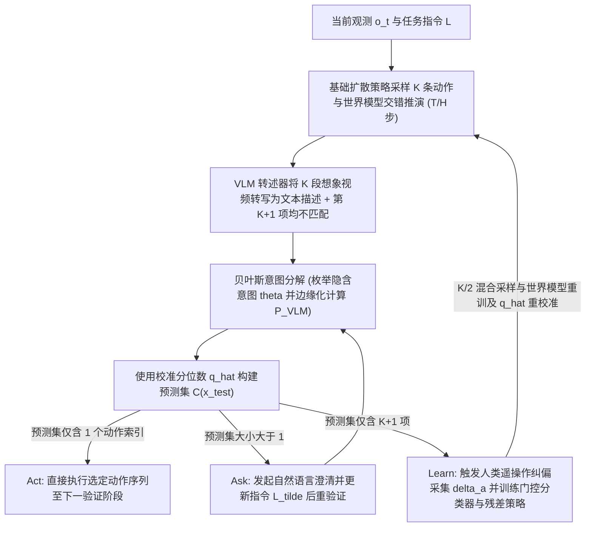
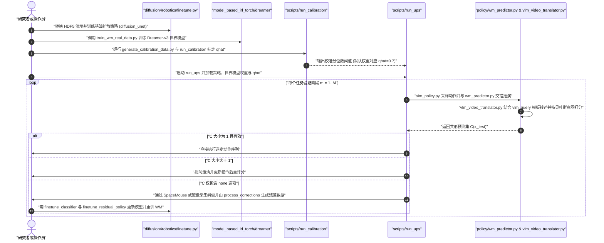

# When to Act, Ask, or Learn: Uncertainty-Aware Policy Steering

## 一句话定义

UPS（Uncertainty-Aware Policy Steering）是一种面向部署期机器人策略引导（Policy Steering）的不确定性校准框架：它通过世界模型推演与 VLM 视频转述将底层扩散策略采样出的 $K$ 条动作映射到语义空间，结合贝叶斯意图分解与序列级共形预测（Conformal Prediction）同时量化高层指令歧义与底层策略无能（Incapability），从而在保证至少 $1-\epsilon$ 覆盖率的统计约束下，自主决策直接执行（Act）、发起自然语言澄清（Ask），或仅在全部候选样本均失效时请求人类遥操作纠偏并训练残差策略（Learn）。

## 英文缩写速查

| 缩写 | 英文全称 | 简要说明 |
|---|---|---|
| UPS | Uncertainty-Aware Policy Steering | 本文提出的不确定性感知策略引导框架，统一决策 Act、Ask 与 Learn |
| VLM | Vision-Language Model | 视觉-语言模型，在本文分别承担世界模型推演视频的文本转述（Narrator）与多选验证器（Verifier） |
| CP | Conformal Prediction | 共形预测，利用校准集非一致性分位数 $\hat{q}$ 构建满足 $1-\epsilon$ 覆盖保证的预测集 |
| APS | Adaptive Prediction Set | 自适应预测集方法，按概率降序累加选项直至超过阈值 $1-\hat{q}$ 的共形基线 |
| UQ | Uncertainty Quantification | 不确定性量化，本文用于同时刻画高层语义任务歧义与底层动作可行性 |
| IIL | Interactive Imitation Learning | 交互式模仿学习，包含 HG-DAgger、EnsembleDAgger 及本文基于语义门控的残差纠偏学习 |

## 为什么重要

1. **打破“VLM 验证器天然已校准”的隐含假设**：在 FOREWARN 等既有策略引导框架中，VLM 直接对候选动作的未来推演给出单选决策或未校准概率。面对模糊指令（例如“把方块放到我惯用手一侧的孔”）时，VLM 往往过度自信地猜测单一行为模式；而当预训练底层策略本身能力不足、所有采样轨迹均失败时，未校准的 VLM 仍倾向于强行挑选一个错误选项而非拒绝执行。
2. **打通“语义澄清（便宜）”与“物理干预（昂贵）”的分级求助闭环**：现有不确定性量化工作往往把高层语言规划与底层控制割裂（如 KnowNo 假设底层策略总能完美执行任意高层指令；EnsembleDAgger 仅依赖动作方差触发人类接管，即使多种动作都能完成任务也会频繁打扰用户）。UPS 将低代价的语言问答与高代价的遥操作纠偏纳入同一统计框架，只在全部候选动作均无法对齐任务时才触发物理干预。
3. **以残差学习保护基础策略的多模态能力**：直接用少量新干预微调基础扩散策略容易引发灾难性遗忘。UPS 在冻结基础策略的基础上训练轻量级干预门控分类器与残差策略 $\pi^{\text{residual}}$，并在再部署采样时保留一半未修改的基础策略样本，既补齐了失败模式，又保持了原有双模态行为分布。

## 核心信息

| 字段 | 内容 |
|---|---|
| 作者 | Jessie Yuan*, Yilin Wu*, Andrea Bajcsy（* 共同一作） |
| 机构 | 卡内基梅隆大学（Carnegie Mellon University, CMU） |
| 发表时间 | arXiv:2602.22474v2（2026-02-25 提交 v1，2026-05-12 修订 v2）；RSS 2026 收录 |
| 论文链接 | [arXiv:2602.22474](https://arxiv.org/abs/2602.22474) / [HTML 全文](https://arxiv.org/html/2602.22474) |
| 项目与代码 | [项目主页](https://jessie-yuan.github.io/ups/) / [CMU-IntentLab/uncertainty_aware_policy_steering](https://github.com/CMU-IntentLab/uncertainty_aware_policy_steering) |
| 清单分类 | `model.adaptation, data.collection` |
| 来源条目 | `survey_ax_2602_22474` |
| 开源状态 | 已开源（RoboMimic `NutAssembly` 仿真全套代码与 Hugging Face 权重/数据集 `jzyuan04/ups_nutassembly_*` 已公开；硬件流水线架构相同但仓库未包含硬件数据与脚本；仓库未附带显式 LICENSE 文件） |

## 核心原理

给定当前观测 $o \in \mathcal{O} := \mathcal{I} \times \mathcal{S}$（RGB 图像 $I$ 与本体状态 $s$）及自然语言任务指令 $\mathcal{L}$，预训练基础策略 $\pi(a \mid o_t)$ 采样 $K$ 条独立动作序列 $\{\mathbf{a}^k\}_{k=1}^K$。UPS 将问题建模为在选项集合 $\mathcal{Y} = \{1, \dots, K, K+1\}$ 上求解最匹配指令的动作索引（其中 $K+1$ 代表“以上样本均不正确”，即策略无能）。

### 1. 交错式长视距世界模型推演与文本转述（Sec. IV-A）

底层扩散策略单次仅生成短视距动作块 $a_{t:t+H}$（$H \ll T$），在如此短的时间窗口内各候选样本的视觉结果几乎无法区分。为此，UPS 交替运行策略与 Dreamer-v3 潜在世界模型 $\mathcal{W}_\phi = (\mathcal{E}_\phi, f_\phi, \mathcal{D}_\phi)$：

1. 从真实观测 $o_t$ 出发采样动作块 $a_{t:t+H} \sim \pi(\cdot \mid o_t)$，经 $\mathcal{W}_\phi$ 预测未来观测 $\hat{o}_{t+1:t+H}$。
2. 将末端解码图像 $\hat{o}_{t+H}$ 喂回基础策略 $\pi(\cdot \mid \hat{o}_{t+H})$ 生成下一段动作块，重复 $T/H$ 次得到 $K$ 条长视距想象轨迹 $\{\hat{o}_{t:t+T}^k\}_{k=1}^K$。
3. 使用 VLM 转述器 $\mathcal{T}^{\text{VLM}}$（实验中为 `Gemini-3-flash-preview`）把视频转写为文本描述 $\ell_t^k = \mathcal{T}^{\text{VLM}}(\hat{\mathbf{o}}_t^k, \mathcal{L})$，合并语义重复的选项后附加第 $K+1$ 项 `"none of the above samples are correct"`，交由 VLM 验证器（`Gemini-2.0-flash`）求解多选问答分布 $\mathbb{P}^{\text{VLM}}(y \mid \{\ell_t^k\}_{k=1}^{K+1}, \mathcal{L})$。

### 2. 贝叶斯意图分解与序列级共形预测（Sec. IV-B & Appendix A-A/A-B）

直接向 VLM 索取多选概率或直接做 CoT 容易分别出现过度自信与过度保守。受人类意图贝叶斯逆规划启发，UPS 在校准前先通过三次 VLM 查询对分布做结构化分解（Eq. 5）：

$$\mathbb{P}^{\text{VLM}}(y \mid \{\ell^k\}_{k=1}^K; \mathcal{L}) = \sum_{\theta \in \Theta} \mathbb{P}(y \mid \{\ell^k\}_{k=1}^K, \theta)\,\mathbb{P}(\theta \mid \mathcal{L})$$

即先让 VLM 枚举潜在隐含意图 $\theta \in \Theta$（例如左/右手习惯），再估计意图先验 $\mathbb{P}(\theta \mid \mathcal{L})$ 与条件选项概率 $\mathbb{P}(y \mid \{\ell^k\}_{k=1}^K, \theta)$ 并边缘化；即使所有样本都偏向右孔，只要 $\Theta$ 包含“用户可能是左撇子”，概率质量也会自然分配给第 $K+1$ 项“均不正确”。

随后，针对序贯决策中前后阶段观测非 i.i.d. 的依赖关系，UPS 在包含 $M$ 个验证阶段的校准轨迹集 $\mathcal{D}_{\text{calib}}$（$|\mathcal{D}_{\text{calib}}|=N$）上定义序列级非一致性分数（Eq. 3）：

$$\kappa(\bar{x}, \bar{y}) = 1 - \min_{x_i \in \bar{x}} \min_{y \in \mathcal{Y}_i^*} \mathbb{P}^{\text{VLM}}(y \mid x_i)$$

- **与 KnowNo 的本质区别（Appendix A-B）**：KnowNo 对真实集合 $\mathcal{Y}_i^n$ 取 $\max$（存在性保证：只需包含至少一个可接受选项），而 UPS 取 $\min$（完备性保证：要求预测集涵盖**所有**合理选项），避免模型替用户猜测未说明的偏好。
- **统计覆盖保证（Theorem 1）**：取 $\{\kappa^n\}_{n=1}^N$ 的 $\frac{\lceil(N+1)(1-\epsilon)\rceil}{N}$ 经验分位数 $\hat{q}$，部署时构造预测集 $C(x_i^{\text{test}}) = \{y \in \mathcal{Y} \mid 1 - \mathbb{P}^{\text{VLM}}(y \mid x_i^{\text{test}}) \le \hat{q}\}$。在推演与转述忠实的前提下，保证 $\mathbb{P}(\mathcal{Y}_i^* \subseteq C(x_i^{\text{test}})) \ge 1 - \epsilon$。

### 3. 三级不确定性消解与混合采样残差学习（Sec. IV-C & Appendix A-F）

依据预测集 $C(x_i^{\text{test}})$ 的结构，系统精确分流至三种策略：

- **Act（高置信执行）**：$|C(x_i^{\text{test}})| = 1$ 且 $K+1 \notin C(x_i^{\text{test}})$，直接执行该索引对应的动作序列直到下一阶段验证。
- **Ask（语言澄清）**：$|C(x_i^{\text{test}})| > 1$，识别出高层语义歧义，生成自然语言澄清问题并依据用户回答改写指令 $\tilde{\mathcal{L}}$，循环重新验证直至 $|C| = 1$。
- **Learn（残差持续学习）**：$C(x_i^{\text{test}}) = \{K+1\}$，判定全部候选样本均不满足任务，向人类请求 SpaceMouse 遥操作纠正，记录差值 $\Delta a = a_{\text{human}} - a_{\text{base}}$ 与二值干预标签，训练干预门控分类器（BCE 损失 + 正样本加权）及残差策略 $\pi^{\text{residual}}(\cdot \mid o, a)$（MSE 损失 + `tanh` 限幅）。再部署时在解码的世界模型图像上混合生成 $K/2$ 条“基础+残差”轨迹与 $K/2$ 条“纯基础”轨迹，最后用残差 rollout 重训世界模型并重校准 $\hat{q}$。

## 流程总览

## 源码运行时序图

论文在 [CMU-IntentLab/uncertainty_aware_policy_steering](https://github.com/CMU-IntentLab/uncertainty_aware_policy_steering) 开源了 RoboMimic `NutAssembly` 仿真任务的完整代码，核心入口串联了 `diffusion4robotics/finetune.py`、`model_based_irl_torch/scripts/train_wm_real_data.py`、`scripts/run_calibration` 与 `scripts/run_ups`：

典型在线流水线在完成基础扩散策略训练、Dreamer-v3 世界模型训练及 `scripts/run_calibration` 阈值标定（官方预训练权重标定结果为 `qhat=0.7`）后，直接通过 `python scripts/run_ups --qhat <qhat> --wm_ckpt ... --base_policy_ckpt ... --classifier_ckpt ... --residual_ckpt ...` 运行。

## 实验与评测

论文在 1 个仿真基准与 2 个真机机器人任务上开展评测（基础策略均采用图像条件扩散策略，世界模型为 Dreamer-v3，转述模型为 `Gemini-3-flash-preview`，打分模型为 `Gemini-2.0-flash`，目标覆盖率 $1-\epsilon = 0.85$，候选数 $K=10$）：

### 1. 任务配置与数据集规模（Sec. V & Appendix A-C/A-D/A-E）

| 任务环境 | 平台与相机输入 | 演示与世界模型训练数据 | 验证阶段 $M$ 与指令集 |
|---|---|---|---|
| **Simulation (`NutAssemblySquare`)** | Robomimic 仿真 Franka Panda；腕部+第三视角相机（策略 96×96，WM 64×64→96×96） | 基础策略 120 条演示（60 左柄+60 右柄）；WM 600 条（120 演示+480 rollout）再以 100 条交错 rollout 微调 | $M=2$；60 明确 + 60 歧义指令（各抽 40 校准、20 测试） |
| **Hardware 1 (`PnP Cup`)** | Franka Emika Panda + Robotiq 夹爪；ZED 2i（左视角）+ ZED Mini（腕部），1920×1080 零填充缩至 256×256 | 基础策略 100 条演示（左“clean”/右“dirty”箱）；WM 350 条（100 演示+250 rollout） | $M=2$；40 明确 + 40 歧义指令（测试各抽 20 条） |
| **Hardware 2 (`Insert Block`)** | Franka + Robotiq；RealSense 前视（640×480）+ ZED 腕部（1280×720）中心裁剪缩至 256×256 | 基础策略 100 条演示（左上/右上孔）；WM 350 条（100 演示+250 rollout） | $M=3$；20 明确 + 20 歧义指令（Table VIII） |

其中明确指令测试集中策略无能比例（Appendix A-E）：仿真校准集抓取失败 $0/40$、放置失败 $9/40$，测试集抓取 $0/20$、放置 $5/20$；硬件校准集抓取 $2/40$、放置 $10/40$，测试集抓取 $1/20$、放置 $5/20$。

### 2. 不确定性量化校准与评分函数消融（Sec. V-A1, Figs. 3–5, Appendix A-E）

- **3×3 对比（`Simple Set`、`APS`、`CP` × `Vanilla`、`CoT`、`Bayesian Intent`）**：在仿真、真机 `PnP Cup` 与真机 `Insert Block` 中，只有 `CP + Bayesian Intent` 稳定在三类场景（明确、歧义、无能）均达到 $\ge 85\%$ 覆盖率，同时在明确/无能场景维持低澄清率、在歧义场景给出接近 2 的预测集大小。`CoT` 倾向过度保守（接近 100% 澄清率，或在 `APS CoT` 下因压缩集合导致覆盖率骤降）；`Vanilla` 则在过度自信与严重欠覆盖间摇摆。
- **非一致性分数分布（Figs. 13–15）**：大多数明确与无能样本的 $\kappa < 0.5$（硬件场景大多 $<0.2$），说明正确选项或“均不匹配”获得 $>50\%$ 概率；绝大多数歧义样本分数落在 $[0.5, 0.7]$，对应两个合理选项各自至少获得 $30\%$ 概率，避免了单边偏置。
- **自生成概率 vs. 首词 Logits Softmax（Figs. 16–17）**：对首词 token（A/B/C/D）logits 做温度 $T=4$ 的 softmax 容易偏向特定选项字母，导致 Vanilla 与 CoT 在歧义场景严重欠覆盖；自生成概率分数全面优于 logits 分数。

### 3. 闭环策略引导与残差持续学习对比（Tables I & IV, Fig. 6, Sec. V-B1/V-B2）

各方法在 20 条明确指令与 20 条歧义指令下的结果分解如下（TP：选中正确动作并成功；TN：正确请求帮助；FP：选中失败动作；FN：不必要求助）：

| 方法 | 真机 `PnP Cup` 明确 (TP / TN / FP / FN) | 真机 `PnP Cup` 歧义 (TP / TN / FP / FN) | 仿真 `NutAssembly` 明确 (TP / TN / FP / FN) | 仿真 `NutAssembly` 歧义 (TP / TN / FP / FN) |
|---|---|---|---|---|
| `Base Policy` | 0.35 / 0.65 / — / — | 0.35 / 0.65 / — / — | 0.45 / 0.55 / — / — | 0.25 / 0.75 / — / — |
| `EnsembleDAgger + Residual` | 0.40 / 0.60 / — / — | 0.50 / 0.50 / — / — | 0.45 / 0.55 / — / — | 0.30 / 0.70 / — / — |
| `HG-DAgger + Residual` | 0.50 / 0.50 / — / — | 0.55 / 0.45 / — / — | 0.60 / 0.40 / — / — | 0.45 / 0.55 / — / — |
| `Forewarn`（未校准引导） | 0.80 / 0.10 / 0.10 / 0.00 | 0.50 / 0.00 / 0.40 / 0.10 | 0.65 / 0.20 / 0.15 / 0.00 | 0.00 / 0.25 / 0.15 / 0.60 |
| `UPS w/ Clarification` | 0.85 / 0.05 / 0.05 / 0.05 | 0.65 / 0.25 / 0.10 / 0.00 | 0.60 / 0.20 / 0.10 / 0.10 | 0.55 / 0.25 / 0.20 / 0.00 |
| `UPS w/ Clarification + Residual` | **0.90** / 0.00 / 0.10 / 0.00 | **0.80** / 0.00 / 0.20 / 0.00 | **0.70** / 0.20 / 0.05 / 0.05 | **0.65** / 0.10 / 0.15 / 0.10 |

- **人类干预代价（Sec. V-B1）**：按“干预步数 / 轨迹长度”归一化统计（无物理纠偏的语言澄清计为 1 步），`PnP Cup` 上 UPS 干预率为 **0.06**（HG-DAgger 0.10，EnsembleDAgger 0.16）；`Insert Block` 上 UPS 为 **0.05**（HG-DAgger 0.06，EnsembleDAgger 0.26）；仿真中 UPS 为 **0.058**（HG-DAgger 0.20，EnsembleDAgger 0.27）。
- **持续学习增益（Sec. V-B2）**：在相同干预轨迹预算下，残差学习使两个真机任务的歧义场景成功率均在 `UPS w/ Clarification` 基础上再提升 **15%**，`PnP Cup` 综合成功率达到 **85%**（与 $1-\epsilon=0.85$ 理论目标吻合），并在歧义场景相对未校准 `Forewarn` 取得 **30%** 提升（0.80 vs. 0.50）。

## 与其他工作对比

| 维度 | Forewarn（未校准引导） | KnowNo（LLM 规划 UQ） | HG-DAgger / EnsembleDAgger | UPS（本文） |
|---|---|---|---|---|
| 推理与验证层次 | 世界模型推演 + VLM 单选引导 | 纯文本/符号规划层共形预测 | 底层动作空间（人类紧盯或集成方差） | **联合高层语义意图与底层策略样本可行性** |
| 非一致性分数目标 | 无共形校准 | 存在性（$\max$）：包含任一可行解即可 | 无统计覆盖保证 | **完备性（$\min$）：保留所有合理意图供澄清** |
| 不确定性消解手段 | 强行单选或拒止 | 仅文本澄清（假设底层必定执行成功） | 仅物理遥操作接管 | **分级决策：Act 执行 / Ask 澄清 / Learn 残差** |
| 持续学习抗遗忘机制 | 无在线纠偏学习 | 无 | 全量或局部策略更新，易向单一模式坍塌 | **门控残差网络 + $K/2$ 混合采样保留基础分布** |

## 结论

**一句话总判：UPS 证明“将 Dreamer-v3 交错推演与 VLM 视频转述结合，再用贝叶斯意图分解和完备性序列共形预测（$\min$ 分数）校准验证器”，是让机器人在复杂操作中同时分清“该干、该问还是该学”的有效工程架构。**

1. **用贝叶斯意图边缘化替代直接问答或 CoT**：在共形校准前先把隐含意图枚举与条件行为评分拆开，可显著抑制 VLM 的过度自信与 CoT 的过度保守，同时实际评测显示 VLM 自生成概率比首词 logits 更适合作为校准评分。
2. **用语义不可达作为残差学习的触发门控**：只在预测集退化为 `{K+1}`（所有候选都无法满足任务）时才请求 SpaceMouse 物理纠偏，能把人类干预率压低到 0.05–0.06 量级，远低于基于动作方差的 EnsembleDAgger（0.16–0.27）。
3. **残差再部署必须混合采样并重校准**：在世界模型推演与在线部署时保留 50% 未修改基础策略样本（$K/2$），并用残差 rollout 重训世界模型与重算 $\hat{q}$，是避免残差策略破坏原有双模态行为的关键。
4. **接触密集任务的瓶颈已转移至世界模型保真度**：在精度要求更高的仿真 `NutAssemblySquare` 与真机 `Insert Block` 上，最终成功率受限于当前潜在世界模型对精细接触细节的图像还原能力。

## 工程实践

- **模型与训练细节（Sec. V & Appendix A-F, Table V）**：
  - 基础策略编码器采用按视角独立的改良 ResNet-18 + 2 层 512 维 MLP，基础动作经过 128 维线性编码器后与视觉本体特征拼接。
  - 干预分类器与残差策略均从基础策略检查点初始化观察编码器并保持可微调；残差动作预测头为 2 层 256 维隐藏层 MLP（`dropout=0.2`，输出经 `tanh` 限制在 $(-1, 1)$），`batch_size=64`、`lr=1e-4`、`iterations=10000`。
  - 分类器训练需先运行 `diffusion4robotics/compute_class_weights.py` 计算正样本权重 `agent.pos_weight` 以应对介入帧稀疏带来的类别不平衡。
- **标定与部署注意事项**：
  - 多阶段任务（$M=2$ 或 $3$）须在序列级采集校准集（论文使用 $N=80$ 条序列、$K=10$ 个候选动作样本、目标覆盖率 $1-\epsilon=0.85$，官方仿真权重对应 `qhat=0.7`）。
  - 在将解码观测送回扩散策略做交错推演时，需与策略训练分辨率对齐（例如仿真中 WM 在 64×64 训练与推演，解码后上采样回 96×96 再输入扩散策略）。

## 局限与风险

1. **未量化世界模型与视频转述本身的不确定性**：论文在 Sec. VI 明确指出当前理论保证以“世界模型想象与 VLM 转述忠实完整”为前提，尚未将视频生成模型或转述器的幻觉纳入不确定性建模。
2. **精密接触操作下的世界模型失真**：在需要高精度对齐的 `NutAssemblySquare` 仿真与 `Insert Block` 真机任务中，当前世界模型难以清晰还原精细接触状态，导致最终成功率略低于 $1-\epsilon=85\%$ 理论目标（仿真为 70%/65%）。
3. **开源仓库与许可边界**：官方仓库主要面向 RoboMimic `NutAssembly` 仿真任务，真机硬件数据与控制脚本未公开；此外仓库未附带显式开源许可证文件，商用或二次分发前需联系作者确认授权。

## 关联页面

- [Agentic Robots 综述](paper-towards-agentic-robots-survey.md)
- [全量项目节点清单](../overview/awesome-agentic-robots-node-index.md)
- [VLA 方法背景](../methods/vla.md)
- [机器人智能体执行框架](../methods/robot-agent-harness.md)：对照规划、执行接口与反馈机制。
- [扩散策略（Diffusion Policy）](../methods/diffusion-policy.md)：UPS 底层多模态动作采样的基础策略载体。
- [生成式世界模型](../methods/generative-world-models.md)：Dreamer-v3 潜在世界模型与长视距动作-结果交错推演。
- [残差策略学习](../methods/residual-policy-learning.md)：针对策略无能场景的增量纠偏与混合采样抗遗忘。
- [DAgger 交互式模仿学习](../methods/dagger.md)：对照 HG-DAgger、EnsembleDAgger 与 UPS 语义门控干预的差异。
- [模仿学习](../methods/imitation-learning.md) 与 [机器人操作任务](../tasks/manipulation.md)：双模态桌面装配与取放任务评测语境。

## 推荐继续阅读

- [arXiv:2602.22474 论文页面](https://arxiv.org/abs/2602.22474)
- [UPS 项目主页与演示视频](https://jessie-yuan.github.io/ups/)
- [UPS 官方 GitHub 代码仓库（CMU-IntentLab）](https://github.com/CMU-IntentLab/uncertainty_aware_policy_steering)
- [Hugging Face 预训练权重与数据集集合（jzyuan04）](https://huggingface.co/jzyuan04/ups_nutassembly_diffusion_checkpoints)

## 参考来源

- [论文全文精读归档](../../sources/papers/paper-agentic-2602-22474.md)
- [官方代码仓库结构与入口归档](../../sources/repos/paper-agentic-2602-22474.md)
- [官方 Awesome 快照归档](../../sources/repos/awesome-agentic-robots-survey-index.md)
- [arXiv:2602.22474v2 HTML 全文](https://arxiv.org/html/2602.22474)
