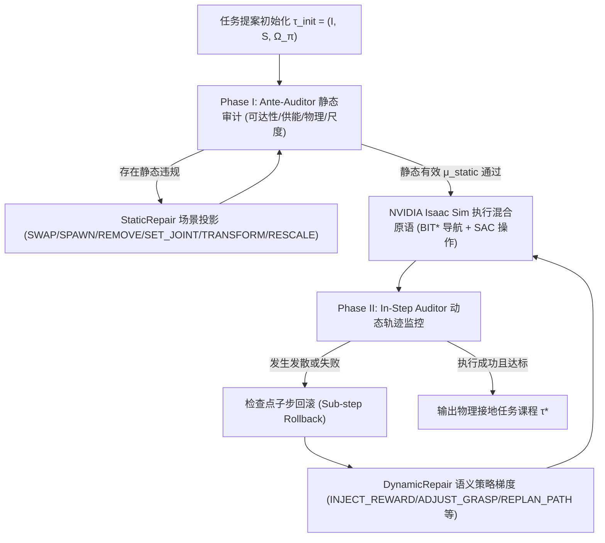

# FATE: Closed-Loop Feasibility-Aware Task Generation with Active Repair for Physically Grounded Robotic Curricula

## 一句话定义

FATE（Feasibility-Aware Task gEneration）是一个将具身多模态审计器（Embodied Brain）直接嵌入任务生成闭环的自修正框架，通过依次执行“静态场景对齐”与“动态执行回滚修复”，把语义通顺但物理不可行的生成式仿真任务主动投影到可执行且保留语义多样性的可行流形上。

## 英文缩写速查

| 缩写 | 英文全称 | 简要说明 |
|---|---|---|
| FATE | Feasibility-Aware Task gEneration | 本文提出的可行性感知闭环任务生成与主动修复框架 |
| SVR | Scene Validity Rate | 静态场景有效率，衡量语义一致性与几何布局合规性 |
| EVR | Execution Validity Rate | 动态执行有效率，经仿真预言机验证物理交互是否成功 |
| FTR | Feasible Task Rate | 端到端可行任务率（任务生成总产率），综合静态与动态可执行性 |
| RSR | Repair Success Rate | 修复成功率，衡量初始不可行提案被主动修复挽回的条件概率 |
| MPC | Model Predictive Control | 模型预测控制，文中用于无接触导航原语的无碰撞轨迹规划 |
| SAC | Soft Actor-Critic | 柔性演员-评论家强化学习算法，文中用于富接触操作原语求解 |

## 为什么重要

开放式生成式仿真（如 GenSim、RoboGen、GenSim-V2 等）能够借助大语言模型规模化产出口头语义丰富的机器人任务提案，但绝大多数框架采用“开环前馈”范式，将任务生成与可执行性检验拆分为互不反馈的孤立阶段。结果是大量生成任务在语言上通顺，却存在供能不匹配（如用微波炉加热生鸡蛋引发语义或物理违规）、物体穿模、目标超出机械臂工作空间或奖励/接触参数病态等“可行性鸿沟（Feasibility Gap）”，直接丢弃又会造成严重仿真算力浪费并压低课程多样性。FATE 将“视觉/语义合理性”与“物理可执行性”共同视为分层约束满足问题，用构造式残差修复替代随机重采样，显著提升了生成任务的端到端产率。

## 核心信息

| 字段 | 内容 |
|---|---|
| 作者 | Bingchuan Wei, Bingqi Huang, Jingheng Ma, Zeyu Zhang, Sen Cui |
| 机构 | 清华大学（航天航空学院、集成电路学院、自动化系）、北京通用人工智能研究院（BIGAI） |
| 发表时间 | 2026-03-02（`arXiv:2603.01505v1 [cs.RO]`） |
| 论文链接 | [arXiv:2603.01505](https://arxiv.org/abs/2603.01505) / [arXiv HTML 全文](https://arxiv.org/html/2603.01505) |
| 项目与代码 | 截至 2026-11-27 未确认独立项目主页或开源代码仓库 |
| 清单分类 | `environment.task_generation` |
| 来源条目 | `survey_ax_2603_01505` |
| 开源状态 | 未确认开源代码（arXiv 摘要及正文均未公布 GitHub 或项目主页链接） |

## 核心原理

### 1. 可行性感知任务的形式化定义

FATE 将单个机器人任务实例化为耦合三元组 $\tau = (\mathcal{I}, \mathcal{S}, \Omega_\pi)$：

- **语义-时序规范 $\mathcal{I} = (\mathcal{L}, \Psi_{\mathcal{I}})$**：自然语言指令 $\mathcal{L} \in \mathcal{V}^*$ 对应隐式轨迹谓词 $\Psi_{\mathcal{I}}: \Xi \to \{0,1\}$，用于判定状态-动作轨迹 $\xi$ 是否满足时序与语义目标。
- **语义铰接场景配置 $\mathcal{S} = \{(M_j, q_j, \Lambda_j)\}_{j=1}^N$**：每个场景实体包含物理流形与惯性属性 $M_j$、$SE(3)$ 与关节空间构型 $q_j \in \mathcal{Q}$，以及几何-供能映射 $\Lambda_j: \mathcal{M}_j \to \mathbb{L}_{sem}$。
- **受约束策略流形 $\Omega_\pi \subset \Theta$**：由代码规范（奖励结构、动作原语选择、规划时域）划定的可搜索参数子流形。

对于给定任务 $\tau$，可行策略集合定义为 $\Phi_\tau = \{\theta \in \Omega_\pi \mid \mathbb{E}_{\xi \sim (\pi_\theta, \mathcal{S})}[\Psi_{\mathcal{I}}(\xi)] \ge 1 - \epsilon\}$；其在探索初始化分布 $\rho_{init}$ 下的测度为任务可行性度量 $\mu(\tau) = \int_{\Omega_\pi} \mathbb{I}(\theta \in \Phi_\tau)\, d\rho_{init}(\theta)$。只有当 $\mu(\tau) > \delta_{min}$ 时，任务才算物理接地。FATE 的优化目标是在语义偏移不超过阈值 $\mathbb{E}_{\tau \sim P_{\mathcal{G}}}[D(\tau, \mathcal{A}(\tau))] \le \epsilon_{sem}$ 的约束下，构造对齐算子 $\mathcal{A}: \tau \mapsto \tau^*$ 最小化不可行概率质量 $L_{\mathcal{G}}(\mathcal{A}) = \mathbb{E}_{\tau \sim P_{\mathcal{G}}}[\mathbb{I}(\mu(\mathcal{A}(\tau)) \le \delta_{min})]$。

### 2. 分层对齐算子与混合执行原语

论文将对齐算子拆解为静态与动态的串行复合 $\mathcal{A} = \mathcal{A}_{exec} \circ \mathcal{A}_{perc}$，并以构造式残差注入 $\Delta\tau^* = \arg\max_{\Delta\tau \in \mathcal{D}} \mu(\tau \oplus \Delta\tau)$ 实现：

- **混合原语执行层 $\Pi = \{\pi_1, \dots, \pi_K\}$**：无接触导航阶段采用基于场景几何约束的 MPC（实验实现中采用 BIT* 无碰撞路径规划），暴露障碍物膨胀半径等几何参数；富接触操作阶段采用基于双层 `[256, 256]` MLP 与 Adam 优化器的 SAC 算法，并由 MLLM 合成带权重 $\theta_{rew}$ 的势能奖励塑形函数。这些可调超参数与场景接口共同构成动态修复的控制面板。

### 3. Phase I：基于感知投影的静态对齐（$\mathcal{A}_{perc}$）

在触发高成本物理仿真前，前置审计器（Ante-Auditor）先通过静态代理分 $\hat{\mu}_{static}$ 筛查四类违规：（1）几何可达性（是否超出工作空间）；（2）供能匹配（物体类别是否支持指令动词）；（3）物理合理性（初始穿模或不稳定摆放）；（4）形态兼容性（如食材与锅具的尺度配合）。若未通过，大脑生成离散静态残差 $\Delta\tau_{static}$ 并调用 6 个场景操作 API 投影回有效流形：

- `SWAP_ASSET(tgt_id, query)`（替换供能不匹配的资产）
- `SPAWN_ASSET(query, pose)`（补全指令隐含但场景缺失的物体）
- `REMOVE_ASSET(tgt_id)`（剔除挡路或超范围杂物）
- `SET_JOINT(tgt_id, idx, val)`（修正铰接关节初始逻辑冲突，如“打开本就开着的门”）
- `TRANSFORM_POSE(tgt_id, Δ)`（消除穿模与位姿干涉）
- `RESCALE(tgt_id, factor)`（调整尺度以解决容器装配或抓取尺寸冲突）

### 4. Phase II：基于语义策略梯度的动态对齐（$\mathcal{A}_{exec}$）

静态合法的场景在执行中仍可能因高力矩抓取失败、接触死锁、狭窄插拔公差或稀疏奖励停滞而失败。步内审计器（In-Step Auditor）监控原语轨迹并在发生动态发散时触发状态检查点（checkpoint）子步回滚，利用故障轨迹 $\xi_{fail}$ 合成动态残差 $\Delta\tau_{dynamic}$（论文称为 Semantic Policy Gradient，$\theta^{(t+1)} \leftarrow \theta^{(t)} \oplus \nabla_{sem}$），调用 7 个动态干预 API 修复策略流形 $\Omega_\pi$ 或局部接触参数：

- **RL 策略流形塑形：** `INJECT_REWARD(func_str)`（重写/注入稠密奖励函数）、`SET_RL_HORIZON(steps)`（调整单回合步数上限）
- **规划与控制调参：** `REPLAN_PATH(inflation_r)`（调节 MPC 膨胀半径解除死锁）、`ADJUST_GRASP(offset, vector)`（修正末端抓取接近位姿）、`TUNE_IMPEDANCE(stiffness)`（调节接触阻抗刚度）、`SKIP_SUBSTEP()`（跳过因意外碰撞已达成的前置子步）、`RESET_ROBOT_JOINT(cfg)`（从运动学奇异构型恢复）

理论分析（Proposition 4.1 与附录 A/B）证明：基于检查点回滚所生成的配置序列，总有效可行策略集满足跨迭代并集单调扩展 $|\Phi_{\mathcal{A}(\tau)}| \ge |\Phi_\tau|$；在 $L$-光滑、审计器方向对齐和 PL 条件下，不可行势能 $\mathcal{J}(\tau_k) = \max(0, \delta_{min} - \mu(\tau_k))$ 具有线性收敛率。

### 5. 具身大脑（Embodied Brain）微调设计

审计器基于 7B 参数的 **RoboBrain 2.0**（衍生自 Qwen2.5-VL，含 Qwen-VL ViT 视觉编码器、MLP 投影层与 Qwen2.5-7B 语言主干，支持最高 16k token 视频上下文）。微调采用约 145,000 条混合样本：45% 具身动作（RoboBench、EgoPlan-Bench2、RoboSpatial-Home）、45% 空间感知（Blink、OmniSpatial、CVBench）、10% 因果推理（ERQA）。在 EmbodiedVerse 上相比基线 Qwen2.5-VL，相对形状估计（Relative Shape）绝对提升 34.15%（相对提升 80.01%），目标分解（Goal Decomposition）提升 5.00%，基础计数（Counting）提升 2.17%。

## 流程总览

## 源码运行时序图

**不适用**（截至 2026-11-27，经核对 arXiv 摘要页、HTML 全文与元信息，作者未公布独立项目主页或官方 GitHub 源码仓库，未确认可运行源码实现）。

## 实验与评测

实验在 **NVIDIA Isaac Sim** 中完成，采用由全向移动底盘与 7 自由度机械臂组成的 **RidgebackFranka** 机器人及 Objaverse、PartNet-Mobility 资产库。

### 1. 生成多样性（Table 1）

FATE 共生成 352 个任务，语义与视觉冗余度均低于（即多样性高于）人工基准与开环生成基线：

| 方法 / 基准 | 任务数 | Self-BLEU-4 ($\downarrow$) | S-BERT Sim ($\downarrow$) | ViT Sim ($\downarrow$) | CLIP Sim ($\downarrow$) |
|---|---|---|---|---|---|
| RLBench | 106 | 0.317 | 0.200 | 0.375 | 0.864 |
| ManiSkill2 | 20 | 0.674 | 0.194 | 0.332 | 0.828 |
| Meta-World | 50 | 0.322 | 0.263 | 0.517 | 0.867 |
| Behavior-100 | 100 | 0.299 | 0.210 | 0.389 | 0.833 |
| GenSim-V2 | 70 | 0.378 | 0.288 | 0.717 | 0.932 |
| **FATE (Ours)** | **352** | **0.276** | **0.158** | **0.189** | **0.754** |

### 2. 任务可行率对比（Table 2）

其中 SVR 通过 BLIP-2 语义连贯性与几何规则检验，EVR 通过仿真预言机调用 MPC 与 RL 实际运行评估：

| 方法 | Scene Validity (SVR, $\uparrow$) | Execution Validity (EVR, $\uparrow$) | Feasible Task Rate (FTR, $\uparrow$) |
|---|---|---|---|
| Vanilla (No Audit) | 41.5% | 30.4% | 12.6% |
| GenSim-V2 | 58.2% | 51.2% | 29.8% |
| FATE-Static (Ante-Audit) | 93.8% | 69.7% | 65.4% |
| **FATE (Full Pipeline)** | **97.5%** | **94.5%** | **92.1%** |

### 3. 审计诊断精度（Table 3）与修复成功率（Table 4）

- **审计器诊断精度（人工标注测试集）：** Semantic 类 Precision 0.96 / Recall 0.94 / F1 0.95；Geometric 类 0.88 / 0.85 / 0.86；Dynamic 类 0.85 / 0.81 / 0.83；总体 Precision 0.90 / Recall 0.87 / **F1 0.88**。
- **分层修复成功率（RSR）：**
  - Ante-Repair（静态场景修复）：201 / 215（**93.5%**）
  - Primitive-Repair（运行时原语/规划修复）：39 / 42（**92.9%**）
  - RL-Repair（学习参数与奖励修复）：58 / 76（**76.3%**）
  - 总计（Aggregate）：298 / 333（**89.5%**）

### 4. 分任务消融结果（Sec. 5.6）

- **几何敏感任务**（如 "Ingredient into Pot"、"Heat Food in Microwave"）：仅启用静态对齐（$\mathcal{A}_{perc}$）即可使产率相对 Vanilla 基线提升超过 60%。
- **富接触任务**（如 "Open Sliding Window"）：仅静态对齐仅能达到 20.6% 成功率，单独动态对齐（$\mathcal{A}_{exec}$）提升至 41.8%，完整双阶段流水线达到约 88%。

## 与其他工作对比

| 范式 / 代表工作 | 是否需要人类演示 | 是否闭环修复不可行任务 | 核心差异与 FATE 定位 |
|---|---|---|---|
| 开环 LLM 仿真生成（GenSim、RoboGen、GenSim-V2、AgentGen、ReGen、FactorSim） | 否 | 否（开环前馈或仅过滤） | 仅关注语言/场景结构合理性，缺乏针对机器人运动学与接触动力学的闭环修复，FTR 显著低于 FATE（GenSim-V2 为 29.8% vs FATE 92.1%） |
| 演示数据扩增（MimicGen、DemoGen、SkillMimicGen、DexMimicGen） | 是 | 否（围绕已有演示做刚体/技能扩增） | 无法脱离已有示范发现全新语义组合（如“用烤面包机加热杯子”）；FATE 完全免演示（demonstration-free） |
| 视频世界模型监督（DreamGen、Gen2Real、LuciBot、IRASim） | 否 / 弱依赖 | 否（生成视频作为监督） | 视频模型易产生“物理幻觉”；FATE 将生成结果视为待验证假设，并通过物理仿真器与 Embodied Brain 闭环落地 |
| 奖励/域随机化自动化（DrEureka） | 否 | 仅调参，不改任务定义 | 假设给定任务本身有效；FATE 可在发现不可行时主动修改资产、尺寸与初始场景配置 |

## 结论

**一句话总判：FATE 通过在生成式仿真中引入“静态场景投影 + 动态回滚调参”双阶段闭环审计与修复算子，将 352 个开放生成任务的端到端可执行率从无审计基线的 12.6% 和 GenSim-V2 的 29.8% 提升至 92.1%，同时保留高于对比基准的语义与视觉多样性。**

1. **静态检验不等于动态可执行**：仅有前置静态过滤（FATE-Static）虽能将 SVR 推高至 93.8%，但动态执行有效率仍停留在 69.7%，必须在仿真交互闭环中引入动态审计。
2. **大部分“不可行任务”可被局部残差挽回**：高达 89.5%（298/333）的初始失败提案并非语义本身荒谬，而是可通过改尺寸、移位姿、调膨胀半径或重写稠密奖励加以修正。
3. **几何敏感任务与富接触任务依赖不同对齐阶段**：尺寸/可达性错误适合在 Phase I 低成本拦截至静态修复，而滑动、插拔等接触动力学问题高度依赖 Phase II 的在线回滚与控制/奖励干预。
4. **策略学习脆弱性仍是主要长尾瓶颈**：Ante-Repair（93.5%）和 Primitive-Repair（92.9%）均已超过九成，但 RL-Repair 仅 76.3%，后续提升应重点针对接触密集型操作策略与更精细的动力学建模。

## 工程实践

- **先静后动削减仿真开销**：先用 RoboBrain 2.0 一类具备空间相对尺度感知能力的 7B VLM 对场景图与 USD 初始位姿做轻量静态检查，把穿模、超工作空间与供能错配问题在进 Isaac Sim 物理滚转前解决。
- **模块化暴露原语与环境可调 API**：将任务生成输出封装为显式支持回滚的检查点流水线，使控制器（MPC 膨胀半径、末端抓取偏移、阻抗刚度）与环境资产（缩放、位姿、关节初值）能以统一接口接受残差编辑。
- **混合求解器解耦导航与接触**：对移动操作任务将 BIT*/MPC 与 SAC 分工使用，并让 MLLM 仅负责势能奖励塑形函数代码合成与步数调节，比端到端直接生成高层动作更具可控性。

## 局限与风险

- **VLM 审计器的随机性与漏检**：基于 7B VLM 的审计模型存在推理随机性（总体 F1 为 0.88，动态类 F1 为 0.83），细微语义或几何边界违规仍可能穿透滤波。
- **精细接触动力学建模不足**：当前修复算子主要作用于几何与运动学层面，对摩擦系数、阻尼与软接触形变等高阶物理参数缺乏系统校准，极端接触任务仍可能超出修复能力。
- **RL 训练脆性与仿真域限定**：RL 阶段修复率明显低于静态与原语阶段（76.3%），且所有实验均局限于 Isaac Sim 仿真环境，仿真可执行性不能直接等同于真实机器人的安全可部署性。
- **未开源带来的复现门槛**：截至 2026-11-27 官方未公布代码与微调权重，外部研究者需自行构建静态/动态 API 封装与 RoboBrain 2.0 审计链路。

## 关联页面

- [Agentic Robots 综述](paper-towards-agentic-robots-survey.md)
- [全量项目节点清单](../overview/awesome-agentic-robots-node-index.md)
- [VLA 方法背景](../methods/vla.md)
- [机器人策略学习流程](../methods/robot-policy-learning.md)：对照相关方法与适用场景。
- [机器人仿真场景生成](../methods/robot-simulation-scene-generation.md)：定位 FATE 在生成式仿真任务与场景构建流程中的闭环修正机制。
- [模型预测控制（MPC）](../methods/model-predictive-control.md)：对应 FATE 导航原语中的无碰撞轨迹优化接口。
- [Soft Actor-Critic（SAC）](../methods/sac.md)：对应 FATE 富接触操作原语所采用的离线策略强化学习求解器。
- [移动操作（Loco-Manipulation）](../tasks/loco-manipulation.md)：对应 RidgebackFranka 在移动底盘与机械臂协同任务中的评测场景。

## 推荐继续阅读

- [FATE arXiv HTML 原文](https://arxiv.org/html/2603.01505)（含附录 A–D 收敛性证明、13 个修复 API 签名与 RoboBrain 2.0 训练细节）
- [RoboBrain 2.0 Technical Report (arXiv:2507.02029)](https://arxiv.org/abs/2507.02029)（FATE 审计器所采用的具身多模态底座模型）

## 参考来源

- [FATE 原文核对归档](../../sources/papers/paper-agentic-2603-01505.md)
- [官方 Awesome 快照归档](../../sources/repos/awesome-agentic-robots-survey-index.md)
- [论文原始入口 (arXiv:2603.01505)](https://arxiv.org/abs/2603.01505)
