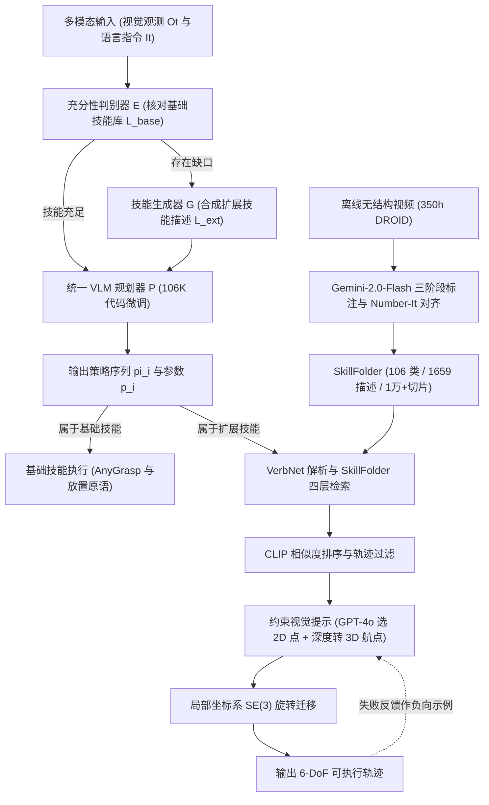

# Uni-Skill: Building Self-Evolving Skill Repository for Generalizable Robotic Manipulation

## 一句话定义

**Uni-Skill 是一种面向开放指令机器人操作的统一技能中心框架：在规划期自动识别基础技能库缺口并生成扩展技能描述，再从基于 VerbNet 与无结构机器人视频自动构建的四层层次化技能库 SkillFolder 中检索示例，通过约束视觉提示与局部坐标系旋转迁移在部署期零人工示教地合成可执行 6-DoF 轨迹。**

## 英文缩写速查

| 缩写 | 英文全称 | 简要说明 |
|------|----------|----------|
| VLM | Vision-Language Model | 视觉语言模型；在本框架中同时承担技能充分性判别、扩展技能描述生成、规划代码输出及离线视频标注 |
| VerbNet | VerbNet (Verb Lexicon) | 英语动词语义角色词典；SkillFolder 参照其动词类别体系组织四层技能树 |
| ZSL | Zero-Shot Learning | 零样本学习；Uni-Skill 在部署期无需人工示教即可执行基础技能库之外的新任务 |
| ICL | In-Context Learning | 上下文学习；用于对比基线 CaP 的提示范式，以及 Uni-Skill 基于检索技能片段的少样本提示与失败闭环纠错 |
| 6-DoF | Six Degrees of Freedom | 六自由度位姿（3D 位置与 3D 姿态）；Uni-Skill 通过 3D 航点与局部坐标系旋转迁移合成末端执行器 6-DoF 轨迹 |
| CLIP | Contrastive Language-Image Pre-training | 图文对比表征模型；用于在 SkillFolder 叶节点候选片段中按视角与空间布局相似度筛选最贴合当前场景的参考轨迹 |

## 为什么重要

- **突破固定技能 API 的天花板：** 传统代码生成式规划方法（如 Code-as-Policies [CaP]）只能组合预设技能库 $L_{\text{base}}$（如 `pick`、`place`）；面对未预置原语的任务（如 `fold cloth`、`close drawer`、`unplug charger`），规划器往往直接失效或陷入死胡同。Uni-Skill 将「检测技能缺口并请求新技能」显式纳入规划循环。
- **以离线结构化检索替代部署期人工采集：** 已有动态扩技能方法常依赖部署阶段的人工口头纠偏、遥操作或航点标注；Uni-Skill 通过自动化视频切分流水线将 350 小时无结构 DROID 机器人视频转化为超过 10,000 条带层次索引的技能切片（106 个 VerbNet 类、1,659 种技能描述），把部署期技能获取转为低成本的语义检索与视觉提示迁移。
- **同时提供语义约束与几何轨迹先验：** 纯关键点视觉提示方法（如 MOKA）在长时域、多约束轨迹任务上易因缺少动作流先验而方向出错；Uni-Skill 将检索到的 2D 投影轨迹参考与 VLM 提炼的接触/航点约束共同注入推理过程，并显式保留局部运动坐标系下的 $SE(3)$ 旋转模式。

## 核心信息

| 字段 | 内容 |
|------|------|
| **作者** | Senwei Xie, Yuntian Zhang, Ruiping Wang, Xilin Chen（通讯作者：Ruiping Wang） |
| **机构** | 中国科学院计算技术研究所（ICT，Key Laboratory of AI Safety of CAS）、中国科学院大学（UCAS） |
| **发表时间** | 2026-03-03（arXiv 提交）；arXiv 备注 Accepted to ICRA2026 |
| **论文链接** | [arXiv:2603.02623](https://arxiv.org/abs/2603.02623) · [arXiv HTML 全文](https://arxiv.org/html/2603.02623) |
| **项目与代码** | 暂未列出独立项目页或官方代码仓库（截至 2026-11-27 核查论文与 arXiv 元信息） |
| **清单分类** | `harness.skills`（来源条目：`survey_ax_2603_02623`） |
| **开源状态** | **未确认开源代码**：论文全文与 arXiv 元信息未公开代码仓库、106K 规划代码微调集或 SkillFolder 数据集下载链接 |

## 核心原理

Uni-Skill 由 **技能感知规划（Skill-Aware Planning）** 与 **自动技能演化（Automatic Skill Evolution）** 两大模块构成，打通「高层自扩充规划」到「底层 6-DoF 动作落地」的闭环。

### 1. 技能感知规划（§III-A）

给定视觉观测 $O_t$、自由形式语言指令 $I_t$ 与基础技能库 API 描述 $L_{\text{base}}$，系统在多模态代码生成管线中协作执行三个角色，得到自扩充技能集 $\{L_{\text{base}}, L_{\text{ext}}\}$ 与可执行策略序列：

1. **充分性判别器 $\mathcal{E}(\{O_t, I_t\}, L_{\text{base}})$：** 评估当前基础技能集是否足以完成指令；若足以覆盖则直接进入规划，否则触发技能补全。
2. **技能生成器 $\mathcal{G}(\{O_t, I_t\}, L_{\text{base}})$：** 在存在能力缺口时自动合成补充技能描述集合 $L_{\text{ext}}$，既作为规划器的临时 API 扩展，也作为后续检索的语义锚点。
3. **规划器 $\mathcal{P}$：** 基于扩充后的技能描述集生成带参数的策略调用序列：

$$(O_t, I_t, \{L_{\text{base}}, L_{\text{ext}}\}) \overset{\mathcal{P}}{\Longrightarrow} \{\pi_i, p_i\}_{i=1}^N$$

其中 $\pi_i \in L_{\text{base}} \cup L_{\text{ext}}$ 为第 $i$ 步技能 API，$p_i$ 为目标物体或动作参数。三者共享统一的代码输出格式，作者从视频演示构建 **106K 条运行时代码样本**对 VLM 进行微调，使其具备多模态对齐的技能判别与结构化规划能力。

### 2. 自动技能标注与四层技能树 SkillFolder（§III-B）

为避免部署期人工采集示教，论文构建了一套基于 **Gemini-2.0-Flash** 的离线三角色标注流水线，对 **350 小时 DROID 机器人数据集**进行自动切分：

- **Extractor（流程提炼）：** 以物理转折点对应的关键帧为条件，将长视频概括为统一的分步操作流程描述。
- **Descriptor（技能描述）：** 对照 $L_{\text{base}}$ 核对步骤描述，不足时按基础技能命名规范合成面向任务的新技能描述。
- **Aligner（时间对齐）：** 采用 **Number-It** 策略在关键帧叠加固定尺寸整数编号，提示模型选取与目标技能描述精确对应的起止帧区间。

最终提炼出 **超过 10,000 条**技能中心化轨迹切片，并参照 WordNet/ImageNet 的层次组织思路，基于 **VerbNet** 搭建四层技能树 **SkillFolder**：

- **第 1 层 $\mathcal{N}_1$（VerbNet 抽象动词类，106 类）：** 如 `wipe-manner-10.4.1`、`amuse-31.1`，刻画高层动作语义与题元角色。
- **第 2 层 $\mathcal{N}_2$（动词实例层）：** 同一 VerbNet 类下语义角色相同但行为模式存在细微差异的具体动词实例。
- **第 3 层 $\mathcal{N}_3$（技能描述层，1,659 项）：** 绑定具体交互目标对象的动作模板与文本技能描述。
- **第 4 层 $\mathcal{N}_4$（视觉落地切片叶节点 $\sigma$）：** 保留视角、场景与 6-DoF 轨迹细节的具体演示片段；当自顶向下检索失配时触发树扩展机制动态新增子节点。

### 3. 部署期少样本技能实现与 SE(3) 姿态迁移（§III-B）

当规划器调用未在 $L_{\text{base}}$ 中实现的扩展技能 $\pi_i$ 时，执行以下落地流程：

1. **层次检索与视角过滤：** 用 VerbNet 解析器定位入口节点并逐层向下匹配；在叶节点候选中通过 **CLIP** 特征相似度筛选视角和空间布局最接近当前场景 $\mathcal{O}_i$ 的演示片段，同时剔除出画（out-of-view）或长时间静止的无效轨迹。
2. **约束视觉提示与 3D 航点生成：** 将参考片段的 6-DoF 轨迹投影到首帧图像上生成绿色 2D 航点迹线 $\{\tau_e, \mathcal{O}_e\}$，并用 VLM 提取接触约束与航点约束 $\{\phi_c, \phi_w\}$。目标观测 $\mathcal{O}_i$ 按物体包围盒标出参数 $p_i$ 并划分离散网格（类似 MOKA），由 **GPT-4o** 结合参考轨迹与语义约束选出首次接触点 $c$ 与可变长度航点序列 $\{w_j\}_{j=1}^N$，再借助深度图反投影至 3D 空间：

$$\{c, \{w_j\}_{j=1}^N\} = \mathcal{V}(\{\tau_e, \mathcal{O}_e\}, \{\phi_c, \phi_w\}, \{\mathcal{O}_i, \pi_i, p_i\})$$

3. **局部坐标系 $SE(3)$ 旋转迁移：** 为保留不同场景间可迁移的夹爪姿态模式，以相邻航点运动方向为基准正交化构造局部坐标系 $R_{\text{local}}$，把参考演示全局旋转 $R_{\text{src}}$ 转换为局部技能旋转模式 $R_{\text{skill}}$，再映射回目标场景全局坐标系：

$$R_{\text{skill}} = (R_{\text{local}}^{\text{src}})^T R_{\text{src}} R_{\text{local}}^{\text{src}}, \qquad R_{\text{tgt}} = R_{\text{local}}^{\text{tgt}} R_{\text{skill}} (R_{\text{local}}^{\text{tgt}})^T$$

将 $R_{\text{tgt}}$ 与 3D 航点逐一配对即得到可执行 6-DoF 位姿序列。对于方向失误等失败案例，系统在 §IV-D 引入闭环自纠错机制，将失败样本作为负向上下文示例提示模型重新规划轨迹。

## 流程总览

## 源码运行时序图

**不适用**（截至 2026-11-27 核查 `arXiv:2603.02623` 论文全文与元信息，未公布官方 GitHub 代码仓库、106K 代码微调集、SkillFolder 数据集或独立项目页链接，当前尚无公开可运行的源码入口可供追踪时序）。

## 实验与评测

所有实验均以同一基础技能库 $L_{\text{base}}$（基于 AnyGrasp 抓取与自上而下放置策略）公平对比 **CaP（GPT-3.5 / GPT-4o，ICL）** 与 **MOKA（GPT-4o）**。

### 1. RLBench 仿真评测（§IV-A，Table I & Table II）

按 PerAct 评测协议，每个任务评估 25 个 episode，重复 3 次统计均值与标准差：

- **基础技能覆盖任务（8 项，Table I）：**

| 模型 | 设置 | Push Buttons | Stack Blocks | Close Jar | Stack Cups | Sweep Dirt | Slide Block | Screw Bulb | Put in Board | 平均（Avg.） |
|------|------|--------------|--------------|-----------|------------|------------|-------------|------------|--------------|--------------|
| CaP (GPT-3.5) | ICL | `0.76 ± 0.04` | `0.12 ± 0.11` | `0.00 ± 0.00` | `0.00 ± 0.00` | `0.43 ± 0.14` | `0.04 ± 0.00` | `0.03 ± 0.02` | `0.04 ± 0.04` | `0.18 ± 0.01` |
| CaP (GPT-4o) | ICL | `0.84 ± 0.00` | `0.31 ± 0.06` | `0.03 ± 0.02` | `0.01 ± 0.02` | `0.64 ± 0.00` | `0.21 ± 0.02` | `0.13 ± 0.02` | `0.08 ± 0.04` | `0.28 ± 0.02` |
| **Uni-Skill (ours)** | ZSL | `0.77 ± 0.02` | `0.39 ± 0.05` | `0.48 ± 0.04` | `0.05 ± 0.02` | `0.64 ± 0.00` | `0.67 ± 0.06` | `0.31 ± 0.02` | `0.08 ± 0.04` | **`0.42 ± 0.01`** |

- **基础技能库外任务（10 项，涵盖 Revolute / Prismatic / Flip / Unplug / Lift / Pour 六类，Table II）：**

| 模型 | Close Micro | Close Fridge | Seat Down | Close Laptop | Close Drawer | Press Switch | Water Plants | Open Door | Unplug Charger | Lift Number | 平均（Avg.） |
|------|-------------|--------------|-----------|--------------|--------------|--------------|--------------|-----------|----------------|-------------|--------------|
| CaP | `0.00 ± 0.00` | `0.00 ± 0.00` | `0.09 ± 0.05` | `0.04 ± 0.04` | `0.00 ± 0.00` | `0.00 ± 0.00` | `0.00 ± 0.00` | `0.00 ± 0.00` | `0.00 ± 0.00` | `0.00 ± 0.00` | `0.01 ± 0.01` |
| MOKA | `0.05 ± 0.02` | `0.17 ± 0.06` | `0.23 ± 0.08` | `0.07 ± 0.05` | `0.19 ± 0.05` | `0.33 ± 0.06` | `0.00 ± 0.00` | `0.00 ± 0.00` | `0.00 ± 0.00` | `0.00 ± 0.00` | `0.10 ± 0.02` |
| **Uni-Skill (ours)** | `0.49 ± 0.06` | `0.57 ± 0.05` | `0.68 ± 0.04` | `0.33 ± 0.02` | `0.56 ± 0.00` | `0.40 ± 0.04` | `0.05 ± 0.02` | `0.33 ± 0.02` | `0.39 ± 0.02` | `0.31 ± 0.02` | **`0.41 ± 0.01`** |

在 10 项库外任务上，Uni-Skill 零样本平均成功率较 MOKA 提升 **31.0 个百分点**（`0.41` vs `0.10`），而 CaP 几乎无法处理未预设 API 的任务（`0.01`）。

### 2. Franka Emika 真机评测（§IV-B，Table III）

在真实 Franka Emika 机械臂上评估 8 类任务（每项 10 次试验，每次重排物体实例与场景布局）：

| 任务 | CaP（GPT-4o） | MOKA | Uni-Skill (ours) |
|------|---------------|------|------------------|
| Pick Place | `0.80` | `0.60` | **`0.90`** |
| Stack Blocks | `0.20` | `0.10` | **`0.50`** |
| Clean Table | `0.80` | `1.00` | **`1.00`** |
| Fold Cloth | `0.00` | `0.20` | **`0.70`** |
| Shake Bell | `0.50` | `0.60` | **`0.60`** |
| Close Door | `0.00` | `0.10` | **`0.80`** |
| Close Drawer | `0.00` | `0.50` | **`0.70`** |
| Stir Blocks | `0.00` | `0.00` | **`0.60`** |
| **Average（论文原文值）** | `0.00`（原文排版值；单行均值约 `0.29`） | `0.39` | **`0.73`** |

论文在摘要与引言总结：真机对比 MOKA 在平均/未见技能表现上提升 `34.0%`（`0.73` vs `0.39`），在长时域任务上提升 `20.0%`；其中同时需要组合推理与长轨迹旋转的 `Stir Blocks` 只有 Uni-Skill 成功完成（`0.60` vs `0.00`）。

### 3. 消融、数据源与质量分析（§IV-C & §IV-D，Table IV）

- **模块消融（Fig. 5）：** 关闭技能更新机制会导致绝大多数库外任务失败；去掉「语义约束」对强接触/整体行为约束类任务（`Revolute`、`Flip`）伤害最大，去掉「空间轨迹参考」对依赖精确空间推理的任务（`Unplug`、`Lift`）影响最明显。
- **视频源对比（Table IV，10 项 RLBench 库外任务）：** 使用 DROID 构建 SkillFolder（`106` 个 VerbNet 类、`1,659` 个技能）成功率为 **`0.41 ± 0.01`**；改用人手第一视角视频 `sth2sth`（搭配轻量手部检测，得 `122` 类、`1,432` 技能）覆盖动词面更广，但因缺动作真值且存在运动模糊，成功率降至 **`0.29 ± 0.02`**。
- **闭环纠错与标注质量（§IV-D）：** 将失败样本作为负向上下文示例的闭环重规划使 `Close Drawer` 与 `Seat Down` 成功率额外提升 **12%**。对 SkillFolder 随机抽检 135 个片段：仅 2 例语义失配、7 例遮挡或过短、0 例执行失败；经长度与边界过滤后低质量数据占比降至 **2% 以下**。

## 与其他工作对比

| 维度 | Code-as-Policies (CaP) | MOKA | 传统检索增强模仿（如 Behavior Retrieval / STRAP） | Uni-Skill（本文） |
|------|------------------------|------|---------------------------------------------------|-------------------|
| **技能库形态** | 固定代码 API 库 | 无显式持久技能库，逐次关键点视觉提示 | 实例级或子轨迹级无层次片段检索 | 基于 VerbNet 组织的四层自演化技能树 SkillFolder |
| **库外任务适应** | 需人工补写新 API | 依赖多轮 VLM 对话猜关键点，长时域易失误 | 需部署期采集少样本任务演示作查询锚点 | 规划器自动申请新技能描述，零部署示教检索参考轨迹 |
| **动作落地机制** | 直接调用硬编码/预设基元 | 2D 网格选点 + 深度投影 + 固定规则姿态 | 基于检索片段重训或微调连续策略 | 约束视觉提示（2D 迹线 + 语义约束）+ 局部坐标系 $SE(3)$ 旋转迁移 |
| **与站内路线关系** | 典型固定代码策略基线 | 标点视觉提示代表方法（对比见实测） | 对应[机器人学习数据管线](../methods/robot-learning-data-pipelines.md)检索支线 | 结合[智能体技能封装](../methods/agent-skill-packaging.md)与[自动标注管线](../methods/auto-labeling-pipelines.md) |

## 结论

**一句话总判：Uni-Skill 的核心价值不在于堆叠更大的 VLA，而在于用「VerbNet 四层技能树 + 无结构视频自动切片 + 局部坐标系姿态迁移」把开放世界技能扩展从部署期人工示教解耦为离线结构化检索与少样本视觉提示，但工程复现受限于未开源代码与闭源 VLM（Gemini-2.0-Flash / GPT-4o）调用链。**

1. **规划必须具备「缺口感知」接口：** 若任务超出基础原语覆盖范围，与其让策略硬拼错用既有 API，不如通过 $\mathcal{E}/\mathcal{G}$ 显式声明新技能语义，将其转化为检索关键词（RLBench 库外任务平均从 CaP 的 `0.01` 升至 `0.41`）。
2. **语义约束与空间轨迹参考缺一不可：** 铰接/翻转类接触约束任务（`Revolute`、`Flip`）依赖语义约束防止动作走样，而拔插/提举类任务（`Unplug`、`Lift`）依赖投影 2D 轨迹提供几何先验，二者应同时进入视觉提示。
3. **无结构视频数据源重质量轻数量：** 第一视角人手视频（`sth2sth`）虽带来更多 VerbNet 动词类（122 vs 106），但缺少机器人末端姿态与画面模糊导致成功率下降 12 个百分点（`0.29` vs `0.41`），落地时仍优先选用带运动学记录的机器人数据集（如 DROID）。
4. **关注闭环自纠错与短板任务：** 负向上下文重规划可带来 `+12%` 的局部增益，但对于浇水（`Water Plants`，`0.05`）、叠杯（`Stack Cups`，`0.05`）和插孔板（`Put in Board`，`0.08`）等精细几何或流体任务，开环 6-DoF 航点迁移仍显著不足。

## 工程实践

- **模块复现边界（基于论文设计，非官方源码实测）：**
  1. **离线建库层：** 需要对原始视频先做物理转折关键帧检测，再用多模板提示词抽取步骤、生成与 $L_{\text{base}}$ 对齐的技能名，并以 Number-It 数字帧标记做区间截取；必须加轨迹出画检测、静默帧剔除与最短长度过滤（否则遮挡/过短切片占比可达 `7/135`）。
  2. **规划微调层：** 需从视频演示合成约 106K 条格式统一的运行代码样本微调 VLM，使充分性判别、技能描述合成与调用代码生成保持一致的接口协议。
  3. **在线执行层：** 目标观测需配合开放词汇目标检测给出参数 $p_i$ 的边界框与空间网格，经深度图还原 3D 航点后按式 (3) 进行局部坐标系旋转迁移，并接入底层轨迹执行与 IK 求解器。
- **失败模式监控重点（§IV-D）：** 在部署监控中应重点区分 **感知定位错误**（如遮挡导致误判抽屉/门把手）、**方向性错误**（参考与目标空间差异或 VLM 幻觉导致的反方向运动）以及 **底层 IK 执行错误**（RLBench 关节限位附近发散），并对方向性错误挂载负向上下文重试环路。

## 局限与风险

- **官方源码与资产尚未公开：** 截至 2026-11-27，论文未提供代码仓库、微调后的规划器权重、106K 运行代码数据或 SkillFolder 索引包，工程团队无法直接一键复现，需自行拼接多套闭源 API（文中离线标注用 Gemini-2.0-Flash，在线航点选择用 GPT-4o）。
- **语义检索与物理力学脱节：** 作者在 §V 明确指出，SkillFolder 当前仅依据 VerbNet 语义层级与 CLIP 视觉相似度检索示例，未显式编码物体质量、摩擦、铰链轴向阻尼等力学属性，可能导致语义相近但动力学迥异的技能片段错配。
- **精细操作与高遮挡场景成功率仍偏低：** 在 `Water Plants`（`0.05`）、`Stack Cups`（`0.05`）、`Put in Board`（`0.08`）等高精度对齐或复杂接触任务上成功率依然低于 10%；若关键把手被遮挡或深度传感噪声较大，2D 选点反投影会直接引入 3D 位姿偏差。
- **推理延迟与闭环频率受限：** 在线技能落地需经过 CLIP 排序、多轮视觉提示调用与重规划纠错，本质上属于中低频任务级轨迹规划，不适合毫秒级高频力控闭环任务。

## 关联页面

- [Agentic Robots 综述](paper-towards-agentic-robots-survey.md)
- [全量项目节点清单](../overview/awesome-agentic-robots-node-index.md)
- [VLA 方法背景](../methods/vla.md)
- [智能体技能封装](../methods/agent-skill-packaging.md)
- [智能体操作策略](../methods/agentic-manipulation-policies.md)
- [机器人智能体调度框架](../methods/robot-agent-harness.md)
- [自动标注流水线](../methods/auto-labeling-pipelines.md)
- [机器人操作](../tasks/manipulation.md)

## 推荐继续阅读

- [Uni-Skill arXiv 摘要与 PDF](https://arxiv.org/abs/2603.02623) — 官方论文主页与 PDF 下载入口
- [Uni-Skill arXiv HTML 全文](https://arxiv.org/html/2603.02623) — 含完整公式、Table I–IV 数据与参考文献 [1]–[41]（含 DROID、MOKA、Code-as-Policies 与 Number-It 等核心引用）

## 参考来源

- [Uni-Skill 原文通读归档](../../sources/papers/paper-agentic-2603-02623.md)
- [官方 Awesome 快照归档](../../sources/repos/awesome-agentic-robots-survey-index.md)
- [arXiv:2603.02623 论文入口](https://arxiv.org/abs/2603.02623)
- [arXiv:2603.02623 HTML 全文](https://arxiv.org/html/2603.02623)
