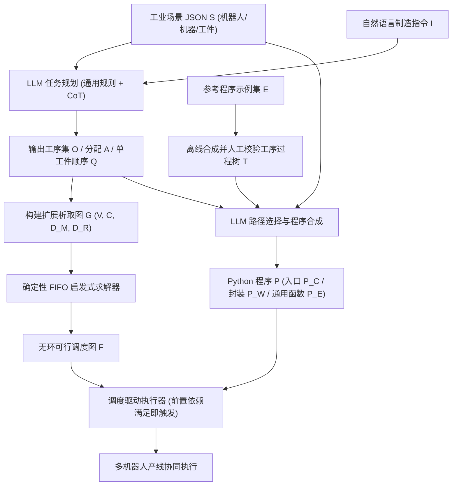

# IMR-LLM: Industrial Multi-Robot Task Planning and Program Generation using Large Language Models

## 一句话定义

IMR-LLM 是一个面向工业多机器人产线的分层规划与编程框架：在高层用大语言模型（LLM）辅助构建扩展析取图并交由确定性启发式算法求解调度冲突，在底层用统一工序过程树引导 LLM 选择并拼接原子技能代码，从而同时保障多机协同调度的可行性与生成程序的可执行性。

## 英文缩写速查

| 缩写 | 英文全称 | 简要说明 |
|---|---|---|
| IMR-LLM | Industrial Multi-Robot Task Planning and Program Generation using Large Language Models | 本文提出的工业多机器人任务规划与程序生成框架 |
| RJSSP | Robotic Job-Shop Scheduling Problem | 机器人作业车间调度问题，需同时处理设备与机器人的互斥占用约束 |
| FIFO | First-In-First-Out | 本文用于求解扩展析取图的确定性先入先出启发式调度算法 |
| OC | Operation Consistency | 工序一致性，生成分配集合与真值分配集合之间的交并比（IoU） |
| SE | Scheduling Efficiency | 调度效率，仅当 OC=1 且调度图可行时按最大完工时间（makespan）归一化计算 |
| Exe | Executability | 可执行率，生成的底层 Python 程序能否在目标环境中成功运行 |
| GCR | Goal Condition Recall | 目标条件召回率，程序执行后工件符号状态变化与真值目标状态的匹配比例 |
| SR | Success Rate | 任务成功率，仅当 SE=1 且 GCR=1 时记为 1 |

## 为什么重要

1. **家庭任务范式难以直接迁移到工业产线**：现有 LLM 多机器人规划方法（如 SMART-LLM、LaMMA-P、LiP-LLM）主要面向厨房或家庭操作，工序顺序相对宽松；而工业制造包含严格的单工件工艺顺序以及机器设备、共享机器人之间的强互斥约束，完全依赖 LLM 直接推演调度顺序极易产生死锁或资源冲突。
2. **Few-shot 示例提示导致底层代码过拟合**：传统代码生成方法（如 ProgPrompt、Code-as-Policies）依赖少数具体任务示例做上下文学习（in-context learning），当产线相机安装位置、夹具外设或工件布局发生变化时，生成代码往往遗漏关键步骤或无法对齐真实执行环境。
3. **提供工业多机器人基准 IMR-Bench**：针对工业场景多机规划与编程公开评测缺失的问题，论文基于真实产线改造了涵盖单机、简单多机与复杂多机三档难度的 50 项任务数据集，为后续工业具身智能体提供统一对照基准。

## 核心信息

| 字段 | 内容 |
|---|---|
| 论文标题 | *IMR-LLM: Industrial Multi-Robot Task Planning and Program Generation using Large Language Models* |
| 作者 | Xiangyu Su, Juzhan Xu, Oliver van Kaick, Kai Xu, Ruizhen Hu |
| 机构 | Shenzhen University、SpeedBot Robotics Co., Ltd.、Carleton University、Institute of AI for Industries, Chinese Academy of Sciences |
| 发表时间 / 载体 | arXiv:2603.02669v1 [cs.RO]（2026-03-03 预印本） |
| 论文链接 | [arXiv 摘要页](https://arxiv.org/abs/2603.02669) · [arXiv HTML 全文](https://arxiv.org/html/2603.02669) |
| 项目与代码 | 截至 2026-11-27，原文与 arXiv 页面未给出独立项目页或官方代码仓库链接 |
| 清单分类 | `model.planning, harness.skills` |
| 来源条目 | `survey_ax_2603_02669` |
| 开源状态 | 未确认开源代码（仿真实验依托 KunWu 平台 [34]，原文未公开源码与 IMR-Bench 数据下载链接） |

## 核心原理

IMR-LLM 将工业产线问题形式化为：**输入**工业场景描述 $S = \{\mathbb{R}, \mathbb{M}, \mathbb{W}\}$（JSON 格式，包含机器人集合 $\mathbb{R}$ 及其外设/可达范围、加工机器集合 $\mathbb{M}$ 及其可达性、工件集合 $\mathbb{W}$ 及其加工状态序列）、自然语言指令 $I$ 与参考程序示例集 $\mathbb{E}$；**输出**高层任务计划 $H = \{\mathbb{O}, \mathbb{A}, F\}$ 与底层可执行 Python 程序 $P = \{\mathbb{P_C}, \mathbb{P_W}, \mathbb{P_E}\}$。核心聚焦五类工业典型工序：**搬运（transport）、打磨（polishing）、焊接（welding）、倒角（beveling）、装配（assembly）**。

### 1. 任务规划：规则引导 LLM + 扩展析取图求解（IV-A）

论文将问题建模为机器人作业车间调度问题（RJSSP），采用扩展析取图 $G = \{\mathbb{V}, \mathbb{C}, \mathbb{D_M}, \mathbb{D_R}\}$ 显式表达约束：
- **顶点集 $\mathbb{V}$**：每个顶点 $V$ 对应一道工序 $O$（包含工序类型 $O_T$、工件 $W$、关联机器 $M_1, M_2$，其中 $M_2$ 仅用于搬运工序），外加源点 $V_S$ 与终点 $V_T$。
- **合取弧 $\mathbb{C}$**：有向边，表示同一工件内部工序的先后顺序约束。
- **机器析取弧 $\mathbb{D_M}$ 与机器人析取弧 $\mathbb{D_R}$**：无向边，分别表示竞争同一台加工设备或同一台机器人的互斥冲突。

为避免 LLM 在多工件资源冲突中出错，IMR-LLM 将规划拆为两步：
1. **LLM 结构化提取**：采用**通用规则提示（rule-based prompting）**与思维链（CoT）推理，从 $(S, I)$ 中输出全部工序集 $\mathbb{O} = \{O^i\}_{i=1}^L$、机器人分配集 $\mathbb{A} = \{\{O^i, R^j\}_{i=1}^L\}$ 以及**仅限单工件内部**的工序顺序集 $\mathbb{Q}$。LLM 无需裁决跨工件、跨机器人的并发冲突。
2. **确定性图求解**：解析器将 $\mathbb{O}$ 映射为 $\mathbb{V}$、$\mathbb{Q}$ 映射为有向边 $\mathbb{C}$，并根据共享机器与共享机器人自动补全无向析取边 $\mathbb{D_M}$ 与 $\mathbb{D_R}$；随后利用启发式 **FIFO** 算法（冲突时按 $\mathbb{O}$ 中出现次序决定先后）为所有无向边定向并保持无环，得到可执行调度图 $F$。

### 2. 程序生成：统一工序过程树引导路径选择（IV-B）

论文观察到同类工业工序（如打磨：拍照 $\to$ 边界检测 $\to$ 轨迹计算 $\to$ 移动至起点 $\to$ 沿轨迹打磨 $\to$ 复位）具有固定主干顺序，仅因产线配置（如支架固定相机 vs. 机械臂手持相机）产生局部实现分支，且跨工序可复用通用步骤（如拍照定位）。因此构建统一 JSON 格式的**工序过程树 $T$**：
- **离线一次性构树与校验**：由 LLM 分析示例集 $\mathbb{E}$，按功能切分代码片段生成树节点（包含唯一 `Index`、所属类型 `Type` 或 `General`、功能描述 `Functional description` 与原子技能代码 `Snippet`，如 `convert_to_robot`、`motion_plan`、`move_by_path`、`control_device`），合并相同实现的节点并针对场景差异细化分支描述，最后由人工校验一遍即可跨所有测试场景复用。
- **在线路径选择与三层代码组装**：给定过程树 $T$、场景 $S$、$\mathbb{O}$ 与 $\mathbb{A}$，LLM 首先根据场景条件为每道工序在 $T$ 中选择唯一的从根到叶路径（将开放式代码生成转化为受控路径选择）；随后拼接同路径节点的 `Snippet` 形成通用执行函数集 $\mathbb{P_E}$（共 $B \le L$ 个函数，减少冗余）；最后为每道工序生成带具体参数的封装函数 $\mathbb{P_W}$ 与调用入口 $\mathbb{P_C}$。

### 3. 调度驱动执行（IV-C）

执行器依据调度图 $F$ 监控各工序的前置依赖，当某道工序的所有前置工序完成后，触发程序 $P$ 中对应的入口函数调用 $\mathbb{P_C}$，通过原子技能库驱动多台机器人并发或顺序作业。

## 流程总览

## 源码运行时序图

**不适用**（截至 2026-11-27，论文原文、arXiv 摘要页及索引材料均未提供官方项目页或可运行代码仓库链接；实验章节仅引用 KunWu 仿真平台 [34] 的官网条目，尚无可供静态核对的官方源码入口与模块定义）。

## 实验与评测

### 1. IMR-Bench 基准与评价指标（V-A）

作者基于 KunWu 工业仿真平台 [34]，邀请产线设计专家根据真实工业产线构建 **23 个场景**（单场景 1–7 台机器人）与 **50 个制造任务**，并人工标注真值 $(\mathbb{O}_{GT}, \mathbb{A}_{GT}, S_{GT}, P_{GT})$：
- **Single Robot**：1 台机器人，$\le 5$ 道工序。
- **Simple Multi-Robot**：最多 3 台机器人，$\le 10$ 道工序（纯并行或纯顺序）。
- **Complex Multi-Robot**：最多 7 台机器人，$\le 24$ 道工序（并行与顺序混合）。

除 `OC`（$\mathbb{A}_{gen}$ 与 $\mathbb{A}_{GT}$ 的 IoU）、`Exe` 和 `SR`（当且仅当 $SE=1$ 且 $GCR=1$ 时为 1）外，调度效率 `SE` 与目标条件召回率 `GCR` 定义如下（注意：仅当 $OC=1$ 时才计算 `SE`，否则 `SE=0`）：

$$
SE = \begin{cases} 0, & \text{if } F \text{ is not feasible}, \\ 1, & \text{if } TS(F_{GT}) = TS(F_{gen}), \\ \dfrac{|\mathbb{O}_{GT}| - TS(F_{gen})}{|\mathbb{O}_{GT}| - TS(F_{GT})}, & \text{otherwise}, \end{cases}
\qquad
GCR = \frac{|\text{Status}(P_{gen}) \cap \text{Status}(P_{GT})|}{|\text{Status}(P_{GT})|}
$$

其中 $TS(F)$ 为调度图 $F$ 的最大完工时间（makespan），$\text{Status}(P)$ 为程序执行后相对初始状态发生改变的工件符号状态集合。

### 2. IMR-Bench 仿真对比主实验（Table I）

所有基线统一采用 GPT-4o 驱动（其中 LaMMA-S/O 与 LiP-O 为适配工业程序生成而分别接入 SMART-LLM 或 IMR-LLM 的代码生成模块）：

| 方法 | Single OC | Single SE | Single Exe | Single GCR | Single SR | Simple OC | Simple SE | Simple Exe | Simple GCR | Simple SR | Complex OC | Complex SE | Complex Exe | Complex GCR | Complex SR |
|---|---:|---:|---:|---:|---:|---:|---:|---:|---:|---:|---:|---:|---:|---:|---:|
| SMART-LLM | 0.83 | 0.70 | 0.50 | 0.50 | 0.50 | 0.67 | 0.46 | 0.46 | 0.32 | 0.20 | 0.50 | 0.04 | 0.00 | 0.03 | 0.00 |
| LaMMA-S | 0.80 | 0.80 | 0.70 | 0.70 | 0.70 | 0.71 | 0.67 | 0.40 | 0.45 | 0.33 | 0.56 | 0.26 | 0.20 | 0.33 | 0.16 |
| LaMMA-O | 0.80 | 0.80 | 0.80 | 0.80 | 0.80 | 0.71 | 0.67 | 0.53 | 0.55 | 0.46 | 0.56 | 0.26 | 0.28 | 0.37 | 0.20 |
| LiP-O | 1.00 | 1.00 | 0.90 | 0.90 | 0.90 | 0.93 | 0.80 | 0.73 | 0.74 | 0.73 | 0.63 | 0.28 | 0.36 | 0.42 | 0.24 |
| **IMR-LLM (GPT-4o)** | 1.00 | 1.00 | 0.90 | 0.98 | 0.90 | 1.00 | 1.00 | 0.87 | 0.94 | 0.87 | **0.88** | **0.75** | **0.76** | **0.79** | **0.68** |
| **IMR-LLM (Qwen3-32B)** | 1.00 | 1.00 | **1.00** | **1.00** | **1.00** | 1.00 | 0.93 | 0.87 | 0.90 | 0.87 | 0.85 | 0.71 | 0.76 | 0.79 | 0.60 |

### 3. 核心模块消融实验（Table II，GPT-4o）

| 消融变体 | Single OC | Single SE | Single Exe | Single GCR | Single SR | Simple OC | Simple SE | Simple Exe | Simple GCR | Simple SR | Complex OC | Complex SE | Complex Exe | Complex GCR | Complex SR |
|---|---:|---:|---:|---:|---:|---:|---:|---:|---:|---:|---:|---:|---:|---:|---:|
| `Ours (w/order)`（LLM 直接排工序顺序） | 1.00 | 1.00 | 0.90 | 0.95 | 0.90 | 1.00 | 0.67 | 0.47 | 0.42 | 0.47 | 0.85 | 0.07 | 0.08 | 0.10 | 0.00 |
| `Ours (w/dependency)`（LLM 建依赖图，无析取图） | 1.00 | 1.00 | 0.90 | 0.98 | 0.90 | 1.00 | 0.73 | 0.80 | 0.80 | 0.60 | 0.83 | 0.39 | 0.44 | 0.47 | 0.36 |
| `Ours (w/o T)`（直接给示例 $\mathbb{E}$，无过程树） | 1.00 | 1.00 | 0.80 | 0.80 | 0.80 | 1.00 | 1.00 | 0.64 | 0.74 | 0.64 | 0.88 | 0.75 | 0.48 | 0.53 | 0.44 |
| **完整 IMR-LLM** | 1.00 | 1.00 | 0.90 | 0.98 | 0.90 | 1.00 | 1.00 | 0.87 | 0.94 | 0.87 | **0.88** | **0.75** | **0.76** | **0.79** | **0.68** |

### 4. 真机部署验证（V-C）

在 3 台真实工业机械臂（均配末端执行器与支架相机）协同向传送带放置工件的产线单元中，专家耗时约 **15 分钟**手工构建场景 JSON，经仿真校验安全性与程序正确性后直接部署到真机，成功完成三臂协同搬运任务。

## 与其他工作对比

| 方法 / 路线 | 规划顺序与耦合方式 | 冲突裁决机制 | 程序生成方式 | 工业复杂场景主要瓶颈 |
|---|---|---|---|---|
| **SMART-LLM** | 先分解与排期，再分配机器人 | LLM 直接输出顺序 | 少样本示例提示（ProgPrompt 风格） | 排期阶段缺乏机器人分配信息，资源冲突严重（Complex SE 仅 0.04，SR 为 0.00） |
| **LaMMA-S / LaMMA-O** | 先分解与分配，再排期 | LLM 直接输出顺序 | 分别接入示例提示 / 本文过程树 | 复杂多机下 LLM 直接排期仍常不可行（Complex SE 仅 0.26）；过程树可小幅提升 Exe（0.20$\to$0.28） |
| **LiP-O** | 分解 $\to$ 依赖图 $\to$ 线性规划分配 | LLM 生成全局依赖图 | 接入本文过程树 | 单机与简单多机表现较好，但复杂场景下 LLM 生成的跨工序依赖图不完整（Complex OC 降至 0.63，SR 降至 0.24） |
| **IMR-LLM（本文）** | 规则引导联合提取 $(\mathbb{O}, \mathbb{A}, \mathbb{Q})$ | **扩展析取图 + 确定性 FIFO 求解** | **统一工序过程树 $T$ 路径选择 + 三层函数复用** | 将 LLM 负担限制在单工件顺序与树路径选择，在复杂多机任务仍维持 0.75 SE 与 0.68 SR |

## 结论

**一句话总判：工业多机器人 LLM 规划的关键在于“把组合调度冲突剥离给确定性图求解器，把开放式代码生成收敛为过程树路径选择”。**

1. **只让 LLM 推理单工件内序，跨资源互斥必须交给析取图求解器**：在 Complex Multi-Robot 任务上，保留同一套 $\mathbb{O}$ 和 $\mathbb{A}$，仅去掉析取图求解（`w/order` 或 `w/dependency`）就会使 `SE` 从 0.75 暴跌至 0.07/0.39、`SR` 跌至 0.00/0.36，证明 LLM 不适合直接担任作业车间调度器。
2. **用统一过程树替代任务级 few-shot 示例可大幅稳住代码可执行率**：同样使用 GPT-4o 规划结果，去掉过程树（`w/o T`）会使 Simple / Complex 档的 `Exe` 从 0.87 / 0.76 降至 0.64 / 0.48；而基于树结构的函数复用在 LaMMA-O 上也能带来稳定增益（Complex Exe 0.20 $\to$ 0.28）。
3. **中等规模开源推理模型可支撑该架构**：将底座从闭源 GPT-4o 替换为开源 `Qwen3-32B-thinking` 后，IMR-LLM 在 Single / Simple / Complex 上取得 1.00 / 0.87 / 0.60 的 `SR`，说明结构化约束显著降低了对超大闭源模型的强依赖。
4. **复杂场景的性能天花板仍在于分配可达性与长上下文幻觉**：Complex 档 `SR` 从 Simple 档的 0.87 降至 0.68，主要诱因是场景扩大后 LLM 仍可能将工序错配给臂展不可达的机器人（`OC` 降至 0.88），且长上下文代码合成更容易出现逻辑不一致（`Exe` 降至 0.76）。

## 工程实践

1. **前置建模与一次性准备**：
   - 将工位、机器人外设（磁力夹具、焊枪等）、相机安装方式（支架固定或臂载手持）及可达关系结构化为标准 JSON 场景文件 $S$；真机三臂单元中专家手动建模约需 15 分钟。
   - 收集覆盖五类核心工序与产线变体的示范程序 $\mathbb{E}$，由 LLM 抽取并合并生成 JSON 工序过程树 $T$，经工程师一次性人工审查确认后固化复用。
2. **规划与调度模块集成**：
   - 使用通用制造规则提示代替具体产线示例提示 LLM 输出 $(\mathbb{O}, \mathbb{A}, \mathbb{Q})$，并将确定性 FIFO 求解器封装为独立模块；若产线更关注极致节拍（makespan），论文指出可无缝替换 FIFO 为约束规划（CP）或元启发式求解器。
3. **仿真预检再下发真机**：
   - 遵循论文真机工作流，将生成的 Python 程序 $P$ 与调度图 $F$ 先送入 KunWu 等数字孪生仿真器做碰撞与逻辑安全性验证，确认无误后再下发真实机械臂控制器。

## 局限与风险

1. **开环执行缺乏运行时故障恢复**：当前框架假设原子技能必然成功，未接入视觉/力觉异常检测与重规划闭环；论文在结论中明确将执行反馈闭环列为未来工作。
2. **复杂场景下的可达性错配与长程代码幻觉**：在最多 7 机、24 工序的复杂场景中，LLM 仍会出现将工序分配给不可达机器人（`OC` 跌至 0.88）以及长文本生成幻觉导致程序不可执行（`Exe` 跌至 0.76）的问题。
3. **人工先验成本与场景静态假设**：部署新产线依赖专家编写精准场景 JSON 与审核过程树节点；对于动态增减工件或非标准化临时工序的产线，通用性受过程树节点覆盖范围限制。
4. **源码与基准尚未确认公开**：截至 2026-11-27 未检索到官方开源仓库与 IMR-Bench 公开下载包，跨平台复现需自行搭建 KunWu 等仿真环境并实现原子技能库。

## 关联页面

- [Agentic Robots 综述](paper-towards-agentic-robots-survey.md)
- [全量项目节点清单](../overview/awesome-agentic-robots-node-index.md)
- [VLA 方法背景](../methods/vla.md)
- [智能体机器人操作策略](../methods/agentic-manipulation-policies.md)：对照操作场景中的规划、执行与反馈接口。
- [Robot Agent Harness · 机器人智能体执行框架](../methods/robot-agent-harness.md)：对照技能契约、调度器约束与执行边界治理。
- [Agent Planning and Feedback Loops · 智能体规划与反馈执行](../methods/agent-planning-feedback.md)：对照分层规划、可核查状态与闭环反馈设计（IMR-LLM 当前仍为开环）。
- [Embodied Agent Benchmarking · 具身智能体评测方法](../methods/embodied-agent-benchmarking.md)：对照 `Exe`、`GCR`、`SR` 等具身规划与代码生成评测协议。
- [Manipulation · 机器人操作](../tasks/manipulation.md)：了解机械臂抓取、放置与多工序协同操作任务主线。

## 推荐继续阅读

- [arXiv:2603.02669 摘要与 PDF](https://arxiv.org/abs/2603.02669)
- [IMR-LLM arXiv HTML 全文](https://arxiv.org/html/2603.02669)

## 参考来源

- [IMR-LLM 原文核对归档](../../sources/papers/paper-agentic-2603-02669.md)
- [官方 Awesome 快照归档](../../sources/repos/awesome-agentic-robots-survey-index.md)
- [arXiv:2603.02669 原始论文入口](https://arxiv.org/abs/2603.02669)
