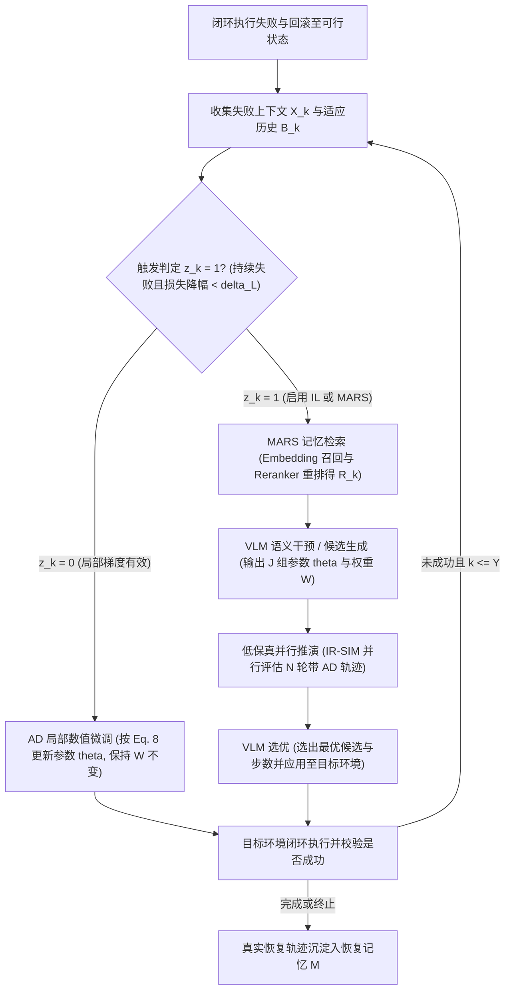

# Self-Evolutionary Replanning for Failure-Aware Motion Planning

## 一句话定义

**SERP**（Self-Evolutionary RePlanning）是一个面向失败感知运动规划的闭环自演化重规划框架，在局部自动微分微调失效时调用视觉语言模型（VLM）联合改写规划器参数与适应损失权重，并通过记忆检索与并行低保真推演筛选可行恢复策略。

## 英文缩写速查

| 缩写 | 英文全称 | 简要说明 |
|---|---|---|
| SERP | Self-Evolutionary RePlanning | 本文提出的失败感知自演化重规划总框架，包含 ILAD 与 MARS 两层机制 |
| ILAD | In-Context Learning with Auto-Differentiation | 将局部自动微分数值微调与基于历史轨迹的 VLM 语境干预耦合的在线适应模块 |
| MARS | Memory-Augmented Rollout System | 结合失败恢复记忆检索、多候选生成与并行低保真仿真推演的演化恢复系统 |
| AD | Auto-Differentiation | 自动微分数值优化模式，在固定损失权重下沿梯度局部更新规划器参数 |
| IL | In-Context Learning | 语境学习干预模式，在局部梯度失效时由 VLM 联合重设规划器参数与损失权重 |
| VLM | Vision-Language Model | 视觉语言模型，负责解释视觉/几何失败上下文、生成候选配置并择优 |

## 为什么重要

1. **突破静态损失函数的局部优化瓶颈：** 现有可微规划器自适应方法（如 DiffTune）通常在固定适应损失权重下仅对连续参数做梯度更新，当环境几何或动力学条件偏离预设假设时，梯度容易被困在无效参数区间。
2. **把失败适应轨迹转化为语义推理证据：** 连续失败的参数演化与闭环结果（$\mathcal{B}_k$）本身暴露了当前优化目标的错配方向；SERP 让 VLM 结合视觉与历史轨迹重塑损失权衡，而非只改高层任务符号计划。
3. **以低保真并行推演降低真机/高保真试错风险：** 直接在目标环境测试多个高差异参数配置成本与碰撞风险均高，MARS 先在轻量 2D 重放环境中并行推演评估，再把最优候选迁移至目标场景并在线沉淀恢复记忆。

## 核心信息

| 字段 | 内容或状态 |
|---|---|
| 作者 | Guoliang Li, Ruihua Han, Chengyang Li, He Li, Shuai Wang, Wenchao Ding, Hong Zhang, Chengzhong Xu |
| 机构 | 澳门大学（University of Macau）、香港大学（HKU）、中国科学院深圳先进技术研究院（SIAT）、复旦大学（Fudan）、南方科技大学（SUSTech） |
| 发表时间 | 2026-03-03（arXiv v1），2026-09-26（arXiv v2，8 页，已投 IEEE 待审） |
| 论文链接 | [arXiv:2603.02772](https://arxiv.org/abs/2603.02772) · [arXiv HTML 全文](https://arxiv.org/html/2603.02772) |
| 项目与代码 | 截至 2026-11-27 未确认官方源码仓库或独立项目页链接 |
| 清单分类 | model.planning, model.adaptation, harness.monitoring_and_recovery |
| 来源条目 | `survey_ax_2603_02772` |
| 开源状态 | 未确认开源代码（arXiv v2 正文与页面未列出开源代码地址） |

## 核心原理

### 1. 问题建模与闭环回滚

在可微导航规划器 $\pi$ 中，系统配置定义为 $\mathcal{Q} = [\theta, \mathcal{W}]$，其中 $\theta$ 为规划器参数，$\mathcal{W}$ 为适应损失权重。给定参考计划 $\mathcal{S}$ 与物理约束 $\mathcal{C}$，规划器求解状态-动作序列 $\mathcal{A} = \pi(\theta, \mathcal{S}, \mathcal{C})$ 并执行得到闭环结果 $\mathcal{O} = \texttt{Execute}(\mathcal{A}, \mathcal{C})$。当发生碰撞或卡滞等失败时，机器人回滚至已执行轨迹上的先前可行状态，利用当前失败上下文 $\mathcal{X}_k$（第一视角观测与执行结果）以及近期适应历史 $\mathcal{B}_k = \{(\mathcal{Q}^{(i)}, \mathcal{L}^{(i)}, \mathcal{O}^{(i)})\}$ 计算更新算子：

$$\mathcal{Q}^{(k+1)} = \Phi_r\left(\mathcal{X}_k, \mathcal{B}_k, \mathcal{Q}^{(k)}\right)$$

### 2. ILAD：自动微分与语境学习耦合

在滚动时域 $\mathcal{H} = \{t, \dots, t+H\}$ 上，基础可微运动规划器通过求解下述带安全距离约束的优化问题生成动作序列：

$$F(\mathcal{A} \mid \theta) = \sum_{h=t}^{t+H}\left(q_s \|\mathbf{s}_h - \mathbf{s}_h^\diamond\|_2^2 + p_u \|\mathbf{e}_1^T \mathbf{a}_h - v^\diamond\|_2^2 - \eta \|\mathbf{d}_h\|_1\right)$$

其中 $d_{\min} \preceq \mathbf{d}_h \preceq d_{\max}$，$\mathbf{e}_1 = [1, 0]^T$ 选取线速度分量，待优化规划器参数为 $\theta = \{q_s, p_u, \eta, d_{\min}, d_{\max}\}$。面向执行结果的适应损失定义为：

$$\mathcal{L}_{\text{ILAD}}(\theta; \mathcal{W}) = \sum_{h=t}^{t+H}\left(\alpha \|\mathbf{s}_h(\theta) - \mathbf{s}_h^\diamond\|_2^2 + \beta \|\mathbf{e}_1^T \mathbf{a}_h(\theta) - v^\diamond\|_2^2 - \gamma \|\mathbf{d}_h(\theta)\|_1\right) + \omega \|\mathbf{s}_{t+H}(\theta) - \mathbf{s}_{\mathrm{goal}}\|_2$$

其中损失权重 $\mathcal{W} = (\alpha, \beta, \gamma, \omega)$ 满足非负且归一化（$\alpha + \beta + \gamma + \omega = 1$），分别平衡状态跟踪、速度跟踪、避障间隙与终点推进。由于 $\{\mathbf{s}_h, \mathbf{a}_h, \mathbf{d}_h\}$ 是 $\theta$ 的隐式函数，梯度可穿过规划器反向传播：

- **切换判定条件：** 在第 $k$ 轮适应时，ILAD 检查历史 $\mathcal{B}_k$ 是否持续失败且相对损失改善不足：

$$z_k = \mathbb{I}\left[\texttt{Fail}(\mathcal{B}_k) \wedge \frac{\mathcal{L}_{\mathrm{first}} - \mathcal{L}_{\mathrm{last}}}{\max(|\mathcal{L}_{\mathrm{first}}|, \varepsilon)} < \delta_L\right]$$

- **AD 模式（$z_k = 0$）：** 保持 $\mathcal{W}^{(k+1)} = \mathcal{W}^{(k)}$，沿梯度更新 $\theta^{(k+1)} = \theta^{(k)} - \epsilon \nabla_\theta \mathcal{L}_{\text{ILAD}}(\theta^{(k)}; \mathcal{W}^{(k)})$。
- **IL 模式（$z_k = 1$）：** 触发 VLM 干预 $[\theta^{(k+1)}, \mathcal{W}^{(k+1)}] = \mathsf{VLM}(\mathcal{X}_k, \mathcal{B}_k, \theta^{(k)}, \mathcal{W}^{(k)})$，同时改写参数与损失权重并重置 $\mathcal{B}_k$，使后续 AD 从新的优化地形重新收敛；循环直至恢复成功或达到最大重规划轮数 $\mathcal{Y}$（IR-SIM 中设为 10）。

### 3. MARS：记忆增强并行推演系统

当单条干预路径仍面临多解或高风险时，MARS 将单次语义修正扩展为“检索—生成—并行推演—沉淀”的演化循环：

1. **多模态失败索引与两阶段检索：** 维护恢复记忆 $\mathcal{M} = \{\mathcal{M}^+, \mathcal{M}^-\}$（分别记录成功与失败的恢复轨迹）。每次失败由第一视角 RGB 图像及两张以失败位置为中心的定尺寸局部几何示意图（一张保持全局地图坐标系，一张对齐局部参考路径）索引，先经 `Qwen3-VL-Embedding-2B` 编码召回，再由 `Qwen3-VL-Reranker-2B` 结合路径转角、最小间隙、间隙不对称性与失败进度进行重排，输出检索记忆 $\mathcal{R}_k$。
2. **多候选生成与并行低保真推演：** 由 $\mathsf{VLM}_{\mathrm{gen}}(\mathcal{X}_k, \mathcal{B}_k, \mathcal{Q}^{(k)}, \mathcal{R}_k)$ 生成 $J$ 个候选配置 $\hat{\mathcal{Q}}_k = \{\hat{\mathcal{Q}}_{k,1}, \dots, \hat{\mathcal{Q}}_{k,J}\}$；随后利用局部感知与参考路径构建轻量重放环境（IR-SIM），对每个候选并行执行最多 $N$ 轮带 AD 微调的闭环推演（发现成功即提前终止），得到推演轨迹 $\{\mathcal{T}_{k,j}\}_{j=1}^J$。
3. **候选择优与在线记忆沉淀：** $\mathsf{VLM}_{\mathrm{sel}}$ 基于推演轨迹选出最优候选与步数 $(j^\star, n^\star)$ 应用到目标环境；真实执行产生的恢复轨迹 $\mathcal{T}_k^{\mathrm{real}}$ 随后通过 $\texttt{Consolidate}(\mathcal{M}_k, \mathcal{T}_k^{\mathrm{real}})$ 写入记忆库。若初始无可用记忆，低保真推演结果仅作当前决策依据，不写入 $\mathcal{M}$。

## 流程总览

## 源码运行时序图

**不适用**（核查结果：截至 2026-11-27，arXiv v2 原文、摘要页及 HTML 全文均未提供可运行的官方源码仓库或独立项目页链接，无法对具体代码入口与模块调用链进行核实。）

## 实验与评测

论文在单张 NVIDIA A6000 GPU 的 Ubuntu 工作站上开展 IR-SIM 与 Habitat 仿真实验，并在实体类车机器人上完成实验室验证。

### 1. IR-SIM 2D 密集障碍仿真（Table I & II）

实验设定为 $65\,\mathrm{m} \times 65\,\mathrm{m}$ 工作空间、$2.0\,\mathrm{m} \times 1.6\,\mathrm{m}$ 差速机器人，涵盖参考路径冲突、高速绕桩、复合场景及均匀随机四类剖面；30/40/50 障碍物密度各 100 场景（总计 300 场景，最大重规划轮数 $\mathcal{Y}=10$），IL 阶段使用 `Qwen3-VL-Plus`：

| 障碍物密度 | 方法 | AvgSpeed ↑ (m/s) | AvgAcc ↓ (m/s²) | AvgEpoch ↓ | TotTime ↓ (s) | ColRate ↓ | SucRate ↑ |
|---|---|---|---|---|---|---|---|
| 30 障碍物 | SFM | 2.299 | 1.015 | – | 35.538 | 3.0% | 35.0% |
| 30 障碍物 | ORCA | 1.938 | 0.828 | – | 35.556 | 0.0% | 46.0% |
| 30 障碍物 | NeuPAN | 3.018 | 0.410 | – | 19.108 | 22.0% | 60.0% |
| 30 障碍物 | DiffTune | 3.023 | 0.479 | 3.610 | 35.079 | 17.0% | 79.0% |
| 30 障碍物 | **SERP** | 2.870 | 0.774 | **2.750** | 38.453 | 1.0% | **95.0%** |
| 40 障碍物 | DiffTune | 3.030 | 0.568 | 3.660 | 34.359 | 21.0% | 76.0% |
| 40 障碍物 | **SERP** | 2.944 | 0.765 | **2.950** | 40.041 | 4.0% | **91.0%** |
| 50 障碍物 | SFM / ORCA | 2.274 / 1.942 | 1.222 / 0.903 | – | 37.988 / 38.989 | 8.0% / 0.0% | 6.0% / 10.0% |
| 50 障碍物 | NeuPAN | 3.036 | 0.529 | – | 16.437 | 29.0% | 43.0% |
| 50 障碍物 | DiffTune | 2.988 | 0.568 | 5.420 | 40.178 | 35.0% | 60.0% |
| 50 障碍物 | **SERP** | 2.808 | 0.959 | **4.080** | 49.440 | 5.0% | **87.0%** |

在另一组独立随机种子的 50 障碍物 100 场景消融（Table II）中：完整 SERP 达 **94.0%** 成功率（ColRate **2.0%**，AvgEpoch **2.66**，TotTime 43.75 s）；去除 IL 后成功率降至 **74.0%**（ColRate 升至 20.0%，AvgEpoch 3.82）；去除 AD 后成功率降至 **84.0%**（ColRate 4.0%，AvgEpoch 3.22，TotTime 48.47 s），说明 IL 负责跳出无效损失区、AD 负责精细参数微分调优。定性案例（Fig. 4）显示，连续两次无效 AD 更新后，`Qwen3-VL-Plus` 在第 3 轮将损失权重由 $(0.25, 0.25, 0.25, 0.25)$ 调整为 $(0.171, 0.220, 0.366, 0.244)$ 并下调 $q_s, p_u, \eta$，随后成功脱困。

### 2. Habitat 室内照片级仿真（Table III）

在 HM3D 数据集 6 个室内场景（`00804`、`00805`、`00806`、`00807`、`00812`、`00813`）各生成 50 个局部近路径障碍/窄通道/拐角阻塞测试场景（共 300 场景），记忆库从空初始化且严格在线逐轮累积（候选生成器为 `Qwen3.7-Plus`，$J=4$，IR-SIM 低保真推演上限 $N=3$）：

- **SERP：** SucRate **87.7%**，ColRate **1.7%**，AvgEpoch **4.06**，TotTime 74.72 s；
- **SERP w/o MARS：** SucRate 81.3%，ColRate 2.7%，AvgEpoch 4.35，TotTime 55.90 s；
- **DiffTune：** SucRate 77.0%，ColRate 4.7%，AvgEpoch 4.48，TotTime **49.46 s**。

随着在线积累的记忆条目由 50 条增长至 236 条（Fig. 6b），SERP 相对 `SERP w/o MARS` 与 `DiffTune` 的成功率优势分别从 `-2.3% / 2.3%` 提升至 `+14.6% / +23.2%`。在 `00804` 窄通道案例中，MARS 选中候选 `cand_relax_tracking`（权重转为 $(0.15, 0.35, 0.35, 0.15)$，安全距离区间放宽至 $[0.05, 0.253]\,\mathrm{m}$），虽受 IR-SIM 与 Habitat 之间的保真度差异影响未一步直接通关，但提供了有效初值并仅需再经 1 次适应更新即完成穿越。

### 3. 实体类车机器人实验（Table IV）

真机平台配备 3D 激光雷达、RGB-D 相机与运行 SLAM/规划的 Intel NUC，初始规划器参数为 $\theta = \{q_s, p_u, \eta\} = \{0.30, 0.80, 29.00\}$：

- **门全开场景（2/4/6 障碍物）：** 启用与不启用 SERP 均 100% 通过，平均导航耗时分别为 11.06 s（10.78 / 10.97 / 11.42 s）与 11.43 s（11.13 / 11.46 / 11.70 s）。
- **门接近关闭窄通道（2/4/6 障碍物）：** 不启用 SERP 时在 3 组实验中全部失败；启用 SERP 后全部成功通过，导航耗时分别为 19.55 s、14.46 s、21.76 s（均值 **18.59 s**）。在 Case 2 中，机器人在 $t = 8.57\,\mathrm{s}$ 卡滞在窄门前，ILAD 在 1 个适应轮次、耗时 $< 3\,\mathrm{s}$ 内将参数更新为 $\theta = \{0.12, 0.62, 29.18\}$，并于 $t = 10.32\,\mathrm{s}$ 顺利穿越门洞。

## 与其他工作对比

| 对比维度 | 经典反应式/优化规划（SFM / ORCA / NeuPAN） | 纯梯度可微调优（DiffTune） | SERP（ILAD + MARS） |
|---|---|---|---|
| 参数与目标自适应 | 冻结规划参数或仅重算轨迹，不改内部权重 | 基于静态损失反向传播更新连续参数 $\theta$ | 联合改写规划器参数 $\theta$ 与损失权重 $\mathcal{W}$ |
| 语义失败诊断与记忆 | 无视觉/历史语境推理或跨场景经验复用 | 无跨任务失败记忆，易受局部损失地形束缚 | 结合适应历史 $\mathcal{B}_k$ 触发 VLM 干预，并在线沉淀恢复记忆 $\mathcal{M}$ |
| 候选评估安全性 | 直接在目标环境执行单一规划 | 直接在目标环境单路径逐步迭代 | 先在 IR-SIM 低保真重放中并行推演 $J$ 个候选，再迁移选优 |
| 典型代价特征 | 密集/窄通道易超时或碰撞（50 障碍 NeuPAN 碰撞 29.0%） | 耗时较短（Habitat 49.46 s），但密集场景碰撞率 35.0% | 成功率最高（IR-SIM 50 障碍 87.0%，Habitat 87.7%），但总耗时偏高（Habitat 74.72 s） |

## 结论

**一句话总判：SERP 通过在可微运动规划器外层耦合“失败触发的 VLM 目标重塑（ILAD）”与“记忆引导的低保真并行推演（MARS）”，显著降低了密集障碍与窄通道场景下的失败率与碰撞率，但以更长的总任务耗时和额外的低保真建模依赖为代价。**

1. **避免局部梯度空转：** 将连续失败与相对损失降幅阈值 $\delta_L$ 作为明确触发器（Eq. 9），只在自动微分陷入停滞时引入 VLM 推理，兼顾实时微调效率与目标重构能力。
2. **必须联合改写损失权重：** 消融实验证实仅靠梯度微调（去 IL）在 50 障碍场景下碰撞率由 2.0% 飙升至 20.0%，表明仅调规划参数而不改适应损失权衡无法解决目标错配型失败。
3. **利用低保真代理充当安全沙盒：** MARS 在进入高保真或真机前先于 IR-SIM 并行推演 $J$ 个候选，虽然仿真与真实场景间的保真度差异导致迁移后仍可能需 1 轮本地微调，但显著压缩了危险探索成本。
4. **控制推理与回滚时延开销：** 在真机窄门场景 ILAD 耗时可控制在 $3\,\mathrm{s}$ 内，但在启用完整 MARS 推演的 Habitat 场景中总耗时由 49.46 s 增至 74.72 s，工程落地需按场景复杂度分级触发。

## 工程实践

- **分级部署策略：** 在结构相对常规但存在几何收窄的场景（如论文真机窄门实验），优先开启轻量级的 ILAD 即可在单轮 $< 3\,\mathrm{s}$ 内完成重规划；在结构多变的大规模室内环境再启用 MARS 记忆检索与并行推演。
- **失败索引与记忆设计：** 构建类似 MARS 的检索库时，建议同时保存第一视角 RGB 与局部路径对齐的二值/栅格几何示意图（包含路径转角、最小间隙与左右间隙不对称度等特征），可明显提高跨场景拓扑相似性召回精度。
- **安全回滚前提：** SERP 的闭环适应默认机器人在失败后能回滚至历史可行状态；真机部署时需确保底层状态估计、局部代价地图保留足够的历史轨迹缓存与可逆倒车/退避走廊。

## 局限与风险

- **未确认开源实现与提示词细节：** 截至 2026-11-27，论文未公开官方代码仓库、VLM 提示词模板、阈值超参 $\delta_L$ 的敏感性分析及重放环境自动构建脚本，直接复现存在较高工程门槛。
- **端到端耗时与加速度代价：** 在 IR-SIM（50 障碍）与 Habitat 实验中，SERP 的总导航时间（49.440 s / 74.72 s）高于 DiffTune（40.178 s / 49.46 s），且 IR-SIM 平均加速度高于 NeuPAN 与 DiffTune，对严格要求高平顺性或低时延的任务构成权衡。
- **低保真到高保真（Sim-to-Sim / Sim-to-Real）保真度鸿沟：** 如 Habitat `00804` 案例所示，IR-SIM 推演选出的最佳配置在迁回复杂 3D 场景后仍可能因动力学与感知建模差异而需二次适应。
- **依赖全局参考路径局部可通行假设：** Habitat 实验显式过滤了需要全局重路由的完全阻塞场景；当参考路径本身不可通行时，仅调整局部可微规划器参数与权重无法替代全局路径重规划。

## 关联页面

- [Agentic Robots 综述](paper-towards-agentic-robots-survey.md)
- [全量项目节点清单](../overview/awesome-agentic-robots-node-index.md)
- [VLA 方法背景](../methods/vla.md)
- [机器人智能体执行框架](../methods/robot-agent-harness.md)：对照规划、执行接口与反馈机制。
- [模型预测控制（MPC）](../methods/model-predictive-control.md)：滚动时域优化与可微控制基础。
- [轨迹优化（Trajectory Optimization）](../methods/trajectory-optimization.md)：带避障与动力学约束的轨迹求解方法。
- [智能体规划与反馈执行](../methods/agent-planning-feedback.md)：基于闭环执行反馈的规划迭代循环。
- [机器人导航与路径执行](../methods/robot-navigation-workflow.md)：感知、全局参考路径与局部运动规划衔接流程。

## 推荐继续阅读

- [arXiv:2603.02772 官方论文摘要与 PDF 入口](https://arxiv.org/abs/2603.02772)
- [arXiv:2603.02772 官方 HTML 全文版](https://arxiv.org/html/2603.02772)

## 参考来源

- [论文全文精读归档](../../sources/papers/paper-agentic-2603-02772.md)
- [官方 Awesome 快照归档](../../sources/repos/awesome-agentic-robots-survey-index.md)
- [论文或官方原始入口（arXiv Abstract）](https://arxiv.org/abs/2603.02772)
- [论文 HTML 全文（arXiv HTML）](https://arxiv.org/html/2603.02772)
