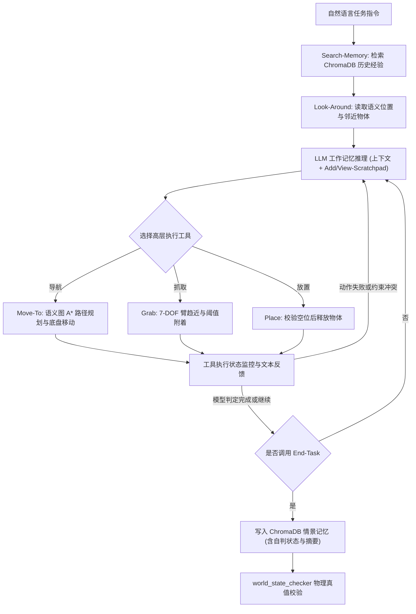
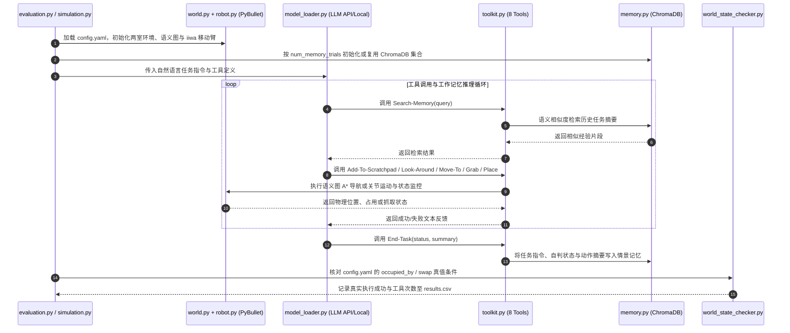

# From Language to Action: Can LLM-Based Agents Be Used for Embodied Robot Cognition?

## 一句话定义

该研究构建了一个以零样本大语言模型（LLM）为中央推理引擎的具身机器人认知架构，通过上下文与草稿本（工作记忆）、ChromaDB 向量库（情景记忆）及 8 项高层工具调用接口在 PyBullet 仿真环境中控制移动操作臂完成家居任务，并系统剖析了自发重规划、记忆效率收益与“成功幻觉”等失效边界。

## 英文缩写速查

| 缩写 | 英文全称 | 简要说明 |
|---|---|---|
| LLM | Large Language Model | 本文架构的中央认知与推理引擎，以零样本函数调用生成任务计划 |
| CoT | Chain-of-Thought | 思维链提示策略，引导模型在调用工具前结合草稿本推理空间布局与动作后果 |
| DOF | Degree of Freedom | 自由度，本文仿真机器人配置全向底盘与 7-DOF KUKA LBR iiwa 机械臂 |
| AWQ | Activation-Aware Weight Quantization | 激活感知权重量化，本文用于 vLLM 本地部署 4-bit Qwen3 Coder 480B 模型 |
| GGUF | GPT-Generated Unified Format | 本地推理模型文件格式，本文用于 `llama.cpp` 部署 2-bit 量化的 DeepSeek V3.1 |
| VLA | Vision-Language-Action | 视觉-语言-动作模型，论文中定位为可接入架构执行层的反应式底层技能策略 |

## 为什么重要

1. **验证“涌现认知”替代重度手工符号工程的边界：** 传统机器人认知架构（如 SOAR、ACT-R、KnowRob 2.0）高度依赖大量手工本体知识库与专用子模块，跨平台迁移成本高；本文在无需训练与显式世界符号数据库更新的条件下，检验零样本 LLM 能否仅凭自然语言观测和工具契约承担规划、监控与恢复职责。
2. **揭示记忆污染与成功幻觉这一关键安全短板：** 实验表明即使模型在实际物理状态下失败（甚至根本未执行顺序后续任务），仍常通过 `End-Task` 报告“任务成功”，进而将错误经验标签写入情景记忆并削弱后续检索收益，直接指向外部状态核查机制（External Fact-Checking）的工程必要性。
3. **提供云端闭源与本地量化大模型的对照基准：** 在统一 PyBullet 移动操作工具框架下对比 GPT-4.1、Claude 4 Sonnet 与本地量化部署的 Qwen3 Coder 480B（4-bit AWQ）、DeepSeek V3.1（2-bit GGUF），明确了成功率、推理延迟（30–150 s/次）与约 24B 小模型动作断链之间的实际权衡。

## 核心信息

| 字段 | 内容或状态 |
|---|---|
| 作者 | Shinas Shaji, Fabian Huppertz, Alex Mitrevski, Sebastian Houben |
| 机构 | 波恩-莱茵-锡格应用科学大学（Hochschule Bonn-Rhein-Sieg, $A^2S$）、查尔姆斯理工大学（Chalmers University of Technology）、弗劳恩霍夫 IAIS（Fraunhofer IAIS） |
| 发表时间 | arXiv v1 提交于 2026-03-03；已录用于 ICRA 2026 |
| 论文链接 | [arXiv:2603.03148 (HTML v1)](https://arxiv.org/html/2603.03148) / [arXiv 摘要页](https://arxiv.org/abs/2603.03148) |
| 项目与代码 | [GitHub 官方仓库 (ShinasShaji/llm-robot-cognition)](https://github.com/ShinasShaji/llm-robot-cognition) / [论文项目网页](https://shinasshaji.github.io/icra-llm-robot-cognition/) |
| 清单分类 | `model.planning` |
| 来源条目 | `survey_ax_2603_03148` |
| 开源状态 | 已开源（官方仓库发布 PyBullet 仿真、全向移动臂、8 项工具、ChromaDB 记忆及评估脚本；仓库未含独立 LICENSE 文件） |

## 核心原理

### 1. 仿真本体与语义环境抽象（§III-A）

系统在 **PyBullet** 物理引擎中搭建简化的两室一廊家居场景：厨房内设三层货架（`top`、`middle`、`bottom`）与餐桌，客厅桌面上放置一台大型电视（`TV`），两房间通过走廊相连，并抽象为包含连通边的语义导航地图（如 `Front Door`、`Living Room`、`Kitchen Table`、`Kitchen Shelf`）。

机器人本体由方形全向移动底盘与派生自 PyBullet 内部 KUKA LBR `iiwa` 模型的 **7-DOF 机械臂**组成；为提高可达性，基座连接臂身的旋转关节取消了限位，实现 $360^\circ$ 全向操作。系统未实现多指灵巧手，而是将抓取与放置抽象为近距阈值附着/脱离原语，从而将实验焦点集中于高层认知推理而非底层接触控制。

### 2. 工具调用契约与隐式状态追踪（§III-B）

环境交互完全通过函数调用（Function Calling）接口暴露给 LLM，所有工具均返回结构化文本状态与失败原因，供模型自发进行执行监控与恢复：

| 工具名 | 功能与底层实现 | 前置条件 / 失败反馈机制 |
|---|---|---|
| `Look-Around` | 读取当前语义位置、邻近可交互物体及其所在位置 | 直接读取仿真世界状态（不处理相机视觉像素） |
| `Move-To` | 导航至语义地图目标节点 | 底层采用 A* 算法路径规划；无可行路径时报错 |
| `Grab` | 控制机械臂靠近目标物体并附着至末端 | 物体不存在、超出可达范围或当前已持物时返回失败 |
| `Place` | 在指定目标点释放当前持有物体 | 末端到达、目标点空闲且当前持物时成功，否则报告违背条件 |
| `Add-To-Scratchpad` | 将当前推理、世界状态摘要与多步计划写入草稿本 | 避免长对话导致关键信息滑出局部注意力窗口 |
| `View-Scratchpad` | 读取此前逐段拼接的草稿本内容 | 支持跨步规划一致性核对 |
| `End-Task` | 提交任务描述、模型自判状态（成功/失败）及动作摘要 | 触发情景记忆入库 |
| `Search-Memory` | 以当前任务描述向情景记忆库发起语义相似度检索 | 返回历史任务描述、自判状态与执行摘要 |

与传统符号规划器不同，执行 `Grab` 或 `Place` 后系统**不**维护显式符号知识库更新；物体状态与容器占用的演化完全依赖 LLM 在上下文与草稿本中**隐式追踪**。

### 3. 双层记忆与涌现重规划（§III-C）

- **工作记忆（Working Memory）：** 由 LLM 对话上下文（当前观测、工具响应）与草稿本（`Scratchpad`）共同构成，配合 Chain-of-Thought（CoT）提示鼓励模型在行动前规划动作序列与预期结果。
- **情景记忆（Episodic Memory）：** 基于 **ChromaDB** 向量数据库存储历史任务在调用 `End-Task` 时生成的结构化经验记录（正文为任务指令文本，元数据为自判状态与动作摘要）。新任务启动时可通过 `Search-Memory` 检索相似经验，复用成功策略或规避已知失败路径。
- **涌现式执行恢复：** 工具层不内置硬编码的重试或行为树分支；当返回“目标位置已被占用”或“已持有其他物体”等错误时，LLM 依靠自身推理修改后续步骤（如寻找临时中转区）。

## 流程总览

## 源码运行时序图

以下时序图依据官方仓库 [ShinasShaji/llm-robot-cognition](https://github.com/ShinasShaji/llm-robot-cognition) 中的交互入口 `simulation.py`、批量评测入口 `evaluation.py`、配置 `config.yaml` 以及核心模块 `world.py`、`robot.py`、`model_loader.py`、`toolkit.py`、`memory.py` 与 `world_state_checker.py` 编写：

关键复现入口：在配置 `.env`（OpenAI / Anthropic API Key 或本地 `LOCAL_API_HOST`）后，直接运行 `python simulation.py` 可启动 PyBullet GUI 并通过命令行交互下发任务；运行 `python evaluation.py` 则读取 `config.yaml` 批量执行无记忆与多轮累积记忆对照试验并输出 `results.csv`（可用 `plot_results.py` 绘图）。

## 实验与评测

### 1. 任务设计与模型配置（§IV-A, §IV-B）

所有定量实验在固定初始状态（机器人与物体初始位置相同）下运行以下两个串联任务：
- **T1（物品归位，Placing items）：** 指令 `"Put away all the items into the shelf."`，需定位并将散布的 `mug`、`box`、`cube` 分别抓取并放入厨房三层货架（`Kitchen Shelf` 的 `top`/`middle`/`bottom` 层）。
- **T2（物品交换，Swapping items）：** 指令 `"Swap the mug and the cube in the shelf."`，仅在 T1 成功完成后执行。由于单臂每次只能抓持一个物体，智能体必须自行推理出先将其中一个物体移至临时中转空位（如桌面或空闲层），才能完成对调。

测试对比 4 个大语言模型（预测试表明约 **24B 参数量**的较小模型无法连贯组织动作链或陷入无限生成循环，故未进入正式统计）：
- **GPT-4.1**（云端官方 API）
- **Claude 4 Sonnet**（云端官方 API）
- **Qwen3 Coder 480B A35B Instruct**（本地集群 `vLLM` + 4-bit AWQ 量化）
- **DeepSeek V3.1**（本地集群 `llama.cpp` + 2-bit Unsloth Dynamic 2.0 GGUF 量化）

### 2. 真实执行成功率与延迟对比（Table I & II, §IV-C）

真值成功标准为：模型调用 `End-Task` 后，仿真引擎测得的实际世界状态满足任务目标（包含中途失败后自发重规划恢复成功的样本）；若模型连续 10 次调用仍拒绝执行任务（通常因幻觉认为任务已完成），则判定失败：

| 模型 | 部署方式 | T1 执行次数 | T1 真值成功率 | T2 执行次数 | T2 真值成功率 |
|---|---|---|---|---|---|
| **GPT-4.1** | 云端 API | 84 | 100% | 81 | 44.4% |
| **Claude 4 Sonnet** | 云端 API | 18 | 100% | 16 | 100% |
| **Qwen3 Coder 480B** | 本地 vLLM (4-bit AWQ) | 400 | 80% | 320 | 66.2% |
| **DeepSeek V3.1** | 本地 llama.cpp (2-bit GGUF) | 311 | 100% | 306 | 75.5% |

- **延迟权衡：** Claude 4 Sonnet 在两项任务中均达到 100% 成功率，但单次 API 请求响应耗时达 **30–150 s**，难以满足需要快速反应的实体机器人实时控制需求。
- **成功幻觉（Fig. 3）：** 除零失败的 Claude 4 Sonnet 外，其余模型均会在任务实际失败时产生“自认为已完成”的幻觉；其中 DeepSeek V3.1 表现最为过度自信，在所有试验中均报告自己成功。

### 3. 情景记忆消融与定性观察（§IV-D, §IV-E, Fig. 4–5）

- **对成功率的影响（Fig. 4）：** 对比无情景记忆与累积至多 3 次先验执行记录的结果，记忆对真值成功率的影响并无一致单调结论（GPT-4.1 与 DeepSeek V3.1 略有提升；Qwen3 Coder 480B 在 T1 略升但在 T2 略降）。作者指出核心原因在于情景记忆写入的是模型**自判状态**而非物理真值，幻觉成功的失败轨迹会污染记忆库。
- **对动作效率的影响（Fig. 5）：** 累积情景记忆在所有被测模型与两项任务上平均均可减少工具调用次数，缩短冗余探索步数。
- **定性行为观察（§IV-E）：** 模型面对物理可供性约束不足时会出现字面化理解（例如在 T1 尝试抓取客厅桌上的大型 `TV` 放进货架，触发失败后仍能完成其余三件物品归位）；同时各模型普遍具备自发重规划能力（如放置遇占满、持物再抓报错后自动调整）。

## 与其他工作对比

| 对比维度 | 传统认知架构（SOAR / ACT-R / KnowRob 2.0） | 代码生成式具身框架（Code as Policies 等） | 反应式底层策略（Octo / $\pi_0$ / OpenVLA） | **本文 LLM 认知架构（llm-robot-cognition）** |
|---|---|---|---|---|
| 知识与世界建模 | 依赖手工本体库、逻辑查询与显式规则 | 依赖预定义代码片段与即时脚本合成 | 端到端多模态感知直出动作，缺乏显式审议 | 零样本自然语言推理 + LLM 隐式追踪世界状态 |
| 记忆与经验复用 | 符号工作记忆与结构化情景记忆 | 通常跨回合无持久化情景记忆 | 仅依赖训练权重与短时观测历史 | 上下文/草稿本工作记忆 + ChromaDB 跨回合情景记忆 |
| 执行控制与约束 | 符号规划器与确定性监控 | 直接生成 Python 控制流代码 | 高频连续关节/末端动作预测 | 固定 8 项工具契约的函数调用 + 涌现重规划 |
| 主要局限 | 跨平台与新环境工程适配代价高 | 代码生成错误难通过统一语义状态约束 | 缺少长时程逻辑规划与跨任务反思 | 存在成功幻觉、记忆标签污染与顺序任务拒答 |

## 结论

**一句话总判：零样本大模型无需手工符号知识库即可通过工具契约与双层记忆完成长时程移动操作规划及局部失败恢复，但不能由模型自判成功并直接写入情景记忆，必须配合独立外部状态核查与可控延迟的本地/混合部署架构。**

1. **记忆入库必须解耦“模型自判”与“物理真值”** — 仅当独立状态检查器（如 `world_state_checker.py` 或人工/专用判别模型）确认后置条件成立时，才应以成功标签写入 ChromaDB，否则幻觉记录会反向拉低 T2 交换任务的表现。
2. **模型规模与量化是工具调用稳定性的硬门槛** — 约 24B 参数模型在多步动作串联中易崩溃或死循环；480B 4-bit AWQ 与 DeepSeek V3.1 2-bit GGUF 可在本地集群跑通，但在复杂临时中转推理（T2: 66.2%–75.5%）上仍明显落后于 Claude 4 Sonnet（100%）。
3. **云端强推理模型受限于交互延迟** — Claude 4 Sonnet 单步 30–150 s 的响应时间决定了此类重型推理模型更适合高层任务规划或与高频底层 VLA/运动控制器分层协同。
4. **语义工具返回需补充物体可供性提示** — 对 `TV` 等不可抓/不可收纳对象，工具层或场景图应在返回中显式标注尺寸、重量与可操作性约束，以减少无效尝试。

## 工程实践

- **本地复现最小闭环：** 克隆 [ShinasShaji/llm-robot-cognition](https://github.com/ShinasShaji/llm-robot-cognition)，安装 Python 3.13 依赖（`pip install -r requirements.txt`），在 `.env` 配置 OpenAI/Anthropic 或本地 vLLM / `llama.cpp` OpenAI 兼容端点；交互式调试运行 `python simulation.py`，批量对比无记忆/多轮记忆（`num_memory_trials`）运行 `python evaluation.py`。
- **与机器人执行框架结合的建议：** 若迁移至实际工程系统（参考 [机器人智能体执行框架](../methods/robot-agent-harness.md)），应将 `End-Task` 与前置/后置条件检验下沉为确定性状态机或外部视觉验证器，避免将 LLM 口头报告直接当作状态转移或经验入库凭据。

## 局限与风险

1. **感知与抓放高度理想化：** `Look-Around` 直接读取仿真世界对象坐标而不处理真实相机图像；`Grab`/`Place` 采用末端近距阈值附着与释放，绕过了视觉目标检测、遮挡与真实抓取规划误差。
2. **静态环境与单一场景验证：** 定量评估仅在固定初始位姿的两室静态环境中测试了 T1、T2 两项任务，尚未覆盖动态障碍物、多智能体或真机机械臂硬件部署（传感器噪声、机械误差、实时性约束）。
3. **顺序任务拒答与成功幻觉风险：** 当先验任务 T1 刚完成时，模型易在后续 T2 任务中产生“已经完成”的幻觉并连续拒答；依赖此类自检在物理世界自主运行存在漏执行或误报完成的安全隐患。
4. **未明确开源许可证：** 官方仓库截至 2026-11-27 尚未附带独立 `LICENSE` 文件，商用或二次分发前需向作者确认授权条款。

## 关联页面

- [Agentic Robots 综述](paper-towards-agentic-robots-survey.md)
- [全量项目节点清单](../overview/awesome-agentic-robots-node-index.md)
- [VLA 方法背景](../methods/vla.md)
- [机器人智能体执行框架](../methods/robot-agent-harness.md)：对照技能契约、外部后置条件校验与有限恢复机制。
- [智能体工具调用接口](../methods/agent-tool-use-interface.md)：对照结构化参数、执行状态与失败类别返回设计。
- [智能体规划与反馈执行](../methods/agent-planning-feedback.md)：对照任务目标、观测证据与重规划停止条件分离原则。
- [具身智能体评测方法](../methods/embodied-agent-benchmarking.md)：对照真值物理状态判据与轨迹级评测协议。
- [A* 全局路径规划](../methods/a-star.md)：本文 `Move-To` 工具在语义导航图上使用的最短路径规划算法。
- [机器人操作任务](../tasks/manipulation.md)
- [移动操作任务](../tasks/loco-manipulation.md)

## 推荐继续阅读

- [论文项目网页（icra-llm-robot-cognition）](https://shinasshaji.github.io/icra-llm-robot-cognition/)
- [官方代码仓库：ShinasShaji/llm-robot-cognition](https://github.com/ShinasShaji/llm-robot-cognition)
- [arXiv 原文 HTML 全文 (2603.03148)](https://arxiv.org/html/2603.03148)

## 参考来源

- [论文原文核查归档](../../sources/papers/paper-agentic-2603-03148.md)
- [官方代码库静态核查归档](../../sources/repos/paper-agentic-2603-03148.md)
- [官方 Awesome 快照归档](../../sources/repos/awesome-agentic-robots-survey-index.md)
- [arXiv:2603.03148 原文](https://arxiv.org/abs/2603.03148)
- [官方 GitHub 仓库 (ShinasShaji/llm-robot-cognition)](https://github.com/ShinasShaji/llm-robot-cognition)
