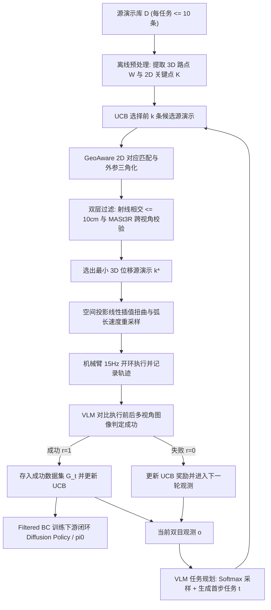
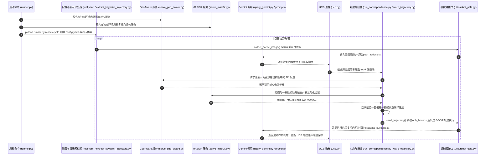

# Tether: Autonomous Functional Play with Correspondence-Driven Trajectory Warping

## 一句话定义

Tether 是一种面向真实世界机器人操作的数据高效策略与自主采集系统：通过语义关键点对应驱动的开环轨迹扭曲（Trajectory Warping）实现 $\le 10$ 条演示的强空间与语义泛化，并将其嵌入视觉语言模型（VLM）引导的多任务自主功能性玩耍（Autonomous Functional Play）循环，以极少人工干预持续产出专家级轨迹供下游闭环策略训练。

## 英文缩写速查

| 缩写 | 英文全称 | 简要说明 |
|---|---|---|
| VLM | Vision-Language Model | 视觉语言模型，Tether 中用于自主玩耍的任务规划与成功判定 |
| CMP | Controlled Markov Process | 受控马尔可夫过程，论文中无奖励函数操作问题的形式化建模 |
| UCB | Upper Confidence Bound | 上置信界多臂赌博机算法，用于在玩耍中动态筛选高成功率源演示 |
| VLA | Vision-Language-Action Model | 视觉-语言-动作模型，如实验中作为对比与下游微调对象的 $\pi_0$ |
| BC | Behavioral Cloning | 行为克隆，用于从筛选后的玩耍成功轨迹训练下游闭环策略 |
| DP | Diffusion Policy | 扩散策略，论文中用于对比及接收玩耍数据流训练的端到端闭环基线 |

## 为什么重要

主流机器人模仿学习与 VLA 模型高度依赖人工遥操作示教，数据规模随人力线性增长，且在分布外物体位置、外观或干扰物面前泛化受限。仿真合成数据虽能扩大规模，但在杂乱桌面、复杂接触与视觉渲染方面仍面临明显的 Sim2Real 鸿沟；而直接在真机上自主采集的方法通常要么先依赖数百条人工示教冷启动，要么因每步频繁调用大模型推理导致吞吐极低。

Tether 提供了另一条可扩展路径：先用非参数的几何与语义对应 priors 构建只需 $\le 10$ 条演示即可稳定工作的“引导策略”，再借由互相可组合（composable）的多任务结构与 VLM 规划/评估闭环在真机连续运行逾 24 小时，使机器人在自然漂移、无人工复位的状态分布下不断积累高质量经验，从而持续喂养并提升端到端闭环策略。

## 核心信息

| 字段 | 内容或状态 |
|---|---|
| 作者 | William Liang, Sam Wang, Hung-Ju Wang, Osbert Bastani, Yecheng Jason Ma, Dinesh Jayaraman |
| 机构 | University of Pennsylvania、UC Berkeley、Dyna Robotics |
| 发表时间 | 2026-03-03（arXiv 提交）；ICLR 2026 录用 |
| 论文链接 | [arXiv:2603.03278](https://arxiv.org/abs/2603.03278) / [arXiv HTML](https://arxiv.org/html/2603.03278) |
| 项目与代码 | [项目页](https://tether-research.github.io) / [官方仓库 tether-research/tether](https://github.com/tether-research/tether) |
| 清单分类 | `data.collection` |
| 来源条目 | `survey_ax_2603_03278` |
| 开源状态 | 已开源（MIT 协议，包含完整轨迹扭曲、对应匹配、UCB 选择、VLM 规划与评测脚本及真机配置） |

## 核心原理

Tether 将机器人操作建模为无显式奖励的受控马尔可夫过程 $M=(S, A, \mathcal{T})$。观测 $o_t = O(s_t)$ 为左右双目第三视角 RGB 图像，动作 $a_t$ 为 6-DOF 末端执行器位姿与二值夹爪开合指令。系统由以下两部分构成：

### 1. 基于语义关键点对应的轨迹扭曲策略（Section 3.1 & Appendix A.1）

1. **演示摘要预处理（Demonstration Summaries）：**
   每条源演示 $\tau_i \in \mathcal{D}$ 被离线压缩为元组 $\kappa_i = (o_i, W_i, K_i, \mathbf{a}_i)$：
   - $o_i$：演示初始时刻的双视角 RGB 图像；
   - $W_i = [w_1, \dots, w_T]$：关键 3D 路点序列。主实验直接抽取夹爪开合状态切换时刻的末端位姿；对于无夹爪切换的关键点（如 Appendix A.1 中的杯子向碗倒水），可由 VLM 挑选关键帧并指出 2D 像素后双目三角化得到；
   - $K_i = [k_1, \dots, k_T]$：将 3D 路点投影到左右视角初始图像得到的 2D 关键点；
   - $\mathbf{a}_i = [a_1, \dots, a_M]$：原始完整动作序列。

2. **对应匹配、双层几何过滤与源演示选择：**
   测试时输入当前双目观测 $o$，利用结合 DINOv2 与 Stable Diffusion 特征的 GeoAware 语义对应模型（Zhang et al., 2024）在左右视图中分别寻找每条演示关键点 $K_i$ 的对应像素 $\tilde{K}_i = [\tilde{K}_{i,\text{left}}, \tilde{K}_{i,\text{right}}]$，并通过标定外参反投影三角化得到目标 3D 路点 $\tilde{W}_i$。为防止错误匹配引发碰撞，系统实施两道过滤：
   - **三角化相交阈值：** 左右反投影射线最近距离超过 $10\text{ cm}$ 即判定该演示匹配不可行；
   - **MASt3R 跨视角安全校验：** 利用 MASt3R（Leroy et al., 2024）将每视角匹配点跨视角映射至另一相机视图，对比 3D 路点到对应射线的距离在源演示与当前观测之间的差异，若超过 $10\text{ cm}$ 同样剔除。
   在所有可行演示中，按 3D 路点欧氏位移 $\text{score}_i(o) = \|W_i - \tilde{W}_i(o)\|_2$ 选择最接近的源演示 $\kappa^*$。

3. **空间线性插值扭曲与弧长速度重采样：**
   对于选中演示 $\kappa^*$ 的相邻路点段 $[w_t^*, w_{t+1}^*]$ 及其目标路点 $[\tilde{w}_t, \tilde{w}_{t+1}]$，端点位移为 $d_t = \tilde{w}_t - w_t^*$、$d_{t+1} = \tilde{w}_{t+1} - w_{t+1}^*$。为保持空间结构，插值在空间而非时间上进行：令段向量 $v = w_{t+1}^* - w_t^*$，对段内每个原动作末端位置 $a \in \mathbf{a}_t^*$ 计算沿 $v$ 的 1D 投影坐标：
   $$\alpha = \frac{(a - w_t^*)^\top v}{\|v\|^2}, \quad d_a = (1 - \alpha) d_t + \alpha d_{t+1}, \quad \tilde{a} = a + d_a$$
   由于目标场景物体间距可能显著异于源演示，固定步数会导致线速度剧变；因此进一步按新旧轨迹段弧长比 $\tilde{T}_{\text{segment}} = (\tilde{L}/L) T_{\text{segment}}$ 缩放步数，并按归一化弧长 $s/L$ 与 $\tilde{s}/\tilde{L}$ 对中间动作重新采样，从而保持原始运动速度分布并开环执行。

### 2. VLM 引导的多任务自主功能性玩耍（Section 3.2 & Appendix A.2）

为使机器人能够无需人工复位持续交互，Tether 设计了近似无限可组合（approximately indefinitely composable）的多任务集合（无论前序任务成功或失败，物体始终处于另一任务的有效初始状态分布中），每轮执行循环包括：
- **稀缺任务采样与滚动时域规划：** 统计各任务已有成功数 $|\mathcal{G}_t|$，按 $\text{Softmax}(-|\mathcal{G}_t|)$ 采样目标任务 $t_{\text{targ}}$；再将左右场景图输入 $\text{VLM}_{\text{planner}}$（Gemini Robotics-ER 1.5），生成到达 $t_{\text{targ}}$ 的原子任务序列（若目标已达成则先执行破坏性前置任务），并在当前轮仅尝试第一步可执行任务 $t$。
- **UCB 源演示筛选：** 针对人工演示质量不均的问题，将演示集 $\mathcal{D}_t$ 视为多臂赌博机，基于历史执行成功回报（二值奖励 $r \in \{0, 1\}$）用 UCB 选出前 $k$ 条演示供 Tether 扭曲执行，在探索新演示与利用高成功率演示之间取得平衡。
- **多视角成功判定与下游过滤训练：** 将执行前后的左、右及腕部共 6 张图像输入 $\text{VLM}_{\text{evaluator}}$（优先保证高精确率以避免假阳性污染训练集）；判定成功的轨迹加入 $\mathcal{G}_t$，随后通过过滤行为克隆（Filtered BC）定期训练闭环 Diffusion Policy 或微调 $\pi_0$。

## 流程总览

## 源码运行时序图

官方仓库通过 `runner.py` 作为统一主入口（支持 `mode=single` 单次滚出与 `mode=cycle` 自主玩耍循环），并依赖两个独立 Conda 环境预先启动的 `serve_geo_aware.py` 与 `serve_mast3r.py` 视觉对应服务以及 `utils/robot_utils.py` 封装的底层机械臂接口。

## 实验与评测

全部实验在 7-DOF Franka Emika Panda（15 Hz 控制）、双 ZED 第三视角相机（评价时辅助腕部相机）及单张 NVIDIA A6000 GPU 上完成；默认每项任务提供 10 条人工演示，每组对比评测执行 10 次随机初始化试验。

### 1. 少样本鲁棒模仿对比（Table 1 & Table 2）

| 任务类别 | 具体任务 | Tether (10 Demos) | Tether (5 Demos) | Tether (1 Demo) | $\pi_0$-FAST (Zero-Shot) | Diffusion Policy (10 Demos) |
|---|---|---|---|---|---|---|
| 分布内空间泛化 | Pineapple from Shelf | `1.0 ± 0.0` | `0.8 ± 0.13` | `0.8 ± 0.13` | `0.5 ± 0.16` | `0.0 ± 0.0` |
| 分布内空间泛化 | Pineapple to Bowl | `1.0 ± 0.0` | `0.8 ± 0.13` | `0.9 ± 0.09` | `0.7 ± 0.14` | `0.0 ± 0.0` |
| 分布内空间泛化 | Bowl to Shelf | `0.9 ± 0.09` | `1.0 ± 0.0` | `0.7 ± 0.14` | `0.0 ± 0.0` | `0.0 ± 0.0` |
| 分布内空间泛化 | Bowl from Shelf | `1.0 ± 0.0` | `1.0 ± 0.0` | `1.0 ± 0.0` | `0.4 ± 0.15` | `0.1 ± 0.09` |
| 分布外语义泛化 | Apple to Bowl | `0.9 ± 0.09` | `1.0 ± 0.0` | `0.9 ± 0.09` | `0.6 ± 0.15` | `0.0 ± 0.0` |
| 分布外语义泛化 | Strawberry to Bowl | `0.9 ± 0.09` | `0.9 ± 0.09` | `0.9 ± 0.09` | `0.7 ± 0.14` | `0.0 ± 0.0` |
| 分布外语义泛化 | Pineapple to Basket | `0.9 ± 0.09` | `0.9 ± 0.09` | `0.9 ± 0.09` | `0.4 ± 0.15` | `0.0 ± 0.0` |
| 分布外语义泛化 | Pineapple to Cup | `0.9 ± 0.09` | `0.9 ± 0.09` | `0.5 ± 0.16` | `0.1 ± 0.09` | `0.0 ± 0.0` |
| 形变/接触/精密 | Wiping with Cloth | `0.6 ± 0.15` | `0.0 ± 0.0` | `0.1 ± 0.09` | `0.0 ± 0.0` | `0.0 ± 0.0` |
| 形变/接触/精密 | Opening Cabinet | `0.6 ± 0.15` | `0.3 ± 0.14` | `0.1 ± 0.09` | `0.0 ± 0.0` | `0.0 ± 0.0` |
| 形变/接触/精密 | Hanging Tape | `0.7 ± 0.14` | `0.3 ± 0.14` | `0.1 ± 0.09` | `0.0 ± 0.0` | `0.0 ± 0.0` |
| 形变/接触/精密 | Inserting Coffee（8mm 容限，相机拉近） | `0.4 ± 0.15` | `0.2 ± 0.13` | `0.2 ± 0.13` | `0.0 ± 0.0` | `0.0 ± 0.0` |

补充实验结果（Appendix A.4–A.5）：
- **微调 $\pi_0$ 与 KAT（10 Demos）：** 在上述 12 项主任务上成功率为 `0.0`（$\pi_0$ 在仅 10 条演示微调时发生过拟合坍塌，往往静止不动或抓空；KAT 在大桌面杂乱背景与多维非均匀速度轨迹上失效，但在更局部的单物体任务“抬咖啡机手柄”与“拉抽屉”上分别取得 `70%` 与 `60%`，低于 Tether 的 `90%` 与 `100%`）。
- **对比 KALM（Table 2）：** 在 4 项菠萝/碗任务上，Tether 成功率为 `1.0 / 1.0 / 0.9 / 1.0`，而同以关键点对应为输入的模仿学习策略 KALM 为 `0.6 / 0.0 / 0.0 / 0.5`。
- **扩展几何、多干扰与替代路点任务（Appendix A.1 & A.5）：** 模拟厨房（水槽到碗）达 `100%`，办公室（文件柜顶到抽屉内碗）达 `90%`；未见过的新咖啡机抬手柄达 `80%`；菠萝、草莓、苹果同时在场时的目标消歧分别达 `100% / 80% / 100%`（无抓错目标失败）；基于 VLM 关键帧选点的“杯子向碗倒水”达 `90%`。

### 2. 长时程自主玩耍与下游策略学习（Section 4.3 & Table 3）

- **26 小时自主玩耍吞吐与人工干预：** 在 6 项可组合任务（桌面/货架/碗之间搬运菠萝与碗）上累计运行 4 轮约 26 小时，总尝试 1946 次（平均 48 秒/次），获得 1085 条成功轨迹（平均 86 秒/条，总成功率 55.8%）。全过程仅需 5 次人工干预（占比 0.26%，平均每 5.2 小时一次，总耗时约 1 分钟；其中 4 次为碗完全倒扣、1 次为菠萝被推入货架最深处）。
- **VLM 模块准确率：** 人工标注全部 1946 次尝试后，Gemini Robotics-ER 1.5 任务规划准确率达 `95.2%`（高于早期 Gemini-2.5-Flash 的 `94.1%`）；成功判定精确率达 `98.4%`、召回率达 `89.6%`（高于早期 GPT-4.1 + 对应启发式双检方案的 `97.7%` 精确率与 `87.7%` 召回率）。
- **下游闭环策略扩展曲线（Figure 8 & Table 3）：**
  - **Diffusion Policy：** 每 500 次玩耍尝试用累计成功轨迹训练，成功率随数据流持续上升并在各任务上达到接近或略高于同等数量人工示教（每任务 141–202 条）训练模型的水平。
  - **$\pi_0$ 微调（Table 3）：** 在 `Pineapple from Shelf / Pineapple to Bowl / Bowl to Shelf` 三项任务上，10 条人工演示微调为 `0.0 / 0.0 / 0.0`，接入 50 条玩耍数据升至 `0.1 / 0.2 / 0.1`，100 条升至 `0.3 / 0.5 / 0.1`，全部玩耍数据升至 `0.7 ± 0.14 / 0.8 ± 0.13 / 0.4 ± 0.15`，全面超过零样本预训练 $\pi_0$ 的 `0.5 / 0.7 / 0.0`。
- **玩耍分布对比（Figure 9）：** 从真实玩耍过程抽取 20 个包含倾斜碗、物体缠绕等非标准初态的场景，10 条演示的 Tether 在全部 6 项任务上均显著优于用 141–202 条人工演示训练的 Diffusion Policy。

## 与其他工作对比

- **对比端到端视觉运动策略（[Diffusion Policy](../methods/diffusion-policy.md)）与通用 VLA（[π₀](../methods/pi0-policy.md)）：** 在 $\le 10$ 条演示的极低数据区间，端到端策略缺少几何结构先验，难以覆盖宽广的物体位姿与语义变化；Tether 将语义对应与空间轨迹扭曲作为显式归纳偏置，但本身不具备闭环反应能力，因此在定位上作为数据生成器与下游闭环策略形成互补。
- **对比其他关键点模仿方法（KAT、KALM、P3-PO、SKIL）：** KAT 将关键点与离散动作喂给 LLM 做上下文学习，在宽桌面分布、高频率（>10 Hz）及带姿态旋转的多维轨迹上难以拟合数值模式；KALM 仍依赖神经网络回归动作，在稀疏演示下空间泛化较弱。Tether 直接以非参数最近邻检索与空间线性扭曲生成轨迹，避开了小样本下神经网络/LLM 动作回归的不稳定性。
- **对比既有真机自主采集与 [Learning from Play](../methods/learning-from-play-lmp.md) 范式：** 传统 LMP 多依赖人工无目的遥操作采集或仿真重置；而真机多轮调用基础模型执行的方案（如 Manipulate-Anything）受限于推理延时仅能产出不足 50 条轨迹且缺乏复位设计。Tether 通过“VLM 仅在回合首尾规划/验收 + 中间过程由几何对应快速开环执行 + 闭环可组合任务集”实现了千条级长程低干预采集。

## 结论

**一句话总判：Tether 证明了“少样本强几何归纳偏置策略 + VLM 语义规划验收 + 可组合无复位任务集”是在真机上低成本自动化生产千条级专家示范并有效反哺闭环策略的可行范式。**

1. **冷启动策略与目标策略解耦：** 工程上不必强求少量演示直接微调大型 VLA 或训练闭环策略，可先用非参数对应扭曲策略作为高质量数据引擎，待轨迹积累至数百条后再训练闭环策略。
2. **数据纯净度优先于召回：** VLM 成功判定应优先优化精确率（如本工作取 98.4% 精确率、89.6% 召回率）并辅以多视角（含腕部相机）前后对比，避免假阳性轨迹污染 Filtered BC 训练集。
3. **双层几何约束必不可少：** 仅靠单步对应三角化阈值（10 cm）仍可能因巧合交会引发碰撞，在无碰撞检测的真机机械臂上应叠加 MASt3R 跨视角射线校验与工作空间 `oob_bounds` 边界拦截。
4. **必须设计结构闭合的任务图：** 要实现数十小时无人值守玩耍，需提前构建类似正逆配对的可组合任务图并部署物理防掉落围挡，以减少像单臂无法扶正倒扣容器这类物理不可逆死锁。

## 工程实践

- **三环境微服务拆分：** 官方代码将主控制流程（`tether`，Python 3.10）与视觉基础模型 `GeoAware-SC`、`MASt3R` 拆分为三个独立 Conda 环境，分别通过 `serve_geo_aware.py` 与 `serve_mast3r.py` 提供本地服务，规避 PyTorch/CUDA 依赖冲突。
- **速度安全缩放：** 扭曲后必须执行 `adjustSpeed` 按弧长比例 $\tilde{T}_{\text{segment}}=(\tilde{L}/L)T_{\text{segment}}$ 重采样轨迹点数，否则当测试场景物体间距大于源演示时会造成危险的高速运动。
- **小物体与精密任务适配：** 默认双目广角视图下 8 mm 容差（如咖啡胶囊插入）仅占 2–3 像素，工程部署时需拉近相机焦距或增加腕部视角以保障对应像素精度；非夹爪切换类动作（如倒水）需改用 VLM 关键帧标注路点。
- **部署边界配置：** 在 `conf/setting/real.yaml` 中明确设置 `oob_bounds` 限制机械臂末端范围，并在桌面边缘增设物理挡板以减少物体掉落地面导致的人工介入。

## 局限与风险

- **开环执行的反应性缺失：** Tether 仅依赖初始帧观测生成整段动作计划，执行途中无法针对物体滑落、动态扰动或接触形变做实时闭环修正，只适合作为数据采集引导策略而非最终高动态交互策略。
- **强依赖关键点可见性与对应质量：** 将图像抽象为少量关键点使其对严重遮挡敏感；若目标物体的关键局部被完全遮挡或缺乏稳定语义纹理，GeoAware 匹配会失效或退化。
- **动作空间与复杂度上限：** 线性空间插值假设新轨迹可通过源演示端点平移平滑形变获得，难以表达与源演示拓扑结构截然不同的复杂避障绕行或双手协作；此外单臂系统在容器完全倒扣等双接触点复位状态上仍无法自主脱困。
- **实验边界：** 论文在 12 项桌面/柜体操作与 6 项玩耍任务上进行了验证，高难度精细操作（如咖啡胶囊插入，40%）仍有明显提升空间，且依赖提前人工录制每任务 $\le 10$ 条源演示及离线多相机外参标定。

## 关联页面

- [Agentic Robots 综述](paper-towards-agentic-robots-survey.md)
- [全量项目节点清单](../overview/awesome-agentic-robots-node-index.md)
- [VLA 方法背景](../methods/vla.md)
- [Learning from Play](../methods/learning-from-play-lmp.md)
- [模仿学习（Imitation Learning）](../methods/imitation-learning.md)
- [扩散策略（Diffusion Policy）](../methods/diffusion-policy.md)
- [π₀ 通用机器人策略](../methods/pi0-policy.md)
- [机器人学习数据流水线](../methods/robot-learning-data-pipelines.md)
- [机器人操作（Manipulation）](../tasks/manipulation.md)

## 推荐继续阅读

- [Tether 官方项目主页与 100 倍速 26 小时自主玩耍延时视频](https://tether-research.github.io)
- [Tether 官方开源代码库（GitHub: tether-research/tether）](https://github.com/tether-research/tether)
- [Tether 论文原文（arXiv:2603.03278）](https://arxiv.org/abs/2603.03278)

## 参考来源

- [论文原文全文核对归档](../../sources/papers/paper-agentic-2603-03278.md)
- [官方开源代码库核对归档](../../sources/repos/paper-agentic-2603-03278.md)
- [官方 Awesome 快照归档](../../sources/repos/awesome-agentic-robots-survey-index.md)
- [arXiv 论文入口](https://arxiv.org/abs/2603.03278)
- [官方项目主页](https://tether-research.github.io)
- [官方 GitHub 仓库](https://github.com/tether-research/tether)
