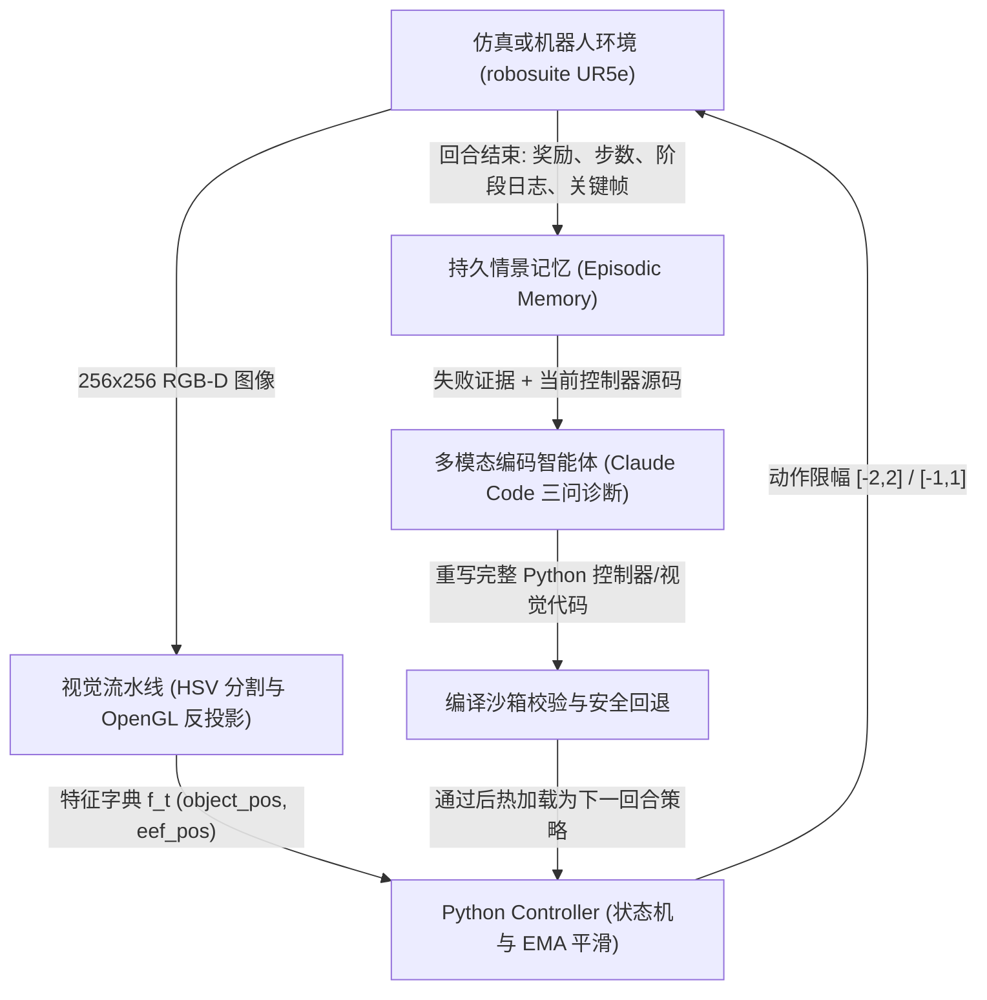

# Act-Observe-Rewrite: Multimodal Coding Agents as In-Context Policy Learners for Robot Manipulation

## 一句话定义

**Act–Observe–Rewrite（AOR）** 是一种面向机器人操作的双时间尺度上下文策略学习（in-context policy learning）框架：无需梯度更新、人类演示或奖励工程，由多模态编码智能体在试验回合之间结合视觉关键帧与结构化失败日志，直接重写完整的低层可执行 Python 控制器与视觉流水线代码。

## 英文缩写速查

| 缩写 | 英文全称 | 简要说明 |
|---|---|---|
| AOR | Act–Observe–Rewrite | 本文提出的双时间尺度代码综合自省策略学习框架 |
| LLM | Large Language Model | 大语言模型；本文中负责回合间多模态诊断与控制器代码生成 |
| RGB-D | Red-Green-Blue-Depth | 彩色与深度图像；单视角 `agentview`（256×256）提供视觉感知输入 |
| EEF | End-Effector | 机械臂末端执行器；用于距离判据与静止抓取控制 |
| HSV | Hue-Saturation-Value | 色相-饱和度-明度颜色空间；智能体自发采用的物体分割表示 |
| EMA | Exponential Moving Average | 指数移动平均；控制器中用于平滑输出动作以保持抓取稳定 |

## 为什么重要

1. **突破“技能选择/参数调优”的表达上限**：既有反思式或代码生成方法（如 Reflexion、SayCan、Code as Policies）大多局限于改写文本策略、挑选固定基元或一次性生成高层计划；当失败源于坐标系符号错误、深度偏置或抓取接触物理时，调阈值或换子目标无法修复底层根因。
2. **用可解释代码实现诊断级上下文学习**：将完整的 Python 控制器与视觉处理代码作为推理单元，使多模态智能体能够把画面中的物理异常（如机械臂系统性右偏 5–8 cm）直接归因到具体代码模块甚至单行反投影公式，并在回合间迭代修复。
3. **零演示、零微调的快速任务迭代视角**：针对缺少大规模示教或强化学习训练算力的单任务部署配置，验证了代码智能体在闭环视觉反馈下完成“感知调试 + 状态机重构”的可行性与清晰边界。

## 核心信息

| 字段 | 内容或状态 |
|---|---|
| 作者 | Vaishak Kumar |
| 机构 | General Bionix, Inc. |
| 发表时间 | 2026-03-03（arXiv:2603.04466v1 `[cs.RO]`，CC BY 4.0） |
| 论文链接 | [arXiv:2603.04466](https://arxiv.org/abs/2603.04466) / [arXiv HTML 全文](https://arxiv.org/html/2603.04466) |
| 项目与代码 | 截至 2026-11-27 未列独立项目页或官方 GitHub 仓库 |
| 清单分类 | `harness.skills`（来源条目：`survey_ax_2603_04466`） |
| 开源状态 | 未确认开源代码（arXiv v1 正文仅说明基于 `Claude Code` 与 `robosuite v1.5.1` 实验，未公布代码链接） |

## 核心原理

### 1. 问题定义与表征对比

设策略在每个时间步 $t$ 接收图像 $o_t$ 与本体状态 $s_t$，输出动作 $a_t \in \mathcal{A}$。单回合结束后产生结构化结果：

$$\tau = \{r,\; T,\; \phi_1, \dots, \phi_k\}$$

其中 $r$ 为标量奖励，$T$ 为回合步数，$\phi_i$ 为诊断信号（阶段日志、最小末端到物体距离 `min_distance`、振荡标志）。给定历史结果 $H_n = \{\tau_1, \dots, \tau_n\}$ 与关键帧图像 $\mathcal{I}_n$，上下文策略学习要在不更新模型权重的前提下生成改进策略 $\pi_{n+1}$。与参数更新、固定技能选择和强化学习奖励改写不同，AOR 直接将 $\pi$ 表示为可执行的 Python 类实现。

### 2. 双时间尺度闭环

- **快环（回合内控制频率）：** 256×256 RGB-D `agentview` 相机图像进入视觉流水线，提取特征字典 $\mathbf{f}_t = \{\texttt{object\_pos}, \texttt{eef\_pos}, \texttt{detected}, \dots\}$（不使用仿真器真值物体位姿），输入包含 `reset()` 与 `get_action(features)` 的 Python `Controller` 类，驱动 UR5e 机械臂的 `OSC_POSE` 笛卡尔增量控制。
- **慢环（回合间推理频率）：** 回合结束后，将结果 $\tau$ 与关键帧（阶段切换帧与定间隔帧）写入持久情景记忆。多模态 LLM（`Claude Code`，`claude-sonnet-4-x` 系列）阅读记忆与当前源码，并强制先回答三个诊断问题再生成代码：（1）主导失败模式是什么？（2）根因在视觉、控制逻辑还是参数？（3）单次最具影响力的改动是什么？

### 3. 安全与稳定机制

- **编译沙箱：** 在隔离命名空间内编译并校验接口与实例化，若失败则自动回退到上一版可用控制器。
- **动作限幅与异常保底：** 笛卡尔增量限幅至 $[-2, 2]$，夹爪指令限幅至 $[-1, 1]$；单步运行时异常返回零动作（safe-stop）。
- **有界重写（Bounded rewrites）：** 提示智能体围绕已定位根因做局部增量修改，保留既有有效结构，避免全盘推翻。

### 4. 智能体自发演化的视觉与控制设计

作者未在提示中硬编码视觉或控制算法，智能体在试错中自主收敛出以下机制：

- **OpenGL 相机约定修正：** `robosuite` 使用 `IMAGE_CONVENTION = "opengl"`（第 0 行为图像底部，$y$ 轴向上、$z$ 轴向后），针孔反投影需采用：

$$\mathbf{p}_{\mathrm{cam}} = [x_p,\; y_p,\; -d,\; 1]^{\top}, \quad x_p = \frac{(u - c_x)d}{f_x}, \quad y_p = \frac{(v - c_y)d}{f_y}$$

  常规 OpenCV 约定使用 $-y_p$ 且 `get_camera_extrinsic_matrix` 附带不兼容的轴修正，导致 5–8 cm 定位偏差；智能体在 `Stack` 第 6 轮自主定位 `src/vision.py` 中的翻转与外参问题（直接由 `cam_xmat` 计算），将定位误差降至 `cubeA` 1.4 cm、`cubeB` 1.9 cm。
- **阶段状态机与双不变原则：** 控制器演进为 `reach -> descend -> grasp -> lift -> {task-specific}` 并带超时回退，同时沉淀出两项跨任务原则：（1）**静止抓取（Stationary grasp）**——闭合夹爪期间保持末端静止，消除下压力对物体的推偏；（2）**EMA 动作平滑**——$\mathbf{a}_t = \alpha \hat{\mathbf{a}}_t + (1 - \alpha)\mathbf{a}_{t-1}$（$\alpha \in [0.3, 0.5]$）。

## 流程总览

> 上图依据原文 §4 Figure 1 与 §4.1–§5.2 的双时间尺度架构绘制，反映回合内控制快环与回合间诊断重写慢环的数据与控制流。

## 源码运行时序图

**不适用**（截至 2026-11-27，核对 `arXiv:2603.04466v1` 全文与候选仓库记录均未确认公开发布的可运行官方源码仓库或项目页，仅存在论文中的架构描述与推理摘录，不能臆造源码运行时序图）。

## 实验与评测

### 实验设置

- **仿真平台：** `robosuite v1.5.1` + `MuJoCo 3.2.3`，UR5e 机械臂，`OSC_POSE` 笛卡尔增量控制，单目 256×256 RGB-D `agentview` 相机，严禁读取物体真值位姿。
- **编码智能体：** 主实验采用 `Claude Code`（`claude-sonnet-4-x` 系列）；对比组将其直接替换为 OpenAI `Codex`（`GPT 5.3`，High reasoning 设置）。

### 跨任务结果汇总（Table 3）

| 任务 | 成功率 | LLM 调用次数 | 重复验证 / 关键诊断与残余失败 |
|---|---:|---:|---|
| `Lift` | 100% | 3 | 4/4 随机重复全部成功；修复 2.5 cm 深度偏置与抓握下压问题 |
| `PickPlaceCan` | 100% | 2 | 20/20 随机重复全部成功；修正罐体红色识别与最大连通域滤除料箱标记 |
| `Stack` | 91% | 20 | 残余 9% 为放置 `cubeA` 时夹爪指尖碰移 `cubeB`（智能体已诊断但未解出避碰策略） |

### `Stack` 任务 20 个版本的演进轨迹（Table 2）

| 版本区间 | 核心改动 | 成功率 | 说明 |
|---|---|---:|---|
| v0–v6 | 仅调控制器增益与阈值 | 0% | 存在 5–8 cm 视觉系统误差，调参无效 |
| v7–v8 | 修正反投影 $y$ 轴翻转 | 33% | 改用 `img_height - 1 - pixel_row` |
| v9 | 修正相机外参约定 | 45% | 直接从 `cam_xmat` 计算变换矩阵 |
| v10 | 完整视觉标定后控制迭代 | 70% | 定位误差降至 1.4 cm（`cubeA`）/ 1.9 cm（`cubeB`） |
| v11–v16 | 撤回斜坡与下降阶段调优 | ~75% | 含低置信度（0.5–0.6）下显著提效的 v16 |
| v17 | 加入失败抓取重试机制 | 6/10 | 低于 8/10 基线：重试沿用相同 `x_correction = -0.015` |
| v18 | 按重试次数变化接近偏置 | 76% | 共享 `self.x_correction` 导致 `cubeB` 放置目标偏移 1.5 cm |
| v19 | 拆分 `x_corr_A` 与 `x_corr_B` | 83% | 解耦抓取偏移与放置对齐参数 |
| v20 | 进入放置阶段时冻结 `cubeB` 估计 | 91% | 残余 9% 全数为下降时夹爪碰移 `cubeB` |

### 编码智能体能力对比（§6.1）

在相同迭代预算下，使用 OpenAI `Codex`（`GPT 5.3`，High reasoning）替代 `Claude Code` 运行上述三个任务，未能解出任意一个任务（包括最基础的 `Lift`），说明底座编码智能体的几何与代码调试能力直接决定了 AOR 循环的可用性。

## 与其他工作对比

| 方法 | 视觉输入 | 代码/策略推理单元 | 回合间迭代 | 失败图像反馈 | 零演示启动 | 策略可解释性 |
|---|---|---|---|---|---|---|
| Reflexion | ✗ | 自然语言策略 | ✓ | ✗ | ✓ | ✓ |
| Reflective TTP | ✓ | 子目标选择 | ✓ | ✗ | ✓ | 部分 |
| Code as Policies | ✗ | 一次性任务程序 | ✗ | ✗ | ✓ | ✓ |
| ReKep | ✓ | 一次性 3D 关键点约束 | ✗ | ✗ | ✓ | ✓ |
| Eureka | ✗ | RL 奖励函数（内环需梯度训练） | ✓ | ✗ | ✓ | ✓ |
| RT-2 / OpenVLA / Octo | ✓ | 神经网络动作（跨任务泛化广） | ✗ | ✗ | ✓ | ✗ |
| Diffusion Policy / ACT | ✓ | 神经网络动作（依赖人类演示） | ✗ | ✗ | ✗ | ✗ |
| **AOR（本文）** | **✓** | **完整底层控制器+视觉代码** | **✓** | **✓** | **✓** | **✓** |

- **对比 [VLA 路线](../methods/vla.md) 与模仿学习**：VLA 与 Diffusion Policy / ACT 在给定演示下具备更高上限与跨任务广度，但部署出错时难以直接定位感知或坐标模块根因；AOR 主攻无演示、单任务快速试错与透明审计。
- **对比 [Agentic Manipulation Policies](../methods/agentic-manipulation-policies.md)**：典型智能体操作策略（如将低层运动留给 SDK 的框架）聚焦高层子目标与工具调用编排，而 AOR 把代码改写深度下探到底层控制器与反投影视觉代码本身，二者在分层架构上互补。

## 结论

**一句话总判：把“完整底层控制器与视觉代码”而非“参数或子目标”交给多模态编码智能体做闭环重写，能在无演示无训练条件下自主定位感知与几何 Bug，但性能高度受限于智能体自身推理能力与串行局部搜索的探索瓶颈。**

1. **视觉反馈是代码诊断的关键分水岭** — 纯数值指标（如 `min_distance = 0.087`）无法区分“未收敛”与“收敛到了错误坐标”，结合关键帧图像才让智能体准确诊断深度偏置与 OpenGL 行序翻转问题。
2. **区分系统性偏差与随机方差可省去大量无效迭代** — `Stack` 前 6 轮在视觉存在 5–8 cm 偏差时反复调控制增益全部失效；建立“跨版本误差不变即排查上游感知”的启发式规则尤为重要。
3. **修改共享状态变量必须防范跨阶段回归** — v18 因复用 `self.x_correction` 破坏了放置阶段精度，提示工程中需要更强的变量作用域隔离或回归测试门禁（参考 [编码智能体验证闭环](../methods/coding-agent-verification-loops.md)）。
4. **单分支反思易陷入局部最优** — `Stack` 最终 9% 的夹爪碰移失败证明“诊断正确”不等于“能搜出可行解”，后续工程需引入并行多假设分支或显式策略多样性压力。

## 工程实践

1. **接口与沙箱隔离**：将视觉特征提取与 `Controller`（`reset()` / `get_action(features)`）解耦，使智能体可单独修复 `vision` 模块而不破坏状态机骨架；每次热加载前通过编译检查与安全限幅保护。
2. **结构化记忆设计**：为每次试验同时记录阶段转换日志（`final_phase`、耗时）、标量诊断指标（最小末端距离、振荡标志）以及阶段切换瞬间的关键帧图像，控制上下文长度的同时保留因果线索。
3. **验证与防回归约束**：结合 Appendix A 暴露的弱点，不应把 LLM 输出的 `confidence` 字段作为接受改动的唯一依据，而应保留上一版已知最佳控制器作为回退基准，并对共享参数修改运行回归评估。

## 局限与风险

1. **仅限仿真验证**：全部实验均在 `robosuite`/MuJoCo 理想物理与固定色块/可乐罐外观下完成，真实硬件的传感器噪声、光照变化与执行器误差尚未验证；HSV 分割对光照与杂乱背景脆弱。
2. **串行单次试错与高模型依赖**：每轮只验证一个候选控制器，串行耗时随任务复杂度上升；且替换编码智能体后（`Codex GPT 5.3`）三任务全败，框架有效性高度依赖特定强多模态编码模型。
3. **局部最优与经典控制偏置**：`Stack` 在发现夹爪碰移 `cubeB` 后仍未能搜出陡降或侧推释放等避碰策略；此外无额外提示时智能体倾向收敛到 HSV + 状态机 + PID 这类传统可解释结构，难以自主引入学习型视觉特征。
4. **工程脆弱性（Appendix A）**：智能体在重构时缺乏全局影响仿真，易因修改共享变量引发下游阶段退化，且常把随机抓取失败误判为需调参的系统偏差。

## 关联页面

- [Agentic Robots 综述](paper-towards-agentic-robots-survey.md)
- [全量项目节点清单](../overview/awesome-agentic-robots-node-index.md)
- [VLA 方法背景](../methods/vla.md)
- [机器人操作](../tasks/manipulation.md)
- [Agentic Manipulation Policies：可编程的智能体机器人操作策略](../methods/agentic-manipulation-policies.md)
- [Agent Planning and Feedback Loops · 智能体规划与反馈执行](../methods/agent-planning-feedback.md)
- [Coding Agent 验证闭环](../methods/coding-agent-verification-loops.md)
- [Robot Agent Harness · 机器人智能体执行框架](../methods/robot-agent-harness.md)

## 推荐继续阅读

- [arXiv 论文原址（2603.04466）](https://arxiv.org/abs/2603.04466)
- [arXiv HTML 全文（含图表与 Appendix A 诊断摘录）](https://arxiv.org/html/2603.04466)
- [Reflective Test-Time Planning for Embodied LLMs（对比参考项目）](https://reflective-test-time-planning.github.io/)

## 参考来源

- [论文一手全文核对记录（Act-Observe-Rewrite）](../../sources/papers/paper-agentic-2603-04466.md)
- [官方 Awesome 快照归档](../../sources/repos/awesome-agentic-robots-survey-index.md)
- [arXiv:2603.04466v1 原文链接](https://arxiv.org/html/2603.04466)
