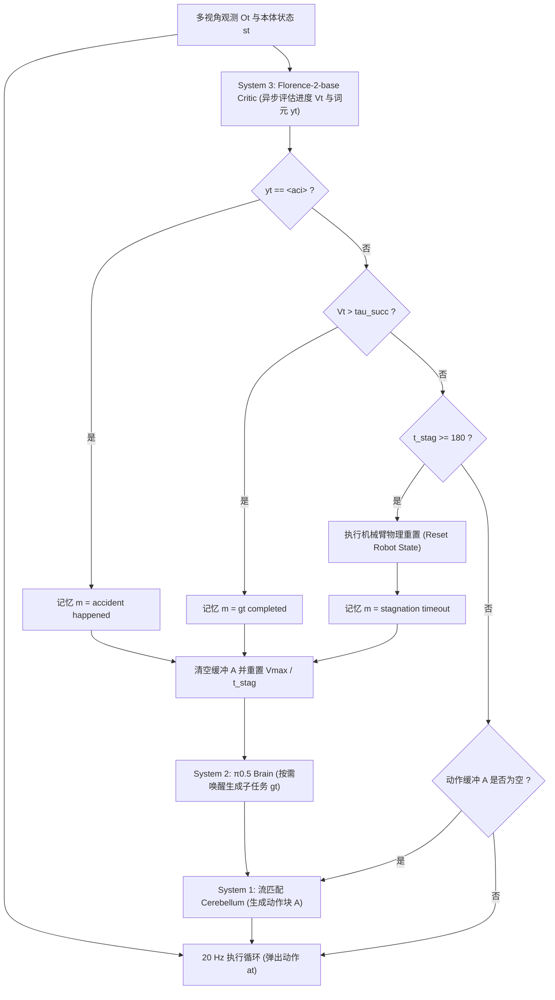

# Critic in the Loop: A Tri-System VLA Framework for Robust Long-Horizon Manipulation

## 一句话定义

**Critic in the Loop（Tri-System VLA）** 是一种由“慢速 VLM 大脑 + 快速流匹配小脑 + 轻量级异步视觉 Critic（System 3）”构成的三系统具身操作框架，通过持续监测子任务进度、异常事件与执行停滞来按需触发重规划并打破长程操作死锁。

## 英文缩写速查

| 缩写 | 英文全称 | 简要说明 |
|---|---|---|
| VLA | Vision-Language-Action | 视觉-语言-动作模型，将多模态感知与语言指令映射为机器人动作 |
| VLM | Vision-Language Model | 视觉-语言模型，负责高层语义理解、子任务规划或视觉问答 |
| VQA | Visual Question Answering | 视觉问答，本文用于统一建模 Critic 的进度估计与异常输出 |
| RDP | Ramer-Douglas-Peucker | 折线几何抽稀算法，本文用于从末端轨迹中提取运动学拐点 |
| EE | End-Effector | 机械臂末端执行器 |
| OOD | Out-of-Distribution | 分布外场景，如训练仅用右臂置杯而测试将杯子放到左侧 |

## 为什么重要

现有分层或双系统 VLA（如 $\pi_{0.5}$、HAMSTER、OneTwoVLA、Hi Robot）多依赖固定频率或每个动作块（action chunk）都重新生成子任务的刚性切换策略，在真实长程双臂操作中面临三类瓶颈：
1. **算力与延迟浪费**：在常规平稳执行阶段频繁调用自回归 VLM，引入明显推理延迟；
2. **意图高频震荡**：面对软体形变（如打开塑料垃圾袋）导致的外观连续变化时，缺乏状态记忆的双系统会在相邻子任务间反复摇摆直至停滞；
3. **OOD 死锁与无限重试**：当目标出现在未见空间分布（如左侧杯子）且机械臂停留在附近时，策略易陷入反复无效抓取的运动学死循环，而为所有边缘失败采集专项数据成本极高。

本文提出的 System Three（Critic）把“何时需要思考”从固定节拍解耦为视觉驱动的事件调度，并用可插拔的类人停滞重置规则（arm retraction reset）在不大幅扩充异常数据的前提下缓解 OOD 死锁。

## 核心信息

| 字段 | 内容 |
|---|---|
| **作者** | Pengfei Yi, Yingjie Ma, Wenjiang Xu, Yanan Hao, Shuai Gan, Wanting Li*, Shanlin Zhong* |
| **机构** | 中国科学院自动化研究所（CASIA）、中国科学院大学人工智能学院（UCAS） |
| **发表时间** | 2026-03-05（arXiv:2603.05185v1） |
| **论文链接** | [arXiv:2603.05185](https://arxiv.org/abs/2603.05185) / [arXiv HTML](https://arxiv.org/html/2603.05185) |
| **项目与代码** | 未确认官方开源仓库（论文基于 `openpi` 中的 $\pi_{0.5}$、Florence-2-base 与 Qwen3-VL 32B 扩展，未发布独立官方项目页或代码链接） |
| **清单分类** | `harness.layered_systems`（来源条目 `survey_ax_2603_05185`） |
| **开源状态** | 未确认开源代码（截至 2026-11-27；文中 §2.3 引用的 `video2tasks` 为 BAAI 先前工作） |

## 核心原理

### 1. 脑-小脑骨干（System 2 & System 1）

系统基于 `openpi` 框架下的 $\pi_{0.5}$ 架构（共享如 PaliGemma 的多视角视觉-语言表示空间）进行改造：
- **System 2（大脑 / 子任务生成 $\pi_{\theta}^{Brain}$）**：接收全局指令 $\ell$、当前多视角观测 $O_t$ 与由 Critic 提供的短期记忆上下文 $m$（例如 `"<subtask> completed"`、`"accident happened"` 或 `"stagnation timeout"`），按模板 `"Task: ℓ; Info: m; Current Subtask:"` 自回归解码当前语义子任务 $g_t \sim \pi_{\theta}(\cdot \mid O_t, m, \ell)$。其在正常执行期间保持休眠，仅在起始或 Critic 发出抢占中断时同步唤醒。
- **System 1（小脑 / 连续动作生成 $\pi_{\theta}^{cerebellum}$）**：保留 $\pi_{0.5}$ 原生流匹配（flow matching）动作专家容量与超参数，以 $(O_t, s_t, g_t)$（含机器人本体状态 $s_t$）为条件学习向量场 $v_t$，将高斯噪声去噪为连续动作块 $a_{t:t+H}$。仅当动作缓冲 $A$ 耗尽或被抢占清空时同步推理。

### 2. 轻量级视觉 Critic（System 3）

Critic $C_{\phi}(O_t, g_t)$ 采用约 0.2B 参数的 **Florence-2-base**，将状态评估统一建模为自回归 VQA（提示为 `"Evaluate the progress for task: g_t."`）：
- **蒙特卡洛进度估计**：对长度为 $L$ 的成功子任务轨迹，在时间步 $t$ 的归一化剩余完成度定义为：
  $$V_t = \max\left(-1.0, \frac{t - L}{L_{max}^{g_t}}\right) \in [-1.0, 0.0]$$
  其中 $L_{max}^{g_t}$ 为训练语料中子任务 $g_t$ 轨迹长度的 90 分位数（$-1.0$ 表示起始，$0.0$ 表示完成）。连续值被均匀离散化为 $B = 101$ 个分箱索引字符串。
- **异常检测词元 `<aci>`**：针对人为干扰或物理失败轨迹（如杯子被打翻）的最后关键时间窗口（如末 20 帧），用高优先级离散词元 `<aci>` 替代数值分箱。进度分箱与 `<aci>` 共用同一语言输出词表，使用标准自回归交叉熵损失端到端训练，避免了独立 BCE 分类器在罕见异常上的长尾失衡。

### 3. 事件驱动动态调度与类人停滞重置（Algorithm 1）

系统运行在三条独立节拍上：~20 Hz 的底层控制与观测循环、动作缓冲耗尽触发的 System 1 同步、以及 Critic 中断驱动的 System 2 同步。每帧异步更新 $V_t, y_t \leftarrow C_{\phi}(O_t, g_t)$ 并检查三类抢占条件：
1. **异常中断**：若 $y_t == \text{<aci>}$，置 $m \leftarrow \text{"accident happened"}$；
2. **子任务完成**：若 $V_t > \tau_{succ}$（例如 $\tau_{succ} \approx -0.041$），置 $m \leftarrow g_t + \text{" completed"}$；
3. **执行停滞（类人启发规则）**：维护自上次刷新历史最高进度 $V_{max}$ 以来的帧数 $t_{stag}$；当 $t_{stag} \ge N_{stag}$（$N_{stag} = 180$ 帧）时，触发物理层 `Reset Robot State`（收回机械臂重置位形以脱离局部视觉-运动学陷阱），并置 $m \leftarrow \text{"stagnation timeout"}$。

一旦任意条件成立（$m \neq \text{None}$），立即清空残留动作缓冲 $A \leftarrow \emptyset$，重置 $V_{max} \leftarrow -\infty, t_{stag} \leftarrow 0$，同步唤醒 System 2 生成修正后的 $g_t$，再由 System 1 解码新动作块。

### 4. 自动化子任务标注流水线

为降低长程遥操作数据的分段成本，系统结合运动学与 VLM 检索自动提取子任务标签：
1. **运动学关键帧提议**：提取 3D 末端执行器轨迹，利用 Ramer-Douglas-Peucker（RDP）算法筛选正交偏离超过阈值 $\epsilon$ 的几何拐点（$\max_i d_{\perp}(\mathbf{p}_i, \overline{\mathbf{p}_{start}\mathbf{p}_{end}}) > \epsilon$），并入夹爪开合状态变化点，再施加最小时间间隔 $\Delta t \ge 30$ 帧的贪心邻近过滤。
2. **VLM 检索接地**：将候选关键帧图像送入 **Qwen3-VL 32B**，从预定义子任务词表中检索最匹配标签并合并连续同标签段落，最后进行人工校验。

## 流程总览

## 源码运行时序图

**不适用**（截至 2026-11-27，arXiv:2603.05185 原文及索引入口均未提供本论文官方源码仓库或可执行复现工程；文中 §2.3 所引 `https://github.com/ly-geming/video2tasks` 为 BAAI 先前工作 Video2Tasks，而 `openpi` / $\pi_{0.5}$ 与 `Florence-2-base` 为所依赖的开源基座模型，均不构成本文独立官方代码仓）。

## 实验与评测

### 1. 硬件与训练设置
- **平台**：Cobot Magic ALOHA 双臂 7-DoF 机器人，配备 3 台 Intel RealSense D435（头视全局 + 左右腕视局部）。
- **数据规模**：`Arrange the Tableware` 采集 200 条正常遥操作轨迹 + 100 条杯子被打翻恢复轨迹（**刻意构造 OOD 偏差**：训练数据中所有杯子仅放置于右侧并用右臂操作）；`Tidy up the Desk` 采集 200 条轨迹。
- **Critic 训练超参数**：冻结 Florence-2-base 视觉塔，仅微调语言层与投影层；AdamW 优化器，基础学习率 $1 \times 10^{-6}$，线性衰减、0 warmup，训练 50 epochs，每卡 batch size 64。

### 2. 主实验结果（Table 1，每场景 10 次真机试验）

| 方法 | 整理餐具：Ordered | 整理餐具：Scattered | 整理餐具：Left cup (OOD) | 整理餐具：Fallen | 整理桌面：Open | 整理桌面：Bottle1 | 整理桌面：Bottle2 | 整理桌面：Overall |
|---|---|---|---|---|---|---|---|---|
| Single-System $\pi_{0.5}$ | 8/10 | 0/10 | 0/10 | 2/10 | 7/10 | 5/10 | 2/10 | 0/10 |
| Dual-System $\pi_{0.5}$ | 7/10 | 6/10 | 1/10 | 5/10 | 6/10 | 5/10 | 1/10 | 0/10 |
| **Tri-System $\pi_{0.5}$ (Ours)** | **10/10** | **9/10** | **7/10** | **7/10** | **9/10** | **8/10** | **5/10** | **4/10** |

核心现象：
- **Single-System $\pi_{0.5}$** 严重依赖空间邻近偏置且过拟合右侧杯子分布，在大小碗混放（`Scattered`）与 `Left cup` 上均得 `0/10`。
- **Dual-System $\pi_{0.5}$** 每个动作块均重推理子任务，高延迟且在塑料垃圾袋形变时频繁切换子任务导致停滞，`Tidy up the Desk` 整体成功率仍为 `0/10`。
- **Tri-System $\pi_{0.5}$** 通过按需唤醒与停滞重置显著抑制意图震荡并支持异常打断恢复。

### 3. OOD 泛化消融（Table 2，`Arrange the Tableware` 之 `Left cup`，10 次试验）

| 编号 | 提示模板 | 提示来源 | 含左臂取碗数据 | 成功率 |
|---|---|---|---|---|
| Case 1 | `"pick and place the <obj>"` | System 2 | $\times$ | 0/10 |
| Case 2 | `"pick and place the <obj>"` | System 2 | $\checkmark$ | 7/10 |
| Case 3 | `"pick and place the <side> <obj> with <arm>"` | System 2 | $\checkmark$ | 3/10 |
| Case 4 | `"pick and place the <side> <obj> with <arm>"` | Ground Truth | $\checkmark$ | 9/10 |

消融分析要点：
- **跨物体技能迁移**：引入左臂操作碗的演示后，System 1 将左臂抓取能力迁移至未见过的左侧杯子（`0/10` $\rightarrow$ `7/10`）。
- **停滞重置打破死锁**：放置完右侧碗后右臂常停在桌中靠近左侧杯子的位置，基线策略会不断尝试右臂不可达抓取；Critic 监测到停滞并收回机械臂后，暴露出左臂更近的几何关系，从而完成交接或重规划。
- **System 2 为当前瓶颈**：带 `<arm>`/`<side>` 的结构化提示在使用真值提示时可达 `9/10`（Case 4），但由 System 2 生成时骤降至 `3/10`（Case 3），说明 System 1 已具备潜在 OOD 执行能力，而 System 2（VLM）在未见属性组合上仍存在明显分布过拟合。

## 与其他工作对比

| 维度 | Single-System $\pi_{0.5}$ | Dual-System VLA（如每块推理版 $\pi_{0.5}$ / OneTwoVLA / Hi Robot） | Critic in the Loop（Tri-System VLA） |
|---|---|---|---|
| **调度触发机制** | 无显式子任务切换 | 固定频率 / 每个 action chunk 同步调用 VLM | 异步 Critic 事件驱动（完成 / `<aci>` / 停滞超时） |
| **短期记忆与纠错** | 无 | 无或弱显式异常状态记忆 | 显式注入 $m$（完成/事故/超时）+ 物理重置 |
| **价值/异常建模** | 无 | 通常无独立在线中断评估器 | 统一 VQA 词表联合建模 101 级进度分箱与 `<aci>` |
| **长程软体任务表现** | 易按距离误抓，整体 `0/10` | 子任务频繁震荡卡死，整体 `0/10` | 稳定推进子任务序列，整体 `4/10` |

## 结论

**一句话总判：把“价值评估与异常中断”独立成异步运行的轻量级 System 3 Critic，比单纯加速或频繁唤醒 VLM 大脑更能兼顾长程语义连贯性与 OOD 脱困能力，而当前真正的上限卡在 System 2 VLM 的未见属性泛化而非 System 1 执行端。**

1. **按需唤醒优于固定节拍** — 仅在子任务完成（$V_t > \tau_{succ}$）、`<aci>` 异常或 $N_{stag}=180$ 停滞时清空动作缓冲并同步调用大脑，既消除了平滑执行期的 VLM 延迟，也抑制了软体操作中的意图震荡（`Tidy up the Desk` 整体从 `0/10` 升至 `4/10`）。
2. **类人启发重置是高性价比 OOD 安全阀** — 不依赖全覆盖异常遥操作，仅靠“进度停滞即收回机械臂重新观测”即可将 OOD `Left cup` 从 `1/10` 提升至 `7/10`。
3. **统一文本输出空间简化故障检测** — 用 `Florence-2-base` 同一语言头联合预测 101 档进度分箱与 `<aci>` 异常词元，比外挂二分类器更易端到端微调且减轻长尾漏报。
4. **工程排查先查大脑提示再查小脑动作** — Table 2（Case 3 `3/10` vs. Case 4 `9/10`）明确说明，结构化 `<arm>`/`<side>` 提示失效主因在于 System 2 自身分布过拟合，后续迭代应优先强化 VLM 侧推理或引入 RL/世界模型合成数据。

## 工程实践

- **多频率异步部署**：在 ALOHA 类双臂平台复现类似三系统架构时，应确保动作执行循环（~20 Hz）与 Critic 推理线程解耦，仅当动作队列 $A$ 耗尽或抢占标志置位时阻塞等待 System 1 / System 2，避免 Critic 抖动直接卡死底层舵机控制。
- **关键阈值标定**：论文采用 $\tau_{succ} \approx -0.041$ 判定完成、$N_{stag} = 180$ 帧判定停滞，并取训练集 90 分位轨迹长度 $L_{max}^{g_t}$ 做归一化以抑制异常长轨迹对进度斜率的压缩；迁移到不同控制频率或任务时长时需按实际帧率重标 $N_{stag}$ 与末段 `<aci>` 窗口长度（论文示例为末 20 帧）。
- **自动化分段清洗**：若采用 `RDP + 夹爪变化 + Qwen3-VL 32B` 流水线切分遥操作长轨迹，仍需保留人工抽检边界的环节（如论文 §4.1 所述），防止操作员犹豫或视觉遮挡引发子任务误合并。

## 局限与风险

- **System 2 分布外泛化受限**：Table 2 表明当引入显式左右臂与方位词槽位时，System 2 在未见组合上的预测准确率明显下降，拖累整体表现（`3/10`）。
- **仍依赖一定规模场景恢复数据与人工复核**：`Fallen` 场景仍额外采集了 100 条专向恢复轨迹用于训练 `<aci>` 与响应动作；自动标注后仍需人工核验边界，且依赖预定义子任务词表。
- **长程软体任务绝对成功率仍偏低**：在 `Tidy up the Desk` 四步任务中，随序列推进成功率从 `Open (9/10)` 逐步衰减至 `Overall (4/10)`，长序列误差累积依然显著。
- **可复现性待补充**：截至 2026-11-27 未确认官方训练/部署代码与权重发布，复现需自行基于 `openpi`（$\pi_{0.5}$）与 `Florence-2-base` 搭建异步调度与提示工程。

## 关联页面

- [机器人视觉感知栈选型闭环](../queries/robot-perception-stack-selection-loop.md)：对照视觉感知与开放词汇定位选型闭环。
- [Agentic Robots 综述](paper-towards-agentic-robots-survey.md)
- [全量项目节点清单](../overview/awesome-agentic-robots-node-index.md)
- [VLA 方法背景](../methods/vla.md)
- [机器人智能体执行框架](../methods/robot-agent-harness.md)：对照规划、执行接口与反馈机制。
- [动作分块（Action Chunking）](../methods/action-chunking.md)：理解 System 1 动作块缓冲与抢占清空机制。
- [智能体规划反馈循环](../methods/agent-planning-feedback.md)：对照进度监控、异常中断与重规划策略。
- [自动化数据标注流水线](../methods/auto-labeling-pipelines.md)：关联本文 §3.5 基于 RDP 运动学提议与 VLM 检索的子任务自动分段方案。
- [双臂操作（Bimanual Manipulation）](../tasks/bimanual-manipulation.md)：关联 Cobot Magic ALOHA 平台上的双臂长程操作与跨臂泛化问题。

## 推荐继续阅读

- [Critic in the Loop 原文（arXiv:2603.05185）](https://arxiv.org/abs/2603.05185)
- [OneTwoVLA: A Unified Vision-Language-Action Model with Adaptive Reasoning（arXiv:2505.11917）](https://arxiv.org/abs/2505.11917)
- [Video2Tasks（BAAI 自动任务切分参考工具）](https://github.com/ly-geming/video2tasks)

## 参考来源

- [论文原文核对归档（arXiv:2603.05185）](../../sources/papers/paper-agentic-2603-05185.md)
- [官方 Awesome 快照归档](../../sources/repos/awesome-agentic-robots-survey-index.md)
- [arXiv:2603.05185 论文页面](https://arxiv.org/abs/2603.05185)
- [arXiv:2603.05185 HTML 全文](https://arxiv.org/html/2603.05185)
