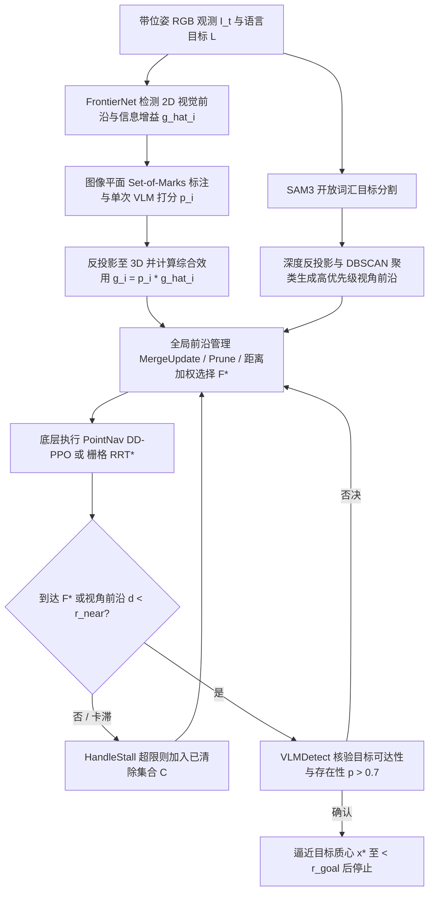
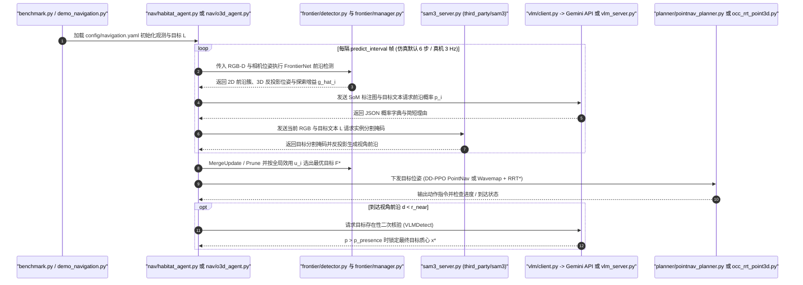

# OpenFrontier: General Navigation with Visual-Language Grounded Frontiers

## 一句话定义

OpenFrontier 是一个零样本语言条件导航框架：直接在 2D RGB 图像上检测视觉导航前沿并用 Set-of-Marks 提示 VLM 打分，将语义先验与探索信息增益融合并投影到 3D 稀疏管理，无需稠密 3D 语义建图或导航任务微调。

## 英文缩写速查

| 缩写 | 英文全称 | 简要说明 |
|---|---|---|
| VLM | Vision-Language Model | 视觉语言模型，用于前沿语义相关性打分与目标存在性核验 |
| SoM | Set-of-Marks | 在图像中对候选区域叠加编号标记以引导 VLM 局部注意力的提示策略 |
| ObjectNav | Object-Goal Navigation | 物体目标导航，要求智能体在未知环境中寻找并到达指定类别或描述的目标 |
| SR | Success Rate | 导航任务成功率（%） |
| SPL | Success weighted by Path Length | 路径长度加权成功率（%），衡量到达目标的效率 |
| DD-PPO | Decentralized Distributed PPO | 分布式近端策略优化，本文仿真阶段用作底层 PointGoal 导航策略 |

## 为什么重要

1. **避免重型建图与任务微调：** 传统方法依赖稠密 3D 语义体素或场景图构建，在杂乱或长时程场景下维护开销高；而端到端 VLN/VLA 模型通常需要大规模交互采样或特定动作空间微调，且每步高频推理开销大、难以稳健锚定到度量空间。
2. **图像空间共享接口发挥 VLM 优势：** 当前 VLM 在多视角 3D 空间推理上仍偏弱，但在单帧 2D 图像上下文理解上非常强。OpenFrontier 将前沿检测与语义推理都放在同一张 2D RGB 图像中完成，让表示本身承担大部分归纳偏置，使 4B–8B 级开源 VLM 也能稳定工作。
3. **稀疏解耦架构易迁移至真机：** 用「视觉前沿」作为高层语义决策与底层运动规划的桥梁，不绑定底层控制器；同一高层逻辑既可在仿真中接无图 PointNav（DD-PPO），也可在真机中接单目深度 + 占据栅格 + $RRT^\star$ 规划器。

## 核心信息

| 字段 | 内容 |
|---|---|
| 作者 | Esteban Padilla-Cerdio\*、Boyang Sun\*、Marc Pollefeys、Hermann Blum |
| 机构 | ETH Zurich、Microsoft Spatial AI Lab、University of Bonn |
| 发表时间 / 载体 | arXiv:2603.05377v3（2026-06-28；v1 于 2026-03-05 提交；仓库标注 RSS 2026） |
| 论文链接 | [arXiv 摘要](https://arxiv.org/abs/2603.05377) / [arXiv HTML 正文](https://arxiv.org/html/2603.05377) |
| 项目与代码 | [项目主页](https://boysun045.github.io/OpenFrontier-Project/) / [官方 GitHub](https://github.com/cvg/OpenFrontier) |
| 清单分类 | `model.perception`（来源条目 `survey_ax_2603_05377`） |
| 开源状态 | **已开源**（含核心前沿管理、VLM/SAM3 服务、Open3D 演示与 Habitat 评测代码；ROS 机器人端胶水节点未直接包含在公开仓根目录） |

## 核心原理

### 1. 问题形式化与 2D 视觉前沿识别（§III-A）

给定 $t$ 时刻带位姿的 RGB 观测 $\mathbf{I}_t \in \mathbb{R}^{H\times W\times 3}$、相机外参 $\mathbf{T}_t \in SE(3)$、内参 $\mathbf{K} \in \mathbb{R}^{3\times 3}$ 及自然语言目标 $\mathbf{L}$，OpenFrontier 沿用 FrontierNet 在关键帧图像上直接检测并聚类得到 2D 视觉前沿簇 $\mathbf{F}_i$，同时预测其纯探索信息增益 $\hat{g}_i$（对应访问该前沿预期能揭露的未知 3D 空间体积），并将其质心反投影至 3D 世界坐标形成位姿 $\mathbf{X}=\{\mathbf{p},\mathbf{q}\}$。

随后，系统在 $\mathbf{I}_t$ 的每个前沿质心位置叠加视觉编号标记（Set-of-Marks），连同目标文本 $\mathbf{L}$ 一起在**单次前向推理**中送入 VLM，输出各前沿通向目标的相关性概率：

$$p_i = \text{VLM}(\mathbf{I}_t, \mathbf{F}_i, \mathbf{L}) \in [0, 1]$$

再将探索先验 $\hat{g}_i$ 与任务语义先验 $p_i$ 相乘，得到每个前沿的综合效用：

$$g_i = p_i \cdot \hat{g}_i$$

- 这种设计让 VLM 直接在 2D 局部视觉上下文中做多候选对比（例如分辨门廊通向浴室还是客厅），而不需要 VLM 估计未探索几何体积。
- 若启用可选的历史增强变体（§V-A / Appendix S1-C3），只需在 VLM 提示中追加少量近期访问过的关键帧图像即可抑制对已排查区域的重复打分，其余模块无需修改。

### 2. 稀疏 3D 全局前沿管理与视角核验（§III-B，Algorithm 1–4）

为支撑长时程探索，系统在世界坐标系下维护活跃前沿集合 $\mathcal{F}$ 与已清除集合 $\mathcal{C}$，按距离加权计算全局效用：

$$u_i = \frac{g_i}{\|\mathbf{p}_r - \mathbf{p}_i\|}$$

其中 $\mathbf{p}_r$ 为机器人当前位置。全局循环每步执行以下关键操作：

1. **融合与剪枝：** `MergeUpdate` 按距离阈值 $\tau_{\text{merge}}=1.8\text{ m}$ 合并新旧前沿提案；`Prune` 移除与已清除集合 $\mathcal{C}$ 距离过近（$r_{\text{clear}}=0.5$）的前沿。
2. **目标分割与视角前沿插入（`InsertViewpointIfAny`）：** 导航过程中调用开放词汇分割模型 [SAM 3](./paper-sam3.md) 在 RGB 图像中检测目标掩码 $\mathcal{M}$。若命中有效掩码，利用深度图与机器人位姿将其反投影为 3D 点云并通过 DBSCAN 聚类得到候选目标质心 $\mathbf{x}_i$，随后在距离 $\mathbf{x}_i$ 固定偏移 $r_{\text{sep}}$ 处生成一个朝向目标的**视角前沿（viewpoint frontier）**，赋予极高（近似无穷大）效用，驱动机器人前去近距离观察。
3. **卡滞检测与清除（`HandleStall`）：** 若连续 $T_{\text{stall}}=15$ 步向当前目标前沿 $\mathbf{F}^\star$ 的距离进展小于 $\epsilon_{\text{stall}}=0.1\text{ m}$，则放弃并将该前沿加入 $\mathcal{C}$；到达 $d < r_{\text{near}}$（仿真 $0.2\text{ m}$ / 真机 $0.5\text{ m}$）后亦将其标为已清除。
4. **VLM 二次存在性核验（`VerifyAndSetTarget`）：** 机器人抵达视角前沿后，调用 VLM（`VLMDetect`）核验当前观测中目标是否真实位于视野内、5 m 可达范围内且非镜面反射或玻璃后方遮挡（阈值 $p > p_{\text{presence}}=0.7$）。若通过核验，则将对应质心 $\mathbf{x}^*$ 设为最终目标并由底层控制器逼近至 $r_{\text{goal}}=1.0\text{ m}$ 内停止；若否决，则剔除该假设继续探索。
5. **应急旋转机制（Appendix S1-B）：** 当开局面向墙壁或陷入无前沿区域时，在原地向左侧、右侧和反方向插入 3 个 $g=1$ 的人工旋转前沿迫使机器人环视；若仍无新前沿，则将过滤阈值 $g^{\min}$ 减半（最多重试 $n_{\text{emergency}}=3$ 轮）。

### 3. 轻量可选几何滤波与控制器解耦（§III-C）

OpenFrontier 不依赖稠密建图进行语义推理，但在工程实现中允许异步运行轻量体积建图（如基于单目深度先验的占据栅格），仅用于剔除落在障碍物内的不可达前沿以及抑制已被自由空间覆盖的过期前沿。

## 流程总览

## 源码运行时序图

以下时序图基于官方仓库 `cvg/OpenFrontier` 的公开入口（`benchmark.py` / `demo_navigation.py`、`sam3_server.py`、`vlm_server.py`）与核心目录结构（`nav/`、`frontier/`、`planner/`、`vlm/`）整理，对应静态代码与 README 核对结果。

## 实验与评测

### 1. Habitat ObjectNav 基准定量结果（Table I）

评测基于 Habitat 0.2.4（步长 $0.25\text{ m}$、转角 $30^\circ$、$640\times 480$ RGB-D、单回合上限 500 步、单卡 RTX 4090 24 GB），主实验采用 `Gemini-2.5-flash` 作为 VLM、FrontierNet（`rgbd_11cls`）、SAM3 与 VLFM 预训练 DD-PPO PointNav 策略，所有数据集沿用同一套超参数（每 6 步检测与打分一次）：

| 方法 | 零样本 | 空间表示 | HM3D Val SR (%) | HM3D Val SPL (%) | MP3D Val SR (%) | MP3D Val SPL (%) | OVON Val Unseen SR (%) | OVON Val Unseen SPL (%) |
|---|---|---|---|---|---|---|---|---|
| History-Aug. VLM | 是 | 2D 语义与文本历史 | 46.0 | 24.8 | – | – | – | – |
| OpenFMNav | 是 | 稠密 2D 语义图 | 52.5 | 24.1 | 37.2 | 15.7 | – | – |
| InstructNav | 是 | 稠密 2D 价值图 | 58.0 | 20.9 | – | – | – | – |
| BeliefMapNav | 是 | 3D 体素信念图 | 61.4 | 30.6 | 37.3 | 17.6 | – | – |
| VLFM | 是 | 稠密 2D 价值图 | 52.5 | 30.4 | 36.4 | 17.5 | 35.2 | 19.6 |
| DAgRL+OD | 否 | 无 | – | – | – | – | 37.1 | 19.9 |
| UniGoal | 是 | 3D 场景图 | 54.5 | 25.1 | 41.0 | 16.4 | – | – |
| Uni-NaVid | 否 | 无（视频端到端微调） | 73.7 | 37.1 | – | – | 39.5 | 19.8 |
| **OpenFrontier (Ours)** | **是** | **稀疏视觉前沿** | **77.3** | **35.6** | **40.7** | **17.8** | **39.0** | **20.1** |

### 2. VLM 骨干敏感性与同底座横向对比（HM3D Val，Table II）

| 方法 (VLM 底座) | HM3D SR (%) | HM3D SPL (%) | 说明 |
|---|---|---|---|
| UniGoal (LLaVA 1.6) | 54.5 | 25.1 | 原基准对比 |
| History-Aug. VLM (LLaVA 1.6) | 46.0 | 24.8 | 原基准对比 |
| InstructNav (Gemini-2.5-flash) | 52.0 | 22.0 | 作者替换为 Gemini-2.5-flash 复测 |
| OpenFrontier (LLaVA 1.6) | 74.2 | 35.3 | 开源较早期小模型仍保持高 SR |
| OpenFrontier (InternVL3_5-8B) | 74.5 | 34.5 | 8B 本地开源模型 |
| OpenFrontier (Gemma-3-4b-it) | 76.9 | 33.7 | 4B 轻量级模型 |
| OpenFrontier (Gemini-2.5-flash) | 77.3 | 35.6 | 论文主配置 |

- **结论：** 四种不同量级和年代的 VLM 在 OpenFrontier 上的 SR 波动不超过 3 个百分点；而在匹配相同 VLM 底座（LLaVA 1.6 或 Gemini-2.5-flash）时，OpenFrontier 相比基线高出约 20–28 个百分点 SR，说明主要增益来自「2D 视觉前沿锚定」与系统接口设计，而非单纯依赖强闭源模型。

### 3. 真机部署验证（§IV-C & Appendix S1-D）

- **硬件与软件栈：** 部署于带机械臂的 Boston Dynamics Spot 四足机器人；臂端单目 RGB 相机（$640\times 480$，~3 Hz）提供图像，机身 VIO 提供位姿；工作站端 RTX 4090 运行 Metric3Dv2（`metric_depth_vit_large_800k`）估计深度、FrontierNet 与 SAM3，并通过 Wavemap（0.1 m 体素、最大深度 3.5 m）与 OMPL $RRT^\star$（16 Hz 管理/选点，最长规划 1.5 s）配合 Pure-Pursuit 控制器输出速度指令。
- **定量结果：** 在大尺度室内未知环境中覆盖 **5 类目标物体**（含灭火器、微波炉、剪叉升降机、电视等）共 **10 次独立导航试验**，取得 **70% 成功率**。

## 与其他工作对比

- **对比稠密语义建图与价值图方法（VLFM、OpenFMNav、BeliefMapNav、UniGoal）：** 这类方法需要持续在全局 2D 价值图、3D 体素信念图或 3D 场景图中更新语义特征。OpenFrontier 只持久化稀疏 3D 前沿节点与探索信息增益，把语义理解留在 2D 单帧画像素平面，避免了跨视角特征融合失真，在 HM3D 上比稠密前沿地图代表方法 VLFM（52.5% SR）高出 24.8 个百分点。
- **对比微调型 VLN/VLA 导航模型（Uni-NaVid、NaVILA）：** Uni-NaVid 需要在特定导航轨迹与动作空间上微调并高频直接输出动作；OpenFrontier 完全零样本运行，在 HM3D 上 SR 达到 77.3%（高于 Uni-NaVid 的 73.7%），在 OVON Unseen 上达到接近的 39.0% SR 与更高的 20.1% SPL，同时具备更清晰的模块替换能力。
- **与 FrontierNet 的继承与扩展：** FrontierNet 仅做无任务的纯几何信息增益探索；OpenFrontier 保留其 2D 前沿检测与探索先验 $\hat{g}_i$，并叠加 VLM Set-of-Marks 语义概率 $p_i$ 与 SAM3 视角核验闭环，将其转化为语言条件目标导航框架。

## 结论

**一句话总判：OpenFrontier 证明了将 VLM 语义推理锚定在 2D 视觉导航前沿上，可在无需稠密 3D 语义建图与任务微调的前提下，以轻量稀疏架构实现高泛化、跨仿真与真机的零样本目标导航。**

1. **优先让 VLM 在 2D 图像上下文做选择：** 用 Set-of-Marks 将几何候选（前沿质心）直接标在原图上，比让 VLM 凭空做 3D 空间坐标推理更稳定，且对 4B–8B 开源小模型友好。
2. **探索与利用显式解耦相乘：** $g_i = p_i \cdot \hat{g}_i$ 让 FrontierNet 负责估算未知体积，VLM 负责语义相关性，双方各自承担擅长部分，减少单一模块失效带来的探索僵局。
3. **检测与确认分离降误报：** 用 SAM3 持续提出候选物体并插入视角前沿，到达近处再触发 `VLMDetect` 二次确认，是提高长时程闭环精度、避免远距离幻觉误停的关键工程手段。
4. **真机迁移应替换底层执行器而非推翻高层：** 高层前沿管理器不假设地图是否存在，仿真可直接接 DD-PPO PointNav，真机则无缝切换为 Metric3Dv2 + Wavemap + $RRT^\star$。

## 工程实践

1. **多进程服务拆解（依据官方仓 README）：** 实际部署需将 SAM3（`sam3_server.py`，Python 3.12 环境）与主导航/仿真进程（Python 3.11 或 Habitat 3.9 环境）解耦为独立 HTTP 服务；若使用本地 VLM，另启 `vlm_server.py` 监听 `12185` 端口。
2. **真机与仿真的参数差异（Table S1 vs Table S2）：**
   - 仿真预测间隔 `predict_interval=6` 步、$r_{\text{near}}=0.2\text{ m}$、$g^{\min}=0.5$；
   - 真机由于背景杂乱、玻璃反光及高处误前沿干扰，需缩短为每帧预测（~3 Hz）、放大清除阈值 $r_{\text{near}}=0.5\text{ m}$、调整 $g^{\min}=0.01$ 并加强高程与空间滤波（距障碍最小 $0.5\text{ m}$、距自由空间最大 $1.5\text{ m}$）。
3. **复现检查点：** 首次运行前需执行 `scripts/download_weights.sh` 准备 FrontierNet 与 PointNav 权重，并确保 Hugging Face 已获 `facebook/sam3` 权限；小规模冒烟测试可用 `demo_navigation.py` 搭配样例场景 `examples/mv2HUxq3B53.glb` 验证。

## 局限与风险

1. **底层控制器卡死与缺乏快速语义重规划：** 论文 §V-B 与 Appendix S2-D 指出，当目标已检出并切入底层 PointNav（DD-PPO）逼近阶段后，若遇到窄道或局部极小值卡死，系统缺少快速识别失败并触发语义级重规划的恢复机制，往往直到消耗完 500 步预算才终止。
2. **目标误检与终止判据脆弱：** 全库失败案例中占比最高的两类是「步数耗尽」与「假阳性误检」（包括前景遮挡/相似物体误判，以及 Habitat 标注未覆盖导致的评测判定分歧）。
3. **多模块级联与未知环境限制：** 系统依赖 FrontierNet 能否稳定检出有效前沿（如经过目标附近但未生成引导前沿时会错过目标）；对玻璃墙、镜面或动态变化剧烈的开放场景仍需额外过滤与重定位支撑。

## 关联页面

- [Agentic Robots 综述](paper-towards-agentic-robots-survey.md)
- [全量项目节点清单](../overview/awesome-agentic-robots-node-index.md)
- [VLA 方法背景](../methods/vla.md)
- [机器人导航与路径执行](../methods/robot-navigation-workflow.md)：对照导航目标、规划与执行。
- [零样本目标导航（Zero-Shot Object Navigation）](../tasks/zero-shot-object-navigation.md)：HM3D / MP3D / OVON 基准与零样本设计范式。
- [视觉–语言导航（VLN）](../tasks/vision-language-navigation.md)：对照端到端 VLN 与稀疏前沿规划差异。
- [自主探索（Autonomous Exploration）](../tasks/autonomous-exploration.md)：信息增益驱动的传统前沿探索基础。
- [机器人视觉感知流程](../methods/robot-visual-perception.md)：RGB-D 与单目深度向 3D 坐标系反投影。
- [RRT* 路径规划](../methods/rrt-star.md)：真机部署中结合 Wavemap 使用的局部路径规划算法。
- [PPO 强化学习](../methods/ppo.md)：仿真底层 DD-PPO PointNav 策略背景。
- [SAM 3：Segment Anything with Concepts](./paper-sam3.md)：OpenFrontier 用于开放词汇目标分割的核心基础模型。
- [Habitat-Sim 仿真平台](./habitat-sim.md)：论文定量评测所用的 Embodied AI 仿真环境。

## 推荐继续阅读

- [OpenFrontier 项目主页](https://boysun045.github.io/OpenFrontier-Project/)（含真机部署视频与多场景轨迹可视化）
- [OpenFrontier 官方 GitHub 仓库](https://github.com/cvg/OpenFrontier)
- [arXiv:2603.05377v3 原文（HTML）](https://arxiv.org/html/2603.05377)

## 参考来源

- [OpenFrontier arXiv 原文核对记录](../../sources/papers/paper-agentic-2603-05377.md)
- [官方 Awesome 快照归档](../../sources/repos/awesome-agentic-robots-survey-index.md)
- [OpenFrontier 官方代码仓库归档](../../sources/repos/paper-agentic-2603-05377.md)
- [论文原始入口（arXiv:2603.05377）](https://arxiv.org/abs/2603.05377)
- [官方项目主页](https://boysun045.github.io/OpenFrontier-Project/)
