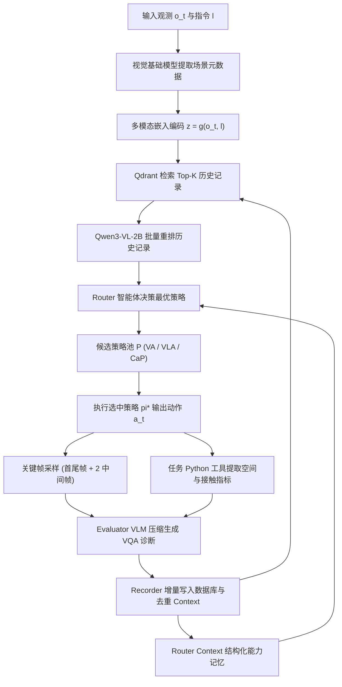

# RoboRouter: Training-Free Policy Routing for Robotic Manipulation

## 一句话定义

RoboRouter 是一个面向机器人操作的免训练（training-free）多智能体策略路由框架，通过多模态任务表征检索相似历史执行经验并结合闭环评估反馈，在异构现成策略池中直接为当前回合选出成功概率最高的控制策略。

## 英文缩写速查

| 缩写 | 英文全称 | 简要说明 |
|---|---|---|
| VLA | Vision-Language-Action | 视觉-语言-动作大模型范式，依赖大规模多模态预训练与微调 |
| VA | Vision-Action | 直接从视觉观测映射到动作的单任务/特定域策略（如 ACT、DP、DP3） |
| VLM | Vision-Language Model | 视觉-语言大模型，在 RoboRouter 中担任路由决策与视频评估骨干 |
| VQA | Visual Question Answering | 视觉问答模块，Evaluator 用其将轨迹关键帧与工具指标压缩为自然语言诊断 |
| OOD | Out-of-Distribution | 分布外场景（如物体位姿、背景、相机视角变化），单体策略常在此退化 |
| RTDE | Real-Time Data Exchange | UR 机械臂实时数据交换 Python 接口，用于论文真机平台控制通信 |

## 为什么重要

现有机器人操作研究形成了视觉-动作策略（VA，如 ACT、DP、DP3）、视觉-语言-动作大模型（VLA，如 RDT、$\pi_0$）与代码组合策略（如 Code as Policies）并存的局面，但没有任何一种单体策略能在所有任务与物理配置上持续占优。与其继续堆叠训练成本呈非线性增长的单体通才模型，RoboRouter 提供了一条系统级编排路径：

1. **免训练整合异构策略：** 将不同架构、不同训练范式的现成检查点统一纳入策略池，不修改内部权重即可互补长短。
2. **实例级（而非仅任务类别级）路由：** 同一任务下的物体摆放、相机视角与实例外观差异会显著改变各策略表现，多模态任务表征使路由器能区分这些细粒度物理条件。
3. **小样本接入与持续闭环演化：** 借助带规则工具的 VLM 评估器与增量上下文记忆，新策略仅需少量聚类代表任务试跑即可接入，并在在线执行中持续校准。

## 核心信息

| 字段 | 内容 |
|---|---|
| 作者 | Yiteng Chen, Zhe Cao, Hongjia Ren, Chenjie Yang, Wenbo Li, Shiyi Wang, Yemin Wang, Li Zhang, Yanming Shao, Zhenjun Zhao, Huiping Zhuang, Qingyao Wu |
| 机构 | 华南理工大学（SCUT）、南京大学（NJU）、新南威尔士大学（UNSW）、西南交通大学（SWJTU）、厦门大学（XMU）、香港理工大学（PolyU）、上海科技大学（ShanghaiTech）、萨拉戈萨大学（Unizar） |
| 发表时间 | 2026-03-09（v1 提交）/ 2026-06-24（arXiv:2603.07892v4 `[cs.RO]`） |
| 论文链接 | [arXiv:2603.07892](https://arxiv.org/abs/2603.07892) / [arXiv HTML](https://arxiv.org/html/2603.07892) |
| 项目与代码 | 未列独立项目页或 GitHub 仓库链接 |
| 清单分类 | `harness.orchestration`（来源条目：`survey_ax_2603_07892`） |
| 开源状态 | 宣称将开源但未列链接（第 1 节声明未来发布框架，截至 2026-11-27 核查 arXiv v4 原文与检索缓存未公开仓库 URL） |

## 核心原理

### 1. 问题形式化

在离散时刻 $t = 0, 1, \dots$，系统接收视觉观测 $o_t$ 与自然语言指令 $l$，并维护一个包含 $M$ 个候选策略的策略池 $\mathcal{P} = \{\pi^{(m)}\}_{m=1}^{M}$，其中每个策略映射 $(o_t, l) \to a_t$。RoboRouter 通过编码函数构建多模态任务表征 $z = g(o_t, l)$，依据历史经验估计各策略在该任务表征下的预期表现分数 $S_\pi(z)$，直接路由至最优策略执行动作，无需逐一试错：

$$\pi^\star(o_t, l) = \arg\max_{\pi \in \mathcal{P}} S_\pi\big(g(o_t, l)\big), \qquad a_t \mid o_t, l \sim \pi^\star$$

### 2. 四智能体协同架构

RoboRouter 在实验主配置中采用 GPT-4o 作为多智能体核心 VLM/LLM 骨干，由四个模块协作完成推理与闭环记忆更新：

- **Retriever（检索与重排器）：** 首先调用视觉基础模型（如 SAM 2）从当前任务图像提取目标物体与场景元数据；随后使用多模态嵌入模型 `Ops-MM-embedding-v1-2B` 将文本指令、图像及元数据共同编码为表征向量 $z$，在 `Qdrant` 向量库中按余弦相似度检索 top-$k$ 相似任务历史执行记录。为缓解长上下文 LLM 的“lost in the middle”位置偏置，系统使用 `Qwen3-VL-2B-Instruct` 对候选记录执行基于 yes/no token 概率的单次前向批量重排（logit-based batch reranking），将物理配置最匹配的记录置于输入前端。
- **Router（策略路由器）：** LLM 智能体接收重排后的相似历史记录与全局 **Router Context**（以条目化要点形式总结各策略在不同任务簇上的能力画像），推理并输出当前回合预期成功率最高的策略 $\pi^\star$，随后仅调用该策略完成推理与机械臂控制。
- **Evaluator（结构化视频评估器）：** 为避免朴素二元成功率统计需要大量重复试跑的问题，Evaluator 在单次回合结束后将轨迹视频抽样为关键帧（默认保留首帧、尾帧及 2 个均匀采样中间帧），同时运行任务定义阶段编写的 Python 规则工具——在仿真中直接读取物体位姿等状态，在真机中通过 `DINOv2 + SAM + k-means` 提取 3D 语义关键点计算工具-物体距离与接触状态。随后 VLM 结合帧图像与工具元数据执行 VQA，输出压缩的自然语言执行摘要（成功概括或具体失败阶段与原因）。
- **Recorder（双层增量记忆记录器）：** 将 Evaluator 输出写入两层记忆：(1) **历史数据库（Database）**，以多模态嵌入 $z$ 为索引追加新记录；(2) **Router Context**，采用增量条目化更新机制（为每条经验分配唯一 ID、原位更新既有条目，并基于语义嵌入相似度合并重复项），避免全量重写带来的算力浪费与细节退化。

### 3. 三条工作管线

- **在线推理管线：** 构建 $z$ → `Qdrant` 检索与 `Qwen3-VL-2B` 重排 → Router 结合 Context 选出 $\pi^\star$ → 策略直接执行。
- **新策略接入管线（Onboarding）：** 单任务策略仅在其训练对应任务评估；多任务策略（如 VLA 或 Code as Policies）则对系统已有任务按 $z$ 聚类，仅在每个簇的代表任务上试跑。论文经验表明每任务约 **10 次试跑**配合 Evaluator 即可有效刻画策略能力边界，显著低于常规仿真评测常用的 100 回合成本。
- **并行在线反馈管线（Online Feedback）：** 与主推理流程在并行线程异步执行，不引入额外的在线路由时延；还支持两种可选人类专家介入（Human-in-the-loop）：研究者可直接修正 Evaluator 生成的视频摘要，或指定次优策略在同一任务重跑以产生对比诊断信号。

## 流程总览

## 源码运行时序图

**不适用**（截至 2026-11-27 核查 `arXiv:2603.07892v4` 原文与检索缓存，作者虽在引言声明将发布框架，但未公布官方 GitHub 仓库、项目主页或可运行代码入口，无法核实源码级模块调用时序）。

## 实验与评测

论文在 **RoboTwin 2.0** 仿真基准（20 个代表性双臂任务，简单模式、每任务 100 次试跑）和自建 **UR5e 真机平台**（UR5e 6-DoF 机械臂 + 步进电机 1-DoF 平行夹爪 + Intel RealSense D435i RGB-D 相机 + i7-14700KF CPU + 双 RTX A6000 GPU，5 个任务各 20 次试跑）上进行了评估。

### 1. 主实验结果（成功率与耗时）

| 评估环境 | 指标 | ACT | DP | DP3 | RDT | $\pi_0$ | Code as Policies | RoboRouter (Ours) |
|---|---|---|---|---|---|---|---|---|
| RoboTwin 2.0（20 任务均值，Tab. 1） | 成功率 | 55.90% | 51.05% | 76.45% | 60.35% | 69.90% | 54.45% | **79.85%** |
| RoboTwin 2.0（Tab. 3） | 平均每回合耗时 | 34 s | 39 s | 27 s | 33 s | 31 s | 37 s | 38 s |
| 真机平台（5 任务均值，Tab. 2） | 成功率 | 26% | 18% | - | 33% | 34% | - | **47%** |
| 真机平台（Tab. 3） | 平均每回合耗时 | 19 s | 24 s | - | 20 s | 21 s | - | 26 s |

> 注：Table 1 逐任务求得 RoboRouter 平均成功率为 `79.85%`（正文与 Table 5 消融对照行报告为 `79.9%` / `79.90%`）；部分单任务（如 `Beat Block Hammer` 81%、`Move Can Pot` 71%、`Place Empty Cup` 67%）上 RoboRouter 甚至略高于池中任何单一基线在该任务上的均值，论文归因于实例级多模态表征按物体位姿与域随机化配置实现了细粒度路由。

真机逐任务成功次数（Tab. 2，20 回合制）：
- `Adjust Bottle`：ACT 8/20、DP 5/20、RDT 2/20、$\pi_0$ 4/20、RoboRouter 7/20
- `Beat Block Hammer`：ACT 4/20、DP 2/20、RDT 9/20、$\pi_0$ 2/20、RoboRouter 9/20
- `Click Alarmclock`：ACT 2/20、DP 7/20、RDT 8/20、$\pi_0$ 8/20、RoboRouter 10/20
- `Open Laptop`：ACT 4/20、DP 2/20、RDT 4/20、$\pi_0$ 8/20、RoboRouter 9/20
- `Place Container Plate`：ACT 8/20、DP 2/20、RDT 10/20、$\pi_0$ 12/20、RoboRouter 12/20

### 2. 路由质量与时延（Tab. 4）

| 环境 | 路由准确率（与固定配置下真实最优策略一致率） | 路由额外时延 |
|---|---|---|
| RoboTwin 2.0 | 96.32% | 4.79 s |
| 真机平台 | 98.63% | 4.54 s |

### 3. 消融实验（Tab. 5 与 Tab. 6）

| 消融配置 | RoboTwin 2.0 成功率 | 真机成功率 | 关键结论 |
|---|---|---|---|
| 完整 RoboRouter（GPT-4o + 2 中间帧 + Python 工具 + VQA） | **79.90%** | **47%** | 完整闭环表现最优 |
| w/o MM Retriever（改用 LightRAG 纯文本检索） | 78.40% | 43% | 纯文本忽略物体位姿与视角等物理差异 |
| w/o Recorder（仅简单追加库，不增量刷新 Context） | 78.75% | 46% | Router Context 可抑制偶发波动噪声 |
| w/o Evaluator（仅统计簇级二元成功率） | 69.80% | 37% | 降幅最大，证明失败归因远胜纯计数 |
| w/o Online Feedback | 78.15% | 44% | 在线持续校准对真机分布漂移尤具价值 |
| 替换 VLM 为 Gemini-1.5-Pro / GPT-4o-mini | 76.55% / 76.60% | 45% / 44% | 路由与评估对骨干 VLM 推理能力存在一定依赖 |
| Evaluator 变体：w/o Python tools / w/o VQA | 77.70% / 76.35% | 41% / 42% | 规则空间度量与语义视觉摘要互补 |
| Evaluator 帧数：0 / 2 / 4 / 6 个中间帧 | 79.25% / 79.90% / 79.80% / 79.95% | 48% / 47% / 46% / 46% | 极稀疏关键帧即可支撑有效失败模式识别 |

## 与其他工作对比

| 对比维度 | 单任务 VA（ACT / DP / DP3） | 通用 VLA（RDT / $\pi_0$） | LLM 代码组合（Code as Policies） | RoboRouter |
|---|---|---|---|---|
| 优势区间 | 目标域内精细控制稳定（如 DP3 在仿真均值 76.45%） | 多任务语言泛化与语义跟随（如 $\pi_0$ 真机均值 34%） | 高层任务分解灵活，无需端到端动作训练 | 聚合策略池优势，仿真 79.85%、真机 47% |
| 主要短板 | 需为每个任务训练独立检查点，跨视角/新物体泛化弱 | 大规模数据与训练成本高，OOD 场景仍明显退化 | 难以习得精细接触与灵巧 affordance | 依赖候选池上限，引入约 4.5–4.8 s 回合前路由开销 |
| 扩展新能力方式 | 重新采集并训练新模型 | 全量或大参数微调，易面临持续学习遗忘 | 手工或代理扩展 API 接口 | 免训练接入，约 10 次/任务试跑即可登记 |

与文本域免训练模型路由（如 Eagle、ICL-router 等 LLM Router）相比，RoboRouter 针对机器人操作的痛点引入了两项专门设计：一是以视觉基础模型元数据+多模态嵌入编码相机视角与物体空间配置，二是利用“关键帧 VQA + 物理关键点 Python 工具”从极少试跑视频中提炼失败阶段诊断。

## 结论

**一句话总判：RoboRouter 验证了“免训练多智能体策略路由”是比单边扩大单体通才模型更轻量且实用的操作性能提升路径，但其增益上限仍取决于候选策略池能力与任务级评估工具的完备性。**

1. **优先保留并组合异构强基线：** 当环境中已有表现各异的 VA（如 DP3）与 VLA（如 $\pi_0$、RDT）检查点时，直接构建实例级多模态路由即可在仿真与真机分别获得 3.4 个百分点（相对 DP3）和 13 个百分点（相对 $\pi_0$）的净提升。
2. **评估器的信息密度比单纯扩充试跑次数更关键：** 从 `w/o Evaluator` 暴跌约 10 个百分点可见，用“稀疏关键帧 VQA + 规则关键点脚本”压缩单次执行过程，是在有限预算下刻画策略边界的核心机制。
3. **跨视角与位姿差异必须进入检索表征：** 纯文本检索无法区分同一指令下的场景几何变化，工程部署时应将首帧图像嵌入与场景物体元数据共同作为向量索引键。
4. **控制在线与离线边界：** 将路由决策保持在单次前向重排与轻量化上下文推理（约 4.5–4.8 s），把耗时的视频解析与记忆去重放入并行异步线程，是保证真机可用性的关键工程折中。

## 工程实践

- **组件选型落地：** 论文给出的参考技术栈为 `Ops-MM-embedding-v1-2B`（本地多模态嵌入，避免远程 API 延迟）+ `Qdrant`（向量存储）+ `Qwen3-VL-2B-Instruct`（单次前向 logit 批量重排）+ `GPT-4o`（Router/Evaluator 推理骨干）。
- **任务 Python 工具构建：** 仿真场景可直接绑定物理引擎物体位姿；真机部署需借助 `DINOv2 + SAM + k-means` 提取任务关键物体的 3D 语义关键点以检测接触和空间距离，作者在 Appendix B.1 中指出这类工具脚本可借鉴 ReKep 思路借助编程智能体自动生成。
- **新策略冷启动预算：** 对于多任务策略，无需在全量任务集重测，按多模态嵌入聚类后对每簇代表任务运行约 10 个回合即可完成能力画像登记。

## 局限与风险

1. **性能受限于策略池天花板与路由时延：** RoboRouter 无法合成策略池中完全不存在的操作技能；同时每次推理前约 4.5–4.8 s 的路由延迟意味着它适合回合级（per-episode）调度，尚不适用于高频反应式子步切换。
2. **对任务定制 Python 工具的先验依赖：** 去掉 Python 工具后真机成功率从 47% 降至 41%（Tab. 6），表明新任务接入时仍需人工或代码智能体预先定义有效的空间/接触检测函数。
3. **骨干大模型推理成本与开源可复现性风险：** 主系统依赖 GPT-4o（更换为 Gemini-1.5-Pro 或 GPT-4o-mini 均出现 2–3.4 个百分点下降）；此外截至 2026-11-27 论文虽声明将开源但尚未发布代码仓库，真机与 RoboTwin 2.0 路由管线细节暂无法通过源码直接复现核验。

## 关联页面

- [Agentic Robots 综述](paper-towards-agentic-robots-survey.md)
- [全量项目节点清单](../overview/awesome-agentic-robots-node-index.md)
- [VLA 方法背景](../methods/vla.md)
- [机器人智能体系统工程（Agent Harness）](../methods/robot-agent-harness.md)
- [智能体规划与执行反馈](../methods/agent-planning-feedback.md)
- [智能体化操作策略](../methods/agentic-manipulation-policies.md)
- [扩散策略（Diffusion Policy）](../methods/diffusion-policy.md)
- [机器人操作](../tasks/manipulation.md)：了解物体操作和抓取任务。
- [双臂操作（Bimanual Manipulation）](../tasks/bimanual-manipulation.md)

## 推荐继续阅读

- [RoboRouter 原文 HTML（arXiv:2603.07892v4）](https://arxiv.org/html/2603.07892)
- [RoboTwin 2.0 双臂操作基准（arXiv:2506.18088）](https://arxiv.org/abs/2506.18088)
- [Agentic Context Engineering（arXiv:2510.04618）](https://arxiv.org/abs/2510.04618)

## 参考来源

- [RoboRouter 原文核对归档](../../sources/papers/paper-agentic-2603-07892.md)
- [官方 Awesome 快照归档](../../sources/repos/awesome-agentic-robots-survey-index.md)
- [arXiv 论文主页（2603.07892）](https://arxiv.org/abs/2603.07892)
- [arXiv HTML 全文（2603.07892v4）](https://arxiv.org/html/2603.07892)
