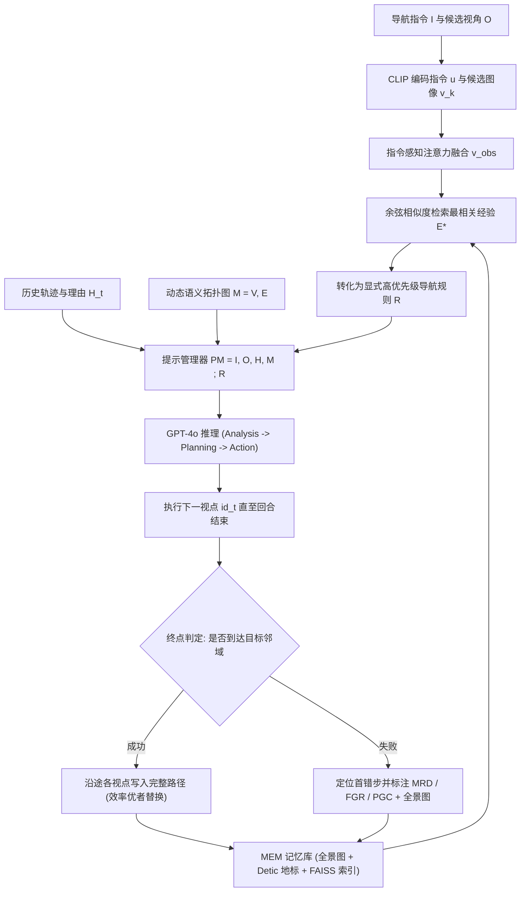

# CMMR-VLN: Vision-and-Language Navigation via Continual Multimodal Memory Retrieval

## 一句话定义

CMMR-VLN 是一种面向零样本视觉语言导航（VLN）的持续多模态记忆检索框架，通过构建视点级全景图像-地标混合记忆库、以指令感知注意力检索经验并转化为显式高优先级导航规则，并在回合结束后基于成功复用与首错归因反思持续更新记忆。

## 英文缩写速查

| 缩写 | 英文全称 | 简要说明 |
|---|---|---|
| CMMR-VLN | Continual Multimodal Memory Retrieval based VLN | 本文框架：基于持续多模态记忆检索的零样本 VLN 代理 |
| VLN | Vision-and-Language Navigation | 视觉语言导航：根据自然语言指令与视觉观测自主导航 |
| MEM | Multimodal Experience Memory | 多模态经验记忆模块：存储视点全景图、地标文本与历史轨迹经验 |
| RAGP | Retrieval-Augmented Generation Pipeline | 检索增强生成流水线：每步按指令相关性检索经验并注入导航规则 |
| MRD / FGR / PGC | Mid-route Deviation / False Goal Recognition / Post-goal Continuation | 反思模块定义的三类导航首错类型：中途偏离、误判到达与越过终点 |
| SPL | Success weighted by Path Length | 路径长度加权成功率：综合衡量导航成功与路径效率的核心指标 |

## 为什么重要

现有基于大语言模型（LLM）的训练自由 VLN 方法（如 NavGPT、MapGPT、DiscussNav）虽然具备指令理解和零样本泛化能力，但每次任务彼此孤立，无法选择性地回忆并复用过往相似场景的成败经验。面对视觉高度相似的岔路口（例如多个区域均出现指令提及的沙发或门厅）或长程路线时，单靠通用语义与局部几何推理容易产生随机误选并导致全局偏航。CMMR-VLN 将“人类导航员依赖显著地标回忆旧路、牢记初次拐错点”的认知机制形式化为可检索、可筛选、可持续更新的外部记忆闭环，在保持单模型推理开销的同时显著提升了导航成功率与路径效率。

## 核心信息

| 字段 | 内容 |
|---|---|
| 作者 | Haozhou Li*、Xiangyu Dong*、Huiyan Jiang、Yaoming Zhou、Xiaoguang Ma† |
| 机构 | 东北大学（佛山研究生创新学院、软件学院、机器人科学与工程学院）、北京航空航天大学（航空科学与工程学院） |
| 发表时间 | 2026-03-09（arXiv:2603.07997v1） |
| 论文链接 | [arXiv:2603.07997](https://arxiv.org/abs/2603.07997) / [HTML 全文](https://arxiv.org/html/2603.07997) |
| 项目与代码 | 暂未公开（论文及公开索引未提供项目主页或官方仓库地址） |
| 清单分类 | `model.adaptation`, `harness.memory`（`survey_ax_2603_07997`） |
| 开源状态 | 未确认开源代码（截至 2026-11-27） |

## 核心原理

CMMR-VLN 围绕 **MEM（记忆构建）— RAGP（在线检索与推理）— Reflection（回合后反思更新）** 三个阶段协同运行，骨干推理模型采用 GPT-4o：

1. **多模态经验记忆（MEM）：**
   - 离散环境（Matterport3D）按唯一视点组织记忆单元；连续真机环境按显著地标或大型物体将室内划分为若干区域单元。
   - 每个记忆单元保存全景 SkyBox 图像、视点 ID、经微调 Detic 模型提取的显著地标文本以及历史经验内容；使用 CLIP 分别编码图像与地标文本生成混合嵌入 $\{m_j\}$，并写入 FAISS 向量索引，通过唯一索引 ID 实现嵌入空间与记忆单元的双向查找。

2. **检索增强生成流水线（RAGP）：**
   - 每步导航收集高层次指令 $I$、当前 $K$ 个可通行候选视角的 RGB 观测 $O=\{o_1,\dots,o_K\}$、历史轨迹与选择依据 $H_t=\{(\mathrm{id}_1,r_1),\dots,(\mathrm{id}_{t-1},r_{t-1})\}$，以及沿用 MapGPT 方式动态扩展的语义拓扑图 $M=(V,E)$。
   - 为避免无关外围视角在均值池化中稀释检索信号，利用 CLIP 编码指令 $u$ 与候选视角图像 $\{v_k\}_{k=1}^K$，通过指令感知注意力融合为单一观测表征 $v_{\mathrm{obs}}$：
     $$\alpha_k = \operatorname{softmax}(u^\top W v_k), \quad v_{\mathrm{obs}} = \sum_{k=1}^{K} \alpha_k v_k$$
   - 通过余弦相似度 $\operatorname{sim}(v_{\mathrm{obs}}, m_j) = \frac{v_{\mathrm{obs}}\cdot m_j}{\|v_{\mathrm{obs}}\|\|m_j\|}$ 在 FAISS 中检索最相关历史经验 $E^*$，并将其改写为**显式高优先级导航规则 $R$**，构成提示管理器 $\mathcal{PM}=\{I,O,H,M;R\}$。分号表示 $R$ 作为顶层指导原则优先约束后续推演。
   - LLM 依此输出结构化思维链：**Analysis**（结合规则 $R$ 分析现状）→ **Planning**（生成多步子目标规划 $P_t=\{(a_1,g_1),(a_2,g_2),\dots\}$）→ **Action**（选定下一视点 $\mathrm{id}_t$）。

3. **反思与选择性记忆更新（Reflection）：**
   - 回合结束时依据最终位置是否落入目标邻域（R2R 为距终点 $\le 3\text{ m}$）判定成败，并经经验过滤器筛选写入：
   - **成功轨迹：** 将指令与完整路径写入沿途每一个视点的记忆单元；若库中已有相似成功路径，仅当新路径效率更高（更短/更优）时才替换旧记录。
   - **失败轨迹：** 不存储冗长无效绕行，而是追溯历史上下文 $H$ 定位**首个错误决策步**，归类为 **MRD**（中途偏离）、**FGR**（误判已达终点）或 **PGC**（越过实际终点继续前进），并将该决策视点、推理依据、错误标签与对应全景图存入记忆单元；若相同决策点与错误原因已存在则跳过写入。

## 流程总览

## 源码运行时序图

**不适用**（截至 2026-11-27，论文原文、arXiv 页面及公开索引未提供官方源码仓库与可运行代码入口，无法执行静态代码与运行时序核对）。

## 实验与评测

作者在 Matterport3D 仿真环境（Room-to-Room, R2R）以及 TurtleBot 4 Lite 移动机器人平台上进行了评测，骨干模型统一为 GPT-4o，全部对比方法均为训练自由（Training-Free）范式。

### 1. R2R Validation Unseen 主实验（11 个场景、783 条轨迹）

| 方法 | 设置 | NE↓ (m) | OSR↑ (%) | SR↑ (%) | SPL↑ (%) |
|---|---|---|---|---|---|
| NavGPT | Training-Free | 6.46 | 42 | 34 | 29 |
| MapGPT | Training-Free | 5.63 | 57 | 43 | 34 |
| DiscussNav | Training-Free | 5.32 | 61 | 43 | 40 |
| **CMMR-VLN (Ours)** | **Training-Free** | **5.10** | **63** | **52** | **51** |

- 相比 NavGPT，SR 相对提升 52.9%（34 → 52）；相比 MapGPT，SR 相对提升 20.9%，SPL 相对提升 50%（34 → 51）；相比依赖多专家 LLM 协同讨论的 DiscussNav，CMMR-VLN 仅用单个 LLM 即取得 SR +20.9% 与 SPL +27.5% 的优势。

### 2. 消融实验（R2R 抽样子集：72 个环境、216 条轨迹）

| 变体 | NE↓ (m) | OSR↑ (%) | SR↑ (%) | SPL↑ (%) |
|---|---|---|---|---|
| **CMMR-VLN（完整框架）** | **5.08** | **65** | **56** | **50.91** |
| MapGPT（基准参考） | 5.62 | 57.9 | 47.7 | 38.1 |
| CMMR-VLN w/o NR（去掉显式规则，经验仅作普通上下文拼接） | 5.59 | 56.5 | 48.2 | 40 |
| CMMR-VLN w/ SD（去掉反思更新，替换为固定场景文本描述） | 10.20 | 40 | 40 | 37.63 |

- 去掉显式规则提示（`w/o NR`）后 SPL 骤降超过 10 个百分点，整体退化至接近 MapGPT 水平，说明 LLM 容易忽略普通上下文中的检索片段。
- 使用静态场景描述（`w/ SD`）导致性能大幅恶化（NE 升至 10.20），定性分析显示代理会过度纠结于把检索文本与当前视野对齐，从而出现原地绕圈行为。

### 3. 真机实验（TurtleBot 4 Lite，20 条含 REVERIE 风格的自然语言指令）

| 方法 | 设置 | SR↑ (%) |
|---|---|---|
| NavGPT | Training-Free | 10 |
| MapGPT | Training-Free | 20 |
| DiscussNav | Training-Free | 20 |
| **CMMR-VLN (Ours)** | **Training-Free** | **30** |

- 机器人配备距底座 50 cm 的 RGB 相机，动作空间离散化为低层运动原语（如 `"Move forward 50 cm"`、`"Turn left 45°"`），按显著地标将连续空间划分为记忆区域单元。CMMR-VLN 在该真机基准上实现 SR 30%，相对 NavGPT、MapGPT、DiscussNav 分别提升 200%、50% 与 50%。

## 与其他工作对比

| 维度 | NavGPT | MapGPT | DiscussNav | CMMR-VLN |
|---|---|---|---|---|
| 空间记忆表示 | 历史文本上下文 | 在线语义拓扑图 | 多角色专家文本讨论 | 语义拓扑图 + 视点级 CLIP-FAISS 多模态经验库 |
| 历史经验跨任务复用 | 无 | 无 | 无 | 有（成功全路径 + 失败首错归因与全景图） |
| 经验约束方式 | 不适用 | 不适用 | 多轮专家对话 | 指令感知注意力检索 + 高优先级显式规则 $R$ |
| 单步 API 模型开销 | 单 LLM | 单 LLM | 多 LLM 专家多轮交互 | 单 LLM（GPT-4o） |

## 结论

**一句话总判：跨回合记忆不仅要“检索得到”，更要通过显式规则约束与首错级反思筛选，才能真正转化为导航决策增益。**

1. **规则优先级决定检索是否生效** — 将检索经验作为高优先级规则 $R$（而非普通上下文拼接）带来超过 10 个百分点的 SPL 差距（50.91 vs. 40）。
2. **失败经验需要颗粒度压缩** — 仅记录首个错误决策步（MRD / FGR / PGC）及对应全景图和理由，可避免整条失败轨迹引入噪音。
3. **固定场景描述反而不如无检索** — `w/ SD` 的 NE 恶化至 10.20，表明冗余视觉描述会诱发 LLM 过度对齐细节而原地打转。
4. **仿真向真机迁移仍存在显著落差** — R2R 仿真 SR 达 52%，但在真机连续环境简化为区域节点 + 离散运动原语后 SR 仅为 30%，空间划分与底层执行仍是瓶颈。

## 工程实践

- **连续环境适配做法：** 在无预定义拓扑图节点的真实室内场景中，需先依据大型物体或显著地标切分区域作为记忆单元，并将高层决策映射为固定步长的底层运动原语（如前移 50 cm、旋转 45°）。
- **多视角表征融合：** 候选视角较多时不宜直接对图像特征做均值池化，应借助指令文本向量计算注意力权重 $\alpha_k$ 以突出相关方向，提升 FAISS 检出精度。
- **记忆去重与防膨胀：** 成功记忆需按路径效率（长度）做劣汰更新；失败记忆按“决策视点 + 理由”去重，防止重复错误反复塞满检索池。
- **复现边界提示：** 论文未公开投影矩阵 $W$ 的训练数据/权重细节、微调 Detic 模型配置及提示模板完整原文，工程复现需自行补齐投影层与系统提示词工程。

## 局限与风险

- **冷启动与记忆覆盖依赖：** 框架效果高度依赖 MEM 中已有经验的覆盖范围与质量；在全新且未积累过相关经验的建筑布局中，检索增益受限。
- **真机连续导航成功率偏低：** 真机测试 SR 仍为 30%（失败率 70%），仅依赖单目 RGB 视野与离散步长运动原语在复杂连续空间中易受遮挡、里程误差与区域边界模糊影响。
- **闭源推理与检索延迟：** 每步需调用 CLIP、FAISS 与 GPT-4o 多模态推理，在实时移动机器人上存在 API 延迟、调用成本以及检索库随规模增长后的效率隐患（论文亦将提升检索效率列为后续工作）。
- **代码可复现性未知：** 截至 2026-11-27 未确认公开代码与权重，难以直接核验工程细节与真实推理耗时。

## 关联页面

- [Agentic Robots 综述](paper-towards-agentic-robots-survey.md)
- [全量项目节点清单](../overview/awesome-agentic-robots-node-index.md)
- [视觉语言导航](../tasks/vision-language-navigation.md)
- [VLA 方法背景](../methods/vla.md)
- [机器人导航工作流](../methods/robot-navigation-workflow.md)
- [机器人智能体框架（Agent Harness）](../methods/robot-agent-harness.md)
- [智能体规划与反馈](../methods/agent-planning-feedback.md)

## 推荐继续阅读

- [CMMR-VLN 论文原文（arXiv:2603.07997）](https://arxiv.org/abs/2603.07997)
- [MapGPT: Map-Guided Prompting with Adaptive Path Planning for VLN (arXiv:2401.07314)](https://arxiv.org/abs/2401.07314)
- [Matterport3D: Learning from RGB-D Data in Indoor Environments (arXiv:1709.06158)](https://arxiv.org/abs/1709.06158)

## 参考来源

- [CMMR-VLN 论文原文核对归档](../../sources/papers/paper-agentic-2603-07997.md)
- [官方 Awesome 快照归档](../../sources/repos/awesome-agentic-robots-survey-index.md)
- [arXiv:2603.07997 摘要页](https://arxiv.org/abs/2603.07997)
- [arXiv:2603.07997 HTML 全文](https://arxiv.org/html/2603.07997)
