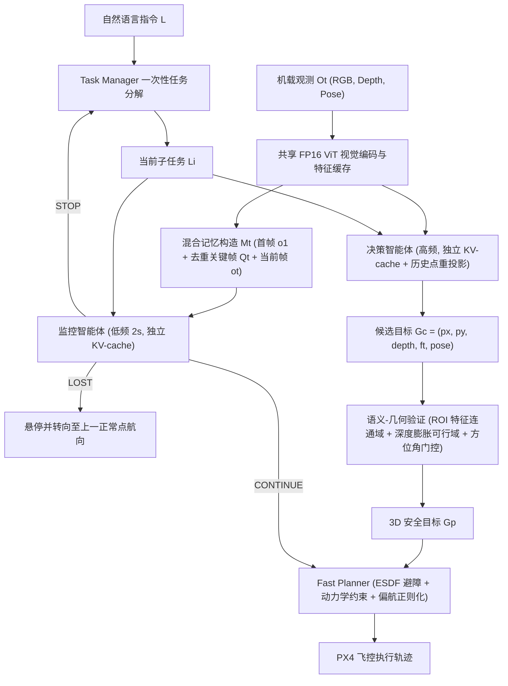

# OnFly: Onboard Zero-Shot Aerial Vision-Language Navigation toward Safety and Efficiency

## 一句话定义

**OnFly** 是一套完全运行在无人机机载算力上的实时零样本空中视觉语言导航（AVLN）系统，通过共享 ViT 感知的双智能体架构将高频目标点生成与低频进度监控解耦，并结合前缀稳定混合记忆（Hybrid Memory）、语义-几何目标验证与 ESDF 局部轨迹规划同时提升任务成功率、安全性与飞行效率。

## 英文缩写速查

| 缩写 | 英文全称 | 简要说明 |
|---|---|---|
| AVLN | Aerial Vision-Language Navigation | 空中视觉语言导航，依据自然语言指令引导无人机在三维环境中飞达目标并自主停止 |
| VLM | Vision-Language Model | 视觉语言模型，本文作为零样本目标点预测、任务分解与状态监控的核心推理底座 |
| ViT | Vision Transformer | 视觉编码器主干网络，本文由决策与监控双智能体共享并缓存特征用于语义验证与去重 |
| ESDF | Euclidean Signed Distance Field | 欧氏符号距离场，局部规划器（Fast Planner）用于三维障碍物避障的地图表示 |
| AWQ | Activation-aware Weight Quantization | 激活感知权重量化，本文将机载 LLM 量化为 `Qwen3-VL-4B-AWQ` 以加速推理 |
| KV-Cache | Key-Value Cache | 注意力键值缓存，本文通过双智能体独立缓存与混合记忆前缀序列化提高复用率 |

## 为什么重要

现有零样本空中视觉语言导航系统在实际无人机机载部署中长期面临三重相互耦合的瓶颈，制约了长程复杂场景下的可靠飞行：

1. **单流 VLM 推理频率失配与目标冲突：** 此前方法通常把高频实时航点决策与低频任务进度判断塞入同一个推理上下文，低频长上下文分析会阻塞高频控制目标输出，引发决策振荡。
2. **滑窗记忆破坏长程上下文与缓存效率：** 传统固定长度滑动窗口会不断覆写早期观测，导致长程任务丢失起点与关键地标参照，同时不断改写输入前缀使解码器 KV-cache 命中率骤降、机载推理延迟升高。
3. **安全与效率的长期权衡困境：** 保守短步长迭代决策（如 PIVOT、TypeFly）因等待 VLM 推理产生严重的停顿-前进（stop-and-go）现象；激进预测长距离目标（如 SPF）虽提升单步跨度，但缺乏几何可行性校验与系统避障约束，极易撞障或错过停止时机。

OnFly 在不依赖任务微调数据和云端通信的前提下，为上述工程瓶颈提供了一套端到端机载解耦方案。

## 核心信息

| 项目 | 详情 |
|---|---|
| 作者 | Guiyong Zheng, Yueting Ban, Mingjie Zhang, Juepeng Zheng, Boyu Zhou（通讯作者） |
| 机构 | 中山大学人工智能学院（SYSU）、南方科技大学（SUSTech）、香港科技大学（广州）（HKUST-GZ） |
| 发表时间 | 2026-03-11（arXiv:2603.10682v1；官方仓库简介标注 `[IROS'26]`） |
| 论文链接 | [arXiv:2603.10682](https://arxiv.org/abs/2603.10682) / [HTML 全文](https://arxiv.org/html/2603.10682) |
| 项目与代码 | [GitHub 仓库（Robotics-STAR-Lab/OnFly）](https://github.com/Robotics-STAR-Lab/OnFly) / [项目页](https://robotics-star.com/OnFly/) |
| 清单分类 | `harness.monitoring_and_recovery`（来源条目：`survey_ax_2603_10682`） |
| 开源状态 | 宣称将开源（截至 2026-11-27 仓库仅含 `README.md` 与 `assets/bg.mp4`，标注 `Code coming soon.`，尚未释放可运行源码） |

## 核心原理

系统接收自然语言指令 $\mathcal{L}$ 与第一视角机载多模态观测 $O_t = \{\mathrm{rgb}_t, \mathrm{depth}_t, \mathrm{pose}_t\}$，由四大核心模块协同完成闭环导航。

### 1. 任务管理（Task Management）

收到长程自然语言指令 $\mathcal{L}$ 后，任务管理器（Task Manager）在任务开始时调用一次机载 VLM 将其分解为有序子任务队列 $\{\mathcal{L}_0, \mathcal{L}_1, \dots, \mathcal{L}_n\}$。执行过程中持续输出当前子任务 $\mathcal{L}_i$，仅当收到监控智能体返回的稳定 `STOP` 信号后才推进至 $\mathcal{L}_{i+1}$，直至队列全部完成。

### 2. 共享感知双智能体（Shared-Perception Dual-Agent System）

为避免视觉编码冗余并彻底解耦不同更新频率的推理需求，**决策智能体（Decision Agent）** 与 **监控智能体（Monitoring Agent）** 共享同一个 FP16 ViT 视觉编码器及缓存特征 $\mathbf{f}_t$，但在 LLM 解码侧维持各自独立的提示词、记忆上下文与 KV-cache：

- **高频决策智能体：** 将动作决策建模为图像平面二维目标点预测 $(p_x, p_y) = \mathrm{VLM}(\mathcal{P}_{\text{dec}}, \mathcal{L}_i, O_t)$。提示词 $\mathcal{P}_{\text{dec}}$ 通过将上一帧预测的 3D 目标重投影至当前图像平面，以 2D 历史点（history point）坐标形式补充轻量级时序线索，缓解单帧遗忘且几乎不增推理开销。随后打包候选目标：
  $$G_c = [p_x, p_y, \mathrm{depth}_t, \mathbf{f}_t, \mathrm{pose}_t]$$
- **低频监控智能体：** 以固定低频（实验设为每 $2\,\mathrm{s}$ 一次）运行，根据监控提示词 $\mathcal{P}_{\text{mon}}$、当前子任务 $\mathcal{L}_i$ 与混合记忆 $\mathcal{M}_t$ 做强约束三分类：
  $$s_t = \mathrm{VLM}(\mathcal{P}_{\text{mon}}, \mathcal{L}_i, \mathcal{M}_t) \in \{\texttt{CONTINUE}, \texttt{STOP}, \texttt{LOST}\}$$
  其中 `CONTINUE` 维持当前子任务执行，`STOP` 触发子任务切换或整轮任务终止，`LOST` 表示偏离航线或丢失目标，系统立即悬停并转向至上一正常点的航向执行恢复。

### 3. 前缀稳定的混合记忆（Hybrid Memory）

为同时保留全局轨迹起点/沿途地标覆盖并最大化解码器 KV-cache 前缀复用，监控记忆被组织为三段式结构 $\mathcal{M}_t = [o_1, \mathcal{Q}_t, o_t]$，其中 $o_t \triangleq (\mathrm{rgb}_t, \mathrm{depth}_t)$，$o_1$ 为初始首帧，$o_t$ 为当前帧，$\mathcal{Q}_t$ 为固定容量 $S$（实验取 $S=4$）的有序关键帧列表：

1. **关键帧池维护与特征去重：** 按累计平移/旋转阈值采样候选关键帧 $\mathcal{C}_t$，先基于缓存 ViT 特征余弦距离阈值 $\epsilon$ 组内去重得到 $\mathcal{C}_t^{\mathrm{new}} = \mathrm{Dedup}(\mathcal{C}_t, \epsilon)$，再仅与几何距离最近的 $L$ 个历史池条目比对特征相似度并合并更新候选池 $\mathcal{U}_t = \mathrm{Merge}(\mathcal{U}_{t-1}, \mathcal{C}_t^{\mathrm{new}}, \epsilon)$。
2. **分段粘滞选择：** 将已飞里程 $[0, D_t]$ 均分为 $S$ 段，每段采用粘滞规则选出代表关键帧——若上一轮胜出帧仍在当前段内则优先保留，否则选距段中心最近的候选（平局偏好较新条目）。
3. **前缀稳定序列化：** 构造 $\mathcal{Q}_t$ 时依次执行：(i) 保留 $\mathcal{Q}_{t-1}$ 的最长有效前缀；(ii) 去重追加本轮各段胜出帧；(iii) 用未使用的较新池条目补齐空缺，最后按时间顺序重排，从而保证每次更新输入前缀尽可能不变。

### 4. 语义-几何验证与局部轨迹规划（Semantic-Geometric Verified Local Planning）

由于 VLM 预测的像素目标仅反映语义意图而可能落在障碍物边缘或不可通行区域，系统先做两步验证再交由局部规划器执行：

1. **语义引导目标修正：** 若原始目标深度 $d = \mathrm{depth}_t(\mathbf{p}) > D_{\max}$（$D_{\max}=7\,\mathrm{m}$），因远距深度与特征匹配不可靠而保留 $\mathbf{p}'=\mathbf{p}$；否则在局部 ROI 内计算与目标特征的余弦相似度掩码 $\mathcal{M}_{\mathbf{p}} = \{\mathbf{q}\in\mathrm{ROI}(\mathbf{p}) \mid \mathrm{sim}(\mathbf{f}_t(\mathbf{q}), \mathbf{f}_t(\mathbf{p})) \ge \tau\}$（$\tau=0.5$），提取包含 $\mathbf{p}$ 的连通域 $\mathcal{C}_{\mathbf{p}} = \mathrm{CC}(\mathcal{M}_{\mathbf{p}}, \mathbf{p})$。同时对深度图阈值化并做半径 $r$（$r=0.2$）障碍膨胀得到安全可行像素集 $\mathcal{S}_t$，选取语义连通且深度安全的最近像素：
   $$\mathbf{p}' = \arg\min_{\mathbf{q} \in \mathcal{C}_{\mathbf{p}} \cap \mathcal{S}_t} \|\mathbf{q} - \mathbf{p}\|_2, \quad d' = \min(\mathrm{depth}_t(\mathbf{p}'), D_{\max})$$
2. **方位角感知几何门控：** 当修正目标 $\mathbf{u}'=[p_x', p_y', 1]^\top$ 位于图像边缘（水平方位角 $\theta = \arctan((p_x'-c_x)/f_x)$ 较大）时，按半视场角 $\theta_{\max} = \mathrm{FOV}_x/2$ 对前向距离做高斯衰减：
   $$d_f = d' \exp\!\left(-\frac{1}{2}\left(\frac{\theta}{\sigma_\theta \theta_{\max}}\right)^2\right)$$
   再反投影 $\mathbf{X}_{\text{camera}} = d_f K^{-1}\mathbf{u}'$ 并经里程计位姿 $T$ 变换为里程计系三维目标 $G_p$，防止无人机在航向未对准前过度前冲偏航。
3. **局部避障规划与偏航正则化：** 采用 Fast Planner 基于局部 ESDF 地图生成满足动力学约束的无碰撞局部轨迹，并加入目标方位角偏航惩罚 $J_\psi = \lambda_\psi \|\mathrm{wrap}(\psi_t - \psi_g)\|^2$（$\psi_g = \mathrm{atan2}(G_{p,y}-y_t, G_{p,x}-x_t)$），使机头朝向持续对齐目标方向而非单纯沿切线飞行。

## 流程总览

## 源码运行时序图

**不适用**（说明核查结果：截至 2026-11-27，官方仓库 [Robotics-STAR-Lab/OnFly](https://github.com/Robotics-STAR-Lab/OnFly) 仅包含 `README.md` 与 `assets/bg.mp4`，并标注 `Code coming soon.`，尚未发布可运行的官方源码实现；文中硬件部署章节仅描述了基于 TensorRT、AWQ 与 CUDA Graphs 的机载推理优化架构，无公开可执行入口文件可供代码时序追溯）。

## 实验与评测

### 仿真环境与协议

- **自建基准：** 基于 Unreal Engine 4.27 与 AirSim 构建 10 个高保真三维场景（包含街区、工厂、别墅与复式建筑等），共 150 个导航任务，涵盖目标导航（40%）、精细导航（40%，如“飞到泳池边缘”）和长程导航（20%）。指令由专业飞手第一人称轨迹图像经 `Qwen3-VL-235B-A22B` 生成并人工核验。
- **评估指标：** 成功率 `SR`（无碰撞且停在目标 $5\,\mathrm{m}$ 阈值内）、Oracle 成功率 `OSR`（轨迹中至少一次进入目标区域）、碰撞率 `CR`（发生碰撞即终止并记为碰撞）与平均飞行时间 `FT`（单回合上限 $70\,\mathrm{s}$，每任务重复 3 次取均值）。
- **公平对比设置：** 仿真机配备 Intel Core i9-13900K、RTX 4090 GPU 与 64 GB 内存；所有基线均统一采用 `Qwen3-VL-4B-AWQ` 作为 VLM 主干，并对无原生停止信号的基线补充轻量级停止接口（如 TypeFly 的 stop 技能与 SPF 的零深度输出）。

### 主实验与规划器对照（Table I & Table II）

| 方法 | SR (%) ↑ | OSR (%) ↑ | CR (%) ↓ | FT (s) ↓ | 备注 |
|---|---|---|---|---|---|
| TypeFly | 5.7 | 17.5 | 66.5 | 35.4 | 依赖 YOLOE 目标检测与 LLM 技能调用，漏检敏感 |
| PIVOT | 10.3 | 44.2 | 64.1 | 32.9 | 图像叠加候选动作迭代选择，视觉推理受限 |
| SPF (See, Point, Fly) | 26.4 | 61.5 | 42.7 | 39.2 | 直接 2D 航点接地，缺系统避障与进度监控 |
| SPF w/ planner（对照） | 43.2 | 80.3 | 4.7 | 50.2 | 仅加避障规划器，碰撞大幅下降但停止滞后、绕行耗时翻倍 |
| **OnFly (Ours)** | **67.8** | **78.1** | **2.7** | **27.1** | 兼顾高成功率、低碰撞率与最短平均飞行时间 |

### 消融实验（Table III）

1. **架构模块消融：**
   - 完整 OnFly：SR `67.8%` / OSR `78.1%` / CR `2.7%` / FT `27.1 s`。
   - `w/o Dual Agent`：SR 降至 `48.6%`，FT 飙升至 `44.1 s`（OSR `77.9%`，CR `2.9%`），证明双智能体解耦对决策效率与及时停止至关重要。
   - `w/o Verification`：SR 降至 `63.7%`，OSR 降至 `72.6%`（CR `3.2%`，FT `28.3 s`），验证语义-几何校验可修正噪声下的不可行目标。
   - `w/o Planner`：CR 从 `2.7%` 激增至 `37.5%`，SR 降至 `35.8%`（OSR `69.4%`，FT `32.2 s`），说明 ESDF 局部避障规划是安全飞行的基础保障。
2. **记忆机制消融：**
   - `Hybrid Memory`（SR `67.8%` / OSR `78.1%` / CR `2.7%` / FT `27.1 s`）在成功率、安全性与飞行时间上综合最优；`Time Sampling`（SR `64.2%` / OSR `78.4%`）与 `Sliding Windows`（SR `60.4%` / OSR `79.5%`）虽 OSR 略高，但因丢失长程参照更易错失停止时机导致 SR 明显下滑。
3. **VLM 主干规模扩展：**
   - `Qwen3-VL-2B`：SR `43.4%` / OSR `53.6%` / CR `2.6%` / FT `23.7 s`（更易过早停止且稳定性弱）。
   - `Qwen3-VL-4B`：SR `67.8%` / OSR `78.1%` / CR `2.7%` / FT `27.1 s`。
   - `Qwen3-VL-30B-A3B`：SR `71.8%` / OSR `84.0%` / CR `2.5%` / FT `29.2 s`（随模型能力提升持续增益）。

### 机载算力延迟与真机飞行（Table IV & §V-D）

- **Jetson Orin NX（16GB）机载耗时对比：** 相对标准 Transformers 实现（决策 `3.83 s`、监控 `7.47 s`），`Edge-Deploy`（TensorRT + LLM AWQ + ViT FP16 + 特征缓存 + KV-cache 复用 + CUDA Graphs）将决策降至 `0.81 s`（`4.73×`）、监控降至 `1.98 s`（`3.77×`）；进一步启用 `Hybrid Memory` 后，决策维持 `0.81 s`（`4.73×`），监控因高 KV-cache 前缀复用进一步压缩至 `1.15 s`（`6.50×`）。
- **真机实验：** 自研四旋翼搭载 Jetson Orin NX（16GB）、Mid360 LiDAR（状态估计）、D435 相机（$640\times 480$ RGB-D）与 PX4 飞控，在全机载离线运行下完成 4 项定性飞行任务：(i) 环形路径行人跟踪；(ii) 稀疏地标长距走廊导航；(iii) 户外台阶草坪边缘精细导航；(iv) 跨过二楼平台护栏的立体避障寻人。

## 与其他工作对比

| 维度 | TypeFly | PIVOT | SPF (See, Point, Fly) | OnFly（本文） |
|---|---|---|---|---|
| 目标表征 | LLM 文本规划 + YOLOE 检测调用技能 | 图像叠加离散候选动作迭代选择 | VLM 直接 2D 图像航点接地 | 2D 目标点预测 + 历史点重投影 + 语义-几何修正 |
| 推理流组织 | 单流串联技能调用 | 单流迭代视觉提示 | 单流生成目标 | 共享 ViT、独立 KV-cache 的高低频双智能体解耦 |
| 进度监控与记忆 | 无显式长程监控（实验补停止技能） | 无专门长程记忆 | 无原生停止信号（实验补零深度） | 首帧 + 分段粘滞关键帧 + 当前帧的 Hybrid Memory |
| 局部安全规划 | 技能级保守运动 | 短步长迭代动作 | 依赖长距点映射（加规划器后耗时 `50.2 s`） | 深度膨胀可行域 + 方位角门控 + Fast Planner ESDF 避障 |
| 核心短板 | 极度依赖检测器召回率 | 候选空间限制 VLM 推理且易碰撞 | 碰撞率高（`42.7%`）或加规划器后停止滞后 | VLM 推理仍约 `0.81 s`/步，高速机动与官方开源待完善 |

## 结论

**一句话总判：OnFly 证明了零样本机载 AVLN 的核心瓶颈不在单纯放大 VLM，而在于用双智能体解耦推理频率、用前缀稳定记忆保住长程停止判断，并用语义-几何局部规划兜底飞行安全。**

1. **只加避障规划器不能解决长程停止问题：** Table II 显示，给 SPF 加上避障规划器虽把碰撞率从 `42.7%` 压到 `4.7%`（OSR 达 `80.3%`），但因缺乏准确进度监控导致绕行与滞后停止，SR 仅 `43.2%`、FT 高达 `50.2 s`；OnFly 凭借双智能体与混合记忆在几乎相等的 OSR（`78.1%`）下将 SR 推高至 `67.8%`、FT 缩短近半至 `27.1 s`。
2. **双智能体解耦是兼顾精度与效率的关键开关：** 消融中去掉 Dual Agent 使 SR 直降 `19.2` 个百分点（`67.8% -> 48.6%`）、飞行时间拉长 `17.0 s`（`27.1 s -> 44.1 s`），说明高低频推理隔离能有效消除上下文干扰。
3. **混合记忆在准确率与推理延迟上双重收益：** 相比滑窗记忆，`Hybrid Memory` 不仅将 SR 从 `60.4%` 提升至 `67.8%`，还通过前缀稳定序列化让 Jetson Orin NX 上的监控推理从 `1.98 s` 进一步降至 `1.15 s`。
4. **安全必须由多层几何约束而非单一 VLM 语义保证：** 去掉 Fast Planner 会令碰撞率从 `2.7%` 飙升至 `37.5%`，而语义-几何验证与方位角门控则在 VLM 边缘指代或深度噪点场景下进一步稳定目标质量。

## 工程实践

- **关键部署参数（论文实测配置）：**
  - **视觉输入与深度截断：** 仿真相机视场角 $90^\circ \times 60^\circ$（720p），真机 D435 为 $640 \times 480$ RGB-D；最大有效深度门限 $D_{\max} = 7\,\mathrm{m}$。
  - **动力学限幅：** 最大速度 $v_m = 0.6\,\mathrm{m/s}$、最大加速度 $a_m = 0.6\,\mathrm{m/s}^2$、最大偏航角速度 $\omega_m = 0.4\,\mathrm{rad/s}$。
  - **双智能体与记忆参数：** 监控智能体运行周期 $2\,\mathrm{s}$；混合记忆分段关键帧上限 $S = 4$；语义相似度阈值 $\tau = 0.5$，障碍掩码膨胀半径 $r = 0.2$。
- **机载推理栈优化要点：**
  - **混合精度策略：** 仅对 LLM 解码器做 AWQ 量化（`Qwen3-VL-4B-AWQ`），ViT 视觉编码器保留 FP16 以防止空间定位与特征匹配精度退化。
  - **计算与显存复用：** 同一时间步的 ViT 特征 $\mathbf{f}_t$ 同时服务于决策、监控特征去重与语义 ROI 验证；解码侧配合 TensorRT、独立 KV-cache 复用与 CUDA Graphs 消除核函数启动开销。

## 局限与风险

- **官方源码尚未释放：** 截至 2026-11-27，GitHub 仓库仅提供项目介绍与背景视频，外部研究者尚无法直接复现其 TensorRT 推理管线、提示词模板及 UE 仿真基准。
- **真机评测缺少定量统计表：** 论文 §V-D 展示了 4 类室内外场景的全机载成功飞行轨迹与第一视角截图，但未提供多轮真机实验的定量 SR/CR 统计。
- **飞行速度与动态场景边界：** 当前实验动力学约束较为保守（$0.6\,\mathrm{m/s}$ 级低速巡航），在高速穿越或强动态障碍物环境下，约 `0.81 s` 的决策推理周期是否会造成语义滞后仍有待验证。
- **视觉语义依赖模型规模：** 消融显示切换至 `Qwen3-VL-2B` 时 SR 骤降至 `43.4%` 且更易出现误停，表明方法在端侧极小模型上的鲁棒性仍受限；此外仿真基线对比中对部分无停止信号基线加入了人工适配停止接口。

## 关联页面

- [Agentic Robots 综述](paper-towards-agentic-robots-survey.md)
- [全量项目节点清单](../overview/awesome-agentic-robots-node-index.md)
- [VLA 方法背景](../methods/vla.md)
- [机器人导航工作流](../methods/robot-navigation-workflow.md)
- [智能体规划与反馈](../methods/agent-planning-feedback.md)
- [AI 模型服务化与推理部署](../methods/ai-model-serving-inference.md)
- [视觉语言导航](../tasks/vision-language-navigation.md)：了解语言条件导航任务与评测设定。
- [零样本物体导航](../tasks/zero-shot-object-navigation.md)：对比开放词汇目标导航范式。

## 推荐继续阅读

- [OnFly 项目主页（Robotics STAR Lab）](https://robotics-star.com/OnFly/)
- [OnFly arXiv HTML 原文](https://arxiv.org/html/2603.10682)
- [OnFly 演示视频（Bilibili）](https://www.bilibili.com/video/BV1QpwczVEZt/)

## 参考来源

- [OnFly 论文精读归档](../../sources/papers/paper-agentic-2603-10682.md)
- [官方 Awesome 快照归档](../../sources/repos/awesome-agentic-robots-survey-index.md)
- [arXiv:2603.10682 论文页面](https://arxiv.org/abs/2603.10682)
- [Robotics-STAR-Lab/OnFly GitHub 仓库](https://github.com/Robotics-STAR-Lab/OnFly)
