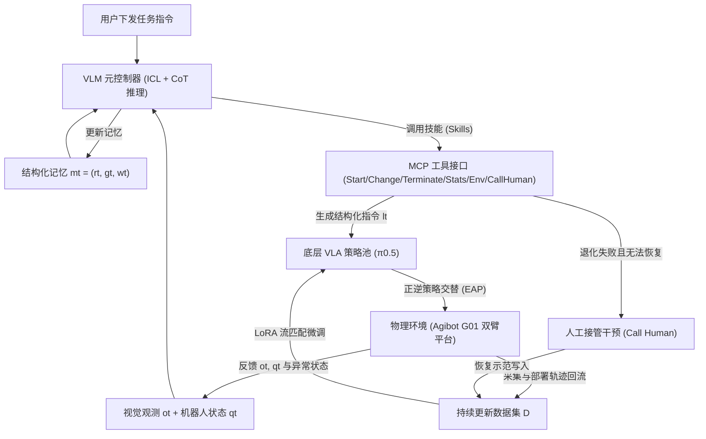
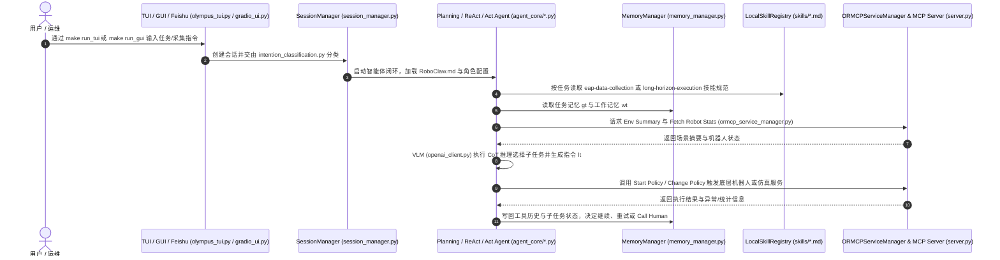

# RoboClaw: An Agentic Framework for Scalable Long-Horizon Robotic Tasks

## 一句话定义

RoboClaw 是一个面向长程机器人操作的全生命周期智能体框架，它用同一个视觉语言模型（VLM）元控制器配合纠缠动作对（EAP）与 MCP 工具接口，打通自主数据采集、VLA 策略迭代训练与部署期过程监督调度。

## 英文缩写速查

| 缩写 | 英文全称 | 简要说明 |
|---|---|---|
| VLA | Vision-Language-Action | 视觉-语言-动作模型，本文底层策略采用 $\pi_{0.5}$ |
| VLM | Vision-Language Model | 视觉语言模型，本文作为高层闭环元控制器使用 |
| EAP | Entangled Action Pairs | 纠缠动作对，将正向操作策略与逆向重置策略配对形成自重置闭环 |
| MCP | Model Context Protocol | 模型上下文协议，智能体调用环境查询、策略启停与人工求助工具的标准接口 |
| ICL | In-Context Learning | 上下文学习，VLM 基于记忆与观测在不微调自身权重的情况下完成决策 |
| CoT | Chain-of-Thought | 思维链推理，用于在调用 MCP 工具前解析场景与评估子任务成功条件 |

## 为什么重要

现有视觉-语言-动作（VLA）管线通常把数据采集、策略训练与长程部署割裂成三个独立阶段：采集阶段需要人工反复重置环境并筛查失败轨迹，部署阶段缺乏持续的过程监控与异常恢复，且不同阶段由不同角色管理，容易引发任务语义、子任务边界与状态分布的错配（distribution & semantic mismatch）。RoboClaw 的核心价值在于用同一套智能体循环和结构化记忆同时治理采集与部署，将人工从高频率重复重置中解放出来，并使部署期产生的真实交互（含失败恢复）直接回流为策略进化的经验来源。

## 核心信息

| 字段 | 内容与核查结果 |
|---|---|
| 作者 | Ruiying Li, Yunlang Zhou, Yuyao Zhu, Kylin Chen, Jingyuan Wang, Sukai Wang, Kongtao Hu, Minhui Yu, Bowen Jiang, Zhan Su, Jiayao Ma, Xin He, Yongjian Shen, Yang Yang, Guanghui Ren, Maoqing Yao, Wenhao Wang, Yao Mu |
| 机构 | 智元机器人（AgiBot）、上海交通大学（SJTU）、新加坡国立大学（NUS）（官方仓库另列 ScaleLab 为合作机构） |
| 发表时间 | 2026-03-12（arXiv v1）/ 2026-04-01（arXiv v3） |
| 论文链接 | [arXiv:2603.11558](https://arxiv.org/abs/2603.11558) · [HTML 全文](https://arxiv.org/html/2603.11558) |
| 项目与代码 | [项目主页](https://roboclaw-agibot.github.io/) · [GitHub 仓库](https://github.com/RoboClaw-Robotics/RoboClaw) |
| 清单分类 | `harness.skills`（来源条目 `survey_ax_2603_11558`） |
| 开源状态 | **部分开源**（Agent 编排框架、Skills 规范、MCP 服务示例与 TUI/GUI 入口已开源；主要在 Agibot G01 验证，完整 VLA 模型部署 `.whl` 包需私信申请） |

## 核心原理

### 1. 三层抽象与结构化记忆闭环

RoboClaw 参照 OpenClaw 风格将具身智能体划分为三层抽象：

- **Policies（底层策略层）**：负责生成低层电机动作块的 VLA 模型（本文采用 $\pi_{0.5}$）。
- **Tools（MCP 工具层）**：通过 Model Context Protocol 暴露的标准化控制与感知接口，包括 `Start Policy`、`Terminate Policy`、`Change Policy`、`Env Summary`、`Fetch Robot Stats` 与 `Call Human`。
- **Skills（技能编排层）**：可复用的高层程序化工作流（如 `eap-data-collection`、`long-horizon-execution`、`monitored-subtask-execution`），负责按上下文编排 MCP 工具。

在每个决策步 $t$，智能体基于视觉观测 $o_t$ 与三元组结构化记忆 $m_t = (r_t, g_t, w_t)$ 进行 CoT 推理并选择下一个子任务 $z_t \in \mathcal{Z}$：

$$z_t = \operatorname{RoboClaw}(m_t, o_t), \qquad m_t = (r_t, g_t, w_t)$$

其中 $r_t$ 为角色身份（决定工作模式与可用工具权限），$g_t$ 为任务级记忆（记录全局目标、子任务拆解与各子任务状态），$w_t$ 为工作记忆（保存当前激活技能与近期工具调用历史）。

### 2. 条件流匹配 VLA 策略与纠缠动作对（EAP）

底层 $\pi_{0.5}$ 策略以视觉观测 $o_t$、关节本体状态 $q_t$ 与 **RoboClaw 在调用 MCP 工具时动态生成的结构化指令 $l_t$** 为条件，预测长度为 $H$ 的动作块 $A_t = [a_t, \dots, a_{t+H-1}]$，训练采用条件流匹配目标：

$$\mathcal{L}^\tau(\theta) = \mathbb{E}_{p(A_t \mid o_t, l_t, q_t),\, q(A_t^\tau \mid A_t)} \left[ \left\| v_\theta(A_t^\tau, o_t, l_t, q_t) - u(A_t^\tau \mid A_t) \right\|^2 \right]$$

其中 $\tau \in [0, 1]$，$A_t^\tau = (1-\tau)\epsilon + \tau A_t$。为消除人工重置瓶颈，RoboClaw 提出 **纠缠动作对（Entangled Action Pairs, EAP）**：对每个技能 $k$ 同时维护正向策略 $\pi_{\theta_k}^\rightarrow$ 与逆向重置策略 $\pi_{\phi_k}^\leftarrow$。当智能体判定正向轨迹 $\tau_k^\rightarrow$ 完成后，自动切换执行逆向策略采集 $\tau_k^\leftarrow$ 将环境拉回可复用的前置条件区域，形成配对轨迹 $\tau_k = (\tau_k^\rightarrow, \tau_k^\leftarrow)$ 写入数据集 $\mathcal{D}$。逆向任务在设计上比正向任务更简单，以确保自重置循环高可靠性运行。

### 3. 部署期过程监督与失败分类学习

部署时，同一智能体周期性调用 `Fetch Robot Stats` 与 `Env Summary` 写入 $w_t$，判断子任务完成条件并更新 $g_t$。面对执行失败，系统区分两类情形：

- **非退化失败（Non-degrading failures）**：环境仍停留在原策略前置条件区域内（例如空抓但药水瓶保持直立），直接重试当前策略即可。
- **退化失败（Degrading failures）**：失败导致环境状态偏离可行域（例如瓶子倾倒或滑出工作区），智能体通过 `Change Policy` 触发恢复策略或重规划；若无法安全恢复则调用 `Call Human`。

部署过程与人工接管恢复产生的轨迹与原始示教、EAP 自主采集轨迹共同并入 $\mathcal{D}$，使系统随时间推移不断扩充恢复策略库并提升正向策略鲁棒性。

## 流程总览

## 源码运行时序图

开源仓库中的可运行智能体入口由 `Makefile` 的 `make run_tui`（调用 `src/agent_demo/interaction_layer/tui/olympus_tui.py`）与 `make run_gui`（调用 `src/agent_demo/interaction_layer/gradio_ui/gradio_ui.py`）拉起，经 `session_layer/session_manager.py` 路由到 `agent_layer/agent_core/`（含 `planning_agent.py`、`react_agent.py`、`act_agent.py`），并通过 `ormcp_service_manager.py` 连接 `src/mcp_server_demo/` 下的机器人与数据分析 MCP 服务，读取 `skills/` 下的三套标准技能文件。

## 实验与评测

所有真机实验均在 **Agibot G01** 双臂移动操作平台上完成（不含末端 20 DoF，双臂配备 1 DoF AGIBOT OmniPicker 夹爪），覆盖卧室梳妆台、厨房货架、书桌与便利店货架 4 个真实场景。

### 1. 微调训练超参数（Table 1）

| 参数项 | 取值 | 参数项 | 取值 |
|---|---|---|---|
| 数值精度 | `bfloat16` | LoRA Rank ($r$) | `16` |
| Batch Size | `16` | LoRA Alpha ($\alpha$) | `16` |
| 训练步数 / Warmup | `10k` / `100` | LoRA Dropout | `0.1` |
| 学习率 | `2.5e-5` | LoRA 目标模块 | `all-linear` |
| 推理流匹配步数 | `3` | Gradient Checkpointing | 开启 |

### 2. 数据采集效率（§4.1, Fig. 4a–b）

- **同等数据量的人力时间对比**：以 RoboClaw 归一化为 `1`，纯人工遥操作加手动重置基线所需人工时间约为 **`2.16×`**（对应全生命周期人工时间投入减少 **`53.7%`**）。
- **Rollout 阶段人工干预频次**：纯人工基线所需人工干预约为 RoboClaw 的 **`8.04×`**。

### 3. 四项单技能正逆向成功率（Table 2 & Table 3，每轮新增 50 条样本，每项测试 50 次）

| 子任务 | 任务挑战 | 逆向重置成功率 (Table 2) | 正向 Iter 1 | 正向 Iter 2 | 正向 Iter 3 | 正向 Iter 4 | 正向 Iter 5 |
|---|---|---|---|---|---|---|---|
| Body Lotion 放置 | 大范围位移与视角变化 | `36/50` | `21/50` | `25/50` | `32/50` | `37/50` | `43/50` |
| Primer 放抽屉并关门 | 遮挡与受限间隙后续交互 | `38/50` | `23/50` | `31/50` | `31/50` | `34/50` | `40/50` |
| Lipstick 窄槽插接 | 紧位置与姿态公差对齐 | `43/50` | `2/50` | `4/50` | `11/50` | `16/50` | `23/50` |
| Tissue Wipe 擦拭 | 持续表面接触轨迹质量 | `39/50` | `11/50` | `13/50` | `14/50` | `21/50` | `26/50` |

### 4. 长程组合任务评测（§4.3, Fig. 4c）

在卧室梳妆台整理任务（依次编排 Primer 放置、Lipstick 插接、Body Lotion 放置与 Tissue Wipe，20 次试验平均）中，RoboClaw 相比同数据集训练的无框架 $\pi_{0.5}$ 基线及四个独立子任务成功率乘积基线，长程任务成功率提升 **`25%`**，增益主要来源于运行期状态监控与失效后的自动重试/恢复调度。

## 与其他工作对比

| 对比维度 | 传统人工采集与开环 VLA（如 $\pi_{0.5}$ 基线） | 遥操作增强/半自动采集（如 Genie Centurion、FieldGen） | RoboClaw |
|---|---|---|---|
| 环境重置方式 | 人工手动重置（耗时 `2.16×`） | 人工介入倒带微调或人工示教精细段 | EAP 正逆向策略自重置闭环（逆向成功率 72%–86%） |
| 采集与部署语义 | 阶段分离，指令与终止边界易错配 | 侧重采集阶段，部署期缺乏统一监督代理 | 同一 VLM 智能体 + $m_t$ 与 MCP 工具统一治理 |
| 长程容错机制 | 子任务误差级联放大，无过程恢复 | 依赖人工接管或预设固定规则 | 区分非退化（重试）与退化失败（恢复策略/求助） |
| 经验闭环 | 采集数据静态冻结，部署轨迹很少回流 | 局限于采集轮次内修正 | 部署轨迹与人工接管数据统一回流 $\mathcal{D}$ 迭代更新 |

## 结论

**一句话总判：RoboClaw 的核心突破不在于发明新的底层 VLA 网络结构，而是用“统一 VLM 智能体 + MCP 工具 + EAP 自重置动作对”把割裂的采集、训练与长程部署缝合成了同一条数据与控制闭环。**

1. **正逆向不对称设计是自重置落地的关键** — 让逆向重置任务刻意比正向任务更简单（4 项任务逆向成功率达 `36/50`–`43/50`），才能支撑后续 5 轮自主增量采集，让高难度任务如 Lipstick 插接从 `2/50` 爬升至 `23/50`。
2. **动态生成子任务指令 $l_t$ 消除了语义断层** — 底层 $\pi_{0.5}$ 在采集与部署时都消费智能体生成的同构语义指令，避免了人工标注风格与调度器状态定义不一致导致的分布偏移。
3. **失败分类比单纯堆模型更省人力** — 区分非退化（直接重试）与退化失败（切恢复策略或 `Call Human`），既把 rollout 人工干预压低到基线的 `1/8.04`，又在长程任务上比无框架同数据 $\pi_{0.5}$ 提升 `25%` 成功率。
4. **开源复现需留意硬件与闭源边界** — 代码仓已完整释放上层 Agent/Skill/MCP 工程框架，但底层 VLA 部署 `.whl` 未随公共仓库直接提供，跨平台迁移需自备底层策略服务接口。

## 工程实践

- **环境与依赖准备**：项目使用 `uv` 管理 Python 依赖（`pyproject.toml` + `uv.lock`），在 `.env` 中配置必填 `OPENAI_API_KEY` 及可选飞书机器人凭据后执行 `make init`，随后可通过 `make run_tui` 或 `make run_gui` 启动本地智能体控制台。
- **技能与护栏解耦**：将任务规范外置为 `skills/<skill-name>/SKILL.md` 与 `references/*.md`（例如 `eap-prompt-pairs.md` 与 `data-collection-guardrails.md`），新增机器人场景时可优先替换 Skill 文档与 `src/agent_demo/config/ormcp_services.json` 中的 MCP 服务地址，而无需重写 `agent_core/` 主循环。
- **LoRA 微调与推理预算**：文中 $\pi_{0.5}$ 微调仅需 `10k` 步与 `r=16` 全线性层 LoRA，推理流匹配步数压缩到 `3` 步，适合快速多轮迭代（每轮补采 50 条轨迹即可重训）。

## 局限与风险

- **云端 VLM 推理延迟**：高层闭环依赖外部 VLM（如通过 `openai_client.py` 调用接口）进行 CoT 推理与视觉评估，在需要毫秒级高频反馈的接触操作中可能产生调度空窗。
- **EAP 可逆性假设边界**：并非所有物理操作都存在低成本、高成功率的逆向重置动作（例如不可逆装配、液体倾洒后的大范围清洁或易损件操作），此类任务仍需人工干预或物理工装辅助。
- **底层 VLA 部署依赖私有包**：开源仓库 README 明确指出主要在 Agibot G01 平台验证，且完整 VLA 部署 `.whl` 包需私信获取，独立复现时需自行对接符合 `corobot_mcp_server` 协议的底层策略推理服务。

## 关联页面

- [Agentic Robots 综述](paper-towards-agentic-robots-survey.md)
- [全量项目节点清单](../overview/awesome-agentic-robots-node-index.md)
- [VLA 方法背景](../methods/vla.md)
- [智能体机器人操作策略](../methods/agentic-manipulation-policies.md)：对照操作场景中的规划、执行与反馈接口
- [OpenClaw 与 Claw 机器人控制生态](../methods/claw.md)：对照 OpenClaw 风格的技能与工具编排体系
- [智能体技能打包规范（Agent Skill Packaging）](../methods/agent-skill-packaging.md)
- [智能体工具调用接口（MCP / Tool Use）](../methods/agent-tool-use-interface.md)
- [Pi0 流匹配 VLA 策略](../methods/pi0-policy.md)：对照流匹配动作块生成与 $\pi_{0.5}$ 底层策略背景
- [机器人学习数据流水线](../methods/robot-learning-data-pipelines.md)
- [双臂操作任务（Bimanual Manipulation）](../tasks/bimanual-manipulation.md)

## 推荐继续阅读

- [RoboClaw 官方项目主页](https://roboclaw-agibot.github.io/)：查看真机长程任务与自重置采集演示视频
- [RoboClaw 官方 GitHub 仓库](https://github.com/RoboClaw-Robotics/RoboClaw)：查阅 `skills/` 提示词规范与 `src/agent_demo/` 三层智能体源码

## 参考来源

- [RoboClaw 论文原文核对归档](../../sources/papers/paper-agentic-2603-11558.md)
- [RoboClaw 官方仓库核对归档](../../sources/repos/paper-agentic-2603-11558.md)
- [官方 Awesome 快照归档](../../sources/repos/awesome-agentic-robots-survey-index.md)
- [arXiv:2603.11558 原文](https://arxiv.org/abs/2603.11558)
- [GitHub 官方仓库](https://github.com/RoboClaw-Robotics/RoboClaw)
