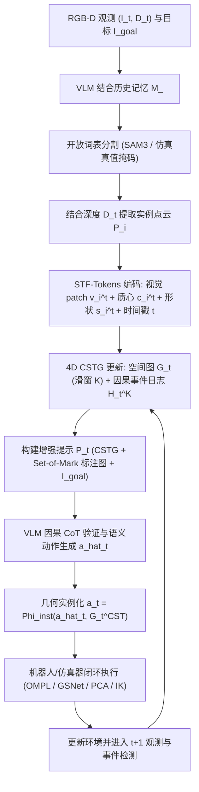
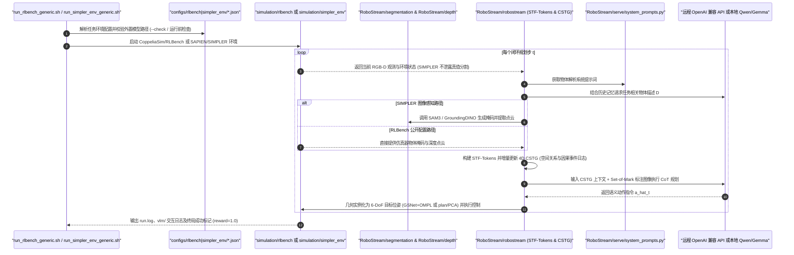

# RoboStream: Weaving Spatio-Temporal Reasoning with Memory in Vision-Language Models for Robotics

## 一句话定义

RoboStream 是清华大学深圳国际研究生院等机构提出的免训练（training-free）视觉语言机器人操作框架，它通过将多视图/单目 RGB-D 物体观测编码为绑定 3D 几何的时空融合标记（STF-Tokens），并由 4D 因果时空图（CSTG）在滑窗内持续记录动作触发的状态转移与遮挡历史，使通用 VLM 无需微调即可稳定完成多步长时域装配、拆解与全遮挡恢复任务。

## 英文缩写速查

| 缩写 | 英文全称 | 简要说明 |
|---|---|---|
| VLM | Vision-Language Model | 视觉语言模型，在 RoboStream 中负责目标物体解析与基于记忆的因果规划（实验采用 Qwen3-VL 系列） |
| STF-Tokens | Spatio-Temporal Fusion Tokens | 时空融合标记，将物体掩码内视觉 patch 特征与 3D 质心、轴向高斯形状及时间戳绑定至同一语言嵌入空间 |
| CSTG | Causal Spatio-Temporal Graph | 4D 因果时空图，由空间场景图 $\mathcal{G}_t$ 与滑窗因果事件日志 $\mathcal{H}_t^K$ 组成，支撑遮挡下的物体恒常性推理 |
| CoT | Chain-of-Thought | 思维链推理，VLM 在输出语义动作前先校核历史状态、空间前置条件与遮挡因果依赖 |
| SoM | Set-of-Mark | 视觉标注提示方式，在输入观测图上叠加物体 ID 标签，与结构化 CSTG 上下文共同对齐视觉与记忆 |
| VLA | Vision-Language-Action | 视觉-语言-动作模型，本文对比或讨论的端到端具身策略范式 |

## 为什么重要

1. **直击长时域 VLM 规划的两大结构性短板**：传统 VLM 规划器把每一步当作独立的状态-动作映射，每轮都从 2D 像素重新猜测空间几何（Ungrounded Spatial Perception），且不记录历史动作如何改写了环境（Untracked Causal History），导致长序列下空间幻觉不断放大、被遮挡物体彻底丢失。
2. **用表征与结构化记忆而非暴力扩参/微调解决长时域崩溃**：在完全免训练条件下，8B 参数规模的 RoboStream 在多步 RLBench 长时域任务上的表现即超过未配备时空记忆的大模型基线与部分需训练的记忆策略（如 SAM2Act、MemoryVLA），证明结构化 3D 锚定与因果日志对物理一致性具有决定性作用。
3. **跨本体零样本泛化与端到端工程闭环**：借助解耦的“语义动作决策 + 确定性 3D 几何实例化”设计，同一套管线免微调即可运行于 Franka Research 3 真机、RLBench（Franka Panda）与 SIMPLER（Google Robot、WidowX），并已将核心框架与两套基准测试封装开源。

## 核心信息

| 字段 | 内容 |
|---|---|
| 作者 | Yuzhi Huang, Jie Wu, Weijue Bu, Ziyi Xiong, Gaoyang Jiang, Ye Li, Kangye Ji, Shuzhao Xie, Yue Huang, Chenglei Wu, Jingyan Jiang, Zhi Wang |
| 机构 | 清华大学深圳国际研究生院、元兴光年机器人（YuanxingGuangnian Robotics）、中国矿业大学、深圳技术大学、华中科技大学、厦门大学 |
| 发表时间 | 2026-03-13（arXiv v1），2026-07-10（v2 修订）；Accepted by ECCV 2026 |
| 论文链接 | [arXiv:2603.12939](https://arxiv.org/abs/2603.12939)（HTML 全文：[arXiv HTML](https://arxiv.org/html/2603.12939)） |
| 项目与代码 | [项目主页](https://robostream123.github.io/) · [GitHub（yu2hi13/RoboStream）](https://github.com/yu2hi13/RoboStream) |
| 清单分类 | `harness.memory`（来源条目：`survey_ax_2603_12939`） |
| 开源状态 | **已开源**（Apache-2.0 协议，公开规划/感知/记忆核心模块、vendored RLBench 与 SIMPLER 仿真栈及 14 个公开 JSON 配置；SAM3、GSNet 与 Qwen3-VL 权重需按说明外置下载） |

## 核心原理

RoboStream 的目标是让免训练 VLM 在执行长时域操作时具备持续的 3D 几何感知与因果状态追踪能力。给定第 $t$ 步的 RGB-D 观测 $(I_t, D_t)$、目标设定 $I_{\text{goal}}$（目标参考图或自然语言指令）以及历史记忆 $\mathcal{M}_{<t}$，整体决策被形式化为四个耦合步骤：

### 1. 记忆引导的开放词表物体感知（Object-Centric Perception）
为避免场景无关杂物干扰并跨步维持物体身份一致，系统首先将 $(I_t, D_t)$、$I_{\text{goal}}$ 与历史记忆 $\mathcal{M}_{<t}$ 一同提示给 VLM，输出与当前任务相关的开放词表物体描述集合 $\mathcal{D} = \{d_1, \dots, d_N\}$。随后由开放词表分割模型生成像素级掩码 $\{M_i\}_{i=1}^N = \mathrm{SAM3}(I_t, \mathcal{D})$（$M_i \in \{0,1\}^{H\times W}$），并结合深度图 $D_t$（真机采用 D435i 深度，代码库亦提供 Depth Anything V2 / Metric3Dv2 / MoGe 等接口）提取每个目标实例的 3D 点云 $\mathbf{P}_i$。

### 2. 时空融合标记：STF-Tokens（Spatio-Temporal Token Fusion）
为了摆脱“每步从整图像素重猜坐标”的不稳定性，编码器 $\Phi_{\text{enc}}$ 为每个对象构建统一的物体级表征 $\mathcal{T}_t^{\text{STF}} = \Phi_{\text{enc}}(I_t, D_t \mid \mathcal{M}_{<t}) = \{\tau_i^t\}_{i=1}^N$：
- **视觉证据压缩 $\mathbf{v}_i^t$**：将掩码应用到 RGB 图像得到局部遮罩图 $\hat{I}_i^t$，经 VLM 视觉编码器生成 $16\times 16$ patch tokens 后，仅保留与掩码 $M_i$ 的 IoU 超过阈值 $I_{th}$ 的前景 patch 并投影聚合为 $\mathbf{v}_i^t$，消除了冗余背景 token 开销。
- **稳健 3D 几何编码 $\mathbf{c}_i^t, \mathbf{s}_i^t$**：从物体点云 $\mathbf{P}_i$ 提取中位数质心 $\mathbf{c}_i^t = \mathrm{median}(\mathbf{P}_i) \in \mathbb{R}^3$，并沿三轴统计高斯分布与极值构造形状向量 $\mathbf{s}_i^t = \{(\mu_a, \sigma_a, a_{\min}, a_{\max}) \mid a \in \{x,y,z\}\}$。联合均值-标准差与轴向极值既能抑制边缘点云离群噪声，又比单纯包围盒更完整地刻画物体几何延伸。
- **跨模态共享空间**：$\mathbf{c}_i^t$ 与 $\mathbf{s}_i^t$ 经文本分词器序列化进与 $\mathbf{v}_i^t$ 相同的语言嵌入空间，无需改动 VLM 网络结构即可形成四元组标记：
$$\tau_i^t = \langle \mathbf{v}_i^t,\; \mathbf{c}_i^t,\; \mathbf{s}_i^t,\; t \rangle$$

### 3. 4D 因果时空图：CSTG（Causal Spatio-Temporal Graph）
单步 3D 锚定仍无法追踪物体间关系与历史操作副作用，因此图更新算子 $\Psi_{\text{graph}}$ 将新生成的 $\mathcal{T}_t^{\text{STF}}$ 递归融入上一时刻图状态：
$$\mathcal{G}_t^{\text{CST}} = \Psi_{\text{graph}}(\mathcal{T}_t^{\text{STF}}, \mathcal{G}_{t-1}^{\text{CST}}) = (\mathcal{G}_t, \mathcal{H}_t^K)$$
- **空间场景图 $\mathcal{G}_t = (\mathcal{V}_t, \mathcal{E}_t)$**：每个节点 $v_i \in \mathcal{V}_t$ 对应一个物体实例，并在内部维护长度为 $K$ 的滑窗状态缓存 $\{\tau_i^{t-K+1}, \dots, \tau_i^t\}$；有向边 $e_{ij} \in \mathcal{E}_t$ 显式编码物体间欧氏距离 $d_{ij} = \|\mathbf{c}_i - \mathbf{c}_j\|_2$ 与三维方向偏移 $\Delta\mathbf{c}_{ij} = \mathbf{c}_j - \mathbf{c}_i$。
- **因果记忆日志 $\mathcal{H}_t^K$**：通过比较滑窗内 STF-Tokens 的连续演化，系统自动检测物体级语义事件（计划位移、意外碰撞、遮挡消失）与任务级事件（动作执行、子任务完成），并记录事件时间戳、三维位置与因果触发源。当物体被杯子或上层积木完全遮挡时，其最近已知位姿与因果来源仍保存在 $\mathcal{G}_t^{\text{CST}}$ 中，使系统具备物体恒常性推理与失败重规划能力。

### 4. 因果思维链推理与解耦 6-DoF 动作实例化
在规划阶段，系统将 $\mathcal{G}_t^{\text{CST}}$ 的结构化状态、叠加 Set-of-Mark 物体 ID 的当前观测图与 $I_{\text{goal}}$ 组装为上下文提示 $\mathcal{P}_t$。VLM 策略 $\Pi_\theta$ 先执行思维链（CoT）空间验证——回溯历史状态、核查支撑/遮挡前置条件——再输出语义动作指令 $\hat{a}_t = \Pi_\theta(I_{\text{goal}}, \mathcal{P}_t \mid \mathcal{G}_t^{\text{CST}})$。最后，实例化算子 $a_t = \Phi_{\text{inst}}(\hat{a}_t, \mathcal{G}_t^{\text{CST}})$ 将语义指令中的目标对象直接绑定回 CSTG 中存储的精确 STF-Token 3D 几何（在 6-DoF 抓取/重排任务中结合 GSNet、plan/PCA 或 PointSO 生成目标位姿与运动轨迹），实现语义泛化与底层坐标精度的解耦。

## 流程总览

## 源码运行时序图

以下时序图基于官方仓库 `yu2hi13/RoboStream` 的已核实入口脚本、公开配置与模块布局（`run_rlbench_generic.sh`、`run_simpler_env_generic.sh`、`configs/`、`RoboStream/robostream/`、`RoboStream/serve/system_prompts.py`、`RoboStream/segmentation/`、`RoboStream/depth/` 及 `simulation/` 仿真栈）整理，反映单次闭环评估任务的执行调用链：

复现主路径：RLBench 长时域任务可直接通过 `./run_rlbench_generic.sh --mode control_record --config configs/rlbench/long_horizon/<task>.json` 启动，SIMPLER 跨本体任务通过 `./run_simpler_env_generic.sh --config configs/simpler_env/<task>.json --task <task>` 启动，两者均提供 `--dry-run` 与 `--check` 用于部署前环境自检。

## 实验与评测

论文在 **免微调零样本** 设定下，基于 `Qwen3-VL-8B`、`Qwen3-VL-32B` 与 `Qwen3-VL-235B`（分别记作 RoboStream-8B / 32B / 235B）完成了 5 类基准评测（所有数值均核自原文 Section 4 与 Appendix 0.C）：

### 1. 真机长时域操作（Franka Research 3 + RealSense D435i，21 项任务×3 次，Tab. 6–7）
使用 17 个彩色几何体与功能物体（含黄三角棱柱、粉红旗、棕色杯）测试三类高难长序列任务：
- **Block Building（Easy/Med/Hard，9 项任务）**：总平均成功率 RoboStream-235B **63.0%**、32B **48.1%**、8B **33.3%**（VoxPoser 25.9%，SoFar 22.2%）；在 7 物体 6–7 步的 **Hard** 难度上，RoboStream-235B 达到 **44.4%**，而 SoFar 与 VoxPoser 均为 **11.1%**。
- **Block Disassembly（自顶向下拆解，9 项任务）**：总平均成功率 RoboStream-235B **77.8%**、32B **63.0%**、8B **40.7%**（SoFar 29.6%，VoxPoser 25.9%）；Hard 难度下 235B 达 **66.7%**（SoFar/VoxPoser 11.1%）。
- **Block Hide and Restore（全遮挡记忆恢复，3 项 Hard 任务）**：要求先拆解或将紫色方块藏于棕杯下、执行干扰步骤后再复原。RoboStream-235B 取得 **88.9%**、32B **55.6%**、8B **33.3%**，而依赖单步视觉重推断的 SoFar 与 VoxPoser 成功率均为 **0.0%**。

### 2. SIMPLER 零样本跨本体泛化（Tab. 1）
- **Google Robot（8B 零样本）**：在 Variant Aggregation（VA）与 Visual Matching（VM）两套协议下，Pick Coke Can 分别达 **94.2%** / **95.7%**（SoFar 为 90.7% / 92.3%，OXE 微调 RT-2-X 为 82.3% / 78.7%）；Move Near 分别达 **79.8%** / **95.8%**（SoFar 为 74.0% / 91.7%）。
- **WidowX + Bridge（8B 零样本）**：四项子任务全部超越零样本 SoFar 与在 Bridge 数据集微调过的 VLA 基线，平均成功率 **74.8%**（Spoon 62.5%、Carrot 71.9%、Stack 77.1%、Egg 87.5%），高于 SoFar（58.3%）、SpatialVLA-Bridge（42.7%）与 RoboVLM-Bridge（31.3%）。

### 3. RLBench 长时域与短时域评测（Tab. 2, 11, 12）
- **8 项自定义长时域任务（每任务 25 回合）**：RoboStream-235B 平均成功率 **90.5%**（32B **82.5%**，8B **58.0%**），大幅领先 SoFar（**28.0%**）与 VoxPoser（**26.5%**）。在极易发生遮挡遗忘的 `Cover Bottom Block with Box` 与 `Unstack then Stack Four Colors` 上，SoFar 与 VoxPoser 均得 **0.0%**，RoboStream-235B 分别达 **96.0%** 与 **84.0%**。
- **对比需训练的记忆策略（Tab. 12，4 项 RLBench 长时域任务）**：需域内训练的 SAM2Act（均分 **30.0%**）与 MemoryVLA（均分 **26.0%**）在 `Cover-B` 与 `Unstack` 上均为 **0.0%**，而零样本 RoboStream-8B / 32B / 235B 分别取得 **48.0%** / **80.0%** / **92.0%**。
- **15 项原生短时域 RLBench 任务（Tab. 11）**：RoboStream-8B 平均 **71.2%**，高于 VoxPoser（49.9%）与 SoFar（23.5%）。

### 4. 6-DoF 空间推理与重排（配合 PointSO，Tab. 3–4）
- **6-DoF SpatialBench**：RoboStream-32B 总准确率 **48.9%**（位置相对 66.0%、位置绝对 44.6%、朝向相对 48.0%、朝向绝对 37.5%），高于 SoFar-32B（45.3%）、SoFar（43.9%）、GPT-4o（36.2%）、RoboPoint（33.5%）与 SpaceMantis（28.9%）。
- **Open6DOR V2**：RoboStream-32B 取得位置 **93.8%**、旋转 **58.8%**、综合 6-DoF **52.2%**（SoFar-32B 为 93.1% / 54.6% / 48.4%，Open6DOR-GPT 为 74.9% / 41.1% / 35.6%）。

### 5. 消融实验、延迟扩展性与失败分析（Tab. 5, 8, 9, 10, Fig. 14）
- **组件消融（235B，8 项 RLBench 长时域任务，Tab. 5）**：完整版 **90.5%** → 去掉 STF-Tokens 降至 **79.5%**（-11.0 个百分点，接触精细度下降）→ 去掉 CSTG 崩塌至 **14.5%**（-76.0 个百分点，失去长时域因果序与遮挡恢复能力）→ 两者全去为 **12.0%**。
- **运行时扩展性（Tab. 9–10）**：在 1×A100 上运行 7 步 Hard 拆解（滑窗 $K=3$），感知（均 0.25 s）与 CSTG 构建（均 0.16 s）耗时恒定，单步总延迟稳定在 6.94–7.91 s（均值 7.62 s），不随步数累积膨胀；全真机基准单步平均总耗时在 8B（1×A100）、32B（2×A100）、235B MoE（8×A100，每次激活约 22B 参数）下分别为 **3.86 s**、**8.61 s** 与 **5.15 s**。
- **真机失败归因（App. 0.C.2, Fig. 14）**：VLM 任务规划错误占 **43.5%**、物体解析与分割检测占 **20.7%**、放置精度偏差占 **16.3%**、抓取不稳定占 **14.1%**、运动规划异常占 **5.4%**。

## 与其他工作对比

| 方法 | 是否免训练 | 3D 几何锚定机制 | 跨步因果记忆 | 全遮挡物体恢复 | 长时域 RLBench 均分 |
|---|---|---|---|---|---|
| **RoboStream (235B)** | 是（Training-Free） | STF-Tokens（Patch 特征 + 质心 + 轴向高斯/极值） | CSTG（滑窗场景图 + 因果事件日志） | 支持（真机 Hide 任务 88.9%） | **90.5%** |
| **SoFar** | 是（依赖现成 VLM + PointSO） | 单步 6-DoF 朝向与语义标注 | 无跨步状态转移日志 | 不支持（真机 Hide 任务 0.0%） | 28.0% |
| **VoxPoser** | 是（LLM/VLM 合成 3D 值图） | 单步 3D 体素势能/约束场 | 无显式物体恒常性日志 | 不支持（真机 Hide 任务 0.0%） | 26.5% |
| **SAM2Act / MemoryVLA** | 否（需域内训练） | 隐式特征 / 分割记忆跟踪 | 隐式历史特征缓冲 | 有限（4 任务集 Cover-B 0.0%） | 30.0% / 26.0%（4 任务子集） |

- 与 **SoFar / VoxPoser** 相比：两者在单步短程任务上具备几何约束能力，但每轮必须从当前像素重新感知全场景，无法追问“上一步把紫方块放到了哪个杯子下面”；RoboStream 通过 CSTG 保留了最近一次观测位置与动作因果来源。
- 与 **SAM2Act / MemoryVLA** 等训练型记忆策略相比：后者在训练分布内的简单放置（96%–100%）表现良好，但在需要反演操作顺序与应对重度遮挡的零样本/复杂场景下泛化较弱，而 RoboStream 凭借显式符号-几何混合图结构展现出随 VLM 容量单调提升的扩展性。

## 结论

**一句话总判：RoboStream 证明了在免训练条件下，将物体级 3D 几何锚定（STF-Tokens）与滑窗因果状态图（CSTG）织入 VLM 规划闭环，能比单纯增大基础模型参数更有效地消除长时域操作中的空间幻觉与遮挡遗忘。**

1. **因果记忆决定长时域下限，3D 几何决定精细操作上限**：消融显示移除 CSTG 会使 235B 长时域成功率从 90.5% 断崖式跌至 14.5%，而移除 STF-Tokens 会带来 11.0 个百分点的接触精度损失——二者分别负责“做对顺序与记得住”和“抓得准与放得稳”。
2. **解耦规划与实例化带来极高跨本体复用度**：VLM 仅负责在 CSTG 语义-几何抽象上生成高层指令，具体 6-DoF 坐标解析与运动规划交由确定性几何与抓取器（GSNet / PCA / OMPL），使同一套方法零样本横跨 Franka、Google Robot 与 WidowX。
3. **滑窗长度设计阻断了长序列上下文爆炸**：将历史记忆限定在长度 $K$（如 $K=3$）的滑窗场景图与结构化事件日志中，使感知与记忆构图延迟稳定控制在 0.8 s 以内，满足在线任务级闭环规划需求。
4. **选型时需区分任务感知协议与模型算力预算**：公开 RLBench 配置默认验证规划层（使用仿真真值分割），实际从图像部署时应参考 SIMPLER 路径充分评估 SAM3 在相似色杂物与重度遮挡下的检测误差（真机失败占比 20.7%）；算力允许时，激活约 22B 参数的 235B MoE 模型在多卡部署下兼顾了高于 32B 稠密模型的推理速度（5.15 s vs 8.61 s）与更高的长时域稳定性。

## 工程实践

- **外部权重与路径约定**：仓内不打包模型权重与密钥。使用远程 VLM 需配置 `OPENAI_API_KEY`、`OPENAI_BASE_URL`、`OPENAI_MODEL`；运行 SIMPLER 需下载 `sam3.pt`（SHA-256 校验 `9999e234...`）与 CLIP BPE 词表并导出 `ROBOSTREAM_SAM3_CHECKPOINT_PATH`、`ROBOSTREAM_SAM3_BPE_PATH`，Google Robot 任务另需下载 GSNet 权重并编译 PointNet2/KNN/MinkowskiEngine 与 OMPL 1.5.2。
- **双仿真栈环境隔离**：官方建议分别建立 `rlbench`（严格锁定 CoppeliaSim v4.1.0 + 指定 commit 的 PyRep，无头运行需配合 Xvfb 与 `QT_QPA_PLATFORM=xcb`）与 `simpler_env`（SAPIEN 2.2.2 + `sam3==0.1.2`）两个独立 conda 环境，避免依赖冲突。
- **预检与调试工具**：每次运行都会在 `RoboStream/output/runs/` 下落盘 `config.json`、`run.log` 与 `vlm/` 对话日志；正式启动仿真前可用 `--dry-run` 查看环境变量解析，用 `--check` 做本地文件哈希与路径预检。

## 局限与风险

1. **VLM 自身规划误差仍是最大瓶颈**：即使引入 STF-Tokens 与 CSTG，真机失败中仍有 **43.5%** 源自 VLM 空间幻觉、左右/堆叠支撑顺序误判或长序列因果链推理失误，且轻量 8B 模型在重度遮挡任务（如 `Cover Bottom Block` 仅 16.0%）上仍明显弱于大模型。
2. **解耦架构的误差级联与非柔性执行**：前端检测偏移（SAM3 在同色干扰与遮挡下占 20.7% 失败）、末端释放微偏差（16.3%）及抓取/IK 异常（14.1% / 5.4%）无法由当前开环式动作执行片段实时补偿，缺乏高频力觉/触觉反馈或底层柔性 VLA 执行器协同。
3. **计算延迟与评测感知边界**：当前规划频率约为 3.8–8.6 s/步，适用于准静态任务级闭环，尚不支持高动态实时控制；此外，官方开源的 RLBench 公开配置采用仿真器真值分割而非 SAM3，复现与对比时应注意区分“纯规划/控制评测”与“含视觉分割端到端评测（SIMPLER 与真机）”。

## 关联页面

- [Agentic Robots 综述](paper-towards-agentic-robots-survey.md)
- [全量项目节点清单](../overview/awesome-agentic-robots-node-index.md)
- [VLA 方法背景](../methods/vla.md)
- [机器人智能体执行框架](../methods/robot-agent-harness.md)：对照规划、执行接口与记忆反馈机制。
- [智能体规划与反馈机制](../methods/agent-planning-feedback.md)
- [智能体操作策略](../methods/agentic-manipulation-policies.md)
- [机器人视觉感知](../methods/robot-visual-perception.md)
- [抓取位姿估计](../methods/grasp-pose-estimation.md)
- [具身智能体评测基准](../methods/embodied-agent-benchmarking.md)
- [机器人操作任务](../tasks/manipulation.md)

## 推荐继续阅读

- [RoboStream 项目主页（演示视频与定量图表）](https://robostream123.github.io/)
- [RoboStream 官方开源仓库（yu2hi13/RoboStream）](https://github.com/yu2hi13/RoboStream)
- [RoboStream 原文（arXiv:2603.12939）](https://arxiv.org/abs/2603.12939)

## 参考来源

- [RoboStream 论文全文核对档案](../../sources/papers/paper-agentic-2603-12939.md)
- [RoboStream 官方仓库核对档案](../../sources/repos/paper-agentic-2603-12939.md)
- [官方 Awesome 快照归档](../../sources/repos/awesome-agentic-robots-survey-index.md)
- [arXiv 原文（2603.12939v2）](https://arxiv.org/abs/2603.12939)
- [RoboStream 项目主页](https://robostream123.github.io/)
- [RoboStream 官方 GitHub 仓库](https://github.com/yu2hi13/RoboStream)
