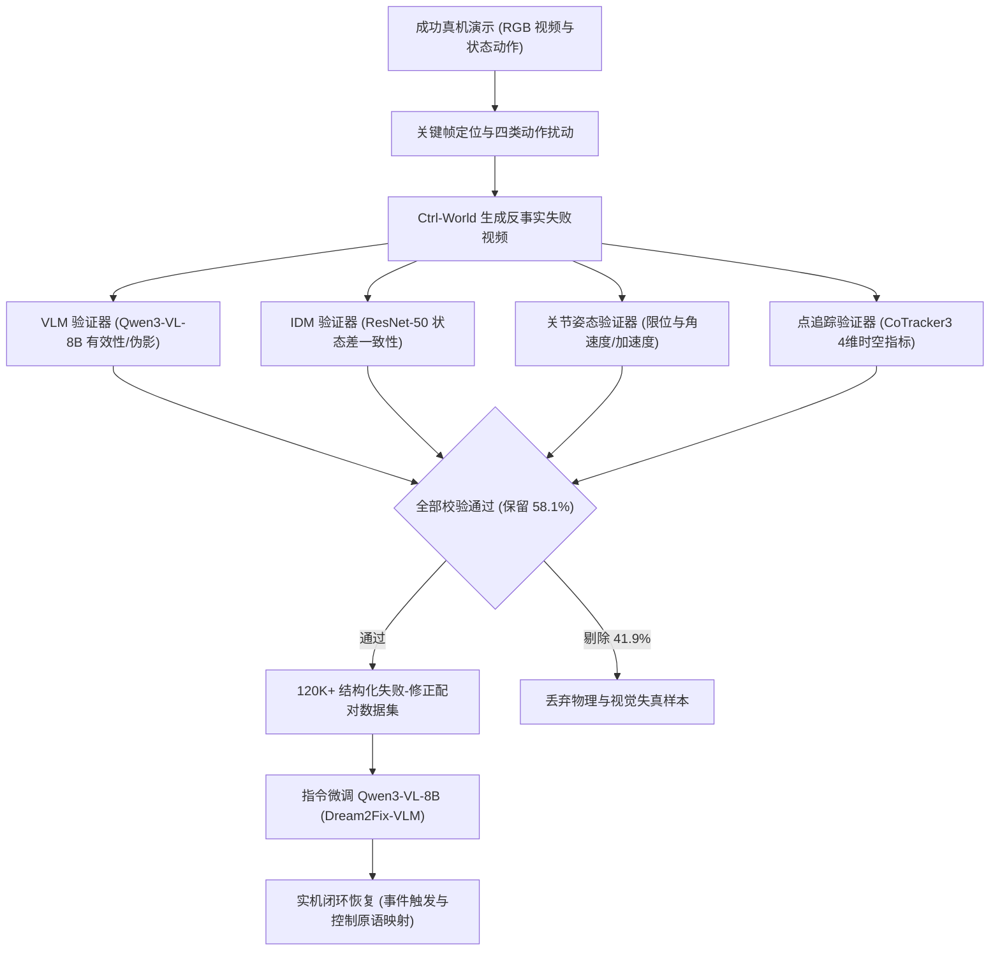

# Learning Actionable Manipulation Recovery via Counterfactual Failure Synthesis

## 一句话定义

**Dream2Fix** 是一种面向机器人操作失败恢复的数据合成与闭环纠错框架：它直接基于真实成功演示，利用动作条件生成式世界模型在关键帧注入可控扰动以合成写实反事实失败视频，经由四维物理与视觉验证器筛选构建超过 120K 条配对样本，并微调视觉语言模型（VLM）将视觉异常直接映射为可执行的轨迹级修正指令。

## 英文缩写速查

| 缩写 | 英文全称 | 简要说明 |
|---|---|---|
| VLM | Vision-Language Model | 视觉语言模型，本文用于合成样本质量审查并微调生成结构化故障诊断与修正指令（Dream2Fix-VLM） |
| VLA | Vision-Language-Action Model | 视觉-语言-动作模型，本文作为下游执行策略（如 OpenVLA）接入闭环失败检测与恢复流水线 |
| IDM | Inverse Dynamics Model | 逆动力学模型，基于 ResNet-50 从相邻生成帧回归末端状态变化，用于检验世界模型动作一致性 |
| MAE | Mean Absolute Error | 平均绝对误差，本文中 $\mathrm{MAE}_{xyz}$ 与 $\mathrm{MAE}_{rpy}$ 用于衡量生成视频与条件状态差的物理吻合度 |
| ROUGE-L | Recall-Oriented Understudy for Gisting Evaluation (Longest Common Subsequence) | 基于最长公共子序列的文本重叠指标，用于评估结构化修正字段与自然语言摘要的生成质量 |
| RGB-D | Red-Green-Blue-Depth | 彩色-深度传感模态，本文真机工作空间采用固定视角 Intel RealSense D435i 采集视觉观测 |

## 为什么重要

1. **填补“失败检测”到“可执行恢复”的鸿沟**：现有视觉失败分析器（如 AHA、REFLECT）主要输出二值成败判断或高层自然语言解释，难以直接转化为机械臂控制器可执行的末端位移或夹爪重闭合原语。
2. **绕开真机采错的高风险与仿真 Sim-to-Real 鸿沟**：在真机上刻意制造碰撞、跌落等失败既昂贵又危及硬件，而纯仿真扰动合成（如 AHA）存在显著视觉与动力学域差距；Dream2Fix 从真实成功演示出发，在写实世界模型中生成反事实失败并自动附带真值恢复标注。
3. **以多维严格验证控制世界模型幻觉**：针对生成式视频易出现物体闪烁、运动学越界的问题，引入四维联合校验门控（筛除 41.9% 失真样本），使纯合成训练的模型能够零样本迁移到物理真机闭环恢复。

## 核心信息

| 字段 | 内容 |
|---|---|
| 论文标题 | *Learning Actionable Manipulation Recovery via Counterfactual Failure Synthesis*（框架名：Dream2Fix） |
| 作者 | Dayou Li, Jiuzhou Lei, Hao Wang, Lulin Liu, Yunhao Yang, Zihan Wang, Bangya Liu, Minghui Zheng, Zhiwen Fan |
| 机构 | Texas A&M University、University of Minnesota、University of Texas at Austin、Abaka AI、University of Wisconsin-Madison |
| 发表时间 | 2026-03-13（arXiv:2603.13528v1 [cs.RO]） |
| 论文链接 | [arXiv:2603.13528](https://arxiv.org/abs/2603.13528) / [arXiv HTML 全文](https://arxiv.org/html/2603.13528) |
| 项目与代码 | 论文首页附项目页 [dream2fix.github.io](https://dream2fix.github.io/)；未确认公开 GitHub 代码仓库 |
| 清单分类 | `harness.monitoring_and_recovery` |
| 来源条目 | `survey_ax_2603_13528` |
| 开源状态 | 未确认开源代码（截至 2026-11-27 预抓取 `project_page_status: 0`，未检索到可验证官方源码仓库） |

## 核心原理

### 1. 问题形式化（Problem Statement）

给定单视角操作视频序列 $\mathcal{I} = \{I_0, I_1, \dots, I_T\}$（其中 $I_t \in \mathbb{R}^{H \times W \times 3}$）与任务指令，模型需要联合预测三项输出：
- **结果分类**：$y_{\text{result}} \in \{\text{success}, \text{fail}\}$；
- **失败类型**：$y_{\text{fail}} \in \mathcal{F} = \{\text{translation}, \text{weak\_close}, \text{force\_open}, \text{delay\_close}\}$；
- **可执行修正**：固定键值格式的结构化指令与自然语言摘要 $y_{\text{fix}} \in \mathcal{T}$。

### 2. 基于世界模型的反事实失败合成（Photorealistic Failure Generation）

Dream2Fix 采用动作条件生成式世界模型 **Ctrl-World**（arXiv:2510.10125）作为生成器。作者将夹爪在开/合状态间切换的时刻定义为**关键帧（keyframe）**，并在关键帧局部时间窗口内对真机成功演示施加四类可控动作扰动：
- `delay_close`：向后施加时间偏移以延迟夹爪闭合，导致滞后或漏抓；
- `weak_close`：减小夹爪闭合幅度，导致接触不稳定或物体滑落；
- `force_open`：在指定关键帧反转夹爪动作，使夹爪保持张开无法抓取；
- `translation`：在接近与接触阶段向末端执行器 $x$-$y$ 状态注入高斯噪声，诱发位置错位或抓取失败。

### 3. 四维结构化验证门控（Structured Failure Validation）

生成视频只有**同时通过**以下四个验证器才会被保留，全流程累计剔除 **41.9%** 样本、保留 **58.1%**（产出 120K+ 配对样本）：

1. **VLM 验证器**：以 `Qwen3-VL-8B` 为底座，联合输入任务指令、真实成功参考视频与合成失败视频，判定两项准则：(i) 相对参考执行确实发生目标失败；(ii) 视觉质量合格且无严重幻觉畸变。
2. **逆动力学模型（IDM）验证器**：在成功演示上训练 `ResNet-50 + MLP` 回归相邻两帧末端状态差 $\widehat{\Delta s}_{t,d} = f_\theta(I_t, I_{t+d})$，与生成条件记录状态差 $\Delta s_{t,d} = s_{t+d} - s_t$ 比对：
   $$e_{t,d} = \left\| \widehat{\Delta s}_{t,d} - \Delta s_{t,d} \right\|_2 \le \tau$$
   阈值 $\tau$ 在真实成功轨迹上标定，用于滤除视觉变化与条件动作脱节的样本。
3. **关节姿态验证器（Joint Pose Verifier）**：用 `ResNet-50` 估计每帧 7 自由度关节角 $q_t \in \mathbb{R}^7$，通过有限差分计算关节速度 $\dot{q}_t$ 与加速度 $\ddot{q}_t$。若存在任意时间步 $t$ 与关节 $j$ 满足越界或超阈条件即剔除：
   $$\exists t, j : \quad q_{t,j} \notin [q_j^{\min}, q_j^{\max}] \ \ \text{or}\ \ |\dot{q}_{t,j}| > \tau_v \ \ \text{or}\ \ |\ddot{q}_{t,j}| > \tau_a$$
4. **点追踪验证器（Point-Tracking Verifier）**：使用 **CoTracker3** 在首帧 $10 \times 10$ 网格采样 $M$ 个点追踪 2D 轨迹 $\{p_t^i\}_{t=1}^T$ 与可见性掩码 $\{m_t^i\}_{t=1}^T$，计算裁剪至 $[0,1]$ 的四项时空一致性指标并加权求和 $S_{\text{pt}} = w_1 S_{\text{smooth}} + w_2 S_{\text{vis}} + w_3 S_{\text{topo}} + w_4 S_{\text{global}}$：
   - 运动平滑度：$S_{\text{smooth}} = \exp(-Q_{0.95}(a)/\tau_{\text{acc}}) \cdot (1 - r_{\text{spike}})$；
   - 可见性稳定度：$S_{\text{vis}} = 1 - \operatorname{median}_i\left(\frac{1}{T-1}\sum_t \mathbf{1}[m_{t+1}^i \neq m_t^i]\right)$；
   - 局部拓扑稳定度（KNN 边长相对变化 $u_t^{ij} = |d_t^{ij}-d_0^{ij}|/(d_0^{ij}+\epsilon)$）：$S_{\text{topo}} = \exp(-\operatorname{median}(u)/\tau_{\text{topo}})$；
   - 全局连续性（帧间仿射配准误差与抖动）：$S_{\text{global}} = 0.7 \exp(-Q_{0.9}(\mathrm{rmse})/\tau_{\text{rmse}}) + 0.3 \exp(-Q_{0.9}(\mathrm{jitter})/\tau_{\text{jitter}})$。

### 4. 自配对修正标注、VLM 微调与闭环恢复

- **确定性修正生成**：直接从注入的扰动参数反推自配对修正标签，避免自由文本歧义。例如针对 `translation` 输出：`RESULT=FAIL; TYPE=translation; STAGE=pre_grasp; FIX_DIR_X=-x; FIX_N_X=2; FIX_DIR_Y=+y; FIX_N_Y=3; ...`；针对夹爪类失败则显式给出修正夹爪指令及时间锚点（temporal anchor）。
- **Dream2Fix-VLM 微调**：基于 `Qwen3-VL-8B-Instruct` 进行视觉指令微调，更新语言模型与多模态投影器参数并冻结视觉编码器等其余组件。
- **VLA 闭环恢复**：运行基座 VLA 时按固定动作预算的事件对齐规则截取关键帧或末端片段送入 Dream2Fix-VLM；确定性映射模块将结构化输出解析为机器人控制空间平移增量或显式闭合/增强夹爪力矩原语，回放修正后轨迹并将恢复成功的轨迹纳入训练库。

## 流程总览

## 源码运行时序图

**不适用**（截至 2026-11-27 未确认可运行官方源码实现：论文仅列出项目主页 `https://dream2fix.github.io/`，预抓取 `project_page_status: 0` 且未检索到公开可运行的官方 GitHub 仓库或训练/推理脚本入口）。

## 实验与评测

### 1. 硬件环境与基准设置

- **真机平台**：Franka Research 3 机械臂（原文亦称 Franka Pandas）配备 Franka Hand 夹爪，及固定视角 Intel RealSense D435i RGB-D 相机（单视角 RGB 输入）。
- **测试集**：(i) **Dream2Fix Test Set**（合成数据划分集）；(ii) **Real-World Benchmark**（真机采集的 10 个操作任务共 100 条失败轨迹，严格零样本评测）。
- **Correction Accuracy（Acc.）定义**：对平移类失败按 $\text{Acc} = (s_{\text{type}} + s_{\text{stage}} + s_x + s_y)/4$ 计分，其中轴向步数误差容限 $\mathrm{cap}=3$；对夹爪类失败按 $\text{Acc} = (s_{\text{type}} + s_{\text{stage}} + s_k)/3$ 计分，$s_k = \mathbbm{1}[|k^{gt}-k^{pred}|\le \delta_k]$。Fuzzy Match 由 `Qwen3-30B-Instruct` 裁判映射（`correct`=1.0, `partially_correct`=0.5, `incorrect`=0.0）。

### 2. 合成数据质量验证（Table II）

| 校验指标 | 真实演示（GT） | Dream2Fix 生成失败样本 |
|---|---|---|
| $S_{\text{smooth}}$ | 0.814 | 0.823 |
| $S_{\text{vis}}$ | 0.999 | 0.998 |
| $S_{\text{topo}}$ | 0.977 | 0.976 |
| $S_{\text{global}}$ | 0.689 | 0.692 |
| $\mathrm{MAE}_{xyz}(\widehat{\Delta s}, \Delta s)$ | 0.008 | 0.015 |
| $\mathrm{MAE}_{rpy}(\widehat{\Delta s}, \Delta s)$ | 0.034 | 0.064 |
| $\omega$ exceedance @p95 | 0.114 | 0.222 |
| $\alpha$ exceedance @p95 | 0.339 | 0.462 |

### 3. VLM 诊断与修正定量结果（Table III）

| 模型 | Test Set ROUGE-L | Test Set Cos. Sim. | Test Set BinSucc | Test Set Fuzzy Match | Test Set Acc. | Real-World ROUGE-L | Real-World Cos. Sim. | Real-World BinSucc | Real-World Fuzzy Match | Real-World Acc. |
|---|---|---|---|---|---|---|---|---|---|---|
| LLaVA-NeXT-7B | 0.080 | 0.099 | 0.111 | 0.322 | 0.022 | 0.000 | 0.000 | 0.000 | 0.354 | 0.000 |
| LLaVA-NeXT-34B | 0.130 | 0.127 | 0.153 | 0.453 | 0.044 | 0.090 | 0.090 | 0.300 | 0.128 | 0.022 |
| Qwen2.5-VL-7B | 0.170 | 0.391 | 0.551 | 0.241 | 0.113 | 0.052 | 0.176 | 0.250 | 0.105 | 0.008 |
| Qwen3-VL-8B | 0.248 | 0.386 | 0.567 | 0.248 | 0.143 | 0.061 | 0.478 | 0.930 | 0.167 | 0.183 |
| Gemini-3-Flash | 0.406 | 0.518 | 0.679 | 0.496 | 0.179 | 0.467 | 0.589 | **0.980** | 0.250 | 0.374 |
| GPT-4o | 0.502 | 0.538 | 0.623 | 0.615 | 0.197 | 0.190 | 0.473 | 0.720 | 0.221 | 0.126 |
| **Dream2Fix-VLM (Ours)** | **0.913** | **0.941** | **0.950** | **0.771** | **0.813** | **0.621** | **0.668** | 0.820 | **0.421** | **0.472** |

### 4. 真机闭环恢复率（Table IV，每组 50 次运行，严格零样本）

| 失败来源 | Dream2Fix-VLM 恢复率 | Gemini3-Flash 恢复率 |
|---|---|---|
| Real-World Benchmark | **46%** | 36% |
| OpenVLA Deployment | **40%** | 30% |

## 与其他工作对比

| 维度 | Dream2Fix | AHA (ICLR 2025) | REFLECT (CoRL 2023) |
|---|---|---|---|
| 数据规模 | **120K** 配对样本 | 49K 样本 | 130 条记录 |
| 数据来源与保真度 | 真实成功演示 + Ctrl-World 反事实生成 + 四维物理/视觉验证 | 仿真程序化扰动，存在显著 Sim-to-Real 差距 | 仿真与少量真机采集，任务与环境多样性受限 |
| 监督与输出形式 | 固定键值结构化可执行轨迹修正 + 阶段/类型 + 摘要 | 二值 `yes/no` 判定 + 失败原因文本解释 | 失败时间戳定位与高层原因描述（依赖 RGB-D/音频/本体感觉） |
| 闭环可执行性 | 可直接通过确定性映射驱动底层控制原语执行恢复 | 缺少可执行的轨迹级位移或夹爪重闭合参数 | 无直接参数化轨迹级修正输出 |

此外，在 Table III 真机基准上，通用大模型如 Gemini-3-Flash（BinSucc 0.980）与 Qwen3-VL-8B（BinSucc 0.930）虽能高频判断任务是否失败，但其修正准确率 Acc. 仅分别为 0.374 与 0.183，印证了“能分辨成败”并不等价于“能给出可执行轨迹修正”。

## 结论

**一句话总判：Dream2Fix 的核心价值在于证明了“动作条件世界模型扰动 + 多维物理/视觉严格门控 + 固定键值修正模式”能够将真实成功演示低成本放大为可零样本迁移到真机的轨迹级恢复监督，其有效性与瓶颈同样取决于世界模型动力学保真度。**

1. **用确定性自配对替代人工标修正**：在关键帧附近对已知成功轨迹注入定量扰动，使修正真值（方向、离散步长与时间锚点）可直接由扰动参数反推，规避了大规模采集真机失败与人工标注修正的高成本。
2. **四维验证门控不可或缺**：即便使用动作条件世界模型 Ctrl-World，仍有 **41.9%** 的生成样本未能通过 VLM/IDM/关节姿态/点追踪联合检查；保留的 58.1% 样本在平滑度与状态差 MAE 上接近真实演示，是零样本真机恢复成立的前提。
3. **成败分类准确率不代表纠错能力**：真机零样本评测中，通用 VLM 的二值判断（BinSucc 高达 0.930–0.980）显著领先其修正准确率（0.183–0.374），工程落地时必须以可执行原语解析率与闭环恢复率而非二分类精度衡量恢复模块。
4. **合成到真机仍存在显著域落差**：Dream2Fix-VLM 的修正准确率从合成测试集的 0.813 降至真机零样本的 0.472，实际部署中将恢复成功率（40%–46%）与闭环回流微调结合仍是必要路径。

## 工程实践

- **关键帧与预算事件触发设计**：闭环部署时不必对每一步推理 VLM，可按夹爪开合切换定位关键帧，并配合固定动作预算（fixed action budget）——若预算耗尽仍未触发闭合尝试，则截取末尾固定长度片段触发诊断，兼顾遗漏动作类失败。
- **结构化 Schema 约束控制器接口**：采用 `RESULT`/`TYPE`/`STAGE`/`FIX_DIR_*`/`FIX_N_*` 固定键值格式配合有限离散步长分箱（`cap=3`）与时间锚点，使 VLM 输出能够通过确定性规则直接映射到机械臂笛卡尔增量或夹爪闭合/加力指令，避免自由文本解析脆性。
- **校验阈值以真实成功轨迹标定**：IDM 误差阈值 $\tau$ 与关节速度/加速度阈值 $(\tau_v, \tau_a)$ 均直接从域内成功演示的 95 分位（p95）统计标定，可免手工硬编码迁移到不同臂型。

## 局限与风险

1. **世界模型动力学缺陷导致高筛除率**：41.9% 的生成轨迹因出现视觉伪影或运动学不一致被剔除，且保留样本的关节角速度/加速度 p95 超限率（0.222 / 0.462）仍高于真实演示（0.114 / 0.339），反映生成式世界模型对接触与高速动作的物理保真度仍有局限。
2. **失败分类体系受限于世界模型可控范围**：当前仅覆盖 `delay_close`、`weak_close`、`force_open` 与 $x$-$y$ 平面 `translation` 四类失败，尚未涵盖姿态旋转误差（roll/pitch/yaw）、柔性体变形、多步高层重规划或双臂协同失败。
3. **零样本真机恢复率仍有较大提升空间**：严格零样本下 Real-World Benchmark 恢复率为 46%、OpenVLA 部署恢复率为 40%，复杂真实光照、遮挡与外观变化下仍会失误；且当前依赖单视角固定 RGB 相机，存在视觉遮挡盲区。
4. **官方代码尚待验证**：目前未确认开源训练/验证脚本，跨硬件与跨 VLA 基座模型的复现边界尚无法通过源码级审查确认。

## 关联页面

- [Agentic Robots 综述](paper-towards-agentic-robots-survey.md)
- [全量项目节点清单](../overview/awesome-agentic-robots-node-index.md)
- [VLA 方法背景](../methods/vla.md)
- [机器人智能体执行框架](../methods/robot-agent-harness.md)：对照规划、执行接口与反馈机制
- [生成式世界模型](../methods/generative-world-models.md)：动作条件视频生成底座机制
- [生成式数据增强](../methods/generative-data-augmentation.md)：反事实合成数据与质量过滤范式
- [智能体规划反馈机制](../methods/agent-planning-feedback.md)：执行异常诊断与闭环反馈恢复
- [机器人操作任务（Manipulation）](../tasks/manipulation.md)：桌面抓取与闭环操作评测任务背景

## 推荐继续阅读

- [Dream2Fix arXiv HTML 全文（2603.13528）](https://arxiv.org/html/2603.13528)
- [Dream2Fix 项目主页](https://dream2fix.github.io/)
- [Ctrl-World: A Controllable Generative World Model for Robot Manipulation（arXiv:2510.10125）](https://arxiv.org/abs/2510.10125)
- [CoTracker3: Simpler and Better Point Tracking by Pseudo-Labelling Real Videos（arXiv:2410.11831）](https://arxiv.org/abs/2410.11831)

## 参考来源

- [论文全文核对归档（arXiv:2603.13528）](../../sources/papers/paper-agentic-2603-13528.md)
- [官方 Awesome 快照归档](../../sources/repos/awesome-agentic-robots-survey-index.md)
- [arXiv 论文摘要页（2603.13528）](https://arxiv.org/abs/2603.13528)
- [arXiv 论文 HTML 全文（2603.13528）](https://arxiv.org/html/2603.13528)
- [Dream2Fix 项目主页](https://dream2fix.github.io/)
