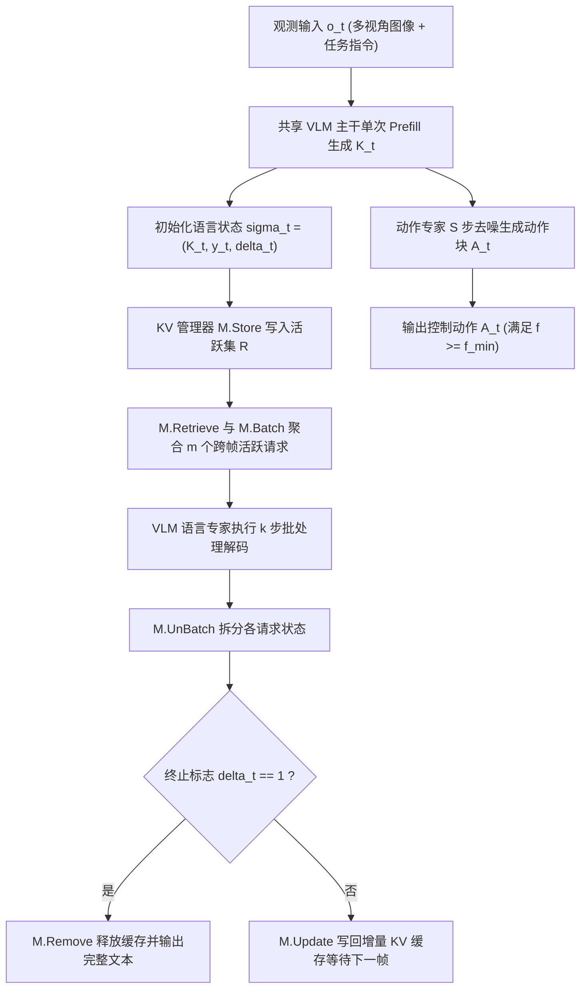
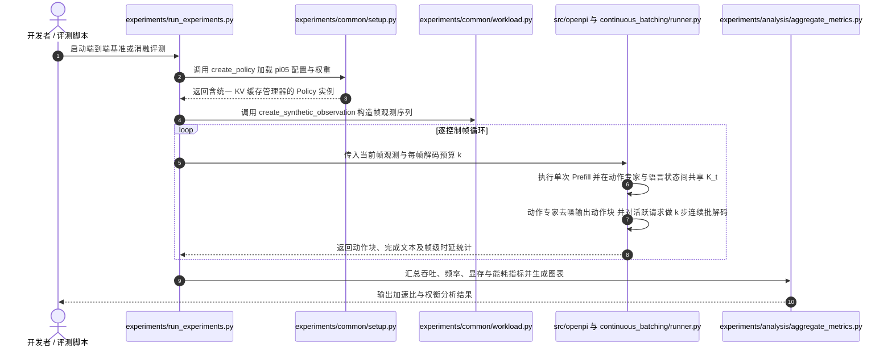

# OxyGen: Unified KV Cache Management for VLA Inference under Multi-Task Parallelism

## 一句话定义

**OxyGen** 是清华大学智能产业研究院（AIR）等机构提出的面向混合 Transformer 架构（MoT）视觉-语言-动作（VLA）模型的多任务并行推理系统，通过将 KV Cache 抽象为跨任务与跨控制周期共享的一等资源，以**跨任务 KV 共享**消除冗余观测编码，并以**跨帧连续批处理**将未完成语言解码均摊到多个控制帧内推进，在保证实时动作频率的同时显著提升并发语言吞吐。

## 英文缩写速查

| 缩写 | 英文全称 | 简要说明 |
|---|---|---|
| MoT | Mixture-of-Transformers | 共享 VLM 观测主干、按输出模态路由至独立动作/语言专家的稀疏多模态架构 |
| VLA | Vision-Language-Action | 融合视觉感知、语言指令理解与机器人动作生成的具身模型 |
| VLM | Vision-Language Model | 对多视角图像与文本提示执行预填充（prefill）并输出共享键值缓存的骨干网络 |
| KV Cache | Key-Value Cache | 注意力层缓存的键张量与值张量；在 OxyGen 中被统一管理以实现跨任务复用与跨帧续跑 |
| MPS | Multi-Process Service | NVIDIA CUDA 多进程共享 GPU 算力机制，文中用作进程级并行隔离基线 |
| LoRA | Low-Rank Adaptation | 低秩微调适配器；OxyGen 在 LIBERO 文本记忆实验中仅对语言续写阶段挂载 LoRA |

## 为什么重要

1. **多任务并行成为具身智能体刚需，但现有系统存在隐性开销**：家庭或服务机器人需要在操纵物体的同时，基于同一帧视觉观测持续生成环境记忆、向用户播报进度或更新规划（即多任务并行）。虽然 $\pi_{0.5}$、Xiaomi-Robotics-0 等 MoT VLA 在模型结构上同时拥有动作与语言专家，但 `openpi` 等传统推理系统采用**隔离执行**（isolated execution），为每个并发任务分别运行完整前向传播。
2. **定位两大系统瓶颈**：作者量化发现，隔离执行存在（i）**冗余计算**——同一帧多视角图像在 VLM 骨干被重复 prefill（在 RTX 4090 上额外消耗约 55–58 ms/帧，导致约 $1.4\times$ 减速）；（ii）**资源竞争与非对称截止期冲突**——动作生成必须满足每帧硬截止期以维持控制频率，而语言生成可跨越多个控制帧；在单一帧内强行完成全部语言解码会直接拖垮控制周期（启用 KV 共享后再叠加跨帧批处理可再提速 $2.7\times$）。
3. **LLM 推理技术无法直接平移**：传统 LLM 服务的 Prefix Caching 与 Continuous Batching 面向纯自回归请求，而在 MoT VLA 中，同一份 prefill KV 必须同时服务**迭代去噪的流匹配/扩散动作专家**和**跨帧递增缓存的语言专家**，且语言解码必须受每帧固定步数预算约束而不打断控制循环。

## 核心信息

| 字段 | 内容或状态 |
|---|---|
| 作者 | Xiangyu Li, Huaizhi Tang, Xin Ding, Weijun Wang, Ting Cao, Yunxin Liu |
| 机构 | 清华大学智能产业研究院（AIR, Tsinghua University）、清华大学电子工程系、中国科学技术大学（USTC） |
| 发表时间 | 2026-03-15 提交 v1，2026-10-16 修订 v5（arXiv:2603.14371v5 [cs.RO]；NeurIPS 2026 Main Track Poster） |
| 论文链接 | [arXiv:2603.14371](https://arxiv.org/abs/2603.14371) / [HTML 全文](https://arxiv.org/html/2603.14371) |
| 项目与代码 | [项目主页](https://air-embodied-brain.github.io/OxyGen/) / [air-embodied-brain/OxyGen](https://github.com/air-embodied-brain/OxyGen)（Apache-2.0；Gemma 组件附 `LICENSE_GEMMA.txt`） |
| 清单分类 | `harness.infrastructure`（来源条目 `survey_ax_2603_14371`） |
| 开源状态 | **已开源**：公开 JAX 与 PyTorch 双后端 $\pi_{0.5}$ 推理与评测代码、LIBERO 文本记忆 LoRA 训练/服务/标注集（HF），以及 Xiaomi-Robotics-0 / StarVLA / Qwen3.5 扩展模块；人型真机驱动与底层控制接入未在仓库文件清单中提供 |

## 核心原理

### 1. 问题形式化：非对称截止期下的多任务并行（§3.1）

在每个控制帧 $t$，智能体接收包含多视角图像与文本指令的观测 $\mathbf{o}_t$。MoT VLA 先通过共享 VLM 主干 $\Theta_{\text{VLM}}$（共 $L$ 层）执行一次 prefill，得到模态无关的 KV Cache：

$$\bigl\{(\mathbf{h}_{t,l},\mathbf{K}_{t,l},\mathbf{V}_{t,l})\bigr\}_{l=1}^{L}=\Theta_{\text{VLM}}(\mathbf{o}_{t}),\quad\mathcal{K}_{t}=\bigl\{(\mathbf{K}_{t,l},\,\mathbf{V}_{t,l})\bigr\}_{l=1}^{L}$$

随后，动作专家 $\Theta_{\text{Act}}$ 基于 $\mathcal{K}_t$ 经过 $S$ 步流匹配或扩散去噪联合生成长度为 $H$ 的动作块 $\mathbf{A}_t = \{\mathbf{a}_{t,i}\}_{i=1}^H$；语言专家 $\Theta_{\text{Lang}}$ 则基于 $\mathcal{K}_t$ 自回归解码至多 $N$ 个文本 token $\mathbf{y}_t = \{y_{t,j}\}_{j=1}^N$。

假设每帧到达 1 个新请求，系统在帧延迟 $T$ 内产出 $H$ 个动作并把批大小为 $B$ 的在途语言请求各推进 $k$ 步解码，则稳态动作频率 $f = H/T$、语言吞吐 $\tau = Bk/T$。系统优化目标是在满足控制频率约束的前提下最大化语言吞吐：

$$\max\;\tau = \frac{Bk}{T} \quad \text{s.t.}\quad f = \frac{H}{T} \ge f_{\min}$$

### 2. 统一 KV 缓存管理器与两项核心优化（§3.2, Appendix A.2–A.3）

OxyGen 引入统一 KV 缓存管理器 $\mathcal{M}$，为每个未完成的语言请求 $r_t$ 维护**可恢复生成状态**（resumable generation state）：

$$\sigma_t = (\mathcal{K}_t,\; \mathbf{y}_t,\; \delta_t)$$

其中 $\mathcal{K}_t$ 存储该请求在帧 $t$ 的 prefill 缓存及后续追加的解码 token KV（预分配至多 $N$ 个输出 token 的槽位），$\mathbf{y}_t$ 记录已生成文本，$\delta_t \in \{0, 1\}$ 为终止标志（输出 EOS 或达到长度 $N$ 时置 1）。管理器暴露 `Store`、`Retrieve`、`Update`、`Remove` 四个状态持久化原语，以及 `Batch` / `UnBatch` 原语将活跃请求集合 $\mathcal{R} = \{r_{t_1}, \dots, r_{t_m}\}$ 沿 batch 维拼接为批状态 $\hat{\sigma} = (\hat{\mathcal{K}}, \hat{\mathbf{y}}, \hat{\boldsymbol{\delta}})$（保留各自 token 位置与注意力掩码）。

单帧执行分为两阶段：

1. **跨任务 KV 共享（Cross-Task KV Sharing）**：对新观测 $\mathbf{o}_t$ 只执行一次 $\text{Prefill}(\mathbf{o}_t)$ 生成 $\mathcal{K}_t$，一边送入动作专家执行 $S$ 步去噪产出 $\mathbf{A}_t$，一边用于初始化新语言状态 $\sigma_t$ 并写入 $\mathcal{M}$。当模型扩展到多动作专家（如同时挂载 PI_v3、GR00T 与 OFT）或语言侧仅启用 LoRA 适配器时，所有专家仍可复用同一次 prefill。
2. **跨帧连续批处理（Cross-Frame Continuous Batching）**：将 $r_t$ 加入活跃集 $\mathcal{R}$，$\mathcal{M}$ 检索全部 $m = |\mathcal{R}|$ 个未完成请求并打包为 $\hat{\sigma}$，在固定**每帧解码预算 $k$**（per-frame decoding budget）内执行 $k$ 步批处理自回归解码；随后解包，释放 $\delta=1$ 的已完成请求并更新其余请求写回 $\mathcal{M}$，留待后续控制帧续跑。在每帧 1 个新请求且固定长度 $N$ 的稳态下，活跃批大小收敛到 $B \approx N/k$，单个语言请求耗时约 $\lceil N/k \rceil T$，从而以可控的语言完成延迟换取高频稳定的控制周期与高吞吐。

## 流程总览

## 源码运行时序图

官方仓库 [`air-embodied-brain/OxyGen`](https://github.com/air-embodied-brain/OxyGen) 已完整开源基于 `openpi`（JAX / PyTorch）的统一 KV 缓存运行时与多模型扩展（归档见 [sources/repos/paper-agentic-2603-14371.md](../../sources/repos/paper-agentic-2603-14371.md)）。以下时序图对齐仓库 `experiments/` 核心评测与推理主链路（基于静态代码结构核对）：

核心复现入口为 `experiments/common/setup.py` 中的 `create_policy("pi05_o2_arx")` 与 `experiments/run_experiments.py`（分别调用 `baseline/`、`parallel_mps/`、`shared_kv/` 与 `continuous_batching/` 下的 `runner.py`）；面向 Xiaomi-Robotics-0、StarVLA 与 Qwen3.5 的扩展执行入口位于 `model_extensions/run.py`（底层调用 `oxygen_models/starvla/batching.py` 等模块）。

## 实验与评测

### 1. $\pi_{0.5}$ 端到端性能与模块消融（§4.2–§4.3, Appendix B.1, D.1）

评测在 NVIDIA GeForce RTX 4090（24 GB）和 Jetson AGX Thor 上基于 LIBERO、DROID、ALOHA 三套观测/动作配置进行（默认动作块 $H=10$、去噪步数 $S=10$，扫描 $k \in \{1,5,10\}$、$N \in \{5,10,15,20,30\}$）：

- **端到端 Pareto 前沿扩展**：在相同输出长度下，OxyGen 相对顺序隔离基线实现 **1.2–3.7×** 的动作频率与语言吞吐同步提升；在 RTX 4090 上可同时达成 **> 200 tokens/s** 语言吞吐与 **70 Hz** 动作频率。
- **跨任务 KV 共享消融（LIBERO, RTX 4090, $S=10$）**：在 $N=5$ 时仅开启 KV 共享（`Ours w/o Batching`）即把帧延迟由 200.3 ms 降至 145.1 ms（**1.4×** 加速），每帧节省约 55–58 ms 重复 prefill（Table 6 拆解显示单次 prefill 占 44.04 ms，是动作去噪 20.46–20.50 ms 的两倍以上，端到端延迟在 $N=1/5/30$ 时分别降低 36.4% / 25.9% / 9.4%）。
- **跨帧连续批处理消融**：当语言输出增长至 $N=30, k=5$ 时，在已开启 KV 共享基础上再启用连续批处理，将 RTX 4090 帧延迟从 469.3 ms 进一步压低至 **175.8 ms**（额外 **2.7×** 加速，动作频率由 21.3 Hz 跃升至 **56.9 Hz**；单请求语言完成中位时间为 1.057 s，符合理论估算 $\lceil 30/5 \rceil \times 175.8\text{ ms} = 1.055\text{ s}$）。随着 $N$ 增大，OxyGen 在 RTX 4090 上稳定维持约 **60 Hz**、在 Jetson AGX Thor 上稳定维持约 **27 Hz**。
- **动态到达负载（§4.5）**：在均匀到达、泊松到达与长短混合请求流下，OxyGen 在混合长度负载中将动作频率稳定保持在 **59–62 Hz**，同时平均语言批大小在 1.1–3.5 之间自适应调节。

### 2. 跨骨干网络与多专家迁移（§4.4, Appendix C, Table 1, Table 4–5）

在 RTX 4090 上，$N=30$ 时不同 MoT 架构与参数规模的加速表现如下（所有加速比均相对同配置隔离执行基线）：

| 模型 / 配置 | 专家数 $E$ | 基线帧延迟 (ms) | 仅 KV 共享 | OxyGen ($k=1$) | OxyGen ($k=5$) | OxyGen ($k=10$) |
|---|---|---|---|---|---|---|
| Xiaomi-Robotics-0 ($S=5$) | 2 | 562.8 | $1.07\times$ | $5.83\times$ | $3.23\times$ | $2.03\times$ |
| StarVLA Qwen3VL-PI_v3 ($S=4$) | 2 | 478.0 | $1.05\times$ | $6.64\times$ | $3.60\times$ | $2.35\times$ |
| StarVLA + GR00T | 3 | 515.8 | $1.11\times$ | $6.05\times$ | $3.53\times$ | $2.38\times$ |
| StarVLA + GR00T + OFT | 4 | 541.2 | $1.16\times$ | $6.30\times$ | $3.69\times$ | $2.49\times$ |

- **多专家缩放**：在无跨帧批处理的 $N=k=5$ 场景下，随专家数量从 2 增至 4，每帧通过前缀复用分别节省约 25 / 50 / 75 ms，整体加速比从 $1.23\times$ 提升至 $1.40\times$ 与 $1.59\times$。
- **骨干尺寸缩放与张量并行**：在 StarVLA 中替换 Qwen3.5（0.8B / 2B / 4B / 9B，16 步动作，$S=4$），$N=30, k=5$ 时加速比分别为 **$3.58\times / 3.62\times / 3.71\times / 3.79\times$**（$k=1$ 时达 $6.30\times$–$7.18\times$）；批大小从 1 增至 30 时，4B 模型单 token 解码仅从 16.0 ms 增至 18.2 ms（9B 从 20.7 ms 增至 27.2 ms）。9B 模型在无 NVLink 的双 RTX 4090 PCIe 服务器上启用 TP=2 仍保持 $3.71\times$ 加速（TP=1 为 $3.50\times$），但帧延迟因跨卡通信由 493.4 ms 略增至 535.3 ms。

### 3. 动作质量、显存能耗与长时稳定性（§4.6, Table 2–3, Appendix D.2–D.3）

- **LIBERO 任务成功率（Table 2）**：基于官方 $\pi_{0.5}$-LIBERO 权重在 10 个随机种子、4 个套件共 20,000 次 rollout 评测中，OxyGen 整体成功率为 **96.76%**（95% CI: `[96.55%, 96.97%]`），与 `openpi` 发布的点估计 **96.85%** 保持一致（Spatial 98.42% vs 98.80%、Object 98.52% vs 98.20%、Goal 97.24% vs 98.00%、LIBERO-10 92.86% vs 92.40%）。
- **显存与能耗（Table 3, RTX 4090）**：在批大小 4 下，OxyGen 峰值显存从基线 6.43 GiB 升至 **7.41 GiB**（仅增 **15%**），但平均功耗从 293.5 W 降至 **154.4 W**（降 **47%**），单请求能耗从 117.4 J 骤降至 **25.8 J**（降 **78.0%**）；相比之下，CUDA MPS 进程并行使显存近乎翻倍（12.49 GiB）且单请求能耗反升 3.0%（120.9 J）。
- **KV 管理开销与长时压测（Table 7, Fig. 12）**：在批大小 6（$k=5$）时，管理器开销仅占帧延迟的 **3.40%**（JAX: 5.01 / 147.59 ms）与 **1.24%**（PyTorch: 2.08 / 168.32 ms）；批大小 30（$k=1$）时升至 **17.48%**（JAX）与 **6.63%**（PyTorch），主要来自张量拼接/拆分（KV splitting）。3,000 帧变负载压测中，活跃显存稳定有界（JAX 6.57–6.94 GiB，PyTorch 7.29–7.65 GiB），无内存泄漏。

### 4. 人形机器人实机部署（§4.7, Fig. 8）

在搭载板载 **Jetson AGX Thor** 的人形机器人平台上（3 路 224×224 RGB 相机，$H=10, S=10, N=30, k=5$）：

- 隔离基线：动作路径 207.5 ms + 语言路径 822.3 ms = **1030 ms**；
- OxyGen：动作路径 198.0 ms + 语言路径 195.4 ms = **393 ms**；一旦动作下发，195.4 ms 的语言解码可完全隐藏在 333.0 ms 的物理动作执行窗口内。

## 与其他工作对比

| 对比维度 | 顺序隔离执行（`openpi` Baseline） | 进程并行执行（CUDA MPS Parallel） | 通用 LLM 服务（vLLM / SGLang） | **OxyGen（本文）** |
|---|---|---|---|---|
| 跨专家观测复用 | 无（每个任务重复 prefill） | 无（两进程重复 prefill） | 仅限同构自回归前缀 | **跨任务共享单次 prefill $\mathcal{K}_t$**（覆盖去噪动作专家与自回归语言专家） |
| 跨帧语言调度 | 单帧同步跑完所有 $N$ 步 | 独立进程无协调竞争 GPU | 按 token 到达持续调度，无控制帧预算 | **跨帧连续批处理 + 固定每帧预算 $k$**，优先保障动作控制截止期 |
| 显存与能耗特征（RTX 4090） | 6.43 GiB，293.5 W，117.4 J/req | 12.49 GiB（近翻倍），120.9 J/req | 面向云端大批量请求 | **7.41 GiB（+15%），154.4 W，25.8 J/req（-78%）** |
| 与模型级/执行级优化关系 | 基线运行时 | 易引发边缘平台（如 Thor）负优化 | 需外部桥接 | 与模型压缩/剪枝（如 KV-Efficient VLA）及异步执行（如 RTC / VLASH）**正交可组合** |

## 结论

**一句话总判：在单帧观测同时触发高频控制与跨周期语言任务的 MoT VLA 部署场景下，将 KV Cache 统一为共享调度一等资源比单纯拉高算力或开多进程 MPS 更能决定端侧实时性；OxyGen 用仅 15% 的显存代价换取高达 $3.7\times$（多专家/小 $k$ 下最高 $7.18\times$）的加速与 78% 的能耗降幅。**

1. **短输出靠 KV 共享，长输出靠连续批处理**：当语言生成很短（$N \le 5$）时，避免重复 prefill（节省 44–58 ms/帧）是主收益；当 $N$ 增大至 20–30 时，跨帧批处理才是把控制频率钉在 ~60 Hz（4090）/ ~27 Hz（Thor）的关键。
2. **注意 $N=k$ 的退化边界**：若每帧语言预算 $k$ 等于总长度 $N$（单帧即结束，没有跨帧积压请求），连续批处理退化为批大小 1 并带来轻微软件调度开销（如 Xiaomi-Robotics-0 在 $N=k=10$ 时为 $0.96\times$），此时应仅依赖跨任务 KV 共享或调小 $k$。
3. **CUDA MPS 在端侧易产生负收益**：在 Jetson AGX Thor 上用多进程并发跑动作与语言不仅显存翻倍，还会因无序争抢显存带宽导致总体性能倒退。
4. **选定 $k$ 即是在控制频率与文本响应延迟间划定显式权衡**：单个语言请求完成时间近似 $\lceil N/k \rceil T$，工程部署时应在硬件上按目标控制频率 $f_{\min}$ 反推最大允许的 $k$。
5. **管理器开销与后端选择有关**：当批大小扩大到 30（$k=1$）时，当前实现的 KV 拼接与拆分（`Batch` / `UnBatch`）在 JAX 中占帧时间达 17.48%（PyTorch 为 6.63%），若进一步追求极大并发批，需引入持久化固定槽位（persistent cache slots）消除拷贝。

## 工程实践

1. **环境与配置基线**：仓库使用 `uv` 与 Python 3.11 管理依赖，拉取依赖时需设置 `GIT_LFS_SKIP_SMUDGE=1` 避免 `lerobot` 大文件拉取阻塞；默认 $\pi_{0.5}$ 权重自动缓存至 `~/.cache/openpi`。
2. **参数配置建议**：
   - 控制帧率优先场景（如桌面精细操作或双臂控制）：建议将每帧语言解码预算设为 $k \in [1, 5]$，在确保动作刷新周期的同时通过跨帧聚批摊薄 VLM 访存。
   - 多任务附加适配（Appendix E）：可在共享冻结主干与 prefill 的前提下，仅为语言续写分支挂载低秩 LoRA（如 LIBERO 文本记忆实验中使用的 rank-16 LoRA），避免破坏动作分布与前缀复用。
3. **跨框架扩展**：仓库 `model_extensions/` 针对 Xiaomi-Robotics-0、StarVLA（含 PI_v3 / GR00T / OFT 多动作头）和 Qwen3.5 提供了独立环境锁文件，工程落地时可先用 `experiments/run_workload_sweep.py` 在目标 GPU 上扫描 $(k, N)$ 找准满足 $f_{\min}$ 的工作点。

## 局限与风险

1. **多模态覆盖边界**：当前系统仅验证了「流匹配/扩散动作专家 + 自回归语言专家」的组合，对于同时包含视频生成、点云或更多异步传感模态的统一世界模型（如视频输出头）尚缺乏实测验证。
2. **闭环训练与真实并发应用链**：文中主基准大多在固定请求到达模式与合成/回放文本长度下测得，仅在 Appendix E 演示了 LIBERO 文本记忆生成；覆盖真实家庭多轮交互、端到端多任务联合训练与长期闭环部署的协同收益仍待充分评估。
3. **固定 $k$ 与通信开销约束**：当前实现采用静态固定解码步数 $k$，面对突发高频控制需求或极长文本时缺少动态优先级抢占；此外在无 NVLink 的多卡 PCIe 环境下，张量并行（TP=2）的跨卡通信反而略微抬高绝对帧延迟。
4. **物理执行安全**：尽管整体任务成功率与基线持平，加速推理后的错误语言记忆或异常动作输出在真机场景仍存在安全风险，需配合底层安全限位与任务监督机制。

## 关联页面

- [Agentic Robots 综述](paper-towards-agentic-robots-survey.md)
- [全量项目节点清单](../overview/awesome-agentic-robots-node-index.md)
- [VLA 方法背景](../methods/vla.md)
- [机器人智能体执行框架](../methods/robot-agent-harness.md)
- [AI 模型服务与推理优化](../methods/ai-model-serving-inference.md)
- [Action Chunking 动作块生成](../methods/action-chunking.md)
- [Pi0 系列流匹配 VLA 策略](../methods/pi0-policy.md)
- [StarVLA 乐高式 VLA 框架](../methods/star-vla.md)
- [机器人操作任务](../tasks/manipulation.md)
- [π0.5 开放世界泛化 VLA](paper-pi05-open-world-vla.md)
- [StarVLA 论文与工程架构](paper-starvla-framework.md)
- [Jetson AGX Thor 上部署 openpi π0.5](jetson-openpi-pi05-on-thor.md)
- [VLA-Perf 推理性能 Roofline 建模](paper-agentic-2602-18397.md)

## 推荐继续阅读

- [OxyGen 官方项目主页与 LIBERO 回放演示](https://air-embodied-brain.github.io/OxyGen/)
- [OxyGen 官方 GitHub 仓库与实验指南](https://github.com/air-embodied-brain/OxyGen)
- [OxyGen arXiv HTML 原文（arXiv:2603.14371v5）](https://arxiv.org/html/2603.14371)

## 参考来源

- [论文原文归档：OxyGen（arXiv:2603.14371v5）](../../sources/papers/paper-agentic-2603-14371.md)
- [官方代码归档：air-embodied-brain/OxyGen](../../sources/repos/paper-agentic-2603-14371.md)
- [官方 Awesome 快照归档](../../sources/repos/awesome-agentic-robots-survey-index.md)
- [论文官方入口（arXiv:2603.14371）](https://arxiv.org/abs/2603.14371)
- [官方代码仓库（GitHub）](https://github.com/air-embodied-brain/OxyGen)
