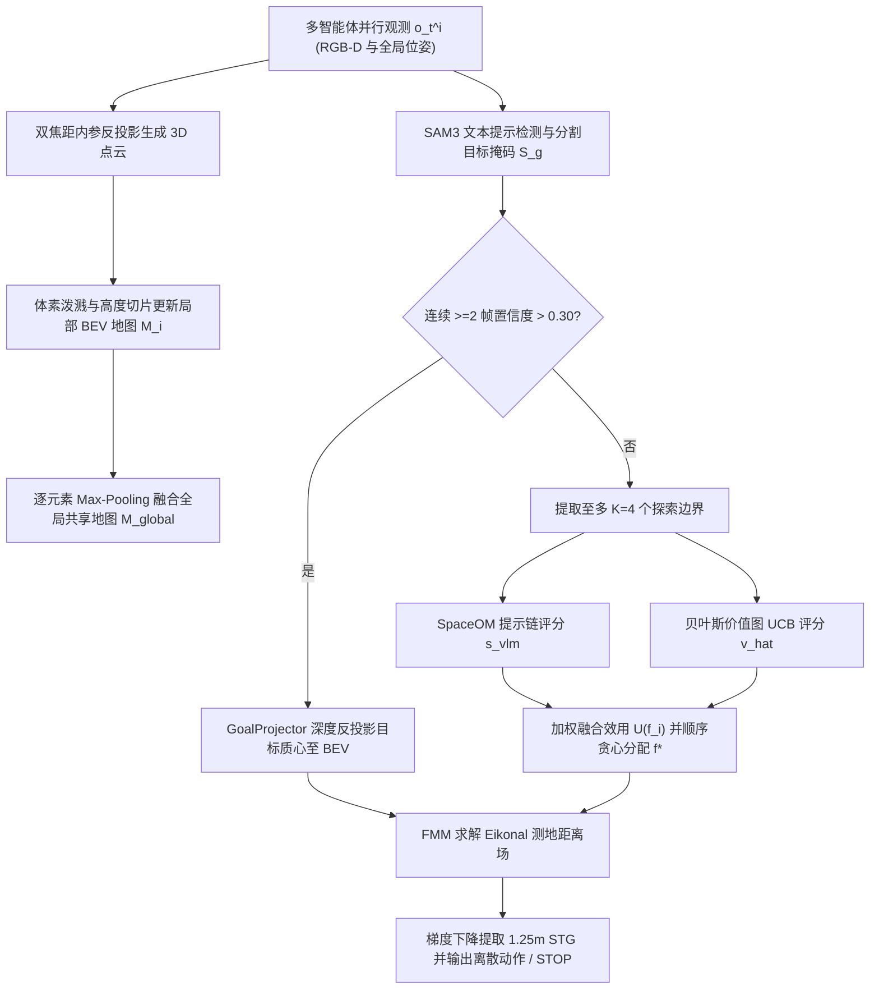

# GoalVLM: VLM-driven Object Goal Navigation for Multi-Agent System

## 一句话定义

GoalVLM 是斯科尔科沃科学技术研究院（Skoltech）提出的去中心化多智能体零样本开放词表目标导航（ObjectNav）框架，它通过双焦距深度反投影构建共享鸟瞰图（BEV）语义地图，并结合 SAM3 目标定位、SpaceOM 视觉-语言边界推理与贝叶斯价值图引导快速行进法（FMM）协同探索，在无需针对导航任务重新训练的前提下定位自由文本描述的目标物体。

## 英文缩写速查

| 缩写 | 英文全称 | 简要说明 |
|---|---|---|
| VLM | Vision-Language Model | 视觉语言模型，在 GoalVLM 中采用 SpaceOM 执行场景描述、房间类型判断与探索边界排序 |
| ObjectNav | Object-Goal Navigation | 目标导航任务，要求智能体在未知环境中自主探索并停在指定类别目标实例附近 |
| BEV | Bird's-Eye View | 鸟瞰图栅格表征，通过体素泼溅与高度切片汇聚多智能体共享的障碍物与语义地图 |
| FMM | Fast Marching Method | 快速行进法，在可通行栅格上求解 Eikonal 方程以计算测地距离场并提取短期路点 |
| UCB | Upper Confidence Bound | 上置信界策略，结合贝叶斯价值均值与方差偏置引导向高价值且欠探索区域推进 |
| Dec-POMDP | Decentralized Partially Observable Markov Decision Process | 去中心化部分可观测马尔可夫决策过程，用于形式化多智能体局部观测下的协同搜索 |

## 为什么重要

1. **打破封闭词表与固定概率图限制**：传统多智能体目标导航常依赖针对固定类别集预训练的概率图模型，遇到测试时才出现的新颖自由文本目标即失效；GoalVLM 通过 SAM3 与 SpaceOM 实现零样本开放词表理解。
2. **揭示竖屏 RGB-D 非均匀缩放的建图陷阱**：论文通过工程消融指出，竖屏传感器降采样（$360\times 640 \to 160\times 120$）若沿用单一焦距假设（$f_x=f_z$）会引发纵向畸变并把地面像素误投为障碍物，提出分别缩放水平与垂直焦距的修正模型。
3. **验证去中心化多机协同对长序导航的增益**：在需要连续定位 5–7 个开放词表目标的 GOAT-Bench 基准上，双智能体共享语义地图与顺序贪心边界分配相比单智能体显著提升任务成功率，同时在双旋翼真机平台上完成了感知建图链路验证。

## 核心信息

| 字段 | 内容 |
|---|---|
| 作者 | MoniJesu James, Amir Atef Habel, Aleksey Fedoseev, Dzmitry Tsetserokou |
| 机构 | 斯科尔科沃科学技术研究院（Skoltech）数字工程中心智能空间机器人实验室 |
| 发表时间 | 2026-03-18（arXiv:2603.18210v1） |
| 论文链接 | [arXiv:2603.18210](https://arxiv.org/abs/2603.18210)（HTML 全文：[arXiv HTML](https://arxiv.org/html/2603.18210)） |
| 项目与代码 | 截至 2026-11-27，arXiv 原文及检索来源未提供独立项目主页或官方代码仓库链接 |
| 清单分类 | `model.perception`（来源条目：`survey_ax_2603_18210`） |
| 开源状态 | **未确认开源代码**（仅公开论文全文与方法细节，尚无官方可执行代码仓库） |

## 核心原理

GoalVLM 将多智能体开放词表目标导航形式化为 Dec-POMDP：在未知环境 $\mathcal{E}$ 中部署 $N$ 个同构智能体 $\mathcal{A}=\{a_1,\dots,a_N\}$，按顺序定位自然语言类别 $g \in \mathcal{G}$（379+ 开放词表类别）的目标实例。每个时间步 $t$，智能体 $a_i$ 接收 RGB-D 图像与全局位姿 $o_t^i=(I_t^{rgb}, I_t^{depth}, p_t^i)$，并从 6 维离散动作空间 `{STOP, MOVE_FORWARD (0.25 m), TURN_LEFT/RIGHT (±30°), TURN_LEFT_S/RIGHT_S (±10°)}` 中选择动作，在目标 1.0 m 欧氏距离内触发 `STOP` 判定成功。

### 1. 双焦距内参修正与 BEV 体素泼溅建图
针对传感器分辨率 $(W_s, H_s)$ 到处理分辨率 $(W_p, H_p)$ 的非均匀缩放（例如竖屏 $360\times 640 \to 160\times 120$），计算独立水平/垂直焦距：
$$f_s = \frac{W_s}{2\tan(\theta_{hfov}/2)}, \quad f_x = f_s \cdot \frac{W_p}{W_s}, \quad f_z = f_s \cdot \frac{H_p}{H_s}$$
各深度像素 $(u,v)$ 反投影为相机坐标系三维点 $\mathbf{P}_{cam} = [(u-c_x)d_{uv}/f_x,\; d_{uv},\; (v-c_y)d_{uv}/f_z]^T$，再经相机俯仰旋转 $\mathbf{R}_\phi$ 与安装高度 $h_s=1.31\text{ m}$ 平移至地理中心点云 $\mathbf{P}_{geo}$。点云通过可微体素泼溅累积至 $\mathcal{V} \in \mathbb{R}^{V\times V\times Z\times C}$，并在可行走高度带 $[z_{min}=25\text{ cm},\; z_{max}=h_s+50\text{ cm}]$ 内沿高度维求和并阈值化，得到障碍物栅格 $\mathcal{M}_{obs}(x,y)$。

### 2. 双路零样本感知与 GoalProjector 定位
- **开放词表目标检测（SAM3）**：向 SAM3 输入当前 RGB 帧与文本目标 $g$，输出检测框 $\{(b_i, c_i)\}$ 与像素级掩码 $\mathcal{S}_g$。`GoalProjector` 将目标掩码经标定深度反投影至 BEV 语义层，并采用多视角确认机制（连续 $N_{confirm} \ge 2$ 帧置信度超过 $\tau_{det}=0.30$）抑制单帧误检后再触发目标趋近。
- **VLM 空间常识推理（SpaceOM）**：当目标尚未被确认检测到时，在已探索空闲区与未知区边界提取至多 $K=4$ 个候选探索边界（frontiers），调用 SpaceOM 通过结构化提示链（场景描述、房间类型分类、感知门控、多边界排序）输出各边界包含目标的后验概率 $s_i^{\text{vlm}} = P(g \mid f_i, \mathcal{H}_t)$（例如将“微波炉”先验关联至“厨房”方向）。

### 3. 贝叶斯价值图与约束引导边界评分
为跨视角累积探索证据，每个智能体维护均值价值图 $\mathcal{V}\in\mathbb{R}^{S\times S}$ 与方差图 $\Sigma\in\mathbb{R}^{S\times S}$（初始化 $\mu_0=0.5, \sigma_0^2=0.5$）。根据深度可视锥掩码 $m(x,y)$ 与观测方差 $\sigma_{obs}^2 = 1 - m(x,y)$，按贝叶斯高斯融合更新价值估计，并以 UCB 指标评估边界中位价值与不确定性（$\beta=1.7$）：
$$\text{UCB}(f_i) = \mu(f_i) + \beta\sqrt{\sigma^2(f_i)}$$
将归一化后的 $\hat{v}_i$ 与 VLM 概率加权融合（$w=0.35$）：$U(f_i) = (1-w)\cdot s_i^{\text{vlm}} + w\cdot \hat{v}_i$，选出最优探索边界 $f^* = \arg\max U(f_i)$。

### 4. FMM 局部路径规划与去中心化多机协同
- **FMM 测地导航**：在可通行图上求解 Eikonal 方程 $|\nabla T(\mathbf{x})|=1/v(\mathbf{x})$ 得到到目标 $\mathbf{x}_g$ 的测地距离场（时间复杂度 $O(n\log n)$），通过梯度下降提取短期目标（STG，限幅在 25 格 / 1.25 m 以内）并映射为离散转向与前进动作。
- **共享地图与顺序贪心分配**：每步各智能体通过逐元素最大池化 $\mathcal{M}_{global}(x,y,c)=\max_i \mathcal{M}_t^i(x,y,c)$ 同步障碍物与语义检测；边界分配采用顺序贪心协议，$a_0$ 锁定最高分边界后将其从候选集移除，$a_1$ 从剩余边界中择优探索，以低通信开销消除双机重复覆盖。

## 流程总览

## 源码运行时序图

**不适用**（核查结果：截至 2026-11-27，arXiv:2603.18210 原文及关联检索来源均未提供独立项目主页、官方 GitHub 仓库或可运行源码；方法细节与执行环路均依据论文 Algorithm 1 与 Sections III-B–III-H 整理）。

## 实验与评测

### 1. GOAT-Bench `val_unseen` 主实验（Table I，HM3D 场景）
在 360 个多子任务回合（GoalVLM 实测报告 357/360 回合、1032 个顺序子任务，每回合含 5–7 个开放词表目标，每子任务上限 500 步）上的子任务级评测结果如下：

| 方法 | 范式 | 子任务 SR ↑ | SPL ↑ |
|---|---|---|---|
| SenseAct-NN Monolithic | RL | 0.123 | 0.068 |
| Modular CLIP on Wheels | Zero-Shot | 0.161 | 0.104 |
| VLMNav | Zero-Shot | 0.163 | 0.066 |
| DyNaVLM | Zero-Shot | 0.255 | 0.102 |
| 3D-Mem | 3D Memory | 0.288 | 0.158 |
| Modular GOAT (ObjectNav) | Explicit Map | 0.294 | 0.175 |
| SenseAct-NN Skill Chain | RL | 0.295 | 0.113 |
| **GoalVLM (Ours, $N=2$)** | **Zero-Shot Multi-Agent** | **0.558** | **0.183** |
| AstraNav-Memory | End-to-End（Qwen2.5-VL-3B 微调） | 0.627 | 0.569 |

注：正文 IV-B 报告 `val_unseen` 平均终局距离 DTG 为 1.42 m（IV-F 讨论节另统计平均 DTG 为 1.39 m、中位数 0.91 m，且 52.3% 回合终局位于目标 1.0 m 内）。

### 2. 消融实验（Table II，GOAT-Bench `val_seen` 50 回合 / 137 子任务）

| 配置 | SR ↑ | SPL ↑ | DTG (m) ↓ |
|---|---|---|---|
| GoalVLM（基线，$N=2$） | **0.562** | **0.163** | **1.37** |
| 去除 VLM 边界推理（保留 SAM3 + GoalProjector） | 0.540 | 0.150 | 1.94 |
| 单智能体（$N=1$） | 0.386 | 0.150 | 2.00 |

- **多智能体增益**：Table II 显示由单机 $N=1$ 增至双机 $N=2$ 使成功率由 38.6% 提升至 56.2%（约 $1.5\times$），DTG 从 2.00 m 降为 1.37 m（注：原文 IV-F 与 V 节文本曾以 32.0%→56.2% / $1.8\times$ 概括该对比，阅读时应以 Table II 数值为准）。
- **相机内参修正**：采用分离的双焦距（$f_x \neq f_z$）消除了竖屏非均匀缩放在可通行高度层造成的地面点云污染。

### 3. 失败分析与真机初步验证（Tables III–IV, Figs. 4–5）
- **回合结果分布（$N=357$）**：完美成功（全子任务 $\text{SR}=1$）111 回合（**31.1%**），部分成功（$0<\text{SR}<1$）172 回合（**48.2%**），完全失败（$\text{SR}=0$）74 回合（**20.7%**）。74 个完全失败按终局 DTG 归类：检测/定位失败（1.5–3.0 m）占 **43.7%**，探索失败（>3.0 m）占 **36.6%**，接近/停止失败（<1.5 m）占 **19.7%**。
- **按目标类别与子任务顺序**：反光/透明材质与小物体最难（`mirror` 47.6% / $n=63$，`window glass` 33.3% / $n=9$），特征鲜明的大件物体成功率较高（`refrigerator` 72.7% / $n=55$，`piano` 80.0% / $n=5$）；第 1–4 顺序子任务 SR 分别为 56.1%、58.8%、55.6%、49.0%，长序级联退化相对可控。
- **双旋翼真机感知验证（Table IV）**：采用 2 架定制四旋翼无人机（RealSense D435/D435i、Orange Pi 5、ArduPilot/MAVROS ROS 2、Vicon 动捕，$10\times 5\text{ m}$ 室内场地），通过 WiFi/ZMQ（20 Hz 状态、10 Hz 图像）推流至地面站运行 GoalVLM 感知建图栈，验证了椅子、手推车与行李箱的实时检测与 BEV 定位（全闭环 VLM 自主飞行留待后续）。

## 与其他工作对比

- **对比 Modular GOAT 与 3D-Mem**：在 GOAT-Bench `val_unseen` 上，GoalVLM（55.8% SR / 18.3% SPL）相对显式建图基线 Modular GOAT（29.4% SR / 17.5% SPL）与 3D-Mem（28.8% SR / 15.8% SPL）大幅提高了子任务到达率，主要收益来自开放词表分割与双智能体协同覆盖。
- **对比单机零样本 VLM 导航（VLMNav / DyNaVLM）**：VLMNav（16.3% SR）与 DyNaVLM（25.5% SR）受限于单智能体探索效率与视觉定位误差；GoalVLM 通过多视角确认（$N_{confirm} \ge 2$）、`GoalProjector` 深度反投影与双机边界分工实现了显著更高的完成率。
- **对比端到端微调记忆模型（AstraNav-Memory）**：AstraNav-Memory 依靠在导航轨迹上微调的 3B VLM 取得 62.7% SR 与 **56.9% SPL**，路径效率远高于 GoalVLM（18.3% SPL）；GoalVLM 的优势在于完全免任务微调与显式多机地图共享，但在探索冗余步数上存在明显代价。

## 结论

**一句话总判：GoalVLM 证明了无需任务微调即可凭借“开放词表分割 + 深度反投影 BEV 建图 + VLM 边界评分 + 双机地图共享”在多阶段开放词表导航中取得接近微调模型的高成功率（55.8% SR），但纯边界探索机制造成了显著的路径冗余（18.3% SPL）。**

1. **优先修复感知与投影几何链路，收益大于盲目调大 VLM**：论文消融表明，去除 VLM 边界推理仅使 SR 从 56.2% 降至 54.0%，而相机双焦距修正、多视角确认和双机协同才是支撑定位稳定性与覆盖率的核心。
2. **多机协同适合提升高预算下的覆盖上限，但需权衡 SPL 折损**：双机使成功率大幅跃升，而模块化边界推进机制仍需物理访问边界才能验证，对路径长度敏感的场景应配合信息增益加权或学习型局部策略。
3. **透明/镜面物体需要深度异常过滤机制**：直接将 SAM3 掩码经原始深度反投影会导致镜面虚像将目标错定在墙后，部署前必须加入镜面深度一致性检验或几何先验过滤。
4. **当前工程落地处于“离线真机感知验证”阶段**：由于官方源码未公开且真机实验仍依赖 Vicon 动捕提供位姿，现阶段复现需自行搭建 SAM3/SpaceOM 与 Habitat/ROS 2 通信桥接并补全机载里程计。

## 工程实践

- **传感器与预处理对齐**：仿真采用 $360\times 640$ 竖屏 RGB-D 输入（HFOV $42^\circ$、相机高 $1.31\text{ m}$、有效深度 $[0.5\text{ m}, 5.0\text{ m}]$），降采样至 $160\times 120$ 时务必分别计算水平与垂直缩放比 $s_x, s_y$ 更新 $f_x, f_z$，并设置可行走切片下界 $z_{min}=25\text{ cm}$ 过滤地面噪声。
- **超参数与门控配置**：开放词表检测阈值 $\tau_{det}=0.30$、连续确认帧数 $N_{confirm}=2$；边界候选上限 $K=4$，VLM 与价值图融合权重 $w=0.35$，UCB 探索系数 $\beta=1.7$，FMM 短期路点截断距离 $1.25\text{ m}$（25 格）。
- **通信与真机架构参考**：真机侧可通过轻量机载计算单元（Orange Pi 5）采集 RealSense 深度与飞控状态，经 ZMQ 异步推流（10 Hz 图像 / 20 Hz 状态）至地面站运行重型 VLM 与分割模型，再将控制指令经 MAVROS 下发至 ArduPilot。

## 局限与风险

1. **路径效率（SPL）显著落后于微调策略**：18.3% 的 SPL 明显低于 AstraNav-Memory 的 56.9%，反映出基于离散边界探索需要反复逼近未探索区域，绕路成本高。
2. **二维 BEV 地图的表达边界**：当前高度切片栅格无法表征多层楼结构或垂直堆叠物体，限制了跨楼层场景适用性。
3. **透明、反光与小物体检测退化**：在所有完全失败回合中检测/定位问题占比最高（43.7%），镜面反射引发的虚假深度会把目标投影至墙体后方，而小物体因可见面积不足难以通过连续多帧置信度门控。
4. **代码未公开与真机闭环尚未完成**：截至 2026-11-27 未见官方代码发布；真机实验依赖 Vicon 动捕隔离漂移，且尚未验证完整的闭环自主 VLM 飞行决策。

## 关联页面

- [机器人视觉感知栈选型闭环](../queries/robot-perception-stack-selection-loop.md)：对照视觉感知与开放词汇定位选型闭环。
- [Agentic Robots 综述](paper-towards-agentic-robots-survey.md)
- [全量项目节点清单](../overview/awesome-agentic-robots-node-index.md)
- [VLA 方法背景](../methods/vla.md)
- [零样本目标导航](../tasks/zero-shot-object-navigation.md)：对照相关方法与适用场景。
- [机器人导航工作流](../methods/robot-navigation-workflow.md)：理解语义建图、全局边界规划与局部路点跟踪的模块划分。
- [机器人视觉感知](../methods/robot-visual-perception.md)：深入理解 RGB-D 反投影、体素化与开放词表语义分割管线。
- [目标检测方法](../methods/object-detection.md)：对比开放词表文本提示检测与传统封闭集检测器边界。
- [智能体规划与反馈机制](../methods/agent-planning-feedback.md)：对比 VLM 提示链边界排序与反馈重规划机制。
- [视觉语言导航任务](../tasks/vision-language-navigation.md)：区分细粒度指令跟随（VLN）与高层次类别搜索（ObjectNav）。
- [自主探索任务](../tasks/autonomous-exploration.md)：对照经典基于边界的探索策略与语义价值图引导机制。

## 推荐继续阅读

- [GoalVLM 原文（arXiv:2603.18210）](https://arxiv.org/abs/2603.18210)
- [GoalVLM HTML 全文版（arXiv HTML）](https://arxiv.org/html/2603.18210)
- [GOAT-Bench 多模态终身导航基准（arXiv:2404.06609）](https://arxiv.org/abs/2404.06609)

## 参考来源

- [GoalVLM 论文全文核对档案](../../sources/papers/paper-agentic-2603-18210.md)
- [官方 Awesome 快照归档](../../sources/repos/awesome-agentic-robots-survey-index.md)
- [GoalVLM 官方论文入口（arXiv:2603.18210）](https://arxiv.org/abs/2603.18210)
