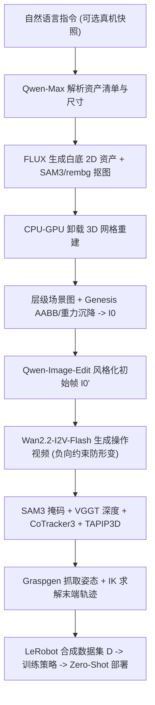

# V-Dreamer: Automating Robotic Simulation and Trajectory Synthesis via Video Generation Priors

## 一句话定义

**V-Dreamer** 是一套面向开放词汇机器人操作的自动化仿真场景与轨迹合成框架：直接从自然语言指令（可选真机照片）生成经物理引擎验证的 3D 场景，并利用视频生成模型作为运动先验，通过视觉-运动学对齐将 2D 生成视频还原为可执行 3D 末端轨迹与 LeRobot 训练数据。

## 英文缩写速查

| 缩写 | 英文全称 | 简要说明 |
|---|---|---|
| LLM | Large Language Model | 大语言模型；本文中由 Qwen-Max 担任资产清单拆解与场景空间推理规划器 |
| AABB | Axis-Aligned Bounding Box | 轴对齐包围盒；在 Genesis 物理引擎中用于布局碰撞检测与去重叠校验 |
| VGGT | Visual Geometry Grounded Transformer | 视觉几何接地 Transformer；为生成视频估计逐帧度量深度线索 |
| IK | Inverse Kinematics | 逆运动学；将抓取位姿与 3D 物体运动轨迹求解为机器人末端/关节可执行轨迹 |
| ACT | Action Chunking with Transformers | 论文选用的下游行为克隆基线策略，用于评估合成数据的可用性与分布覆盖度 |
| SR | Success Rate | 成功率；规定回合步长内成功完成抓取并放置至目标容器的试验占比 |

## 为什么重要

- **打破固定资产库限制：** 传统程序化仿真（如 ProcTHOR、GenSim、RoboGen）依赖预设 3D 资产库，语义与外观分布受限；V-Dreamer 通过文生图加 CPU-GPU 分层卸载 3D 重建，从零合成开放词汇物体与多材质桌面环境。
- **用视频运动先验替代手写启发式规划：** 相比针对特定任务编写运动规划器或仅停留在 2D 像素预测的视频规划（如 UniPi、Video Language Planning），V-Dreamer 将视频扩散模型的行为常识通过掩码受限点追踪与度量深度提升为物理可执行的 3D 轨迹。
- **极简真机迁移路径：** 结合真实场景照片条件的 Real2Sim–Sim2Gen–Sim2Real 流程，仅凭单条仿真合成演示即可在 6-DoF Piper 机械臂上验证闭环视觉伺服的零样本真机迁移。

## 核心信息

| 项目 | 内容 |
|---|---|
| **作者** | Songjia He*、Zixuan Chen*、Hongyu Ding、Dian Shao、Jieqi Shi、Chenxu Li、Jing Huo、Yang Gao† |
| **机构** | 南京大学（NJU）、西北工业大学（NPU） |
| **发表时间** | 2026-03-19（arXiv:2603.18811v1） |
| **论文链接** | [arXiv:2603.18811](https://arxiv.org/abs/2603.18811)（[HTML 全文](https://arxiv.org/html/2603.18811)） |
| **项目与代码** | [项目页（当前返回 404）](https://jia-handsome.github.io/v-Dreamer/)；未确认 V-Dreamer 官方代码仓库 |
| **清单分类** | `data.collection`（来源条目：`survey_ax_2603_18811`） |
| **开源状态** | **未确认开源代码**（正文引用的 FLUX、rembg、Genesis 为第三方依赖，非本论文代码） |

## 核心原理

V-Dreamer 将自然语言指令（可选真机参考图像）转化为仿真就绪环境与训练级专家数据集 $\mathcal{D} = \{(\tau_i, O_i)\}_{i=1}^N$，由三个递进模块组成：

### 1. Semantic-to-Physics 场景合成（§III-A）

1. **语义解析与资产清单：** 由 Qwen-Max 将抽象指令拆分为对象级 JSON 资产清单，同时注入负向约束（如禁用镜面、玻璃等高反光或透明表面），避免下游渲染与 3D 重建产生几何失真。
2. **去阴影 2D 视觉合成与混合分割：** 使用 FLUX 生成各物体图像，提示词固定附加 `"studio lighting"` 与 `"solid white background"` 抑制烘焙阴影；随后采用以物体名称提示的 SAM3 语义分割为主、`rembg` 视觉分割为兜底的混合前景提取方案。
3. **显存优化 3D 重建：** 在 2D 到 3D 网格提升阶段，推理期间动态在 CPU 与 GPU 之间卸载（offload）编解码子网络，以计算时间换取显存空间，使消费级 GPU 能够重建高多边形网格。
4. **物理接地布局：** LLM 估算各物体真实度量尺寸并修正 3D 提升形变；基础模型生成布局 JSON，建立由地面结构 `anchors`（贴合 $Z = 0$）与可操作目标 `accessories`（置于支撑面 $Z = H_{\text{parent}} + \delta$ 并引入程序化空间抖动）组成的层级语义场景图；最后在 Genesis 物理引擎中通过 AABB 碰撞检测与重力对齐消除穿模。

### 2. 基于视频先验的轨迹生成（§III-B）

1. **动态沉降与风格化初帧：** 先在 Genesis 中短暂物理沉降消除残余微穿透，渲染稳定初始帧 $I_0$；再经 Qwen-Image-Edit 进行风格化改写（自动施加条纹/材质等预定义外观扰动，或接收人工定制提示）生成 $I_0'$。
2. **受约束的视频运动合成：** 将 $I_0'$ 送入 `Wan2.2-I2V-Flash` 生成操作过程视频，通过负向提示词明确抑制相机运动、物体形变与背景闪烁，迫使扩散过程专注机械臂与目标物的刚体运动。
3. **Sim-to-Gen 视觉-运动学对齐：**
   - 使用 SAM3 提取 $I_0'$ 中目标物体的精确掩码（区别于 TraceGen 的全图稠密追踪，减少背景干扰）；
   - 使用 VGGT 估计逐帧度量深度，利用 CoTracker3 追踪掩码内均匀采样的 2D 点，再经 TAPIP3D 融合为 3D 物体运动轨迹并滤除离群点与时序抖动；
   - 由 Graspgen 生成可行的 6-DoF 抓取位姿，通过逆运动学（IK）将 3D 物体运动映射为机械臂末端轨迹 $\tau = \{(p_t, q_t)\}_{t=0}^T$（$p_t$ 为连续末端位姿，$q_t$ 为离散夹爪状态）。

### 3. Sim-to-Real 对齐与闭环合成（§III-C）

- 长时程指令由基础模型拆分为多个子任务，在仿真中迭代执行视频生成、轨迹提取与物理操作。
- 面向真机部署时，利用真实场景快照实例化风格对齐的仿真初始帧 $I_0'$，标定真实相机内外参及工作空间边界，全部轨迹合成与策略训练均在仿真内完成，训练后的策略不经真机微调直接零样本上机部署。

## 流程总览

## 源码运行时序图

**不适用**（截至 2026-11-27，未确认 V-Dreamer 官方可运行源码仓库；论文仅给出项目页 `https://jia-handsome.github.io/v-Dreamer/`，核查返回 HTTP 404，正文中出现的 `black-forest-labs/flux`、`danielgatis/rembg`、`Genesis-Embodied-AI/Genesis` 均为第三方依赖组件仓库，不作为本论文官方实现，故不编造源码运行时序图。）

## 实验与评测

### 1. 数据生产吞吐与仿真缩放实验（§I, §IV-A, §IV-B, Fig. 5）

- **合成吞吐量：** 在 `8 × RTX 4090` 工作站上，V-Dreamer 每小时可自动化生成约 **600 条** LeRobot 格式轨迹。
- **仿真测试设置：** 采用 7-DoF Franka 机械臂执行桌面抓取放置任务；训练集覆盖 **40** 个目标物体、**40** 个容器与 **20** 种桌面环境（木质、大理石、玻璃等）；留出测试集为 **10 个几何、把手和纹理完全未见的杯子**，每个杯子随机初始位姿评测 50 次（共 500 trials）。基础策略在 §IV-A 选定为 ACT（§IV-B 缩放实验正文亦以 diffusion-based imitation policy 指代该模仿学习模型）。
- **数据规模与零样本泛化表现：**

| 合成训练轨迹规模 | 10 个未见杯子成功率 (SR, 500 trials) | 论文观察结论 |
|---|---|---|
| 500 条 | **3.46%** | 视觉-空间状态分布覆盖不足，发生灾难性失败 |
| 1,000 条 | **25.90%** | 泛化能力出现显著跃升 |
| 2,500 条 | **36.96%** | 达到峰值；在纯合成数据下超过论文引用的未见任务常见 30% 上限 |

### 2. 真机 One-Shot Zero-Shot 迁移评测（§IV-C, Table I, Fig. 6）

- **真机硬件：** Cobot-Magic / ALOHA 平台左臂（6-DoF Piper 轻量机械臂 + 平行夹爪）与两台 Orbbec DaBai RGB-D 相机；策略仅接收原始 RGB 图像 $O_t$，主动丢弃深度通道与额外标定；为低成本消除机械臂外观域差，基于 Robot-Twin URDF 将仿真机械臂连杆（底座除外）设为黑色，并在真机视野内连杆贴黑色胶带。
- **训练方式：** 仅在方块-碗-桌面仿真场景中合成 **1 条** 演示轨迹训练策略，零样本直接迁移至真实桌面（黄色方块抓放至红色目标）。
- **Table I 单演示真机鲁棒性评测：**

| 扰动类型 | 真机测试条件 | 成功率 (SR) |
|---|---|---|
| Visual Distractors | 视野中存在未建模的背景杂物干扰 | **50%** |
| Object Generalization | 苹果、胶带卷、芒果、梨、瓶子等分布外物体 | **20%** |
| Spatial Perturbation | 目标物与放置容器初始位姿发生偏移 | **15%** |
| Sensor Occlusion | 运行过程中遮挡 Orbbec DaBai 相机视野 | **0%** |

> 遮挡条件下成功率为 0%，证明真机策略确实依据实时视觉输入进行闭环伺服，而非开环回放仿真轨迹。

## 与其他工作对比

| 对比维度 | 代表基线 / 相关路线（论文 §II & §III-B） | V-Dreamer 的设计差异 |
|---|---|---|
| **场景生成范围** | ProcTHOR、GenSim、RoboGen、Holodeck、MimicGen（依赖固定资产库或已有演示扩增） | 通过 FLUX + 3D 重建从语言直接生成开放词汇几何与纹理，不依赖预建资产库 |
| **视频运动先验利用** | UniSim、UniPi、Video Language Planning、GR-2、Genie（主要停留在 2D 像素空间预测） | 通过 VGGT + CoTracker3 + TAPIP3D + Graspgen + IK 将视频先验接地为可执行 3D 机械臂轨迹 |
| **3D 点追踪对齐** | TraceGen（全帧稠密追踪运动区域，易受背景移动干扰） | 先用 SAM3 抽取目标掩码再在掩码内追踪点云，提升物体运动一致性与精度 |
| **Sim-to-Real 机制** | 领域随机化（手工调参难覆盖真实复杂度）、Real-to-Sim（人工重建耗时）、TRANSIC（需在线人工纠偏） | 依托扩散外观多样性与照片条件化 Real2Sim–Sim2Gen–Sim2Real 实现无真机微调零样本迁移 |

## 结论

**一句话总判：V-Dreamer 验证了「文生图建景 + 视频模型出运动 + 几何追踪接地」能够全自动产出可用于真机策略训练的 3D 操作轨迹，但其当前能力边界仍停留在刚体桌面抓取放置与依赖人工或后续过滤机制的阶段。**

1. **视频生成先验必须配合掩码受限 3D 接地才能控制机器人** — 直接用视频模型容易出现相机漂移和物体形变；通过负向提示约束加 SAM3 掩码限制 CoTracker3/VGGT/TAPIP3D 追踪区域，才能提取可靠末端轨迹。
2. **纯合成数据的零样本泛化存在明显规模门槛** — 500 条轨迹几乎失效（3.46%），从 1,000 条（25.90%）到 2,500 条（36.96%）才跨越视觉-空间覆盖阈值，数据量不足时不应过早否定合成管线。
3. **低成本外观对齐可放大极少样本迁移效率** — 用贴黑胶带对齐仿真黑化连杆并仅保留 RGB 闭环，即便单条轨迹也能验证 50% 背景干扰下的真机闭环执行，但位置扰动（15%）与跨品类（20%）仍需多样本扩增。
4. **当前工程落地需补充物理过滤层** — 论文明确指出尚未自动化过滤低质量生成轨迹，直接全量喂给策略可能引入噪声演示。

## 工程实践

- **显存预算控制：** 2D-to-3D 重建阶段启用编码器/解码器子网络在 CPU 与 GPU 间的动态卸载，是把高面数生成接入消费级或标准工作站 GPU（如 8 × RTX 4090 实现 600 traj/h）的关键工程取舍。
- **消除资产伪影的提示工程：** 资产生成时强加 `"studio lighting"` 与 `"solid white background"` 并在 LLM 清单层禁止镜面/玻璃，可显著降低后续抠图失败与深度估计跳变。
- **防漂移视频生成提示：** 在图生视频前先做 Genesis 物理沉降获取 $I_0$，并在 `Wan2.2-I2V-Flash` 中加入针对相机运动、物体变形、背景闪烁的负向提示，避免生成视频无法与机械臂基坐标系对齐。
- **低成本真机外观对齐：** 对轻型机械臂可直接在相机视野内贴覆单色胶带并在仿真 URDF 渲染对应纯色外观，降低模型依赖虚假材质线索的风险。

## 局限与风险

- **缺乏自动化轨迹质量过滤：** 视频生成与 3D 提升偶发物理不合理或抓取失败轨迹，论文尚未引入自动物理感知过滤机制以剔除坏样本。
- **仅限刚体桌面操作：** 当前假设目标为刚体且位于平面支撑面上，尚未支持铰接物体（抽屉、门）与可变形物体（布料、流体）。
- **生成与物理反馈解耦：** 视频生成阶段未接入实时物理引擎闭环校验，物理真实感与跨物体/跨位姿泛化（单样本真机 OOD 仅 20%、空间扰动仅 15%）仍有较大提升空间。
- **开源复现阻塞：** 论文项目页当前不可访问且未公开官方集成代码，工程复用需自行拼接 Qwen-Max、FLUX、SAM3、Genesis、Wan2.2、VGGT、CoTracker3、TAPIP3D 与 Graspgen 等多套模型管线。

## 关联页面

- [Agentic Robots 综述](paper-towards-agentic-robots-survey.md)：了解 V-Dreamer 所属 `data.collection` 分类在四域十七类框架中的定位。
- [全量项目节点清单](../overview/awesome-agentic-robots-node-index.md)：检索同批收录的机器人智能体相关论文节点。
- [VLA 方法背景](../methods/vla.md)：理解下游视觉-语言-动作策略对大规模操作轨迹的需求。
- [视频生成与编辑](../methods/video-generation-workflow.md)：对照视频生成在机器人运动先验与时序一致性约束中的工程做法。
- [机器人仿真场景生成](../methods/robot-simulation-scene-generation.md)：对照语义驱动 3D 资产合成与物理接地布局流程。
- [生成式数据增强](../methods/generative-data-augmentation.md)：对比固定资产扩增与全生成式操作数据引擎的取舍。
- [Sim2Real 迁移流程](../methods/sim2real-transfer-workflow.md)：结合 Real2Sim–Sim2Gen–Sim2Real 与低成本外观对齐理解真机部署路径。
- [Action Chunking](../methods/action-chunking.md)：了解论文用于验证合成数据有效性的 ACT 行为克隆策略架构。
- [抓取位姿估计](../methods/grasp-pose-estimation.md)：了解 Graspgen 等 6-DoF 抓取位姿生成在轨迹接地中的作用。
- [机器人操作任务](../tasks/manipulation.md)：了解桌面抓取放置任务设置、评价指标与泛化挑战。

## 推荐继续阅读

- [V-Dreamer 原论文 HTML（arXiv:2603.18811）](https://arxiv.org/html/2603.18811)：查看全文实验细节、可视化场景图例（Fig. 3–6）与完整参考文献。
- [Genesis 物理仿真平台](https://github.com/Genesis-Embodied-AI/Genesis)：本文用于场景碰撞校验、动态沉降与轨迹执行的核心物理引擎。
- [FLUX 图像生成模型](https://github.com/black-forest-labs/flux)：本文 Semantic-to-Physics 阶段用于开放词汇 2D 物体资产合成的扩散模型。
- [Wan 视频生成模型（arXiv:2503.20314）](https://arxiv.org/abs/2503.20314)：本文提供操作运动先验的图生视频基础模型家族。

## 参考来源

- [V-Dreamer 原文核对归档](../../sources/papers/paper-agentic-2603-18811.md)
- [Awesome Agentic Robots 官方文献索引](../../sources/repos/awesome-agentic-robots-survey-index.md)
- [arXiv:2603.18811 摘要页](https://arxiv.org/abs/2603.18811)
- [arXiv:2603.18811 HTML 全文](https://arxiv.org/html/2603.18811)
- [V-Dreamer 项目页（核查时返回 404）](https://jia-handsome.github.io/v-Dreamer/)
