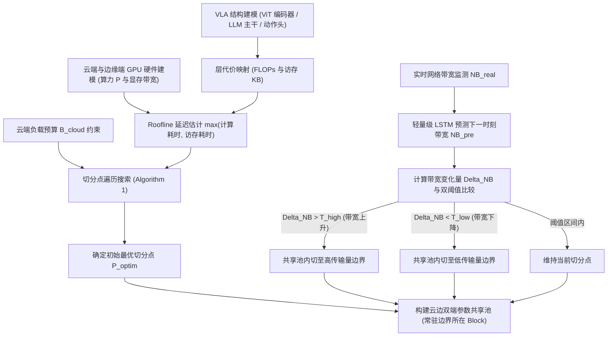
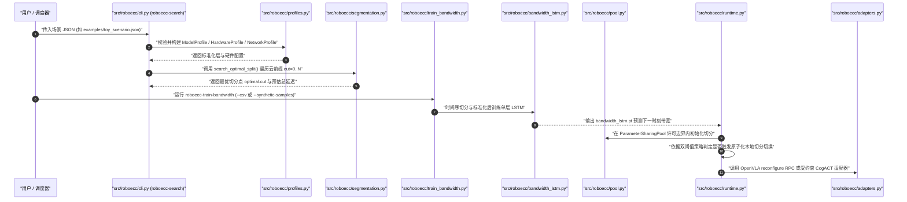

# RoboECC: Multi-Factor-Aware Edge-Cloud Collaborative Deployment for VLA Models

## 一句话定义

**RoboECC** 是面向视觉-语言-动作（VLA）模型的多因素感知云边协同（ECC）部署框架，通过联合建模模型异构结构与 GPU Roofline 硬件性能搜索最优云边切分点，并借助轻量级 LSTM 带宽预测与参数共享池实现无需重传权重的在线细粒度切分动态调整。

## 英文缩写速查

| 缩写 | 英文全称 | 简要说明 |
|------|----------|----------|
| RoboECC | Multi-Factor-Aware Edge-Cloud Collaborative Deployment for VLA Models | 本文提出的面向异构 VLA 模型的云边协同部署框架 |
| ECC | Edge-Cloud Collaboration | 云边协同推理范式，将计算切分至云端与边缘端共同执行 |
| VLA | Vision-Language-Action | 融合视觉、语言并输出机器人动作的多模态策略模型 |
| DiT | Diffusion Transformer | CogACT 等模型采用的扩散变换器动作头结构 |
| LSTM | Long Short-Term Memory | 本文用于在线预测下一时刻网络带宽变化的长短期记忆网络 |
| RPC | Remote Procedure Call | 开源仓库中 OpenVLA 适配器用于触发块级切分重配置的远程过程调用 |

## 为什么重要

1. **边缘端 VLA 实时性严重不足**：论文实测未优化的 VLA 在边缘设备上仅能达到 `1~3 Hz`（§I）至 `3~5 Hz`（§II-A2）控制频率，即便配合常见加速手段在消费级 GPU 上也仅 `10~15 Hz`，远低于具身闭环控制常见的 `~30 Hz` 需求。
2. **传统云边切分无法应对 VLA 结构异构性**：早期 VLA（如 OpenVLA）末端为同构 LLM 解码块，延迟随切分深度近似线性变化；而包含独立扩散/DiT 动作头的 VLA（如 CogACT）在模块过渡处会出现延迟跳变（例如第 13 层块虽与第 16 层块同样满足云端负载预算，但总延迟显著更低），仅靠均匀或按负载比例的静态切分无法命中全局最优边界。
3. **短动作多步闭环放大网络波动敏感度**：传统 LLM 单次请求输出长文本，可将网络抖动均摊到长序列中；但 VLA 每步仅输出极短动作序列且需多步闭环推理，网络传输延迟在部分切分下可超过总延迟的 40%。一旦带宽骤降（例如从 `10 MB/s` 跌至 `1 MB/s`），原本最优切分点（如传输 `102 KB` 激活）传输耗时从 `9.9 ms` 飙升至 `99.6 ms`，从而引发最优切分点漂移甚至动作控制抖动。

## 核心信息

| 字段 | 内容 |
|---|---|
| 作者 | Zihao Zheng, Hangyu Cao, Jiayu Chen, Sicheng Tian, Chenyue Li, Maoliang Li, Xinhao Sun, Guojie Luo, Xiang Chen |
| 机构 | 北京大学（PKU）、华南理工大学（SCUT）、北京师范大学（BNU） |
| 发表时间 / 载体 | 2026-03（arXiv v1）/ 2026-04-27（arXiv v2）；录用于 IJCNN 2026 |
| 论文链接 | [arXiv:2603.20711](https://arxiv.org/abs/2603.20711) / [arXiv HTML](https://arxiv.org/html/2603.20711) |
| 项目与代码 | [GitHub: zhengzihaoPKU/RoboECC](https://github.com/zhengzihaoPKU/RoboECC)（MIT License） |
| 清单分类 | harness.infrastructure |
| 来源条目 | `survey_ax_2603_20711` |
| 开源状态 | **部分开源**（已开源规划与运行时控制层源码 `src/roboecc/`、CLI 及 34 个 CPU 测试；未包含外置双端执行后端、实测带宽轨迹及预训练 LSTM 权重） |

## 核心原理

RoboECC 由**离线模型-硬件协同切分策略**与**在线网络感知部署调整**两大模块构成，在保持模型输出计算等价（不改变任务成功率）的前提下最小化端到端单步推理延迟。

### 1. 模型-硬件协同切分策略（Model-Hardware Co-Aware Segmentation）

- **三段式 VLA 结构抽象**：将任意 VLA 模型统一建模为有序链 $[\mathbb{S}_{\text{enc}}, \mathbb{S}_{\text{bac}}, \mathbb{S}_{\text{dec}}]$，其中视觉编码器 $\mathbb{S}_{\text{enc}} \in \{\mathcal{M}_{\text{ViT}}\}$，多模态主干 $\mathbb{S}_{\text{bac}} \in \{\mathcal{M}_{\text{LLM}}\}$，动作解码器 $\mathbb{S}_{\text{dec}} \in \{\mathcal{M}_{\text{De-tokenizer}}, \mathcal{M}_{\text{MLP}}, \mathcal{M}_{\text{LSTM}}, \mathcal{M}_{\text{Diff}}, \mathcal{M}_{\text{DiT}}\}$。
- **层代价查表映射**：基于层类型 $L_i$、隐层维度 $H_i^L$ 与参数规模 $W_i$ 建立映射 $\mathcal{M}_{\text{type}}(L_i, H_i^L, W_i) \rightarrow (\mathcal{C}_{\text{compute}}^{\text{type}}, \mathcal{C}_{\text{datamove}}^{\text{type}})$，获取每层计算量（FLOPs）与数据访存量（KB）。
- **GPU Roofline 延迟建模（Eq. 2）**：针对云端与边缘端 GPU 的计算/访存流水线特性，单边计算延迟估计为各层计算时间与访存时间的最大值之和：
  $$T_{\text{GPU}} = \sum_{i} \max\left(T_{\text{compute}}^{L_i}, T_{\text{memory}}^{L_i}\right) = \sum_{i} \max\left(\frac{\mathcal{C}_{\text{compute}}^{L_i}}{P_i \times \text{Parallel}_i}, \frac{\mathcal{C}_{\text{datamove}}^{L_i}}{\text{Bandwidth}_i}\right)$$
  其中 $P_i$ 为 GPU 算力，$\text{Parallel}_i$ 为并行度系数，$\text{Bandwidth}_i$ 为全局显存带宽。
- **云端预算约束下的切分搜索（Algorithm 1）**：从末层反向遍历切分点 $S$，在满足云端卸载负载上限 $\sum_{S}^{n} \text{load}^{\text{cloud}}(\mathcal{C}_{\text{compute}}^{L_i}; \mathcal{C}_{\text{memory}}^{L_i}) < B^{\text{cloud}}$ 的搜索空间内，选择使云端计算、边缘计算与中间激活传输总延迟 $T_{\text{total}}^S$ 最小的最优切分点 $P_{\text{optim}}$（开源代码 `src/roboecc/segmentation.py` 规范化表示为云端前缀阶段数 `cut` $\in [0, N]$）。

### 2. 网络感知部署调整（Network-Aware Deployment Adjustment）

- **细粒度 LSTM 带宽预测**：云端与边缘端协同运行轻量级 LSTM 网络（论文中模型体积 `20.1 MB`；开源实现默认采用单层 many-to-one LSTM，输入窗口 20 个采样点、隐藏层维度 32），预测下一时刻网络带宽 $NB_{t+1}^{\text{pre}}$。其输入采样间隔 $t_{\text{input}}$ 需满足实时性约束 $t_{\text{input}} < \min(t_{\text{cloud}}, t_{\text{edge}})$（Eq. 3）。
- **参数共享池（Parameter-Sharing Pool）**：为避免动态切换切分点时跨网络重传模型权重，RoboECC 在云端与边缘端同时常驻包含最优切分点所在 Block 的全部层参数（例如单个 LLaMA Block 约 `386 MB`，相比 OpenVLA 约 `16 GB` 显存占用及 Orin `32/64 GB`、Thor `64/128 GB` 内存余量开销极低）。切换切分点仅更新执行元数据，实现本地原子提交。
- **双阈值细粒度切分切换**：计算预测带宽变化量 $\Delta NB = NB_{t+1}^{\text{pre}} - NB_t^{\text{real}}$，并与双阈值 $\mathcal{T}_{\text{high}}$、$\mathcal{T}_{\text{low}}$ 比较：
  - 当 $\Delta NB > \mathcal{T}_{\text{high}}$（带宽显著上升）：在参数共享池内搜索**激活传输量最大**的边界并切换过去，充分利用带宽资源减少边缘算力负担；
  - 当 $\Delta NB < \mathcal{T}_{\text{low}}$（带宽显著下降）：在参数共享池内搜索**激活传输量最小**的边界并切换过去，压缩传输时延；
  - 在开源代码 `src/roboecc/llama_block.py` 中，单个 LLaMA Decoder Block 可进一步拆分为 5 个规划阶段（`input RMSNorm -> self-attention -> post-attention RMSNorm -> MLP expand -> MLP down`），将残差张量纳入传输字节估算，从而暴露更细粒度的块内切分候选边界。

## 流程总览



## 源码运行时序图



上述时序对应官方仓库 `zhengzihaoPKU/RoboECC` 中已开源的**规划与运行时控制层**（入口为 `roboecc-search` 与 `roboecc-train-bandwidth`）；实际跨设备张量切分前向计算需由外部 OpenVLA / CogACT 服务端配合适配器接口执行。

## 实验与评测

### 1. 硬件与评测平台设置（Table I & §V-A）

| 角色 | 设备型号 | 核心频率 | 4-bit 算力 | Tensor Core 数 | 显存带宽 |
|---|---|---|---|---|---|
| 云端（Cloud） | NVIDIA A100 GPU | 1410 MHz | 2496 TFLOPs | 432 | 2039 GB/s |
| 边缘端 1（Edge） | Jetson AGX Orin（MAX_N） | 1300 MHz | 275 TFLOPs | 64 | 204.8 GB/s |
| 边缘端 2（Edge） | Jetson AGX Thor（MAX_N） | 1386 MHz | 517.5 TFLOPs | 96 | 273 GB/s |

- **仿真评测**：OpenVLA 在 LIBERO 基准（每个任务 10 次测试取单步平均延迟），CogACT 在 SimplerEnv 基准。由于 RoboECC 保持计算等价，任务成功率不受影响，论文主要汇报延迟与负载指标。
- **真机评测**：AgileX PIPER 机械臂，采集 1,000 条示范样本微调后在 `Orin+A100` 与 `Thor+A100` 上运行。

### 2. 仿真基准主结果（Table II & Table III）

| 模型与基准 | 边缘平台 | 方法 | 云端延迟 / 负载 | 边缘延迟 / 负载 | 总延迟（含网络） | 相对 Edge-Only 加速比 |
|---|---|---|---|---|---|---|
| OpenVLA + LIBERO | Orin | Edge-Only | – / – | 1119.4 ms / 14.1 GB | 1119.4 ms | 1.00× |
| OpenVLA + LIBERO | Orin | Cloud-Only | 151.2 ms / 14.1 GB | – / – | 151.2 ms | – |
| OpenVLA + LIBERO | Orin | Fixed Seg | 87.9 ms / 6.3 GB | 717.8 ms / 7.9 GB | 923.3 ms | 1.21× |
| OpenVLA + LIBERO | Orin | **RoboECC** | **136.7 ms / 12.1 GB** | **94.5 ms / 2.0 GB** | **354.4 ms** | **3.16×** |
| OpenVLA + LIBERO | Thor | Edge-Only | – / – | 628.9 ms / 14.1 GB | 628.9 ms | 1.00× |
| OpenVLA + LIBERO | Thor | Fixed Seg | 89.5 ms / 6.3 GB | 378.4 ms / 7.9 GB | 587.2 ms | 1.07× |
| OpenVLA + LIBERO | Thor | **RoboECC** | **137.1 ms / 12.1 GB** | **51.3 ms / 2.0 GB** | **300.1 ms** | **2.10×** |
| CogACT + SimplerEnv | Orin | Edge-Only | – / – | 775.3 ms / 14.5 GB | 775.3 ms | 1.00× |
| CogACT + SimplerEnv | Orin | Cloud-Only | 111.4 ms / 14.5 GB | – / – | 111.4 ms | – |
| CogACT + SimplerEnv | Orin | Fixed Seg | 46.9 ms / 7.9 GB | 437.2 ms / 6.6 GB | 572.5 ms | 1.35× |
| CogACT + SimplerEnv | Orin | **RoboECC** | **81.9 ms / 12.0 GB** | **143.2 ms / 2.5 GB** | **236.1 ms** | **3.28×** |
| CogACT + SimplerEnv | Thor | Edge-Only | – / – | 429.6 ms / 14.5 GB | 429.6 ms | 1.00× |
| CogACT + SimplerEnv | Thor | Fixed Seg | 47.2 ms / 7.9 GB | 240.4 ms / 6.6 GB | 375.4 ms | 1.14× |
| CogACT + SimplerEnv | Thor | **RoboECC** | **82.7 ms / 12.0 GB** | **105.7 ms / 2.5 GB** | **192.7 ms** | **2.23×** |

### 3. 真机、消融与开销分析（§V-B2, Table IV, §V-C1）

- **真机环境（AgileX PIPER + OpenVLA）**：Edge-Only 单步耗时在 Orin 上约 `1274.4 ms`、Thor 上约 `667.2 ms`；接入 RoboECC 后分别降至 `361.8 ms`（Orin+A100）与 `321.6 ms`（Thor+A100），机械臂运动更平滑并减少抖动。
- **消融实验（Table IV，Orin+A100，OpenVLA）**：
  - `Edge-Only`：总延迟 `1119.4 ms`；
  - `+ Co-Aware Segmentation`：云端 `135.9 ms` + 边缘 `99.8 ms`，总延迟大幅降至 `392.7 ms`；
  - `+ Network-Aware Adjustment`：云端 `136.7 ms` + 边缘 `94.5 ms`，总延迟进一步降至 `354.4 ms`（主要压缩网络传输耗时）。
- **系统开销**：参数共享池额外存储开销仅为总开销的 `2.55%~2.62%`，带宽预测 LSTM 体积为 `20.1 MB`；动态切分点调整平均耗时 `10.7 ms`，而平均可带来 `32.6 ms` 的延迟收益。

## 与其他工作对比

| 方案类型 | 代表工作 / 基线 | 切分粒度与依据 | 网络波动适应性 | 相对 RoboECC 的主要差异 |
|---|---|---|---|---|
| 纯边缘部署 | Edge-Only（Orin / Thor） | 全模型在边缘执行 | 无跨端通信 | 延迟高（628.9–1119.4 ms），难以满足实时控制 |
| 纯云端部署 | Cloud-Only（A100） | 全模型卸载至云端 | 依赖全帧图像上传与稳定链路 | 云端单卡承担全量负载（14.1–14.5 GB），多机并发受限 |
| 均等静态切分 | Fixed Seg（论文基线） | 云边负载大致平分 | 静态固定切分 | 忽视模型结构异构与激活传输峰值，Orin 上 OpenVLA 仍需 923.3 ms |
| 传统 LLM ECC 框架 | EdgeShard / CoEdge（论文对比背景） | 面向同构 Transformer / DNN | 假设网络延迟静态 | 缺少针对 VLA 动作头切换（如 [CogACT](paper-cogact.md) 的 DiT）与短动作高频闭环的动态重切分 |
| **RoboECC** | **本文框架** | **Roofline + 云预算感知，支持块级与 LLaMA 块内规划** | **LSTM 预测 + 参数共享池双阈值动态切换** | 在 Orin+A100 与 Thor+A100 上分别实现 3.16×–3.28× 与 2.10×–2.23× 加速（[OpenVLA](paper-openvla.md) / CogACT） |

## 结论

**一句话总判：在异构 VLA 模型与动态网络条件下，仅靠静态负载均衡切分远不够，联合建模计算/访存 Roofline 边界并通过小范围参数冗余消除切换传输开销才是实现低延迟云边协同的关键。**

1. **先查结构跳变再切分** — 面对带有 Diffusion/DiT 动作头的 VLA（如 CogACT），延迟在模块边界处呈非线性跳变，工程上必须用层级计算-访存画像配合 Roofline 模型搜索，而不是按参数量均分。
2. **用少量内存换零权重重传** — 边缘端（如 32–128 GB 的 Orin/Thor）通常有充足内存冗余，双端常驻单个边界 Block（约 386 MB，总开销 2.55%–2.62%）即可把网络自适应切换的权重迁移代价降为零。
3. **带宽预测与切分调整必须形成正收益闭环** — 论文中单次切换决策均值 `10.7 ms` 换取 `32.6 ms` 延迟下降，设置过窄的 $\mathcal{T}_{\text{high}}/\mathcal{T}_{\text{low}}$ 会导致频繁抖动，必须基于真实链路波动标定阈值。
4. **注意论文实验与开源代码仓的边界** — 开源仓库已完整提供规划器、LSTM 预测器、共享池与适配器，但未包含真实双端跨设备推理引擎与 A100↔Orin/Thor 带宽日志，落地仍需自行对接外部推理服务端。

## 工程实践

1. **安装与离线切分搜索**：核心规划器仅依赖 Python >= 3.10（无第三方运行时依赖），安装后即可运行离线切分搜索：
   ```bash
   python -m pip install -e .
   roboecc-search examples/toy_scenario.json
   ```
   如需启用 LSTM 带宽预测与测试套件，需安装 `python -m pip install -e ".[lstm,dev]"`，并运行 `PYTHONPATH=src python -m unittest discover -s tests -v`（共 34 个 CPU 测试）。
2. **带宽预测器训练协议**：使用时间有序的 `bytes/s` 轨迹训练单层 LSTM（默认窗口 20、隐藏层 32，严格按时间划分验证集、仅用训练集前缀做标准化、采用 AdamW + 梯度裁剪 + 早停）：
   ```bash
   roboecc-train-bandwidth --csv traces/a100_thor_bandwidth.csv --column bandwidth_bytes_per_second --output checkpoints/bandwidth_lstm.pt
   ```
   若无真实轨迹，可使用 `--synthetic-samples 300 --epochs 10` 进行流水线冒烟验证（不能作为实验性能依据）。
3. **后端适配约束**：对接 OpenVLA 时依赖外部 split backend 提供块级 `reconfigure` RPC；对接 CogACT 时要求采用**云前缀 DiT 执行顺序**并预加载共享池参数（仓库明确提示旧版独立 CogACT 客户端采用边前缀顺序，不兼容该适配器）。

## 局限与风险

1. **加速器建模范围受限（论文 §V-C3）**：Roofline 硬件模型当前仅针对 GPU 架构设计，尚未覆盖 NPU、TPU 或 FPGA 等异构边缘加速器。
2. **开源代码为规划与控制层（仓库 `KNOWN_GAPS` / README）**：仓库未打包 OpenVLA、CogACT、LIBERO、SimplerEnv，且 LLaMA 5 阶段块内切分（`ExpandedLlamaModel`）目前属于规划与传输量建模抽象，尚未实现算子级跨双 GPU `LlamaDecoderLayer.forward()` 执行。
3. **实测轨迹与双端回归缺失**：截至核对时，官方仓库尚未公开 A100↔Orin/Thor 真实网络带宽 CSV 数据、预训练 LSTM checkpoint 及双机实测端到端回归脚本。
4. **绝对控制频率仍受限于基础推理延迟**：尽管实现了 2.10×–3.28× 加速，Orin+A100 下 OpenVLA 单步总延迟仍为 `354.4 ms`（约 `2.8 Hz`），CogACT 为 `236.1 ms`（约 `4.2 Hz`），距离 `30 Hz` 高频连续控制仍需与动作分块（Action Chunking）、量化或推测解码等方法叠加。

## 关联页面

- [Agentic Robots 综述](paper-towards-agentic-robots-survey.md)
- [全量项目节点清单](../overview/awesome-agentic-robots-node-index.md)
- [VLA 方法背景](../methods/vla.md)
- [机器人智能体执行框架](../methods/robot-agent-harness.md)：对照规划、执行接口与反馈机制
- [AI 模型服务与推理优化](../methods/ai-model-serving-inference.md)：对照云边推理服务与延迟优化
- [机器人控制架构](../methods/robot-control-architecture.md)：对照分层控制频率与实时性约束
- [机器人操作任务](../tasks/manipulation.md)：对照 LIBERO / SimplerEnv 桌面操作场景
- [OpenVLA 实体页](paper-openvla.md)：本文主要评测的自回归 token 动作型 VLA 基线
- [CogACT 实体页](paper-cogact.md)：本文用于验证异构 DiT 动作头切分的 VLA 基线
- [LIBERO 基准](libero-benchmark.md)：本文 OpenVLA 仿真评测使用的基准套件

## 推荐继续阅读

- [RoboECC arXiv HTML 原文](https://arxiv.org/html/2603.20711)
- [RoboECC arXiv 摘要页](https://arxiv.org/abs/2603.20711)
- [RoboECC 官方 GitHub 仓库](https://github.com/zhengzihaoPKU/RoboECC)

## 参考来源

- [论文原文核对归档](../../sources/papers/paper-agentic-2603-20711.md)
- [官方开源仓库核对归档](../../sources/repos/paper-agentic-2603-20711.md)
- [官方 Awesome 快照归档](../../sources/repos/awesome-agentic-robots-survey-index.md)
- [论文官方入口（arXiv:2603.20711）](https://arxiv.org/abs/2603.20711)
- [官方代码仓库（zhengzihaoPKU/RoboECC）](https://github.com/zhengzihaoPKU/RoboECC)
