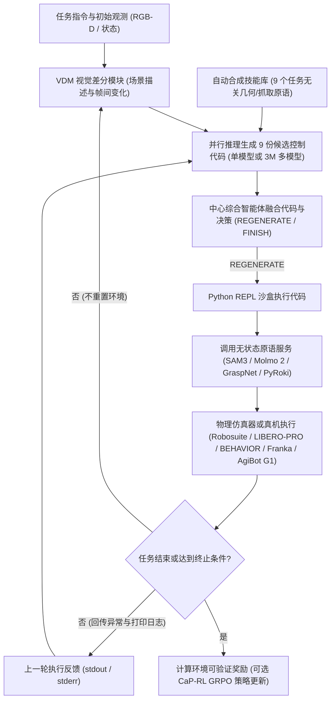

# CaP-X: A Framework for Benchmarking and Improving Coding Agents for Robot Manipulation

## 一句话定义

**CaP-X** 是由 NVIDIA、UC Berkeley、Stanford 与 CMU 联合提出的**代码即策略（Code-as-Policy）具身操作统一研究框架**，通过交互式沙盒环境 **CaP-Gym**、分层受控基准 **CaP-Bench**、免训练多轮智能体架构 **CaP-Agent0** 与可验证奖励后训练方法 **CaP-RL**，系统剥离人工预设原语脚手架的影响并提升代码智能体在仿真与真机上的操作可靠性。

## 英文缩写速查

| 缩写 | 英文全称 | 简要说明 |
|---|---|---|
| CaP | Code-as-Policy | 代码即策略范式，由语言或视觉语言模型生成可执行机器人控制程序 |
| CaP-Gym | Code-as-Policy Gymnasium Environment | 本文构建的统一交互式机器人代码执行环境，封装 187 个仿真与真机接口任务 |
| CaP-Bench | Code-as-Policy Benchmark | 本文设计的 8 层级（S1–S4、M1–M4）受控评测基准，解耦抽象度、交互轮次与视觉接地 |
| VDM | Visual Differencing Module | 视觉差分模块，将多轮执行前后的 RGB 图像变化转化为结构化自然语言描述 |
| VLA | Vision-Language-Action | 端到端视觉-语言-动作策略模型，代表性对比基线包括 OpenVLA、$\pi_0$ 与 $\pi_{0.5}$ |
| GRPO | Group Relative Policy Optimization | 组相对策略优化算法，本文 CaP-RL 用于基于环境可验证奖励微调代码模型 |
| RLVR | Reinforcement Learning with Verifiable Rewards | 基于可验证奖励的强化学习，直接以物理仿真任务成败奖励优化代码生成策略 |

## 为什么重要

1. **剥离“人工高层宏原语”造成的虚假能力错觉：** 早期 Code-as-Policy 工作普遍向模型暴露高度任务定制的高层函数（如 `stack_objs_in_order()`），掩盖了模型在底层感知、几何变换与控制序列合成上的真实短板；CaP-Bench 首次沿原语抽象度、交互轮次与视觉接地方式三轴完成受控剥离。
2. **揭示“多模态直插退化”并给出文本接地解法：** 论文发现直接把原始 RGB 图像交错插入多轮代码上下文（M2）反而比纯 `stdout`/`stderr` 文本反馈（M1）表现更差，而通过 **VDM** 将场景与前后帧差异转为结构化文本（M3/M4）可稳定提升跨模型表现，使底层原语在测试时计算扩展后追平甚至反超高层单轮接口。
3. **验证程序化控制对分布外扰动的零样本泛化优势：** 在 LIBERO-PRO 位置与指令扰动评测中，依赖特定训练分布的端到端 VLA 模型出现大幅退化，而免训练的 **CaP-Agent0** 与基于可验证仿真奖励后训练的 **CaP-RL** 凭借共享感知-控制原语接口实现了跨任务变体与跨本体（Robosuite / Franka Emika / AgiBot G1）的低差距迁移。

## 核心信息

| 字段 | 内容 |
|---|---|
| 作者 | Letian Fu, Justin Yu, Karim El-Refai, Ethan Kou, Haoru Xue, Huang Huang, Wenli Xiao, Guanzhi Wang, Dantong Niu, Fei-Fei Li, Guanya Shi, Jiajun Wu, Shankar Sastry, Yuke Zhu, Ken Goldberg, Linxi "Jim" Fan |
| 机构 | 英伟达（NVIDIA）、加州大学伯克利分校（UC Berkeley）、斯坦福大学（Stanford）、卡内基梅隆大学（CMU） |
| 发表时间 | 2026-03-23（arXiv v1）/ 2026-07-02（arXiv v2，标注 ICML） |
| 论文链接 | [arXiv:2603.22435](https://arxiv.org/abs/2603.22435) / [arXiv HTML](https://arxiv.org/html/2603.22435) |
| 项目与代码 | [项目主页](https://capgym.github.io)（截至 2026-11-27 缓存文本未列出具体 GitHub 仓库 URL） |
| 清单分类 | `environment.benchmarking`, `harness.skills` |
| 开源状态 | 宣称开源但未在缓存页确认仓库地址（论文与项目页均定位为开放访问平台，Appendix G 与 H.1 公开了 `S3` API 类定义及 9 个技能函数实现，但未提供可下载运行的 GitHub 仓库入口） |

## 核心原理

CaP-X 将机器人操作建模为“代码智能体与无状态感知/控制原语服务之间的闭环交互程序合成问题”，由四个层层递进的组件构成：

1. **CaP-Gym 统一交互环境与无状态原语栈（§2，Appendix B.2 & G）：**
   - 环境遵循 Gymnasium 接口，将底层物理仿真器（或真机控制器）与有状态 Python Read-Eval-Print Loop（REPL）执行器绑定。每次交互“轮次（turn）”中，智能体读取观测并输出整段 Python 控制程序，由沙盒一次性执行到底并回传控制台输出与环境观测。
   - 底层全部重计算模块以无状态微服务运行以支持高吞吐并行评测：**感知原语**包含语言/点提示分割 `SAM3`（`segment_sam3_text_prompt`、`segment_sam3_point_prompt`）、开放词汇指点模型 `Molmo 2`（`point_prompt_molmo`）及 `OpenCV` / `Open3D`（`get_oriented_bounding_box_from_3d_points`）；**抓取与控制原语**包含 `Contact-GraspNet`（`plan_grasp` 返回相机系下的 $K$ 组 $4\times 4$ 候选抓取位姿与置信度）和 `PyRoki` 逆运动学与轨迹优化（`solve_ik`、`move_to_joints`、`open_gripper` / `close_gripper`，以及双臂变体 `solve_ik_arm0/1`、`move_to_joints_both`）。在 Franka 等夹爪上统一配置了工具中心点偏置 `_TCP_OFFSET = [0.0, 0.0, -0.107]`。
   - 共集成 **187** 个标准化任务：7 个 Robosuite 核心任务、130 个 LIBERO-PRO 扰动任务与 50 个 BEHAVIOR 移动操作任务，并在真机侧通过同一原语接口接入 Franka Panda 与双臂轮式 AgiBot G1（补充底盘移动 `go_forward`、`turn_left_45_degrees`、腕部相机与 6-DoF 力矩观测及 `Viser` 三维可视化）。

2. **CaP-Bench 三轴受控评测协议（§3，Table 1）：**
   - 围绕 **原语抽象层级**（高层人工宏 vs. 底层 API）、**时间交互深度**（单轮 Zero-Shot Pass@1 vs. 不重置环境的多轮迭代）和 **视觉接地模态** 划分出 8 个层级：
     - **S1（特权高层单轮）：** 高层原语 + 无噪声真值状态（分割掩码与物体位姿），用于剥离感知噪声并测量纯规划上限。
     - **S2（非特权高层单轮）：** 高层原语 + 真实 RGB-D 感知模块，对应多数既有 Code-as-Policy 工作设定。
     - **S3（带示例底层单轮）：** 用底层感知与 IK/抓取原语替换高层宏，并在 docstring 中保留用法示例。
     - **S4（无示例底层单轮）：** 与 S3 相同底层原语，但剥除全部用法示例，仅保留函数签名与接口文档。
     - **M1（纯文本多轮）：** 高层原语 + 多轮环境不重置，仅反馈 Python `stdout` 与 `stderr` 追踪，支持智能体主动打印符号状态进行自省。
     - **M2（原生多模态多轮）：** 在 M1 基础上将每轮真实 RGB 图像直接插入上下文窗口。
     - **M3（视觉差分多轮）：** 引入 **VDM**（文中主实验采用 Gemini-3-Pro）将首帧场景属性及后续帧间差异、完成判定转写为结构化自然语言提供给代码智能体。
     - **M4（底层原语 + VDM 多轮）：** 将 S3 的底层原语接口与 M3 的 VDM 闭环机制结合。

3. **CaP-Agent0 免训练测试时扩展架构（§4，Appendix H）：**
   - **视觉差分模块（VDM）：** 首轮输出任务相关的几何/语义状态先验（如辨识球体不能支撑立方体、识别目标物体被上层积木遮挡的依赖链），后续轮次显式对比前后图像变化并辅助判定是否完成任务。
   - **自动合成持久化技能库（Skill Library）：** 从 12 个模型在 S3 层的全部成功执行轨迹中以正则提取自定义辅助函数，并由 Gemini-3-Pro 归纳出 9 个通用、任务无关的基础技能函数（Appendix H.1）：`rotation_matrix_to_quaternion`（Sheppard 方法稳健转换）、`decompose_transform`、`depth_to_point_cloud`、`mask_to_world_points`、`pixel_to_world_point`、`transform_points`、`interpolate_segment`、`normalize_vector` 及 `select_top_down_grasp`（基于世界坐标系 $-Z$ 轴对齐度过滤侧向抓取），使智能体在保留底层表达力的同时免于反复重造易错几何代码。
   - **并行集成推理（Parallel Reasoning）：** 每轮并发采样 9 份候选程序——单模型配置为对同一模型以温度 $\{0.1, 0.2, \dots, 0.9\}$ 采样 9 次；多模型 `3M` 配置为对 Gemini-3-Pro、Claude Opus 4.5 与 GPT-5.2 各以 $\{0.1, 0.5, 0.9\}$ 温度采样 3 次——再由中心综合智能体对照多候选策略的鲁棒性与失败检查进行代码融合，并在后续轮次统计 `REGENERATE` / `FINISH` 投票以决定重试或结束。

4. **CaP-RL 可验证环境奖励强化学习（§5，Appendix E）：**
   - 直接对代码生成模型（`Qwen2.5-Coder-7B-Instruct`）执行在策略 **GRPO** 后训练。为避免 S2 非特权感知噪声导致“正确代码因感知偶发误差被判负奖励”的信用分配模糊，训练阶段统一在无噪声特权层 **S1** 上运行，每任务训练 **50** 次迭代。
   - 由于策略动作空间本身是“跨仿真与真机共享的感知-控制 API 代码”，而非绑定渲染纹理的低层电机指令，学到的因果步骤顺序（识别 $\rightarrow$ 抓取 $\rightarrow$ 搬运 $\rightarrow$ 释放）与动态几何读取习惯（如开启 `return_bbox_extent=True` 计算堆叠高度而非硬编码偏移）可直接零样本迁移至 S2 噪声感知与真实 Franka 机械臂。

## 流程总览

## 源码运行时序图

**不适用**（截至 2026-11-27 核查，`arXiv:2603.22435v2` 正文、项目页 `https://capgym.github.io` 抓取文本及候选仓库列表中均未包含可核验的具体 GitHub 仓库 URL 与完整可运行工程入口；论文仅在 Appendix G 与 Appendix H.1 给出了 `S3` 原语类接口定义及 9 个技能函数实现片段）。

## 实验与评测

### 1. CaP-Bench 基准结论（§3.3，Fig. 1–6，7 个核心 Robosuite 任务 × 100 次试验）

在 7 个单臂/双臂任务（Cube Lift、Cube Stack、Spill Wipe、Peg Insertion、Cube Re-stack、Two-Arm Lift、Two-Arm Handover）上评测 12 个模型及 7 位论文作者构成的线下迭代人类专家基线（Appendix K.1）：
- **人类专家单轮参考上限：** 经充分线下调试后单轮平均成功率达 **88.5%**（简单抓放耗时 $<1$ 天，接触密集型 Peg Insertion 与双臂交接 Two-Arm Handover 耗时 **2–3 周/任务**）。前沿模型在单轮最高平均成功率超过 **30%**，仍存在约 56 个百分点的差距。
- **抽象度与多轮消融趋势（Takeaway 2–3）：** 原语抽象从 S4 提升到 S1 带来单调成功率增长，并显著缓解弱模型/开源模型的代码编译崩溃；多轮文本反馈（M1）稳定优于单轮（S2），直接插入原生 RGB（M2）反而劣于纯文本 M1，而采用 VDM 转写视觉差分（M3）在全部模型上取得最高多轮增益；底层原语 + VDM（M4）即可超越高层单轮（S2）并与高层多轮（M3）持平。

### 2. CaP-Agent0 消融与跨基准评测（§4.1–4.2，Table 2–3，Table 5，Table 9）

- **CaP-Bench 核心 7 任务（Table 5，Appendix H.4）：** 采用底层原语（M4）+ 技能库 + `3M` 多模型集成的 CaP-Agent0 在 7 项任务中 **4 项** 达到或超过人类专家单轮基线，`3M` 具体成功率为：Cube Lift **97%**、Cube Stack **98%**、Spill Wipe **100%**、Peg Insertion **0%**、Cube Re-stack **89%**、Two-Arm Lift **74%**、Two-Arm Handover **20%**，7 任务平均 **68.29%**。若改用强制逐行审查调试的 `3M + debug` 提示，均值反而微降至 **65.43%**（94% / 100% / 98% / 0% / 88% / 66% / 12%）。
- **LIBERO-PRO 扰动泛化评测（CaP-Bench++，Table 2 & Tables 6–8，30 任务 × 50 试验）：** 在位置互换（Pos）与指令改写（Task）两类分布外扰动下对比训练好的端到端 VLA 基线：

| 方法 | 训练需求 | `libero-object` (Pos / Task) | `libero-goal` (Pos / Task) | `libero-spatial` (Pos / Task) |
|---|---|---|---|---|
| OpenVLA | 需任务训练 | 0.00 / 0.00 | 0.00 / 0.00 | 0.00 / 0.00 |
| $\pi_0$ | 需任务训练 | 0.00 / 0.00 | 0.00 / 0.00 | 0.00 / 0.00 |
| $\pi_{0.5}$ | 需任务训练 | 0.17 / 0.01 | **0.38** / 0.00 | **0.20** / 0.01 |
| **CaP-Agent0** | **免训练** | **0.22** / **0.18** | 0.26 / **0.17** | 0.12 / **0.14** |

- **BEHAVIOR 轮式人形移动操作评测（Table 3，R1Pro 机器人，每任务 25 试验）：**

| 任务 | 导航成功率 (Human / S3 / CaP-Agent0) | 任务成功率 (Human / S3 / CaP-Agent0) |
|---|---|---|
| Pick up Radio | 88% / 72% / 80% | 36% / 24% / **56%** |
| Pick up Soda Can | 80% / 52% / **84%** | **72%** / 32% / **72%** |

- **计算耗时（Table 9，Cube Stack，$N=20$，Gemini-3-Pro）：** S1、S2、S3 的 LLM 代码生成均值分别为 6.8 s、9.6 s、23.8 s（总单次试验耗时 12.9 s、20.0 s、28.4 s）；M1 与 M3 平均总耗时分别为 **60.8 s** 与 **113.6 s**（LLM 耗时 20.1 s 与 15.8 s）。

### 3. CaP-RL 后训练与真机迁移（Table 4，仿真 $N=100$ / Franka Emika 真机 $N=25$）

在特权 S1 层使用 GRPO 训练 `Qwen2.5-Coder-7B-Instruct` 50 轮后，直接评测于非特权 S2 仿真与真实 Franka 机械臂：

| 方法 | 仿真 Cube Lift | 仿真 Cube Stack | 仿真 Spill Wipe | 真机 Cube Lift | 真机 Cube Stack |
|---|---|---|---|---|---|
| Human Expert | 93% | 73% | 100% | 92% | 84% |
| Qwen2.5-Coder-7B（基座） | 25% | 4% | 30% | 24% | 12% |
| **Qwen w/ CaP-RL** | **80%** | **44%** | **93%** | **84%** | **76%** |

定性分析（Appendix E）表明，RL 后训练消除了基座模型直接移向放置点并张开夹爪的“跳步与幻觉状态”错误，同时促使模型从硬编码 `z+0.05` 转向读取 `return_bbox_extent=True` 计算物体实际高度，从而零样本泛化到更换物体类别/颜色（如将网球放到绿色方块上）的新指令。

## 与其他工作对比

| 维度 | 传统手工 TAMP / 工程脚本 | 端到端 VLA 策略（OpenVLA / $\pi_0$ / $\pi_{0.5}$） | 早期 Code-as-Policy（如 ProgPrompt） | CaP-X（CaP-Agent0 / CaP-RL） |
|---|---|---|---|---|
| 动作表示 | 人工编写状态机与运动规划 | 高频连续关节/末端动作块（约 73–167 ms/步） | 依赖人工高层宏原语的 Python 脚本 | **底层感知-抓取-IK 原语 + 自动合成技能库** |
| 训练与数据依赖 | 无，但需数天至数周人工调参 | 需大规模示范轨迹训练与重训 | 免训练，但受限于定制原语先验 | **CaP-Agent0 免训练；CaP-RL 支持特权仿真 GRPO** |
| 反馈与恢复机制 | 预写异常分支 | 隐式高频视觉闭环，缺显式语义规划 | 开环或基于状态图文本断言 | **多轮执行追踪 + VDM 文本视觉差分 + 集成投票** |
| 分布外指令扰动鲁棒性 | 仅支持预设脚本分支 | LIBERO-PRO Task 扰动下几乎失效（0.00–0.01） | 依赖给定高层宏覆盖度 | **LIBERO-PRO Task 扰动显著保持泛化（0.14–0.18）** |
| 接触密集型精细操作 | 可靠但工程代价高 | **擅长高频连续力/视觉伺服任务** | 较弱 | **仍较脆弱（Peg Insertion 为 0%）** |

## 结论

**一句话总判：CaP-X 用受控消融证明了代码智能体的真实瓶颈不在“缺乏高层定制宏”，而在缺乏“结构化视觉状态接地、可复用底层几何技能与预判式集成推理”；一旦补齐测试时计算脚手架或结合特权仿真 GRPO，底层代码策略即可在分布外扰动与跨本体真机迁移上比肩甚至超越专有微调 VLA。**

1. **评测口径必须下探到底层原语（S3/S4）：** 依赖高层宏（S1/S2）会高估弱模型能力并封死自主恢复上限；基准对比应重点报告底层原语在多轮反馈下的表现。
2. **多轮视觉接地优先采用 VDM 转文本而非原生图像直插：** 当代码大模型同时处理代码逻辑与连续物理帧时，M2 直插图像会损伤代码合成准确率，先由强 VLM 提炼状态差分文本（M3/M4）是最稳妥的工程接口。
3. **测试时集成优于单路事后修补：** 多模型 `3M` 集成之所以同时提升成功率并降低平均交互轮次，是因为候选综合能在首轮就预先插入夹爪偏置检查、深度异常回退与自上而下抓取过滤，而非等撞倒物体后事后补救。
4. **RLVR 训练应放在特权状态层（S1）再跨层迁移：** 在带噪声感知层直接跑 RL 会混淆“代码逻辑错”与“分割偶发错”；固定感知-控制 API 后，在 S1 训练 GRPO 即可无痛迁移至 S2 与真机。
5. **长远落地需走向 CaP-VLA 混合架构：** 对于插销（Peg Insertion，0%）等需毫秒级力/视觉闭环伺服的接触密集型子阶段，不应强行用离散 Python 轮次硬控，而应让代码智能体管高层分解与异常恢复、将底层接触段委托给 VLA 或力控技能。

## 工程实践

- **底层原语接口设计注意事项：** 在底层暴露 `get_oriented_bounding_box_from_3d_points` 与刚体变换工具（四元数/旋转矩阵/欧拉角互转）能显著减少模型手写几何转换公式引入的坐标轴符号错误（Appendix B.2 & H.1）。
- **抓取筛选经验法则：** 对桌面操作，直接按 `Contact-GraspNet` 原始分数取最大值易选到与周边物体冲突或不可达的侧向抓取；内置 `select_top_down_grasp`（检查旋转矩阵 Z 轴与世界 $-Z$ 轴对齐阈值 $\ge 0.8$，无解时再放宽到 $0.5$ 或退回点云中心抓点）是提升稳定性的核心技巧（Appendix F.2.3 & I.1）。
- **级联感知回退模式：** 针对难以用简单名词分割的目标（如液体污渍），采用 `Molmo 2` 定位 2D 坐标点再喂给 `segment_sam3_point_prompt`，失败后再用多组近义文本提示（`"stain"` $\rightarrow$ `"brown liquid"`）回退，比单次文本分割可靠得多（Appendix F.2.2）。
- **真机交互与安全边界：** 在 AgiBot G1 真机界面中，结合 `Viser` 实时查看 URDF、规划轨迹与点云，并在 `goto_pose` 接口内强制支持 `z_approach` 预抓取悬停与最大力矩阈值（`max force-wrench`）保护，同时允许人类在多轮间输入自然语言纠错（Appendix B.1–B.2 & B.3.4）。

## 局限与风险

1. **接触密集型与非碰撞感知规划短板：** 离散轮次代码执行缺少高频连续视觉/力伺服闭环，在 Peg Insertion 上成功率仍为 **0%**；同时 `PyRoki` 逆运动学插值默认缺少全场景稠密点云避障，在杂乱桌面（如 LIBERO-PRO）中容易在接近或抬起阶段碰倒邻近物体（Appendix A & J）。
2. **基础感知模块级联失效风险：** 当场景存在外观或语义相近物体（如 `alphabet soup can` 与 `tomato sauce can`）时，SAM3 文本分割容易误选目标，导致后续抓取与放置全部偏离（Appendix J）。
3. **多模型 API 调用耗时与经济成本高：** `3M` 多模型集成每轮并发调用 9 次前沿大模型再经中心节点综合，配合 VDM 视觉差分后，单次任务尝试平均耗时接近 **2 分钟**（M3 为 113.6 s），无法用于要求毫秒级实时响应的动态操作任务（Appendix K.2）。
4. **源码开放尚待外部核验：** 截至 2026-11-27 归档日，论文与项目页尚未在已抓取文档中公开可独立下载复现的完整 GitHub 仓库与训练脚本。

## 关联页面

- [具身大模型评测基准选型闭环](../queries/embodied-eval-benchmark-selection-loop.md)：对照评测基准设计与指标选型闭环。
- [Agentic Robots 综述](paper-towards-agentic-robots-survey.md)
- [全量项目节点清单](../overview/awesome-agentic-robots-node-index.md)
- [VLA 方法背景](../methods/vla.md)
- [具身智能体基准评测](../methods/embodied-agent-benchmarking.md)
- [代码智能体验证闭环](../methods/coding-agent-verification-loops.md)
- [智能体技能封装](../methods/agent-skill-packaging.md)
- [GRPO 算法](../methods/grpo.md)
- [机器人智能体执行框架](../methods/robot-agent-harness.md)
- [机器人操作](../tasks/manipulation.md)
- [双臂操作](../tasks/bimanual-manipulation.md)
- [移动操作](../tasks/loco-manipulation.md)

## 推荐继续阅读

- [CaP-X 官方项目主页](https://capgym.github.io)
- [CaP-X 论文原文（arXiv:2603.22435）](https://arxiv.org/abs/2603.22435)

## 参考来源

- [CaP-X 论文全文核对归档](../../sources/papers/paper-agentic-2603-22435.md)
- [官方 Awesome 快照归档](../../sources/repos/awesome-agentic-robots-survey-index.md)
- [CaP-X 项目页（capgym.github.io）](https://capgym.github.io)
- [arXiv:2603.22435 HTML 原文](https://arxiv.org/html/2603.22435)
