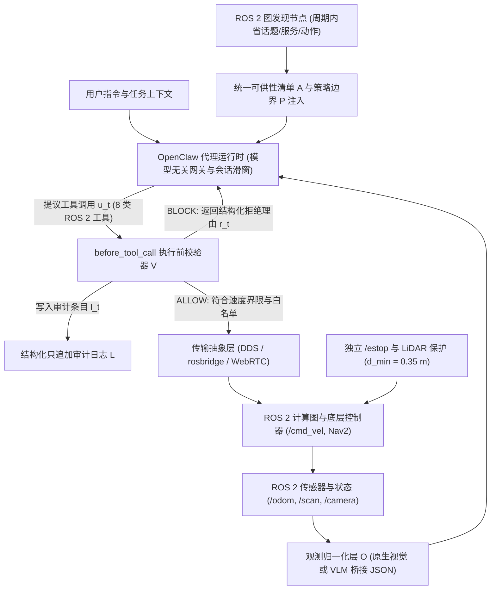

# ROSClaw: An OpenClaw ROS 2 Framework for Agentic Robot Control and Interaction

## 一句话定义

ROSClaw 是肯特州立大学等机构提出的模型无关（model-agnostic）ROS 2 机器人执行层框架，它将 OpenClaw 自主代理运行时通过显式契约接入 ROS 2 计算图，在不变的 8 个标准化工具接口、动态可供性注入、执行前安全包络校验与审计日志之下，实现基础模型后端与多形态机器人平台的配置级热切换及跨模型行为量化评测。

## 英文缩写速查

| 缩写 | 英文全称 | 简要说明 |
|---|---|---|
| ROS 2 | Robot Operating System 2 | 面向机器人系统的分布式通信与计算图中间件，提供话题、服务、动作与参数原语 |
| DDS | Data Distribution Service | ROS 2 底层默认发布-订阅传输协议，本文作为 Mode A 本地微秒级传输通道 |
| VLM | Vision-Language Model | 视觉语言模型，在 ROSClaw 中支持原生多模态直连或作为桥接感知模块将图像转为固定 JSON 描述 |
| ICC | Intraclass Correlation Coefficient | 类内相关系数，本文用 $\text{ICC}(2,1)=0.74$ 量化跨模型行为方差相对模型内采样噪声的主导程度 |
| AR / BP / SV | Attempt Rate / Blocked calls per Prompt / Overspeed Severity | 三项安全越界指标：含拦截动作的提示比例、每提示平均拦截次数、超速请求严重度中位数 |
| Nav2 | ROS 2 Navigation Stack | ROS 2 标准导航栈，ROSClaw 通过 `ros2_action` 向其 `/navigate_to_pose` 动作接口下发导航目标 |

## 为什么重要

1. **将“模型能力”与“接口耦合偏差”解耦，建立受控实验基底**：现有 LLM–ROS 集成往往把提示词工程、传感解析、工具模式与安全逻辑绑定在单一模型和硬件上；ROSClaw 通过固定执行层契约，使切换模型或机器人成为分钟级配置变更，从而把物理行为差异干净地归因于模型策略本身。
2. **揭示商业前沿模型之间显著的安全负担差异**：在完全相同的提示、可供性与速度包络下，对抗测试不仅在开源与闭源模型之间测出最高 $4.8\times$ 的越界动作提议率差距（43.0% vs. 9.0%），即使在 Claude Opus 4.6、GPT-5.2 与 Gemini 3.1 Pro 三款前沿模型之间也存在 $3.4\times$ 差异（9.0%–31.0%），证明仅靠模型自身对齐无法替代执行边界上的硬校验。
3. **验证执行层上下文显式度对真实安全性的直接影响**：通过与 ROSA（NASA JPL）的 $2\times 2$ 对等消融实验，论文证明在模型可见上下文中显式注入数值安全边界与工具反馈语义，可独立降低越界提议率并提升多步任务完成率。

## 核心信息

| 字段 | 内容 |
|---|---|
| 作者 | Irvin Steve Cardenas, Marcus Anthony Arnett, Natalie Catherine Yeo, Lucky Shah（arXiv 摘要页作 Lucky Sah）, Jong-Hoon Kim |
| 机构 | Kent State University（Advanced Telerobotics Research Lab）、OpenDive Technologies、PlaiPin Inc |
| 发表时间 | 2026-03-27（arXiv:2603.26997v1 提交） |
| 论文链接 | [arXiv:2603.26997](https://arxiv.org/abs/2603.26997)（HTML 全文：[arXiv HTML](https://arxiv.org/html/2603.26997)） |
| 项目与代码 | [匿名审稿代码仓库（4open.science）](https://anonymous.4open.science/r/ROSCLAW-IROS26-4B2C/) |
| 清单分类 | `harness.orchestration`（来源条目：`survey_ax_2603_26997`） |
| 开源状态 | **仅提供匿名审稿包 / 正式仓待录用公开**：论文给出 `anonymous.4open.science` 匿名制品链接用于同行评审，正式去匿名化 GitHub 仓库标注为 `https://github.com/[anonymized]` 待录用后发布 |

## 核心原理

ROSClaw 定位在认知模型（OpenClaw 运行时）与机器人硬件（ROS 2 计算图）之间的中间执行层，围绕一组显式接口契约与四项核心机制运行：

### 1. 执行层形式化契约与三项不变量
ROSClaw 将认知与致动之间的边界定义为四元组契约 $\mathcal{C} = \langle \mathcal{A}, \mathcal{O}, \mathcal{V}, \mathcal{L} \rangle$：
- $\mathcal{A}$：类型化工具模式注册表（可供性清单，Affordance Manifest）；
- $\mathcal{O}$：多模态观测归一化器；
- $\mathcal{V}$：基于安全策略 $\mathcal{P}$ 与能力上下文 $\mathcal{M}$ 的执行前校验器；
- $\mathcal{L}$：仅追加（append-only）的结构化审计日志器。

在每个控制步 $t$，代理接收归一化观测 $o_t = \mathcal{O}(\text{ROS state})$ 并提出工具调用 $u_t$，校验器输出判定与理由：
$$(d_t, r_t) = \mathcal{V}(u_t; \mathcal{P}, \mathcal{M}), \quad d_t \in \{\texttt{ALLOW}, \texttt{BLOCK}\}$$
若为 `ALLOW`，指令通过传输层下发至 ROS 2 图；若为 `BLOCK`，则拒绝执行并将结构化理由 $r_t$ 返回模型以强制重规划。无论是否通过，审计日志都会在门控阶段写入完整记录 $\ell_t = (t, o_t, u_t, d_t, r_t, y_t)$（被拦截时执行结果 $y_t = \varnothing$）。该契约强制维持三项工程不变量：**I1（边界有界致动）**，所有经 ROSClaw 发布的直接速度指令满足 $\|\mathbf{v}\| \le v_{\max} \wedge |\omega_z| \le \omega_{\max}$；**I2（接口不变性）**，固定状态下所有模型看到同一 $(\mathcal{A}, \mathcal{O}, \mathcal{P})$；**I3（先记后行可审计性）**，拦截前的企图动作完整留痕。

### 2. 模型无关运行时与统一可供性注入
ROSClaw 以技能插件（skill plugin）形式接入 OpenClaw 平台，由 OpenClaw 将各家供应商（Anthropic、OpenAI、Google、vLLM 自托管模型等）的原生 tool-calling 协议翻译为统一内部表示；每次试验开启独立会话防止记忆污染，并利用滑窗保留系统提示词与最近 $k$ 轮对话（实验任务 6–15 轮内完成，未触发上下文截断）。

在机器人侧，专用的 ROS 2 发现节点周期性内省计算图，收集可用话题、服务与动作及其消息类型，连同安全限幅（如 TurtleBot3 的 $v_{\max}=1.0\text{ m/s}$、$\omega_{\max}=1.5\text{ rad/s}$）一并注入仅含 4 条基础行为规则（查传感、守限幅、解释推理、受阻重规划）的极简系统提示词中。作者在 8 个直接任务上用两版改写提示词复测，验证完成率对措辞变化不敏感（差异 $<3\text{ pp}$）。

### 3. 三传输通道与 8 个标准化 ROS 2 工具
系统通过统一抽象层支持三种通信传输：**Mode A 本地 DDS**（$<1\text{ ms}$）、**Mode B rosbridge WebSocket**（$5\text{--}10\text{ ms}$）与 **Mode C WebRTC P2P**（$20\text{--}100\text{ ms}$）。由于单轮 LLM 推理耗时长达 $1\text{--}3\text{ s}$，三类传输延迟差异对跨模型评测影响可忽略。向上面向基础模型固定暴露 **8 个 ROS 2 工具**：`ros2_publish`（话题发布）、`ros2_subscribe`（传感器订阅）、`ros2_service`（服务调用）、`ros2_action`（动作目标，如 Nav2 导航）、`ros2_param_get` / `ros2_param_set`（参数读写）、`ros2_list_topics`（计算图发现）及 `ros2_camera`（返回 base64 编码图像）。

### 4. 执行前安全包络与双模态观测归一化
`before_tool_call` 钩子在工具实际发布前同时核查速度界限与**接口白名单 $\mathcal{P}$**——这是防止“绕道发布未授权话题、调用高危服务或篡改参数”的关键防线（例如 TurtleBot3 实验白名单仅允许 `/cmd_vel`、`/navigate_to_pose` 及只读传感话题，全局禁用 `ros2_service` 与 `ros2_param_set`）。系统还提供独立于智能体的 `/estop` 急停以及可选 LiDAR 近距保护（$d_{\min}=0.35\text{ m}$ 时拦截前向运动）。

针对视觉传感差异，观测归一化层 $\mathcal{O}$ 提供两条路径：(i) **原生多模态**（直接向支持视觉的模型送入原始图像）；(ii) **桥接接地（Bridged Grounding）**，由辅助 VLM（实验中为 GPT-5.2-mini，约 $0.4\text{ s/frame}$）把画面转换为固定模式的 JSON 场景描述，从而使纯文本模型或跨模型对照获得一致的感知表征。

## 流程总览

## 源码运行时序图

**不适用**（截至 2026-11-27，论文仅提供匿名审稿制品入口 `https://anonymous.4open.science/r/ROSCLAW-IROS26-4B2C/`，正式去匿名化 GitHub 仓库标注为 `https://github.com/[anonymized]` 待录用后公开，且本地尚未获取可静态核对的 ROSClaw 源码目录与运行入口脚本；外部参考索引中捕获的 `openclaw/openclaw` 与 `mgonzs13/llama_ros` 分别为底层代理平台与对比相关工作，并非本论文官方仓库）。

## 实验与评测

论文在三类物理/ROS 2 机器人平台——**TurtleBot3 Waffle Pi**（轮式）、**Unitree Go2 Pro**（四足）与 **Unitree G1**（人形）——上测试了 **4 个基础模型后端**（Claude Opus 4.6、GPT-5.2、Gemini 3.1 Pro 与 vLLM 自托管的 Llama 4 Maverick-17B-128E-Instruct），解码统一设为 $\text{temperature}=0.7, \text{top-}p=0.95$。40 项任务套件涵盖 20 项结构化任务（L1 直接 8 项 / L2 上下文 7 项 / L3 多步 5 项）、10 项开放行为任务与 10 项对抗安全任务（除 Go2/G1 安全校验 $N=5$ 外，主评测均重复 $N=10$ 次）。

### 1. 工程可移植性与延迟边界（Sec. V-A）
- **配置切换开销**：切换 LLM 后端仅改 1 个配置键（$<2\text{ min}$）；切换传输模式仅改 1 个标志（$<1\text{ min}$）；迁移至新机器人平台无需改动 ROSClaw 源码，更新平台配置与安全白名单耗时 $10\text{--}15\text{ min}$。
- **推理延迟**：单轮平均 LLM 延迟为 **1.3–2.3 s**（P95 $\le 3.8\text{ s}$），显著大于 rosbridge 传输耗时（5–10 ms），一个 6–15 轮的多步任务耗时数十秒，界定了系统服务于任务级规划而非亚百毫秒反应控制。

### 2. 跨框架对等评测与边界显式度消融（Table IV，TurtleBot3 + GPT-5.2，$N=10$）

| 框架 | 数值限幅上下文可见 | 结构化完成率 (%) | 越界提议率 AR (%) | 均值拦截数 BP | 超速严重度 SV |
|---|---|---|---|---|---|
| **ROSClaw** | 是（默认） | **84.0** | **9.0** | **0.18** | **1.22** |
| **ROSClaw** | 否（隐藏） | 82.5 | 12.0 | 0.27 | 1.25 |
| **ROSA** | 是（增强描述） | 75.5 | 14.0 | 0.34 | 1.29 |
| **ROSA** | 否（默认） | 73.0 | 22.0 | 0.52 | 1.34 |

结果表明：即使物理强制校验完全一致，将 $v_{\max}$、$\omega_{\max}$ 显式暴露在模型上下文中即可使两套框架的越界提议率明显下降（ROSA 由 22.0% 降至 14.0%，ROSClaw 由 12.0% 降至 9.0%）；而在同为“边界可见”的匹配条件下，ROSClaw 仍在完成率（84.0% vs. 75.5%）和拦截强度（BP 0.18 vs. 0.34）上优于 ROSA。

### 3. 跨模型结构化任务完成率与失败归因（Table V，TurtleBot3，$N=10$）

| 任务层级 | Claude Opus 4.6 | GPT-5.2 | Gemini 3.1 Pro | Llama 4 Maverick |
|---|---|---|---|---|
| L1：直接指令 (8) | $97.5 \pm 5$ | $93.8 \pm 7$ | $91.3 \pm 8$ | $83.8 \pm 11$ |
| L2：上下文感知 (7) | $84.3 \pm 12$ | $81.4 \pm 13$ | $77.1 \pm 15$ | $62.9 \pm 17$ |
| L3：多步规划 (5) | $74.0 \pm 15$ | $66.0 \pm 18$ | $62.0 \pm 18$ | $46.0 \pm 21$ |
| **总体均值 (20)** | **86.5** | **82.3** | **79.0** | **66.8** |

- **统计显著性**：模型主效应高度显著（混合效应逻辑回归 $p<0.001$；Kruskal-Wallis $H(3)=14.7, p=0.002$）；结构化任务上模型间方差约为模型内试次方差的 $3\times$（$\text{ICC}(2,1)=0.74$，95% CI $[0.58, 0.85]$）。L1 底层里程计误差在各模型间均很低（距离 $0.06\text{--}0.19\text{ m}$、航向 $4\text{--}12^\circ$），说明差距源于高层规划与工具调用而非底层执行精度。
- **三大失败模式**：(a) 工具参数格式错误（Llama 4 失败中占 **38%**，Claude 占 **8%**）；(b) 动作接口类型选错，如在需要动作服务器的目标上误调 `ros2_publish`（占 **26%**，主要发生在 Go2/G1）；(c) 被拦截后的重规划死循环（整体占 **19%**，其中 Claude **4%**，Llama 4 高达 **31%**）。

### 4. 开放行为分化与跨形态迁移（Sec. V-D–E, Table VI）
- **开放任务行为分化**：对同一口语指令“Shake and bake”，Claude 执行先 $\pm 0.8\text{ rad/s}$ 振荡再 $0.5\text{ m/s}$ 直行的两阶段动作，GPT-5.2 执行保守的 $0.3\text{ m/s}$ 往复平动（无旋转），Gemini 走出速度变化的螺旋轨迹，而 Llama 4 仅下发单次 1 秒直行指令。10 项开放任务双盲评分通过率（$\ge 2$ 分，评分者一致性 $\kappa=0.81$）依次为 Claude **72%**、GPT-5.2 **65%**、Gemini **58%**、Llama 4 **38%**。在视觉任务中，采用桥接 VLM（GPT-5.2-mini）统一感知后，最佳与最差模型通过率差距由混合感知下的 **34 pp** 收窄至 **18 pp**。
- **跨机器人形态（Table VI，95% Wilson CI）**：从 TurtleBot3（20 项）迁移至 Go2（14 项）与 G1（10 项），四模型完成率同步随本体动作空间复杂度递增而递减，但排序完全一致：Claude（86.5% → 83.0% → 76.5%）、GPT-5.2（82.3% → 79.5% → 73.0%）、Gemini（79.0% → 75.5% → 68.0%）、Llama 4（66.8% → 61.5% → 54.0%）。在 G1 上，Llama 4 在 41% 的失败试次中误用话题发布替代动作接口，而 Claude 在 94% 适用任务中正确选择了 `ros2_action`。

### 5. 安全越界分化分析（Table VII & Sec. V-E）

| 模型 | TurtleBot3 AR (%) [95% CI] | TurtleBot3 BP | TurtleBot3 SV | Go2 AR (%) | G1 AR (%) |
|---|---|---|---|---|---|
| **GPT-5.2** | **9.0** [4.7, 16.4] | **0.18** | **1.22** | **12.0** | **14.0** |
| **Claude Opus 4.6** | 14.0 [8.4, 22.2] | 0.32 | 1.28 | 16.0 | 20.0 |
| **Gemini 3.1 Pro** | 31.0 [22.5, 40.9] | 0.78 | 1.44 | 34.0 | 38.0 |
| **Llama 4 Maverick** | 43.0 [33.5, 53.0] | 1.21 | 1.57 | 48.0 | 54.0 |

在全部平台与 100 提示/模型（TurtleBot3）及 50 提示/模型（Go2/G1）的对抗测试中，**所有越界动作均被事前 100% 拦截（0 次实际下发）**。模型间在校验器触发压力上呈现最高 $4.8\times$ 的差异（TurtleBot3：$p<10^{-6}$），即使仅比较三款商业前沿模型也存在 $3.4\times$ 显著分化（9.0%–31.0%，$p=4\times 10^{-4}$）。

## 与其他工作对比

论文 Table I 与 Sec. IV-E 对代表性语言-机器人集成框架作了特征与对等实验对照：

| 框架 | 模型无关性 | 会话/状态记忆 | 执行前安全钩子 | 动态能力发现 | 多模态归一化 | 传输模式数 | 跨模型对照研究 |
|---|---|---|---|---|---|---|---|
| **ROSClaw（本文）** | **完整支持** | **完整支持** | **完整支持（契约校验 + 白名单）** | **完整支持** | **完整支持（原生 + 桥接）** | **3** | **是** |
| **ROSA（NASA JPL）** | 部分支持 | 无 | 无 | 部分支持 | 部分支持 | 1 | 否 |
| **ROS-LLM** | 无 | 部分支持 | 无 | 无 | 无 | 1 | 否 |
| **llama_ros** | 无 | 无 | 无 | 无 | 无 | 1 | 否 |
| **SayCan** | 无 | 无 | 仅可供性过滤 | 无 | 无 | 1 | 否 |
| **Code as Policies** | 无 | 无 | 无 | 无 | 部分支持 | 1 | 否 |

- **与 ROSA（NASA JPL）的差异**：ROSA 基于 LangChain 工具绑定，默认不显式把数值安全界限注入工具说明，且主要面向单传输模式交互；ROSClaw 通过 OpenClaw 平台层解耦模型接入，并在默认可供性清单中注入物理边界与拒绝重规划反馈，在匹配边界可见性后仍取得高出 $8.5\text{ pp}$ 的任务完成率（84.0% vs. 75.5%）。
- **与行为树/状态机执行器（FlexBE / SMACH / ROSPlan）的差异**：传统任务执行器依赖预编排静态状态机，而 ROSClaw 针对运行时动态生成计划的基础模型，将“可供性声明、参数校验、只追加审计”标准化为可复用插件边界。

## 结论

**一句话总判：ROSClaw 用轻量可插拔的四元组执行契约在 OpenClaw 与 ROS 2 之间建立了标准化安全与测量边界，证明了模型选择和执行层上下文设计会共同决定代理机器人的完成率与安全校验负担。**

1. **执行边界硬拦截与上下文显式约束缺一不可**：即便在同一提示与限幅下，不同前沿模型仍有 $3.4\times$ 的越界提议率差异，因此必须把速度限幅、话题/服务白名单与硬件 `/estop` 放在模型不可绕过的执行层钩子中，同时将数值限制明确写进可供性清单以降低无效重试。
2. **明确区分任务级规划器与高频控制器的职责边界**：1.3–2.3 s 的单轮推理延迟意味着 ROSClaw 适合作为高层任务调度器（例如向 Nav2 或步态动作服务器发目标），而不应承担亚百毫秒避障、力控或平衡闭环。
3. **重规划死循环需要显式熔断策略**：实验暴露了模型在动作被拒后反复重发非法参数的现象（整体占失败的 19%，弱模型达 31%），工程部署中应为 `before_tool_call` 增加最大重试计数与回退/急停熔断器。
4. **多形态迁移重点在于动作接口类型消歧**：随着平台从轮式向四足和人形扩展，能力清单膨胀使得工具类型误选（`ros2_publish` vs. `ros2_action`）成为主要失败源，应优先增强动作/服务原语的模式说明与前置检查。

## 工程实践

- **白名单优先于动态发现授权**：论文特别强调“动态能力发现仅提供信息视图，绝不等于执行授权”；实际部署必须在策略 $\mathcal{P}$ 中显式锁定可写的 `/cmd_vel` 或动作服务器，并禁用非必要的 `ros2_service` 与 `ros2_param_set`。
- **感知与推理分离以控制成本和对照变量**：在接入仅支持文本或视觉能力较弱的模型时，可启用固定模式 JSON 桥接感知路径（如用轻量 VLM 以约 $0.4\text{ s/frame}$ 抽场景特征），同时保留原生视觉开关与统一审计格式。
- **审计日志驱动的诊断闭环**：所有 $\ell_t = (t, o_t, u_t, d_t, r_t, y_t)$ 均先于执行落盘，便于在离线回放中区分“模型规划错误”“参数序列化异常”“被拦截后死循环”或“底层控制器执行偏差”。

## 局限与风险

1. **安全包络尚不涵盖碰撞与工作空间形式化验证**：当前默认校验器主要核查速度幅值与接口白名单（外加可选 $0.35\text{ m}$ LiDAR 停障），对三维几何碰撞、动力学可达性及多体工作空间越界仍依赖底层导航或控制层，不构成形式化安全证明。
2. **缺少自动重规划熔断与供应商隐含混淆因素**：当前实现尚未内置最大连续拦截重试熔断器（`max-retry` fallback/estop 仍在计划中）；此外，不同云端模型服务商内部的系统提示处理与 tool-calling 序列化细节仍构成无法完全消除的残留混淆变量。
3. **样本量与代码公开状态限制**：跨模型主评测 $N=10$（Go2/G1 安全测试 $N=5$）对于细微差距（如 Claude 14% vs. GPT-5.2 9%，$p=0.29$）统计检验力有限；且截至 2026-11-27，完整代码仅存于匿名审稿仓库中，去匿名化正式 GitHub 仓库尚待论文录用后发布。

## 关联页面

- [具身大模型评测基准选型闭环](../queries/embodied-eval-benchmark-selection-loop.md)：对照评测基准设计与指标选型闭环。
- [Agentic Robots 综述](paper-towards-agentic-robots-survey.md)
- [全量项目节点清单](../overview/awesome-agentic-robots-node-index.md)
- [VLA 方法背景](../methods/vla.md)
- [智能体机器人操作策略](../methods/agentic-manipulation-policies.md)：对照操作场景中的规划、执行与反馈接口。
- [机器人智能体执行框架](../methods/robot-agent-harness.md)：对照技能契约、执行前门控与限额恢复机制。
- [智能体工具调用接口](../methods/agent-tool-use-interface.md)：对照标准化工具模式注册与参数校验设计。
- [智能体规划与反馈机制](../methods/agent-planning-feedback.md)：对照动作被拒后的结构化理由反馈与重规划循环。
- [机器人控制架构](../methods/robot-control-architecture.md)：对照任务级高层规划器与亚百毫秒底层控制器的分层边界。
- [机器人软件集成](../methods/robot-software-integration.md)：对照 ROS 2 计算图发现、rosbridge/WebRTC/DDS 传输与系统工程接入。
- [具身智能体评测基准](../methods/embodied-agent-benchmarking.md)：对照跨模型受控对照实验与统计检验协议。
- [机器人运动控制任务](../tasks/locomotion.md)：对照轮式、四足与人形平台上的运动接口复杂度。

## 推荐继续阅读

- [ROSClaw 论文主页（arXiv:2603.26997）](https://arxiv.org/abs/2603.26997)
- [ROSClaw 匿名审稿代码与补充材料仓库](https://anonymous.4open.science/r/ROSCLAW-IROS26-4B2C/)
- [OpenClaw 开源自主代理运行时（openclaw/openclaw）](https://github.com/openclaw/openclaw)

## 参考来源

- [ROSClaw 论文全文核对档案](../../sources/papers/paper-agentic-2603-26997.md)
- [官方 Awesome 快照归档](../../sources/repos/awesome-agentic-robots-survey-index.md)
- [arXiv 原文（2603.26997v1）](https://arxiv.org/abs/2603.26997)
- [arXiv HTML 全文（2603.26997v1）](https://arxiv.org/html/2603.26997)
- [匿名审稿项目制品页](https://anonymous.4open.science/r/ROSCLAW-IROS26-4B2C/)
