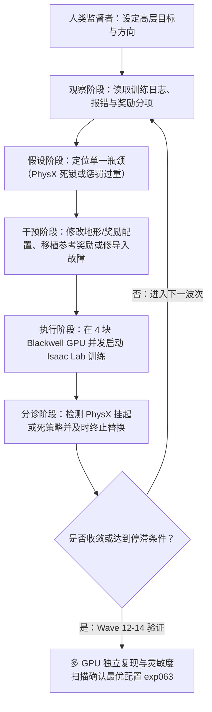

# Agent-Driven Autonomous Reinforcement Learning Research: Iterative Policy Improvement for Quadruped Locomotion

## 一句话定义

**这是一项针对四足机器人强化学习的实证案例研究：在人类设定研究方向后，由编码智能体（OpenCode 中的 Claude）在 Isaac Lab 中自主承担代码排障、地形死锁隔离、参考奖励移植、多 GPU 任务调度与单变量超参迭代，历时 14 个波次（70 余组实验）将 DHAV1 12 自由度四足机器人的粗糙地形速度跟踪误差降至 0.263。**

## 英文缩写速查

| 缩写 | 英文全称 | 简要说明 |
|------|----------|----------|
| RL | Reinforcement Learning | 强化学习，本文用于训练四足机器人粗糙地形速度跟踪策略 |
| PPO | Proximal Policy Optimization | 近端策略优化；文中 Basic PPO 分支最终收敛并胜过同项目 HIM 分支 |
| HIM | Hybrid Internal Model | 混合内部模型运动控制策略分支（受 HIMLoco 启发，本项目中作为对照分支） |
| DR | DeepRobotics Reference Implementation | 文中指公开四足训练参考库 `DeepRobotics/rl_training` 与 `rl_sar`（如 DR-style 地形与奖励） |
| DoF | Degrees of Freedom | 机器人关节自由度；实验平台 DHAV1 为 12-DoF 四足机器人 |
| PhysX | NVIDIA PhysX Physics Engine | Isaac Sim/Lab 底层物理引擎，文中出现与箱体/阶梯原语相关的死锁挂起故障 |

## 为什么重要

1. **填补自主科研范式在真实物理仿真工程中的空白：** 相比代码规模紧凑、单卡封闭的语言模型自动化研究（如 AutoResearch），机器人 RL 研究充满物理引擎死锁、模块导入顺序崩溃、多 GPU 并发调度与奖励尺度失真等工程摩擦。本文完整记录了智能体如何处理这类“研究+工程分诊”混合任务。
2. **展示诊断型实验而非盲目调参：** 智能体没有只靠扩大参数网格搜索解决问题，而是通过缩减并行环境数证伪纯批量压力假说，再通过地形原语隔离将 PhysX 死锁定位到箱体与阶梯类几何体，为后续可控调参扫清障碍。
3. **揭示跨配置奖励比较的归一化陷阱：** 当跟踪权重从 `5.0/2.5` 提高到 `7.0/3.5` 或 `8.0/4.0` 时，总奖励从 `116.3` 膨胀到 `174.1`，但实际速度跟踪误差却可能变差；论文用实际轨迹演示了权重无关指标（`vel_err`）与分项奖励拆解的必要性。

## 核心信息

| 字段 | 内容 |
|---|---|
| 作者 | Nimesh Khandelwal, Shakti S. Gupta |
| 机构 | 印度理工学院坎普尔分校机械工程系（Department of Mechanical Engineering, Indian Institute of Technology Kanpur） |
| 发表时间 | 2026-03-28（arXiv:2603.27416v1） |
| 论文链接 | [arXiv:2603.27416](https://arxiv.org/abs/2603.27416) / [HTML 全文](https://arxiv.org/html/2603.27416) |
| 项目与代码 | 未确认开源（论文及 arXiv 元数据未公布独立项目页或本研究实验归档仓库） |
| 清单分类 | `model.training` |
| 来源条目 | `survey_ax_2603_27416` |
| 开源状态 | 未确认开源代码（仅引用外部参考库 `DeepRobotics/rl_training`、`rl_sar`、`autoresearch` 与 `IsaacLab`） |

## 核心原理

本文未提出新的 RL 优化算法，而是记录了一套 **人机协同的波次化自主实验闭环（Wave-Based Autonomous Research Loop）**：

1. **五层系统架构：**
   - **人类指令层：** 仅给出高层方向指令（如“同时调优 Basic PPO 与 HIM”“参考公开粗糙地形配置”），决定阶段性议程，不直接逐次手改训练代码。
   - **智能体执行层：** 基于运行在 OpenCode 编码环境中的 Claude 智能体，拥有代码读写、Shell 执行、日志检查与后台任务管理权限。
   - **仿真训练栈：** 在 Isaac Sim / Isaac Lab 中运行 DHAV1 12-DoF 四足机器人速度跟踪任务；主训练采用 `4096` 并行环境，诊断运行采用 `2048` 或 `512` 环境。
   - **硬件调度层：** 一台配备 4 块 NVIDIA RTX PRO 4500 Blackwell（每块 32 GB 显存）的工作站，由智能体动态分配 GPU 并发跑批、监控卡死进程并杀掉挂起任务以释放算力。
   - **实验档案层：** 仓库内持久保存波次总结、运行指标、错误堆栈与奖励分项分析，作为智能体下一波决策的唯一经验证据约束。

2. **五阶段波次研究循环（Observation → Hypothesis → Intervention → Execution → Triage）：**
   - **观察：** 解析训练日志、汇总指标、单步奖励分项与失败轨迹。
   - **假设：** 提炼单一可验证瓶颈（如“PhysX 死锁是否由并行环境缓冲区压力引起”“惩罚项是否过强导致策略直接躺平”）。
   - **干预：** 编辑配置、奖励权重或修复启动代码；在 Wave 7 中读取公开参考仓库 `DeepRobotics/rl_training` 与 `rl_sar`，移植 4 项此前缺失的奖励函数：对角步态奖励（diagonal gait reward）、腾空时间方差正则（air-time variance regularization）、关节镜像对称（joint-mirror symmetry）与无指令触地塑形（feet-contact-without-command shaping），同时修复 `omni`/`pxr` 过早导入造成的 Isaac Sim 启动崩溃。
   - **执行与分诊：** 并发启动训练并实时巡检；一旦发现 PhysX 死锁无自恢复迹象或呈现零地形进展的僵死策略，立即终止并替换作业。

3. **核心技术诊断与指标校准：**
   - **地形死锁隔离（Wave 5–6）：** 缩小环境数只延迟挂起时间而未消除故障；隔离地形族后发现含 box 与 stair-like 原语的混合地形会反复触发 PhysX 死锁，替换为 DR 参考风格的平滑粗糙地形组合（`random_rough`、`hf_pyramid_slope`、`hf_pyramid_slope_inv`）后首次实现稳定长程训练。
   - **奖励尺度归一化（Section VI-E）：** 当线性/角速度跟踪权重上调时，总均回报随权重线性放大，易误导超参搜索。智能体依据权重归一化后的分项跟踪得分（均约 `~0.88`）和权重无关的平面速度误差 `vel_err` 进行公平比较，发现适中步态约束（`gait=0.5`）配合较强姿态稳定惩罚（`base_height=-10.0`、`flat_orientation=-10.0`）与腾空方差正则（`airtime=-6.0`）能为优化器留出精准跟踪速度的自由度。

## 流程总览

## 源码运行时序图

**不适用**（截至 2026-11-27，论文及 arXiv 元数据未公布本研究 DHAV1 Isaac Lab 案例实验归档与智能体自动化调度脚手架的官方独立代码仓库或项目页；文中引用的 `DeepRobotics/rl_training`、`DeepRobotics/rl_sar`、`karpathy/autoresearch` 与 `isaac-sim/IsaacLab` 均为外部参考实现或底层仿真框架，不足以还原作者实验循环的实际源码入口。）

## 实验与评测

全研究共跨越 **14 个波次（Wave 1–14）**、**70 余组实验（`exp001`–`exp073`）**，平台为 DHAV1 12-DoF 四足机器人（Isaac Lab，4096/2048/512 并行环境，4 × NVIDIA RTX PRO 4500 Blackwell 32 GB GPU）：

| 实验编号 | 波次 | 策略族与核心配置 | 平均回报 | 地形进展 / 速度误差 `vel_err` | 训练结果与备注 |
|---|---|---|---:|---:|---|
| Wave 1 基线 | 1 | HIM 初始粗糙地形与默认奖励 | `7–10` | – | 无明显粗糙地形进展 |
| `exp019` | 3 | Basic PPO，软化惩罚，默认粗糙地形 | `21.0` | 地形 `0.53` | 约 154 轮迭代后 PhysX 挂起 |
| `exp028b` | 6 | Basic PPO，DR 风格平滑地形，软化奖励 | – | 地形 `6.59` | 完成 500 轮迭代，首次稳定长跑 |
| `exp029` | 6 | HIM，DR 风格地形，强化跟踪 | – | 地形 `0.0` | 完成 500 轮但无地形推进 |
| `exp033` | 7 | Basic PPO，DR 地形，激进惩罚（`base_height=-10`, `orient=-10`, `contact=-0.1`） | `-0.85` | 地形 `0.0` | 死策略（100% 机座触地终止） |
| `exp036` | 7–8 | HIM，DR 地形，默认权重（与 `exp035` 同条件对照） | `3.1` | 地形 `0.0` | `vel_err > 1.4`，靠原地站立保存活 |
| `exp035` | 7–8 | Basic PPO，DR 地形，适中惩罚 | `65.6` | 地形 `5.87` | 稳定跑至 1363 轮迭代 |
| `exp039` | 8 | Basic PPO，DR 地形，适中惩罚 + 步态增强 + 无课程 | `116.3` | 地形 `6.18` / `vel_err=0.29` | 第 991 轮达 `97%` 超时存活 |
| `exp043` | 9 | Basic PPO，增强跟踪 `7.0/3.5`，`gait=1.0` | `168.4` | `vel_err=0.27` | 完成全部 2000 轮迭代 |
| `exp052` | 10 | Basic PPO，降低步态权重 `gait=0.5` | `156.3` | `vel_err=0.271` | 完成 2000 轮，`exp059` 精确复现 `0.271` |
| `exp053` | 10 | Basic PPO，`base_height=-10.0` | `161.9` | `vel_err=0.275` | `timeout=98.2%` |
| `exp058` | 11 | 组合优胜项：`gait=0.5` + `height=-10` + `orient=-10` | `153.0` | `vel_err=0.266` | 完成 2000 轮，`timeout=97.7%`，首个 `100%`（4/4）完成波次 |
| `exp063` | 12 | 在 `exp058` 基础上加入 `airtime=-6.0` | `153.4` | **`vel_err=0.263`** | **全研究最佳日志运行**，2000 轮 `97%` 超时存活 |
| `exp066` | 13 | 进一步提高跟踪权重至 `8.0/4.0` | `174.1` | `vel_err=0.282` | 总奖励虚高但速度跟踪退化 |
| `exp071` | 14 | `gait=0.25` + `airtime=-6.0` | `151.1` | `vel_err=0.272` | 劣于 `gait=0.5` |
| `exp072` | 14 | 复现 `exp063` 配置 | `153.4` | `vel_err=0.263` | 跨 3 块 GPU 的第 5 次独立复现（含 `exp063`/`exp064`/`exp072`） |

**参数灵敏度与收敛验证（Wave 12–14）：**
- 系统扫描了步态权重（`0.0, 0.25, 0.5, 1.0, 1.5, 2.0, 2.5`）、姿态稳定惩罚（`-5, -7, -10, -12`）、跟踪权重（`5/2.5, 7/3.5, 8/4`）、腾空方差（`0, -4, -5, -6, -7, -8`）与接触力惩罚（`-0.01, -0.02`）。
- 呈现清晰的 U 型最优区间：`gait=0.5`、`height/orient=-10`（`-12` 时崩溃）、`airtime=-6.0`；在当前最优组合上额外加倍力矩惩罚或加入关节镜像对称会引起训练不稳定。
- 最优 `exp063` 收敛奖励分项显示：正向跟踪奖励占主导（线速度跟踪 `× 7.0` 贡献约 `6` 单位，角速度跟踪 `× 3.5` 贡献约 `2.7` 单位），姿态与高度惩罚收敛至接近 0，接触力惩罚约 `-0.4`。

## 与其他工作对比

| 工作 / 基线 | 定位与工作条件 | 本文差异与实证对照结果 |
|---|---|---|
| **HIM（本仓库移植分支，源自 HIMLoco）** | 同项目内双分支对比，使用完全相同的 DR 地形与奖励权重 | 在相同配置下 Basic PPO（`exp035`）奖励 `65.6`、`vel_err < 0.3`、地形 `5.87`；HIM（`exp036`）奖励 `3.1`、`vel_err > 1.4`、`terrain=0.0`（原地站立）。作者明确说明该结论仅限本项目该 HIM 移植实现，不构成对 HIMLoco 的普适评价 |
| **AutoResearch（Karpathy）** | 紧凑单卡 Python 语言模型训练代码库上的近封闭自主实验循环 | 本文在失败率更高的机器人 RL 环境下运行：需处理 Isaac Sim 导入引导、PhysX 地形死锁、4-GPU 并发作业生杀与外部仓库奖励移植 |
| **The AI Scientist / v2** | 标准化 ML 基准下端到端自动生成实验与论文 | 本文强调人类定方向 + 智能体做高摩擦工程诊断与实验执行的半自主档案，而非端到端论文生成 |
| **Eureka / Text2Reward** | 由大模型从头编写或生成密集奖励代码 | 本文智能体不从零捏造奖励函数，而是定位公开参考实现并移植既有成熟奖励项，再通过单变量实验调权 |

## 结论

**一句话总判：编码智能体能够可靠承担物理仿真强化学习中大量低层代码排障、系统分诊与单变量实验迭代工作，但其效能取决于人类把控高层议程、用权重无关指标防止奖励尺度误导，以及先隔离仿真器稳定性故障。**

1. **先治仿真死锁再谈超参调优：** 在 PhysX 因箱体/阶梯地形发生随机挂起时，奖励权重对比会被随机截断混杂；隔离出稳定平滑粗糙地形后，Wave 11 才首次实现 `100%`（4/4）完赛率。
2. **用物理误差指标替代原始总奖励做跨组比较：** 提高跟踪权重会直接抬高总回报（`116.3 → 174.1`），必须以 `vel_err` 与权重归一化分量作为选优依据。
3. **适度步态引导 + 较强姿态稳定惩罚构成有效区间：** 降低步态权重（`1.0 → 0.5`）释放跟踪自由度，配合 `base_height=-10.0`、`flat_orientation=-10.0` 与 `airtime=-6.0` 达到最佳平衡；过度惩罚（`-12` 或高接触惩罚）会导致策略直接躺平。
4. **“参考代码移植 + 单变量消融”比从零生成奖励更稳健：** 从经过验证的开源实现移植 4 个步态/触地奖励项后，再做可控单变量微调与多卡复现，可在有限算力下快速逼近稳定局部最优。

## 工程实践

- **多 GPU 实验分诊策略：** 在多卡工作站上赋予智能体实时日志检测与杀进程权限，对无地形进展（`terrain=0.0`）或 PhysX 卡死的任务果断终止并重排，避免空占算力。
- **最小化诊断实验：** 当怀疑并行规模或显存缓冲区引发挂起时，先运行 `512`/`2048` 环境的缩减诊断实验区分“延迟失败”与“根因消除”，再决定是否转向地形原语排查。
- **Isaac Sim 启动顺序防坑：** 避免在仿真应用初始化前 eager import `omni`/`pxr` 相关模块，防止环境注册与训练启动前报错中断。
- **未开放自身代码时的复现参考：** 本研究未公开独立代码仓，但关键地形简并思路与新增四项奖励直接源自公开参考库 `DeepRobotics/rl_training` 与 `rl_sar`（结合 `IsaacLab`）。

## 局限与风险

- **无自身源码与真机验证：** 本案例研究未发布独立仓库，也未提供 DHAV1 实体四足机器人的 Sim2Real 真机部署评测，所有定量结果均来自 Isaac Lab 仿真日志。
- **单项目与非受控对比：** 全文仅为单一团队在单一四足任务上的实证记录，缺少“人类研究员 vs. 智能体”严格对照实验，且人类仍掌握高层方向决策权。
- **局部最优与地形简化代价：** 为消除 PhysX 死锁而移除 box 与 stair-like 地形原语后，所训练策略对离散台阶、棱台等强几何障碍的泛化能力未经验证。
- **HIM 分支局限性非普适结论：** HIM 在本项目多次取得 `terrain=0.0`，仅反映该工程移植版本在该地形与奖励配置下的表现，不能推论原版 HIMLoco 算法失效。

## 关联页面

- [Agentic Robots 综述](paper-towards-agentic-robots-survey.md)
- [全量项目节点清单](../overview/awesome-agentic-robots-node-index.md)
- [VLA 方法背景](../methods/vla.md)
- [强化学习](../methods/reinforcement-learning.md)：了解奖励驱动的策略学习基础。
- [PPO（近端策略优化）](../methods/ppo.md)：本文 Basic PPO 分支收敛所依赖的核心策略优化算法。
- [编码智能体闭环验证](../methods/coding-agent-verification-loops.md)：智能体读取日志、修改配置并执行验证的闭环工程模式。
- [工程仿真工作流](../methods/engineering-simulation-workflow.md)：物理引擎稳定性排查与多组实验管理实践。
- [机器人仿真集成](../methods/robot-simulation-integration.md)：Isaac Sim / Isaac Lab 环境配置与启动引导问题背景。
- [足式运动控制（Locomotion）](../tasks/locomotion.md)：四足速度跟踪与粗糙地形自适应任务脉络。

## 推荐继续阅读

- [arXiv:2603.27416 HTML 全文（Agent-Driven Autonomous Reinforcement Learning Research）](https://arxiv.org/html/2603.27416)
- [Karpathy AutoResearch 官方仓库](https://github.com/karpathy/autoresearch)
- [NVIDIA Isaac Lab 官方仓库](https://github.com/isaac-sim/IsaacLab)

## 参考来源

- [论文原文核对笔记（arXiv:2603.27416）](../../sources/papers/paper-agentic-2603-27416.md)
- [Awesome Agentic Robots 快照归档](../../sources/repos/awesome-agentic-robots-survey-index.md)
- [arXiv:2603.27416 官方摘要与 HTML 全文](https://arxiv.org/abs/2603.27416)
