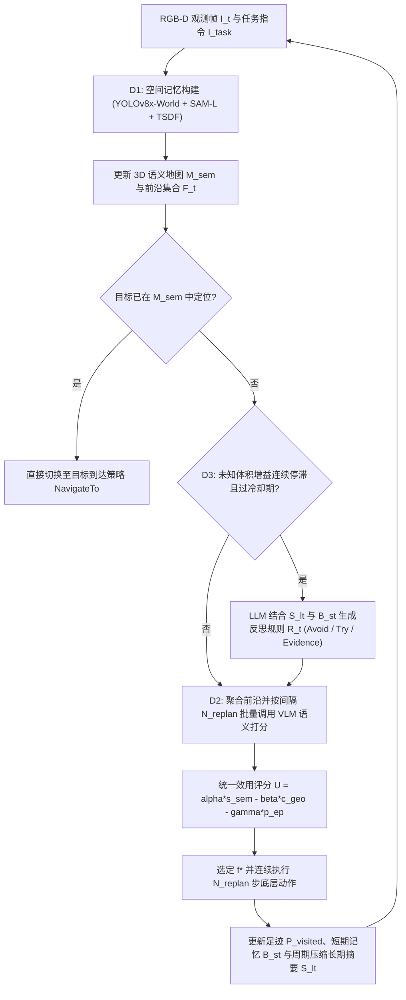

# Stop Wandering: Efficient Vision-Language Navigation via Metacognitive Reasoning

## 一句话定义

**MetaNav** 是一个免训练的元认知视觉语言导航（VLN）智能体框架，通过**持久 3D 语义空间记忆**、**带历史重访排斥与固定重规划间隔的启发式规划**以及**基于信息增益停滞检测的 LLM 反思纠偏闭环**，抑制零样本探索中的局部震荡与无效绕行并减少 VLM 调用开销。

## 英文缩写速查

| 缩写 | 英文全称 | 简要说明 |
|---|---|---|
| VLN | Vision-Language Navigation | 视觉语言导航，根据自然语言指令在未知 3D 环境中感知并导航至目标 |
| VLM | Vision-Language Model | 视觉语言模型，本文用于已知目标定位检查与候选前沿批量语义打分 |
| LLM | Large Language Model | 大语言模型，本文用于压缩长期记忆摘要并在探索停滞时生成纠偏规则 |
| TSDF | Truncated Signed Distance Function | 截断有符号距离场，用于将多视角 RGB-D 帧融合为连续一致的 3D 体素地图 |
| SR | Success Rate | 导航成功率（%），智能体停在目标 1.0 m 内判定成功 |
| SPL | Success weighted by Path Length | 路径长度加权成功率（%），同时衡量成功率与路径几何效率 |
| A-EQA | Active Embodied Question Answering | 主动具身问答基准，要求智能体主动探索 3D 场景并回答环境状态/关系问题 |

## 为什么重要

1. **打破「贪心前沿 + 被动记忆」导致的局部震荡死循环：** 现有免训练 VLN 方法虽然常引入场景图或记忆快照，但空间记忆只作被动查询使用，决策层仍依靠近视语义打分，在复杂室内环境中容易反复重访局部死胡同或被相似干扰物体吸引。
2. **引入可监测、可诊断、可覆写的元认知闭环：** MetaNav 将人类探索中的元认知（监测进展、识别卡滞、修正策略）形式化为「体积信息增益触发 + 双层情景记忆 + Avoid/Try/Evidence 规则注入」，使智能体能够从失败轨迹中即时纠偏，而不需重新训练策略网络。
3. **计算与通信开销解耦：** 通过固定重规划间隔 $N_{replan}=3$ 与条件触发式反思，将秒级（约 5.4–5.8 s）的基础模型推理与毫秒级（2 ms 评分、~414 ms 建图融合）局部执行解耦，在多步移动中摊薄延迟并显著降低单回合查询次数。

## 核心信息

| 字段 | 内容 |
|---|---|
| 作者 | Xueying Li、Feng Lyu\*、Hao Wu\*、Mingliu Liu、Jia-Nan Liu、Guozi Liu |
| 机构 | 中南大学（Central South University）、南京大学（Nanjing University）、国网湖北省电力有限公司电力科学研究院（State Grid Hubei Electric Power Research Institute）、东莞理工学院（Dongguan University of Technology） |
| 发表时间 / 载体 | arXiv:2604.02318v1 [cs.RO]（2026-04-02；10 页，6 图） |
| 论文链接 | [arXiv 摘要](https://arxiv.org/abs/2604.02318) / [arXiv HTML 正文](https://arxiv.org/html/2604.02318) |
| 项目与代码 | 论文摘要提供联系邮箱 `xueyingli@csu.deu.cn` 获取代码，未公开 GitHub 仓库或独立项目主页 |
| 清单分类 | `harness.monitoring_and_recovery`（来源条目 `survey_ax_2604_02318`） |
| 开源状态 | **未确认公开开源代码**（截至 2026-11-27，未在论文正文、arXiv 元数据或公开代码平台确认可独立下载运行的官方仓库） |

## 核心原理

MetaNav 将感知、经验感知规划与元认知反思整合为四阶段在线循环（对应论文 §3.1–§3.4 与 Algorithm 1）：

### 1. 空间记忆构建（D1，§3.2）

- **关键帧语义提取：** 对每帧 RGB-D 观测 $I^t$，使用开放词汇检测与分割模型（实验采用 YOLOv8x-World + SAM-L）及冻结 VLM 提取检测对象集合 $\mathcal{O}^t=\{o_1,\dots,o_M\}$，每个对象表示为 $o_j=(c_j, s_j, p_j)$（类别、置信度与深度反投影得到的局部 3D 坐标），组成局部语义观测 $\mathcal{K}^t=\langle I^t, \mathcal{O}^t\rangle$。
- **TSDF 体积建图与前沿提取：** 借助相机内外参将全局体素中心投影至当前图像平面，按原始深度与投影深度之差以加权平均方式更新全局 3D 体素网格 $\mathcal{V}^t$。依据 TSDF 符号与观测权重将空间互斥划分为自由空间、占据空间与未知空间（Eq. 1）：

$$\mathcal{V}^t = \mathcal{V}_{free}^t \cup \mathcal{V}_{occ}^t \cup \mathcal{V}_{unk}^t$$

- **前沿体素定义与持久语义地图：** 若自由体素 $v\in\mathcal{V}_{free}^t$ 的空间邻域 $\mathcal{N}(v)$ 中存在至少一个未知体素 $v'\in\mathcal{V}_{unk}^t$，则 $v$ 属于前沿集合 $\mathcal{F}^t$（Eq. 2）。同时，将 $\mathcal{K}^t$ 中的 3D 对象提案按空间邻近性与视觉相似性与全局对象库关联：匹配者融合更新，未匹配者实例化为新对象，形成持久化、以对象为中心的 3D 语义地图 $\mathcal{M}_{sem}^t$。

### 2. 历史感知启发式规划（D2，§3.3）

- **已知目标直达分支：** 规划周期开始时先将 $\mathcal{M}_{sem}^t$ 与近期关键帧送入 VLM 核查目标是否已被观测并定位；若确认已定位，直接提取估计坐标并切换至目标到达策略，跳过前沿探索。
- **统一前沿效用评分：** 当目标尚未定位时，将相邻前沿体素聚类为带质心与空间范围的前沿区域，按固定间隔单次批量调用 VLM 获取各前沿的归一化语义得分 $s_{sem}(f_i)\in[0,1]$，并与归一化 2D 几何距离代价 $c_{geo}(f_i)$ 及情景重访惩罚 $p_{ep}(f_i)$ 组合（Eq. 3）：

$$\mathcal{U}(f_i) = \alpha \cdot s_{sem}(f_i) - \beta \cdot c_{geo}(f_i) - \gamma \cdot p_{ep}(f_i)$$

- **时间衰减高斯排斥场：** 依据历史轨迹足迹 $\{p_\tau\}_{\tau=1}^{t-1}$ 构造排斥场惩罚（Eq. 4），其中 $\lambda\in(0,1)$ 控制时间衰减、$\sigma$ 控制空间排斥半径，用于抑制智能体反复回到近期刚离开的死胡同或区域：

$$p_{ep}(f_i) = \sum_{\tau=1}^{t-1} \lambda^{t-\tau} \exp\left(-\frac{\|p_{f_i} - p_\tau\|^2}{2\sigma^2}\right)$$

- **固定间隔执行：** 选出 $f^* = \arg\max \mathcal{U}(f_i)$ 后，智能体承诺向该路标连续执行 $N_{replan}$ 步底层动作（主实验取 $N_{replan}=3$），期间不再查询 VLM，直至间隔到期或到达目标前沿。

### 3. 反思与纠偏（D3，§3.4）

- **双层情景记忆：** 为兼顾局部诊断细节与长时程上下文窗口限制，系统维护两部分轨迹状态：
  - **短期滑动窗口 $\mathcal{B}_{st}$：** 容量为 $K$（主实验 $K=5$），逐条记录 $e_\tau=\langle p_\tau, a_\tau, r_\tau\rangle$（位置、执行动作以及包含所选前沿与决策依据的 $r_\tau$）。
  - **长期摘要 $\mathcal{S}_{lt}$：** 当 $\mathcal{B}_{st}$ 达到容量 $K$ 时，调用 LLM 将近期轨迹压缩为概括已探索区域与策略模式的 $\mathcal{S}_{lt}$，随后清空 $\mathcal{B}_{st}$。所有已执行位姿同步累积到全局足迹集合 $P_{visited}$ 供 Eq. 4 使用。
- **信息增益停滞检测：** 定义单步探索增益为未知体素减少量 $g_t = |\mathcal{V}_{unk}^{t-1}| - |\mathcal{V}_{unk}^t|$。当连续 $N_{stag}$ 步满足 $g_\tau < \epsilon_{gain}$ 且距离上次反思满足冷却时间 $T_{cool}$ 时触发死锁信号 $\Delta_t=\texttt{True}$（Eq. 5）：

$$\Delta_t = \mathbb{I}\left(\sum_{\tau=t-N_{stag}}^{t} \mathbb{I}(g_\tau < \epsilon_{gain}) \ge N_{stag} \land (t - t_{last}) \ge T_{cool}\right)$$

- **LLM 纠偏规则注入：** 当 $\Delta_t=\texttt{True}$ 时，暂停启发式规划并向 LLM 输入任务指令 $I_{task}$、长期摘要 $\mathcal{S}_{lt}$ 与短期失败轨迹 $\mathcal{B}_{st}$，生成包含 **Avoid**（应回避的无效区域/启发式）、**Try**（有潜力的新方向）与 **Evidence**（从过往失败中推导的依据）的结构化反思摘要 $\mathcal{R}_t$，并将其拼接至后续周期的 VLM 提示词 $\mathcal{P}_{prompt}$ 中，从语义层面调制未来前沿评分。

## 流程总览

## 源码运行时序图

**不适用**（核查结果：截至 2026-11-27 未确认可运行的官方公开源码仓库；论文仅在摘要末尾说明可联系作者邮箱 `xueyingli@csu.deu.cn` 获取代码，未提供 GitHub 仓库或独立项目主页，因此不构造基于猜测文件名的源码时序图。）

## 实验与评测

### 评测环境与实现细节（§4.1）

- **回合与观测设置：** 单回合最大 50 步，步长上限 $1.0\text{ m}$；输入 $1280\times 1280$ RGB-D 图像，水平视场角 $120^\circ$，有效深度范围 $1.7\text{ m}$，相机离地高度 $1.5\text{ m}$、下倾 $30^\circ$。
- **感知与基础模型：** 开放词汇检测与分割分别采用 YOLOv8x-World 与 SAM-L；GPT-4o 同时担任决策 VLM（图像输入降采样至 $360\times 360$）与反思 LLM。查询与耗时统计（Table 6）在 RTX 3080 GPU 上评估。
- **基准与指标：** GOAT-Bench（Val Unseen，含 Object / Description / Image 三类指令，成功阈值为停在目标 $1.0\text{ m}$ 内，指标为 SR 与 SPL）、HM3D-OVON（Val Unseen，指标为 SR 与 SPL）、A-EQA（指标为基于冻结 LLM 判定一致性的 LLM-Match 与 LLM-SPL）。

### 主要基准结果（Table 1–3）

| 基准 | MetaNav 指标 | 关键对照基线 | 对比结果说明 |
|---|---|---|---|
| GOAT-Bench（Val Unseen） | **71.4% SR / 51.8% SPL** | 3D-Mem（69.1 / 48.9）、Explore-EQA（61.5 / 45.3）、MTU3D（47.2 / 27.7） | 较 3D-Mem 提升 +2.3% SR、+2.9% SPL；在 Description 模态指令上优势尤为显著（Fig. 3） |
| HM3D-OVON（Val Unseen） | **46.1% SR / 29.8% SPL** | NavFoM（45.2 SR / **31.9 SPL**）、Dynam3D（42.7 / 22.4）、TANGO（35.5 / 19.5）、VLFM（35.2 / 19.6） | SR 高于所有免训练及有监督对照基线；大规模轨迹预训练的 NavFoM 在 SPL 上更高（31.9% vs 29.8%） |
| A-EQA | **58.3% LLM-Match / 45.5% LLM-SPL** | 3D-Mem（52.6 / 42.0）、MTU3D + GPT-4o（51.1 / 42.6）、Explore-EQA（46.9 / 23.4） | 较 3D-Mem 提升 +5.7% LLM-Match 与 +3.5% LLM-SPL |

### 消融实验、超参敏感性与计算效率（Table 4–6，Fig. 4–5）

- **模块消融（GOAT-Bench Val Unseen，Table 4）：**
  - 完整 MetaNav：**71.4% SR / 51.8% SPL**
  - 去掉长期摘要（w/o Long-Term Summary）：68.7% SR / 49.6% SPL
  - 去掉情景记忆缓存（w/o Episodic Memory）：69.2% SR / 49.9% SPL
  - 去掉 D3 反思纠偏（w/o Reflection）：66.3% SR / 47.1% SPL（下降 5.1 个百分点）
  - 去掉 D2 统一效用评分退化为贪心 VLM（w/o Unified Scoring Function）：64.9% SR / 48.2% SPL
  - 去掉 D1 空间记忆构建（w/o Spatial Memory Construction）：58.6% SR / 40.0% SPL
- **超参敏感性：**
  - **重规划间隔 $N_{replan}$（Fig. 4）：** GOAT-Bench 上 SR 在 $N_{replan}=2$ 达峰值 71.7%、SPL 在 $N_{replan}=3$ 达峰值 51.8%；HM3D-OVON 上 SR（46.1%）与 SPL（29.8%）均在 $N_{replan}=3$ 达峰值，过大的间隔会导致对远处错误前沿过度承诺。
  - **短期记忆容量 $K$（Fig. 5）：** GOAT-Bench 性能在 $K=5$ 达到最优（71.35% SR / 51.75% SPL）；过小（$K=2$）因频繁压缩破坏局部连贯性跌至 60.5% SR；过大（$K=50$）因原始日志冗长难以提炼可操作规律跌至 68.7% SR。
- **延迟与查询开销（Table 5–6）：** 点云投影平均 54.0 ms，记忆融合 359.9 ms，效用与惩罚打分 2.0 ms，VLM 决策推理 5.40 s，LLM 反思与摘要 5.75 s。在 GOAT-Bench 上，3D-Mem 每回合平均调用基础模型 31.6 次，而 MetaNav 仅需 25.1 次（基础导航 21.3 + 反思 1.9 + 摘要 1.8），总查询次数减少 **20.7%**。

## 与其他工作对比

| 对比维度 | 贪心/快照记忆方法（如 3D-Mem、Explore-EQA、CG w/ Frontier Snapshots） | 端到端预训练导航策略（如 NavFoM、MTU3D、Uni-NaVid） | MetaNav（本页） |
|---|---|---|---|
| 是否需任务微调 | 否（免训练） | 是（需大规模轨迹或环境专属训练） | 否（免训练，基于现成感知与 GPT-4o） |
| 历史轨迹利用方式 | 仅存储静态地图或视角快照供当前帧查询 | 隐式编码在历史视频/token 序列中 | 显式用于高斯排斥惩罚 $p_{ep}$ 与双层情景反思 |
| 停滞诊断与纠偏 | 无显式死锁检测，易在局部往复震荡 | 依赖策略自身泛化，缺可解释纠偏规则 | 以未知体积探索增益检测停滞并注入 Avoid/Try/Evidence |
| 推理频率与路径效率 | 多为每步查询 VLM（3D-Mem 均 31.6 次/回合） | 单步前向快，在 HM3D-OVON 上 NavFoM SPL 更高（31.9%） | 固定间隔 $N_{replan}=3$ 摊薄调用（25.1 次/回合，降 20.7%） |

## 结论

**一句话总判：MetaNav 在不训练任何导航策略参数的前提下，证明了「物理可量测的探索增益停滞监测 + 历史排斥惩罚 + LLM 显式规则注入」能够有效缓解零样本 VLN 中的局部震荡并减少约五分之一的 VLM 查询量，但当前尚缺公开可复现代码且核心推理仍高度依赖闭源 GPT-4o 与特定超参平衡。**

1. **防震荡同时依赖连续几何排斥与离散语义反思：** 消融显示去掉统一效用函数（-6.5% SR）与去掉反思（-5.1% SR）均带来明显退化，前者负责局部尺度持续避开旧点，后者负责打破全局语义误导下的僵局。
2. **$N_{replan}=3$ 与 $K=5$ 是延迟、记忆碎片化与提示噪声的折中点：** 工程移植到不同场景尺寸或步长设定时，应优先重新标定重规划步数与压缩窗口，而非直接照搬默认值。
3. **无训练方案与强预训练策略在路径效率上仍有分工：** 在 HM3D-OVON 上 MetaNav 虽然 SR 略高于 NavFoM（46.1% vs. 45.2%），但 SPL 仍落后 2.1 个百分点（29.8% vs. 31.9%），说明反射式纠偏仍难完全替代端到端策略在首次探索阶段的最优路径直觉。
4. **实际部署与复现前需先核验接口可用性：** 论文未公开仓库链接且未报告开源 VLM 替代实验，若需直接作为工程底座，当前更适合借鉴其算法设计并在 [OpenFrontier](paper-agentic-2603-05377.md) 等已开源前沿探索栈中二次实现。

## 工程实践

- **分层计算调度：** 将毫秒级模块（TSDF 更新与前沿效用计算，合计约 0.42 s 以内）与秒级模块（VLM 决策 5.40 s、LLM 反思 5.75 s）解耦，避免底层局部避障与移动被远程 API 阻塞。
- **防抖冷却保护：** 在引入信息增益触发反思时，必须保留步数窗口 $N_{stag}$ 与冷却时间 $T_{cool}$（Eq. 5），防止智能体在狭窄走廊或遮挡转角处连续高频触发反思请求，反噬查询预算。
- **与已有 VLN 开源基座结合：** 若基于 Habitat 等仿真栈复现，需注意论文实验设定中相机视野（$120^\circ$）、有效深度截断（$1.7\text{ m}$）与步长（$1.0\text{ m}$）相对常见 ObjectNav 默认配置（如 $0.25\text{ m}$ 步长）更大，直接迁移参数 $\sigma$ 与 $N_{replan}$ 时应按物理距离尺度换算。

## 局限与风险

1. **未公开可验证开源代码：** 摘要仅留有作者联系邮箱，未附带公开 GitHub 仓库或项目页，外部研究者无法直接复用原始提示词模板与实验脚本（正文提及提示词与案例细节在补充材料中，当前 arXiv HTML 正文未包含补充材料附录）。
2. **闭源大模型与推理延迟依赖：** 主实验全部基于 GPT-4o 完成决策与反思，单次调用平均耗时 5.40–5.75 s，论文未给出轻量开源 VLM/LLM（如 7B/8B 级模型）替代后的性能退化曲线，也未验证真实机器人平台上的异步实时控制表现。
3. **对体积信息增益与深度质量敏感：** 停滞检测直接依赖 $|\mathcal{V}_{unk}^t|$ 的跨步变化量 $g_t$（Eq. 5），在深度噪声较大、玻璃/反光表面或动态物体干扰下，TSDF 未知体素估计误差可能导致误触发或漏触发反思。
4. **路径效率相对大规模预训练端到端策略仍有差距：** 在 HM3D-OVON 上虽然 SR 领先，但 SPL（29.8%）低于大规模轨迹预训练的 NavFoM（31.9%），反映零样本探索在首次命中正确房间/语义线索方面仍有额外绕行。

## 关联页面

- [Agentic Robots 综述](paper-towards-agentic-robots-survey.md)
- [全量项目节点清单](../overview/awesome-agentic-robots-node-index.md)
- [VLA 方法背景](../methods/vla.md)
- [视觉语言导航](../tasks/vision-language-navigation.md)：了解语言条件导航任务定义与指标体系
- [机器人导航工作流](../methods/robot-navigation-workflow.md)：理解建图、前沿规划与底层执行的工程分层
- [机器人智能体调度底座（Agent Harness）](../methods/robot-agent-harness.md)：对照监控、停滞恢复与执行循环设计
- [智能体规划与反馈循环](../methods/agent-planning-feedback.md)：了解记忆压缩与反思规则在长时程规划中的机制
- [具身智能体基准评测](../methods/embodied-agent-benchmarking.md)：了解 SR、SPL 与 LLM-Match 等评测协议
- [零样本物体导航](../tasks/zero-shot-object-navigation.md)：HM3D-OVON 等开放词汇目标搜索任务语境
- [自主探索](../tasks/autonomous-exploration.md)：前沿提取与体积信息增益探索基础
- [HM3D-OVON](./paper-hm3d-ovon.md)：本文评测所使用的开放词汇物体导航基准
- [OpenFrontier](./paper-agentic-2603-05377.md)：同属免训练前沿探索路线的视觉前沿导航对比工作

## 推荐继续阅读

- [Stop Wandering 原文摘要页（arXiv:2604.02318）](https://arxiv.org/abs/2604.02318)
- [Stop Wandering 原文 HTML 全文（arXiv:2604.02318v1）](https://arxiv.org/html/2604.02318)
- [Awesome Agentic Robots 文献索引仓库](https://github.com/chonghanqin/Awesome-Agentic-Robots)

## 参考来源

- [MetaNav / Stop Wandering 原文核对归档](../../sources/papers/paper-agentic-2604-02318.md)
- [官方 Awesome 快照归档](../../sources/repos/awesome-agentic-robots-survey-index.md)
- [arXiv:2604.02318 摘要页](https://arxiv.org/abs/2604.02318)
- [arXiv:2604.02318v1 HTML 全文](https://arxiv.org/html/2604.02318)
