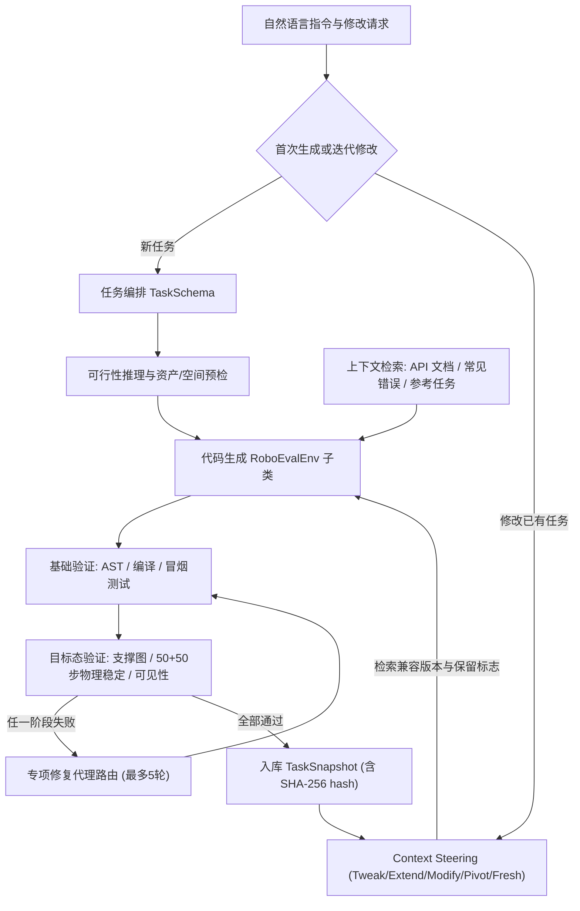

# RoboPlayground: Democratizing Robotic Evaluation through Structured Physical Domains

## 一句话定义

RoboPlayground 是华盛顿大学与 AI2 提出的语言驱动机器人操作评测框架，它把自然语言指令编译为结构化物理域（MuJoCo 方块操作域）中带显式资产、重置分布、成功谓词和版本谱系的可执行任务族，使非专家用户也能安全、可复现地扩展与细粒度诊断操作策略的泛化边界。

## 英文缩写速查

| 缩写 | 英文全称 | 简要说明 |
|---|---|---|
| VLA | Vision-Language-Action | 视觉-语言-动作策略模型，文中对比 StarVLA 四变体与 $\pi_{0.5}$ |
| AST | Abstract Syntax Tree | 抽象语法树，用于生成代码进入仿真前的静态语法与禁用模式检查 |
| DiT | Diffusion Transformer | 基于扩散/流匹配的动作解码架构，如 GR00T 与 Dual 变体 |
| TAMP | Task and Motion Planning | 任务与运动规划，文中借助 CuTAMP 自动生成基线任务微调轨迹 |
| SUS | System Usability Scale | 系统可用性量表（0–100 分，68 分以上通常视为高于平均可用水平） |
| NASA-TLX | NASA Task Load Index | 认知工作负载量表，文中归一化至 0–100 且越低表示用户负担越轻 |

## 为什么重要

现有机器人操作评测（如 RLBench、LIBERO、RoboCasa、ManiSkill、Simpler 等）大多由少数研究者在固定环境中硬编码任务实例与成功条件，外部使用者若想追问「若改变颜色约束、目标排序或任务先后阶段，策略会如何失效」，往往必须直接修改底层基准代码。与此同时，已有的 LLM 任务生成系统（如 GenSim、Gen2Sim、RoboGen）主要面向训练数据扩增，缺乏严格的物理可达性验证、确定性复现保障以及任务变体之间的谱系对照。

RoboPlayground 将评测本身重塑为**结构化物理域上的语言驱动编译与受控演化过程**：一方面通过 `TaskSchema`、物理稳定性验证和 `TaskSnapshot` 版本控制保证「可复现、可对比」的科学严谨性；另一方面通过自然语言接口让更广泛的贡献者参与定义评测任务，在实验上证明了跨贡献者聚合能够突破单一作者的多样性瓶颈，并暴露出固定分布内基准难以察觉的**行为扰动（behavioural perturbation）**失效。

## 核心信息

| 字段 | 内容 |
|---|---|
| 作者 | Yi Ru Wang*, Carter Ung*, Evan Gubarev, Christopher Tan, Siddhartha Srinivasa†, Dieter Fox† |
| 机构 | 华盛顿大学（UW）、艾伦人工智能研究所（AI2） |
| 发表时间 | 2026-04-06（arXiv:2604.05226v1 `[cs.RO]`） |
| 论文链接 | [arXiv:2604.05226](https://arxiv.org/abs/2604.05226) · [HTML 全文](https://arxiv.org/html/2604.05226) |
| 项目与代码 | [官方项目页](https://roboplayground.github.io)（展示 `roboplayground.ai/create` 与生成代码片段；暂未列出 GitHub 仓库链接） |
| 清单分类 | `environment.reconstruction`, `environment.task_generation`, `environment.benchmarking` |
| 来源条目 | `survey_ax_2604_05226` |
| 开源状态 | 宣称将开源或未列链接（截至 2026-11-27，项目页写明 "Everything is open-source"，但论文及项目页未公布可下载的官方 GitHub 仓库 URL） |

## 核心原理

### 1. 任务形式化表示

论文将每个操作任务形式化为一个五元组：

$$T = (\mathcal{A}, \rho_0, G, \ell, \mathcal{V})$$

其中 $\mathcal{A}$ 为任务资产集合（在当前实例化中包括 `ColoredCube`、`SemanticCube`、`Table` 及目标区域贴片），$\rho_0$ 为环境重置时的初始状态采样分布，$G: \mathcal{S} \to \{0, 1\}$ 为作用于仿真器状态的成功判定谓词（对应 `_success()` 方法），$\ell$ 为规范自然语言指令，$\mathcal{V}$ 为用于指令鲁棒性测试的同义改写集合。论文指出，仅靠自然语言等价性不足以充当评测单元——容差阈值、重置分布或成功判定时机上的细微差异都会改变策略评测结果，因此必须将语言编译为确定性的可执行规格。

### 2. 任务编排与可行性推理（Task Orchestration）

用户输入自然语言描述 $u$ 后，编排模块包含 `task`（任务提炼与资产引导）与 `feasibility`（工作空间边界、资产兼容性与机器人能力检查）两个子组件，先填充固定结构的 `TaskSchema`（任务名、资产、目标条件、初始化逻辑），避免欠指定（underspecified）输入。可行性推理分为四步：**资产分析**（例如 `SemanticCube` 最多支持 26 个字母和 10 个数字）→ **需求提取** → **可行性检查**（同时校验排序、空间与可见性约束是否冲突）→ **结构化修复建议**（如 `Reduce_Labels_Preserve_Geometry`、`Switch_Ordering_Pattern`、`Switch_To_Spatial_Only`）。

### 3. 上下文增强的程序合成（Code Generation）

基于已校验的 `TaskSchema`，推理 LLM 先生成中间自然语言任务规格，再编译为继承统一基类 `RoboEvalEnv` 的 Python 任务类，强制实现 `_initialize_env()`、`_on_reset()` 与 `_success()` 三个接口以消除编码风格差异对评测的干扰。合成提示同时注入三类检索上下文：
- `api_review`：环境与资产 API 文档；
- `common_errors`：历史常见错误模式库；
- `code_references`：从 10 个人工编写的参考任务库（含堆叠、对齐、字母/单词/数字排序、等式排列、圆形排列、按序放置与旋转等）中按**资产类别、推理类型、复杂度与操作原语**检索 2–3 个样例，并附带面可见性、资产能力与几何尺寸约束分析。

### 4. 多阶段验证与迭代修复（Validation & Iterative Repair）

所有生成任务均在统一 MuJoCo 配置下验证（桌面高度 $z = 0.95\text{ m}$，工作空间 $x \in [0.40, 0.70]\text{ m}, y \in [-0.25, 0.25]\text{ m}$，固定相机视角与全局物理参数），通过以下门禁后方可入库：

1. **基础软件验证（Basic Validation）**：依次执行 AST 静态语法与禁用模式扫描 → 隔离环境编译（`compile()`）→ 实例化并执行 `env.reset()` 与零动作步进冒烟测试（Smoke Test）。
2. **逻辑与物理可达性验证（Success Check）**：
   - **支撑图逻辑检查**：从 `_success()` 提取支撑关系（如 `On(block_A, block_B)`）构建有向图，进行环路检测（防止 A 压 B、B 压 A 的循环支撑）、支撑完整度检查（所有可动物体最终须落地到 `table`/`floor`/`ground` 等固定表面）和传递冗余分析。
   - **目标态静置与稳定性校验**：直接将环境实例化到目标构型，零动作前向仿真 **50 步**使接触充分静置后校验 $G = \text{True}$；随后再仿真 **50 步**验证结构稳定性，要求物体水平/整体漂移不超过 **1 cm** 且垂直位移不超过 **2 cm**（排除倾倒构型）。
   - **`SemanticCube` 几何可见性与字符可读性**：从相机向每个立方体面的中心与 80% 边界偏移的四角发射 **5 条射线**，至少 3 条无遮挡才判定该面可见（共面排列的顶面与竖直堆叠的背面采用解析捷径）；可见面的法向量与期望视线夹角余弦须 $\ge 0.97$（约 $14^\circ$），面内字符方向余弦须 $\ge 0.94$（约 $20^\circ$）。
3. **专项修复路由**：任一阶段失败时，Agent Orchestrator 将物体位姿、通过的子目标与异常回溯路由给 6 类专项修复代理（`SyntaxFixAgent`、`APIUsageFixAgent`、`RuntimeFixAgent`、`SuccessCheckFixAgent`、`StructureStabilityFixAgent`、`GeometricBoundsFixAgent`）及约束修复代理。系统最多运行 **5 轮**验证-修复循环，每个代理最多尝试 **3 次**，并把历史失败方案作为负例注入以防修复震荡。

### 5. 上下文引导与版本谱系（Context Steering）

在多轮人机迭代修改中，`SteeringRouter` 将修改请求分类为五种意图：`Tweak`（仅参数调整）、`Extend`（增量追加）、`Modify`（保持结构修改属性）、`Pivot`（结构重写并覆盖目标）和 `Fresh`（全新任务），据此设定 `preserve_assets`、`preserve_positions`、`preserve_goals` 标志。每次验证通过的产物记录为不可变 `TaskSnapshot`（含顺序 `version_id`、`description`、`assets_used`、`goal_summary` 与 SHA-256 `code_hash`）。当新指令需要的资产能力与当前版本不兼容时（例如从无标签 `ColoredCube` 切回支持字符排序的 `SemanticCube`），路由器可自动检索历史快照并回溯兼容版本作为参考，同时利用 `code_hash` 去重与检测循环修改。

## 流程总览

## 源码运行时序图

**不适用**（核查结果：截至 2026-11-27，论文 `arXiv:2604.05226v1` 与项目页 `https://roboplayground.github.io` 虽写明 "Everything is open-source" 并展示 `roboplayground.ai/create` 交互示例及代码片段，但均未列出可下载的官方 GitHub 代码仓库链接，无法核对真实运行入口与模块调用时序）。

## 实验与评测

论文从**作者端可用性与规范质量**、**策略泛化诊断**、**多贡献者扩展性**以及**模块消融**四个部分展开评测（均基于公开原文数据）：

### 1. 任务编写可用性与规范质量（$N=26$ 被试内研究）

在 26 名不同编程背景参与者（涵盖本科生、博士生等，机器人仿真经验中位数 3/7）的被试内对照实验中，每人依次使用 GenSim、Cursor（提供基础仓与 README 的代码助手基线）和 RoboPlayground 完成受限三维方块搭塔任务（Table I、Table X–XVI）：

| 系统 | SUS 可用性 ↑ | NASA-TLX 负载 ↓ | 平均易用排名 ↓ | 首选偏好 (%) | 任务1耗时 (分:秒) | 任务2耗时 (分:秒) | 未完成率 DNF ↓ |
|---|---|---|---|---|---|---|---|
| GenSim | $52.5 \pm 9.3$ | $41.8 \pm 9.0$ | $2.7 \pm 0.2$ | 8% (2/26) | $7:45 \pm 0:56$ | $9:14 \pm 0:43$ | $56\% \pm 14\%$ |
| Cursor | $68.8 \pm 7.8$ | $36.7 \pm 10.4$ | $2.0 \pm 0.2$ | 23% (6/26) | $6:30 \pm 0:55$ | $8:03 \pm 0:54$ | $32\% \pm 13\%$ |
| **RoboPlayground** | **$83.4 \pm 6.9$** | **$18.6 \pm 7.7$** | **$1.3 \pm 0.3$** | **69% (18/26)** | **$3:53 \pm 0:37$** | **$6:59 \pm 0:53$** | **$14\% \pm 10\%$** |

统计检验表明 RoboPlayground 在 SUS（vs. GenSim $p < 0.001$，vs. Cursor $p = 0.0017$）、NASA-TLX（vs. GenSim $p = 0.0007$，vs. Cursor $p = 0.0019$）及偏好分布（$\chi^2 = 16.0, p = 0.0003$）上均显著优于两个基线。此外，在规格生成质量对照（Table IV）中，RoboPlayground 在 Compile、Smoke Test 与 Human Verification 上均达到 **$100 \pm 0\%$**，LLM Intent Alignment 达到 **$73.5 \pm 11.1\%$**，高于 Cursor（Compile $80.0\pm 24.8\%$、Alignment $61.1\pm 14.0\%$、Human $80\pm 24.8\%$）和 GenSim（Smoke Test $60.0\pm 30.4\%$、Alignment $38.8\pm 14.0\%$、Human $70\pm 28.4\%$）。

### 2. 策略分布内与受控泛化诊断（Table II、VIII–IX）

作者使用 CuTAMP 在 10 个基础训练任务上自动收集成功示范（每个任务 280 至 3,549 条轨迹），在完全相同的数据集上端到端微调 6 个策略（4 个基于 `Qwen3-VL-4B-Instruct` 的 [StarVLA](../methods/star-vla.md) 变体：`Adapter`、`GR00T`、`Dual`、`Qwen-OFT`；以及 2 个基于 `Pi0.5-DROID` 的 $\pi_{0.5}$ 全参数微调与 LoRA 变体），随后测试 10 个分布内任务与 12 个由 RoboPlayground 沿**语义（S）、视觉（V）、行为（B）**三轴扰动生成的留出泛化任务：

- **分布内表现**：`GR00T`、`Dual`、`Qwen-OFT` 在单物体相对放置与双块放置任务上表现稳健（`GR00T` 在 `Place Two Blocks on Patch` 达 **96.0%**，`Dual` 在 `Red Block Front of Yellow` 达 **88.0%**，`Qwen-OFT` 在 `Red Block Right Placement` 达 **86.0%**）；但即便是分布内任务，一旦涉及多步组合或对齐（`Red Block Stacking`、`Color Block Alignment`、`Three Block Color Stacking`），所有模型成功率均骤降至 **0%–22.0%**。`Pi-0.5 (LoRA)` 全线大幅落后（0%–48.0%）。
- **泛化轴不对称性**：
  - **视觉扰动（V）**：仅改变外观或补丁尺寸/颜色而保持执行结构时迁移较强，例如 `GR00T` 在 `Place Two Blocks on Green Patch` 达 **90.0%**、`Place Two Blue Blocks on Patch` 达 **86.0%**（`Dual` 分别为 72.0% 与 80.0%）。
  - **语义扰动（S）**：修改颜色或关系指代时，DiT/OFT 结构仍保持一定鲁棒性（`GR00T` 在 `Yellow Block Left Placement` 达 **78.0%**、`Green on Blue Stack` 达 **62.0%**），但 `Adapter` 出现严重过拟合失效（分别仅 **4.0%** 与 **0.0%**）。
  - **行为扰动（B）**：需要多阶段规划或非单调回退的任务暴露出跨架构的共性瓶颈——`Blue Block Stacking` 全模型 **0.0%**，`Yellow on Red Unstack Restack` 最高仅 **2.0%**（`GR00T`），`Stack Two Blocks on Patch` 最高仅 **2.0%**（`Pi-0.5 (LoRA)` / `Dual`），`Red Block Two Tower Stacking` 最高 **10.0%**，`Three Block Beside` 最高 **14.0%**。

### 3. 众包任务多样性扩展与消融分析（Fig. 4、Table III）

- **多样性随贡献者规模增长**：每位作者在同一方块域中编写最多 50 个有效任务，基于句子嵌入余弦距离的聚合分析显示，单作者累计任务的多样性快速趋于平台期（边际收益递减），而跨贡献者任务池（每用户抽样 10 个任务）的平均成对多样性随贡献者人数增加**单调上升**。
- **关键模块消融（Table III，$n=26$）**：
  - **Validation 是可执行性决定因素**：关闭所有验证门时，`Compile` 虽有 96.0%，但 `Smoke Test` 与 `Task Success` 均跌至 **12.0%**；仅加入文本校验即恢复至 `Task Success` **96.2%**、`Smoke Test` **100.0%**；开启完整验证与专项修复代理后，`Task Success`、`Compile`、`Smoke Test`、`Human-Verified` 全达 **100.0%**，`LLM Alignment` 为 **73.6**。
  - **Task Proposal 与 CodeGen**：逐步开启资产推理与可行性预检将 `Human-Verified` 从 88.5% 提升至 **100.0%**；加入 `API review`、`common errors` 与 `in-context examples` 使 `LLM Alignment` 从 70.8 提升至 **73.6**。
  - **Context Steering 版本历史**：仅做意图路由而不开启版本历史追踪时，`Human-Verified` 从 100.0% 急降至 **76.9%**；恢复 `version history tracking` 与 `reference selection` 后，四项执行/人工指标全部恢复至 **100.0%**。

## 与其他工作对比

| 维度 | 传统固定基准（RLBench / LIBERO / RoboCasa / Colosseum） | LLM 训练任务生成（GenSim / Gen2Sim / RoboGen） | 众包真实评测（[RoboArena](../methods/roboarena.md)） | RoboPlayground |
|---|---|---|---|---|
| 核心目标 | 标准化固定任务评测 | 规模化生成训练数据与课程 | 分布式真实世界盲测对比 | 用户共创、可复现的诊断式评测 |
| 任务/成功条件编写 | 专家硬编码 | LLM 自动合成，面向数据流 | 真机自由任务与人类成对打分 | 自然语言编译为受控可执行规范 |
| 任务变体与谱系 | 固定或预设扰动集 | 缺少版本谱系与可控修改机制 | 无统一仿真状态复现 | `SteeringRouter` + `TaskSnapshot` |
| 物理与语义验证 | 人工静态调试 | 多依赖基础编译/运行检查 | 人工现场执行 | 支撑图检查 + 50+50 步稳定 + 射线可读性 |

## 结论

**一句话总判：RoboPlayground 把自然语言从「策略输入或注释」升级为「结构化仿真域中的可执行评测编译器」，证明了用户共创任务族比固定分布内测试集更能诊断操作策略的组合与时序短板。**

1. **评测前移验证门禁至关重要**：消融表明缺少验证与修复闭环时任务端到端通过率仅 12.0%，多阶段静态分析、支撑图逻辑与 50+50 步物理静置检查是开放任务编写不失真的前提。
2. **版本谱系是连续演化的核心**：在多轮对话修改任务时，脱离 `TaskSnapshot` 与资产兼容回溯的路由会使人工验证率跌至 76.9%，记录不可变快照与代码哈希是维护可对比任务族的必要工程投入。
3. **诊断 VLA 泛化必须显式加入行为扰动**：对比实验表明基于 Qwen3-VL 或 $\pi_{0.5}$ 的策略对视觉外观变化已有较高容忍度，但在需拆解重排（unstack-restack）和多阶段组合的任务上普遍接近 0% 成功率。
4. **扩充评测多样性应优先引入多作者而非单作者堆量**：单作者提示很快陷入固定模板偏好，唯有支持低门槛共创才能持续覆盖新的空间关系与约束组合。

## 工程实践

- **统一环境基类与固定物理参数**：在 MuJoCo 中强制任务类继承 `RoboEvalEnv`（`_initialize_env` / `_on_reset` / `_success`），锁定桌面高度 $z=0.95\text{ m}$、工作空间 $x\in[0.40,0.70]\text{ m}, y\in[-0.25,0.25]\text{ m}$ 与固定相机，避免作者编码风格与物理配置漂移污染策略对比。
- **三源上下文检索防 API 幻觉**：在代码生成时注入 `api_review`、`common_errors` 与按资产/推理类型/复杂度/动作原语筛选的 2–3 个 `code_references`，可稳定提高 `_success()` 与语言意图的对齐度。
- **专项修复加负例约束**：将失败归因分流到 `SyntaxFixAgent`、`SuccessCheckFixAgent`、`StructureStabilityFixAgent` 等 6 类子代理，并把前序失败方案作为负例传入，能有效抑制重试过程中的振荡修改。
- **策略微调与评估启示**：若使用低秩微调（如 `Pi-0.5 (LoRA)`）适配多任务操作分布，需警惕其跨扰动退化明显强于全参数微调；同时在设计训练与测试切分时，应参考论文的 S/V/B 三轴划分避免仅测视觉外观变化。

## 局限与风险

- **结构化域的泛化边界**：论文刻意将框架实例化在受限的桌面方块操作域（`ColoredCube`、`SemanticCube` 与目标贴片）以换取高度可控性与可解释性；将该编译与物理校验范式推广至可变形物体、铰接家具或非结构化家居场景仍需大量领域原语与校验器设计。
- **语义对齐仍有提升空间**：即使开启全套编排、代码参考与验证流水线，`LLM Intent Alignment` 仍停留在 **73.5%–73.6%** 左右，说明自然语言中的隐含约束与 `_success()` 阈值/顺序逻辑之间仍可能存在细粒度偏差。
- **公开代码尚未就绪**：截至 2026-11-27，虽然项目页声明 "Everything is open-source" 并展示了前端创建流程，但公开途径尚未提供可拉取的 GitHub 源码仓库与在线任务集合，外部复现受限于论文提供的算法与提示词细节。

## 关联页面

- [具身大模型评测基准选型闭环](../queries/embodied-eval-benchmark-selection-loop.md)：对照评测基准设计与指标选型闭环。
- [Agentic Robots 综述](paper-towards-agentic-robots-survey.md)
- [全量项目节点清单](../overview/awesome-agentic-robots-node-index.md)
- [VLA 方法背景](../methods/vla.md)
- [具身智能体评测方法](../methods/embodied-agent-benchmarking.md)：对照任务设置、接口与评估指标。
- [机器人仿真场景生成](../methods/robot-simulation-scene-generation.md)：对照 LLM 驱动的任务/场景编译与约束验证范式。
- [Coding Agent 验证闭环](../methods/coding-agent-verification-loops.md)：对照静态检查、仿真冒烟测试与迭代修复路由机制。
- [StarVLA 方法入口](../methods/star-vla.md)：本文 Section IV-B 评测的四类 Qwen3-VL-4B 动作头变体的底座框架。
- [RoboArena 分布式真机评测](../methods/roboarena.md)：论文 Related Works 中与 RoboPlayground 形成互补的众包真机评测方案。
- [机器人操作任务](../tasks/manipulation.md)：了解桌面与双臂操作任务族的基准设计与挑战。

## 推荐继续阅读

- [RoboPlayground 官方项目页](https://roboplayground.github.io)
- [RoboPlayground 论文（arXiv HTML 全文）](https://arxiv.org/html/2604.05226)
- [RoboPlayground 论文（arXiv 摘要页）](https://arxiv.org/abs/2604.05226)
- [RoboEval（arXiv:2507.00435）](https://arxiv.org/abs/2507.00435) — 同一团队此前提出的结构化可扩展操作评测工作

## 参考来源

- [RoboPlayground 论文精读归档](../../sources/papers/paper-agentic-2604-05226.md)
- [官方 Awesome 快照归档](../../sources/repos/awesome-agentic-robots-survey-index.md)
- [论文官方入口（arXiv:2604.05226）](https://arxiv.org/abs/2604.05226)
- [官方项目页（roboplayground.github.io）](https://roboplayground.github.io)
