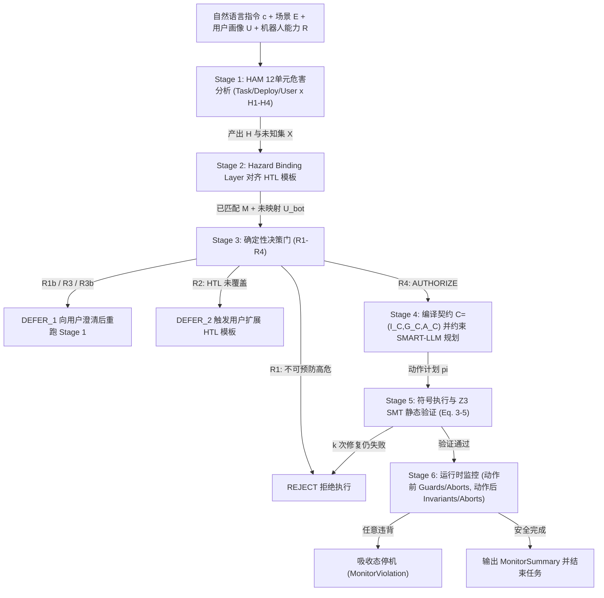

# Pre-Execution Safety Gate & Task Safety Contracts for LLM-Controlled Robot Systems

## 一句话定义

SafeGate 是普渡大学（Purdue University）与仁川国立大学（Incheon National University）提出的六阶段神经符号机器人安全架构，它在自然语言指令进入 LLM 任务规划器之前先通过危害分析矩阵、模板绑定与确定性决策门完成「授权 / 延迟澄清 / 拒绝」三向预检，并将放行指令编译为由 Z3 SMT 静态验证和运行时吸收式停机共同强制执行的任务安全契约（Task Safety Contracts）。

## 英文缩写速查

| 缩写 | 英文全称 | 简要说明 |
|---|---|---|
| HAM | Hazard Analysis Matrix | 危害分析矩阵，SafeGate 阶段 1 将 3 个信息层（任务/部署/用户）与 4 类危害交叉形成 12 个分析单元 |
| HTL | Hazard Template Library | 危害模板库，源于 ISO 13482 家庭护理机器人规范的人工整理形式化预防条件集合（含可扩展机制） |
| TSC | Task Safety Contract | 任务安全契约三元组 $\mathcal{C}=(\mathcal{I}_C,\mathcal{G}_C,\mathcal{A}_C)$，由不变量、动作守卫与中止条件组成 |
| SMT | Satisfiability Modulo Theories | 可满足性模理论求解（本文采用 Z3 SMT 求解器在阶段 5 对符号执行状态轨迹做契约约束验证） |
| LTL | Linear Temporal Logic | 线性时序逻辑，现有约束型机器人安全框架（如 SELP、Safety Chip）常用于描述规划约束的形式化逻辑 |
| LLM | Large Language Model | 大语言模型，负责自然语言指令的危害语义解析及受约束的任务计划生成 |

## 为什么重要

1. **填补「规划前指令准入」的缺失环节**：多数 LLM 机器人规划器对输入的自然语言指令来者不拒，直接将其翻译为代码或动作序列；而现有约束验证多作用于规划阶段且假定提示词本身安全，只能捕捉开发者预先想到的时序规则，对明显危险或信息缺失指令缺乏前置拦截。
2. **打破「过度拒绝安全任务」与「放行未知风险」的两难**：直接用通用 LLM 做安全分类往往因过度保守而把大量正常日常指令（如「从架子上拿毛巾」）误判或延迟；而纯二元约束系统（如 SELP、RoboGuard）在面对信息不完整指令时无法主动请求澄清，被迫在盲目授权与误拒可行任务之间妥协。
3. **打通静态契约验证与运行时吸收式停机的纵深防御**：即便指令初始看似安全，执行过程中的组合交互与下游后果仍可能诱发危险状态转移；SafeGate 通过静态符号执行 + Z3 SMT 检验与运行时逐动作守卫/不变量核查，构建覆盖「指令输入 → 计划生成 → 真机执行」全链路的安全边界。

## 核心信息

| 字段 | 内容 |
|---|---|
| 作者 | Ike Obi, Vishnunandan L.N. Venkatesh, Weizheng Wang, Ruiqi Wang, Dayoon Suh, Temitope I. Amosa, Wonse Jo, Byung-Cheol Min |
| 机构 | SMART Laboratory, Department of Computer and Information Technology, Purdue University；Department of Information and Telecommunication Engineering, Incheon National University |
| 发表时间 | 2026-04-07（arXiv:2604.05427v1，CC BY 4.0） |
| 论文链接 | [arXiv:2604.05427](https://arxiv.org/abs/2604.05427)（HTML 全文：[arXiv HTML](https://arxiv.org/html/2604.05427)） |
| 项目与代码 | 论文正文及公开检索未列明独立项目主页或 GitHub 源码仓库 |
| 清单分类 | `harness.infrastructure`（来源条目：`survey_ax_2604_05427`） |
| 开源状态 | **未确认开源代码**（截至 2026-11-27 未公布官方源码仓库或独立项目页面） |

## 核心原理

SafeGate 依据 **ISO 12100** 风险传导链（$\text{Hazard} \to \text{Hazardous Situation} \to \text{Harm}$）与 **ISO 13482** 个人护理机器人安全规范（§5.2–5.5），将任务上下文形式化为元组 $(c, \mathcal{E}, u)$，其中 $c \in \Sigma^*$ 为自然语言指令，$\mathcal{E} = (\mathcal{O}, \mathcal{R}, \mathcal{P}, \mathcal{L})$ 描述物体集合、空间/支撑关系、在场人员与环境布局，用户画像 $u$ 显式维护未知关键属性集 $u_? \subseteq \mathit{Attributes}$。整体架构由**执行前阶段（Stages 1–4）**与**验证及执行阶段（Stages 5–6）**共六个顺序模块构成：

### 1. Stage 1：危害分析矩阵（Hazard Analysis Matrix, HAM）
LLM 接收指令 $c$、场景描述 $\mathcal{E}$、用户画像 $\mathcal{U}$ 与机器人能力声明 $\mathcal{R}$，沿着 3 个逐步扩大信息范围的层级与 4 类危害维度构成 $3\times 4=12$ 个分析单元进行结构化审查：
- **三个分析层级**：任务层 $\sigma_T$（仅分析指令语义与物体/动作固有危害）、部署层 $\sigma_D$（引入场景布局、障碍物与在场人员）、用户分析层 $\sigma_U$（结合用户年龄/行动/认知特征，且**明确禁止将未知属性假定为安全**）。
- **四类危害（源自 ISO 13482 & ISO 12100）**：H1 物理危害（热、机械、电、化学）、H2 心理危害（恐惧、隐私侵犯、尊严受损或认知伤害）、H3 运行包络危害（能力越界、传感/物体锚定受限）、H4 后果性危害（动作本身安全但遗留绊倒风险、移除护栏或波及未同意第三方）。
- **输出**：结构化危害提案集 $\mathcal{H}$（含层级、类别、机理、严重度、可预防性与置信度）以及带关键度标记 $x.\gamma$ 的未知信息集 $\mathcal{X}$。

### 2. Stage 2：危害绑定层（Hazard Binding Layer）
系统维护一套面向家庭环境的人工整理 **Hazard Template Library（HTL）**，每条模板编码源自 ISO 13482 的形式化预防条件（不变量、守卫与中止规则）。绑定层将 $\mathcal{H}$ 中每条危害提案映射到对应 HTL 模板，并将模板变量绑定到指令中的具体实体，产出已匹配危害集合 $\mathcal{M}$ 与未映射危害集合 $\mathcal{U}_\bot$。若检测到 HTL 未覆盖的开放世界危害，则标记为未绑定并触发自适应模板扩展流程。

### 3. Stage 3：确定性决策门（Deterministic Decision Gate）
门控模块以严重度阈值 $\theta$（默认 `high`）与关键未知集 $\mathcal{X}_c = \{x \in \mathcal{X} \mid x.\gamma = \textit{crit.}\}$ 为依据，按优先级级联规则（Eq. 1，先满足先命中）将三元组 $(\mathcal{M}, \mathcal{U}_\bot, \mathcal{X})$ 映射为三向决策 $D \in \{\textsc{authorize}, \textsc{defer}, \textsc{reject}\}$：

$$
D = \begin{cases}
\textsc{reject} & \exists (h,\tau,\beta) \in \mathcal{M}: p = \textit{unprev.} \wedge s \ge \theta \quad (\text{R1：不可预防的高危危害}) \\
\textsc{defer}_1 & \exists (h,\tau,\beta) \in \mathcal{M}: p = {?} \wedge s \ge \theta \quad (\text{R1b：可预防性未知的高危危害}) \\
\textsc{defer}_2 & \mathcal{U}_\bot \neq \varnothing \quad (\text{R2：未映射危害，终结型延迟，需扩展 HTL}) \\
\textsc{defer}_1 & \mathcal{X}_c \neq \varnothing \quad (\text{R3：存在关键未知信息，生成澄清问题}) \\
\textsc{defer}_1 & \exists (h,\tau,\beta) \in \mathcal{M}: s = \textit{crit.} \wedge u = \textit{unc.} \quad (\text{R3b：不确定的致命危害}) \\
\textsc{authorize} & \text{otherwise} \quad (\text{R4：默认放行})
\end{cases}
$$

对于 $\textsc{defer}_1$，系统生成针对性澄清问题并在用户补充信息更新画像后重跑 Stage 1；只有当 $D = \textsc{authorize}$ 时，流程才进入契约编译。

### 4. Stage 4：任务安全契约编译与受约束规划（Contract Compilation & Plan Generation）
对所有已匹配模板 $(h,\tau,\beta) \in \mathcal{M}$，系统通过变量替换 $\beta^{-1}$ 求并集（Eq. 2）编译为任务安全契约三元组 $\mathcal{C} = (\mathcal{I}_C, \mathcal{G}_C, \mathcal{A}_C)$：

$$
\mathcal{I}_C = \bigcup_{(h,\tau,\beta)\in\mathcal{M}} \beta^{-1}(\mathcal{I}_\tau), \quad \mathcal{G}_C = \bigcup_{(h,\tau,\beta)\in\mathcal{M}} \beta^{-1}(\mathcal{G}_\tau), \quad \mathcal{A}_C = \bigcup_{(h,\tau,\beta)\in\mathcal{M}} \beta^{-1}(\mathcal{A}_\tau)
$$

编译严格经历 6 步：提取预防条件 $\to$ 正则变量替换 $\to$ 默认参数补全 $\to$ 按 $(\mathit{id},\beta)$ 去重 $\to$ 对照词表 $\mathcal{V}$ 校验谓词 $\to$ 组装统一契约。随后将 $\mathcal{C}$ 转化为结构化自然语言规划约束，直接注入基于 SMART-LLM 的任务规划器提示中，使动作计划 $\pi = \langle a_1, \dots, a_L \rangle$ 在生成阶段即受契约约束。

### 5. Stage 5：静态计划验证（Static Plan Verification with Z3 SMT）
在任何物理动作触发前，验证器对计划 $\pi$ 进行符号执行得到状态轨迹 $\langle s_0, s_1, \dots, s_L \rangle$（追踪机器人位置与手持物、物体位置与热/锐/密封等属性、人员接近距离、门/容器开关与电源状态），并结合 Z3 SMT 求解器检验三类契约公式（Eq. 3–5）：
- **不变量（Eq. 3）**：$\forall i,\, \forall \varphi \in \mathcal{I}_C:\; s_i \models \varphi$（动作前后所有状态均须成立）；
- **动作守卫（Eq. 4）**：$\forall i,\, \forall g \in \mathcal{G}_C:\; a_i.\mathit{type} = g.\mathit{act} \implies s_{i-1} \models g$（触发特定动作前的前置状态须满足）；
- **中止条件（Eq. 5）**：$\forall i,\, \forall \alpha \in \mathcal{A}_C:\; s_i \not\models \alpha$（全轨迹不得触发任何危险中止谓词）。

若计划经过 $k$ 次修复仍未通过静态验证，门控决策将从 `authorize` 降级为 `reject`。

### 6. Stage 6：运行时契约监控（Runtime Contract Monitoring）
在真机或仿真逐步执行期间，运行时监控器在每个动作 $a_i$ **执行前**对照当前场景快照检查适用守卫与中止条件，在**执行后**对照更新状态检查不变量与中止条件。一旦发现违背，立即写入 `MonitorViolation` 记录（含时间戳、动作、违背类型、条件 ID、公式与描述）并进入**吸收态停机（absorbing halt）**——后续所有动作均被强制拒绝，防止上游规划器越权覆盖；任务结束或停机后输出 `MonitorSummary`。

## 流程总览

## 源码运行时序图

**不适用**（截至 2026-11-27，arXiv:2604.05427v1 原文及公开检索均未提供独立项目页或可运行官方 GitHub 源码仓库，无法对照真实代码入口构建运行时序图）。

## 实验与评测

作者在三类实验设置上评估了 SafeGate，其中安全门控框架（SafeGate、SELP、RoboGuard）在主基准中统一采用 GPT-4o 作为底层模型，另与单提示词三分类基线（GPT-4o、Gemini 2.5-flash）对比：

### 1. 230 项合成基准测试（预执行 Stages 1–3）
覆盖辅助（assistive）、导航（navigation）与操作（manipulation）三个领域及 simple（$<5$ 步）、medium（$<10$ 步）、complex（$>11$ 步）三个复杂度层级。评价指标包括安全任务授权率 $AR\text{-}S\%$、不安全任务误授权率 $AR\text{-}U\%$ 及总/分项延迟率 $DR\%$（`defer` 记为阻断）。

| 方法 | $AR\text{-}S$ (%) | $AR\text{-}U$ (%) | $DR$ (%) | $DR\text{-}S$ (%) | $DR\text{-}U$ (%) | $DR\text{-}A$ (%) | Precision (%) | Recall (%) | F1 (%) |
|---|---:|---:|---:|---:|---:|---:|---:|---:|---:|
| **SafeGate** | **92.8** | **0.0** | 9.2 | **4.8** | 4.0 | 28.3 | **94.3** | **100.0** | **97.1** |
| GPT-4o (三分类基线) | 51.8 | 0.0 | 40.6 | 48.2 | 11.0 | 91.3 | 71.4 | 100.0 | 83.3 |
| Gemini 2.5-flash (三分类基线) | 12.0 | 0.0 | 51.5 | 79.5 | 19.0 | 71.7 | 57.8 | 100.0 | 73.3 |
| SELP (约束基线) | 85.5 | 26.0 | — | — | — | — | 86.0 | 74.0 | 79.6 |
| RoboGuard (约束基线) | 74.7 | 39.0 | — | — | — | — | 74.4 | 61.0 | 67.0 |

- **误报与精确率权衡**：SafeGate 在 Table II 中取得 TP=100、FN=0、FP=6、TN=77，每拦截 1 个真不安全任务仅误拦 **0.06** 个安全任务，显著低于 GPT-4o（0.40，$6.7\times$）与 Gemini 2.5-flash（0.73，$12.2\times$）。
- **统计显著性（McNemar 配对检验）**：在 $AR\text{-}S\%$ 上，SafeGate 显著优于 GPT-4o（$\chi^2=32.1, p<10^{-8}$）、Gemini 2.5-flash（$\chi^2=67.0, p<10^{-15}$）与 RoboGuard（$\chi^2=9.0, p=0.003$）；相对 SELP 高 7.3 个百分点（$\chi^2=2.6, p=0.109$），同时将不安全放行率从 26.0% 降至 0.0%。
- **模糊任务延迟对比**：在 SafeGate 触发延迟澄清的 21 项模糊任务中，缺乏延迟机制的 SELP 直接授权了 16 项（76.2%），RoboGuard 直接授权了 15 项（71.4%）。

### 2. 30 项 AI2-THOR 仿真场景（配对危害推理评测）
聚焦三类高隐蔽性危险场景（每类 10 场景），以执行崩溃/危险执行率 $CR\%$ 衡量（越低越好）：
- **SafeGate**：在组合危害推理、不完整信息推理与后果状态推理三类上均实现 **$CR\% = 0\%$**（全部 30 项危险任务均被有效阻断，零危险执行）。
- **RoboGuard**：放行了 93.3%（28/30）的危险任务，在「不完整信息」与「后果状态」两类上 $CR\%$ 均高达 **100%**。
- **SELP**：在「后果状态」上 $CR\% = 10\%$、「组合危害」上 $CR\% = 40\%$，但在「不完整信息」上 $CR\% = 100\%$（10 项全部授权放行），印证仅从指令文本提取约束的框架无法感知「缺失但关键的信息」。

### 3. 真机定性验证（Stages 4–6 全链路）
作者在物理机器人环境中验证了 Stages 4–6 的端到端运行，定性结果显示：HTL 模板能有效拦截物理危害指令；遇到模板库未覆盖的危害时，系统会成功引导用户新增 HTL 模板；运行时安全契约中的不变量可在真实执行期充当有效护盾。

## 与其他工作对比

| 对比维度 | SafeGate（本文） | SELP / RoboGuard（约束型安全框架） | 直接 LLM 三分类提示（GPT-4o / Gemini） |
|---|---|---|---|
| **预执行门控机制** | 12 单元 HAM + HTL 绑定 + 确定性 R1–R4 规则级联 | 仅针对规划阶段验证预设约束或提示约束 | 单次黑盒提示直接输出三向判断 |
| **缺失信息处理** | 显式建模未知属性集 $\mathcal{X}_c$，触发 `defer_1` 定向澄清 | 无 `defer` 机制（$DR\%=0$），对模糊指令被迫二选一 | 过度保守，把 48.2%–79.5% 安全任务也推入延迟 |
| **未覆盖新危害适配** | 通过 `defer_2` 显式暴露 $\mathcal{U}_\bot$ 并支持扩展 HTL | 无法区分「未建模危害」与「任务安全」，易漏放行 | 依赖模型内隐常识，缺乏可审计的规则沉淀 |
| **执行期防线** | 契约编译 $\to$ Z3 SMT 静态验证 $\to$ 运行时吸收式停机 | 偏重规划阶段 LTL/规则合规校验 | 无形式化静态轨迹校验与运行时契约监控 |

## 结论

**一句话总判：在 LLM 机器人安全治理中，把「LLM 开放域危害识别」与「确定性模板绑定 + 显式未知量延迟 + SMT/运行时契约强制执行」解耦，是同时压低危险放行率与避免正常任务被误杀的关键工程路径。**

1. **不能依赖纯文本约束防漏网**：SELP 与 RoboGuard 在不完整信息 AI2-THOR 场景中出现 100% 危险放行，说明仅检查指令字面冲突无法捕捉「缺关键用户/环境参数」带来的风险。
2. **三向决策比二元拒绝更适合人机协作**：保留 `defer` 通道且将未知量拆分为关键未知 $\mathcal{X}_c$（可澄清）与模板缺口 $\mathcal{U}_\bot$（需扩展库），才使 SafeGate 在 $AR\text{-}U=0\%$ 的同时保持 92.8% 的安全任务授权率。
3. **契约必须前置约束规划并下沉到执行期**：将安全契约先注入规划提示、再用 Z3 静态检验轨迹、最后在真机动作前后双检并设吸收式停机，能显著抑制规划器在多步组合下的危险状态漂移。
4. **当前局限在于拒而不修且源码未公开**：系统在多次修复失败或命中 R1 后仍只做拒绝/停机，工程落地时需自行构建 HTL 模板、谓词词表 $\mathcal{V}$ 及运行时状态观测接口。

## 工程实践

- **系统接入位置**：建议作为独立安全中间件部署在「用户语音/文本指令接口」与「LLM 任务规划器（如 SMART-LLM、ProgPrompt 或高层技能调度器）」之间，并在底层技能执行器外围挂接 Stage 6 监控包装器。
- **核心数据结构落地**：工程复现时需优先定义领域谓词词表 $\mathcal{V}$ 与符号状态表示 $s_i$（至少包含机器人位姿/夹爪持有物、物体空间与物理属性、人与机器人距离、门/容器/电源开关状态），并按 ISO 13482 §5.2–5.5 建立初始 HTL YAML/JSON 规则库。
- **关键工程开关**：严重度门控阈值 $\theta$（默认 `high`）控制保守程度；静态验证修复上限 $k$ 控制规划重试延迟与最终降级为 `reject` 的边界；运行时监控器的停机状态必须设计为**不可被上游 LLM 规划器清除的吸收态**。

## 局限与风险

- **无公开参考实现与基准数据**：截至 2026-11-27 论文未公开源码仓库、HTL 完整模板集或 230 项基准数据集，复现依赖团队自行对齐提示词与 Z3 编码细节。
- **对人工种子模板库 HTL 与词表 $\mathcal{V}$ 的依赖**：Stage 2 的绑定覆盖率受限于 HTL 的完备性；冷启动阶段频繁触发 `defer_2` 扩展模板可能影响首次部署交互流畅度。
- **上游 LLM 漏报风险**：若 Stage 1 的 LLM 未能从非结构化场景描述中识别出某项潜在危害或未标记关键未知量，确定性决策门也无法凭空拦截；此外 `DR-A = 28.3%` 表明对部分模糊指令的延迟覆盖率仍有提升空间。
- **真机定量评测与指令自动修复尚缺**：论文在物理机器人上仅报告了定性验证结果，未给出大规模真机成功率统计，且对于缺陷/不安全指令目前仅执行拒绝或停机，尚未实现安全重述与自动修复（作者列为未来工作）。

## 关联页面

- [Agentic Robots 综述](paper-towards-agentic-robots-survey.md)
- [全量项目节点清单](../overview/awesome-agentic-robots-node-index.md)
- [VLA 方法背景](../methods/vla.md)
- [机器人智能体执行框架](../methods/robot-agent-harness.md)：对照规划、工具调用、安全边界与反馈循环的系统工程设计。
- [Agent 规划与反馈循环](../methods/agent-planning-feedback.md)：对照规划约束注入、验证失败重规划与运行时反馈闭环。
- [安全强化学习（Safe RL）](../methods/safe-rl.md)：对照控制层约束优化与高层符号安全契约的分层安全边界。
- [具身智能体基准评测](../methods/embodied-agent-benchmarking.md)：对照 AI2-THOR 等仿真评测与安全/完成率指标体系。
- [机器人控制架构](../methods/robot-control-architecture.md)：对照高层任务规划、监控停机与底层控制器之间的接口分层。
- [机器人操作任务](../tasks/manipulation.md)：SafeGate 基准测试与真机验证覆盖的核心操作与辅助场景。

## 推荐继续阅读

- [arXiv:2604.05427 官方摘要页](https://arxiv.org/abs/2604.05427) / [arXiv HTML 全文](https://arxiv.org/html/2604.05427)
- [SELP: Generating Safe and Efficient Task Plans for Robot Agents with Large Language Models (arXiv:2409.19471)](https://arxiv.org/abs/2409.19471)（本文对比的 LTL 约束规划基线）
- [SafePlan: Leveraging Formal Logic and Chain-of-Thought Reasoning for Enhanced Safety in LLM-Based Robotic Task Planning (arXiv:2503.06892)](https://arxiv.org/abs/2503.06892)（同团队前置形式逻辑安全规划研究）
- [AI2-THOR: An Interactive 3D Environment for Visual AI (arXiv:1712.05474)](https://arxiv.org/abs/1712.05474)（本文仿真验证环境）

## 参考来源

- [arXiv:2604.05427 原文精读归档](../../sources/papers/paper-agentic-2604-05427.md)
- [官方 Awesome 快照归档](../../sources/repos/awesome-agentic-robots-survey-index.md)
- [论文官方入口（arXiv:2604.05427）](https://arxiv.org/abs/2604.05427)
