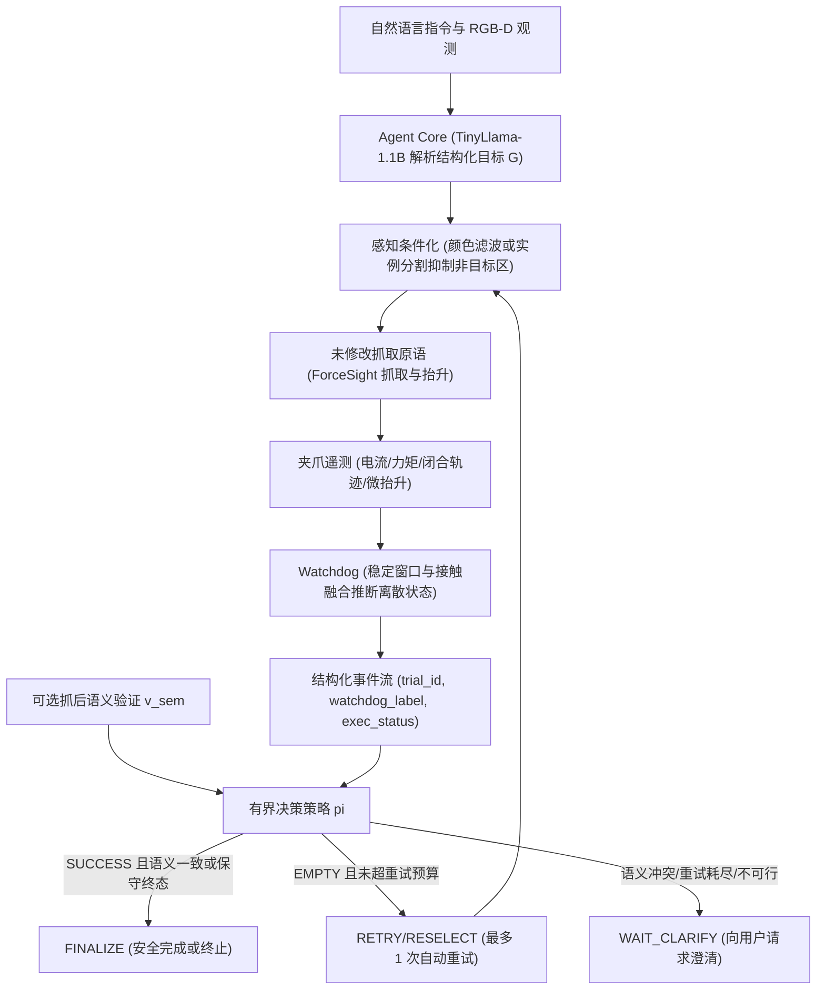

# A Physical Agentic Loop for Language-Guided Grasping with Execution-State Monitoring

## 一句话定义

**面向语言引导机器人抓取的物理智能体闭环封装（Physical Agentic Loop）**：不修改或重训底层抓取原语（ForceSight），而是通过 **Watchdog** 将连续夹爪遥测稳定抽象为离散工具执行状态流，并由确定性有界决策策略在有限预算内完成确认、单次重试或向用户请求澄清。

## 英文缩写速查

| 缩写 | 英文全称 | 简要说明 |
|---|---|---|
| LLM | Large Language Model | 大语言模型；文中本地运行 TinyLlama-1.1B 解析指令并管理澄清交互 |
| VLM | Vision-Language Model | 视觉-语言模型；相关工作中常用于视觉失败诊断，与本文遥测监测互补 |
| VLA | Vision-Language-Action | 视觉-语言-动作端到端策略范式；多数单次执行缺乏标准执行状态流 |
| RGB-D | Red, Green, Blue and Depth | 彩色与深度图像；眼在手上 D405 相机向感知条件化与抓取原语提供的输入 |
| AIML | Australian Institute for Machine Learning | 澳大利亚机器学习研究所（阿德莱德大学），本文作者所属机构 |

## 为什么重要

1. **打破语言引导抓取的「单次盲执」假设**：传统视觉-力抓取原语（如 ForceSight）或 VLA 策略在发出一次动作后往往缺乏结构化执行反馈，空抓、抬升滑落、堵转或抓错颜色/位置相近干扰物都无法被上层决策显式感知。
2. **把数字智能体的工具状态契约引入物理执行**：无需重写或重训底层控制模型，只需用事件接口与 Watchdog 把物理抓取包装为可返回离散状态（`SUCCESS`、`EMPTY`、`SLIP`、`WEAK`、`STALL`、`TIMEOUT`）的「物理工具」，即可获得可解释的闭环恢复能力。
3. **验证「系统执行闭环」对真机鲁棒性的独立增益**：在 Stretch 移动操作真机上保持底层 ForceSight 权重不变，仅靠感知条件化 + Watchdog 状态监测 + 有界重试，即将干扰物与多相同目标场景的成功率从 0%–10% 提升至 100%，而平均单次耗时仅增加约 1.16 秒。

## 核心信息

| 字段 | 内容 |
|---|---|
| **作者** | Wenze Wang, Mehdi Hosseinzadeh, Feras Dayoub |
| **机构** | 澳大利亚机器学习研究所（AIML），阿德莱德大学（Adelaide University） |
| **发表时间** | 2026-04-08（arXiv:2604.07395v1 [cs.RO]） |
| **论文链接** | [arXiv:2604.07395](https://arxiv.org/abs/2604.07395) / [arXiv HTML v1](https://arxiv.org/html/2604.07395) |
| **项目与代码** | [项目页](https://wenzewwz123.github.io/Agentic-Loop/) · [GitHub（WenzeWWZ123/Agentic-Loop）](https://github.com/WenzeWWZ123/Agentic-Loop) · [YouTube 演示](https://youtu.be/BaT5lDUizZE) |
| **清单分类** | `harness.monitoring_and_recovery`（来源条目：`survey_ax_2604_07395`） |
| **开源状态** | **宣称将开源 / 占位阶段**（截至 2026-11-27 核查，GitHub 仓库仅包含 `README.md` 与 `docs/` 静态项目页素材，`README.md` 标注 `Code coming soon`，尚无 Watchdog、策略控制或硬件部署源码） |

## 核心原理

### 1. 有界具身智能体形式化（§III-A）

论文将语言引导抓取建模为四元组智能体 $\mathcal{A} = (\mathcal{O}, \mathcal{S}, \mathcal{U}, \pi)$：

- **观测 $\mathcal{O}$**：由抓取候选、执行反馈（夹爪遥测与动作后线索）以及可选的语义验证信号组成。
- **离散执行状态 $\mathcal{S}$**：由 Watchdog 从连续反馈中抽象出的 6 类物理结果标签：
  $$\mathcal{S} = \{\texttt{SUCCESS},\ \texttt{EMPTY},\ \texttt{SLIP},\ \texttt{WEAK},\ \texttt{STALL},\ \texttt{TIMEOUT}\}$$
- **高层决策动作 $\mathcal{U}$**：Decide 阶段的三类有界动作：
  $$\mathcal{U} = \{\texttt{FINALIZE},\ \texttt{RETRY/RESELECT},\ \texttt{WAIT\_CLARIFY}\}$$
- **决策策略 $\pi : (\mathcal{S}, \mathcal{G}) \rightarrow \mathcal{U}$**：根据结构化目标约束 $\mathcal{G}$ 与当前离散状态映射到唯一动作。

### 2. 三层解耦架构与事件接口（§III-B）

系统将高层语义推理、感知条件化与物理执行监测解耦，并通过「物理工具状态流（physical tool-state stream）」连接：

1. **Agent Core**：采用轻量本地语言模型 **TinyLlama-1.1B** 将自然语言指令解析为结构化目标规范 $\mathcal{G}$（物体类别、颜色或空间方位限定词）；在推理前调用感知条件化模块（依据指令与杂乱程度在轻量颜色滤波与实例分割之间切换，将非目标区域以黑色掩膜抑制后输入 RGB-D）；在动作后消费事件流决定结束、单次重试/重选目标或向用户发起澄清。
2. **Event-Based Interface**：每次执行赋予唯一 `trial_id`，向 Agent Core 发布包含细粒度 `watchdog_label` $\in \mathcal{S}$、粗粒度 `exec_status` $\in \{\texttt{SUCCESS}, \texttt{FAIL}, \texttt{WAIT\_CLARIFY}\}$、时间戳及轻量调试元数据的结构化事件。
3. **Outcome-Aware Grasping Engine**：把未经修改的视觉-力抓取原语 **ForceSight**（基于 RGB-D 与文本预测末端位姿和接触力目标并执行伺服抓取与抬升）与安全控制、Watchdog 封装在同一调用单元内。

### 3. Watchdog 状态抽象与稳定化（§III-C, §IV-E, Table I）

为避免传感器噪声导致上层频繁误触发重试，Watchdog 通过接触感知融合与时间稳定化输出离散状态：

| Watchdog 标签 | 物理含义与判定依据 |
|---|---|
| `SUCCESS` | 力矩/电流、闭合行为与抬升后线索一致支持稳定抓持目标物体 |
| `EMPTY` | 夹爪闭合轨迹与反馈表明未抓到物体（可恢复失败候选） |
| `SLIP` | 出现短暂接触/抓持随后信号丢失，符合抬升滑脱特征 |
| `WEAK` | 夹持证据边缘或不稳定，属于脆弱抓取 |
| `STALL` | 运动或夹爪闭合未能推进至稳定终态（卡滞/堵转） |
| `TIMEOUT` | 超过固定单次时间预算仍未到达稳定终态 |

工程稳定化采用两项关键机制（§IV-E）：（1）状态发射需在短**稳定窗口（settle window）**内保持力矩与闭合线索一致；（2）引入**微抬升（micro-lift）**证据，用来剔除「指尖刚碰触表面但未真正抓起」的接触假阳性。

### 4. 确定性有界决策策略（§III-D）

Evaluate 阶段输出 $(\mathcal{G}, \texttt{trial\_id}, \texttt{watchdog\_label}, \texttt{exec\_status}, v_{\text{sem}})$（其中 $v_{\text{sem}}$ 为可选的抓后语义一致性验证），策略 $\pi$ 按以下规则保证有限步终止：

- **`SUCCESS`**：若启用语义验证且 $v_{\text{sem}}$ 一致（或未启用），输出 `FINALIZE`；若物理抓起但语义不符（抓到干扰物），输出 `WAIT_CLARIFY`。
- **`EMPTY`**：若重试预算尚余（默认最多 **1 次** 自动重试），输出 `RETRY/RESELECT`（必要时重新筛选目标实例或微调位置后再执行）；若预算耗尽，输出 `WAIT_CLARIFY`。
- **`SLIP` / `WEAK` / `STALL` / `TIMEOUT`**：在保守默认策略下输出 `FINALIZE` 安全终止；当后续动作依赖用户重新明确意图时，可选升级为 `WAIT_CLARIFY`。

## 流程总览

## 源码运行时序图

**不适用**（核查结果：截至 2026-11-27，官方 GitHub 仓库 [WenzeWWZ123/Agentic-Loop](https://github.com/WenzeWWZ123/Agentic-Loop) 仅包含 `README.md` 与 `docs/` 静态项目页素材，且 `README.md` 明确标注 `Code coming soon`，未公开机器人控制节点、Watchdog 遥测处理或实验运行脚本，故无法绘制对齐实际代码入口的源码运行时序图）。

## 实验与评测

全部实验在 **Hello Robot Stretch** 移动操作机器人上完成，腕部搭载眼在手上 **Intel RealSense D405** RGB-D 相机；底层抓取原语为未经重训或微调的 **ForceSight**，基线（Baseline）为无结构化监测与恢复的开环单次执行。全研究过程共运行超过 **290** 次真机试验，最终系统配置下完成 **180** 次受控对照试验（各测试配置每组 $N=10$ 次）。

### 1. 代表性场景抓取成功率对比（Table II，$N=10$）

| 测试场景 | Baseline（开环） | Ours（物理智能体闭环） |
|---|---|---|
| Single Target（单目标） | 80% (8/10) | **100% (10/10)** |
| Ambiguity: Color / Spatial（颜色/空间歧义） | 40% (4/10) | **80% (8/10)** |
| Distractor Robustness（强干扰物邻近） | 0% (0/10) | **100% (10/10)** |
| Multiple Identical Targets（多同款目标） | 10% (1/10) | **100% (10/10)** |

在全部成功试验中，系统最多触发 **1 次**自动重试即完成恢复，验证了恢复策略的严格有界性；同时作者在诱导空抓（Induced Empty Grasp）、无有效目标（No Valid Target）、域迁移（更换台面/背景/光照）及中途目标修改（Goal Revision）场景中展示了定性行为轨迹（Fig. 5–6）。

### 2. 歧义场景组件消融（Table III，$N=10$：Diff-color 5 次 + Same-color 5 次）

| 配置变体 | Diff-color | Same-color | 合计 |
|---|---|---|---|
| No Watchdog | 3/5 | 4/5 | 7/10 |
| No Vision Conditioning | 1/5 | 3/5 | 4/10 |
| No Retry | 5/5 | 4/5 | 9/10 |
| **Full System** | **5/5** | **5/5** | **10/10** |

消融表明：缺失视觉条件化会严重削弱不同颜色目标下的筛选能力（1/5）；缺失 Watchdog 使整体成功率降至 7/10；即便保留目标筛选，关闭重试仍会在同色目标上损失 1/5 机会。

### 3. Watchdog 检测精度与时间开销（§IV-C, Fig. 4, Table IV）

- **Watchdog 空抓检测混淆矩阵（共 100 次受控评估）：**
  - 50 次真实空抓中正确检出 `EMPTY` **43/50**（86%）。
  - 50 次真实成功抓取中仅 **5/50**（10%）被误判为 `EMPTY`。
- **单目标端到端耗时（Table IV，$N=10$）：**
  - Baseline（开环）：均值 **14.78 s**（标准差 2.97 s）。
  - Ours（Agentic loop）：均值 **15.94 s**（标准差 7.27 s），平均仅增加约 1.16 s（标准差增大主要来自偶发重试分支）。

## 与其他工作对比

| 对比维度 | 本文（Physical Agentic Loop） | 开环视觉-力原语（ForceSight 等） | 视觉失败监督器（如 [AHA](./paper-agentic-2410-00371.md) / REFLECT） | 重型代码生成型智能体策略 |
|---|---|---|---|---|
| **执行状态信号源** | 低延迟夹爪本体遥测（电流/闭合/微抬升）+ 可选 $v_{\text{sem}}$ | 无结构化执行状态输出 | 主要依赖相机关键帧或视频由 VLM 推理归因 | 依赖 SDK 返回异常与多轮大模型重新观察 |
| **底层模型改动** | **零修改、零重训**（直接封装 ForceSight） | 需自身训练视觉-力预测器 | 常作为外挂 VLM 评估器或与特定规划器耦合 | 依赖强通用推理模型生成程序调用 SDK |
| **恢复与终止保证** | 确定性状态机，默认 `EMPTY` 最多重试 1 次，必达终态 | 单次执行后即结束 | 多用于离线分析、奖励反思或自由文本重规划 | 易受长链路大模型推理延迟与多轮不确定性影响 |
| **计算与延迟开销** | 本地 TinyLlama-1.1B + 轻量遥测窗口（均值 +1.16 s） | 最低（无监控与恢复分支） | 需调用 7B/13B 或云端 VLM，推理延迟显著更高 | 需频繁调用大模型生成或修改控制代码 |

## 结论

**一句话总判：在语言引导抓取任务中，很大一部分真机失败并非底层抓取策略不够强，而是缺少把物理执行结果转化为可决策离散状态的运行时抽象层。**

1. **先把执行接口事件化，再急着重训策略** — 在不改动 ForceSight 权重的前提下，仅靠感知条件化 + Watchdog + 单次有界重试，就把强干扰物与多相同目标场景成功率从 0%–10% 拉升到 100%。
2. **用稳定窗口和微抬升压低接触假阳性** — 只看瞬时夹爪电流或位置极易把碰撞误认为抓牢；加入 settle window 与 micro-lift 后，Watchdog 在 50 次空抓中检出 43 次、50 次成功抓持中仅 5 次误报。
3. **默认策略宁可保守也不无限震荡** — 只对确定可恢复的 `EMPTY` 开放 1 次自动重试，对其余异常优先安全终止或请求人类澄清，换取可控时延（均值 15.94 s vs. 开环 14.78 s）与安全边界。
4. **关注代码开源进度后再做直接复现** — 截至 2026-11-27 官方仓库尚在 `Code coming soon` 阶段，工程上可先借鉴其「`trial_id` + 6 类 `watchdog_label` + 3 类决策动作」接口规范自建封装层。

## 工程实践

- **把非目标抑制前置到原语输入层**：当底层抓取模型对局部干扰物敏感时，可在进入原语前结合轻量指令解析（如 TinyLlama-1.1B 抽取颜色/方位约束）与颜色滤波/实例分割，将非目标像素置黑（RGB-D conditioning）后再送入抓取网络，消融显示这一步在异色歧义场景带来最直接收益（4/10 → 10/10 体系中的关键一环）。
- **设计 Watchdog 的防抖与防碰撞假阳性逻辑**：不要仅根据夹爪未合拢到零位就判定 `SUCCESS`，应当在夹爪闭合后结合短稳定窗口内电流/力矩持续性与微抬升阶段的载荷保持情况综合判别。
- **在接口层面硬编码预算与超时**：为每次尝试分配唯一 `trial_id`、固定单次超时与最大重试次数（如 `max_retries = 1`），确保机器人面对物理不可达或场景中根本不存在目标时能确定性退出到 `WAIT_CLARIFY` 或 `FINALIZE`。

## 局限与风险

1. **恢复动作仍偏保守**：当前默认仅对 `EMPTY` 执行最多 1 次自动重试，`SLIP`、`WEAK`、`STALL`、`TIMEOUT` 均直接走安全终止，尚未实现针对滑落的重新抓取（regrasp）或针对脆弱抓取的二次逼近。
2. **语义消歧受限于上游视觉模块**：感知条件化依赖颜色阈值或实例分割的稳定性；若在复杂光照或极度相似物体下分割出错，Watchdog 仍可能只报告物理层面的 `SUCCESS`（除非额外接入可靠的抓后语义验证 $v_{\text{sem}}$）。
3. **状态粒度侧重空抓分离**：目前 Watchdog 的定量混淆矩阵主要验证 `EMPTY` 与非空抓的区分（43/50 与 5/50），多分类异常之间的精确区分与物理可行性推理（超出目标存在性/类别约束之外）仍有待扩展。
4. **实验规模与代码开放边界**：每组定量测试样本量为 $N=10$ 且固定在 Stretch + D405 + ForceSight 栈上验证；截至 2026-11-27 官方仓库尚无公开源码，跨平台与不同夹爪遥测阈值的标定参数需自行适配。

## 关联页面

- [Agentic Robots 综述](paper-towards-agentic-robots-survey.md)：了解本论文在 Harness 域 `monitoring_and_recovery` 中的分类定位。
- [全量项目节点清单](../overview/awesome-agentic-robots-node-index.md)：浏览 Awesome Agentic Robots 全景节点索引。
- [机器人智能体执行框架（Robot Agent Harness）](../methods/robot-agent-harness.md)：技能契约、前置/后置条件验证与有界恢复的通用方法抽象。
- [智能体工具调用接口（Agent Tool-use Interface）](../methods/agent-tool-use-interface.md)：理解本文如何将数字智能体工具生命周期契约映射到物理抓取事件流。
- [智能体操作策略（Agentic Manipulation Policies）](../methods/agentic-manipulation-policies.md)：对比固定原语封装与代码生成型智能体操作路线的接口边界。
- [视觉伺服（Visual Servoing）](../methods/visual-servoing.md)：了解底层 ForceSight 所依赖的闭环视觉-力伺服执行背景。
- [VLA 方法背景](../methods/vla.md)：对照端到端视觉-语言-动作策略与外置监控封装层的设计取舍。
- [AHA（arXiv:2410.00371）](paper-agentic-2410-00371.md)：基于 VLM 的操作失败检测与自由文本归因方法，可与本文轻量遥测监测互补。
- [机器人操作（Manipulation）](../tasks/manipulation.md)：了解物体抓取与操作任务的核心挑战与评测视角。

## 推荐继续阅读

- [Agentic-Loop 官方项目页与真机演示](https://wenzewwz123.github.io/Agentic-Loop/)
- [arXiv:2604.07395 原文（HTML 全文）](https://arxiv.org/html/2604.07395)
- [WenzeWWZ123/Agentic-Loop GitHub 仓库](https://github.com/WenzeWWZ123/Agentic-Loop)
- [Agentic-Loop YouTube 真机视频演示](https://youtu.be/BaT5lDUizZE)

## 参考来源

- [arXiv:2604.07395 原文核读归档](../../sources/papers/paper-agentic-2604-07395.md)
- [官方 Awesome 快照归档](../../sources/repos/awesome-agentic-robots-survey-index.md)
- [arXiv:2604.07395 摘要与元数据](https://arxiv.org/abs/2604.07395)
- [官方项目页（wenzewwz123.github.io/Agentic-Loop）](https://wenzewwz123.github.io/Agentic-Loop/)
