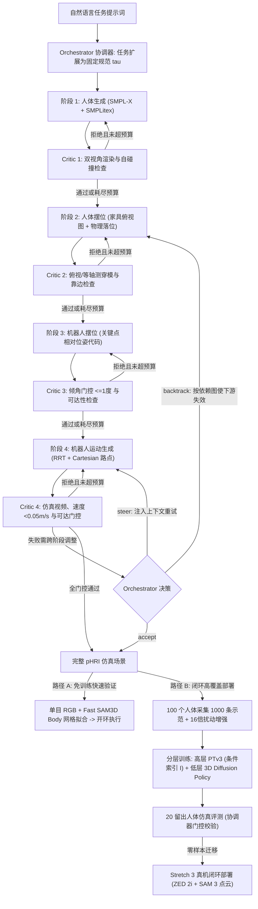

# GenPHRI: Agentic Generative Simulation for Physical Human-Robot Interaction

## 一句话定义

**GenPHRI** 是卡内基梅隆大学（CMU）提出的智能体生成式仿真框架，仅输入自然语言任务描述，即可通过“生成器-评审器-协调器（Generator-Critic-Orchestrator）”闭环在仿真中自动构建包含室内家具、SMPL-X 人体姿态与摆位、机器人配置及接触交互轨迹的完整物理人机交互（pHRI）场景，并支持免训练直接执行或仿真示范训练策略的零样本真机迁移。

## 英文缩写速查

| 缩写 | 英文全称 | 简要说明 |
|---|---|---|
| pHRI | Physical Human-Robot Interaction | 物理人机交互，指机器人与人体进行受控、安全接触的交互任务（如擦浴、挠痒、按摩） |
| VLM | Vision-Language Model | 视觉语言模型，本文中由 Gemini 3.7 Flash 驱动场景渲染图与视频评审及代码生成 |
| SMPL-X | Skinned Multi-Person Linear - eXpressive | 参数化三维人体网格模型，由姿态 $\theta$ 与体型 $\beta$ 参数生成全身含手面部网格 |
| RRT | Rapidly-exploring Random Tree | 快速扩展随机树规划器，用于无接触自由空间的无碰撞运动规划 |
| PTv3 | Point Transformer V3 | 面向三维点云的分层 Transformer 主干网络，用于高层路点目标预测 |
| DP3 | 3D Diffusion Policy | 三维扩散策略，本文低层控制器条件化于目标位姿输出 8 步末端增量动作 |

## 为什么重要

1. **填补 pHRI 生成式仿真的空白：** 传统护理仿真平台（如 Assistive Gym、RCareWorld）高度依赖手工编写任务与场景，而现有文本生成 3D 场景工作缺乏人体模型构建与贴体接触轨迹规划。GenPHRI 首次将智能体生成式仿真引入接触密集型 pHRI 领域。
2. **解决跨阶段耦合失配问题：** 在 pHRI 中，人体坐卧朝向、家具边界与机器人底座位姿强耦合。单纯的局部重试无法修复上游选择导致的不可达问题，GenPHRI 引入带有依赖图失效机制的协调器（Orchestrator），将全路点可达率从仅用局部评审器时的 57.0% 提升至 100.0%。
3. **打通“从文本到真机”双部署闭环：** 系统无需人类遥操作示范即可大规模合成 50 个不同护理任务场景，并支持免训练快速试错（Direct Execution）与闭环视觉策略迁移（零样本真机完成率达约 80%）两条互补路径。

## 核心信息

| 字段 | 内容或状态 |
|---|---|
| 作者 | Junxiang Wang, Nir Pechuk, Xinwen Xu, Tiancheng Wu, Nayon Kim, Julian Millan, Zackory Erickson |
| 机构 | Carnegie Mellon University (Robotics Institute) |
| 发表时间 | 2026-04-09（arXiv v1），2026-09-22（arXiv v2） |
| 论文链接 | [arXiv:2604.08664](https://arxiv.org/abs/2604.08664) / [arXiv HTML 全文](https://arxiv.org/html/2604.08664) |
| 项目与代码 | [GenPHRI 项目页](https://rchi-lab.github.io/gen_phri/)（仅展示 50 个交互场景与真机视频；底层仿真器依赖 [Genesis](https://github.com/Genesis-Embodied-AI/Genesis)） |
| 清单分类 | `environment.task_generation`（来源条目：`survey_ax_2604_08664`） |
| 开源状态 | 宣称将开源或未列链接（截至 2026-11-27 论文正文与项目页未发布独立 GenPHRI 源码仓库） |

## 核心原理

### 1. 约束效用最大化建模与两层优化
给定由自然语言扩展得到的固定任务规范 $\tau$（指定任务类型、人体姿态、支撑家具类型、目标身体区域与运动模式），系统求解场景配置 $x = (A_{\mathrm{room}}, A_{\mathrm{pose}}, A_{\mathrm{position}}, A_{\mathrm{robot}}, A_{\mathrm{motion}})$：

$$\underset{x \in \mathcal{X}_\tau}{\operatorname{maximize}}\; U_\tau(x) \quad \text{subject to} \quad c_j(x;\tau) = 1,\; j = 1,\dots,m$$

其中 $c_j$ 为仿真器检验的硬性门控条件（gates），$U_\tau$ 为任务质量偏好（advisory flags 与视觉评审指标）。系统采用“单阶段局部生成-渲染-评审循环 + 跨阶段协调器”的两层架构：生成与评审职责分离，且评审器仅依据原始提示词和不可变的 $\tau$ 评分，避免生成过程中的任务漂移（task drift）。底层室内环境通过 SceneSmith 生成或抽取，物理仿真运行于 Genesis。

### 2. 四阶段 Generator-Critic 组件生成（全流程默认使用 Gemini 3.7 Flash）
1. **人体生成（Human Generation）：** 采用参数化人体模型 SMPL-X $M(\theta,\beta)$。生成器先用 LLM 将高层描述扩展为体型与姿态语义描述，再通过 few-shot 示例对映射为髋、膝、颈、肩、肘具体关节角（当前支持坐姿与卧姿），构建以生成姿态为零位配置的驱动 URDF 并使用 SMPLitex 纹理化。评审器从双视角渲染排查异常扭曲或自碰撞（咨询旗标：自碰撞对数 $>0$，最大穿透 $\ge 1\text{ cm}$）。
2. **人体摆位（Human Placement）：** 基于空家具俯视图与坐标系规范，VLM 生成器输出家具局部框架下的归一化坐标 $(x,y) \in [0,1]^2$ 及朝向离散量 $d_{\mathrm{head}}, d_{\mathrm{face}} \in \{\text{up},\text{down},\text{left},\text{right},\text{in},\text{out}\}$。坐姿通过几何接触高度定位，卧姿则让驱动人体 URDF 在家具上物理落位并回写参数。评审器结合俯视与等轴测图检查人体-家具穿模以及是否靠近宽家具边缘以便机器人可达。
3. **机器人摆位（Robot Placement）：** 生成器编写 Python 函数 `get_robot_placement(human)`，且被严格限制只能调用 11 个人体骨骼关键点的 `get_joint_pos` API，输出移动底座位置与 yaw 角（强制相对人体计算而非硬编码世界坐标）。硬门控为落位后底座倾角 $\le 1^\circ$，评审器核查场景碰撞、距离与正面朝向交互区。
4. **机器人运动生成（Robot Motion Generation）：** 生成器编写 Python 函数 `generate_trajectory(...)`，可调用 12 个人体关键点、人体点云表面投影、逐点法向与相机位姿 API，输出路点序列（三维位置、$3\times 3$ 姿态矩阵、速度、接触力标志 $\in \{0,1\}$、规划器 $\in \{\text{RRT},\text{Cartesian}\}$）。硬门控要求满足 schema 断言（接触速度 $<0.05\text{ m/s}$、首路点无力）且全部路点运动学可达；运动评审器不仅看轨迹叠加俯视/等轴测图，还审查仿真执行视频与法向偏差（$>75^\circ$ 预警）、区域覆盖指标。

### 3. 协调器（Orchestrator）跨阶段调度与策略分支扩展
当某阶段达到迭代预算上限或出现结构性失败时，协调器基于压缩后的上下文摘要（优先保留失败约束）从三种动作中决策：
- `accept`：采纳合格的当前或历史最优候选进入下一阶段；
- `steer`：保留上游结果，通过注入明确纠错指令重试或延长当前局部循环；
- `backtrack`：沿**资产依赖图（artifact dependency graph）**使受影响的下游组件失效并回溯上游重算（例如调整人体摆位会触发重算机器人摆位与轨迹，而仅修改轨迹则复用已有摆位）。

在策略学习分支中，协调器进一步管辖数据采集、高层策略训练、低层策略训练与仿真评测，依据非有限值检查、验证损失回升（$>1.5\times$ 最佳 epoch）及留出人体成功率差距（$>0.25$）等门控与旗标执行回退选点或重采数据。

### 4. 双路径真机迁移（Direct Execution vs. Policy Learning）
- **免训练直接执行（Direct Execution）：** 对标定好的单目 RGB 起始帧运行 Fast SAM3D Body 估计 SMPL-X 网格 $(\beta,\theta)$、平移与朝向，提取骨骼关键点、网格顶点和法向输入生成的轨迹函数并开环执行。该方式无需数据与训练，但单目深度歧义会导致毫米至十余厘米级定位误差。
- **分层闭环策略学习（Policy Learning）：** 在 100 个随机化人体上采集 1,000 条仿真示范，以 4,500 点人体点云（相对质心归一化）和末端 4 点位姿 $C=\{c_i\}_{i=1}^4$ 为观测，改进 ArticuBot 分层模仿学习框架：
  - **高层策略：** 将主干从 PointNet++ 替换为 **Point Transformer V3（PTv3）**，并引入离散路点条件整数 $I \in [0,K-1]$（通过加权位移预测下一个路点目标 $G=\{g_i\}_{i=1}^4$），解决诸如“沿前臂往复挠痒”时单靠当前末端位置无法区分前进/后退的多模态歧义。推理时初始设 $I=0$，当满足 $\frac{1}{4}\sum_{i=1}^4 \|c_i - g_i\|_2 < d_{\text{thresh}}$ 时递增 $I$。
  - **低层策略：** 基于预测目标 $G$ 条件化 **3D Diffusion Policy**，预测 8 步末端增量动作（delta end-effector poses），并在含机器人手臂遮挡的仿真点云上训练以增强真机抗遮挡闭环鲁棒性。

## 流程总览

## 源码运行时序图

**不适用**（截至 2026-11-27，论文 arXiv:2604.08664 与项目页 `https://rchi-lab.github.io/gen_phri/` 仅提供交互式场景预览与实验演示视频，未公开发布 GenPHRI 自身的独立可运行官方源码仓库；原文引用的 `https://github.com/Genesis-Embodied-AI/Genesis` 为底层多物理引擎依赖而非本项目代码库）。

## 实验与评测

### 1. 大规模场景生成效率与调度统计（50 场景 / 9 任务族 / 34 房间布局）
全自动无人工干预生成 50 个护理场景（包括背部叩击 7、止痒 7、海绵擦浴 6、涂抹乳液 5、皮肤评估 5、暖手 5、毛巾擦干 5、安抚轻触 5、水肿按摩 5），总计消耗 **254.4 GPU-hours**、**9,170 次 LLM 调用**（累计 **9.17M 输入 tokens**、**605k 输出 tokens**，单场景平均约 183.4k 输入 / 12.1k 输出 tokens）与 **1,209 次阶段尝试**。

| 生成阶段 | 至少触发 1 次 Critic 拒绝的场景数 | 平均 Critic 迭代轮数 | Orchestrator 干预决策数 |
|---|---|---|---|
| 1. Human generation | 22 / 50 | 2.02 | 5 |
| 2. Human placement | 40 / 50 | 3.22 | 7 |
| 3. Robot placement | 14 / 50 | 4.16 | 25 |
| 4. Motion generation | 37 / 50 | 6.62 | 18 |
| **总计（全流程）** | **50 / 50** | **16.0** | **55**（16 个场景触发） |

注：55 次协调器恢复决策包含 42 次带上下文重试、5 次局部延续（steer）、3 次回溯上游（backtrack）及 5 次采纳历史最优（accept）。

### 2. 七路消融实验（Back-and-leg bathing，每组评估 100 个人体）

| 配置方案 | 全路点可达率 (%) $\uparrow$ | 轨迹偏移 $>2\text{ cm}$ 占比 (%) $\downarrow$ | P95 末端位置误差 (mm) $\downarrow$ |
|---|---|---|---|
| **Full pipeline（完整框架）** | **100.0** | **0.0** | **1.8** |
| Critics only（无 Orchestrator） | 57.0 | 4.0 | 152.3 |
| Critics only，移除 Human Generation Critic | 0.0 | 100.0 | 155.9 |
| Critics only，移除 Human Placement Critic | 37.0 | 50.0 | 77.4 |
| Critics only，移除 Robot Placement Critic | 1.0 | 81.8 | 69.9 |
| Critics only，移除 Motion Generation Critic | 0.0 | 100.0 | 330.0 |
| Open-loop（完全开环，无 Critic/Orchestrator） | 0.0 | 100.0 | 349.3 |

### 3. 零样本真机用户实验与仿真对照（$N=12$ 被试，Stretch 3 移动操作臂）
擦浴（Bathing）使用背部与双腿 15 枚可揭除魔术贴方片衡量目标完成度；挠痒（Scratching）使用右前臂 5 枚接触标记衡量；仿真评估在 20 个留出人体上各跑 2 个随机种子（共 40 次试验，2 cm 邻近判定）。

| 任务与评估环境 | Policy（静态人体） | Direct Execution（免训练直接执行） | Policy+Motion（受试者主动移臂） |
|---|---|---|---|
| **Bathing — 真机（Real）** | **80 ± 11%** | 39 ± 25%（$p<0.001$） | — |
| **Bathing — 仿真（Sim）** | 86 ± 7% | — | — |
| **Scratching — 真机（Real）** | **79 ± 16%** | —（深度误差大未启用） | **63 ± 20%** |
| **Scratching — 仿真（Sim）** | 92 ± 14% | — | 92 ± 20% |

- **提示词一致性（7 分制中位数）：** 仿真下生成示范与策略回放在 1 分边界内统计等效（中位数 $5.5\text{--}6.5$，$p<0.01$）；真机擦浴策略中位数 5.0 vs 直接执行 4.5（无显著差异）；真机挠痒策略 4.25，受试者移臂条件下仍满足 1 分非劣效（$p<0.01$）。

## 与其他工作对比

| 对比维度 / 工作 | 构建方式与输入 | 跨阶段协调与接触规划 | 真机部署与适应性 |
|---|---|---|---|
| **Assistive Gym / RCareWorld / Human-Robot Gym** | 人工预设固定护理任务与交互环境 | 手工编写任务逻辑、摆位与动作脚本 | 扩展新任务需重新手工建模与调参 |
| **SceneSmith** | 多智能体生成仿真就绪室内场景 | 聚焦静态家具布局与房间场景 | 不含人体姿态生成与贴体接触交互规划 |
| **ArticuBot** | 基于 PointNet++ 的分层铰接物体操作策略 | 假定仅凭当前末端与点云即可唯一确定目标 | 难以处理 pHRI 往复擦拭/挠痒等状态多模态路径 |
| **GenPHRI（本文）** | 纯自然语言提示词驱动 4 阶段智能体生成 | 固定 $\tau$ + 依赖图回溯 + 物理/视频双重门控 | **双路径：** 直接执行适合宽表面快速预览；PTv3 条件索引 + 3D 扩散策略实现约 80% 零样本真机完成率 |

## 结论

**一句话总判：GenPHRI 验证了“自然语言 $\rightarrow$ 智能体闭环生成仿真 $\rightarrow$ 零样本真机物理人机交互”的可行链路，其核心工程抓手在于固定任务规范 $\tau$ 防漂移、跨阶段依赖回溯以及针对往复接触引入离散路点索引的层级扩散策略。**

1. **防任务漂移的评审隔离机制：** 在多轮自动场景生成中，应将任务规范 $\tau$ 冻结并禁止协调器改写，强制 Critic 仅对照原始任务与 $\tau$ 验收，避免系统为迁就失败尝试而降低标准。
2. **明确双部署路径的适用边界：** 面对背部等宽大且具备工具顺应性的部位，可用单目网格拟合的 Direct Execution 快速试错；面对前臂（宽 $5\text{--}8\text{ cm}$）等窄小部位，单目深度误差（$6\text{--}16\text{ cm}$）会带来脱靶与挤压安全风险，必须切入闭环点云策略。
3. **往复轨迹策略必须消除状态歧义：** 针对来回擦拭、挠痒等轨迹自交或重复经过同一区域的操作，在分层视觉策略高层引入离散路点阶段索引 $I$ 是保持动作顺序不折返的关键设计。
4. **合成数据增强对真机遮挡至关重要：** 通过“100 个人体 $\times$ 1,000 条示范 + 16 倍轨迹扰动 + 相机/底座随机化 + 在线点云/末端噪声”，即使不依赖真实遥操作数据也能跨过显著的机械臂遮挡与视觉域差。

## 工程实践

- **真机系统部署配置（Appendix D）：** 采用 Hello Robot Stretch 3 移动操作臂（装配专用海绵或挠痒器末端）与吸顶式 ZED 2i 深度相机；通过在腕关节放置 ArUco 标定板完成相机-机器人外参标定；独立 GPU 工作站使用 SAM 3 分割人体并从遮罩深度图构建点云，无线下发关节控制指令。
- **点云预处理与随机化范围（Appendix E）：** 示范采集覆盖 $\beta \sim \mathcal{N}(0,I)$ 体型分布，相机名义高度 $2.5\text{ m}$ 并施加 $\Delta x_{\mathrm{cam}} \sim \mathrm{Unif}([-0.1,-0.1,-0.7],[0.1,0.1,0])$ 与视点扰动；点云以人体质心为中心下采样至 **4,500 点**（FPS）。
- **轨迹与观测增强：** 每条原始示范扩展 **16 份扰动副本**（平移 $\sigma=2\text{ cm}$ 截断于 $\pm 5\text{ cm}$，接触期切向缩放 $0.5$、法向仅允许向外退让以避免穿入人体，旋转 $\sigma=0.175\text{ rad}$ 截断于 $\pm 0.524\text{ rad}$）并重新计算 8 步纠偏动作；训练时额外注入 1–3 mm 点云高斯噪声与末端位姿扰动。
- **训练算力与耗时（Table 7）：** 在 4 张 NVIDIA RTX PRO 5000 Blackwell（48 GB）上使用 PyTorch DDP 训练，高层 PTv3 训练 15 epochs（每卡 batch size 128），低层 DP3 训练 20–30 epochs（每卡 batch size 256，8 步预测视界）；单任务总训练时长约 **19.0–19.8 小时**（其中高层占约 17.5–17.7 小时）。

## 局限与风险

1. **单目直接执行存在严重深度误差与安全隐患：** Appendix C 实测显示，Fast SAM3D Body 虽在 2D 投影下贴合人体轮廓，但在相机视线方向可能偏离真实手臂表面达 **6–16 cm**（向后偏移 16 cm 或向前偏移 6–10 cm），直接开环执行可能将刚性工具压入人体组织，带来物理安全风险。
2. **人类主动运动适应性仍有缺口：** 真机挠痒任务在受试者主动移臂后完成率从 79% 降至 **63%**；虽然底层仿真器支持环境人体运动，但当前策略训练数据仍仅基于静态人体姿态采集。
3. **接触物理保真度与力感知缺失：** 受限于计算预算，仿真采用刚体近似而非软体形变人体建模，且当前视觉策略未接入末端力/触觉传感器观测，难以在接触力层面实现精细闭环调节。
4. **真机验证规模与覆盖有限：** 用户实验仅涵盖 12 名受试者、单台 Stretch 3 机械臂与 2 个典型护理任务（且当前生成范围限于坐姿与卧姿），向站立协作或更复杂多接触双臂任务的泛化尚待后续验证。

## 关联页面

- [Agentic Robots 综述](paper-towards-agentic-robots-survey.md)
- [全量项目节点清单](../overview/awesome-agentic-robots-node-index.md)
- [VLA 方法背景](../methods/vla.md)
- [机器人仿真环境集成](../methods/robot-simulation-integration.md)
- [机器人仿真场景生成](../methods/robot-simulation-scene-generation.md)
- [智能体规划与反馈循环](../methods/agent-planning-feedback.md)
- [模仿学习](../methods/imitation-learning.md)
- [Diffusion Policy（扩散策略）](../methods/diffusion-policy.md)
- [Sim2Real 迁移工作流](../methods/sim2real-transfer-workflow.md)
- [机器人操作任务](../tasks/manipulation.md)

## 推荐继续阅读

- [GenPHRI 官方项目主页（含 50 个交互式场景浏览器与真机对比视频）](https://rchi-lab.github.io/gen_phri/)
- [GenPHRI arXiv HTML 原文](https://arxiv.org/html/2604.08664)
- [Genesis 多物理仿真平台（论文底层仿真引擎）](https://github.com/Genesis-Embodied-AI/Genesis)
- [ArticuBot (arXiv:2503.03045) — 本文分层点云策略基础架构](https://arxiv.org/abs/2503.03045)

## 参考来源

- [GenPHRI 原文核对归档](../../sources/papers/paper-agentic-2604-08664.md)
- [官方 Awesome 快照归档](../../sources/repos/awesome-agentic-robots-survey-index.md)
- [arXiv:2604.08664](https://arxiv.org/abs/2604.08664)
- [GenPHRI 项目页](https://rchi-lab.github.io/gen_phri/)
