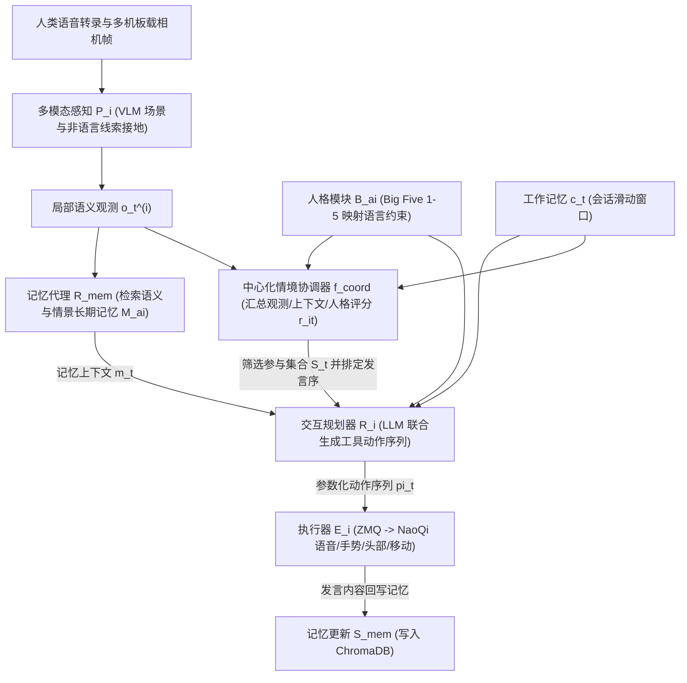
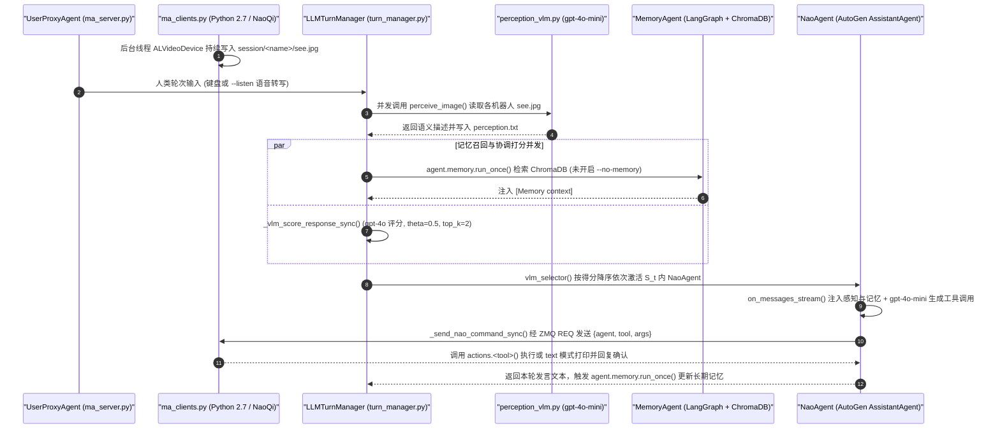

# M2HRI: An LLM-Driven Multimodal Multi-Agent Framework for Personalized Human-Robot Interaction

## 一句话定义

**一套面向个性化多机器人社交互动的多模态多智能体框架**：通过显式大五人格（Big Five）与智能体专属长期记忆将每台机器人建模为不可互换的独立个体，并引入基于上下文、视觉观测与人格画像的情境化中心协调器，动态决定每轮由哪些机器人依次响应。

## 英文缩写速查

| 缩写 | 英文全称 | 简要说明 |
|---|---|---|
| M2HRI | Multimodal Multi-Agent Human-Robot Interaction | 本文提出的多模态多智能体人机交互框架及双 NAO 实现系统 |
| HRI | Human-Robot Interaction | 人机交互领域，本文聚焦共处物理空间的多机器人社交对话 |
| FFM | Five-Factor Model | 心理学大五人格模型（OCEAN：开放性、尽责性、外向性、宜人性、神经质） |
| VLM | Vision-Language Model | 视觉语言模型；在 M2HRI 中同时负责多模态场景语义接地与轮次适配度打分 |
| LLM | Large Language Model | 大语言模型；驱动记忆检索/写入决策与具身动作工具调用规划 |
| ZMQ | ZeroMQ | 轻量化异步消息通信库，用于 Python 3 LLM 服务端与 Python 2.7 NAO 客户端跨进程调度 |

## 为什么重要

- **从“同质机器人池”转向“带个体身份的社交团队”**：既往多机器人 HRI 系统大多将多台机器人视为可互换的功能节点，忽略了差异化人格与长期交互记忆对人类社交认知的影响；M2HRI 系统验证了“人格 + 记忆”能显著提升用户对智能体身份的辨识度与个性化体验。
- **揭示个体化对多机轮次协调的结构性需求**：一旦机器人拥有不同性格与私有记忆，轮次管理就不能只依赖静态规则或“谁离得近谁回答”，而必须联合评估当前视觉场景、对话上下文与各智能体人格适配度。
- **用可控实验分离三大设计维度的独立贡献**：通过 105 名被试、7 个实验组（人格五维对比、记忆开关、协调开关）的受控研究，量化揭示了“表达显性度决定人格区分度”“自然度不等同于个性化”“协调机制对抑制重叠抢话最关键”等可复用 HRI 设计结论。

## 核心信息

| 字段 | 内容 |
|---|---|
| **作者** | Shaid Hasan, Breenice Lee, Sujan Sarker, Tariq Iqbal |
| **机构** | 弗吉尼亚大学（University of Virginia，Collaborative Robotics Lab） |
| **发表时间** | 2026-04-13（arXiv v1）/ 2026-06-21（arXiv:2604.11975v2 [cs.RO]） |
| **论文链接** | [arXiv:2604.11975](https://arxiv.org/abs/2604.11975) / [arXiv HTML v2](https://arxiv.org/html/2604.11975) |
| **项目与代码** | [项目页](https://project-m2hri.github.io/) / [GitHub: project-m2hri/m2hri](https://github.com/project-m2hri/m2hri) |
| **清单分类** | `harness.orchestration` |
| **来源条目** | `survey_ax_2604_11975` |
| **开源状态** | **已开源**（官方仓库公开了 AutoGen 多智能体服务端、LangGraph/ChromaDB 记忆代理、Big Five 人格模块、15 个 NAO 动作工具定义及 ZMQ/NaoQi 客户端代码；仓库未包含独立 `LICENSE` 文件） |

## 核心原理

M2HRI 将共处物理空间的多智能体交互解耦为“**分散式个体认知循环 + 中心化情境参与协调**”（原文 §III-A 至 §III-C）：

### 1. 智能体个体建模与认知循环（§III-A，Eq. 1–5）

每个机器人智能体形式化为三元组 $a_i = \langle \phi_i, \Lambda_i, \Gamma_i \rangle$，其中身份画像 $\phi_i = \langle M_i, B_i \rangle$ 决定“它是谁”，认知循环 $\Lambda_i = \langle P_i, R_i, E_i \rangle$ 决定“它如何运转”，$\Gamma_i$ 约束物理动作能力集合：

- **多模态感知 $P_i$（Eq. 2）：** 在交互时间步 $t$，机器人接收转录语音 $x_t^{\text{speech}}$ 与板载相机帧 $x_t^{\text{vision}}$，由 VLM 联合映射为自然语言语义观测 $o_t = P_i(x_t^{\text{speech}}, x_t^{\text{vision}})$，用于将口语指代接地到物理实体、空间关系以及用户视线/手势等非语言线索。
- **三层长期与短期记忆 $M_{a_i}$：**
  - **工作记忆：** $c_t = \{o_{t-k}, \dots, o_{t-1}, o_t\}$ 构成的会话内滑动观测窗口，每次新会话重置、不写入磁盘；
  - **语义记忆与情景记忆：** 每个智能体维护隔离的持久化向量库 $M_{a_i}$，分别存储关于用户/物体的客观事实与带时间上下文的偏好及历史经历。给定观测 $o_t$，由基于 LLM 的记忆控制器执行上下文检索 $m_t = R_{\text{mem}}(o_t, M_{a_i})$ 与去重更新 $M_{a_i} \leftarrow M_{a_i} \cup S_{\text{mem}}(o_t, M_{a_i})$（仓库实现中还包含 `procedural_memory` 集合）。
- **大五人格表征 $B_{a_i}$（Eq. 3）：** 用离散 5 维向量 $\mathbf{B}_{a_i} = (O, C, E, A, N) \in \{1, 2, 3, 4, 5\}^5$ 分别刻画开放性、尽责性、外向性、宜人性与神经质（$3$ 为中性值）。通过确定性映射函数 $f_{\text{trait}}: \{1,2,3,4,5\} \to \text{linguistic modifiers}$ 转为强度分级的自然语言人格约束，直接注入系统提示词，从推理源头而非表层措辞修饰影响对话与动作选择。
- **交互规划 $R_i$ 与具身执行 $E_i$（Eq. 4–5）：** 规划器联合观测、上下文、检索记忆、人格向量与动作库 $\mathcal{A}$ 输出有序参数化原语序列 $\pi_t = \text{Planner}(o_t, c_t, m_t, B_{a_i}, \mathcal{A}) = \{(a_1, \theta_1), \dots, (a_k, \theta_k)\}$，再由执行器顺序映射为物理动作 $u_t = E(\pi_t) \in \Gamma_i$（如 `wave -> speak -> nod` 复合序列）。

### 2. 情境化多智能体协调机制（§III-B，Eq. 6–7）

针对多机器人同场对话容易出现的“集体抢话”或“错误机器人作答”问题，M2HRI 在保持个体认知隔离的前提下设置共享中心协调器：

1. **信息聚合：** 收集所有 $N$ 个智能体的局部观测、共享对话上下文与人格向量：
   $$\mathcal{Z}_t = \left\{ z_t^{(i)} \right\}_{i=1}^{N}, \qquad z_t^{(i)} = \left( o_t^{(i)},\, c_t,\, B_{a_i} \right)$$
2. **适配度打分与阈值筛选：** 协调函数 $r_{i,t} = f_{\text{coord}}(\mathcal{Z}_t)_i \in [0, 1]$ 评估各智能体在当前社交与视觉语境下回应的合适程度，随后筛选超过阈值 $\tau$ 的集合 $S_t = \{ i \mid r_{i,t} \ge \tau \}$，按顺序（实际代码中取分数降序并可配 Top-$K$ 上限）触发入选机器人依次生成与执行各自策略。

## 流程总览

## 源码运行时序图

以下时序图依据官方仓库 `project-m2hri/m2hri` 的 `ma_server.py`、`modules/llm/turn_manager.py`、`modules/llm/perception_vlm.py`、`modules/memory/memory_agent.py`、`modules/llm/helpers.py` 及 `ma_clients.py` 静态核查绘制，完整反映“服务端认知调度 + 客户端 ZMQ/NaoQi 执行”的双进程运行时路径：

核心复现入口为在两个终端分别启动 `python ma_clients.py --multi --connection text`（或连接实体 NAO 的 `--connection speech --mode execute`）与 `python ma_server.py`（可选 `--no-memory` 跳过 ChromaDB/LangGraph 记忆管线）。

## 实验与评测

作者在两台 NAO 机器人上完成原型部署，并在 Prolific 招募 $n=105$ 名被试（年龄 18–77 岁，$M=39.3, SD=13.7$；男 66 / 女 38 / 非二元 1）开展受控视频观察研究（IRB 批准，7 个实验组各 15 人，每人约 10 分钟）：

### 1. 机器人人格评估（RQ1，5 个被试间组，极端值 5 vs. 1 对比，其余维度设为 3）

| 评估维度 / 检验项 | 开放性 (O) | 尽责性 (C) | 外向性 (E) | 宜人性 (A) | 神经质 (N) |
|---|---|---|---|---|---|
| **讨论场景** | 非传统爱好 | 备考 vs. 派对抉择 | 结识新朋友 | 播客创意反馈 | 宠物走失反应 |
| **人格区分度**（vs. 中性 3.0） | $4.73 \pm 0.46$ ($p<.001, d=3.79$) | $3.53 \pm 1.25$ ($p=.120, d=0.43$) | $4.47 \pm 0.52$ ($p<.001, d=2.84$) | $4.47 \pm 0.64$ ($p<.001, d=2.29$) | $4.80 \pm 0.41$ ($p<.001, d=4.35$) |
| **人格表达一致性**（均 $p<.001$） | $4.53 \pm 0.52$ ($d=2.97$) | $4.13 \pm 1.06$ ($d=1.07$) | $4.33 \pm 0.82$ ($d=1.63$) | $4.53 \pm 0.74$ ($d=2.06$) | $4.87 \pm 0.35$ ($d=5.31$) |
| **交互参与度**（vs. 中性 3.0） | $4.40 \pm 0.74$ ($p<.001, d=1.90$) | $3.33 \pm 1.18$ (不显著, $d=0.28$) | $3.40 \pm 1.18$ (不显著, $d=0.34$) | $4.13 \pm 1.25$ ($p=.003, d=0.91$) | $4.33 \pm 0.82$ ($p<.001, d=1.63$) |
| **特质识别准确率**（随机基准 $33.3\%$，均 $p \le .0085$） | $93.3\%$ | $66.7\%$ | $93.3\%$ | $86.7\%$ | $86.7\%$ |

### 2. 长期记忆与情境协调评估（RQ2 & RQ3，各 $n=15$ 被试内配对检验，$df=14$）

| 研究问题与对比条件 | 评价指标 | 配对 t 检验 | 95% 置信区间 | Wilcoxon 检验 | 效应量 ($d$) |
|---|---|---|---|---|---|
| **RQ2：长期记忆**（有 vs. 无，偏好回忆场景） | 回忆准确率 | $t(14)=6.52, p<.001$ | $[1.70, 3.37]$ | $Z=-3.24, p=.001$ | $1.68$ |
| **RQ2：长期记忆** | 用户偏好意识 | $t(14)=12.65, p<.001$ | $[2.22, 3.12]$ | $Z=-3.53, p<.001$ | $3.27$ |
| **RQ2：长期记忆** | 交互自然度 | $t(14)=3.09, p=.008$ | $[0.31, 1.69]$ | $Z=-2.39, p=.017$ | $0.80$ |
| **RQ3：情境协调**（有 vs. 无，直接点名讨论场景） | 对话流畅度 | $t(14)=4.08, p=.001$ | $[0.73, 2.34]$ | $Z=-2.70, p=.007$ | $1.05$ |
| **RQ3：情境协调** | 响应恰当性 | $t(14)=4.00, p=.001$ | $[0.74, 2.46]$ | $Z=-2.69, p=.007$ | $1.03$ |
| **RQ3：情境协调** | 避免重叠抢话 | $t(14)=7.89, p<.001$ | $[2.09, 3.65]$ | $Z=-3.35, p<.001$ | $2.04$ |

## 与其他工作对比

- **对比经典单智能体人格/记忆 HRI 工作**：以往研究（如使用 Big Five 调节单台机器人语速与手势，或跨会话记忆儿童/成人偏好）多在单机器人场景下独立验证人格或记忆；M2HRI 将二者同时注入多机团队并揭示个体化与轮次协调之间的强耦合关系。
- **对比传统规则式或纯近邻触发的多机轮次控制**：既往多机 HRI 常依赖凝视方向、空间距离或固定轮询决定谁开口，缺乏对机器人个体特质与话题语境的联合考量；M2HRI 用中心化 VLM 评分函数统一消费视觉画面、对话历史与人格画像，在直接点名与开放话题切换中显著降低重叠率（$d=2.04$）。
- **对比面向物理操作的单机对话框架**：与侧重单机器人视觉伺服与端到端低层控制的 [VLA](../methods/vla.md) 或单机 [人形机器人智能语音交互](../methods/humanoid-voice-interaction.md) 管线不同，M2HRI 聚焦上层多智能体社会角色分化与轮次编排，更接近轻量化的 [机器人智能体执行框架](../methods/robot-agent-harness.md)。

## 结论

**一句话总判：在多机器人社交交互中，显式人格与长期记忆负责建立“不可互换的个体身份”，情境化协调负责维持“有序不冲突的群体轮次”，两者缺一不可。**

1. **人格可辨识度取决于行为外显度而非配置强度**：即便都设为极端分（1 vs. 5），开放性、神经质、宜人性与外向性极易在短对话中被区分（$M \ge 4.47$），而尽责性依赖长期目标导向行为，在短对话中的区分度不显著（$M=3.53, p=.120$）。
2. **“自然”不等于“个性化”**：关闭长期记忆后，仅靠工作记忆仍能维持基本对话连贯性（因此自然度增益相对温和，$d=0.80$），但会丧失对用户偏好的主动呼应（偏好意识效应量高达 $d=3.27$）。
3. **没有情境协调，个体化会放大对话混乱**：无协调组由智能体凭局部上下文各自决定是否发言，极易造成同时开口或答非所问；引入 $f_{\text{coord}}$ 后在避免重叠指标上获得最大增益（$t(14)=7.89, d=2.04$）。
4. **双进程 ZMQ 解耦适合老旧机器人硬件复用**：把 Python 3 现代 LLM/VLM/LangGraph 栈与 Python 2.7 NaoQi 控制端通过 ZMQ JSON 协议隔离，既能保留现成硬件执行能力，也支持 `--connection text` 无硬件联调。

## 工程实践

- **多机并发调度延迟控制：** 参考 `modules/llm/turn_manager.py`，在人类发言后使用 `asyncio.gather` 并发执行所有机器人的 `perceive_image`（`gpt-4o-mini`）、`MemoryAgent.run_once` 与 `_vlm_score_response_sync`（`gpt-4o`），可避免多机串行调用导致首字响应时间成倍增长。
- **反社交性格与阈值约束：** 在多机轮次管理中需审慎设置 `VLM_THRESHOLD`（默认 `0.5`）与 `VLM_TOP_K`（默认 `2`）；当所有机器人得分均低于阈值时直接把轮次交还 `Human`，可避免强行凑话。
- **跨代 SDK 桥接模式：** 对只提供 Python 2.7 或私有 C++ SDK 的社交机器人（如 NAO），建议采用 `ma_server.py` + `ma_clients.py` 的 ZMQ REQ/REP 分离模式，并使用 `actions/tools.json` 动态反射参数 schema，避免大模型输出未定义字段触发硬件执行异常。
- **无物理机开发调试：** 联调提示词、记忆检索与协调打分逻辑时，先运行 `python ma_clients.py --multi --connection text` 仅打印动作参数，确认工具序列稳定后再接入实体机器人相机线程（`see.jpg` 须大于 500 字节才会被视觉模块采纳）。

## 局限与风险

- **视频观察范式而非真人现场长程部署：** 用户研究（$n=105$）采用约 10 分钟预录交互视频，虽严格控制了运动与时序变量，但未能检验真实用户在现场自由走动、环境噪声及跨天多会话交互中的适应与疲劳效应。
- **静态人格与中心化协调瓶颈：** 当前 Big Five 向量在会话前通过 `agent_config.json` 静态设定，尚不支持随交互反馈自适应演化；同时协调器每轮对每台机器人都调用一次 `gpt-4o` 视觉打分，随机器人数量 $N$ 增加会产生线性 API 费用与时延压力。
- **硬件感知与软件生态耦合：** 相机采集仅以当前单帧覆盖写入 `see.jpg`（无历史视觉缓冲），且客户端强绑定 Python 2.7 / NaoQi；此外仓库尚未声明开源 `LICENSE` 文件，商用或二次分发前需向作者确认授权。

## 关联页面

- [Agentic Robots 综述](paper-towards-agentic-robots-survey.md)
- [全量项目节点清单](../overview/awesome-agentic-robots-node-index.md)
- [VLA 方法背景](../methods/vla.md)
- [机器人智能体执行框架](../methods/robot-agent-harness.md)：对照规划、工具调用与反馈的系统边界
- [人形机器人智能语音交互](../methods/humanoid-voice-interaction.md)：对比单机语音交互流水线与 M2HRI 多智能体对话架构
- [Agent Tool-use Interface · 智能体工具调用接口](../methods/agent-tool-use-interface.md)：动态 JSON schema 约束下的机器人动作原语调用契约
- [智能体规划与反馈机制](../methods/agent-planning-feedback.md)：分析中心化协调评分、记忆召回与动作反馈闭环

## 推荐继续阅读

- [M2HRI 官方项目主页（演示视频与系统概览）](https://project-m2hri.github.io/)
- [M2HRI 官方 GitHub 仓库（project-m2hri/m2hri）](https://github.com/project-m2hri/m2hri)

## 参考来源

- [M2HRI 原文精读笔记](../../sources/papers/paper-agentic-2604-11975.md)
- [官方 Awesome 快照归档](../../sources/repos/awesome-agentic-robots-survey-index.md)
- [M2HRI 官方仓库源码核对档案](../../sources/repos/paper-agentic-2604-11975.md)
- [arXiv:2604.11975v2 论文原文（HTML）](https://arxiv.org/html/2604.11975)
- [M2HRI 官方项目主页](https://project-m2hri.github.io/)
