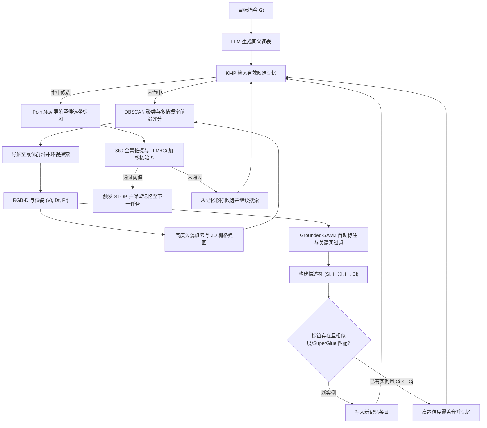

# OVAL: Open-Vocabulary Augmented Memory Model for Lifelong Object Goal Navigation

## 一句话定义

**OVAL**（Open-Vocabulary Augmented Memory Model for Lifelong Object Goal Navigation）是一种面向**终身开放词汇目标导航**的无训练框架，通过维护带位置、HSV 场景直方图与置信度描述符的显式实例记忆，并结合距离、语义共现与轨迹足迹的多值概率前沿评分，在未知环境中持续完成序列化的物体搜索任务。

## 英文缩写速查

| 缩写 | 英文全称 | 简要说明 |
|---|---|---|
| OVAL | Open-Vocabulary Augmented Memory Model for Lifelong Object Goal Navigation | 本文提出的终身开放词汇目标导航记忆与探索框架 |
| ObjectNav | Object Goal Navigation | 在未知环境中自主导航寻找指定目标物体的任务 |
| MultiON | Multi-Object Navigation | 给定预定义多目标列表的多物体导航基准任务 |
| SR | Success Rate | 导航成功率（500 步内距目标 1 m 内触发 STOP） |
| SPL | Success weighted by Path Length | 路径长度加权成功率，衡量导航成功与路径效率 |
| KMP | Knuth-Morris-Pratt | 线性时间字符串匹配算法，用于记忆标签跨粒度子串查询 |
| HSV | Hue, Saturation, Value | 色调-饱和度-明度颜色空间，用于构建房间场景直方图描述符 |

## 为什么重要

1. **从单次任务走向终身持续导航：** 传统 [零样本目标导航](../tasks/zero-shot-object-navigation.md)（如 VLFM）仅服务单集（isolated）目标，导航结束后丢弃语义价值图；实际服务机器人在酒店或家庭中需要连续执行「先找杯子、再找遥控器」的序列化开放词汇任务。
2. **解决自动开放词汇标注的记忆混乱：** 直接存储 Grounded-SAM2 等自动标注器输出的原始文本会产生同义词分裂（如 `"desk"` 与 `"green desk"`）、重复实例膨胀和误检污染；闭集记忆方法（如 GOAT）又无法扩展到未预定义类别。
3. **弥合场景语义与持续探索之间的鸿沟：** 通过显式记忆描述符管理实例合并，并用轨迹足迹惩罚抑制重复回访，使长期探索既能利用已有经验，又能在未见区域保持系统性覆盖。

## 核心信息

| 项目 | 信息 |
|---|---|
| **作者** | Jiahua Pei*, Yi Liu*, Guoping Pan, Yuanhao Jiang, Houde Liu†, Xueqian Wang† |
| **机构** | 清华大学深圳国际研究生院（Tsinghua University SIGS） |
| **发表时间 / 载体** | 2026-04-14 提交 · arXiv:2604.12872v1 [cs.RO]（8 页） |
| **论文链接** | [arXiv:2604.12872](https://arxiv.org/abs/2604.12872) · [arXiv HTML](https://arxiv.org/html/2604.12872) |
| **项目与代码** | 未确认公开项目页或代码仓库（`context.json` 及原文均未提供仓库地址） |
| **清单分类** | `harness.memory`（来源条目：`survey_ax_2604_12872`） |
| **开源状态** | 未确认开源代码（截至 2026-11-27 仅公开 arXiv 论文全文） |

## 核心原理

OVAL 以观察 $O_t = (V_t, D_t, P_t)$（RGB 图像、深度图与机器人位姿）为输入，在动作空间 $\{\text{Stop}, \text{Move Forward}, \text{Turn Left}, \text{Turn Right}, \text{Look Up}, \text{Look Down}\}$ 上决策，由三大模块协同工作：

### 1. 多值概率前沿探索（Frontier Exploration）

利用当前深度图点云（按高度过滤并变换到全局坐标系）构建 2D 俯视障碍栅格图，提取探索边界并用 DBSCAN 聚类为前沿航点，同时记录已尝试前沿以避免在不可达点之间来回振荡。每个前沿 $F$ 的选择概率由三项叠加：

$$P(F) \propto o_d(F) + o_s(F) + o_f(F)$$

- **距离项 $o_d(F)$：** $o_d(F) = A_d \mathcal{N}(P_F; P_t, \sigma_d \bm{I}) \cdot \mathbf{1}_{\|P_F - P_t\| \le d_{th}}$，在阈值半径 $d_{th}$ 内优先选择近邻前沿以加快局部推进。
- **语义项 $o_s(F)$：** $o_s(F) = A_s \sum_{k=0}^{n(\mathcal{C})} \left[\mathcal{N}(P_F; X_k, \sigma_s \bm{I}) P(G_t, S_k)\right]$，依据预定义的物体共现表（如马桶与洗手台、毛巾架高频共现）向高相关区域偏置；若当前目标 $G_t$ 不在共现表中，则自动退化为仅依赖距离项与足迹项。
- **足迹惩罚项 $o_f(F)$：** $o_f(F) = -A_f \sum_{k=0}^{t} \mathcal{N}(P_F; P_k, \sigma_f \bm{I})$，对历史轨迹位置 $P_k$ 施加负向高斯惩罚，避免在已建图区域重复兜圈。

### 2. 开放语义记忆模型（Open-Semantic Memory Model）

- **开放语义预处理：** 采用 Grounded-SAM2 的 `Autolabel` 模式（实验配置为 `<DETAILED_CAPTION>` 配合 Florence-2-base）做零样本识别，并用关键词表过滤 `"wall"`、`"various objects"` 等无关噪声；每轮任务初始化时由 LLM（GPT-4o-mini）生成目标 $G_t$ 的同义词集合 $\overline{G}_t$。
- **记忆描述符定义：** 记忆库定义为 $\mathcal{C} = \{S_i, \mathcal{I}_i, X_i, H_i, C_i\}_{i=1}^{n(\mathcal{C})}$，分别存储物体标签 $S_i$、容量上限为 $N$ 的对齐图像缓存 $\mathcal{I}_i$、检测框中心像素 $\overline{p}_c$ 映射得到的 3D 平面位置描述符 $X_i$、场景 HSV 颜色直方图描述符 $H_i \in \mathbb{R}^{H\times S\times V}$（用于区分一墙之隔但位置相近的不同房间物体），以及置信概率 $C_i$：

$$C_i = \exp\left(-\sigma \frac{\|\overline{p}_c - p_c\| D_{t,\overline{p}_c}}{A_b}\right)$$

  其中 $p_c$ 为图像中心坐标，$D_{t,\overline{p}_c}$ 为目标中心深度，$A_b$ 为检测框面积，$\sigma$ 控制空间衰减尺度——距离过远、框面积过小或位于视野边缘的观测置信度更低。
- **实例匹配与合并（Memory Management）：** 遇到新观测 $\{S_j, \mathcal{I}_j, X_j, H_j, C_j\}$ 时，若 $S_j \notin \mathcal{C}$ 则新建实例；若标签已存在，先计算场景与位置联合相似度：

$$S_m = \lambda_H \text{Sim}(H_i, H_j) - \lambda_X \text{Sigmoid}(k \|X_i - X_j\|)$$

  当 $S_m > \tau_u$ 直接判为同一实例，$S_m < \tau_l$ 判为新实例；对处于模糊区间 $\tau_l \le S_m \le \tau_u$ 的候选，进一步用 SuperGlue 提取局部特征点计算匹配数 $|\mathcal{M}_{sg}| \ge \tau_M$。确认同一实例且新观测置信度更高（$C_i \le C_j$）时，以 $(X_j, H_j, C_j)$ 覆盖旧参数并精炼图像缓存 $\mathcal{I}_i$。

### 3. 检索导航与全景验证（Navigation & Verify "STOP"）

- **KMP 跨粒度检索：** 面对如记忆中存 `"green desk"` 而指令查询 `"desk"` 的词汇粒度差异，利用 KMP 子串搜索算法在 $\mathcal{C}$ 中匹配目标 $G_t$ 及其同义词 $\overline{G}_t$。
- **路径执行与到点核验：** 调用贪心 PointNav 规划器导航至最优候选坐标 $X_i$ 后，采集周围 360° 全景图像 $\{V_k\}_{k=1}^K$，调用 LLM（GPT-4o）给出目标存在概率 $\phi(\{V_k\}_{k=1}^K)$，并与记忆置信度加权融合：

$$S = \omega \phi(\{V_k\}_{k=1}^K) + (1 - \omega) C_i$$

  若 $S$ 超过阈值则执行 `STOP` 结束本轮；否则将该误检候选从记忆库中剔除并继续检索或探索。

## 流程总览

## 源码运行时序图

**不适用**（截至 2026-11-27，论文原文 [arXiv:2604.12872v1](https://arxiv.org/html/2604.12872) 及公开索引均未发布官方代码仓库或可运行源码入口，无法对实际目录结构与运行脚本做静态核对）。

## 实验与评测

论文在 **Habitat** 仿真器上，使用 **HM3D** 与 **MP3D** 验证集各 1000 个 episode 进行评测（硬件为单张 RTX 4090D 24GB）。为构建 Lifelong ObjectNav 基准，作者按 Scene ID 与楼层高度（高度差 $< 0.5\text{ m}$ 归为同一楼层）重排 episode：同组连续任务保留地图与记忆并瞬移至上一集终点，跨组时重置。

### 1. Lifelong ObjectNav 对比（Table I，1000 episodes）

| 方法 | 开放词汇 | 终身记忆 | HM3D SR (%) ↑ | HM3D SPL (%) ↑ | MP3D SR (%) ↑ | MP3D SPL (%) ↑ |
|---|---|---|---|---|---|---|
| VLFM | ✓ | × | 53.7 | 30.6 | 35.1 | 16.7 |
| GOAT | × | ✓ | 59.2 | 31.2 | N/A | N/A |
| **OVAL (Ours)** | ✓ | ✓ | **68.1** | **33.8** | **44.1** | **18.6** |

- **关键观察：** GOAT 因依赖闭集检测器（Mask R-CNN），在类别繁杂的 MP3D 数据集上无法识别未训练类别导致运行失败（N/A）；OVAL 在 HM3D 上相比 GOAT 提升 +8.9% SR / +2.6% SPL，且当同一场景连续目标数达到 4 个及以上时（论文 Fig. 5），记忆模型趋于稳定并带来显著的成功率与效率增益。
- **推理速度：** OVAL 整体运行速率为 **1.14 FPS**（包含 LLM 调用开销），与 VLFM（1.67 FPS）及 GOAT（1.85 FPS）处于同一数量级，作者指出可通过异步执行满足实时交互需求。

### 2. 核心模块消融实验（Table II，HM3D Lifelong ObjectNav）

| Verify "STOP" | Memory Model | Probability Map | SR (%) ↑ | SPL (%) ↑ |
|---|---|---|---|---|
| × | ✓ | ✓ | 61.3 | 31.2 |
| ✓ | × | ✓ | 56.1 | 26.0 |
| ✓ | ✓ | × | 66.8 | 32.3 |
| **✓** | **✓** | **✓** | **68.1** | **33.8** |

- 记忆模型对终身导航性能贡献最大（移除后 SR 下降 12.0 个百分点、SPL 下降 7.8 个百分点）；Verify `"STOP"` 显著减少误停带来的失败（移除后 SR 下降 6.8%）；概率图主要在前几次探索期提升效率，随着后续记忆逐步完善其边际增益递减。

### 3. 标准单集 ObjectNav 对比与探索消融（Table III & Table IV，1000 episodes）

| 方法 | 开放词汇 | 无训练 | 终身记忆 | HM3D SR / SPL (%) | MP3D SR / SPL (%) |
|---|---|---|---|---|---|
| OVRL-V2 | ✓ | × | × | **64.7** / 28.1 | - |
| Instruct-Nav | ✓ | ✓ | × | 58.0 / 20.9 | - |
| OpenFMNav | ✓ | ✓ | × | 54.9 / 24.4 | - |
| VLFM | ✓ | ✓ | × | 52.5 / **30.4** | 36.4 / **17.5** |
| GOAT | × | ✓ | ✓ | 50.6 / 24.1 | - |
| **OVAL (Ours)** | ✓ | ✓ | ✓ | 58.2 / 24.5 | **41.1** / 15.3 |

- 在单集 ObjectNav 概率图消融（Table IV，HM3D）中，完整方法 SR 58.2% / SPL 24.5%；移除足迹项 $o_f(F)$ 降至 54.3% / 21.4%（影响最大），移除距离项 $o_d(F)$ 降至 56.7% / 22.8%，移除语义项 $o_s(F)$ 降至 56.2% / 23.9%。

## 与其他工作对比

- **对比 VLFM / OpenFMNav / Instruct-Nav（无终身记忆的开放词汇导航）：** VLFM 等在单集 HM3D ObjectNav 上具有较高的 SPL（30.4%），但缺乏跨任务实例记忆，在 Lifelong 设定下（HM3D 53.7%）无法复用历史观察；OVAL 通过持久化实例记忆在 Lifelong HM3D 上达到 68.1% SR。
- **对比 GOAT / 3D-Mem / OVAMOS（记忆引导导航）：** GOAT 等依赖闭集或预定义类别，遇到 MP3D 中的长尾/开放词汇类别即失效；OVAL 借助 Grounded-SAM2 自动标注、KMP 子串查询与多描述符融合打破词表限制，同时以坐标+置信度替代全量点云投影，降低维护复杂度。
- **对比 OneMap：** OneMap 使用特征向量构建开放词汇地图，而 OVAL 侧重以物体级的视觉-空间-场景三元组描述符加上 SuperGlue 几何验证实现结构化实例去重与高精度到点核验。

## 结论

**一句话总判：在开放词汇终身目标导航中，决定长程收益的核心在于「防混淆、防膨胀的实例级记忆合并机制」与「带轨迹足迹抑制的探索策略」，而非简单堆叠大模型或保留原始文本标签。**

1. **用视觉与空间描述符替代原始文本去重** — 单靠自动标注文本会因同义词与视角差异导致记忆污染；结合 3D 坐标 $X_i$、HSV 房间直方图 $H_i$ 与模糊区间 SuperGlue 匹配，是在跨任务期间保持记忆干净且不丢失召回的关键设计。
2. **多目标积累存在明显拐点** — 消融显示去掉记忆模型后 Lifelong SR 暴跌 12.0%；而在同场景连续执行 $\ge 4$ 个目标后，记忆库趋于完备，能稳定拉高后续任务的 SR 与 SPL。
3. **足迹惩罚比语义先验更稳健，验证机制决定精确率** — 概率图中足迹抑制 $o_f(F)$ 对防兜圈贡献最大；到点后结合全景 GPT-4o 与观测置信度 $C_i$ 做二次核验可避免单帧误检导致提前误停（移除 Verify `"STOP"` 会使 Lifelong SR 下降 6.8%）。
4. **工程落地需权衡外部 API 延迟与共现先验边界** — 当前约 1.14 FPS 的速率和 GPT-4o / Grounded-SAM2 的算力消耗依赖异步管线；且预定义语义共现表在遇到未收录冷门物体时会回退至纯几何-足迹探索。

## 工程实践

- **关键超参数参考（论文 §IV-A）：** 概率图权重 $A_d=1, A_s=0.5, A_f=1$，高斯尺度 $\Sigma_d=\Sigma_s=\Sigma_f=10^6$；描述符相似度权重 $\lambda_H=\lambda_X=0.5$，$k=8$，模糊匹配阈值区间 $[\tau_l, \tau_u]=[0.2, 0.8]$，SuperGlue 最低匹配点数 $\tau_M=60$；终局融合权重 $\omega=0.5$。
- **部署与硬件配置：** 论文在单卡 RTX 4090D（24GB）上运行 Florence-2-base + Grounded-SAM2 + SuperGlue，并异步调用 GPT-4o-mini（开局同义词）与 GPT-4o（终局全景核验），整套链路可达 ~1.14 FPS。
- **代码复现边界：** 官方尚未开源实现，若基于本文复现，需自行对接 Habitat 仿真环境、Grounded-SAM2 (`<DETAILED_CAPTION>`)、SuperGlue 权重以及人工整理室内物体-房间共现概率表 $P(G_t, S_k)$。

## 局限与风险

- **任务与模态单一（原文 §V）：** 当前仅支持纯物体类别/短语形式的 ObjectNav，无法处理包含空间关系、属性组合或跨模态指令（如图像目标、复杂自然语言导航指令）的任务。
- **动态与快速运动场景退化（原文 §V）：** 在存在动态障碍物、复杂干扰或机器人快速移动导致画面模糊的场景中，Grounded-SAM2 识别与描述符匹配准确率会明显下降，且静态记忆假设在物体被移动后会失效。
- **启发式共现表与 LLM 依赖风险：** 语义项 $o_s(F)$ 依赖手工预定义的物体共现表，长尾开放词汇目标可能无法触发语义引导；到点验证依赖云端闭源 LLM（GPT-4o），在断网或高并发真机场景下存在延迟与成本风险。
- **仿真评测简化与无真机验证：** 论文的 Lifelong 评测通过仿真集内同层瞬移衔接实现，未评估楼层切换（楼梯/坡道）以及真实机器人里程计漂移、碰撞恢复与连续控制闭环。

## 关联页面

- [Agentic Robots 综述](paper-towards-agentic-robots-survey.md)
- [全量项目节点清单](../overview/awesome-agentic-robots-node-index.md)
- [VLA 方法背景](../methods/vla.md)
- [机器人智能体执行框架](../methods/robot-agent-harness.md)：对照规划、记忆、执行接口与反馈机制。
- [零样本目标导航](../tasks/zero-shot-object-navigation.md)：ObjectNav / ZSON 任务定义、Habitat 评测口径与前沿方法对比。
- [自主探索](../tasks/autonomous-exploration.md)：前沿点（Frontier）提取与探索效率优化。
- [机器人导航工作流](../methods/robot-navigation-workflow.md)：建图、全局/局部路径规划与状态反馈闭环。
- [自动标注管线](../methods/auto-labeling-pipelines.md)：Grounded-SAM2 等开放词汇自动标注与噪声过滤实践。

## 推荐继续阅读

- [OVAL 论文原文（arXiv HTML）](https://arxiv.org/html/2604.12872) — 查看公式推导、Algorithm 1、Fig. 4/5 与完整消融表格。
- [VLFM: Vision-Language Frontier Maps（ICRA 2024）](https://arxiv.org/abs/2312.03275) — 本文重点对比的无记忆开放词汇前沿探索基线。
- [GOAT: GO to Any Thing（RSS 2024）](https://arxiv.org/abs/2311.06430) — 本文重点对比的早期终身多目标记忆导航框架。

## 参考来源

- [OVAL 原文通读归档](../../sources/papers/paper-agentic-2604-12872.md)
- [官方 Awesome 快照归档](../../sources/repos/awesome-agentic-robots-survey-index.md)
- [arXiv:2604.12872 官方页面](https://arxiv.org/abs/2604.12872)
