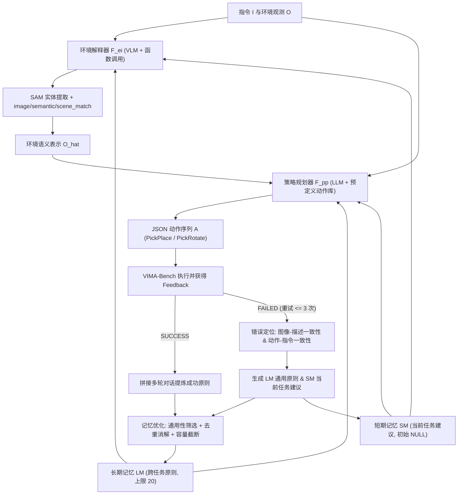

# Evolvable Embodied Agent for Robotic Manipulation via Long Short-Term Reflection and Optimization

## 一句话定义

**EEAgent**（Evolvable Embodied Agent）是一种基于大视觉语言模型（VLM）工具调用与自然语言记忆演化的机器人操作智能体框架：通过上游环境解释器（SAM 分割 + 多模态实体匹配）与下游策略规划器（输出结构化 JSON 动作序列）解耦感知与规划，并借助长短期反思优化机制（**LSTRO**）在执行成功与失败后定位误差、动态更新长期跨任务原则与短期当前任务建议，从而在无需模型微调或外部检索库的情况下实现自我演化。

## 英文缩写速查

| 缩写 | 英文全称 | 简要说明 |
|---|---|---|
| EEAgent | Evolvable Embodied Agent | 本文提出的可演化具身智能体框架，由环境解释器与策略规划器组成 |
| LSTRO | Long Short-Term Reflection and Optimization | 本文提出的长短期反思与优化机制，用于动态更新智能体提示记忆 |
| VLM | Vision-Language Model | 视觉语言模型，用于场景实体匹配、视觉特征描述及错误反思 |
| SAM | Segment Anything Model | 通用图像分割模型，本文用于从环境观测中提取候选物体实体 |
| LM | Long-Term Memory | 长期记忆，以自然语言原则形式跨任务持久化并上限受控（实验中最多 20 条） |
| SM | Short-Term Memory | 短期记忆，面向当前任务的纠错建议，新任务开始时重置并在重试中迭代更新 |
| RAG | Retrieval-Augmented Generation | 检索增强生成，本文对比并指出其依赖外部存储且存在检索噪声的局限 |

## 为什么重要

1. **绕开参数微调与外部 RAG 检索开销**：传统学习型操作策略或持续学习需要大规模轨迹数据与昂贵参数更新，而基于 RAG 的经验库容易受到外部检索延迟与检索错误的影响；EEAgent 直接将经验编码进可解释的自然语言提示（prompt），在不训练本地模型权重的前提下完成跨任务适应。
2. **用工具化环境解释降低直接生成代码的视觉幻觉**：相比直接让 LLM 生成完整控制代码（如 CaP），EEAgent 先通过函数调用与 SAM 显式提取并对齐图像/文本/场景实体，再由策略规划器从受限动作库输出 JSON 动作序列，减少了“幻觉物体”或错误坐标引起的级联失效。
3. **将“事后泛泛总结”细化为“错误定位 + 双层记忆合并”**：针对 Reflexion 类方法容易产生任务碎片化、冗余或矛盾反思的问题，LSTRO 在失败后先用“图像-描述一致性”与“动作-指令一致性”区分感知错误与规划错误，再区分长期通用原则（LM）与短期任务提示（SM），并经由通用性筛选与去重消解维持记忆精炼。

## 核心信息

| 字段 | 内容 |
|---|---|
| **作者** | Jianzong Wang†, Botao Zhao†, Yayun He, Junqing Peng, Xulong Zhang*（†同等贡献，*通讯作者） |
| **机构** | 平安科技（深圳）有限公司（Ping An Technology (Shenzhen) Co., Ltd.） |
| **发表时间** | 2026-04-15 提交 v1，2026-04-22 修订 v2（arXiv:2604.13533v2 [cs.RO]；已获 IJCNN 2026 接收） |
| **论文链接** | [arXiv:2604.13533](https://arxiv.org/html/2604.13533) / [arXiv Abs](https://arxiv.org/abs/2604.13533) |
| **项目与代码** | 未确认（截至 2026-11-27，arXiv v2 正文与参考文献未列出 GitHub 仓库或独立项目主页） |
| **清单分类** | `model.planning, harness.memory`（来源条目：`survey_ax_2604_13533`） |
| **开源状态** | **未确认开源代码**（正文 §IV-A 明确说明系统基于 ChatGPT-4o 接口与 SAM Huge 构建，无本地训练且未附公开复现仓库） |

## 核心原理

EEAgent 由**环境解释器 $\mathrm{F}_{\mathrm{ei}}$**、**策略规划器 $\mathrm{F}_{\mathrm{pp}}$** 与 **LSTRO 反思优化闭环**三部分构成（原文 §III，Fig. 2 与 Algorithm 1）：

### 1. 工具驱动的环境解释器 $\mathrm{F}_{\mathrm{ei}}(\hat{O} \mid I, O)$（§III-B）

利用 VLM（主实验为 ChatGPT-4o）的 function-calling 能力，围绕指令 $I$ 与环境观测 $O$ 调度四类预设工具以产出结构化环境信息 $\hat{O}$：

- `extract_env_entities()`：调用 SAM（主实验为 Huge 版本）从当前环境图像中分割并提取候选物体实体。
- `image_match()`：当指令中包含目标物体图像示例时，结合记忆提示调用 VLM 选出最匹配实体，并额外生成目标图像的文本特征描述以辅助后续一致性校验。
- `semantic_match()`：当指令以文本属性描述物体（如 `"place the checkerboard round into the yellow and purple polka dot pan"`）时，调用 VLM 完成文本-视觉实体对齐。
- `scene_match()`：针对多对多实体映射任务（如 `"rearrange to this scene"`），迭代调用 `image_match()` 与 `semantic_match()` 建立目标场景与当前场景实体间的一一或集合对应关系。

### 2. 受限动作库策略规划器 $\mathrm{F}_{\mathrm{pp}}(A \mid I, \hat{O})$（§III-C）

策略规划器由 LLM 承担，其系统提示由五部分拼接：**任务描述、长期原则（$\mathrm{LM}_{\mathrm{pp}}$）、短期建议（$\mathrm{SM}_{\mathrm{pp}}$）、少样本示例、输出格式约束**，并绑定面向具体基准的预定义动作库。在 VIMA-Bench 中动作库包含两类原语：

- `PickPlace`：抓取目标并放置到指定位置，需给出 `pick_location` 与 `place_location`；
- `PickRotate`：抓取并按目标角度旋转物体。

模型被约束仅使用动作库内原语生成可执行动作序列 $A$ 并以 JSON 格式输出，而非生成自由格式 Python 代码。

### 3. 长短期反思与优化机制 LSTRO（§III-D，Algorithm 1）

系统为环境解释器与策略规划器分别维护长期记忆 $\theta = \{\mathrm{LM}_{\mathrm{ei}}, \mathrm{LM}_{\mathrm{pp}}\}$ 与短期记忆 $\gamma = \{\mathrm{SM}_{\mathrm{ei}}, \mathrm{SM}_{\mathrm{pp}}\}$：

1. **任务初始化与执行循环**：所有任务开始前 $\mathrm{LM}_{\mathrm{ei}}, \mathrm{LM}_{\mathrm{pp}}$ 初始化为空；在第 $t$ 个任务开始时，先将 $\mathrm{SM}_{\mathrm{ei}}, \mathrm{SM}_{\mathrm{pp}}$ 重置为 `NULL`，随后顺序执行 $\hat{O} = \mathrm{F}_{\mathrm{ei}}(I, O)$ 与 $A = \mathrm{F}_{\mathrm{pp}}(I, \hat{O})$ 并在环境中执行动作，获取二值反馈 $\text{Feedback} \in \{\text{SUCCESS}, \text{FAILED}\}$。
2. **成功分支（Success Reflection）**：若任务成功，拼接本次执行过程中解释器与规划器的多轮交互对话，由 LLM 提炼简洁可迁移的成功原则 $p_t^{\mathrm{ei}}, p_t^{\mathrm{pp}}$ 并整合进长期记忆 $\theta$。
3. **失败分支与双层错误定位（Error Location，§III-D 2）**：若任务失败，进入最多 $\text{MAX\_TRIALS}=3$ 次的纠错循环，先定位错误归属模块：
   - **图像-描述一致性（Image-description consistency）**：针对 `image_match()` 等感知环节的细粒度识别失误，要求 VLM 为参考图与候选匹配图补充详细特征描述，再由 LLM 核验两段描述是否一致；不一致即判定为 $\mathrm{F}_{\mathrm{ei}}$ 匹配错误。
   - **动作-指令一致性（Action-to-instruction consistency）**：针对 $\mathrm{F}_{\mathrm{pp}}$ 规划失误，由 LLM 根据实际执行的动作序列 $A$ 反向还原自然语言指令并与原始指令 $I$ 对比；不一致即判定为规划错误。
4. **双记忆同步更新与记忆优化（§III-D 3–4）**：在定位错误后，LLM 同时生成用于跨任务泛化的 LM 原则（$p_{t,k}^{\mathrm{ei}}, p_{t,k}^{\mathrm{pp}}$）与仅针对当前任务重试的 SM 纠错建议（$q_k^{\mathrm{ei}}, q_k^{\mathrm{pp}}$）。为抑制 LLM 反思引入的幻觉、冗余与冲突，记忆更新经过三道滤波：
   - **通用性评估**：由 LLM 判断新反思是否具备跨任务通用性；
   - **去重与冲突消解**：将通过筛选的新内容与既有 LM 合并，由 LLM 整合语义重复项并消解前后矛盾；
   - **容量上限控制**：限制 LM 最大条数（实验中设为 `20`），避免提示上下文过长稀释注意力。

## 流程总览

## 源码运行时序图

**不适用**（截至 2026-11-27，arXiv:2604.13533v2 原文及公开检索材料均未确认可运行的官方源码仓库、脚本入口或权重发布页，正文仅给出总体模块架构（Fig. 2）与 LSTRO 算法伪代码（Algorithm 1），并明确指出系统基于 ChatGPT-4o 接口与 SAM Huge 运行、无本地训练流程，因此不绘制源码级运行时序图。）

## 实验与评测

作者在 **VIMA-Bench** 基准上选取了与 Instruct2Act 对齐的 6 个子任务，覆盖 L1（放置位置泛化）、L2（组合泛化）、L3（新物体泛化）和 L4（新任务泛化）四级泛化设定；主系统采用 ChatGPT-4o + Huge-SAM，`max_trials = 3`，`max_long_memories = 20`。

### 1. 六类任务主对比实验（Table I，成功率 %）

| 类别 | 方法 | Task 1 | Task 2 | Task 3 | Task 4 | Task 5 | Task 6 | Avg. |
|---|---|---|---|---|---|---|---|---|
| LLM 规划 | CaP | 76.3 | 73.7 | 79.3 | 70.8 | 66.3 | 60.3 | 71.1 |
| LLM 规划 | CLIN | 81.7 | 77.7 | 80.7 | 72.8 | 70.3 | 72.7 | 76.0 |
| LLM 规划 | Instruct2Act | 91.8 | 80.1 | 98.4 | 78.2 | 72.7 | 89.6 | 85.1 |
| 学习型方法 | VIMA-20M | **99.3** | **100.0** | **100.0** | **99.5** | 58.7 | 41.5 | 83.2 |
| 学习型方法 | VIMA-GPT | 53.0 | 57.2 | 50.52 | 46.3 | 37.2 | 1.7 | 47.6 |
| 学习型方法 | VIMA-Gato | 50.7 | 56.2 | 38.7 | 52.3 | 36.0 | 1.0 | 45.9 |
| 学习型方法 | VIMA-Flamingo | 52.8 | 55.0 | 54.5 | 51.0 | 40.3 | 0.5 | 49.2 |
| 提示策略（同架构） | Vanilla EA（无 LSTRO） | 89.2 | 90.8 | 98.3 | 76.2 | 74.5 | 81.8 | 85.1 |
| 提示策略（同架构） | CoT-Prompt | 91.7 | 92.8 | 99.2 | 82.5 | 80.0 | 88.3 | 88.2 |
| 提示策略（同架构） | S-C (Reflect) | 90.8 | 92.5 | 99.0 | 82.7 | 79.8 | 87.2 | 88.7 |
| 提示策略（同架构） | S-C (Voting) | 90.5 | 93.0 | 98.8 | 83.3 | 81.2 | 87.7 | 89.2 |
| 提示策略（同架构） | S-C (Select) | 91.2 | 93.7 | 99.2 | 82.8 | 80.5 | 88.3 | 89.3 |
| 提示策略（同架构） | **EEAgent (Ours)** | 94.3 | 94.2 | 99.3 | 87.2 | **84.8** | **93.2** | **92.2** |

- **Task 5（重排后复原）与 Task 6（多步容器放置后复原）优势显著**：监督/模仿学习方法 VIMA-20M 在 Task 1–4 达 99.3%–100.0%，但在组合复杂度与时序跨度更高的 Task 5、Task 6 上骤降至 58.7% 与 41.5%；EEAgent 分别达到 84.8% 与 93.2%，整体均值 92.2% 高于 VIMA-20M（83.2%）与 Instruct2Act（85.1%）。
- **相对同架构无记忆基线与自一致性提示的增益**：未启用 LSTRO 的 Vanilla EA 已取得 85.1% 平均成功率，加入 LSTRO 后提升 +7.1 个百分点至 92.2%，同时优于 CoT-Prompt（88.2%）和三种 Self-Consistency 变体（88.7%–89.3%）。

### 2. VLM 底座与 SAM 规模消融（Table II，成功率 %）

| 消融维度 | 模型变体 | Task 1 | Task 2 | Task 3 | Task 4 | Task 5 | Task 6 |
|---|---|---|---|---|---|---|---|
| VLM 底座（配合 Huge-SAM） | LLaVA-v1.5 (7B) | 80.5 | 79.7 | 84.2 | 75.2 | 71.5 | 69.2 |
| VLM 底座（配合 Huge-SAM） | Qwen2-VL (70B) | 85.0 | 84.2 | 88.2 | 80.5 | 76.8 | 78.7 |
| VLM 底座（配合 Huge-SAM） | Gemini 1.5 Pro | 93.7 | 94.0 | 98.8 | **88.2** | **85.2** | 91.8 |
| VLM 底座（配合 Huge-SAM） | GPT-4o | **94.3** | **94.2** | **99.3** | 87.2 | 84.8 | **93.2** |
| SAM 规模（配合 GPT-4o） | Base-SAM | 80.2 | 80.7 | 86.5 | 73.2 | 72.8 | 66.8 |
| SAM 规模（配合 GPT-4o） | Large-SAM | 88.3 | 89.5 | 96.2 | 84.7 | 82.2 | 87.5 |
| SAM 规模（配合 GPT-4o） | Huge-SAM | **94.3** | **94.2** | **99.3** | **87.2** | **84.8** | **93.2** |

- **分割精度是全流程底座**：将 SAM 从 Huge 降为 Base 后，Task 1 跌至 80.2%（-14.1%），Task 6 跌至 66.8%（-26.4%）；作者据此强调前端实体分割质量直接决定后续所有匹配与规划步骤的上限。
- **VLM 容量影响推理与反思质量**：7B 级别的 LLaVA-v1.5 显著落后于 70B Qwen2-VL 及闭源旗舰模型（Gemini 1.5 Pro 与 GPT-4o 在 6 项任务上整体接近）。

## 与其他工作对比

| 维度 | VIMA-20M | Instruct2Act / CaP | CLIN | EEAgent（本文） |
|---|---|---|---|---|
| **策略载体与训练需求** | 需大规模轨迹训练的多模态序列策略 | 零样本/少样本 LLM 生成可执行代码 | 基于外部记忆检索的持续语言智能体 | **无参数微调，VLM 工具调用 + JSON 受限动作输出** |
| **视觉感知方式** | 端到端编码视觉提示与目标掩码 | 依赖外部检测/分割转文本或代码调用 | 依赖环境文本交互与外部经验库检索 | **SAM 提取实体 + image/semantic/scene 三类专门 VLM 匹配工具** |
| **经验复用与自演化** | 部署后参数静态，难跨新组合任务扩展 | 无跨回合反思与自我修正闭环 | 依赖外部存储检索，存在检索噪声与延迟 | **双层自然语言记忆（LM + SM）+ 一致性错误定位 + 冲突去重优化** |
| **复杂长程任务表现（Task 5/6）** | 58.7% / 41.5%（泛化退化明显） | Instruct2Act 72.7% / 89.6% | 70.3% / 72.7% | **84.8% / 93.2%（平均 92.2%）** |

## 结论

**一句话总判：EEAgent 证明在 VLM 操作智能体中，“上游高质量分割 + 语义/图像/场景显式匹配工具”贡献了高基线能力（85.1%），而“带一致性错误定位与去重消解的长短期自然语言记忆（LSTRO）”进一步稳定地撬动了复杂多步操作（92.2%）。**

1. **分割模型选型优先级高于复杂提示工程**：从 Base-SAM 升至 Huge-SAM 在 Task 6 上带来 +26.4 个百分点增益，工程复现时优先保证前端实体分割召回与边界清晰度，收益远高于只调规划提示。
2. **用受限 JSON 动作库替代自由代码生成可降错**：将规划器限制在 `PickPlace`/`PickRotate` 等显式原语与 JSON 模式，使未开反思的 Vanilla EA（85.1%）即与专门化代码方案 Instruct2Act 持平。
3. **长短期记忆必须配套“通用性过滤 + 冲突消解”**：反思直接堆砌容易造成提示膨胀与规则互相打架；通过区分跨任务 LM（上限 20 条）与单任务 SM，并用一致性校验定位错误源头，可在不引入外部向量数据库的情况下维持演化稳定性。
4. **当前验证边界限于仿真准静态桌面任务**：VIMA-Bench 仅检验离散拾放与旋转原语下的视觉泛化，尚未涵盖连续力控、灵巧操作及真机异步延迟场景。

## 工程实践

- **模块解耦与错误隔离**：在工程实现中建议保持 $\mathrm{F}_{\mathrm{ei}}$ 与 $\mathrm{F}_{\mathrm{pp}}$ 的接口边界清晰；当任务失败时，优先执行「图像-描述一致性」核查 `image_match()`，再执行「动作-指令一致性」反演核查规划器，避免用错误规划去补偿感知漏检。
- **提示记忆容量治理**：在自然语言系统提示中设置固定长期记忆条数上限（文中取 `20`），并在每次合并新反思前调用校验提示执行同义归并和冲突覆盖，防止长上下文带来推理退化与 API 成本上升。
- **大模型与分割器算力选型**：若追求更高任务上限，前端分割建议选用 Large-SAM 或 Huge-SAM，后端规划与反思优先采用推理与多模态细粒度对齐能力较强的 VLM（如 GPT-4o 或 Gemini 1.5 Pro 级别模型）；开源小参数 VLM（如 7B 模型）在多步复合任务（Task 5–6）上会明显掉点。

## 局限与风险

- **未开源代码与完整提示词**：截至 2026-11-27，原文未公布官方代码仓库、工具 JSON schema 细节与记忆演化 prompt 模板，独立复现需自行补齐 VIMA-Bench 接口封装及 LSTRO 提示工程。
- **缺乏物理真机与连续控制验证**：所有评测均在 VIMA-Bench 仿真环境下的 `PickPlace` 与 `PickRotate` 离散原语中完成，未验证部分可观测、遮挡动态变化及真机执行误差下的鲁棒性。
- **依赖二进制成败反馈与闭源模型开销**：LSTRO 依赖环境明确给出 `SUCCESS` / `FAILED` 信号（失败后最多重试 3 次），且单轮包含解释、规划、一致性检验、反思、记忆融合多次 VLM/LLM 调用，在高频控制或预算受限场景下 API 延迟与成本较高。
- **记忆边界重叠与伪代码细节差异**：作者在 §IV-E 指出短期记忆与长期记忆在实际演化中仍会出现一定内容重叠；此外原文 Algorithm 1 伪代码存在个别笔误（如第 6 行写作 $\mathrm{F}_{\mathrm{ei}}(I,\hat{O})$、第 14 行循环条件写作 `Feedback != SUCCESS or k < MAX_TRIALS`），工程实现时应以 §III 正文逻辑为准。

## 关联页面

- [Agentic Robots 综述](paper-towards-agentic-robots-survey.md)
- [全量项目节点清单](../overview/awesome-agentic-robots-node-index.md)
- [VLA 方法背景](../methods/vla.md)
- [机器人操作](../tasks/manipulation.md)：了解物体操作和抓取任务
- [Agent Planning and Feedback Loops · 智能体规划与反馈执行](../methods/agent-planning-feedback.md)：对照带有反馈循环的智能体任务规划与重试机制
- [Agent Tool-use Interface · 智能体工具调用接口](../methods/agent-tool-use-interface.md)：理解环境解释器通过结构化函数调用衔接分割与匹配工具的设计
- [Agentic Manipulation Policies：可编程的智能体机器人操作策略](../methods/agentic-manipulation-policies.md)：对比可编程操作智能体策略与本文受限动作库规划路线
- [Robot Agent Harness · 机器人智能体执行框架](../methods/robot-agent-harness.md)：了解上层决策与底层动作原语边界控制
- [Embodied Agent Benchmarking · 具身智能体评测基准](../methods/embodied-agent-benchmarking.md)：参考具身操作智能体的分级泛化评测体系
- [VIMA 原始基准与方法页面](./paper-pai-2210-03094-vima.md)：理解本文评测基准 VIMA-Bench 与学习型基线 VIMA-20M
- [Code as Policies](./paper-pai-2209-07753-codeaspolicies.md)：对照直接生成可执行策略代码的基线方法 CaP

## 推荐继续阅读

- [arXiv 原文 HTML v2（含 Algorithm 1、Table I–II 与 Fig. 1–5）](https://arxiv.org/html/2604.13533)
- [arXiv 摘要页（arXiv:2604.13533）](https://arxiv.org/abs/2604.13533)

## 参考来源

- [论文一手全文核对归档（arXiv:2604.13533v2）](../../sources/papers/paper-agentic-2604-13533.md)
- [官方 Awesome 快照归档](../../sources/repos/awesome-agentic-robots-survey-index.md)
- [arXiv:2604.13533 论文原文入口](https://arxiv.org/abs/2604.13533)
