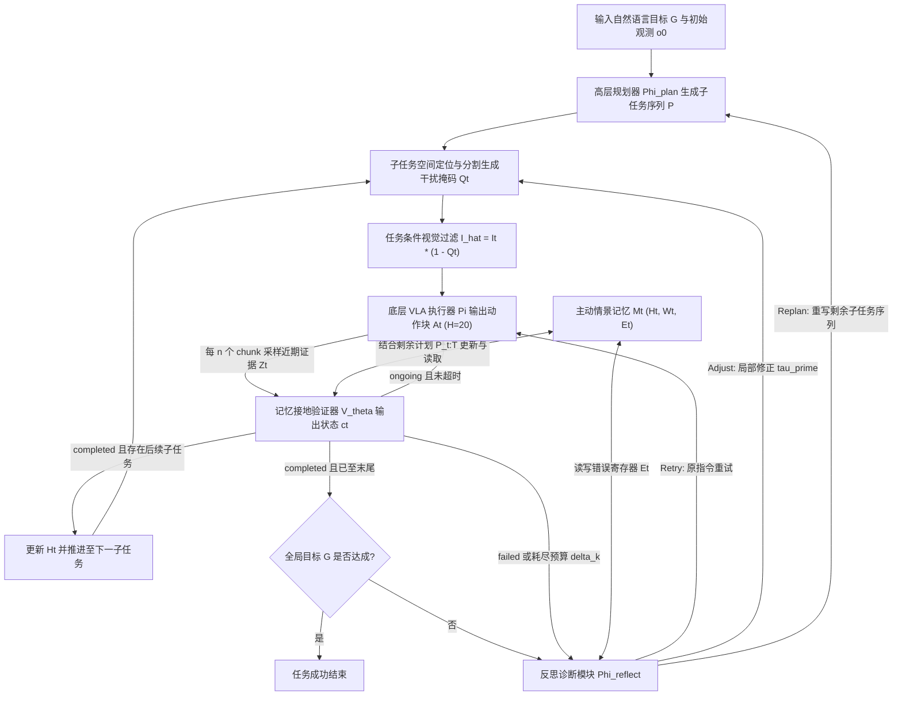

# Goal2Skill: Long-Horizon Manipulation with Adaptive Planning and Reflection

## 一句话定义

**Goal2Skill**（[arXiv:2604.13942](https://arxiv.org/abs/2604.13942)，v2 修订标题为 *Goal2Skill: Long-Horizon Manipulation with Adaptive Planning and Progress Verification*）是一个面向长程部分可观测操作任务的双系统框架：以高层 VLM 大脑协调子任务分解、主动情景记忆、自进化进度验证与分级反思恢复，以底层带任务条件视觉过滤的 VLA 策略输出连续动作块，实现在保留已达成进展前提下的局部纠偏与剩余计划改写。

## 英文缩写速查

| 缩写 | 英文全称 | 简要说明 |
|---|---|---|
| VLA | Vision-Language-Action | 视觉-语言-动作模型；本文中 $\pi_{0.5}$ 担任底层连续动作块执行器 |
| VLM | Vision-Language Model | 视觉-语言模型；本文中 `qwen3.8-flash` 担任高层规划、验证与反思大脑 |
| WAM | World-Action Model | 世界-动作模型；将动作生成与未来观测预测耦合的对比技术路线 |
| EMA | Exponential Moving Average | 指数移动平均；RoboMME 与 RMBench 底层策略训练均启用权重平滑 |
| API | Application Programming Interface | 应用程序接口；高层 VLM 通过 OpenRouter API 在线调用 |

## 为什么重要

- **将「规划-执行」静态分离升级为「记忆接地验证 + 分级恢复」闭环**：单纯在架构上拆分高层 VLM 与底层 VLA 仍无法应对中途条件变化或伪完成（如移动饮料罐到扫码仪前但条码背对镜头）；Goal2Skill 通过周期性验证决定继续（`ongoing`）、推进（`completed`）或反思（`failed`），并支持仅重写剩余未完成步骤。
- **用剩余计划驱动「主动记忆管理」**：长程任务中关键线索（如演示顺序、遮挡前状态）往往在后续步骤时已移出视野；Goal2Skill 在记忆更新 $\Phi_{\mathrm{mem}}$ 中显式传入剩余计划 $\mathcal{P}_{t:T}$，使系统在观察当下画面时就知道哪些信息需要为未来步骤主动保留。
- **把「验证器」本身变成可从回放中演进的技能库**：不同任务与场景对完成判据的要求差异很大（如反复摆动次数去重检测）；Goal2Skill 结合规则检查、轻量模型与 VLM 推理，并允许根据历史轨迹缺陷修订验证技能、经轨迹回放验证后再入库。

## 核心信息

| 字段 | 内容 |
|---|---|
| **作者** | Zhen Liu, Zhe Hu, Xinyu Ning, Hanlin Wang, XinXin Xie, Weize Li, Zhipeng Tang, Chongyu Wang, Zejun Yang, Yitong Liu, Zhongzhu Pu（通信：`puzz@inspireomni.ai`） |
| **机构** | 北京邮电大学（BUPT）；InspireOmni AI；清华大学（Tsinghua） |
| **发表时间** | 2026-04-15 提交 v1，2026-10-13 修订 v2（arXiv:2604.13942 [cs.RO]） |
| **论文链接** | [arXiv:2604.13942](https://arxiv.org/abs/2604.13942) / [arXiv HTML v2](https://arxiv.org/html/2604.13942) |
| **项目与代码** | 待核实（v2 文本页眉标注 `\metadata [GitHub] InspireOmniRobot/Goal2Skill`，但正文未附完整可访问 URL 且尚未核查到公开仓库文件） |
| **清单分类** | `harness.monitoring_and_recovery`（来源条目：`survey_ax_2604_13942`） |
| **开源状态** | **未确认开源代码**（截至 2026-11-27，`candidate_repos` 为空，未验证到可运行官方源码或权重） |

## 核心原理

Goal2Skill 在自然语言全局目标 $\mathcal{G}$ 与全局步数预算 $T$ 下，于三个时间尺度上耦合高层认知（基于 VLM $\Phi$）与底层控制（基于 VLA 策略库 $\Pi$）（原文 §3）：

### 1. 任务分解与自适应规划（§3.2.1）

给定目标 $\mathcal{G}$ 与初始观测 $o_0$，高层规划器输出有序子任务序列：
$$\mathcal{P} = \langle \tau_1, \tau_2, \ldots, \tau_K \rangle = \Phi_{\mathrm{plan}}(\mathcal{G}, o_0), \qquad \tau_k = (\ell_k, \delta_k, j_k)$$
其中 $\ell_k$ 为子任务语言指令，$\delta_k$ 为单次尝试的步数预算，$j_k$ 指定调用的底层技能索引。当前子任务经验证完成后才按前置依赖推进至下一步；若失败或耗尽 $\delta_k$，则在**不推翻已完成进度**的前提下实施局部重试、微调或重规划剩余序列。

### 2. 三元组主动记忆管理（§3.2.2）

系统维护回合级结构化记忆 $\mathcal{M}_t = (\mathcal{H}_t, \mathcal{W}_t, \mathcal{E}_t)$：

- **情景历史 $\mathcal{H}_t$：** 按时间顺序压缩保存跨子任务的世界/机器人状态变化与已验证结果，并保留即使已退出视野但后续仍需用到的线索（如目标排列顺序）。
- **工作记忆 $\mathcal{W}_t$：** 记录当前活跃子任务的起始基准观测、近期执行证据与局部进度，供验证器比对「执行前后究竟改变了什么」。
- **错误寄存器 $\mathcal{E}_t$：** 登记本回合内的失败偏差、假设成因、提出的恢复动作及实际结果，避免后续反思重复无效尝试。

每次验证检查点触发后，记忆按 $\mathcal{M}_t^+ = \Phi_{\mathrm{mem}}(\mathcal{M}_t, \mathcal{P}_{t:T}, \mathcal{Z}_t, v_t)$ 更新（$\mathcal{Z}_t$ 为近期观测与动作窗口，$v_t$ 为验证输出）；显式引入剩余计划 $\mathcal{P}_{t:T}$ 使得系统能够识别未来子任务所需条件并主动留存关键证据。

### 3. 记忆接地进度验证与自进化机制（§3.2.3）

每执行 $n$ 个动作块，验证器从验证技能库中检索与当前子任务和场景匹配的规则 $\theta_k$（含触发条件、所需证据、检查流程与判定准则），输出：
$$v_t = (e_t, c_t) = V_{\theta_k}(\mathcal{Z}_t, \tau_k, \mathcal{M}_t), \qquad c_t \in \{\textsc{completed}, \textsc{ongoing}, \textsc{failed}\}$$
其中 $e_t$ 为判别理由。验证器混合使用**规则检查、轻量模型与 VLM 推理**以兼顾延迟与鲁棒性；当整个计划序列执行完毕时，还会额外检查全局目标 $\mathcal{G}$ 是否真正满足，以拦截子任务「虚假完成」。在离线积累轨迹上，系统会识别验证偏差并更新或新增验证技能，且必须通过**轨迹回放（trajectory replay）**验证后才提交进验证技能库（如在 `SwingXtimes` 中演化出针对左右到达区域与重复到达去重的专用计数流程）。

### 4. 分级反思修正与重规划（§3.2.4）

当验证返回 `failed`、单次预算 $\delta_k$ 耗尽或末轮全局检查未通过时，反思模块基于证据 $\mathcal{F}_t$ 与记忆 $\mathcal{M}_t$ 输出诊断与恢复决策：
$$(d_t, \rho_t, \tau'_t) = \Phi_{\mathrm{reflect}}(\mathcal{F}_t, \mathcal{M}_t)$$
恢复策略 $\rho_t$ 按受影响范围分三级递进：**`Retry`**（保持子任务定义不变重试） $\to$ **`Adjust`**（保留后续队列，仅改写当前子任务指令、空间定位或执行参数 $\tau'_t$） $\to$ **`Replan`**（结合全局目标重写未完成子任务序列；若证据显示剩余计划已失效也可直接跳转至 `Replan`）。所有恢复动作均受全局步数预算 $T$ 与尝试次数上限约束。

### 5. 任务条件视觉过滤与动作块生成（§3.3）

- **视觉过滤（§3.3.1，沿用 HSC-VLA）：** 子任务启动时由空间定位给出干扰物边界框 $\mathcal{B}_{k,t}$，分割模型 $\mathcal{S}$ 生成二值干扰掩码 $Q_t$ 并由轻量追踪器跨帧传播，底层策略接收 $\hat{I}_t = I_t \odot (1 - Q_t)$ 以抑制杂乱场景中的无关高亮/物体干扰，同时保持未掩码区域的原始像素与几何坐标不变。高层模块（规划/验证/反思/记忆）仍直接读取原始图像 $I_t$，避免漏检全局状态变化。
- **动作生成（§3.3.2）：** 由 $j_k$ 选定策略 $\pi_{j_k} \in \Pi$，基于过滤图像 $\hat{I}_t$、本体感受状态 $s_t$ 与指令 $\ell_k$ 以滚动时域方式生成长度为 $H=20$ 的连续动作块 $\mathbf{A}_t = (a_t, \ldots, a_{t+H-1})$。

## 流程总览

## 源码运行时序图

**不适用**（截至 2026-11-27，arXiv:2604.13942v2 文本页眉仅包含 `\metadata [GitHub] InspireOmniRobot/Goal2Skill`，正文、附录及 `candidate_repos` 扫描均未发现可访问的官方代码仓库 URL 或已验证源码文件，故不绘制源码级运行时序图。）

## 实验与评测

作者在两个长程记忆依赖操作仿真基准 **RoboMME** 与 **RMBench** 上进行了评测（原文 §4–§5、§9）。高层模块统一采用 `qwen3.8-flash`（OpenRouter API），底层采用微调后的 $\pi_{0.5}$（$H=20$），全局预算 $T=1300$ 步，单子任务单次尝试预算 $\delta_k=320$ 步（每子任务最多 $K_{\mathrm{sub}}=3$ 次，末轮全局恢复最多 3 轮）。

### 1. RoboMME 主实验与全 16 任务结果（Table 1, Table 7–9）

每项任务包含 100 条训练演示与 50 局测试（26 Easy / 12 Medium / 12 Hard，全基准共 800 局）。下表汇总 6 个代表任务、全 16 任务总均值及四个能力套件均值（成功率 %）：

| 方法 | 类型 | `PickXtimes` | `ButtonUnmaskSwap` | `VideoRepick` | `VideoPlaceOrder` | `PickHighlight` | `VideoPlaceButton` | 6 任务均值 (Table 1) | 全 16 任务均值 (Table 7) |
|---|---|---:|---:|---:|---:|---:|---:|---:|---:|
| $\pi_{0.5}$ | 基础策略 | 42.0 | 6.0 | 0.0 | 26.0 | 12.0 | 32.0 | 19.7 | 17.8 |
| $\pi_{0.5}$ w/ past actions | 基础策略 | 58.0 | 16.0 | 8.0 | 18.0 | 12.0 | 24.0 | 22.7 | 19.5 |
| MME-VLA (FrameSamp) | 记忆增强 VLA | 82.0 | 12.0 | 32.0 | 28.0 | 24.0 | **54.0** | 38.7 | 42.3 |
| MemER | 记忆增强 VLA | 78.0 | 24.0 | 32.0 | 36.0 | **82.0** | 16.0 | 44.7 | 43.6 |
| SAM2Act+ | 记忆增强 VLA | 76.0 | 26.0 | 6.0 | 20.0 | 18.0 | 24.0 | 28.3 | 21.5 |
| GroundSG+QwenVL | 双系统基线 | 90.0 | 10.0 | 34.0 | 36.0 | 24.0 | 48.0 | 40.3 | 32.8 |
| **Goal2Skill** | **双系统闭环** | **92.0** | **50.0** | **60.0** | **90.0** | 76.0 | 52.0 | **70.0** | **51.5** |
| *GroundSG+Oracle* | *真值子目标参考* | *100.0* | *86.0* | *98.0* | *98.0* | *52.0* | *100.0* | *89.0* | *82.8* |

- **四大套件分布（§9.2, Table 7）：** Goal2Skill 在 `Reference` 套件均值达 **69.5%**（对比 MemER 41.5%）、`Permanence` 均值 **57.0%**，在 `VideoPlaceOrder`（Easy 96.2% / Medium 91.7% / Hard 75.0%，其余非 Oracle 方法 Hard 最高 33.3%）与 `ButtonUnmaskSwap` 全难度档位上优势突出；而在偏重密集视觉轨迹回放的 `Counting`（52.0% vs. FrameSamp 66.0%）与 `Imitation`（27.5% vs. FrameSamp 42.5%）上低于历史帧采样方法 FrameSamp。

### 2. RMBench 主实验（Table 2）

在 5 项代表性记忆任务（2 项单阶段记忆 $M(1)$ + 3 项多阶段依赖 $M(n)$，每任务 50 条演示微调）上的成功率（%）：

| 方法 | `Observe & Pick Up` | `Rearrange Blocks` | `Battery Try` | `Blocks Ranking Try` | `Press Button` | $M(1)$ 均值 | $M(n)$ 均值 | 总均值 |
|---|---:|---:|---:|---:|---:|---:|---:|---:|
| DP | 1.0 | 0.0 | 10.0 | 10.0 | 0.0 | 0.5 | 6.7 | 4.2 |
| ACT | 1.0 | 29.0 | 19.0 | 0.0 | 0.0 | 15.0 | 6.3 | 9.8 |
| $\pi_{0.5}$ | **9.0** | 13.0 | 16.0 | 6.0 | 0.0 | 11.0 | 7.3 | 8.8 |
| X-VLA | **9.0** | 13.0 | 26.0 | 1.0 | 0.0 | 11.0 | 9.0 | 9.8 |
| MemER | 7.0 | 17.0 | 27.0 | 0.0 | 0.0 | 12.0 | 9.0 | 10.2 |
| **Goal2Skill** | 8.0 | **38.0** | **46.0** | **60.0** | **10.0** | **23.0** | **38.7** | **32.4** |

### 3. 消融实验（RMBench，§9.1 Table 5–6）

- **结构化记忆三元组消融（Table 5，3 任务均值）：** 完整 Goal2Skill 均值 **35.3%**（`Observe & Pick Up` 8% / `Rearrange Blocks` 38% / `Blocks Ranking Try` 60%） $\to$ 移除错误寄存器 $-\mathcal{E}_t$ 降至 **28.0%**（6% / 36% / 42%） $\to$ 再移除工作记忆 $-\mathcal{E}_t - \mathcal{W}_t$ 降至 **27.7%**（8% / 21% / 54%，`Rearrange Blocks` 大幅下滑） $\to$ 再移除情景历史 $-\mathcal{E}_t - \mathcal{W}_t - \mathcal{H}_t$ 跌至 **6.7%**（4% / 10% / 6%，低于无规划器的 $\pi_{0.5}$ 基线，因无状态记录导致规划器重复已完成步骤或发出冲突子目标）。
- **反思修正消融（Table 6，2 任务均值）：** 完整 Goal2Skill 均值 **28.0%**（`Battery Try` 46% / `Press Button` 10%） $\to$ 移除反思机制 $-\mathrm{Reflection}$ 降至 **17.5%**（30% / 5%），仅靠重跑相同子任务无法诊断并改写错位计划。

## 与其他工作对比

- **对比记忆增强单层 VLA（MME-VLA FrameSamp、MemER、SAM2Act+）：** 这类方法在策略特征内部检索历史帧或隐式视觉记忆，在高频轨迹模仿（`PatternLock`、`RouteStick`）或瞬时视觉线索（`PickHighlight`）上表现很强；Goal2Skill 则把长程状态、错误记录与子任务进度显式提升到结构化语言/符号记忆与验证闭环，因此跨多阶段与顺序推理任务（`VideoPlaceOrder`、`Blocks Ranking Try`）收益显著，但对连续细节轨迹的保真度不如显式多帧特征记忆。
- **对比无闭环验证与反思的双系统（`GroundSG+QwenVL`）：** 同样采用 VLM 规划 + $\pi_{0.5}$ 执行，但 `GroundSG+QwenVL` 在 RoboMME 全 16 任务均值仅 **32.8%**（`ButtonUnmaskSwap` 10.0%、`SwingXtimes` 6.0%），远低于 Goal2Skill 的 **51.5%**；论文案例分析（§8.1）表明，缺乏物理结果验证与终局反思会造成动作未达预期却盲目推进下一子目标，或遗漏按钮后新出现的子任务。
- **与站内 [VLA 方法背景](../methods/vla.md) 及 [机器人智能体执行框架](../methods/robot-agent-harness.md) 的关系：** Goal2Skill 展示了「上层 Harness（记忆 + 验证 + 反思）包裹冻结/多任务 VLA 底层策略」的典型监控与恢复范式，且验证技能支持基于回放演化。

## 结论

**一句话总判：在长程部分可观测操作中，显式子任务规划必须与「主动情景记忆 + 物理结果验证 + 分级反思恢复」绑定才能生效；缺少记忆的盲目规划反而会比纯底层 VLA（6.7% vs. 8.8%）更差。**

1. **三元组记忆各司其职且 $\mathcal{H}_t$ 是底线**：情景历史 $\mathcal{H}_t$ 决定多阶段不迷路（去掉后 `Blocks Ranking Try` 从 54% 跌至 6%），错误寄存器 $\mathcal{E}_t$ 防止在试错任务中重复踩坑（42% $\to$ 60%），工作记忆 $\mathcal{W}_t$ 辅助状态变动剧烈的重排任务（21% $\to$ 36%）。
2. **仅做失败检测不做反思只能拿一半收益**：在 `Battery Try` 与 `Press Button` 上，仅有检测重跑为 17.5%，加入分级反思诊断与局部/全局改写后升至 28.0%。
3. **混合推理策略是工程甜点**：通过将 20% 掩码数据混入常规微调（无需改动 $\pi_{0.5}$ 参数量）即可让底层策略适配干扰物视觉过滤，同时把原始未经掩码的图像完整留给高层 VLM 做进度核验。
4. **双系统不是对密集感知记忆的完全替代**：在需要像素级高频历史对齐的 `Counting`（52.0% vs. 66.0%）与 `Imitation`（27.5% vs. 42.5%）任务上，符号化高层摘要仍存在信息损失，未来需与历史视觉特征融合。

## 工程实践

- **掩码增强混训配比（§7.1–7.2）：** 训练底层 $\pi_{0.5}$ 时无需新增网络分支，仅将 **20%** 的演示数据替换为任务条件干扰物掩码图像（RoboMME 20/100，RMBench 10/50），其余 80% 保持原图联合训练即可获得遮挡干扰抑制能力。
- **训练关键超参（Table 3–4）：**
  - RoboMME 16 任务联合微调：冻结 SigLIP2 视觉编码器，action horizon $H=20$，batch size 64，AdamW 恒定学习率 $5\times 10^{-5}$（warmup 0.05），EMA 0.999，80,000 步（8× A800）。
  - RMBench 单任务微调：余弦学习率 $2.5\times 10^{-5} \to 2.5\times 10^{-6}$（warmup 1,000 步），EMA 0.99，20,000 步，`bfloat16`。
- **运行时预算与防死循环护栏（§7.3）：** 设定全局步数上限 $T=1300$、单子任务单次预算 $\delta_k=320$、单子任务最大尝试次数 $K_{\mathrm{sub}}=3$，以及计划耗尽后最多 3 轮全局反思重规划，防止 VLM 在难以物理完成的步骤上无限重试。
- **高低层图像隔离原则（§3.3.1）：** 切勿把视觉过滤后的图像 $\hat{I}_t$ 传给高层验证与反思模块——被当作背景/干扰屏蔽的区域可能恰恰包含子任务完成或环境变化的证据（如新亮起的高亮标记）。

## 局限与风险

- **无真机实验与官方源码未验证：** 全文评测仅覆盖 RoboMME 与 RMBench 仿真基准；截至 2026-11-27，页眉提及的 `InspireOmniRobot/Goal2Skill` 未附可访问链接与核查过的可运行源码，底层演示分段标注、验证技能库初始模板及空间定位模型具体实现细节在文中披露有限。
- **视觉摘要瓶颈制约计数与精细模仿任务：** 依赖语言/结构化记忆与周期检查点难以无损捕捉连续高频运动轨迹，导致 `SwingXtimes`、`PatternLock`、`RouteStick` 等任务明显落后于直接检索历史视觉帧的 FrameSamp。
- **在线 VLM 延迟与成本风险：** 高层规划、周期性语义验证及反思均调用在线 `qwen3.8-flash` API，在真实物理部署中需考虑网络往返延迟对机械臂急停与瞬态接触过程的影响（原文未汇报平均单局推理耗时与 API 成本）。
- **部分任务绝对成功率仍偏低：** 例如在 RoboMME `StopCube`（2.0%）、`InsertPeg`（2.0%）、`RouteStick`（8.0%）及 RMBench `Observe and Pick Up`（8.0%）、`Press Button`（10.0%）上仍有大量失败，说明底层策略执行精度与复杂接触控制仍是瓶颈。

## 关联页面

- [Agentic Robots 综述](paper-towards-agentic-robots-survey.md)
- [全量项目节点清单](../overview/awesome-agentic-robots-node-index.md)
- [VLA 方法背景](../methods/vla.md)
- [机器人智能体执行框架](../methods/robot-agent-harness.md)：对照规划、执行接口与反馈机制
- [Agent Planning & Feedback · 智能体规划与反馈](../methods/agent-planning-feedback.md)：失败诊断、重规划与执行反馈闭环设计
- [Agentic Manipulation Policies · 智能体化操作策略](../methods/agentic-manipulation-policies.md)：长程多阶段具身操作策略范式
- [Action Chunking · 动作块预测](../methods/action-chunking.md)：底层策略滚动时域动作块（$H=20$）生成机制
- [pi0 策略与衍生架构](../methods/pi0-policy.md)：本文底层执行器所采用的 $\pi_{0.5}$ 骨干技术谱系
- [Embodied Agent Benchmarking · 具身智能体评测基准](../methods/embodied-agent-benchmarking.md)：记忆依赖型操作基准评测方法
- [Manipulation · 机器人操作](../tasks/manipulation.md)：任务定义与长程控制挑战

## 推荐继续阅读

- [arXiv:2604.13942 论文主页与摘要](https://arxiv.org/abs/2604.13942)
- [arXiv:2604.13942v2 论文 HTML 全文](https://arxiv.org/html/2604.13942)
- [RoboMME 基准论文（arXiv:2603.04639）](https://arxiv.org/abs/2603.04639)
- [RMBench 基准论文（arXiv:2603.01229）](https://arxiv.org/abs/2603.01229)

## 参考来源

- [论文一手全文核对归档（arXiv:2604.13942v2）](../../sources/papers/paper-agentic-2604-13942.md)
- [官方 Awesome 快照归档](../../sources/repos/awesome-agentic-robots-survey-index.md)
- [arXiv:2604.13942 论文原文入口](https://arxiv.org/abs/2604.13942)
- [arXiv:2604.13942v2 HTML 全文](https://arxiv.org/html/2604.13942)
