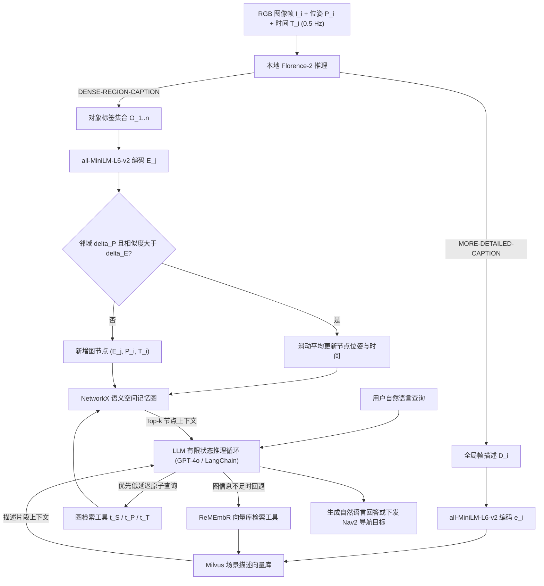

# EmbodiedLGR: Integrating Lightweight Graph Representation and Retrieval for Semantic-Spatial Memory in Robotic Agents

## 一句话定义

EmbodiedLGR（即 **EmbodiedLGR-Agent**）是一种面向移动机器人的双层具身记忆与检索架构：在边缘端运行轻量级视觉语言模型 `Florence-2` 实时构建去重更新的**语义空间记忆图**与高层次场景**向量数据库**，并由大语言模型按查询复杂度选择性调用图检索工具或向量库回退检索，从而在保持区域级问答精度的同时降低交互延迟。

## 英文缩写速查

| 缩写 | 英文全称 | 简要说明 |
|---|---|---|
| EmbodiedLGR | Embodied Light Graph Retrieval | 本文提出融合轻量图表示与向量检索的具身记忆智能体框架 |
| VLM | Vision-Language Model | 视觉语言模型，本文用于本地生成帧描述与密集区域物体标签（Florence-2） |
| EQA | Embodied Question Answering | 具身问答任务，要求机器人结合感知、记忆与推理回答环境时空问题 |
| RAG | Retrieval-Augmented Generation | 检索增强生成，本文用于基于向量库检索历史场景描述 |
| HRI | Human-Robot Interaction | 人机交互，强调机器人响应自然语言查询的实时性与可用性 |
| ROSA | Robot Operating System Agent | 用于将大语言模型工具调用与 ROS 2 话题、Nav2 导航栈对接的智能体框架 |

## 为什么重要

在真实环境中执行长程探索与人机交互的移动机器人，常被询问“某物体在哪里”“某区域何时出现过”等时空语义问题。然而，现有基于 RAG 的具身记忆系统（如 ReMEmbR、Meta-Memory）多将每帧的大模型描述单调追加进向量库，不仅在计算资源受限的机载平台上难以运行 7B–13B 参数级 VLM，还因缺乏对同一实体重复观测的合并机制而导致记忆冗余、检索与推理上下文膨胀。

EmbodiedLGR 证明了在 `< 1B` 参数级 VLM（`Florence-2`，0.22B / 0.77B）与本地嵌入模型条件下，将**轻量可更新的对象级记忆图**与**按需回退的帧级描述向量库**解耦，既能支持在 Jetson AGX Orin 等边缘算力上实时建图，又能在原子物体位置查询中将端到端响应时间缩短约一半，为资源受限机器人的可部署 Agentic Memory 提供了可工程落地的结构范式。

## 核心信息

| 字段 | 内容 |
|---|---|
| 论文标题 | EmbodiedLGR: Integrating Lightweight Graph Representation and Retrieval for Semantic-Spatial Memory in Robotic Agents |
| 作者 | Paolo Riva, Leonardo Gargani, Matteo Frosi, Matteo Matteucci |
| 机构 | 米兰理工大学（Politecnico di Milano, DEIB） |
| 发表时间 / 载体 | arXiv:2604.18271（v1: 2026-04-20；v2: 2026-09-04）；IEEE/RSJ IROS 2026 录用 |
| 论文链接 | [arXiv:2604.18271](https://arxiv.org/abs/2604.18271) · [arXiv HTML v2](https://arxiv.org/html/2604.18271) |
| 项目与代码 | 截至 2026-11-27 未列独立项目页与官方代码仓库链接 |
| 清单分类 | `harness.memory`（来源条目：`survey_ax_2604_18271`） |
| 开源状态 | 未确认开源代码（论文全文及摘要页均未提供源码或项目页地址，亦未声明发布计划） |

## 核心原理

EmbodiedLGR-Agent 将工作周期划分为在线**记忆构建（Memory Building）**与按需**记忆检索与推理（Memory Retrieval & Inference）**两个阶段：

### 1. 数据流与轻量视觉-语言感知

机器人探索过程中持续采集 RGB 图像帧 $I_{1:k}$、对应机器人位姿 $P_{1:k}$ 及时间戳 $T_{1:k}$（实验设定每 $2.0\text{ s}$ 采样 1 帧，即 $0.5\text{ Hz}$）。本地运行的 `Florence-2` 对每帧 $I_i$ 执行两项任务（单次生成上限 $1024$ tokens）：
- `DENSE-REGION-CAPTION`：提取场景中检测到的局部对象标签集合 $\{O_1, \dots, O_n\}_i$；
- `MORE-DETAILED-CAPTION`：生成整帧的全局语义描述 $D_i$。

随后由轻量句向量模型 `all-MiniLM-L6-v2` 将各对象标签编码为嵌入 $\{E_1, \dots, E_n\}_i$，并将全局描述编码为向量 $\mathbf{e}_i$。

### 2. 双层记忆存储与图节点实时更新

- **语义空间记忆图（NetworkX）：** 节点以三元组 $\{E_j, P_i, T_i\}$ 存储低层实体信息，同时索引在空间坐标与文本嵌入空间中。当在位姿 $P_k$、时刻 $T_k$ 再次观测到标签嵌入为 $E_k$ 的对象时，将其与已有节点 $\{E_h, P_h, T_h\}$ 比较，当同时满足空间邻近条件与语义等价条件时执行原地更新：

$$\|P_k - P_h\| \le \delta_P, \qquad \frac{E_h \cdot E_k}{\|E_h\|_2 \|E_k\|_2} > \delta_E$$

  其中实验经验阈值为 $\delta_P = 5\text{ m}$、$\delta_E = 0.75$（用于合并如 `"cup"` 与 `"mug"` 等近义表达）。命中更新时，对位置 $\{x, y, z\}$ 在 $P_h$ 与 $P_k$ 间做滑动平均（保留原偏航角 yaw）并刷新时间戳为 $T_k$；若不满足则新建节点。针对单帧内出现 $k$ 个同义对象、而半径 $\delta_P$ 内已存在 $h$ 个同义节点的情况：若 $k < h$ 则更新距当前位姿最近的 $k$ 个节点；若 $k > h$ 则在更新现有 $h$ 个节点之外新增 $k - h$ 个节点。

- **向量数据库（Milvus）：** 同步写入帧级全局描述三元组 $\{\mathbf{e}_i, P_i, T_i\}$，保留细粒度整帧语义描述供复杂查询使用。

### 3. 三类图检索工具与条件回退推理

收到用户查询后，LLM（实验选用 `GPT-4o`，通过 LangChain 接入，为系统唯一云端模块）进入有限状态循环推理，按问题需求自主调用工具并将返回值写入上下文窗口：
1. **图上语义检索：** $t_S(query) \to \{E, P, T\}_{1:k}$，用 `all-MiniLM-L6-v2` 编码查询文本后按余弦相似度取 Top-$k$ 节点；
2. **图上空间检索：** $t_P(x, y, z) \to \{E, P, T\}_{1:k}$，按 $L_2$ 欧氏距离取最近 Top-$k$ 节点；
3. **图上时间检索：** $t_T(hh, mm, ss) \to \{E, P, T\}_{1:k}$，按 $L_1$ 时间差取最接近 Top-$k$ 节点；
4. **向量库回退检索：** 仅当图节点信息不足以回答复杂场景级提问时，由 LLM 触发内置的 `ReMEmbR` 智能体检索 Milvus 向量库。回退比例定义为 $Fallback = N_{vector} / N_{queries}$。

## 流程总览

## 源码运行时序图

**不适用**（截至 2026-11-27，论文全文与 arXiv 摘要页均未列出官方代码仓库或独立项目页链接，无法确认可运行的官方源码实现与脚本入口。）

## 实验与评测

作者在 **NaVQA** 数据集抽取的 **120 条导航问答**上开展了消融与基线对比评测。鉴于每 $2.0\text{ s}$ 抽帧一次且采用 `< 1B` 级轻量 VLM，实验采用区域级时空容差口径：**空间准确率**以预测 $(x, y, z)$ 与真值 $L_2$ 距离 $\le 25\text{ m}$ 为正确，**时间准确率**以 $L_1$ 时间差 $\le 3\text{ min}$ 为正确。

| VLM 骨干 | 记忆检索配置 | 空间准确率 (%) | 时间准确率 (%) | 平均准确率 (%) | 平均响应延迟 (s) | 向量库回退率 (%) |
|---|---|---:|---:|---:|---:|---:|
| Florence-2-base (0.22B) | Graph Memory | 13.75 | 20.48 | 17.11 | 10.80 | — |
| Florence-2-base (0.22B) | ReMEmbR (仅向量库) | 6.67 | 38.63 | 22.65 | 19.14 | — |
| Florence-2-base (0.22B) | Graph Memory + ReMEmbR | 19.59 | 30.30 | 24.94 | 23.13 | 93.33 |
| Florence-2-large (0.77B) | Graph Memory | 13.75 | 14.82 | 14.29 | 9.97 | — |
| Florence-2-large (0.77B) | ReMEmbR (仅向量库) | 19.59 | 38.63 | 29.11 | 19.79 | — |
| Florence-2-large (0.77B) | Graph Memory + ReMEmbR | 29.17 | 38.63 | 33.90 | 23.73 | 80.83 |

**实机与仿真部署验证（§VI）：**
- **仿真平台：** 在消费级 PC（AMD Ryzen 7 3700X、RTX 3060 12 GB、32 GB RAM）上以 ROS 2 + Gazebo 仿真 AgileX Scout 仓库巡检。
- **物理机器人平台：** 部署于 **AgileX Bunker Pro**（机载 **NVIDIA Jetson AGX Orin 64 GB** + **ZED X** 相机 + **Velodyne 3D LiDAR**），通过 **ROSA** 框架接入 ROS 2 话题与 **Nav2** 导航栈；`Florence-2-large`（非量化 0.77B）、`all-MiniLM-L6-v2`、NetworkX 与 Milvus 全程本地运行。
- **校园 30 分钟探索实测：** 遥控以最高 $1.5\text{ m/s}$ 建图后，系统成功回答功能型定位请求（如 *"Take me to a place where I can repair my robot"* $\to$ 匹配门牌 `"laboratory"` 并驱动 Nav2 导航）及原子物体查询（如 *"where is the closest hydrant?"*，仅触发图检索且耗时近似单次 LLM API 延迟）；但对于细粒度视觉属性查询（如 *"Find me a bench with a red wooden tint"*），因高速运动下观测短暂及轻量 VLM 描述粒度受限，仅返回普通长椅列表而未能区分颜色细节。

## 与其他工作对比

- **对比纯向量库 RAG 基线 `ReMEmbR`（同骨干受控对比，Table I & II）：** 在统一换用轻量 `Florence-2` 的条件下，仅使用图记忆即可将平均响应延迟从 `19.14–19.79 s` 降至 `9.97–10.80 s`（提速约 2 倍）；将图记忆与 `ReMEmbR` 组合后，在 `Florence-2-large` 上空间准确率由 `19.59%` 提升至 `29.17%`，综合平均准确率由 `29.11%` 提升至 `33.90%`（`Florence-2-base` 亦由 `22.65%` 升至 `24.94%`），代价是工具集增多与回退调用使联合平均延迟上升约 `20%`（`19.79 s -> 23.73 s`）。
- **对比 3D 场景图与重型 VLM 记忆方案（§I, §II, §IV）：** 诸如 Hydra / ConceptGraphs 等 3D 场景图与采用 `VILA1.5-13B`（ReMEmbR 原配置）或 `Qwen2.5-VL-7B`（Meta-Memory）的方案语义细节更强，但本地边缘算力开销高；EmbodiedLGR 改用 `< 1B` 的 `Florence-2` 并在图结构中即时融合重复观测，以牺牲细粒度属性识别为代价换取 Jetson AGX Orin 本地实时建图能力。

## 结论

**一句话总判：EmbodiedLGR 的核心工程贡献在于用“可原地去重更新的轻量对象记忆图 + 按需回退的帧级向量库”替代单一冗余向量库，使边缘移动机器人能以 `< 1B` 本地 VLM 支撑低延迟人机交互与区域级导航。**

1. **空间定位看实体图，时间与场景线索仍靠向量库** — NaVQA 消融表明图记忆显著补强空间检索（`19.59% -> 29.17%`），而无明确物体锚点的时间/事件型问题仍高度依赖帧级描述向量库（`38.63%`）。
2. **VLM 语义质量直接决定图命中率与延迟收益** — 将 `Florence-2-base` 换为 `Florence-2-large` 后，向向量库回退的比例从 `93.33%` 降至 `80.83%`（近 20% 请求无需碰向量库），但当任务以复杂场景问题为主时，联合配置仍会因长上下文带来约 `20%` 的 LLM API 延迟开销。
3. **“边缘感知 + 云端工具编排”的折中边界清晰** — 仅靠 `Florence-2-large` 与 `all-MiniLM-L6-v2` 可在 Jetson Orin 上无量化实时建图，但可靠的多步工具调用仍依赖 `GPT-4o` 等云端 LLM。
4. **选型适配原子查询密集且算力受限场景** — 若机器人主要服务“最近某物在哪”“带我去某功能区域”等原子位置查询，图记忆的延迟优势（`~10 s`）最为突出；若需精细颜色、材质等长尾属性问答，则需放慢建图速度或升级更大 VLM。

## 工程实践

- **关键部署参数（可作为调参基线）：** 抽帧周期 `2.0 s`（0.5 Hz）、VLM 最大生成长度 `1024 tokens`、空间合并半径 $\delta_P = 5\text{ m}$、嵌入余弦合并阈值 $\delta_E = 0.75$、嵌入模型 `all-MiniLM-L6-v2`。
- **软件栈选型：** 记忆图采用轻量内存图库 `NetworkX`，向量检索采用 `Milvus`，工具链经由 `LangChain` 与 `ROSA` 封装为 ROS 2 节点，并与 `Nav2` 对接下发导航目标位姿。
- **采集与速度匹配：** 实机测试显示，遥控运动速度达 $1.5\text{ m/s}$ 时结合 $0.5\text{ Hz}$ 抽帧容易错过细粒度外观特征；工程部署时应根据相机视场、运动速度与算力裕量动态调节采样频率或对关键区域降速驻留。

## 局限与风险

- **云端推理依赖与工具调用稳定性：** 全系统仅保留 `GPT-4o` 在云端，一旦断网或遇到本地小参数 LLM 替代，工具选择错误或结果误读会显著影响可用性。
- **轻量 VLM 的语义粒度损失：** `< 1B` 的 `Florence-2` 难以稳定捕捉细粒度外观修饰（如“红木色调长椅”），且 NaVQA 评测采用了 `25 m` / `3 min` 的区域级宽松容差，不能直接等价于精细桌面操作级空间精度。
- **机器人位姿近似与无 3D 实体接地：** 当前节点存储的是观察时刻**机器人的自身位姿** $(x, y, z)$ 而非物体在世界坐标系下的精确 3D 边界框位置，远距离观测或大视场偏移时会引入定位偏差。
- **未开源限制复现：** 目前无官方公开代码仓库，基于论文复现时需自行搭建 `Florence-2` 双任务提示词、NetworkX 更新逻辑与 ROSA/ReMEmbR 桥接代码。

## 关联页面

- [机器人视觉感知栈选型闭环](../queries/robot-perception-stack-selection-loop.md)：对照视觉感知与开放词汇定位选型闭环。
- [Agentic Robots 综述](paper-towards-agentic-robots-survey.md)
- [全量项目节点清单](../overview/awesome-agentic-robots-node-index.md)
- [VLA 方法背景](../methods/vla.md)
- [机器人智能体执行框架](../methods/robot-agent-harness.md)：对照规划、执行接口与记忆挂载。
- [智能体工具调用接口](../methods/agent-tool-use-interface.md)：对照 `t_S / t_P / t_T` 检索工具与 ROSA/Nav2 执行接口封装。
- [智能体规划与反馈循环](../methods/agent-planning-feedback.md)：对照有限状态循环中基于检索反馈迭代推理的机制。
- [机器人导航工作流](../methods/robot-navigation-workflow.md)：对照 SLAM、Nav2 与语义导航目标下发流水线。
- [视觉语言导航任务](../tasks/vision-language-navigation.md)：对照 NaVQA 等自然语言条件导航评测口径。
- [自主探索任务](../tasks/autonomous-exploration.md)：对照探索过程中同步构建长期环境记忆的工程需求。

## 推荐继续阅读

- [EmbodiedLGR 论文原页（arXiv:2604.18271）](https://arxiv.org/abs/2604.18271)
- [EmbodiedLGR 论文 HTML 全文（arXiv v2）](https://arxiv.org/html/2604.18271)

## 参考来源

- [EmbodiedLGR 论文全文核读归档](../../sources/papers/paper-agentic-2604-18271.md)
- [Awesome Agentic Robots 官方动态文献索引](../../sources/repos/awesome-agentic-robots-survey-index.md)
- [arXiv HTML v2 全文](https://arxiv.org/html/2604.18271)
