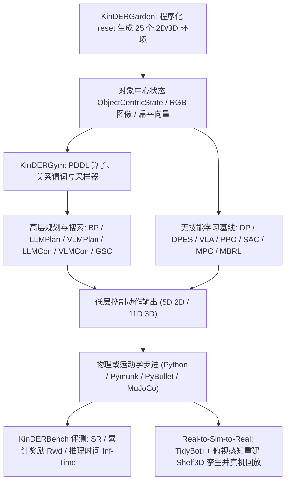
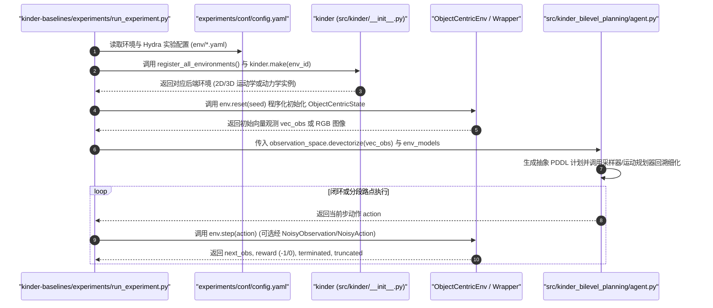

# KinDER: A Physical Reasoning Benchmark for Robot Learning and Planning

## 一句话定义

KinDER（Kinematic and Dynamic Embodied Reasoning）是一个专注于机器人物理推理的开源基准套件，通过 25 个覆盖 2D/3D 运动学与动力学约束的程序化环境、对象中心 Gymnasium 接口与参数化技能库，以及跨越任务与运动规划（TAMP）、强化学习、模仿学习和基础模型的 13 项统一基线评测，系统衡量具身智能体的中层物理推理能力。

## 英文缩写速查

| 缩写 | 英文全称 | 简要说明 |
|---|---|---|
| KinDER | Kinematic and Dynamic Embodied Reasoning | 本基准名称，聚焦运动学与动力学具身推理 |
| TAMP | Task and Motion Planning | 结合离散符号任务规划与连续几何运动规划的经典范式 |
| BP | Bilevel Planning | 先在抽象符号层搜索、再在连续参数层回溯采样的双层规划方法 |
| DP / DPES | Diffusion Policy / DP + Environment States | 基于条件扩散的视觉动作模仿策略及其附加环境状态向量变体 |
| GSC | Generative Skill Chaining | 将技能分布以扩散模型拼接的长时程技能链规划方法 |
| VLA | Vision-Language-Action | 视觉-语言-动作策略模型，文中微调 $\pi_{0.5}$ 作为代表基线 |

## 为什么重要

- **将物理推理从感知与语义中解耦：** 现有家庭服务等应用导向基准（如 BEHAVIOR-1k、RoboCasa、LIBERO）常将物理推理与复杂视觉感知、自然语言指令理解纠缠在一起，导致无法诊断方法瓶颈究竟在语义理解还是物理约束满足。
- **跨范式统一对比标尺：** 机器人规划（TAMP）、模型自由学习（RL/IL）与基础模型（LLM/VLM/VLA）长期在各自独立场景评估，缺乏共享状态接口、技能抽象与评测指标；KinDERGym 同时向规划器暴露关系谓词与参数化技能、向学习策略暴露固定维状态或 RGB 观测，使 13 类方法可在同一基准下横向对比。
- **揭示当前代表性范式的显著短板：** 在 KinDERBench 的 8 个代表性任务上，即使工程代价最高的双层规划平均成功率也仅 0.57，微调 VLA（$\pi_{0.5}$）、MPC 与扩散策略均在多阶段非抓持与动态约束任务中大量失效，说明通用物理推理仍是具身智能未解决的核心缺口。

## 核心信息

| 项目 | 内容 |
|---|---|
| 作者 | Yixuan Huang\*、Bowen Li\*、Vaibhav Saxena\*、Yichao Liang、Utkarsh Aashu Mishra、Liang Ji、Lihan Zha、Jimmy Wu、Nishanth Kumar、Sebastian Scherer、Danfei Xu、Tom Silver |
| 机构 | Princeton University、CMU、Georgia Tech、University of Cambridge、NVIDIA、MIT |
| 发表时间 | 2026-04-28（arXiv v1）/ 2026-05-04（arXiv v2），被 RSS 2026 接收 |
| 论文链接 | [arXiv:2604.25788](https://arxiv.org/abs/2604.25788) / [arXiv HTML v2](https://arxiv.org/html/2604.25788) |
| 项目与代码 | [项目主页](https://prpl-group.com/kinder-site/) / [kindergarden（环境库）](https://github.com/Princeton-Robot-Planning-and-Learning/kindergarden) / [kinder-baselines（基线库）](https://github.com/Princeton-Robot-Planning-and-Learning/kinder-baselines) |
| 清单分类 | `environment.benchmarking`（来源条目 `survey_ax_2604_25788`） |
| 开源状态 | 已开源（`kindergarden` 采用 MIT 协议，支持 `pip install kindergarden`；`kinder-baselines` 公开全部 9 个基线子包；Hugging Face 公开预训练模型与演示数据集） |

## 核心原理

KinDER 由 **KinDERGarden（环境集）**、**KinDERGym（软件与技能接口）** 和 **KinDERBench（评测与基线套件）** 三部分构成，围绕五类物理推理挑战组织评测：基础空间关系、非抓持多物体操作、工具使用、组合几何约束与动力学约束。

### 1. 对象中心状态与多抽象层级环境（KinDERGarden）

所有环境均遵循 Gymnasium API（`reset()` 执行程序化场景生成，`step()` 给出稀疏奖励——到达目标前每步返回 `-1`），核心差异在于原生采用**以对象为中心的状态表示（Object-Centric State）**：将场景中的实体名（如 `robot`、`hook`）映射为按对象类型定义维度的实值特征向量。例如 3D 移动操作机器人 `MobileManipulator` 包含底座 $\mathrm{SE}(2)$ 位姿与速度、$\mathbb{R}^7$ 机械臂关节状态与速度及 $[0,1]$ 夹爪开合度；可动物体 `Movable` 包含 $\mathrm{SE}(3)$ 位姿/速度及 $\mathbb{R}^3$ 包围盒尺寸。为兼容标准 RL/IL 与视觉策略，环境同时支持 `observation_space.vectorize/devectorize` 扁平向量转换（固定物体数变体）、RGB 图像渲染及高斯观测/动作噪声包装器（`NoisyObservation`、`NoisyAction`）。

25 个环境按「运动学 vs. 动力学」和「2D vs. 3D」分为四类（动作空间在 2D 为 $\mathcal{A}\in\mathbb{R}^5$，在 3D 为 $\mathcal{A}\in\mathbb{R}^{11}$）：

- **Kinematic2D（6 个）：** 纯 Python 实现，圆形 $\mathrm{SE}(2)$ 底座 + 1D 伸缩臂 + 矩形吸盘（激活时刚性吸附邻近物体），碰撞即回退状态；包括 `Motion2D`、`Obstruction2D`、`ClutteredRetrieval2D`、`ClutteredStorage2D`、`PushPullHook2D`、`StickButton2D`。
- **Dynamic2D（4 个）：** 采用 Pymunk 2D 物理引擎建模速度、加速度、重力与摩擦，使用双指夹爪支持非抓持接触与物理捷径（如在 `DynObstruction2D` 中用持握的方块直接推开障碍物，而无需先抓放障碍）；包括 `DynPushT`（仓库内记为 `DynPushT2D`）、`DynObstruction2D`、`DynPushPullHook2D`、`ScoopPour2D`（仓库内记为 `DynScoopPour2D`）。
- **Kinematic3D（5 个）：** 基于 PyBullet 进行运动学与碰撞检测，统一使用 TidyBot++ 全向底座 + 7-DOF Kinova Gen3 机械臂 + Robotiq 2F-85 夹爪（闭合时刚性附着，碰撞回退）；包括 `BaseMotion3D`、`Obstruction3D`、`Packing3D`、`Table3D`、`Transport3D`。
- **Dynamic3D（10 个）：** 基于 MuJoCo 进行接触动力学仿真与摩擦抓持（无刚性焊接），采用配置文件驱动共享 Python 代码，借鉴 BDDL 规范生成任务并复用 RoboCasa 物体资产与 MimicLabs 场景资产；论文 Table XII 详列 `Rearrange3D`、`Tossing3D`、`BalanceBeam3D`、`ConstrainedCupboard3D`、`Shelf3D`、`SweepSimple3D`、`SweepIntoDrawer3D`、`SortClutteredBlocks3D`、`ScoopPour3D`，项目主页与仓库另包含第 10 个环境 `Dynamo3D`。

### 2. 参数化技能、概念谓词与遥操作（KinDERGym）

为打通符号规划、基础模型与低层控制之间的接口，KinDERGym 将技能封装为带 PDDL 算子及连续采样器（sampler）的选项（option），例如 $\mathrm{Pick(object, \theta)}$（$\theta\in\mathrm{SE}(3)$ 为相对抓取位姿，选项策略内部可维护运动规划状态）；将概念实现为接地于对象中心状态的关系谓词分类器，例如 $\mathrm{On(object, surface)}$，从而与对象状态共同组成双层场景图。数据采集方面，2D 提供键鼠与 PS5 手柄控制，3D 提供基于 iPhone 陀螺仪/加速度计的网页端（通过逆运动学映射末端位姿）与 Meta Quest 3S VR 手柄，并在 10 个环境中通过「遥操作 + 规划」预置了每个环境 $\ge 100$ 条演示数据。

### 3. 13 类跨范式基线设计与评测维度（KinDERBench）

KinDERBench 汇总四类范式共 13 个基线：
1. **符号/分层规划（使用参数化技能与谓词）：** 双层规划 `BP`（hFF 启发式贪心最佳优先搜索最多 10 条抽象计划或 60s 超时 + 每步最多 3 次回溯采样）；零样本 `LLMPlan` / `VLMPlan` 与少样本上下文 `LLMCon` / `VLMCon`（基于 GPT-5.2，分别输入对象状态与技能描述，VLM 额外输入初始 RGB 图像）。
2. **基于模型与轨迹优化：** `MPC`（利用真值仿真器进行 10 控制点预测采样，每步采样 10 条 100 步候选轨迹）；`MBRL`（用演示训练 2 层 256 维 SiLU 神经网络状态转移模型后再跑 MPC）。
3. **示范学习与基础策略：** `DP`（16 步预测、2 步观测条件、8 步执行，UNet+DDIM）、`DPES`（额外拼接 MLP 编码的底层环境状态）、微调 `VLA`（基于 OpenPI 对 $\pi_{0.5}$ 微调，执行前 8 步，不使用真值环境状态）以及扩散技能链 `GSC`（按 skill 标签切分轨迹进行组合生成）。
4. **模型自由强化学习：** `PPO` 与 `SAC`（4 层 tanh MLP，2D 为 128 维、3D 为 256 维，训练 1M 环境步）。

## 流程总览

## 源码运行时序图

标准评测入口由 `kinder-baselines` 的 `kinder-bilevel-planning/experiments/run_experiment.py` 加载 Hydra 环境配置驱动，底层通过 `kindergarden` 提供的 `kinder.register_all_environments()` 与 `kinder.make()` 实例化目标任务环境，并借助 `observation_space.devectorize()` 将向量观测还原为对象中心状态供规划或策略模块消费。

## 实验与评测

全部基线在 8 个代表性环境上以 **5 个随机种子 × 每种子 50 回合** 评测，核心结果（Table II）如下（指标为成功率 SR $\uparrow$ / 成功回合累计奖励 Rwd $\uparrow$ / 单回合推理时间 Inf-Time 秒 $\downarrow$）：

| 基线方法 | 全 8 环境平均 SR | Motion2D-p0 SR | StickButton2D-b1 SR | DynObstruction2D-o1 SR | DynPushPullHook2D-o5 SR | BaseMotion3D-o0 SR | Transport3D-o2 SR | Shelf3D-o1 SR | SweepIntoDrawer3D-o5 SR |
|---|---|---|---|---|---|---|---|---|---|
| BP | **0.57** | 1.00 | **0.99** | 0.08 | 0.01 | 1.00 | **0.46** | **1.00** | 0.03 |
| LLMCon | 0.43 | 1.00 | 0.44 | 0.07 | 0.01 | 1.00 | 0.36 | 0.55 | 0.00 |
| VLMCon | 0.43 | 1.00 | 0.44 | 0.07 | 0.01 | 1.00 | 0.34 | 0.52 | 0.00 |
| LLMPlan | 0.34 | 0.99 | 0.25 | 0.02 | 0.00 | 1.00 | 0.43 | 0.00 | 0.00 |
| VLMPlan | 0.34 | 1.00 | 0.28 | 0.03 | 0.00 | 1.00 | 0.38 | 0.00 | 0.00 |
| MPC | 0.32 | 0.92 | 0.68 | 0.41 | 0.00 | 0.54 | 0.00 | 0.00 | 0.00 |
| VLA ($\pi_{0.5}$) | 0.32 | 0.79 | 0.53 | **0.50** | **0.43** | 0.25 | 0.00 | 0.02 | 0.00 |
| GSC | 0.26 | 1.00 | 0.08 | 0.32 | 0.00 | 0.66 | 0.00 | 0.00 | 0.00 |
| DPES | 0.25 | 0.92 | 0.10 | 0.34 | 0.00 | 0.54 | 0.00 | 0.09 | 0.04 |
| DP | 0.24 | 0.88 | 0.10 | 0.33 | 0.00 | 0.32 | 0.00 | 0.13 | **0.14** |
| PPO | 0.13 | 0.80 | 0.14 | 0.08 | 0.00 | 0.00 | 0.00 | 0.00 | 0.00 |
| MBRL | 0.08 | 0.16 | 0.36 | 0.04 | 0.00 | 0.06 | 0.00 | 0.00 | 0.00 |
| SAC | 0.02 | 0.00 | 0.00 | 0.01 | 0.00 | 0.15 | 0.00 | 0.00 | 0.00 |

- **子任务拆解（Table III，`SweepIntoDrawer3D-o5`）：** `DP` 打开抽屉成功率达 0.87、抓取扫帚达 0.74，但扫入部分方块降至 0.22、全部扫入仅 0.14；`DPES` 对应阶段为 0.50 / 0.28 / 0.08 / 0.04；微调 `VLA` 在开抽屉阶段仅 0.01，后续全为 0.00。
- **分布外障碍数泛化（Table IV，`DynObstruction2D` 训练 1 个障碍，测试 0/1/2/3 个）：** `VLA` 成功率依次为 0.52 / 0.50 / 0.43 / 0.40，`DP` 为 0.35 / 0.33 / 0.30 / 0.26，均保留了一定跨物体数量迁移能力。
- **双层规划规模扩展瓶颈（Table V，`StickButton2D` 按钮数 1→3→5→10）：** `BP` 成功率从 0.99 剧降至 0.26 / 0.02 / 0.00，单回合推理时间由 1.51s 膨胀至 19.45s / 28.12s / 38.39s。
- **稠密奖励与噪声消融（Table VII–VIII）：** 在 `BaseMotion3D` 中加入 XY 平面欧氏距离引导奖励可使 PPO 从 0.00 升至 0.10，但 SAC 反从 0.15 降至 0.10；向 `BP` 注入极小观测噪声（stdev=0.01）即导致 `StickButton2D` 成功率从 1.00 跌至 0.22、`Motion2D` 从 1.00 跌至 0.40（stdev=0.1 时分别跌至 0.06 与 0.08）。
- **Real-to-Sim-to-Real 验证（§VII & Appendix D）：** 在实体 TidyBot++ 上利用标定俯视相机定位底座并结合开放词汇 2D 检测构造 `Shelf3D` 仿真场景，由 `BP` 生成无碰撞规划路点并在真机顺序执行，验证了仿真挑战与真实硬件任务的结构对应性。

## 与其他工作对比

| 基准/方法维度 | 覆盖范围与核心差异（依据论文 Table I 与 §III） |
|---|---|
| 家庭应用基准（BEHAVIOR-1k、RoboCasa、ManiSkill-HAB、CALVIN） | 偏重长程家务多样性、语言指令或视觉逼真度，物理推理与复杂场景感知高度耦合；KinDER 则将五类物理推理抽离为低耦合的跨维度测试床 |
| 通用操作基准（LIBERO、VLABench、FurnitureBench、OGBench） | 聚焦桌面操作、终身学习、装配或离线目标条件 RL，缺少非抓持工具交互与强动力学约束的组合覆盖；KinDER 同时涵盖 2D/3D 运动学与动力学 |
| 纯物理推理基准（PHYRE、I-PHYRE、Virtual Tools、Kinetix） | 多限于 2D 游戏谜题或非标准移动操作本体；KinDER 直接面向机器人构型（TidyBot++ 11-DOF 移动操作臂）并提供真机对照 |
| 传统 TAMP 与学成策略（BP vs. VLA/DP/RL） | `BP` 在结构化技能齐全且静态确定环境得分高（`Shelf3D` 1.00），但物体数增多或存在观测噪声时迅速退化；`VLA` 与 `DP` 在非抓持动态推拉（`DynPushPullHook2D`、`SweepIntoDrawer3D`）展现优势但缺乏组合约束稳定性 |

## 结论

**一句话总判：KinDER 是首个系统隔离五类核心物理推理挑战并打通 TAMP、RL、IL 与基础模型统一评测接口的机器人开源基准，实验证明现有主流方法均未真正过关（最高平均成功率仅 0.57）。**

1. **选型优先级分场景分化：** 若任务具备清晰几何模型与预定义技能（如 `Shelf3D`、`Transport3D`），双层规划（BP）显著领先；但在难以显式建模接触的动态非抓持工具任务（如 `DynPushPullHook2D`）中，预训练后微调的 VLA（0.43）是目前唯一产生有效解的基线。
2. **多模态模型尚未有效对齐几何与视觉：** `VLMPlan`/`VLMCon` 与纯文本状态 `LLMPlan`/`LLMCon` 得分几乎持平（0.34/0.43），说明直接附带 RGB 图并未提升大模型的空间/几何推理，提示词中注入少量成功示例（in-context examples）才是有效增益来源。
3. **底层状态拼接不能自动提升扩散策略：** `DPES`（0.25）未超越仅用图像与本体状态的 `DP`（0.24），盲目拼接非结构化环境状态向量反而可能加重高维复杂场景（如 `SweepIntoDrawer3D`）的拟合负担。
4. **纯无模型 RL 与学习转移模型在稀疏长程物理推理任务中表现乏力：** PPO（0.13）、SAC（0.02）与学得神经转移模型的 MBRL（0.08）在绝大多数 3D 及工具任务中接近零成功率，长时程探索与接触模型误差仍是关键障碍。
5. **组合规模与感知噪声是 TAMP 的阿喀琉斯之踵：** 随着物体数增至 10 个或注入 `0.01` 级别状态噪声，双层规划推理时间成倍暴涨且成功率断崖下跌，需结合学习型采样器与闭环重规划缓解。

## 工程实践

- **按后端按需安装：** `pip install kindergarden` 会拉取 PyBullet、MuJoCo、pygame 等全部后端；若仅评测 Kinematic2D/Dynamic2D，推荐执行 `pip install --no-deps kindergarden` 再单独安装 `requirements/kinematic2d.txt` 或 `dynamic2d.txt`。`kinematic3d_v2` 变体（如 `VegaMotion3D`）需额外安装 `kindergarden[prpl-kinematics]`。
- **状态接口切换：** 环境默认返回扁平向量观测以兼容常规 RL/IL 训练管线；开发规划器或谓词分类器时，可通过 `env.observation_space.devectorize(vec_obs)` 零损耗恢复 `ObjectCentricState` 字典视图。
- **基线复现边界：** 全部 13 个基线与 Hydra 配置文件位于独立仓库 `kinder-baselines`（分为 `kinder-bilevel-planning`、`kinder-imitation-learning`、`kinder-rl` 等 9 个独立包），需按 `scripts/install_all.py` 顺序安装内部依赖；本维基条目完成静态原文与仓库结构核对，未在本地执行基线训练或仿真评测。

## 局限与风险

- **仿真保真度与任务覆盖边界：** 论文明确指出其主要刻画「中层物理推理」，简化了精细真实接触摩擦、形变物体及复杂传感器噪声；当前设计未包含部分可观测性（POMDP）、固有环境随机性、多构型机器人本体切换以及多机协作任务。
- **技能工程代价高昂：** BP 与 LLM/VLM 规划基线依赖手工编写的 PDDL 算子、关系谓词与采样器，在需要连续复杂接触规划的环境（如 `DynObstruction2D`、`SweepIntoDrawer3D`）中预定义技能本身难以覆盖物理捷径，导致 BP 表现骤降。
- **真机实验规模有限：** 论文 §VII 仅在 `Shelf3D` 单一场景上展示了基于俯视相机定位与固定高度假设的开环/路点式 Real-to-Sim-to-Real 验证，尚未在动态抛掷或复杂非抓持清扫任务中完成真机定量评测。

## 关联页面

- [具身大模型评测基准选型闭环](../queries/embodied-eval-benchmark-selection-loop.md)：对照评测基准设计与指标选型闭环。
- [Agentic Robots 综述](paper-towards-agentic-robots-survey.md)
- [全量项目节点清单](../overview/awesome-agentic-robots-node-index.md)
- [VLA 方法背景](../methods/vla.md)
- [具身智能体评测方法](../methods/embodied-agent-benchmarking.md)：对照任务设置、接口与评估指标。
- [扩散策略（Diffusion Policy）](../methods/diffusion-policy.md)：KinDERBench 中 DP / DPES 模仿学习基线方法。
- [模型预测控制（MPC）](../methods/model-predictive-control.md)：KinDERBench 中基于真值仿真器的预测采样 MPC 基线。
- [机器人仿真场景生成](../methods/robot-simulation-scene-generation.md)：对照 KinDERGarden 的程序化任务生成与资产复用机制。
- [机器人操作任务（Manipulation）](../tasks/manipulation.md)：与 KinDER 涵盖的抓持、非抓持及工具使用操作挑战对照。

## 推荐继续阅读

- [KinDER 官方项目网站与环境演示视频](https://prpl-group.com/kinder-site/)
- [KinDERGarden 环境库源码与文档（GitHub）](https://github.com/Princeton-Robot-Planning-and-Learning/kindergarden)
- [KinDER Baselines 实现仓库（GitHub）](https://github.com/Princeton-Robot-Planning-and-Learning/kinder-baselines)
- [KinDER 预训练模型与演示数据集（Hugging Face）](https://huggingface.co/datasets/kinder-bench/kinder-datasets)

## 参考来源

- [KinDER 论文全文核对归档](../../sources/papers/paper-agentic-2604-25788.md)
- [KinDER 官方仓库核对归档](../../sources/repos/paper-agentic-2604-25788.md)
- [官方 Awesome 快照归档](../../sources/repos/awesome-agentic-robots-survey-index.md)
- [论文原版入口（arXiv:2604.25788v2）](https://arxiv.org/html/2604.25788)
- [官方项目页（prpl-group.com/kinder-site）](https://prpl-group.com/kinder-site/)
