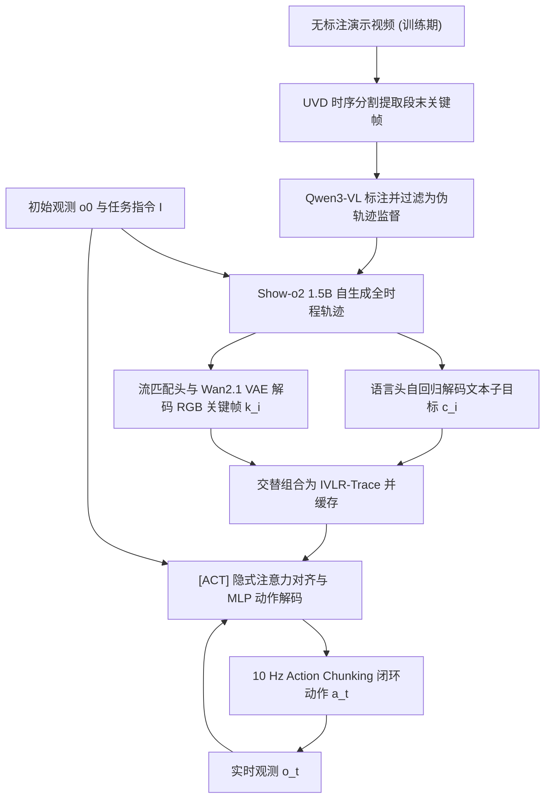

# Thinking in Text and Images: Interleaved Vision–Language Reasoning Traces for Long-Horizon Robot Manipulation

## 一句话定义

**IVLR**（Interleaved Vision–Language Reasoning）是一种面向长时程机器人操作的 VLA 策略框架：由单个原生多模态 Transformer 在任务初始阶段一次性自生成“文本子目标 + 视觉关键帧”交替排列的全时程轨迹 **IVLR-Trace** 并缓存，随后在每一步控制中将缓存轨迹与实时观测共同输入动作解码器实现闭环执行。

## 英文缩写速查

| 缩写 | 英文全称 | 简要说明 |
|---|---|---|
| IVLR | Interleaved Vision–Language Reasoning | 本文提出的交错视觉-语言推理策略框架与全时程轨迹范式 |
| VLA | Vision-Language-Action | 结合视觉感知、语言指令与机器人动作输出的端到端策略模型 |
| CoT | Chain-of-Thought | 思维链推理机制，在机器人领域常以纯文本子目标或局部视觉预测形式出现 |
| UVD | Universal Visual Decomposer | 通用视觉分解器，用于按视觉嵌入进度自动切分演示视频阶段边界 |
| VAE | Variational Autoencoder | 变分自编码器，本文采用 Wan2.1 VAE 将图像帧压缩为连续视觉潜变量 |
| VLM | Vision-Language Model | 视觉-语言大模型，本文用 Qwen3-VL 为切分后的演示阶段生成结构化伪标注 |

## 为什么重要

1. **打破“因果顺序”与“空间几何”在单一模态下的割裂**：纯文本思维链（如文本 CoT）擅长刻画子目标之间的因果依赖，却无法指定抓握位姿、接触几何与目标放置空间；纯视觉未来帧预测或世界模型提供几何线索，但多局限于局部短视野，容易漂移到“视觉合理却违背任务顺序”的错误步骤。
2. **显式全时程故事板替代隐式潜状态**：标准 VLA 策略把长时程规划隐式压缩在网络隐藏层中，面对多阶段任务容易发生时间短视（例如提前抓取后续阶段中视觉更显著的物体）。IVLR-Trace 将推理过程外显为可监督、可检查、可消融的图文交替序列。
3. **可扩展的演示数据伪标注范式**：常规机器人演示数据集缺乏多模态推理轨迹标注，作者通过“UVD 时序分割 + Qwen3-VL 结构化字幕 + 规则过滤”自动构造伪轨迹，使既有轨迹数据能够低成本升级为全时程交错推理监督。

## 核心信息

| 字段 | 内容 |
|---|---|
| 作者 | Jinkun Liu, Haohan Chi, Lingfeng Zhang, Yifan Xie, YuAn Wang, Long Chen, Hangjun Ye, Xiaoshuai Hao, Wenbo Ding |
| 机构 | 清华大学（Tsinghua University）、北京理工大学（Beijing Institute of Technology）、小米集团（Xiaomi Group） |
| 发表时间 | 2026-05-01（arXiv:2605.00438v1 `[cs.AI]`） |
| 论文链接 | [arXiv:2605.00438](https://arxiv.org/abs/2605.00438) / [arXiv HTML 全文](https://arxiv.org/html/2605.00438) |
| 项目与代码 | 未发布独立项目主页或官方代码仓库链接 |
| 清单分类 | `data.annotation`（来源条目：`survey_ax_2605_00438`） |
| 开源状态 | 未确认开源代码（截至 2026-11-27，arXiv v1 原文及公开检索未发现官方代码仓） |

## 核心原理

### 1. 问题形式化与策略分解

在部分可观测的语言条件操作设定下（假设 $t=0$ 时任务相关工作区在初始图像中可见），机器人于时间步 $t$ 接收观测 $o_t \in \mathcal{O}$、输出连续动作 $a_t \in \mathcal{A}$，并受语言指令 $\mathcal{I}$ 约束。IVLR 引入显式全时程轨迹 $z$：

$$z = \left[(c^{(1)}, k^{(1)}), (c^{(2)}, k^{(2)}), \ldots, (c^{(N)}, k^{(N)})\right]$$

其中每个阶段对 $(c^{(i)}, k^{(i)})$ 称为一个**语义-几何基元**（semantic-geometric primitive）：文本子目标 $c^{(i)}$ 定义该阶段的因果角色，视觉关键帧 $k^{(i)}$ 锚定阶段完成时预期的空间状态。整个策略分解为先规划、后闭环执行两阶段：

$$P_\Theta(z, a_{1:T} \mid o_0, \mathcal{I}) = P_\Theta(z \mid o_0, \mathcal{I}) \prod_{t=1}^T P_\Theta(a_t \mid o_t, \mathcal{I}, z)$$

执行阶段保留原始指令 $\mathcal{I}$ 与缓存轨迹 $z$ 并行作为上下文，以防生成轨迹不完整时丢失全局任务语义。

### 2. 统一原生多模态架构

模型基于 **Show-o2 1.5B** 原生多模态 Transformer 初始化，在单一模型内统一处理文本、视觉与动作模态：

- **文本模态**：指令 $\mathcal{I}$ 与各阶段子目标 $c^{(i)}$ 经词表分词后，由语言头自回归解码。
- **视觉模态**：观测图像与目标关键帧通过 **Wan2.1 VAE** 编码为连续潜向量 $x = \mathrm{Flatten}(\mathcal{E}(I)) \in \mathbb{R}^{L \times d}$。生成关键帧时，由流匹配（Flow-Matching）视觉头从初始噪声出发，依据上下文 $\mathcal{C}$ 求解常微分方程 $dx_\tau / d\tau = v_\Theta(\tau, x_\tau, \mathcal{C})$ 得到关键帧潜表示并解码为 RGB 图像。
- **动作模态**：引入可学习的 `[ACT]` token，在每步执行时使 `[ACT]` 隐状态对当前观测 $o_t$、原始指令 $\mathcal{I}$ 和缓存轨迹 $z$ 做注意力聚合，再经轻量级 MLP 与数据集动作均值偏置 $\mu_{\text{act}}$ 输出连续控制量：

$$a_t = \mathrm{MLP}(h_{\texttt{[ACT]}}(o_t, \mathcal{I}, z)) + \mu_{\text{act}}$$

### 3. 推理缓存与隐式闭环对齐

在 $t=0$ 时刻，模型从 $(o_0, \mathcal{I})$ 出发交替生成文本子目标 $c^{(i)}$ 与流匹配关键帧 $k^{(i)}$，形成完整轨迹 $z$ 并缓存于注意力上下文中。进入控制循环后，模型**不设手工硬编码的阶段指针**，而是依赖 `[ACT]` token 在全量缓存轨迹与实时观测 $o_t$ 之间的隐式注意力对齐，动态关注与当前物理进展相匹配的阶段锚点，从而保持对实时状态的闭环响应，而非开环回放关键帧。

### 4. 伪轨迹构造与联合训练目标

针对现有机器人数据集缺少交错轨迹标注的问题，作者设计自动化伪监督管线：
1. **视觉阶段切分**：利用 **UVD** 根据视觉嵌入进度变化划分演示片段，选取每段末帧（交互完成后的首个稳定状态）作为关键帧 $k^{(i)}$。
2. **结构化 VLM 标注与过滤**：应用视角归一化（必要时水平翻转）后，将片段与指令输入 **Qwen3-VL** 输出包含 `stage_id`、`caption`、`objects`、`gripper_action`、`spatial_relation`、`keyframe_index` 的 JSON 记录；随后剔除无效 JSON、空字幕、无状态变化的相邻重复阶段、幻觉/未见物体或纯相机运动描述，并辅以随机人工抽检。

训练混合推理样本 $(o_0, \mathcal{I}, z_{\text{pseudo}})$ 与动作样本 $(o_t, \mathcal{I}, z_{\text{pseudo}}, a_t)$，总目标函数为：

$$\mathcal{L}_{\text{total}} = \mathcal{L}_{\text{text}} + \lambda \mathcal{L}_{\text{flow}} + \gamma \mathcal{L}_{\text{action}}$$

其中 $\mathcal{L}_{\text{text}}$ 为自回归交叉熵损失，$\mathcal{L}_{\text{flow}} = \mathbb{E}_{\tau, x_0, x_1, \mathcal{C}}[\|v_\Theta(\tau, x_\tau, \mathcal{C}) - (x_1 - x_0)\|_2^2]$（$x_1 = \mathcal{E}(k^{(i)})$），$\mathcal{L}_{\text{action}} = \|\hat{a}_t - a_t\|_1$。训练期引入随机轨迹噪声与动态上下文掩码，以缓解策略对完美轨迹的过度依赖。

## 流程总览

## 源码运行时序图

**不适用**（核查结果：截至 2026-11-27，arXiv:2605.00438v1 原文、参考文献及公开仓库线索均未提供官方代码仓库、模型权重或可运行脚本入口，仅给出基于 Show-o2 1.5B 与 Wan2.1 VAE 的方法设计与超参说明。）

## 实验与评测

测试阶段所有 IVLR 结果均采用**模型自主生成的轨迹**（伪轨迹仅用于训练监督，推理时不使用真值或演示引导）。由于算力限制，论文未报告多种子置信区间。

### 1. LIBERO 主实验对比（Table 2）

| 方法 | Spatial | Object | Goal | Long | Average |
|---|---:|---:|---:|---:|---:|
| DP* | 78.3% | 92.5% | 68.3% | 50.5% | 72.4% |
| Octo | 78.9% | 85.7% | 84.6% | 51.1% | 75.1% |
| OpenVLA | 84.9% | 88.4% | 79.2% | 53.7% | 76.5% |
| SpatialVLA | 88.2% | 89.9% | 78.6% | 55.5% | 78.1% |
| CoT-VLA | 87.5% | 91.6% | 87.6% | 69.0% | 81.1% |
| $\pi_0$-FAST | 96.4% | 96.8% | 88.6% | 60.2% | 85.5% |
| VLA-0 | 97.0% | **97.8%** | 96.2% | 87.6% | 94.7% |
| **IVLR (ours)** | **97.8%** | 95.8% | **97.0%** | **92.4%** | **95.5%** |

IVLR 的主要增益集中在需要跨阶段保持因果序的 **LIBERO-Long**（92.4%，较 CoT-VLA 提升 23.4 个百分点，较 VLA-0 提升 4.8 个百分点）；而在单阶段物体泛化套件 LIBERO-Object 上略低于 VLA-0 与 $\pi_0$-FAST。

### 2. SimplerEnv-WidowX 视觉分布偏移评测（Table 3）

| 模型 | Spoon (Grasp / Succ) | Carrot (Grasp / Succ) | Stack (Grasp / Succ) | Eggplant (Grasp / Succ) | 总体成功率 |
|---|---|---|---|---|---:|
| RT-1-X | 16.7% / 0.0% | 20.8% / 4.2% | 8.3% / 0.0% | 0.0% / 0.0% | 1.1% |
| Octo-Base | 34.7% / 12.5% | 52.8% / 8.3% | 31.9% / 0.0% | 66.7% / 43.1% | 16.0% |
| Octo-Small | 77.8% / 47.2% | 27.8% / 9.7% | 40.3% / 4.2% | 87.5% / 56.9% | 29.5% |
| OpenVLA | 4.1% / 0.0% | 33.3% / 0.0% | 12.5% / 0.0% | 8.3% / 4.1% | 1.0% |
| RoboVLMs | 70.8% / 45.8% | 33.3% / 20.8% | 54.2% / 4.2% | 91.7% / 79.2% | 37.5% |
| SpatialVLA | 20.8% / 16.7% | 29.2% / 25.0% | 62.5% / 29.2% | **100% / 100%** | 42.7% |
| **IVLR (ours)** | **75.0% / 70.8%** | **54.2% / 45.8%** | **79.2% / 33.3%** | 95.8% / 91.7% | **59.4%** |

作者强调 SimplerEnv 结果仅反映仿真中光照、背景与视角变化下的视觉鲁棒性，不能替代真实机器人验证。

### 3. 模态消融与受控压力测试（Table 4 & Table 5，LIBERO）

| 实验设置 | Spatial | Object | Goal | Long | Average |
|---|---:|---:|---:|---:|---:|
| **w/o Trace**（同骨架移除轨迹） | 81.2% | 82.9% | 72.4% | 37.7% | 68.6% |
| **Text-Only Trace** | 82.5% | 88.1% | 81.4% | 62.0% | 78.5% |
| **Vision-Only Trace** | 88.9% | 91.2% | 85.5% | 68.4% | 83.5% |
| **Full IVLR（基准）** | 97.8% | 95.8% | 97.0% | 92.4% | 95.5% |
| 2 cm 末端随机扰动（每回合 1 次） | 94.2% | 92.5% | 93.6% | 88.2% | 92.1% |
| 文本轨迹随机掩码 30% | 94.5% | 92.0% | 93.5% | 88.6% | 92.2% |
| 视觉关键帧随机掩码 30% | 91.2% | 90.5% | 91.8% | 86.4% | 90.0% |

视觉关键帧掩码 30% 带来的性能降幅（平均 -5.5%）大于文本掩码（-3.3%），说明几何关键帧锚点对精细操作尤为关键。

## 与其他工作对比

论文在 Table 1 中按时间跨度、表征形式、视觉锚定与执行耦合四个维度对比了相关推理型 VLA 路线：

- **文本 CoT / 分层语言规划（如 SayCan、ECoT）**：可表达全局因果顺序，但文本无法直接约束接触位姿与几何细节，且常依赖分离的规划器-控制器接口。
- **局部视觉预测与世界模型策略（如 [WorldVLA](paper-shenlan-wm-07-worldvla.md)）**：具备几何先验，但多做局部或滚动短时域预测，缺少语义约束时容易生成“视觉逼真但偏离任务子目标顺序”的未来帧。
- **结构化多模态 VLA（如 [CoT-VLA](paper-sa-2503-22020-cot-vla-visual-chain-of-thought-reasoning-for-vi.md)、[UniVLA](paper-sa-2506-19850-univla-unified-vision-language-action-model.md)、[dVLA](paper-sa-2509-25681-dvla-diffusion-vision-language-action-model-with.md)、[MolmoAct](paper-molmoact.md)）**：这些同期工作通常在局部滚动步内生成视觉/深度/感知 token 或统一离散流；IVLR 的核心差异在于**于执行前生成覆盖全任务周期的文本子目标 + RGB 关键帧故事板**，并通过流匹配头生成连续视觉锚点缓存供闭环动作解码。

## 结论

**一句话总判：显式且图文交错的全时程轨迹表征对长时程操作具有显著因果约束价值，但当前设计以约 10 秒初始规划延迟和“静态初始全可观测”假设为代价。**

1. **双模态缺一不可** — 同等 Show-o2 1.5B 骨架下，LIBERO-Long 成功率从无轨迹（37.7%）、纯文本（62.0%）、纯视觉（68.4%）跃升至图文交错的 92.4%。
2. **闭环条件化优于开环关键帧回放** — 将缓存轨迹作为上下文与实时观测 $o_t$ 并行输入 `[ACT]` 解码器，使策略在 2 cm 末端扰动下仍保持 92.1% 平均成功率（仅下降 3.4%）。
3. **伪轨迹构造降低了多模态推理监督门槛** — UVD 边界切分 + Qwen3-VL JSON 结构化字幕与过滤无需人工逐帧标注即可支撑全时程推理训练。
4. **场景适用边界明确** — 该机制最适合初始视野完整、桌面相对静态的多阶段操作；动态变化或目标被遮挡场景尚需引入异步流式规划与自触发重规划。

## 工程实践

- **模型初始化与组件配置**：基础模型为 Show-o2 1.5B（无冻结模块），视觉压缩采用 Wan2.1 VAE，动作端采用 `[ACT]` token + 轻量 MLP，结合 action chunking 以 **10 Hz** 频率闭环输出动作。
- **优化器与分模块学习率（Appendix B）**：使用 AdamW（$\beta=(0.9, 0.95)$，$\epsilon=10^{-8}$，weight decay $10^{-8}$，max grad norm 1.0），余弦退火至 $10^{-6}$（5K 步 warmup，上限 100 epochs / 100K steps）。学习率按模块设置：基础学习率 $2.5\times 10^{-5}$，Show-o2 主干与接口 $1.0\times 10^{-5}$，动作模型 $1.0\times 10^{-4}$；损失缩放权重为 VLA 动作分支 1.0、VLM 推理分支 0.1。
- **算力与推理耗时**：训练使用 16 × NVIDIA H200 GPU（LIBERO 约 40K 步 / 4 小时，SimplerEnv 约 60K 步 / 6 小时）；单张 NVIDIA H20 GPU 上，执行前生成完整 IVLR-Trace 约耗时 **10 秒**，缓存后控制频率达 **10 Hz**。
- **伪轨迹数据清洗要点**：使用 UVD 切分前需统一相机视角方向（含必要的水平翻转）；VLM 生成的 JSON 须强制校验字段完整性并过滤纯相机移动或相邻重复状态字幕。

## 局限与风险

1. **缺少真机硬件验证**：所有指标均来自仿真基准（LIBERO 与 SimplerEnv-WidowX），论文明确指出仿真分布偏移测试不能替代真实物理机器人部署验证。
2. **静态与初始全可观测假设**：轨迹仅在 $t=0$ 生成一次并缓存；若初始时刻目标物体被遮挡、未在视野中出现，或执行期间场景被外力/他人改变，缓存轨迹会立即失效且当前系统无重规划能力。
3. **初始规划延迟与动态环境冲突**：单次全轨迹生成约 10 秒的启动延迟在静态桌面任务中尚可接受，但不适用于人机协作或快速变化的动态环境；论文提出的“边生成后续阶段边执行首阶段”异步流水线尚未实现与评测。
4. **实验与鲁棒性验证局限**：重度遮挡和大幅物理滑移仍会导致失败（Appendix C）；训练期噪声/掩码增强未做独立消融隔离其因果贡献；受算力所限未提供多种子统计置信区间。

## 关联页面

- [Agentic Robots 综述](paper-towards-agentic-robots-survey.md)
- [全量项目节点清单](../overview/awesome-agentic-robots-node-index.md)
- [VLA 方法背景](../methods/vla.md)
- [Action Chunking 动作分块](../methods/action-chunking.md)
- [自动标注流水线](../methods/auto-labeling-pipelines.md)
- [统一多模态 Token 表示](../methods/unified-multimodal-tokens.md)
- [Agentic 操作策略](../methods/agentic-manipulation-policies.md)
- [机器人操作](../tasks/manipulation.md)
- [LIBERO 基准评测](libero-benchmark.md)
- [SimplerEnv 真实到仿真评测](paper-simplerenv-real2sim-eval.md)
- [CoT-VLA：视觉思维链 VLA](paper-sa-2503-22020-cot-vla-visual-chain-of-thought-reasoning-for-vi.md)

## 推荐继续阅读

- [arXiv:2605.00438v1 官方 HTML 全文](https://arxiv.org/html/2605.00438)
- [Show-o2: Improved Native Unified Multimodal Models (arXiv:2506.15564)](https://arxiv.org/abs/2506.15564)
- [Universal Visual Decomposer (UVD, ICRA 2024)](https://arxiv.org/abs/2310.08581)

## 参考来源

- [论文原文核对笔记：Thinking in Text and Images (IVLR)](../../sources/papers/paper-agentic-2605-00438.md)
- [官方 Awesome 快照归档](../../sources/repos/awesome-agentic-robots-survey-index.md)
- [arXiv:2605.00438 官方摘要页](https://arxiv.org/abs/2605.00438)
- [arXiv:2605.00438v1 HTML 全文](https://arxiv.org/html/2605.00438)
