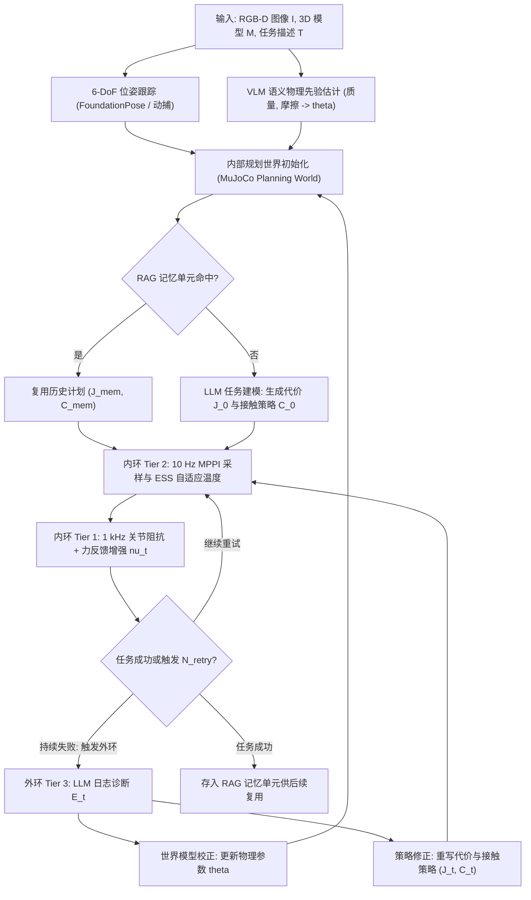

# CoRAL: Contact-Rich Adaptive LLM-based Control for Robotic Manipulation

## 一句话定义

CoRAL（Contact-Rich Adaptive LLM-based Control）是一种面向接触丰富机器人操作的神经符号分层控制框架：不直接用大模型输出底层动作，而是由 VLM 提供质量/摩擦等物理参数先验、LLM 合成 MPPI 代价函数与局部接触区域吸引子，并通过“高频 MPPI 反应控制内环 + 低频 LLM 在线系统辨识与策略修正外环”实现零样本部署。

## 英文缩写速查

| 缩写 | 英文全称 | 简要说明 |
|---|---|---|
| CoRAL | Contact-Rich Adaptive LLM-based Control | 本文提出的分层神经符号自适应操作控制框架 |
| MPPI | Model Predictive Path Integral | 基于采样的模型预测路径积分随机最优控制规划器 |
| ESS | Effective Sample Size | 有效样本量，用于在线二分法自适应调节 MPPI 温度参数 $\lambda$ |
| VLA | Vision-Language-Action | 端到端视觉-语言-动作策略模型 |
| VLM / LLM | Vision-Language Model / Large Language Model | 分别承担物理参数先验估计与代价/策略推理修正的视觉语言与大语言模型 |
| RAG | Retrieval-Augmented Generation | 检索增强生成，用于从记忆单元中复用成功任务的代价函数与接触策略 |

## 为什么重要

在推动薄砧板拾取（T1）、恒力推动（T4）或借墙壁翻转物体（T6）等**接触与力关键（contact- and force-critical）**任务中，机器人需要主动利用外部接触约束并精细调节交互力，而非单纯几何避障。传统端到端 VLA（如 OpenVLA-OFT、$\pi_{0.5}$）或力触觉策略依赖大规模示教数据，面对未见物理参数与新颖借力策略时泛化脆；现有 LLM 引导规划器（如 L2R）虽可零样本生成代价函数，却假定静态物理模型，一旦视觉估计的质量或摩擦失准便难以在线纠错。CoRAL 证明了通过分离“视觉物理先验估计—符号代价与接触策略规划—高频力反馈控制—低频在线系统辨识”四个角色，无需任何任务示教即可在仿真与真机实现高解释性的在线纠错与迁移。

## 核心信息

| 字段 | 内容 |
|---|---|
| **作者** | Berk Çiçek*, Mert K. Er*, Ozgur S. Oguz |
| **机构** | LiRA Lab, Department of Computer Engineering, Bilkent University (Ankara, Türkiye) |
| **发表时间** | 2026-05（arXiv:2605.02600v2，已被 RSS 2026 接收） |
| **论文链接** | [arXiv:2605.02600](https://arxiv.org/abs/2605.02600) · [arXiv HTML 全文](https://arxiv.org/html/2605.02600) |
| **项目与代码** | [项目主页](https://sites.google.com/view/lira-coral) |
| **清单分类** | `model.robot_control`（来源条目 `survey_ax_2605_02600`） |
| **开源状态** | **未确认开源代码**（仅公开论文附录提示词与伪代码清单 S7–S12 及项目主页演示视频；未提供官方源码仓库链接） |

## 核心原理

CoRAL 将部分可观测马尔可夫决策过程（POMDP）下的长程接触操作拆分为三层异步架构与两个嵌套闭环：

1. **感知与语义物理世界模型初始化（§III-A）**：
   - **6-DoF 位姿跟踪**：以 RGB-D 图像 $I$ 与已知 3D 物体网格 $M$ 为输入，仿真中使用 FoundationPose 连续跟踪所有可交互物体位姿；真机验证中为简化状态估计改用 6 相机 Vicon Vero 动捕系统。
   - **VLM 语义物理先验**：将场景图像、任务描述 $T$、物体已知语义标签及当前估计位姿输入 GPT-4o VLM，输出 JSON 格式的质量（`mass_kg`）与摩擦系数（`friction_coeff`）初值，构成可修正的内部规划世界参数 $\theta$（Planning World，基于 MuJoCo/robosuite）。
2. **记忆检索与 LLM 任务建模（§III-B，§S12）**：
   - **RAG 经验复用**：系统先以 $(T, \theta)$ 查询基于 LLM 语义嵌入的记忆单元 $(J_{\text{mem}}, C_{\text{mem}}) = \text{RAG}_{\text{Retrieve}}(T, \theta)$；若命中相似成功经验，直接复用其最终代价函数与接触策略跳过冷启动。
   - **Python 运行代价函数生成 $J_0$**：未命中时，LLM 根据任务文本生成可执行的 `state_cost(self)` Python 函数。对多阶段任务（如 T1“推板过桌沿再抓握”），LLM 自动构造软切换门控（如基于悬伸量与稳定度计算的 `grasp_score` 经 Sigmoid 平滑过渡推与抓两阶段权重）。
   - **几何接触策略采样 $C_0$**：LLM 为每个物体输出 1–3 个高价值接触区域描述子（三维中心 $c_{\text{ref}}$、表面法向 $\mathbf{n}$、半径 $r$ 与采样数 $k$），由 `sample_points_in_region` 在受限表面流形 $\mathcal{R} = \partial\mathcal{O} \cap \mathcal{E}(c_{\text{ref}}, \mathbf{A})$ 上均匀采样候选接触点 $C_0$，并作为软吸引代价 $w_{\text{attr}}\|p_{\text{eef}} - x_{\text{des}}\|^2$ 写入 $J_0$，在缩小搜索空间的同时保留动力学优化自由度。
3. **三层控制与内环反应执行（§III-C，§S1-B）**：
   - **Tier 1（1 kHz）**：底层关节阻抗控制保障物理接触顺应性与安全。
   - **Tier 2（10 Hz）**：MPPI 规划器在内部世界模型中并行滚动采样 $K=256$ 条、步长 $H=32$ 的控制序列。由于 LLM 生成的代价量纲多变，CoRAL 在每步规划中基于有效样本量 $\mathrm{ESS}(\lambda) = 1 / \sum_i W_i(\lambda)^2$ 对目标 $E_{\text{tgt}} = \phi K$（$\phi=0.2$）执行 25 步二分搜索，自适应确定温度 $\lambda^{(n)}$。
   - **反应式传感增强**：实际下发指令叠加真实力/力矩与本体传感误差反馈项：$\nu_t = u_t + K_f \cdot (x_{\text{des}} - x_{\text{measured}})$。
4. **外环在线自适应与系统辨识（§III-D，§S11）**：
   - **Tier 3（~1 Hz 异步）**：当内环连续尝试 $N_{\text{retry}}$ 次仍失败时触发外环，将包含最近状态、动作、代价与参数的历史日志 $E_t$ 送入 LLM 进行诊断并分两条路径修正：
     - **世界模型校正（System Identification）**：若策略合理但物理响应偏离预期（如推物体不动），LLM 推断质量或摩擦低估/高估，输出更新后的 JSON 物理参数 $\theta$；
     - **策略与代价重写**：若逻辑失衡（如某阶段权重过小），LLM 直接重写 `state_cost` 源码并附带自然语言故障诊断报告（§S6 图 S2）。任务完成后，成功上下文写入记忆单元。

## 流程总览

## 源码运行时序图

**不适用**（截至 2026-11-27，arXiv:2605.02600v2 论文正文/附录及项目主页均未公布或链接可运行的官方代码仓库，仅在附录 S7–S12 展示了 `state_cost`、`ask_state_cost_fn`、`ask_params_refinement`、`ask_region_strategy` 与 `sample_points_in_region` 等关键函数清单，无法对齐完整仓库目录与实际运行入口）。

## 实验与评测

作者在 robosuite/MuJoCo 仿真与真机 7-DoF Franka Emika Panda（配备平行夹爪、固定 RGB-D 相机及关节力矩传感；计算平台为 Intel i9-13900K + 64 GB RAM + RTX 4060 Ti，VLM/LLM 均调用 GPT-4o API）上评估了 6 个任务（每项 10 次试验，随机化物体初始位姿、质量、桌面摩擦与尺寸）：

- **主实验结果（Table I，仿真成功率 x/10）：**

| 方法 | T1 推抓砧板 | T2 抓放方块 | T3 杂乱抓取 | T4 恒力推动 | T5 翻转方块 | T6 借墙翻转 |
|---|---:|---:|---:|---:|---:|---:|
| OpenVLA-OFT | 0/10 | 10/10 | 9/10 | 0/10 | 1/10 | 0/10 |
| $\pi_{0.5}$ | 0/10 | 10/10 | 8/10 | 0/10 | 3/10 | 0/10 |
| L2R（静态代价生成） | 0/10 | 10/10 | 9/10 | 5/10 | 4/10 | 1/10 |
| 人类专家（单阶段代价） | 0/10 | 10/10 | 10/10 | 9/10 | 9/10 | 3/10 |
| 人类专家（手工 FSM） | 8/10 | 10/10 | 10/10 | 10/10 | 10/10 | 9/10 |
| **CoRAL（完整框架）** | **5/10** | **10/10** | **10/10** | **9/10** | **9/10** | **7/10** |

- **组件消融实验（Table I，仿真成功率 x/10）：**
  - `CoRAL (w/o Memory)`：T1 2/10、T2 10/10、T3 9/10、T4 9/10、T5 7/10、T6 5/10（记忆检索对长程 T1 与 T6 提升显著）。
  - `CoRAL (w/o Refinement)`：T1 0/10、T2 10/10、T3 3/10、T4 6/10、T5 4/10、T6 2/10（禁用外环自适应导致 T1 完全失效）。
  - `CoRAL (Unified VLM)`：T1 0/10、T2 2/10、T3 0/10、T4 1/10、T5 0/10、T6 0/10（单一大模型同时做感知与规划几乎全军覆没）。
  - `CoRAL (w/o Pose Tracking)`：所有任务 T1–T6 均为 0/10（VLM 直接估位姿产生严重幻觉，证明专用 6-DoF 跟踪不可替代）。
- **接触策略与参数敏感性分析（§IV-A4，Table II）：**
  - **LLM 接触策略贡献（T6）**：相比无接触引导的纯 MPPI 探索，引入 $C_0$ 使控制步数减少 **83.9%**（32 步 vs. 199 步），末端路径缩短 **63.9%**（1.33 m vs. 3.69 m）。
  - **极端模型失配恢复**：将质量初值人为设为 2.0 kg（真值 0.25 kg）、摩擦初值设为 0.9（真值 0.5），外环在仿真与真机均能在数轮迭代内收敛至接近真值。
  - **T1 参数/位姿敏感性（100 组样本，质量 $\in[0.4,0.8]$ kg，摩擦 $\in[0.3,0.6]$）**：仅 VLM 估值的质量与摩擦 MAE 分别为 **0.29 kg** 和 **0.14**；经 4 轮在线自适应后 MAE 降至 **0.11 kg** 和 **0.06**（T1 成功率由 2/10 升至 5/10）。在 Table II 中，仅替换真实物理参数成功率仍为 5/10，而替换真实位姿升至 **7/10**（两者皆为真值达 **8/10**）；此时 FoundationPose 在 10 轮中的平均 ADD 误差为 **13.2 mm**（88.2% 帧 < 5 mm），主要瓶颈来自末端遮挡导致的短时跟踪丢失。
- **真机零样本迁移（Table III，Franka Emika Panda + Vicon Vero，无微调）：**
  - T1：4/10（$21.6 \pm 5.5$ s）；T2：10/10（$16.7 \pm 1.1$ s）；T3：10/10（$22.0 \pm 1.5$ s）；T4：9/10（$11.7 \pm 1.9$ s，实测接触力稳定约束在约 5 N 目标区间）；T5：7/10（$9.2 \pm 2.6$ s）；T6：6/10（$25.3 \pm 4.9$ s）。

## 与其他工作对比

| 对比维度 | 端到端 VLA（OpenVLA-OFT / $\pi_{0.5}$） | 力触觉 VLA（ForceVLA / TLA） | 静态代价生成（L2R / IMPACT） | **CoRAL（本文）** |
|---|---|---|---|---|
| **输入模态** | 视觉 + 语言 | 视觉 + 语言 + 力/触觉 | 语言 / 视觉 + 语言 | 视觉 + 语言 + 力/力矩反馈 |
| **动作生成机制** | 黑盒策略直接输出动作/流匹配 | 端到端多模态策略 | 静态代价图/代码 + MPC/RRT* | LLM 动态生成代价/接触区域 + 自适应 MPPI |
| **数据需求** | 大规模示教数据集 | 大规模专用力触觉示教 | 零样本（无示教） | **零样本（无示教）+ RAG 经验积累** |
| **在线物理自适应** | 无（推理期固定权重） | 无（依赖训练分布覆盖） | 无（静态物理参数与代价） | **有（外环在线系统辨识 + 代价源码重写）** |
| **长程接触表现** | 在 T1/T6 等借力任务 0/10 | 依赖同分布演示 | T6 借墙翻转仅 1/10 | T6 仿真 7/10，真机 6/10 |

## 结论

**一句话总判：CoRAL 验证了“VLM 语义物理先验 + 专用 6-DoF 位姿跟踪 + LLM 代价/接触流形引导的自适应 MPPI + 低频在线辨识外环”是一条摆脱大规模力触觉示教瓶颈的零样本接触操作可行路径，但其真实性能上限目前仍强受限于接触遮挡下的位姿跟踪精度与已知 3D 模型假设。**

1. **VLM 只能做粗先验，必须配外环修正**：单独依靠 VLM 估计质量与摩擦（MAE 0.29 kg / 0.14）不足以完成精细接触操作，但经外环 4 轮在线系统辨识降至 0.11 kg / 0.06 后即可匹配物理真值参数条件下的成功率（5/10）。
2. **专用 6-DoF 位姿跟踪比物理参数精度更致命**：将物理参数替换为真值未提升 T1 成功率（仍为 5/10），但将位姿替换为真值立即把 T1 从 5/10 推高至 7/10；在遮挡严重的接触阶段保持位姿连续跟踪是工程落地的首要前提。
3. **LLM 不应充当端到端感知器或底层控制器**：Unified VLM 消融几乎全面失效（T1/T3/T5/T6 均 0/10），而将 LLM 限制在结构化 Python 代价合成、接触圆盘采样提示与故障日志诊断上，既保留了可读性又保证了 10 Hz/1 kHz 物理控制稳定性。
4. **ESS 自适应温度 $\lambda$ 对接 LLM 代价函数很关键**：LLM 生成的代价项数值尺度跨度大，采用固定 $\lambda$ 极易退化；用 ESS 目标（$\phi=0.2$）在每轮通过二分法自适应定标 $\lambda$，再辅以 $[0.1, 10]$ 权重区间约束，可显著降低优化崩溃概率。

## 工程实践

- **核心工程配置（源自 §S1-B 与 §S3）**：
  - **控制分层频率**：Tier 1 关节阻抗 1 kHz，Tier 2 CPU 并行 MuJoCo/robosuite MPPI 10 Hz（$K=256$ 条滚动轨迹，预测时域 $H=32$ 步），Tier 3 GPT-4o 异步调用约 1 Hz。
  - **MPPI 自适应温度参数**：目标有效样本比例 $\phi = 0.2$（$E_{\text{tgt}} = 0.2K$），二分搜索上下界初始化为 $\lambda_{\text{lo}}=10^{-8}$、$\lambda_{\text{hi}}=5\max(10^{-3}, \max_i S_i)$，固定迭代 $T=25$ 步。
  - **Prompt 防护约束（§IV-A4）**：显式要求 LLM 说明各项代价相对重要性并将权重限制在 $[0.1, 10]$ 可比量纲内，避免出现 $w_d : w_c = 1000 : 1$ 导致部分目标被完全忽略。
  - **多阶段切换条件规范（§S8）**：避免仅用单边几何阈值（如 $d_{\text{edge}} > \tau$）触发阶段切换，应同时约束抓握部位实际悬伸量与物体速度稳定性（$d_{\text{handle}} > \tau_{\text{grasp}} \;\wedge\; \|\dot{x}_{\text{board}}\| < \epsilon_v$）。
- **源码可运行性核查**：**不适用**（截至 2026-11-27 未确认官方可运行源码仓库；论文附录提供关键函数伪代码清单，本地仅完成文本与算法机制核对，未执行代码复现）。

## 局限与风险

1. **强依赖已知 3D 物体几何模型与高精度外部跟踪**：系统假定已知物体 3D 模型 $M$ 供 MuJoCo 规划世界与 FoundationPose 使用；真机测试中甚至用 6 相机 Vicon Vero 动捕替代了 FoundationPose，尚未验证在纯机载视觉与未知几何物体上的闭环鲁棒性。
2. **接触遮挡与软体/非刚体动力学缺口**：机械臂在贴近物体施力时易遮挡相机导致短时位姿漂移；此外当前内部规划世界主要针对刚体质量与库仑摩擦建模，面对柔性变形体或复杂接触摩擦需额外扩展状态与动力学辨识。
3. **通用大模型的策略语法与阶段条件缺陷**：不到 10% 的试次中仍会出现不完备的阶段切换条件或失衡权重；另外依赖云端 GPT-4o API 推理延迟使其外环纠错仅能以秒级异步介入，无法应对毫秒级突发滑脱策略重组。

## 关联页面

- [Agentic Robots 综述](paper-towards-agentic-robots-survey.md)
- [全量项目节点清单](../overview/awesome-agentic-robots-node-index.md)
- [VLA 方法背景](../methods/vla.md)
- [MPPI 模型预测路径积分](../methods/mppi.md)：CoRAL 内环底层规划器采用自适应温度的 MPPI 进行并行轨迹采样。
- [Agent 规划与反馈](../methods/agent-planning-feedback.md)：了解大模型闭环规划与基于执行反馈的策略修正范式。
- [直接力反馈控制](../methods/direct-force-feedback-control.md)：了解接触丰富操作中的实时力反馈闭环调节机制。
- [Agentic 操作策略](../methods/agentic-manipulation-policies.md)：对比端到端视觉语言操作与分层神经符号规划路线。
- [机器人操作](../tasks/manipulation.md)：了解物体操作和抓取任务。

## 推荐继续阅读

- [CoRAL arXiv HTML 全文（含附录 S1–S12 代码与 Prompt 清单）](https://arxiv.org/html/2605.02600)
- [CoRAL 官方项目主页与真机演示视频](https://sites.google.com/view/lira-coral)
- [Language to Rewards for Robotic Skill Synthesis (L2R, CoRL 2023)](https://arxiv.org/abs/2306.08647)

## 参考来源

- [CoRAL 原文核对归档](../../sources/papers/paper-agentic-2605-02600.md)
- [官方 Awesome 快照归档](../../sources/repos/awesome-agentic-robots-survey-index.md)
- [arXiv:2605.02600 摘要页](https://arxiv.org/abs/2605.02600) · [arXiv HTML 全文](https://arxiv.org/html/2605.02600)
- [CoRAL 官方项目主页](https://sites.google.com/view/lira-coral)
