# DexSim2Real: Foundation Model-Guided Sim-to-Real Transfer for Generalizable Dexterous Manipulation

## 一句话定义

**一套面向灵巧操作的零样本 Sim-to-Real 强化学习集成框架**：用视觉语言模型（VLM）作为视觉真实感评判器通过闭环 [CMA-ES](../methods/cma-es.md) 自动优化域随机化分布（FM-DR），配合双向视触觉交叉注意力策略（TVCAP）与基于大语言模型分解的渐进技能课程（PSC），在不依赖真机示教的前提下将策略直接迁移至物理机械手。

## 英文缩写速查

| 缩写 | 英文全称 | 简要说明 |
|---|---|---|
| FM-DR | Foundation Model-Guided Domain Randomization | 基于 VLM 视觉真实感评分与 CMA-ES 的闭环域随机化优化模块 |
| TVCAP | Tactile-Visual Cross-Attention Policy | 融合 RGB、指尖触觉与本体感知的双向交叉注意力强化学习策略 |
| PSC | Progressive Skill Curriculum | 由 LLM 分解子技能并按成功率阈值推进难度 $\delta_l$ 的渐进课程 |
| DR / ADR | Domain Randomization / Active Domain Randomization | 均匀域随机化与主动域随机化，用于提升仿真策略对真实环境扰动的鲁棒性 |
| CMA-ES | Covariance Matrix Adaptation Evolution Strategy | 无梯度进化优化算法，用于更新高斯混合域随机化参数分布 |
| PPO | Proximal Policy Optimization | 策略梯度强化学习算法，用于训练输出动作块的 TVCAP 策略 |

## 为什么重要

- **补齐文本驱动域随机化的视觉闭环盲区**：以往自动域随机化方法（如 DrEureka）主要依赖大语言模型基于文本推理生成参数范围，缺乏对仿真渲染结果的直接视觉检验；FM-DR 直接让 VLM 对渲染帧与真机参考图打分，把视觉与物理一致性纳入黑箱分布优化闭环。
- **在零真机示教下超越有示教基线**：在涵盖抓放、堆叠、插孔、手中旋转、工具使用与倒粒状物的六项灵巧任务盲测中，DexSim2Real 以 78.2% 的平均零样本真机成功率超过同预算零样本基线 DrEureka（65.1%）与 DeXtreme（59.2%），同时超越使用 100 条真机示教的 Act3D（66.1%）和 RVT（65.1%）。
- **明确拆解视觉随机化、触觉融合与课程调度的独立收益**：消融实验证明 VLM 指导的 FM-DR 是减小迁移落差的最大驱动力（去除后平均成功率下降 12.4 个百分点），而触觉交叉注意力对高接触任务（手中旋转 $-14.3\%$、插孔 $-11.7\%$）至关重要。

## 核心信息

| 字段 | 内容 |
|---|---|
| **作者** | Zijian Zeng, Fei Ding, Huiming Yang, Xianwei Li, Yuhao Liao |
| **机构** | 清华大学（Tsinghua University）；阿里巴巴集团（Alibaba Group）；蚌埠学院（Bengbu University）；思特雅大学（UCSI University） |
| **发表时间** | 2026-05-03（arXiv:2605.05241v1 [cs.RO]，13 页，2 图，5 表） |
| **论文链接** | [arXiv:2605.05241](https://arxiv.org/abs/2605.05241) / [arXiv HTML v1](https://arxiv.org/html/2605.05241) |
| **项目与代码** | 未确认（arXiv v1 正文及参考文献未列出 GitHub 仓库或独立项目页 URL） |
| **清单分类** | `environment.reconstruction`（来源条目：`survey_ax_2605_05241`） |
| **开源状态** | **未确认开源代码**（截至 2026-11-27，arXiv:2605.05241v1 未附公开源码仓库、模型权重或数据集链接） |

## 核心原理

DexSim2Real 采用「**环境分布优化（FM-DR）→ 多模态策略表征（TVCAP）→ 课程化技能串联（PSC）**」三阶段框架（原文 §3）：

### 1. 基础模型引导的域随机化（FM-DR，§3.1）

设仿真参数向量为 $\boldsymbol{\xi} = \{\xi_1, \dots, \xi_K\}$（包括摩擦系数 $0.3\text{–}1.2$、质量缩放 $0.8\text{–}1.5$、3 项光照参数、纹理噪声幅值及相机位姿噪声）。FM-DR 将参数分布 $p(\boldsymbol{\xi}; \boldsymbol{\theta})$ 建模为高斯混合分布，以真实世界参考图像集 $\mathcal{I}_r = \{I_r^1, \dots, I_r^N\}$ 为基准，用 VLM 评判器 $\mathcal{V}$（GPT-4V / `gpt-4-vision-preview`）从光照、纹理、几何与物理合理性四个维度给仿真渲染图 $I_s(\boldsymbol{\xi})$ 打 1–10 分：

$$s(\boldsymbol{\xi}) = \mathcal{V}\bigl(I_s(\boldsymbol{\xi}), \mathcal{I}_r, \texttt{prompt}_{\text{realism}}\bigr)$$

为避免分布坍缩到单一真实渲染配置而丧失对环境扰动的泛化性，FM-DR 通过 CMA-ES 最大化带分布熵正则的期望目标：

$$\boldsymbol{\theta}^* = \arg\max_{\boldsymbol{\theta}} \; \mathbb{E}_{\boldsymbol{\xi} \sim p(\cdot; \boldsymbol{\theta})}\bigl[s(\boldsymbol{\xi}) + \lambda \cdot H\bigl(p(\cdot; \boldsymbol{\theta})\bigr)\bigr]$$

其中 $\lambda = 0.3$（经 $\{0.1, 0.3, 0.5, 0.7\}$ 网格搜索选定）。优化采用种群规模 16、初始步长 $\sigma_0 = 0.3$、50 代 CMA-ES，每轮采样 20 个参数配置渲染打分，10–15 轮（约 200–300 次 VLM 查询）即可收敛。

### 2. 视触觉交叉注意力策略（TVCAP，§3.2）

策略 $\pi_\phi$ 接收三种模态观测并独立编码到共享维度 $d$：

- **视觉分支 $\mathbf{z}_v = f_v(\mathbf{o}_v) \in \mathbb{R}^{N_v \times d}$**：以预训练 DINOv2 为主干的 ViT 提取图像块 token；
- **触觉分支 $\mathbf{z}_t = f_t(\mathbf{o}_t) \in \mathbb{R}^{N_t \times d}$**：1D-CNN 编码来自 $F$ 个指尖传感器（每指 $D_t$ 个 taxel）的触觉读数；
- **本体分支 $\mathbf{z}_p = f_p(\mathbf{o}_p) \in \mathbb{R}^{1 \times d}$**：MLP 编码关节角、速度与力矩。

随后通过带残差连接的双向 Cross-Attention 实现动态模态交互：

$$\tilde{\mathbf{z}}_v = \mathrm{CrossAttn}\bigl(\mathbf{z}_v, [\mathbf{z}_t; \mathbf{z}_p]\bigr) + \mathbf{z}_v, \qquad \tilde{\mathbf{z}}_t = \mathrm{CrossAttn}\bigl(\mathbf{z}_t, [\mathbf{z}_v; \mathbf{z}_p]\bigr) + \mathbf{z}_t$$

融合表征 $\mathbf{z} = [\tilde{\mathbf{z}}_v; \tilde{\mathbf{z}}_t; \mathbf{z}_p]$ 输入 Transformer Decoder 并以动作分块（[Action Chunking](../methods/action-chunking.md)）形式输出未来 $T$ 步动作 $\mathbf{a}_{1:T}$，在仿真中使用 [PPO](../methods/ppo.md) 端到端优化；触觉侧辅以标准差 $\sigma = 0.05\text{ N}$ 的噪声随机化以缓冲真机传感差异。

### 3. 渐进技能课程（PSC，§3.3）

给定自然语言任务描述 $\tau$，首先由 LLM 将长程或高接触任务分解为带成功判据的有序子技能序列 $\mathcal{S} = \{s_1, \dots, s_L\}$（例如「将杯 A 中的物倒入杯 B」分解为接近抓握、抬起、对准上方、倾倒与回正 5 步）。每个子技能维护控制初始状态分布与容差阈值的难度系数 $\delta_l \in [0, 1]$（初始 $\delta_l = 0$），并在迭代成功率越过门槛 $\gamma = 0.8$ 时按步长 $\alpha = 0.1$ 递增：

$$\delta_l^{(t+1)} = \min\Bigl(1,\; \delta_l^{(t)} + \alpha \cdot \mathbb{1}\bigl[\mathrm{SR}_l^{(t)} > \gamma\bigr]\Bigr)$$

当各子技能自身达到 $\mathrm{SR} > 0.9$ 后，以前一子技能的终态分布初始化下一子技能，并使用复合奖励对完整动作序列进行端到端串联微调。

## 流程总览

```mermaid
flowchart TD
  TaskDesc["自然语言任务描述与真机参考图集"] --> FMDR["FM-DR: 采样仿真参数并渲染图像"]
  FMDR --> VLM["GPT-4V 视觉真实感评分 s(xi)"]
  VLM --> CMAES["CMA-ES 最大化 s(xi) + 0.3 * H(p)"]
  CMAES -->|"迭代 10-15 轮优化分布"| FMDR
  CMAES -->|"锁定参数分布 p*(xi)"| SimEnv["Isaac Sim 4096 并行仿真环境"]
  TaskDesc --> LLMDecomp["PSC: LLM 分解子技能与成功判据"]
  LLMDecomp --> DiffSched["难度调度 delta_l 与技能串联"]
  DiffSched --> SimEnv
  SimEnv -->|"RGB + 指尖触觉 + 本体状态"| Encoders["DINOv2 ViT / 1D-CNN / MLP 编码器"]
  Encoders --> CrossAttn["TVCAP: 双向交叉注意力融合与残差"]
  CrossAttn --> Decoder["Transformer Decoder 输出动作块 (PPO 优化)"]
  Decoder -->|"更新仿真策略"| SimEnv
  Decoder -->|"零样本直接迁移"| RealBot["Franka Panda + Allegro Hand + XELA 触觉真机"]
```

## 源码运行时序图

**不适用**（截至 2026-11-27，arXiv:2605.05241v1 原文及公开检索材料未确认可运行的官方源码实现、GitHub 仓库或项目页入口，因此不绘制源码级运行时序图。）

## 实验与评测

实验在 NVIDIA Isaac Sim（PhysX 5，120 Hz 控制频率，4096 并行环境，$4\times$ NVIDIA A100）训练，并零样本部署至 **Franka Emika Panda + 16-DoF Allegro Hand + XELA 指尖触觉（4 指 × 15 taxels）+ 双 RealSense D435** 真机平台。每项任务在 $15\times 15\text{ cm}$ 工作空间内随机采样物体位姿执行 50 次真机试验、跨 3 个随机种子，并由 2 名对方法身份盲测的评估员独立判定（一致率 $\kappa = 0.94$）。

### 1. 六项灵巧操作任务真机成功率对比（Table 1，%，mean ± std）

| 方法 | 范式 | Pick-Place | Stacking | Peg Insertion | In-Hand Rotation | Tool Use | Pouring | 平均 |
|---|---|---|---|---|---|---|---|---|
| Vanilla DR | 零样本 RL | $71.5 \pm 3.2$ | $58.3 \pm 3.8$ | $45.2 \pm 3.5$ | $32.1 \pm 3.1$ | $28.4 \pm 2.9$ | $35.7 \pm 3.4$ | 45.2 |
| RAPS | 零样本 RL | $75.0 \pm 3.0$ | $62.4 \pm 3.5$ | $51.3 \pm 3.3$ | $38.7 \pm 3.2$ | $35.1 \pm 2.8$ | $41.2 \pm 3.1$ | 50.6 |
| ADR | 零样本 RL | $78.2 \pm 2.8$ | $65.1 \pm 3.2$ | $55.8 \pm 3.1$ | $42.5 \pm 3.4$ | $38.2 \pm 3.0$ | $45.3 \pm 3.3$ | 54.2 |
| DeXtreme | 零样本 RL | $80.1 \pm 2.5$ | $68.4 \pm 3.0$ | $58.2 \pm 3.2$ | $52.6 \pm 3.5$ | $45.3 \pm 3.1$ | $50.8 \pm 3.3$ | 59.2 |
| DrEureka | 零样本 RL | $83.5 \pm 2.3$ | $72.1 \pm 2.8$ | $62.7 \pm 3.0$ | $61.8 \pm 3.2$ | $53.4 \pm 2.9$ | $57.2 \pm 3.1$ | 65.1 |
| PerAct（100 示教） | 真机模仿学习 | $82.1 \pm 2.4$ | $71.8 \pm 2.9$ | $63.5 \pm 3.1$ | $52.3 \pm 3.3$ | $48.7 \pm 3.0$ | $55.1 \pm 3.2$ | 62.3 |
| RVT（100 示教） | 真机模仿学习 | $84.5 \pm 2.2$ | $74.2 \pm 2.7$ | $66.1 \pm 2.9$ | $55.8 \pm 3.1$ | $51.3 \pm 2.8$ | $58.4 \pm 3.0$ | 65.1 |
| Act3D（100 示教） | 真机模仿学习 | $85.2 \pm 2.1$ | $75.8 \pm 2.6$ | $67.3 \pm 2.8$ | $56.2 \pm 3.0$ | $52.8 \pm 2.7$ | $59.1 \pm 2.9$ | 66.1 |
| **DexSim2Real（Ours）** | 零样本 RL | **$92.3 \pm 1.8$** | **$85.7 \pm 2.1$** | **$78.4 \pm 2.4$** | **$71.2 \pm 2.7$** | **$67.8 \pm 2.5$** | **$73.5 \pm 2.6$** | **78.2** |

### 2. Sim-to-Real 性能差距与核心消融（Table 2–4）

- **Sim-to-Real 差距（Table 2）：** DexSim2Real 平均仿真成功率 86.4%、真机成功率 78.2%，绝对落差 $\Delta = \mathbf{8.3\%}$（Pick-Place 4.5%、Stacking 7.4%、Peg Insertion 9.1%、In-Hand Rotation 10.2%、Tool Use 9.4%、Pouring 8.6%），大幅低于 Vanilla DR（73.7% → 45.2%，$\Delta = 28.5\%$）和 ADR（73.4% → 54.2%，$\Delta = 19.2\%$）。
- **模块消融（Table 3，六任务平均真机成功率）：**
  - 完整系统：**78.2%**；
  - 去掉 FM-DR 改用 Vanilla DR：**65.8%**（$-12.4\%$）；改用 ADR：**69.3%**（$-8.9\%$）；保留 CMA-ES 但改为 1–10 随机打分：**67.1%**（$-11.1\%$）；去掉 Eq. (2) 熵正则：**71.6%**（$-6.6\%$）；
  - 去掉触觉输入：**70.1%**（$-8.1\%$，其中 In-Hand Rotation 跌 $14.3\%$、Peg Insertion 跌 $11.7\%$）；将双向交叉注意力替换为简单拼接：**72.4%**（$-5.8\%$）；
  - 去掉 PSC 改为平铺训练：**68.9%**（$-9.3\%$）；去掉 LLM 任务分解改用人工课程：**74.1%**（$-4.1\%$）。
- **未见物体泛化与训练效率（Table 4–5 & §4.5）：** 在 10 个未见 YCB 物体上，Pick-Place 为 **85.4%**（已见 92.3%）、In-Hand Rotation 为 **63.8%**（已见 71.2%），显著优于 ADR（61.7% / 28.4%）与 Vanilla DR（52.3% / 18.6%）。PSC 使仿真收敛速度比无 PSC 快约 $2\times$、比 Vanilla DR 快约 $3\times$；总计算成本为 50 A100 GPU-hours（FM-DR 2 h + RL 48 h），与 ADR（45 h）和 Vanilla DR（48 h）同量级。

## 与其他工作对比

- **对比 DrEureka 与 DeXtreme：** DrEureka 通过 LLM 文本推理自动生成域随机化范围，DeXtreme 依靠大规模手工调参的域随机化；DexSim2Real 用 VLM 直接比对渲染图像与真机照片闭环调优参数，在共享比较下平均真机成功率分别高出 **13.1%**（vs. DrEureka）与 **19.0%**（vs. DeXtreme），在高接触的 Tool Use 与 In-Hand Rotation 上优势尤大。
- **对比视觉-触觉模仿学习（3D-ViTac、ViTacFormer）及 PerAct / RVT / Act3D：** PerAct、RVT、Act3D 依赖 100 条真机示教数据；TVCAP 将双向视触觉交叉注意力引入无需真机示教的零样本强化学习设定，并在六项任务均值上领先 Act3D **12.1%**。
- **对比常规 VLA 与端到端域随机化管线：** 不同于 [VLA](../methods/vla.md) 直接把视觉语言大模型作为动作策略主干，DexSim2Real 让基础模型退居「仿真环境评判器 + 任务课程编排器」，与具体底层策略解耦，同时对应 [Sim2Real 迁移工作流](../methods/sim2real-transfer-workflow.md) 中的自动物理/视觉对齐环节。

## 结论

**一句话总判：在零样本灵巧操作迁移中，用 VLM 视觉真实感反馈替代盲目大范围随机化是缩小现实落差的首要杠杆，而视触觉交叉注意力与渐进课程则决定了复杂接触技能的上限与收敛速度。**

1. **视觉闭环域随机化优于纯启发式搜索**：同等 CMA-ES 预算下，用随机打分替代 VLM 仅达 67.1%，完整 FM-DR 达 78.2%，且只需 200–300 次查询（2 GPU-hours）即可将迁移差距压低至 8.3%。
2. **熵正则不可或缺**：去掉 Eq. (2) 中的熵正则（$\lambda = 0.3$）会使成功率从 78.2% 降至 71.6%，说明完全追求「最像单一参考图」会削弱策略对真机扰动的鲁棒性。
3. **高接触任务必须保留触觉与动态融合**：去除触觉在手中旋转和 1 mm 间隙插孔上分别损失 14.3% 与 11.7%，而用拼接代替双向交叉注意力损失 5.8%。
4. **LLM 任务分解兼顾训练效率与多阶段衔接**：PSC 在平铺训练之上带来 9.3% 成功率收益并加速约 $2\times$ 收敛，适合作为多步接触任务的默认训练调度。

## 工程实践

- **FM-DR 调参建议：** 优先将熵权重 $\lambda$ 设在 $0.3$ 附近（论文网格搜索 $\{0.1, 0.3, 0.5, 0.7\}$ 的最优折中点，使分布熵相对均匀分布仅降低 $18\%$ 而非过度坍缩），CMA-ES 种群规模 16、$\sigma_0 = 0.3$ 跑 10–15 轮即可收敛，可显著节省 VLM API 成本。
- **多模态传感配置：** 视觉分支可复用 DINOv2 预训练特征并保留双视角（前视 + 腕部）减轻手部遮挡；由于 FM-DR 尚未覆盖触觉物理建模，工程上需对指尖 taxel 读数加入噪声随机化（论文取 $\sigma = 0.05\text{ N}$）配合交叉注意力自适应降权。
- **课程推进与串联门槛：** 按论文设置 $\gamma = 0.8$、$\alpha = 0.1$ 渐进放开初态分布与容差，子技能达到 $\mathrm{SR} > 0.9$ 后再使用前驱终态分布串联微调，可避免早期长程探索梯度稀疏。

## 局限与风险

- **未开源代码与参考实现**：截至 2026-11-27，arXiv:2605.05241v1 未发布官方代码库、VLM 提示词脚本或训练检查点，工程复现需自行在 Isaac Sim 中搭建 CMA-ES + GPT-4V 闭环及 TVCAP/PSC 训练框架。
- **触觉域差距未纳入 VLM 闭环**：论文明确指出 FM-DR 仅优化视觉与物理参数，触觉迁移仍依赖手工噪声随机化（$\sigma = 0.05\text{ N}$），对不同材质或高剪切力下的触觉失真适应有限。
- **仅限刚体与单臂单任务**：实验全部针对刚体物体（及颗粒倒出）和单臂 Allegro 手单任务策略，尚未验证可变形体、液体操作以及双臂协同场景。
- **VLM 偏置与 API 依赖**：GPT-4V 评分受基础模型自身视觉先验影响，且每任务约 200–300 次远程 API 调用存在配额、延迟及模型版本退役风险（论文建议后续可引入评分缓存或蒸馏小模型）。

## 关联页面

- [Agentic Robots 综述](paper-towards-agentic-robots-survey.md)
- [全量项目节点清单](../overview/awesome-agentic-robots-node-index.md)
- [VLA 方法背景](../methods/vla.md)
- [机器人操作](../tasks/manipulation.md)：了解物体操作、灵巧抓取与长程操作任务定义
- [Sim2Real 迁移工作流](../methods/sim2real-transfer-workflow.md)：系统化 Sim-to-Real 对齐与域随机化工程管线
- [域自适应与域随机化](../methods/domain-adaptation-for-sim2real.md)：对照传统 DR / ADR 与本文 VLM 闭环 FM-DR
- [CMA-ES 优化方法](../methods/cma-es.md)：了解 FM-DR 用于更新参数分布的无梯度进化策略
- [PPO 近端策略优化](../methods/ppo.md)：TVCAP 在大规模并行仿真中的策略优化算法
- [Action Chunking 动作分块](../methods/action-chunking.md)：TVCAP Transformer 解码器采用的多步动作块输出范式
- [手中重定向与灵巧操作](../methods/in-hand-reorientation.md)：对应本文 In-Hand Rotation 与多指接触控制场景

## 推荐继续阅读

- [arXiv 原文 HTML v1（含完整公式、Table 1–5 与消融细节）](https://arxiv.org/html/2605.05241)
- [arXiv 摘要页（arXiv:2605.05241）](https://arxiv.org/abs/2605.05241)

## 参考来源

- [论文一手全文核对归档（arXiv:2605.05241v1）](../../sources/papers/paper-agentic-2605-05241.md)
- [官方 Awesome 快照归档](../../sources/repos/awesome-agentic-robots-survey-index.md)
- [arXiv:2605.05241 论文原文入口](https://arxiv.org/abs/2605.05241)
